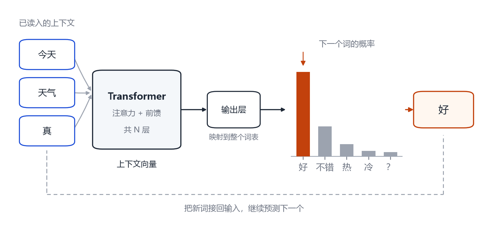
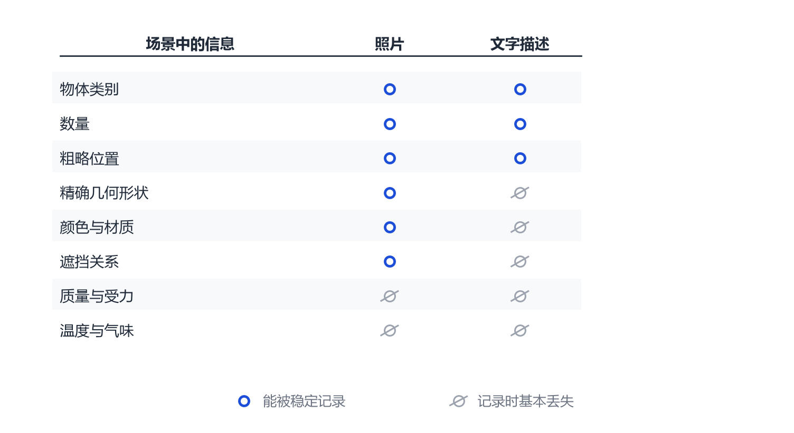

# 第 1 章　预测下一个词

在手机输入法里敲下“今天天气”四个字，候选栏会跳出“不错”“很好”“怎么样”。你按下其中一个，句子就完成了。这个再普通不过的动作背后，是一个概率模型在做它唯一会做的事：给定前面的文字，猜下一个词是什么。

过去十年里，这件事被做到了极致。模型从几千万参数长到几千亿参数，训练语料从几亿词长到几十万亿词，于是它能翻译、能写代码、能回答法律问题，甚至能模仿某位作家的笔调。人们习惯把这些能力统称为“智能”。可是当你问它“桌上的杯子被推到边缘会不会掉下去”，它给出的答案来自文字，而不是来自对桌子和杯子的任何一次观察。

这一章想说明的就是这个缺口在哪里。不是要否定语言模型，而是要看清楚它的目标函数把它带到了什么地方，又在哪里停下。

## 1.1 一个句子的概率

一句话出现的可能性，可以拆成一连串条件概率的乘积。设句子由词 $w_1, w_2, \dots, w_n$ 组成，那么

$$
p(w_1, w_2, \dots, w_n) = \prod_{t=1}^{n} p(w_t \mid w_1, \dots, w_{t-1}).
$$

这个等式不涉及任何假设，它只是概率论里的链式法则。它的意思是，只要有一个函数能够在看到前 $t-1$ 个词时给出第 $t$ 个词的概率分布，整个句子的概率就算得出来。语言模型要学的，正是这个函数。

训练目标因此变得非常干净。给模型一段真实文本，让它逐词预测下一个词，把每次预测的概率取对数再取负，加起来求平均，就得到交叉熵损失：

$$
\mathcal{L} = -\frac{1}{n}\sum_{t=1}^{n} \log p_\theta(w_t \mid w_1, \dots, w_{t-1}).
$$

模型参数 $\theta$ 沿着这个损失的梯度往下走。损失越小，说明模型给真实文本打的分越高。工程上常用的另一个指标叫困惑度，它是交叉熵取指数，含义是“模型在每一步平均要在多少个候选词之间犹豫”。困惑度为 10，大约相当于每步在十个词里挑一个。

交叉熵这个损失有一个性质，值得在进入下一节之前说清楚。它惩罚的是模型给正确答案分配的概率太低，而不是模型给错误答案分配了多少。一个模型可以同时认为“不错”有六成可能、“很好”有三成可能，只要真实答案是其中之一，损失就不算大。这条性质让模型在训练时不必在候选之间做非此即彼的决定，也让它能把“几个说法都说得通”这件事保留下来。

这里还有一个容易被忽略的细节：整个训练过程不需要任何人工标注。文本本身就是标签，前一个词是输入，后一个词是答案。互联网上有多少文字，就有多少条免费的训练样本。这是语言模型能够长到今天的根本原因。

## 1.2 从查表到注意力

最早的做法是数数。统计语料里“今天天气”后面出现过多少次“不错”，再除以“今天天气”出现的总次数，得到的就是条件概率。这叫 n-gram 模型，n 通常取 2 到 5。

数数的办法有一个致命问题。假设词表有一百万个词，那么三元组共有 $10^{18}$ 种组合，而任何语料里出现的组合都只是其中极小的一部分。绝大多数组合的计数是零，模型只能给它们零概率。语言是开放的，人每天都在造新句子，靠记忆历史片段无法覆盖。

神经网络的解法是把词变成向量。每个词对应一个几百维的实数向量，意思相近的词，向量也相近。这样一来，“今天天气不错”和“今日天气很好”虽然字面完全不同，在向量空间里却落在相近的位置，模型从前者学到的规律可以迁移到后者。这个想法在 2003 年由 Bengio 等人系统地实现，称作神经网络语言模型。

分词这一步值得单独提一句。模型处理的不是字符，也不是词，而是介于两者之间的词元。一个常见的中文词元表有四万到十五万条，生僻字会被拆成几个字节，常见词组会被合并成一条。切分方式决定了模型看到的世界有多粗。同一个句子，换一套词元表，模型要预测的序列就变了，它能注意到的规律也跟着变。所有后面的讨论都建立在这个离散化之上，这是语言模型的第一道约束。

真正让规模起飞的，是 2017 年提出的 Transformer。它的核心是注意力机制。处理句子中某个位置时，模型会向所有位置发出一个“查询”，每个位置拿出自己的“键”来匹配，匹配程度高的位置获得更大的权重，然后把这些位置的“值”加权求和，作为当前位置的新表示。写成公式就是

$$
\mathrm{Attention}(Q, K, V) = \mathrm{softmax}\!\left(\frac{QK^\top}{\sqrt{d}}\right)V .
$$

矩阵的形状说明了它在做什么。$QK^\top$ 是一个“谁该看谁”的打分表，softmax 把每一行变成概率，再乘上 $V$ 就是把信息按权重搬运过来。多头注意力只是把这个过程并行做几次，让不同的头关注不同的关系，有的头盯语法搭配，有的头盯指代，有的头盯远处的主题。

这一步的计算量随序列长度平方增长。序列翻一倍，要算的打分对翻四倍。上下文窗口从两千词元扩到十万，算力需求涨的不是五十倍，而是两千五百倍。这也是为什么长上下文在工程上那么贵，以及为什么模型对“开头说过什么”经常记不牢，注意力要在几万个候选里分配有限的权重。

注意力本身不区分位置，所以还要给每个词加上位置编码。再加上残差连接和层归一化，几十层网络才能稳定训练。最后的输出层把每个位置的向量映射回词表大小，经过 softmax 得到一个概率分布。整个过程如图 1-1。

<figure class="fig">

<figcaption><b>图 1-1</b>　下一词预测的流程。左侧的上下文被逐层编码，最后一个位置的向量经过输出层变成词表上的概率分布，采样得到下一个词，再把它接回输入，如此循环。</figcaption>
</figure>

图 1-1 里有一条回环的箭头，它标出了这类模型最关键的性质：生成是逐词的，每产出一个词，这个词就变成下一步输入的一部分。写文章、写代码、写对话，本质上是同一个循环在重复。

## 1.3 规模带来的意外

把模型变大、数据变多，损失会平滑下降。2020 年，Kaplan 等人发现这种下降在很大的范围内遵循幂律，用双对数坐标画出来接近直线。这条经验规律后来被称为缩放定律，它让“把模型做大”从一种赌博变成了一种可以预算的工程决策。

更让研究者意外的是能力的涌现。一个只被训练来预测下一个词的模型，在参数量超过某个量级之后，突然能做算术、能翻译、能根据几个例子学会新任务。GPT-3 有 1750 亿参数，训练语料约 3000 亿个词元，它没有为这些任务中的任何一个做过专门设计。

这些能力从哪来，目前没有公认的答案。有一种解释是，要把下一个词预测得足够准，模型不得不自己在内部重建文本背后的规律。语法是规律，事实是规律，逻辑推理也是规律。文本是这些规律的记录，学会压缩文本，也就学会了一部分规律。

这条曲线也解释了为什么“把模型做大”在几年里成了默认策略。损失对参数和数据都呈幂律下降，意味着多花十倍算力通常能换来确定的一截改进，投入和产出之间的关系是可以预算的。代价是这条路的边际收益在变小。高质量文本正在被用完，剩下的增量要靠合成数据、多轮筛选和更贵的数据清洗，而每一档规模提升都要重新走一遍训练。

这个解释有实验支持。研究者训练模型下黑白棋，输入只是棋谱的文字记录，模型从没被告知棋盘长什么样。训练完成后，从模型的中间层可以线性解码出棋盘的当前状态，连每个格子上有没有棋子都能读出来。模型为了预测下一步棋，自己发明了一个棋盘。类似地，在语言模型的中间层做线性探针，能读出词性、句法树、实体关系，甚至地理位置的方向。

## 1.4 文本是世界的影子

棋盘实验很漂亮，但它成立有一个前提：棋谱完整地记录了棋盘。每一步棋都写在记录里，世界状态和文本之间是一一对应的。凡是这样的领域，预测下一个符号就等于预测世界状态。

照片不是这样。一张厨房的照片里包含物体的形状、材质、遮挡关系、光照方向、物体之间的支撑与接触，而这些信息在“一个厨房的台面上放着杯子”这句话里几乎全部丢失。文字记录的是世界的一个投影，投影保留了轮廓，丢掉了深度。

<figure class="fig">

<figcaption><b>图 1-2</b>　文字是世界的一个投影。左侧是一个场景里实际存在的信息，右侧是能够被文字稳定记录的部分。颜色、材质、精确位置、受力关系在写成句子时大多丢失，而这些恰好是预测物理后果所需要的。</figcaption>
</figure>

图 1-2 想说明的是信息量的差距，不是文字的无能。文字在自己的范围内极其高效，它能表达抽象概念、传递意图、记录因果解释，这些恰恰是像素不擅长的。问题在于，一个只从文字里学习的世界模型，能看到的只是被人类语言筛过一遍的世界。

探针实验还有另一面，值得说清楚，免得把它读成“语言模型已经有世界模型了”。能读出方位、颜色、物体类别，说明这些信息在表征里存在，但存在不等于被使用。模型回答问题时用到的可能只是其中一小部分，其余部分是训练的副产品。更关键的是，读出来的都是静态属性，没有一条是“如果我这样做，会怎样”。因果和干预在文本里几乎不留痕迹，因为写文章的人只记录结果，不记录反事实。

后果很具体。语言模型可以说出“杯子被推到桌沿会掉下去”，因为这类句子在语料里出现过无数次。同一个模型在描述一张杯子悬在半空的图片时，也可能写出通顺的句子，因为在文字层面，“杯子在桌子上方”并没有什么不合法的地方。它没有那种“东西会往下掉”的直觉，只有“这些话常一起出现”的统计。

再举一个更细的例子。问模型“把一杯水放进冰箱，两小时后水会变多还是变少”，它能答对，因为蒸发、结冰、体积这些概念在文本里有大量讨论。但如果问“这杯水放在这块倾斜的玻璃板上，会不会滑下去”，答案取决于玻璃的倾斜角度、水的重量、杯子底部的材质、有没有水膜，这些量在文本里根本没有被记录。模型只能猜。

## 1.5 给它看图也不行吗

这里有一个绕不过去的反驳。现在的模型早就不只读文字了，它们能看图、能听声音、能处理视频。既然输入里已经有了像素，前面说的“文本是影子”是不是就不成立了。

要看清楚这件事，得看多模态模型内部发生了什么。一张图进来，先经过一个视觉编码器，被切成小块，每块变成一个向量，再经过一层投影压成几十到几百个词元，和文字的 token 拼在同一条序列里。接下来的事情和纯文本模型完全一样，仍然是预测下一个词元。图片被翻译成了一种特殊的“词”，然后进入同一个目标函数。

这条流水线里有两件事同时在发生，值得分开看。视觉编码器本身通常是自监督训练的，它确实在像素上工作，也确实学到了形状、材质、空间关系这类东西，DINOv2 一类的模型就是靠这个吃饭的。但把视觉特征接到语言模型上的那一步，靠的是海量图文对，训的是“这张图对应这段文字”。模型最后学到的是图文之间的统计对应，而不是“杯子在桌沿会掉”这样的物理规律。

信息也在这一步被压缩。一张 224 像素的图有十五万个数值，压成几百个词元之后，能保留的只是被图文对反复强化过的那部分。倾斜角度、摩擦系数、杯底和桌面之间的水膜，这些量在图文对里从来没有被标注过，压缩时自然留不下来。模型能说出“杯子可能会掉”，依据仍然是它读过多少类似的句子。

还有一个更细的证据。把同一个视觉问题用文字描述给纯文本模型，和把图片直接给多模态模型，两者的答案往往高度一致，连错误都一致。这说明图像通道提供的增量信息比想象中少，模型主要还是靠语言先验在答题。视觉在这里起的作用更像一个索引，帮你把问题定位到某段语言知识上。

所以换模态不等于换目标。只要训练信号仍然是“下一个词元”，模型就会继续把世界压成符号之间的关联。真正的改变要发生在目标这一层，也就是让模型去预测状态本身，而不是预测描述状态的词。

## 1.6 目标函数决定了学什么

把问题归到根上，会发现不是模型不够大，而是目标不一样。

下一个词预测的目标，是让文本的似然最大。任何能提高似然的东西都会被保留，包括真实的物理规律，也包括纯粹的文体习惯、套话、标点偏好。模型没有理由区分这两类知识，因为目标函数不区分。它甚至没有理由把“重力”表示成一个独立的变量，只要把“杯子”“桌沿”“掉”这几个词的联系记牢，预测就已经足够准了。

还有一层原因在数据本身。语言里很少出现精确的量和动作。“把杯子往左推了三厘米”这种句子，人在日常对话里几乎不说，写了也没人读。语料里充斥的是结果，而不是过程。模型能学到“推了会动”，学不到“推多大力动多远”，因为后者从未被写下来。

要让它必须理解世界，得换一个目标。不是问“下一个词是什么”，而是问“接下来世界会变成什么样”。这个问题有两个难点。第一，世界状态不是现成的符号，得先有一个表示。第二，未来往往不唯一，同一只手伸向杯子，可能拿起它，也可能推开它，模型要能表示这种多分支的可能，而不是被迫选一个。

这个目标还有第三个难点，比前两个更隐蔽。世界状态是连续的，而模型的输出必须是可比较的。要判断两个状态像不像，得先有一个度量；要在这个度量上做预测，得先保证它不会退化。语言模型不用操心这件事，因为词表天然给了它一个离散的、固定的坐标系。JEPA 没有这份便宜，它必须自己造一个坐标系，还要保证这个坐标系在训练中不会塌掉。这个麻烦会占掉后面好几章的篇幅。

这两个难点，正好对应后文要讲的两件东西：表征和预测器。把观察压成一个向量，再用一个网络预测“在这个向量上，世界会怎么变”，这套组合有一个名字，叫联合嵌入预测架构，英文缩写 JEPA。

## 1.7 一条岔路

JEPA 不是语言模型的对立面。它更像是把语言模型的目标换了个位置：从符号空间挪到表征空间，从“猜词”挪到“猜状态”。

这个改动看起来小，影响却很大。语言模型必须把一切都变成词，才能用同一个目标训练，于是图像要转成描述，动作要转成指令，连续的量要转成离散的符号。每一次转换都是一次信息损失。JEPA 不需要转换，它直接处理观察本身，图像就是图像，视频就是视频，动作就是动作，只要能把它们编码成向量。

代价是失去了语言模型那种“一本万利”的数据优势。文本是现成的、廉价的、几乎无限的；视频要采集，动作要执行，物理交互要真实的机器和时间。这也是为什么 JEPA 这条路走了几年，规模始终比语言模型小几个数量级。

后面几章会沿着这条岔路一步步走下去。先弄清楚“表征”到底是什么，再看自监督学习的三种做法，然后进入 JEPA 的内部结构，最后回到一个更大的问题：如果不同的模型真的都在描述同一个世界，它们学到的表征会不会是同一张地图。2026 年的一篇论文给出了肯定的答案，并且把它写成了定理。这正是本书后半部分的主题。
