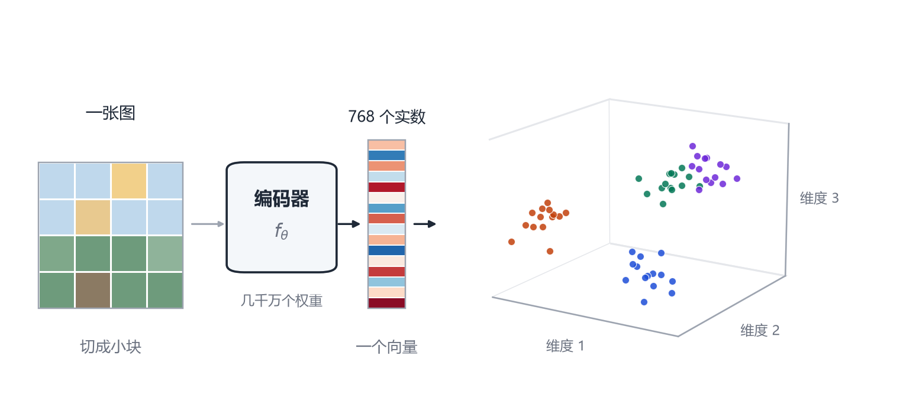
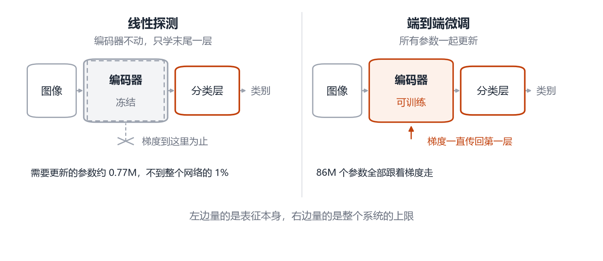
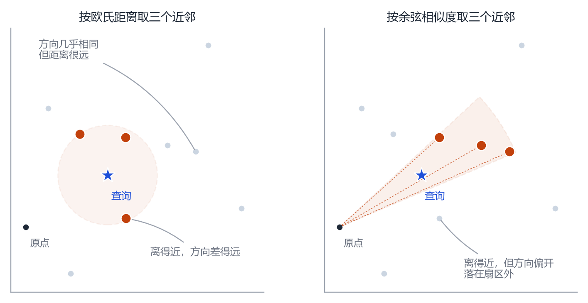

# 第 2 章　表征是把世界折起来

手机相册里有一个搜索框。输入“雪”，三年前冬天拍的几张照片被翻了出来，一张是雪地上的脚印，一张是结冰的窗，一张是夜里路灯下的雪片。没有人给这些照片打过标签，也没有人告诉过程序雪长什么样。

它做的事情听起来很朴素。把每张照片变成一串数字，再比较这些数字之间的远近。脚印那张和雪片那张的数字挨得近，和去年夏天海边的照片离得远。

一串数字凭什么能代表一张图？这一章想回答的就是这个问题。答案分两层，一层是映射，说清一张图怎么变成一个点；一层是几何，说清这些点的位置为什么有意义。

## 2.1　一张图变成一个点

图书馆的书脊上贴着一个索书号。它丢掉了书名、作者、封面颜色、纸张厚度，只保留一件事，这本书该插在书架的哪一格。想找一本书，你不用走遍全馆，顺着号码走到那一排就行。

索书号是有损的。两本毫不相干的书可能挨在一起，一本小说和一本小说史研究。但它够用，因为你要的从来不是还原这本书，而是在几十万册里快速缩小范围。

地铁线路图也是这样。图上两站之间的距离和真实距离没有关系，一号线和二号线被画成两条直线交叉。它丢掉了地理，保留了换乘关系。凭这张图你能规划路线，却没法知道两站之间要走几分钟。

这两个类比都在做同一件事，选择丢掉什么。索书号丢掉内容，地铁图丢掉距离，表征丢掉像素。丢什么不是随手定的，它由后面的任务决定。同一只猫从左前方拍和从右前方拍，两张图的像素值几乎没有一个对得上，但它们说的是同一只猫。一个称职的图像表征应该把这两张图放到很近的位置，把猫和沙发放到较远的位置。像素层面的差异是它该丢掉的，语义层面的差异是它该保留的。

表征（representation）这个词指的是同一个动作。编码器（encoder）是一个函数 $f_\theta$，把原始对象 $x$ 映射成向量

$$
z = f_\theta(x) \in \mathbb{R}^{d} .
$$

$x$ 可以是一张图、一段音频、一帧视频、一个句子。$\theta$ 是网络里几千万个权重，$d$ 是向量的维度。$z$ 就是 $x$ 的表征，也叫嵌入（embedding）或特征（feature），三个词在多数场合可以互换。

编码器不是查表。它没有把见过的图存起来，而是学了一套压缩规则，任何一张新图丢进去都能得到一个向量，包括训练时从没出现过的图。这套规则由几千万个权重编码，训练就是调这些权重。

以视觉 Transformer（Vision Transformer，ViT）为例。一张 $224 \times 224$ 的图被切成 $16 \times 16$ 的小块，每边 14 块，一共 196 块。每个小块先变成一个向量，经过若干层注意力互相交换信息，然后汇总成一个向量。切块本身也是一次取舍。块越大，位置信息越粗，细节丢得越多；块越小，序列越长，注意力的计算量按平方增长。16 这个数字是精度和成本之间的一次折中。ViT-Base 的这个向量是 768 维，整个模型 8600 万参数（ViT 论文表 1）。DINOv2 的 ViT-B/14 嵌入维度同样是 768，小一号的 ViT-S/14 是 384（DINOv2 论文表 17）。同一个 768，可以装一只猫，也可以装一整条街。

<figure class="fig">

<figcaption><b>图 2-1</b>　一张图变成空间里的一个点。图像被切成小块送进编码器，输出一列实数；右侧把这串数画成三维坐标，只取前三维，四种颜色是四个类别。散点为示意数据。</figcaption>
</figure>

如图 2-1，左边是一张被切开的图，中间是编码器，右边是这串数字在空间里的位置。这张图容易让人产生一个误解，以为向量里有一格专门记录“这里有个杯子”。实际不是这样，后面 2.4 节会细说。

真正需要记住的是右边那一簇点。同一类东西的点挤在一起，不同类的分开，这件事不是巧合，是训练目标逼出来的。表征的价值全部落在这种位置上，而不落在任何单个数字上。

## 2.2　距离和夹角

有了点，就有了比较。两个向量之间最常用的两种度量，一种看距离，一种看方向。

欧氏距离量的是直线距离

$$
\lVert z_a - z_b \rVert_2 = \sqrt{\sum_{i=1}^{d} (z_{a,i} - z_{b,i})^2},
$$

其中 $z_{a,i}$ 是向量 $z_a$ 的第 $i$ 个分量，求和遍历所有维度。余弦相似度量的是夹角

$$
\cos(z_a, z_b) = \frac{z_a^\top z_b}{\lVert z_a \rVert \, \lVert z_b \rVert},
$$

分子是内积，分母是两个向量的长度之积。夹角越小，余弦越接近 1；夹角 90 度时余弦为 0；方向相反时为 $-1$。

两个人从同一个路口出发，一个朝北走了一百米，另一个朝北走了一公里。余弦相似度说他们的方向完全一致，欧氏距离说他们隔了九百米。两个答案都对，只是回答的问题不同。前者问“他们是不是在往同一个方向走”，后者问“他们现在离得多远”。

以图搜图的系统把这件事做成了工程。图库里的每张图先编码成向量存起来，查询时把输入的图编码一次，然后在这堆向量里找最近的若干个。如果所有向量都归一化到单位长度，余弦相似度和欧氏距离给出的排序完全一样，因为此时

$$
\lVert z_a - z_b \rVert^2 = 2 - 2\cos(z_a, z_b).
$$

两者只有在长度不被约束时才会分道扬镳。归一化那一步通常只是一行代码，却决定了后面所有比较的含义。

深度学习里的表征比较，绝大多数用余弦。原因有两个。

一个原因是长度常常没有意义。网络里到处是归一化层，训练目标也经常显式地把向量拉到单位球面上，长度被这些操作抹掉了。剩下的信息全在方向上。这时候用欧氏距离，等于在一个长度已经被压平的坐标里量长度，量出来的东西不稳定。

另一个原因更根本，跟维度有关。在高维空间里随机撒点，任意两点的距离会趋近于同一个值。在 768 维里取 1500 对随机向量，两点距离的平均值是 39.18，标准差只有 0.96，相对波动 2.44%。所有点对看起来都差不多远，距离这个量失去了分辨力。方向没有这个问题，两个随机向量的夹角分布仍然铺得很开。

这两种度量的分歧不是学术趣味。任何靠“相似”做判断的系统，都得先选定一种，选定之后，它给出的答案就带着这个选择的偏向。

## 2.3　怎么衡量一个表征

一个编码器训练完了，怎么判断它学到的表征是好是坏？

最直接的办法是拿它去做下游任务，看准确率。但这里面有个陷阱。如果把编码器和分类器一起训练，编码器会为了这个任务改变自己，测出来的就是“这套系统能做到多好”，不是“这个表征本身有多好”。想单独考察表征，得把编码器冻住。

线性探测（linear probe）就是这么做的。编码器权重全部冻结，梯度不往回传，只在它输出的向量上接一个线性分类器，训练这个分类器。分类器能学的东西只有一件，给 768 个方向各配一个权重，再加一个偏置。如果这样一个几乎不会思考的模型就能把类别分对，说明类别信息在表征里已经是线性可分的，也就是已经被“摆平”了。

I-JEPA 的评测用的就是这个协议。自监督预训练结束后，编码器被冻住，研究人员在它上面训练一个线性分类器，用的是 ImageNet-1K 的完整训练集（I-JEPA 论文第 5 节）。

这个线性层要学多少参数？输入 768 维，输出 1000 类，一共 76.8 万个，占 ViT-Base 8600 万参数的 0.89%。不到百分之一。剩下那 99% 的能力，全部凝固在冻结的权重里，线性层只是把这些能力读出来。

<figure class="fig">

<figcaption><b>图 2-2</b>　线性探测与端到端微调的区别。左边编码器冻结，梯度停在半路，只训练末尾一层；右边所有参数一起更新。前者测量表征本身，后者测量整个系统。</figcaption>
</figure>

如图 2-2，两种用法并排放着。左边那条断掉的梯度箭头是关键，它保证了被测的东西在测量过程中不会变。

除了线性探测，还有几种常用的量法。k 近邻分类不做任何训练，直接看每个样本在表征空间里最近的 k 个邻居是什么类别，投票决定。检索任务用 R@1，意思是查询一张图，返回的第一条结果就是正确答案的比例。迁移学习则把编码器搬到另一个数据集上，看它需要多少标注才能追上从头训练。

k 近邻值得多说一句。它不训练任何参数，只是把空间里的局部结构直接读出来。如果一个表征的邻居全是同一类，说明它在局部是干净的；如果邻居里混进了奇怪的样本，说明那片区域被压扁了。这种方法便宜、直观，缺点是只看局部，看不出全局的类别边界在哪里。

邻居是谁，还取决于怎么算近。同一批点，用欧氏距离筛一遍，用余弦再筛一遍，得到的名单并不一样。

<figure class="fig">

<figcaption><b>图 2-3</b>　同一批点，两种度量选出不同的近邻。左图欧氏距离只看圆圈内的点，右图余弦只看扇区内的方向，星号是查询点。示意数据。</figcaption>
</figure>

如图 2-3，左图里右上方那个点和查询点的方向几乎一致，只因为离得远，没被选中。右图里正下方那个点离查询点很近，方向却偏开了二十多度，落到了扇区外面。同一批点，两份邻居名单。

这也解释了一件事。检索系统报告“找回了最相似的十张”，你得先问它用的是哪种相似。用欧氏距离，它会偏向整体亮度、对比度接近的图；用余弦，它会偏向构图和内容接近的图。两者都不是错的，只是筛选标准不同。

长度里也可能藏着信息。有些模型用向量的模长表示置信度或者罕见程度，这时候强行归一化反而丢东西。判断该不该归一化，看训练时有没有把长度约束掉。

另一种量法更接近真实使用。把一个在 ImageNet 上预训练的编码器搬到医学影像或者卫星图上，冻住大部分层，只解冻末尾几层，看它需要多少标注才能达到可用精度。标注越少、精度越高，说明这个表征携带的东西越通用。

这些指标测的是不同侧面，但背后的直觉是同一个。一个表征如果好用，语义上相近的东西在空间里就挨着，而且这种相邻关系能用简单的方式读出来。线性探测把这个直觉推到了极限，它要求相邻关系简单到一条直线就能切开。

反过来说，线性探测分数低，不一定说明表征差。有可能语义关系是非线性的，弯弯曲曲地绕在空间里，一条直线切不开。这时候换一个更强的探测头，分数会上去。所以线性探测给出的是下界，不是判决。

另外，同一个编码器在不同数据集上的线性探测分数也不能直接横比。类别数不一样，任务难度不一样，连输入分辨率都可能不一样。

## 2.4　维度不是概念

回到那个容易产生的误解。768 维的向量，是不是有 768 个格子，每个格子管一个属性？

不是。把训练好的 ViT 打开看，找不到哪一维专门对应“有没有耳朵”或者“是不是金属”。随机挑一维出来，它可能对“毛茸茸的”“在户外”“颜色偏暖”都有反应，而且反应的方向还不一样。

这种存法叫分布式表示（distributed representation）。一个概念不是某一维的值，而是很多维一起构成的一个模式。像一杯咖啡的香气，不是由某一个分子决定的，是几十种分子按比例混出来的结果。少一种，味道会变，但不会消失。

这种安排有一个直接后果，就是冗余。同一个信息会在多个维度上重复出现，稍微不同的组合。好处是抗噪，坏处是难解释。你没法指着某一维说“这就是狗”，只能指着一片方向说“往这边走更像狗”。

这种冗余还有一个更极端的版本，叫叠加（superposition）。当需要表示的概念数量远多于维度数量时，网络会把多个概念塞进同一批维度里，让它们各自占用不同的方向。代价是概念之间会有轻微干扰，收益是能装下远多于 768 个概念的东西。近几年用稀疏自编码器把这些叠加拆开，是目前可解释性研究的一条主线。

有一个简单的检验能说明信息是分散的。把向量的某几维随机置零，再跑线性探测，性能会平滑下降，不会突然崩掉。如果真是“一维一个属性”的存法，删掉关键那一维，对应的类别应该直接归零。实际观测到的曲线是缓坡，不是悬崖。

实践上这意味着两件事。第一，别指望从单个维度读出语义，那条路基本走不通。第二，维度数量不等于概念数量。384 维的 DINOv2 ViT-S/14 能区分的视觉概念，远多于 384 个。反过来，如果一个概念真的只占一维，它对噪声就毫无抵抗力，那一维被扰坏，概念就没了。分布式存法用冗余换来的正是这种韧性。

## 2.5　空间有形状

散点图容易给人一种错觉，以为表征空间是均匀铺开的。真实的表征空间不是这样。

数据在空间里占据的区域非常小，而且形状很怪。所有猫的图片挤成一条弯弯曲曲的带子，所有汽车的图片挤成另一条，两条带子在某些地方靠近，在另一些地方远离。这种“高维空间里的一张低维曲面”的假设，叫流形假设（manifold hypothesis）。它说的不是数据真的落在一张完美的曲面上，而是说数据的有效自由度远小于名义维度。一张 224×224 的彩色图有五万个像素、十五万个数值，能拍出来的内容却受限于物理世界的规律，自由度要小好几个数量级。

簇还有层次。狗和金毛的距离，小于狗和汽车的距离；狗和汽车的距离，又小于狗和云的距离。这层结构不是谁写进去的，是数据本身的相似关系在空间里的投影。检索系统能工作，靠的就是它。

流形之上还有方向。早期的词向量研究里有一个流传很广的演示，king 减 man 加 woman，结果最接近 queen。三个向量做加减，居然能算出第四个词。这类演示说明关系可以表示成一个固定的位移，性别这个语义差别在空间里对应一个大致恒定的箭头。

这个例子被过度宣传了。它在部分词上成立，在另一部分上不成立，结果对语料、词频、是否归一化都很敏感。换一个语料重训，成功的例子会换一批。把它当成“表征空间可以做算术”的证据，是把它当成了定律。

但它指向的东西是真的。如果某个语义变换在空间里近似是一个平移，那么一个线性模型就能完成这个变换。这正是线性探测能奏效的几何解释。语义被摆平，指的就是这件事，关系变成了方向，方向可以用矩阵乘出来。

## 2.6　目标函数塑造几何

到这里可以回答一个隐含着的问题。表征空间的样子是谁定的？

答案是对应的训练目标。同一批图片，换一个损失函数，得到的几何完全不同。

用分类目标训练，网络只关心一件事，让不同类别的点在空间里能被平面切开。类内的点可以散得很开，只要不越界就行。于是同一只猫在不同光照下的两张照片，可能被放到相距很远的位置，因为分类器不需要它们靠近。

用对比学习训练，目标变成让同一张图的两个增强视图靠近、让不同图的表征远离。这时候同一只猫的十几个变体会被拉成一个紧致的簇，簇与簇之间留出空隙。几何变成了一个个岛。

用重建目标训练，网络必须能还原被遮住的像素，于是纹理、边缘、光照这些细节都会被保留下来。表征里装了大量低级信息，语义反而被稀释。几何由像素相似度主导，两张颜色接近但内容不同的图会挨得很近。

三种训练目标，三种空间。这解释了一个常见的困惑。同一个模型在不同论文里报告的表征质量差那么多，是因为它们测的可能根本不是同一种东西。

同一个网络的不同层，几何也不一样。浅层的表征更像像素，保留边缘和颜色；深层的表征更像语义，丢掉了具体长相。做分割任务常从浅层取特征，做分类常从深层取。所谓“这个模型的特征”，其实是一族特征。

这也解释了迁移学习中一个反复出现的现象。在 ImageNet 上学到的表征搬到医学影像上，前面几层几乎可以直接用，后面几层往往要重训。浅层学的是边缘和色块，这些东西跨领域通用；深层学的是类别边界，换一批类别就不作数了。

于是“什么是好表征”就没有唯一答案。好这个字永远相对于某个下游任务。做细粒度分类，需要保留纹理；做语义检索，需要丢掉纹理。一个 768 维的 BERT-Base 和一个 768 维的 DINOv2 ViT-B，维度一样，装的东西完全不是一回事。

表征是把世界折起来。折法有很多种，每一种都保留了一部分褶皱，压平了另一部分。折得好不好，取决于你接下来要展开哪一面。

自监督学习要解决的问题，就是在没有标签的情况下，怎么定义“哪些东西应该相似”。这个定义一旦写下，空间的形状就定了。下一章讲三条已经走通的路。
