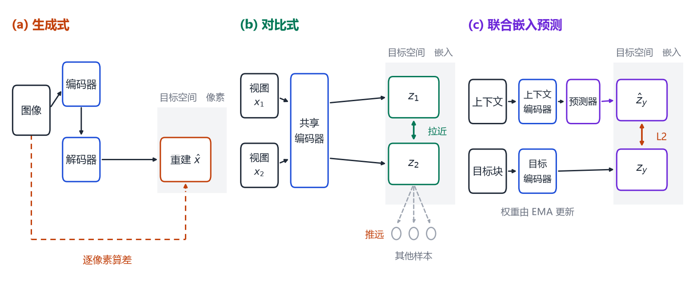
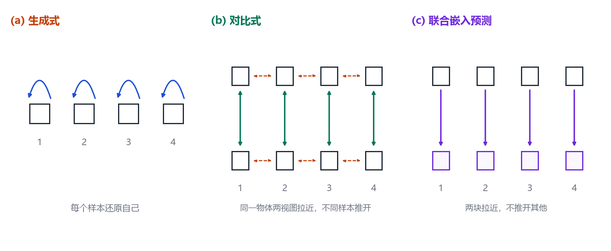

# 第 3 章　三条自监督路线

你手上有一块硬盘，装着一千万张照片，没有一张带标签。你想训练一个网络，让它以后能认出台面上的杯子、椅子和猫。监督学习在这里启动不了，因为它要求每张图配一个答案，而答案要人写。一千万张图，一张一秒，一个人不吃不睡也要写上将近四个月，写出来的还未必对。

人的眼睛不是这样学会看东西的。一个婴儿没有被谁标注过“这是杯子”，他看见杯子被推下桌沿，听见响，看见碎片。这些观察自己带着答案。答案不在图外面，答案在图里面。

把数据拆成两半，一半当输入，一半当答案，这就是自监督学习（self-supervised learning）。拆的办法不同，长出的路线也不同。这一章讲三条，生成式、对比式、联合嵌入预测式。

三条路线听起来差别很大，其实都在回答同一个问题，什么和什么应该相似。这个问题看着朴素，全书后面的内容都挂在它上面。

## 3.1 把答案从数据里拆出来

第一种拆法是遮。一张图遮掉中间一半，让模型还原那一半。这最像填空题，题干和答案来自同一句话，不需要任何外部知识。

第二种拆法是看两遍。同一张照片，一次裁左边，一次裁右边，一次调亮，一次调暗，得到两个版本，让模型认出它们同源。这种题没有标准答案的字符串，答案是一个等价关系。

第三种拆法也是遮，但不要求还原像素，只要求说出被遮住的地方在语义上是什么。还是半张脸，不画睫毛，只说那边有另一只眼睛和半个鼻子。

三种拆法对应三种损失。第一种算在像素上，第二种算在两个向量的相似度上，第三种算在一个向量和另一个向量的距离上。

桌上一副打散的拼图能把它们分开。生成式的做法是把每块拼图放回原位，评价标准是图案对不对得上。对比式的做法是拿两副同样的拼图分别打散，让模型判断哪两块来自同一副。联合嵌入预测式的做法是只看一角，让模型说出剩下的部分大概是什么图案，但不要求画出来。

这类人为设计的任务有个名字，叫代理任务（pretext task）。代理任务本身没用，谁也不需要模型真的把拼图拼回去。有用的是模型在完成它的过程中被迫记住的东西。选什么样的代理任务，等于选什么样的归纳偏置。遮住一块让人去补，模型学到的是纹理和局部连续性；让两个视图对齐，模型学到的是对裁剪和颜色不敏感的身份。同一批数据，换一个代理任务，学到的表征几何就换了一套。

三种做法都能学出东西，代价不一样。生成式把力气花在还原细节上，对比式把力气花在分辨样本上，联合嵌入预测式把力气花在抽象上。三者的骨架可以放在一起对比，如图 3-1。

<figure class="fig">

<figcaption><b>图 3-1</b>　三条路线的结构对比。三张子图共用一套画法，输入经编码器进入右侧的目标空间，差别在损失落在像素还是嵌入，以及要不要靠负样本把别的样本推开。</figcaption>
</figure>

图 3-1 的读法是从左往右。左边是观测，中间是网络，右边灰底的地方是损失落脚的空间。三条路线的第三个格子里装的不是同一种东西，这一点决定了后面所有的差别。

## 3.2 把遮住的部分画回来

生成式自监督的源头是自编码器（autoencoder）。结构极简，编码器把输入压成向量，解码器把向量还原成输入，损失是两者的平方差

$$
\mathcal{L} = \lVert x - D(E(x)) \rVert^2 .
$$

$E$ 是编码器，$D$ 是解码器，$x$ 是输入。这个目标有一个明显的漏洞。中间那个向量如果足够宽，网络可以学成恒等映射，把输入原样搬到输出，损失降到零，什么也没学到。所以自编码器必须有一个瓶颈，让向量比输入窄得多。瓶颈逼着网络做选择，哪些信息值得留下。

瓶颈的选择是门手艺。太窄，细节全丢；太宽，网络偷懒。2018 年的 BERT 提供了另一条思路，它不去压瓶颈，而是把输入的 15% 遮掉，让模型预测被遮住的词。图像上的版本叫 BEiT（BERT Pre-Training of Image Transformers），把图切成小块，遮掉大约 40%，让模型预测每块的离散编号。这些编号来自一个事先训练好的离散自编码器，所以 BEiT 的目标既不是像素也不是语义，而是一套人为定义的词表。那套词表的码本只有 8192 个编号，每块图被映射成其中一个。词表本身是在 2.5 亿张图上训练出来的，也就是说 BEiT 并不是完全从零开始，它借了一个已经看过大量图像的编码器。

掩码自编码器（Masked Autoencoder，MAE）回到了像素。2021 年，He 等人把图像切成 $16\times16$ 的小块，随机遮掉 75%，只把剩下的 25% 送进编码器，解码器再把整张图补出来。一张 224 像素的图切成 196 块，遮掉 75% 只剩 49 块进入编码器。

75% 这个数字值得停一下。BERT 的典型比例是 15%，此前视觉领域的工作大多在 20% 到 50% 之间。图像和文字不一样，图像高度冗余。遮得少的时候，周围四个邻居几乎能插值出答案，模型不需要理解任何东西。遮到 75%，邻居也一起没了，插值失效，模型只能靠“这里应该有个轮子”这类整体判断。原文的消融实验说，75% 对线性探测和微调都好，40% 到 80% 的区间都还能用。

为什么文字遮 15% 就够，图像要遮到 75%，MAE 的原文给了一个解释。语言是人写出来的信号，语义密度高，一句话里几乎每个词都承担信息，遮掉几个词，模型必须理解上下文才补得回来。图像是自然信号，空间冗余大，缺一块往往能从邻居插值出来，不需要理解物体和场景。比例得一直往上抬，抬到插值失效为止，任务才变得值得做。

这个设计还有一半在工程上。编码器只处理可见的块，被遮的位置不产生计算，遮罩标记只在轻量解码器里补上。损失也只算在被遮住的块上，可见的块不参与，因为它们的答案就摆在输入里。原文说这样能把预训练时间缩短三倍以上。

代价在目标函数上。损失算在像素上，模型就必须为每一个像素负责。同一片草地，早上和下午的阴影不同，一阵风吹过草叶的弯曲不同。这些差异在像素层面接近随机，学不到规律，只能记住。容量是有限的，花在草叶上的容量，就不能花在“这是一片草地”上。

再换一个更贴近直觉的例子。遮住一张人脸的右半边，你能说出右边应该有一只眼睛、半个鼻子、一段下颌线，你甚至能判断这个人大约在往左看。但你画不出每一根睫毛的走向，也画不出皮肤上每一处细微的反光。MAE 的训练目标要求模型把这些也画出来。它画得越准，说明记住的纹理越多，这不等于它理解得越好。

## 3.3 拉近与推远

对比式换了一个问题。它不问被遮住的是什么，它问这两个东西是不是同一个。

SimCLR（Simple Contrastive Learning of visual Representations）的流程很短。取一张图，做两次随机增强，裁剪、翻转、颜色抖动、模糊，得到两个视图。两个视图过同一个编码器，得到两个向量。损失要求这两个向量接近，同时要求它们远离同一批里其他图的所有向量。MoCo（Momentum Contrast）的改动在于负样本从哪来。它维护一个队列，把过去若干批次的向量存着当负样本，队列长度 65536，编码器用动量 0.999 慢慢更新，保证队列里的旧向量不会因为参数突变而失效。

推远这一步是这类方法的关键。如果只要求正样本对接近，把所有输入都映射成同一个向量就能让损失归零。这个问题叫表征塌缩，第 5 章专门讲。负样本给接近设了一个下限，你不能让所有东西都靠近，因为那样负样本也会靠近。

举个具体的例子。一张猫趴在窗台上的照片，裁一次剩猫头和窗框，再裁一次剩猫背和窗外的树。两个视图共享的东西只有一件，这是同一只猫在同一个窗台上。颜色抖动、模糊、翻转都在往同一个方向使劲，把与身份无关的变化抹掉，只留下身份。所以增强函数实际上是在替模型回答一个问题，哪些差异可以忽略。

队列的好处是把字典大小和批大小解耦。批大小受显存限制，字典大小不必。代价是队列里的向量来自旧参数的编码器，新旧编码器给出的向量不在同一个坐标系里，直接比较没有意义。动量更新就是让旧向量慢慢失效，而不是某一步突然失效。

损失函数叫 InfoNCE（Info Noise Contrastive Estimation），最早由 van den Oord 等人在 2018 年提出

$$
\ell_i = -\log \frac{\exp\left(\operatorname{sim}(z_i, z_i^{+}) / \tau\right)}
{\exp\left(\operatorname{sim}(z_i, z_i^{+}) / \tau\right) + \sum_{j=1}^{K} \exp\left(\operatorname{sim}(z_i, z_j^{-}) / \tau\right)} .
$$

逐个符号看。$z_i$ 是锚点，当前这张图的一个视图经过编码器得到的向量。$z_i^{+}$ 是它的正样本，另一张视图的向量。$z_j^{-}$ 是第 $j$ 个负样本，来自同一批里别的图。$K$ 是负样本个数。$\operatorname{sim}(u,v)$ 是两个向量的余弦相似度，先各自归一化到单位长度，再取内积。$\tau$ 是温度，一个正的小常数。$\ell_i$ 越小，正样本在 $K+1$ 个候选里被挑中的概率越高。

整个式子的形状是 softmax 加交叉熵。分母把正样本和所有负样本的指数放在一起求和，分子只有正样本。最小化它，就是让正样本的份额在候选里变大。

温度控制分布的尖锐程度。除以一个小的 $\tau$，指数把分数差距放大，softmax 几乎只盯住最难的那几个负样本；除以一个大的 $\tau$，分布变平，所有负样本分到差不多的权重。SimCLR 在 0.1、0.5、1.0 三个候选里选了 0.5。

负样本要多少。SimCLR 把批大小从 256 一路加到 8192，一个批里 8192 张图，两张视图，于是每个正样本对配 16382 个负样本。这个数字解释了对比学习早期为什么那么吃显存。MoCo 用队列绕开了它，队列里的 65536 个向量不必同时参与反向传播。

代价在增强函数上。增强定义了什么是同一张图，也就定义了模型应该忽略什么。裁剪是最强的一种，它告诉模型位置不重要；颜色抖动告诉模型颜色不重要。这些假设在很多场景成立，在另一些场景不成立。一张图裁得太狠，两个视图可能只剩两块草地，模型学到的是草地和草地相似。

还有一个麻烦。负样本是从同一批里随手取的，取到同一类的概率不低。一张猫的图当锚点，负样本里可能正好有另一只猫。目标要求把它们推开，可它们本来就应该靠近，这个矛盾叫假负样本。批越大，撞上的机会越多，所以这条路线在细粒度任务上总差一口气。

## 3.4 只预测表征

第三条路线把目标从像素挪到向量。

I-JEPA（Image Joint-Embedding Predictive Architecture）里有两个编码器和一个预测器。上下文编码器看图像的一部分，目标编码器看另一部分，预测器从上下文的向量出发，猜目标那部分的向量。损失是两个向量的 L2 距离

$$
\mathcal{L} = \lVert P(E_{\text{ctx}}(x)) - E_{\text{tgt}}(y) \rVert^2 .
$$

$E_{\text{ctx}}$ 是上下文编码器，$E_{\text{tgt}}$ 是目标编码器，$P$ 是预测器，$x$ 是可见的上下文块，$y$ 是被遮住的目标块。目标编码器的权重不走梯度，而是跟着上下文编码器做指数滑动平均，这条规则在第 8 章细讲。

和 MAE 比，区别只在右边那一项。MAE 要求还原像素 $y$，这里要求逼近 $E_{\text{tgt}}(y)$。像素里有一根草的弯曲，向量里没有。目标编码器把一根草压成“这里有一片绿色的东西”，预测器只需要猜到这个程度。

预测器是一个窄的 ViT，宽度比编码器小得多，它接上下文编码器的输出，还接一组位置标记，告诉它该猜哪个位置上的块。位置必须显式给进去，否则同一个上下文可以对应很多个目标块，模型无从下手。窄是故意的，预测器太宽，它自己就能把任务做完，上下文编码器反而学不到东西。

这套结构里没有解码器。输出不是给人看的图像，而是一个向量，只在训练时用来算损失。训练结束，预测器通常被丢掉，留下的是上下文编码器。

和对比式比，区别在没有负样本。分母那个求和项消失了，剩下的只是两个向量之间的距离。这看起来应该立刻塌缩，把所有输入映射成同一个向量，距离就是零。实际没有，原因在目标端在动。目标编码器是上下文编码器的滑动平均，它慢半步。上下文编码器想塌缩到常数时，目标端还停在塌缩之前的位置，预测误差反而变大。这个机制不完美，但足以让训练走下去。

风险也在这里。这类方法对超参数敏感，滑动平均的系数、预测器的宽度、批大小，都会影响它是否塌缩。第 5 章讲塌缩的机制，第 6 章讲几种防塌缩的设计。

## 3.5 三个问题把它们分开

三条路线的骨架其实很像，都是输入过网络，得到一个东西，再和另一个东西比。差别集中在三个问题上。

损失算在哪个空间。生成式算在像素或离散词元上，对比式和联合嵌入预测式算在嵌入上。这个区别决定了模型必须为哪些细节负责。

有没有显式的负样本。对比式有，而且要多；另外两条没有。没有负样本的路线必须用别的办法防塌缩，停梯度、滑动平均、白化，都属于这一类。

目标从哪来。生成式的目标是输入自己，对比式的目标是同一个输入的另一个版本，联合嵌入预测式的目标是另一部分的表征。三种目标携带的信息量依次减少，但第三种最接近理解。

<figure class="fig">

<figcaption><b>图 3-2</b>　三种目标各自把哪些样本拉近。四个样本编号 1 到 4，实线表示拉近，虚线表示推远。生成式只让样本回到自己，对比式还要推开别人，联合嵌入预测式不推。</figcaption>
</figure>

图 3-2 里最值得看的是 (b) 和 (c) 的差别。两张图的实线一样多，都是一个样本内部的两条观测连在一起，区别只在于有没有那些虚线。负样本不是可有可无的补丁，它是整个目标函数成立的前提。

把三个问题对着三条路线各问一遍，得到表 3-1。

**表 3-1**　三条自监督路线的对比。目标空间决定模型要为哪些细节负责，负样本决定它靠什么防止塌缩。

| 路线 | 目标空间 | 负样本 | 典型方法 | 主要风险 |
|---|---|---|---|---|
| 生成式 | 像素或离散词元 | 不需要 | 自编码器、MAE、BEiT | 容量花在不可预测的细节上 |
| 对比式 | 嵌入 | 需要，且要多 | SimCLR、MoCo | 依赖数据增强，负样本成本高 |
| 联合嵌入预测式 | 嵌入 | 不需要 | BYOL、I-JEPA | 表征塌缩 |

三条路线不是互斥的。BEiT 的目标是离散词元，位置在像素和表征之间。data2vec 预测的是深层特征，形式上已经是联合嵌入预测。MAE 的编码器可以直接拿来当 I-JEPA 的上下文编码器，两者对编码器的要求几乎一样。

一句话概括它们的共同点，三条路线都在定义一个正样本对的分布，然后决定怎么处理负样本。生成式的正样本对是图和它的残缺版，对比式的是图的两个增强版，联合嵌入预测式的是图的两个部分。负样本怎么处理，决定了这个目标会不会塌缩。

成本结构也不一样。生成式贵在解码器，它要把整张图铺开算；对比式贵在负样本，显存和批大小绑在一起；联合嵌入预测式贵在稳定性，超参数不对就塌缩，得反复试。选哪条路线，往往不是看哪个理论更漂亮，而是看手上有什么。

## 3.6 不要把 JEPA 读成预测未来

JEPA 里的预测容易被读成预测未来。在 I-JEPA 里，被预测的是同一张图的另一个块。上下文块和目标块来自同一时刻，没有时间差。模型学到的是这个场景的这一部分和那一部分在语义上怎么对应，不是接下来会发生什么。

这个区别不小。如果目标真是预测未来，模型就必须知道动力学，知道杯子被推会移动，知道球会往下掉。I-JEPA 的训练目标没有这么强，它只要求空间上的可预测性。一张静态照片里的语义结构，就足够训练它。

预测未来是这套架构在世界模型里的用法。把另一块换成下一帧，把同一张图换成同一段视频，把目标编码器换成动作条件下的预测器，JEPA 就成了世界模型。第 9 章到第 11 章走的是这条路。

这个误读还会带来一个具体的后果，以为 JEPA 必须先有视频才能训练。静态图像已经足够，因为一张图里就有很多个可以互相预测的部分。桌上的杯子、杯子底下的桌面、桌面旁边的椅子，它们的表征之间有关系，这个关系就是可学的信号。视频只是把这种关系从空间扩展到了时间。

还有一个细节能说明它为什么这样设计。I-JEPA 的目标块要选得够大。块太小，模型可以靠周围的纹理插值猜出目标块的向量，任务变得太容易，学到的表征也就停在纹理层面。这和 MAE 需要 75% 的高掩码比例是同一个道理，题目太简单，模型就抄近路。

三条路线走到这里，问题已经收窄。生成式要还原细节，对比式要分辨样本，联合嵌入预测式只要两个向量对齐。第三种最省，也最危险。

省在哪里已经说过，不需要解码器，不需要负样本，不需要为像素负责。危险在哪里也露了头，只要求两个向量对齐，最优解可以是所有输入都输出同一个向量。这个解让损失完美，让表征一文不值。

要把这个危险看清楚，得先把“对齐”写成一个可以最小化的量。下一章从一副拼图开始，讲能量。
