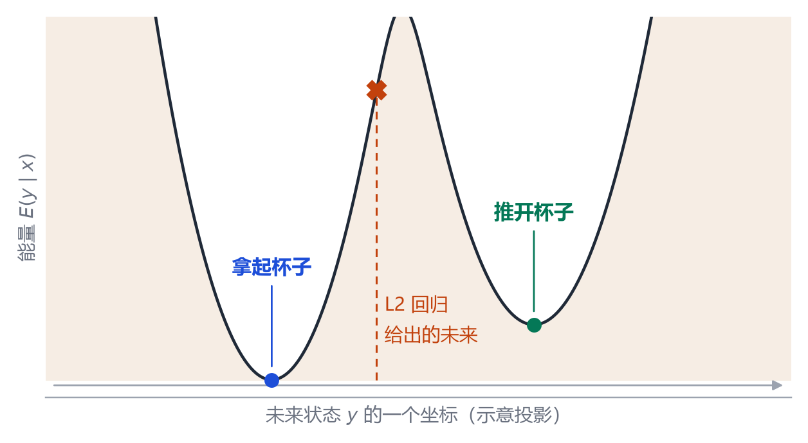
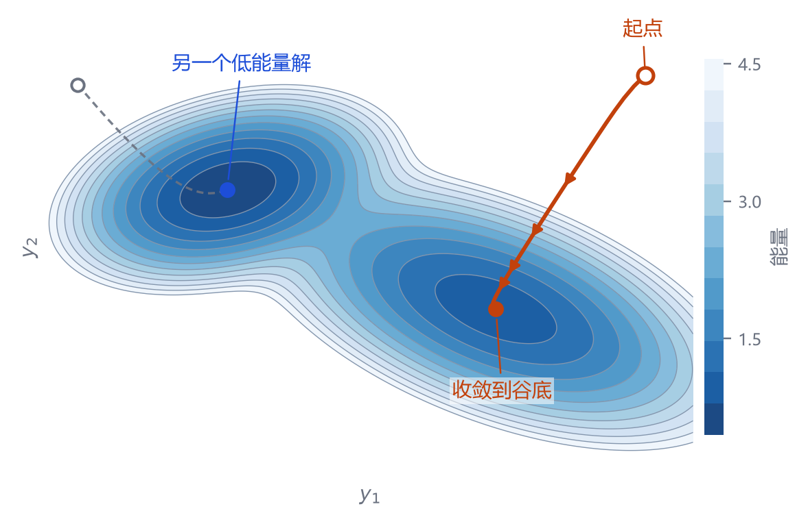

# 第 4 章　用能量衡量兼容

桌上摊着一副没拼完的拼图。你拿起一块，试着往几个空位里塞，角度不对就卡住，直到某一次，凸起滑进凹槽，边缘严丝合缝，你停手了。这个判断发生得很快，快到你不觉得它在计算。可如果要把它写下来，写下来的会是一个数，这一块放在这里的合适程度。

合适程度是个标量。它不需要是一张图，不需要一段解释，只要一个数，就能把“这两样东西配不配”说清楚。配得上，数小；配不上，数大。把“数小”叫成能量低，这套说法就有了名字。

拼图只有两块，候选位置也就那么几个。换成预测，麻烦立刻出现。给定现在，未来的候选有无穷多个，你得给每一个打分。这一章讲的就是这个打分函数，以及它为什么比“回归出一个点”更适合描述未来。

## 4.1　合适是一个标量

把打分写成函数，记作 $E(x,y)$，输出一个实数。$x$ 是给定的那一半，可以是一张照片、一段上下文、一只伸向杯子的手；$y$ 是候选的那一半，可以是一个未来、一句回答、另一块拼图。$E$ 小表示两者兼容，$E$ 大表示不兼容。

这个函数没有任何附加约束。不必非负，不必归一化，不必有下界。物理学里的能量有守恒律，有单位，有量纲，这里的“能量”只是借来的名字。它的全部含义就是排序，谁比谁低。

插头和插座是个好例子。对的插头插进去，两个金属片贴合，能量低；拿两个插头对着顶，谁也进不去，能量高。注意这个分数只在自己内部有意义。把所有分数加 100，排序不变；乘 2，排序也不变。所以单个数值没有含义，差才有含义。这一点后面会变成一句很实用的话，比较两个候选的时候，不需要知道概率的绝对值。

顺带说一句，兼容不一定对称。钥匙能开锁，锁开不了钥匙。$E(x,y)$ 和 $E(y,x)$ 可以是两个完全不同的函数，写成条件能量 $E(y \mid x)$ 就已经承认了这一点。给定现在去看未来，和给定未来去反推现在，难度差得很远。

同一个“兼容”还能在不同的地方衡量。两张图配不配，可以在像素上算差值，也可以先各自压成向量再算距离。选哪个空间，等于选在哪个层面上定义“像”。像素层面会把“同一只杯子换了个角度”判成不兼容，向量层面可能判成兼容。能量函数定义在哪个空间，决定了它认为什么差异重要。

实际用的能量函数都带参数，写成 $E_\theta$，$\theta$ 是网络的权重。它可以是一个把 $x$ 和 $y$ 拼起来、直接吐一个数的网络，也可以是两个编码器加一个距离。前者灵活，后者省算力，而且在推理时更容易对 $y$ 求梯度。两种形态在文献里都常见，选哪种取决于你更缺灵活还是更缺速度。

那为什么不直接用概率？因为概率要求归一化，归一化要求把整个空间里的分数都算一遍。给一个候选打分是局部的事，便宜；把分数变成概率是全局的事，昂贵。工程上先做便宜的那一半，这就是能量模型的做法。

## 4.2　能量换算出概率

能量和概率之间有一座桥，写成这样

$$
p(x) = \frac{e^{-E(x)}}{Z}, \qquad Z = \int e^{-E(x)}\,\mathrm{d}x .
$$

$E(x)$ 是能量，$e^{-E(x)}$ 把“越低越好”翻译成“越大越好”，同时保证结果是正数。$Z$ 叫配分函数，它把所有 $x$ 的 $e^{-E(x)}$ 累加起来，作用只是让概率的总和等于 1。$x$ 如果是离散的，积分换成求和。

用指数而不是别的单调函数，有一个具体理由。假设一个对象由两部分组成，两部分互不影响，那么整体的能量是两部分之和，整体的概率是两部分之积。指数正好把加法变成乘法，这个性质在把多个约束拼成一个模型时天天要用。

$Z$ 的问题在于它是一次全空间积分。一张 256×256 的彩色图有将近二十万个维度，这个积分没有任何办法精确计算，蒙特卡洛采样也只能覆盖其中极小的一块。所以能量模型从不真的去算 $Z$。它只学 $E$，把 $Z$ 留在式子里当摆设。

这里有一件事值得单独说：评估比生成便宜。给一个候选打分只需要一次前向传播，而生成一个样本要在这张地形上反复搜索、反复打分。判断比创造便宜，这条不对称在能量框架里是结构性的，也是它适合做规划的原因。

比较两个候选时，摆设就消掉了。把两个概率相除，$Z$ 约掉，只剩能量的差，$p(y_1)/p(y_2) = e^{-(E(y_1)-E(y_2))}$。这句话是整章的技术核心。只要关心相对高低，配分函数可以完全不管。反过来，两个候选的能量差就是对概率比取对数，差 0.7 大约是两倍，差 2.3 大约是十倍。

配分函数算不出来，逼出了几条路。一条是只学相对高低，用成对的样本做比较，这就是对比学习。另一条是对能量求导再想办法匹配，绕开 $Z$，这类做法在生成模型里叫得分匹配。还有第三条路是采样，按 $e^{-E}/Z$ 这个分布抽一个 $y$ 出来。它同样绕开了 $Z$ 的具体数值，只让一条马尔可夫链的稳态分布等于目标分布，链条跑够了，抽出来的样本就服从那个分布。

还有一个温度参数常被省略。写成 $e^{-E/T}$，$T$ 大，分布被抹平；$T$ 小，分布变得尖锐。习惯上取 $T=1$，把它吸收进 $E$ 的定义里，后面不再提。

## 4.3　固定现在，看未来的地形

预测用的是条件能量，记作 $E(y \mid x)$。$x$ 是现在，$y$ 是候选未来。固定 $x$ 之后，$E$ 就退化成 $y$ 上的一个普通函数，也就是一张地形图。预测这件事，变成了在这张图上找低处。

杯子在桌沿，一只手从右边伸过来。候选一，手握住杯子往上抬，杯子离开桌面。候选二，手把杯子往左推，杯子贴着桌面滑走。候选三，杯子悬在原地不动，手从它中间穿过去。前两个能量低，第三个能量高，因为手穿过固体这件事在训练数据里从没出现过。把这些候选按能量高低排开，就得到一张地形图，如图 4-1。

<figure class="fig">

<figcaption><b>图 4-1</b>　一维能量地形。横轴是把未来压到一个坐标上的示意投影，两个谷对应拿起杯子和推开杯子两种合理未来，谷底深浅不同。两谷之间的高墙上，L2 回归给出的条件均值正落在那里。</figcaption>
</figure>

真实未来是几百维的向量，压到一个坐标上只为画得出来，所以横轴只是一个示意投影。两个谷就是两种合理未来。谷底深浅不同，深的那一个更可能发生，在这个示意里两谷能量差 0.50，按 $p \propto e^{-E}$ 折算，概率相差约 1.65 倍。两谷之间是一道高墙，墙顶对应“手一半在拿一半在推”的状态，物理上不成立，能量很高。

这张地形不是物理引擎算出来的，是从数据里学出来的。见过很多次“手抬起杯子”，那片区域就被压低了；从没见过“手穿过杯子”，那片区域就留得很高。地形的准确程度取决于数据覆盖了哪些情形，没覆盖到的地方，能量值基本是网络的外推，不可信。

条件能量有两种常见写法。一种把 $x$ 和 $y$ 拼在一起送进网络，网络直接吐一个数。另一种先用两个编码器把 $x$、$y$ 各自压成向量，再在向量之间算距离，能量等于 $E(s_x, s_y) = \lVert s_y - P(s_x) \rVert^2$，$s_x$ 和 $s_y$ 是两个表征，$P$ 是预测器。这样定义的能量，地形是围绕 $P(s_x)$ 的一圈圈同心等高线，谷底就是预测器认为“应该在这里”的那个点。这种写法省事，但它只有一个谷，预测器一旦用平方误差训练，谷底就落在条件均值上。4.6 会说明这个谷底为什么可能是最糟的位置。

条件 $x$ 给多细，同样影响地形的形状。给整张图，模型得自己找出哪些像素和未来有关；给一个已经压好的表征，地形直接在语义层面铺开，细节被丢掉了。条件太粗，不同的现在会被混成同一张地形，本该分开的谷连成一片；条件太细，地形会跟着噪声抖动，同一个情形稍微换个光照就换了形状。粗细之间要有个取舍，这个取舍在 JEPA 里表现为“预测在哪个空间里做”。

这张图最该被记住的不是谷的形状，而是低点不止一个。一个函数在 $y$ 上有多个局部最小，这是本章后面所有麻烦的来源，也是它的价值所在。单峰的损失函数只能表达“唯一正确答案”，多峰的地形才能表达“几种未来都行”。

## 4.4　推理就是往下走

如果 $y$ 是连续向量，找低点最直接的办法是梯度下降

$$
y \leftarrow y - \eta \,\nabla_y E(y \mid x) .
$$

$\eta$ 是步长，控制每步走多远。$\nabla_y$ 是对 $y$ 求梯度，它指向能量上升最快的方向，前面加一个负号，就成了下降最快的方向。反复迭代，点就滑进最近的谷。二维的样子如图 4-2。

<figure class="fig">

<figcaption><b>图 4-2</b>　二维能量等高线与梯度下降轨迹。颜色越深能量越低，两条轨迹从不同起点出发，各自落进一个谷，说明推理落到哪里取决于从哪里出发。</figcaption>
</figure>

等高线围出两个盆地，颜色越深越低。一条轨迹从右上出发，一路下坡进右边的谷；另一条从左上出发，进了左边的谷。两边看着差不多，落点却完全不同。这不是算法有缺陷，是地形本身的性质。

梯度下降只保证走到某个局部最小，不保证走到全局最小。地形有几个谷，就有几种落点，图 4-2 已经把这个事实摆在眼前。工程上的应对是并行放很多起点，或者在下坡途中加一点噪声，让点有机会翻过矮的脊再滑下去，噪声幅度随时间减小。还有一类做法是先学一个提议分布，让它专门往低能量区域送候选，再在候选里挑。三种办法都在做同一件事，用额外的算力换“不漏掉谷”。

还有一个区别常被忽略。取最小值只给一个答案，采样给一批答案。下游如果只需要一个具体动作，取能量最低的就够；下游如果要评估风险，需要知道低能量区域有几个、各有多宽，那就得采样，让每个谷按它的概率被访问到。

如果 $y$ 是离散的，一句话、一个动作序列、一个棋盘局面，梯度无从谈起，只能用搜索和采样。beam search 保留若干条最优前缀，模拟退火允许偶尔往高处走以跳出局部极小，马尔可夫链蒙特卡洛按能量构造一条会停在低处的随机游走。工具不同，目标一样，都是在这张地形图上找低点。

真实系统里这套东西已经在跑。V-JEPA 2 的动作条件世界模型（V-JEPA 2-AC）把能量定义成“想象 $T$ 步之后的状态表征”与“目标图像的表征”之间的距离，用的是 L1 距离，见论文第 10 页的公式 5。规划就是对这个能量做最小化，采样一批动作序列，用交叉熵方法迭代收紧分布，取能量最低的那条，执行第一步，看一眼新画面，再重新规划。作者报告说这个能量面“相对平滑且局部凸”（图 9，第 13 页），机械臂末端能进到目标位置 4 厘米以内（第 12 页）。能量面好不好走，在工程上是要交代的事，因为它决定了搜索要花多少步。

执行第一步就丢掉剩下的计划，再拿真实观察重新算一遍，这个做法叫滚动时域控制。理由很直接，世界模型一定会飘，预测得越远越不准。与其一次算二十步然后闭眼执行，不如每一步都用真实画面校正一次。

生成也能这么看。扩散模型从一团噪声出发，每一步把样本往概率高处挪一点，等价于在能量面上往下走一小段。这条联系解释了两件看起来无关的事为什么能互相借工具。

## 4.5　学习是把对的那一侧压下去

能量函数里有一堆参数，学习就是调这些参数，让正确的配对能量低，错误的配对能量高。

只做前一半会出事。把所有正确配对的能量都压到很低，最优解是把 $E$ 变成常数，处处为零，这时损失为零，函数却什么也没学到。只做后一半也会出事，把所有错误配对的能量抬到很高，最优解是 $E$ 处处很大。两种极端都退化成“没有信息”，只是退化的方向相反。

所以损失必须成对出现。同一个 $x$ 之下，正确的 $y$ 要比错误的 $y$ 低，而且要低出一个间隔。一个常见写法是把 $-E(x,y)$ 当成未归一化的对数概率送进交叉熵，损失是 $-\log \frac{e^{-E(x,y^{+})}}{\sum_i e^{-E(x,y_i)}}$，$y^{+}$ 是正确的那一个，分母里的 $y_i$ 包括正确样本和一批负样本。这个式子和第 3 章的 InfoNCE 是同一个东西，只是把“相似度”换成了“负能量”。相似度高就是能量低。

另一种写法更直接，要求正确配对和错误配对的能量差超过一个余量 $m$，写成 $\max(0, m + E(x,y^{+}) - E(x,y^{-}))$。余量防止模型把差距压到刚好为零就收手，也防止训练后期梯度消失。

负样本从哪来，是个工程问题。图像可以从同一批数据里取别的样本，文本可以从同一个句子里取别的词，视频可以从同一段视频里取别的时间点。取错了，能量会被推到不该高的地方，这叫假负样本，它会把地形压出一个假的坑。

这里还有一件容易被绕过去的事。L2 损失本身就是一种能量，$E(x,y) = \lVert f(x) - y \rVert^2$，$f$ 是预测网络。它的地形是一个以 $f(x)$ 为底的抛物面，只有一个谷，而且谷底位置由平方误差的最优解决定。单峰意味着它只能表达一个正确答案，这正是下一节要处理的问题。

换个说法会更清楚。JEPA 的训练损失看上去只是“把预测拉近目标”，实际动作是在能量面上给正确的位置挖坑，同时把别处垫高。挖坑需要负样本，或者需要别的机制来代替负样本。第 6 章讲的那些技巧，白化、停梯度、动量教师，全都是在没有负样本的情况下防止地形整体塌下去的办法。

## 4.6　为什么平均值不是答案

L2 回归是最常见的预测损失，它的最优解有一个闭式答案

$$
f^{*}(x) = \mathbb{E}[y \mid x] .
$$

$\mathbb{E}[\cdot \mid x]$ 表示在“现在为 $x$”的条件下对 $y$ 求期望，也就是把每个候选未来按它的概率加权平均。数学上这个结论没有问题，最小化平方误差的解就是条件均值，一步推导就能得到。

问题出在“均值”这个词在多峰分布上没有意义。图 4-1 里两个谷分别在 -1.20 和 1.12，按各自的概率加权，均值落在 -0.27，正好在两谷之间的墙上，能量 2.63，是深谷 0.50 的五倍多。回归模型给出的正是这个点。它同时得罪了两个正确答案，还落在物理上不成立的地方。

图像上的后果更直观。两个未来分别是“手抬起杯子”和“手把杯子推开”，把两张图逐像素平均，得到的是一只半透明的手穿过一只半透明的杯子。这个结果在平方误差意义下是最优的，在任何一个别的意义上都不是“一个可能的未来”。

行人预测是老例子。一个人站在路口，下一步可能左转也可能右转，各占一半。L2 回归给出的是原地不动。模型在训练集上的损失很小，因为平均值离两个答案都不远，但没有任何一个真实未来长得像平均值。

还有一个更隐蔽的后果。单点输出的模型在训练集上损失很低，在验证集上也未必难看，因为平均值对两个答案都不算太远。指标上看不出问题，用起来才发现模型从来不给一个能执行的答案。这类失败不会报错，只会让下游行为变得犹豫。

反过来看，如果给定 $x$ 之后未来确实只有一个答案，比如预测一个已经确定了的物理量，L2 就是合适的。问题不在 L2 本身，在于把它用在了多峰的条件分布上。分类任务没有这个困扰，因为交叉熵比较的是分布，不是点。

处理多峰有几条老路。把连续的未来切成若干格子，把回归改造成分类，交叉熵天然能表达多峰。或者让模型输出若干个假设，每个假设配一个概率，训练时只惩罚离真相最近的那个。两条路都要预先决定峰有几个，而真实的未来分几个岔，事先并不知道。

能量视角给出的解法更自然。不要逼模型输出一个点，让它输出一个函数。推理的时候在这个函数上找低点，找到几个就是几个，多峰的地形正好能表达“未来不唯一”，而回归的头只能表达一个点。JEPA 在表征空间里做预测，用能量式的目标训练，动机就在这里。

在表征空间里做预测，均值问题会变轻，但不会消失。两个未来的表征如果差别很大，它们的平均仍然是一个谁也不像的向量；如果差别只体现在像素细节上，比如同一只杯子换了光照，表征的均值可能仍然是一个合理的状态。这就是为什么把预测目标放在表征上，比放在像素上划算得多。

能量视角也有软肋。地形是靠训练数据堆出来的，如果目标只压正确样本，没有机制把别处垫高，整张地形会一起塌下去，所有点的能量都变低，低成一片平地。这时候损失很小，地形却没有形状，模型对任何输入都给出同一个答案。下一章讲这件事，它的名字叫塌缩。
