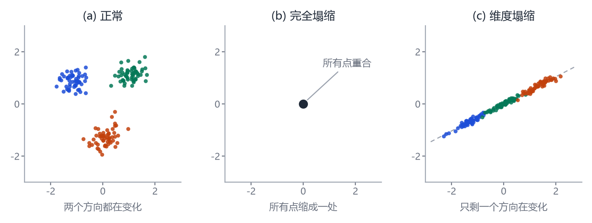
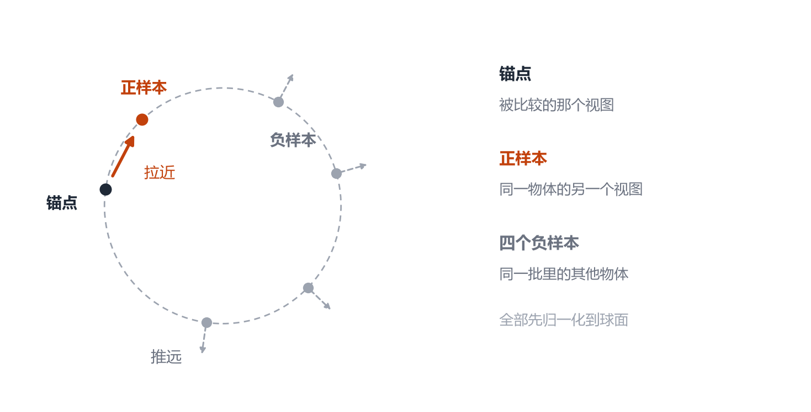

# 第 5 章　塌缩

晚自习两个人被安排做同一份卷子，老师改卷的方式很省事，只看两份答案像不像，像就给满分。这时候最省力的做法不是各自把题算对，而是一个人写，另一个人照抄。如果连抄都懒得抄，两人在每道题后面都写一个 0，同样能拿满分。

自监督学习里有一类方法，评分标准和这位老师一样。取一张照片，裁一刀、调一下亮度，得到两个视图。两个视图各自过编码器，变成两个向量。损失函数量的是这两个向量之间的距离。训练要做的就是把距离压到零。

这条路有一个平凡解，而且它离得很近。把所有输入都映射成同一个向量，距离处处为零，损失一步到底。编码器没有坏，训练也没有崩，它只是找到了目标函数真正在奖励的东西。这个现象叫塌缩（collapse）。

这一章讲三件事。塌缩为什么是目标函数的结构性后果，它有哪两种形态，以及人们用哪三类办法把它挡住。每类办法内部怎么运作，留给下一章。

## 5.1　常数解是全局最优

把上面的流程写成式子。设编码器是 $f_\theta$，一张图 $x$ 经过两次随机增强得到 $x_1$ 和 $x_2$，损失取两个嵌入的平方距离

$$
\mathcal{L}(\theta) = \mathbb{E}_{x}\left\lVert f_\theta(x_1) - f_\theta(x_2) \right\rVert^2 ,
$$

$\theta$ 是编码器参数，期望对数据分布和随机增强一起取。这个损失非负，最小值是零。取 $f_\theta(x) = c$，$c$ 是任意一个常向量，那么对任何一对视图都有 $f(x_1) - f(x_2) = 0$，损失精确等于零。

麻烦在于，这个坏点不需要艰难搜索就能碰到。在损失面上，常数解占据一整片连续的最低区域，任何 $c$ 都一样好，梯度在这里为零。梯度下降从随机初始化出发，两个分支的输出只要开始互相靠近，剩下的梯度就只剩收缩方向的份量，没有把不同样本推开的力量，于是一路收缩到底。收缩是一个没有阻力的方向，每一步都被往前推一点，走完用不了多久。

结构里多加一个预测器也救不了。有些方法不直接比两个嵌入，而是让一支的输出先过一个小网络 $P$，再去拟合另一支，损失写成 $\lVert P(f(x_1)) - f(x_2)\rVert^2$。常数解照样成立，取 $P(c) = c$ 就行。多加的那几层只改变了路径，没有改变终点。

从信息的角度看，这个解把整个数据集压成一个点。下游任务拿到这样的向量，两只不同的猫和一把椅子没有区别。零损失和零信息在这里是同一件事，而目标函数只看得见前一件。

换一个比方。一张城市地图如果被缩成一个点，图上任意两地的距离都是零，问路系统永远不会给出错误的距离，因为它从不给出距离。塌缩的表征就是这个点。它没有说谎，只是什么也没说。

## 5.2　两种塌缩

完全塌缩是最彻底的一种，所有输入的嵌入完全相同，表征空间的维度全部作废。上面那个常数解走到底就是它。

更常见的是维度塌缩。嵌入没有全变成同一个点，但所有点挤在一条线、一张面，或者某个低维子空间里。名义上编码器输出 2048 维，实际能自由变化的方向远远没有这么多，其余维度几乎不动。

要看清这件事，得看一批向量的奇异值。把 $N$ 个 $d$ 维向量摞成一个 $N \times d$ 的矩阵做奇异值分解，得到的奇异值衡量点云在各个主方向上的伸展长度。第一个对应最长的方向，第二个对应与它垂直的方向里最长的，依次往下。奇异值大，说明数据在这个方向上有变化；奇异值接近零，说明这个方向上所有点几乎重合。把奇异值取对数画成一条曲线，曲线的形状就是表征的实际维度分布。

Jing 等人在 2022 年做过这个测量。他们取 SimCLR 训好的 ResNet-50，表征维度是 2048，把奇异值谱画出来。没有投影头的时候，谱线前面高、后面很快塌到接近零；加了投影头，谱线平坦得多。投影头是接在编码器后面的一个小网络，通常两三层全连接，只在训练时使用，下游评测时丢掉。结论有点刺人，对比学习挡住了完全塌缩，却没挡住维度塌缩。三种状态的差别如图 5-1。

<figure class="fig">

<figcaption><b>图 5-1</b>　三种状态的二维示意，三个子图共用同一坐标范围。左图三类各自成团，两个方向都有伸展；中图所有点重合在一处；右图三类退化成一条直线上的次序，只有一个方向有厚度。</figcaption>
</figure>

三个子图共用一套坐标轴，可以直接比较点云的体积。中图是急症，一眼能看出来；右图是慢性病，形状还在，尺寸已经不对了。

维度塌缩的代价比完全塌缩隐蔽。信息没有全部丢光，直线上的次序还在，一个线性分类器有时仍能分开一部分类别。丢掉的是余量。名义上那么多维可以分摊不同的语义差别，实际只有很少几个方向在工作，剩下的方向是死区。死区方向上的梯度接近于零，训练后期很难自己长回来。

举个具体的影响。人脸识别的下游任务要求表征同时做两件相反的事，忽略光照方向和拍摄角度，保留骨相上的细微差别。前者要求丢掉信息，后者要求留住信息，两件事本来可以占用不同的方向。维度塌缩把它们挤进同一小撮方向里，两件事开始互相干扰，准确率就下来了。

也有例外。如果被压掉的方向本来只承载噪声，压掉是好事，等于一次免费的降维。麻烦在于编码器没有依据判断哪个方向是噪声。目标函数只说两个视图要像，没有说保留下来的方向要覆盖数据的变异，于是它压掉哪个方向，取决于初始化、数据分布和优化路径，不由语义决定。

## 5.3　损失曲线看不出来

塌缩最难对付的地方是它不留痕迹。训练日志上，损失平滑下降，收敛到接近零，看起来是一次漂亮的收敛。跑完评测才发现线性探测的准确率是随机水平。

Chen 和 He 在 2021 年的 SimSiam 里留了一组对照，把这件事摆得很清楚。同一个网络、同一套超参、同样的数据，唯一差别是梯度是否从一支流回另一支。保留停梯度（stop-gradient，把一支的梯度在回传时切断，让它不参与更新），ImageNet 线性探测 67.7%；去掉它，准确率变成 0.1%，也就是一千类里随机猜的水平。两种情况下训练损失都降得很低。

原因不难想。损失衡量的是目标函数被满足了多少，不是表征里还剩多少信息。塌缩恰恰是这两件事分道扬镳的地方，目标被完美满足，信息被彻底抹掉。只看损失，等于只看两个人有没有抄成一样，不看答案对不对。0.1% 这个数字值得多看一眼，它不是效果差，是“什么都没学到”，一千类里随机猜正好是一千分之一。

所以监控塌缩要靠别的量。最直接的是嵌入的统计量。SimSiam 报告，正常训练时输出每个通道的标准差接近 $1/\sqrt{d}$，$d$ 是嵌入维度，这个数值说明点均匀散布在单位超球面上，没有挤成一团。第二种手段是奇异值谱，以及由它算出的有效秩，做法是把归一化后的奇异值当作概率分布取熵再取指数，得到一个实际用了几个方向的估计。第三是下游探针，冻结编码器，在上面训一个线性分类器或者 k 近邻分类器。SimSiam 直接把 kNN 准确率当作训练进度的监视器，因为它比损失更能反映表征的质量。这三种手段测的是同一件事，只是粒度不同：标准差看整体有没有缩，奇异值谱看缩在哪个方向，探针看缩掉的部分对任务有没有影响。

## 5.4　三类解法

既然根源是目标只说了什么应该相似，没说信息应该保留多少，那么所有解法的实质都是往目标里补一条信息约束。区别只在这条约束从哪里来。

一类从样本之间的关系来。既然常数解让所有样本混在一起，那就明确规定不同样本应该分开，用负样本把不同的东西推开。对比学习走的是这条路。

一类从网络的对称性来。既然塌缩要求两支同时往同一个方向移动，那就让两支不完全一样，一支带预测器，一支不带，或者一支的梯度被切断，一支的梯度被冻结。BYOL 和 SimSiam 走的是这条路。

一类从嵌入的统计量来。既然塌缩表现为某些方向的方差接近零、方向之间高度相关，那就直接把这些量写进损失，规定方差不能太小、协方差要接近零。白化、VICReg、Barlow Twins 走的是这条路。

三类不是互斥的。有的方法同时用动量和中心化，有的在白化之外还保留停梯度。按方法名字分类容易乱，按信息约束从哪里来分类更清楚。后面三节各讲一类，只讲到能看出它为什么挡得住塌缩为止。还有第四种回答，不约束样本之间的关系，也不约束二阶统计量，而是直接规定整个分布的形状，第 7 章会讲。

这里有一个反复出现的张力。不变性要求同一个物体的不同视图靠得近，信息量要求不同的物体离得远，两条要求方向相反。约束给得太松，模型走捷径，塌缩；给得太紧，模型被迫把本来该忽略的细节也编码进去，比如光照角度、裁剪位置，不变性就没了。每一类解法都是在调这个平衡，调法不同，代价也不同。

## 5.5　把不同样本推开

对比学习的几何如图 5-2。一批样本先归一化到单位球面上，其中一个当锚点，一个是它的正样本，来自同一个物体的另一个视图，其余都算负样本。损失要求模型在这批候选里把正样本认出来。

先归一化这一步不是装饰。不归一化的话，把所有向量的长度一起缩到接近零，距离也会变小，塌缩就多了一条更好走的路。把向量放到球面上，长度这个自由度被拿掉，距离只剩夹角一个来源，才能干净地讨论“谁和谁像”。

<figure class="fig">

<figcaption><b>图 5-2</b>　InfoNCE 的两股力。橙色的实线箭头把锚点拉向正样本，灰色虚线箭头把四个负样本各自推远。两者方向相反，所以所有向量重合的解不再是低损失。</figcaption>
</figure>

InfoNCE 的写法在第 3 章出现过，这里只看它的几何含义

$$
\mathcal{L} = -\log \frac{\exp\left(\mathrm{sim}(z, z^{+})/\tau\right)}{\exp\left(\mathrm{sim}(z, z^{+})/\tau\right) + \sum_{j=1}^{K} \exp\left(\mathrm{sim}(z, z_j^{-})/\tau\right)} ,
$$

$z$ 是锚点的嵌入，$z^{+}$ 是正样本，$z_j^{-}$ 是第 $j$ 个负样本，$\mathrm{sim}$ 是余弦相似度，$\tau$ 是温度，$K$ 是负样本个数。分子要变大，分母要变小，两件事同时发生。分子变大意味着锚点与正样本的夹角缩小，分母变小意味着锚点与每个负样本的夹角增大。球面上同时有两股力，一股收，一股推。

这两股力合起来正好破坏了常数解。假设所有向量都相同，锚点与正样本的相似度和锚点与负样本的相似度一样大，softmax 在 $K+1$ 个候选上只能均匀分配，正样本被认出的概率是 $1/(K+1)$，损失是 $\log(K+1)$。这是这个损失能达到的最大值。常数解从全局最优变成了最差解，信息约束就是这么被塞进去的。

代价是负样本要够多。SimCLR 把批大小从 256 加到 8192，于是一个正样本能配上 16382 个负样本，温度取 0.5。批大小直接决定了负样本的数量，这也解释了为什么早期对比学习动辄要几千的批。数量之外还有质量，一个和锚点本来就很不一样的负样本，夹角已经很大，再推也推不动多少，真正起作用的是那些看起来有点像、其实不是同一个物体的负样本。MoCo 换了个思路，用一个队列存历史批次的键，队列长度 65536，键那一侧的编码器用动量缓慢跟随，动量取 0.999，负样本数量就不再受当前批大小限制。

## 5.6　让两支不一样

BYOL（Bootstrap Your Own Latent）把负样本整个去掉了，结构上做了一处不对称。它有两套网络。在线网络是编码器加一个预测器，吃一个视图；目标网络只有编码器，吃另一个视图，参数不通过梯度更新，而是对在线网络的参数做指数滑动平均。损失是在线网络的预测与目标网络的输出之间的平方距离，梯度只从在线网络那一侧流回。

Grill 等人在 2020 年的论文里，目标网络的滑动平均系数从 0.996 起步，训练过程中逐渐升到 1，批大小 4096，跑在 512 块 TPU v3 上。整个训练没有负样本，也没有显式的统计约束，它却不塌缩。

SimSiam 把结构削到最简。去掉动量，目标网络就是在线网络的一份副本，参数不更新，也不接收梯度。只留预测器和那个梯度切断。批大小 512，ImageNet 线性探测 67.7%，比 BYOL 差一些，但结构简单得多。

直觉是这样。要让两支同时塌到同一个常数，它们得沿着同一个方向一起移动，而且这个移动要在两边都得到奖励。梯度只从一支流出，另一支就是一块固定的靶子，靶子不会主动往锚点那边挪。塌缩需要两边合谋，停梯度取消了合谋的可能。这个解释只说对了一半，预测器为什么也必不可少，第 6 章会讲得更细。

BYOL 刚出来的时候，很多人不信这套结构能自己站住，怀疑真正起作用的是批归一化。批归一化在批内做统计，等于把不同样本的信息混进了每个样本的输出，确实有可能起到类似负样本的作用。SimSiam 的对照把这条解释挡回去了：两个对照组用的是完全相同的批归一化配置，只是其中一个去掉了停梯度，它就塌了。所以批归一化对优化的稳定性有帮助，但没有证据说它能防塌缩。

## 5.7　规定嵌入的形状

第三类办法不问样本之间的关系，也不动网络结构，它直接盯住嵌入这批向量的统计量。

白化是最朴素的写法。把一批嵌入的均值减掉，再让协方差矩阵变成单位阵。协方差矩阵的对角元是各维的方差，非对角元是两维之间的协方差。变成单位阵的意思是，每个方向的方差都是 1，任意两个方向不相关。几何后果是点云被拉成一个各向同性的球，原来被压扁的方向被撑开，原来互相纠缠的方向被转正。

塌缩在这个约束下不可能发生。某个方向方差接近零这件事直接违反约束，而约束写在损失里，违反就要付代价。

白化的代价是算得贵。协方差矩阵是 $d \times d$ 的，$d$ 是嵌入维度，求逆的计算量随 $d$ 的三次方增长；批内样本数少于维度时这个矩阵还不可逆，只能加一个小常数或者先降维。后来的方法多半改成只约束对角线、再顺手把非对角元压一压，不去真的求逆。

VICReg（Variance-Invariance-Covariance Regularization）把这件事拆成三项，各管一件事。不变项是正样本嵌入之间的均方距离，管该近的要近。方差项是每一维标准差的一个下界，低于阈值就罚，管别挤扁，用标准差而不是方差，是因为方差在数值上太小，梯度信号弱。协方差项把不同维度之间的协方差压向零，管别重复记账。三项加权求和，Bardes 等人在 2022 年的论文里取不变项和方差项的系数都是 25，协方差项的系数是 1，批大小 2048。

Barlow Twins 用同一个思路，写法更像统计。算出两个视图嵌入之间的互相关矩阵，希望它接近单位阵。对角线上的元素是同一维度在两个视图里的相关性，压向 1，这一项管信息量。非对角线上的元素是不同维度之间的相关性，压向 0，这一项管冗余。Zbontar 等人在 2021 年把后一项叫作冗余削减，这个名字来自神经科学家 Barlow 在 1961 年提出的假设，感官处理的目标是把高度冗余的输入重编码成各分量相互独立的码。

这类办法的好处是不依赖大量负样本，对批大小也没那么敏感。Barlow Twins 在批大小 256 时性能几乎不受影响，同一篇论文里提到，SimCLR 在同样的批大小下会掉大约 4 个百分点。

塌缩这件事的教训不在技术层面。一个只写什么应该相似的目标函数是不完整的，它描述了一种关系，没有描述关系的两端应该携带多少信息。补上后面这一句，方法才能工作。还有一点值得记住，塌缩不是某个方法的实现缺陷，而是这一类目标的默认结局。谁在这条路上走，谁都得回答同一个问题，凭什么不让所有东西变成一个点。

三类解法的差别很大，回答的却是同一个问题，信息约束从哪里来。负样本从样本之间的关系来，不对称结构从优化路径来，统计约束从嵌入的分布来。它们各自的代价也很清楚。负样本要大批量或者长队列，显存和算力都得跟上。不对称结构要多维护一份网络状态，多一次前向。统计约束要对整个批次的协方差做运算，批内样本的相关性会渗进梯度。

第 6 章从最反直觉的那一类讲起。完全没有负样本，只有停梯度、动量和一项对协方差的约束，为什么就能让表征既不塌缩又保住信息。这条路的理论解释比它的结构复杂得多，涉及的谱分析和第 14 章的定理是同一套工具。
