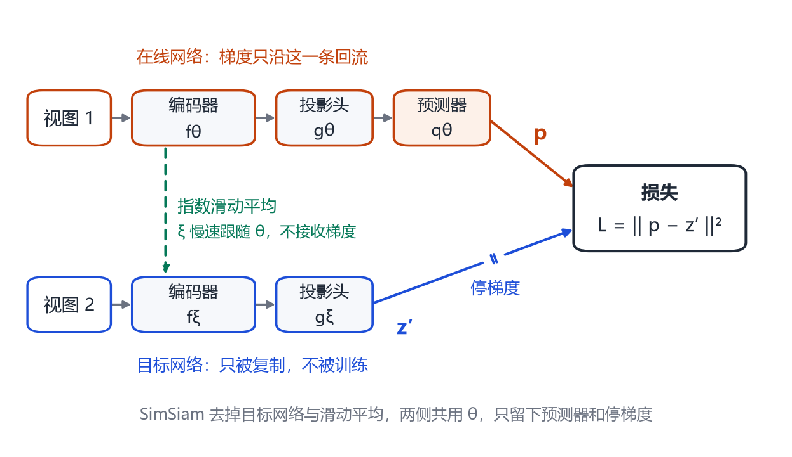
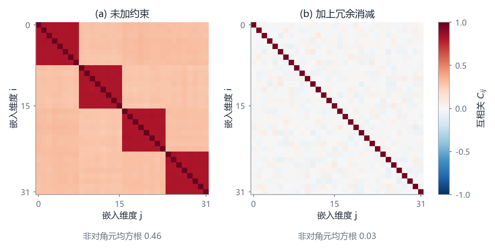
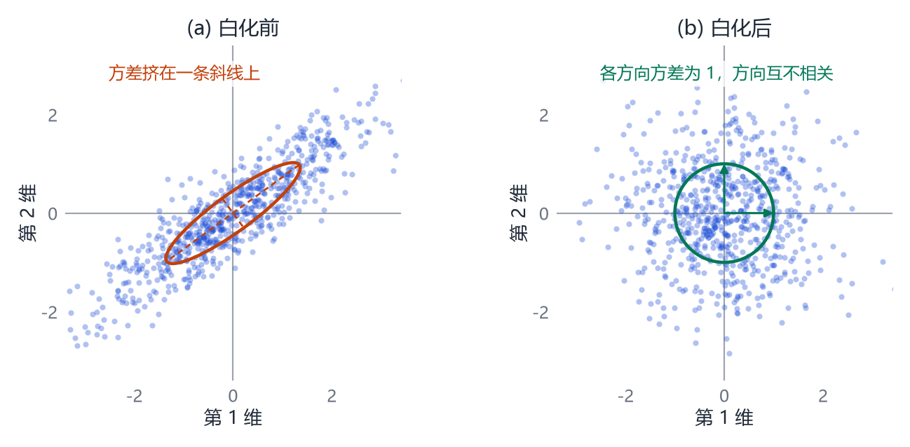

# 第 6 章　不用负样本的学习

两个学生做完同一份卷子，老师让他们互相检查。如果他们只被告知“你们俩的答案要一致”，最省力的做法不是都做对，而是都交白卷。这个道理在上一章已经讲透。只约束一致性，不约束信息量，常数解就是全局最优。

对比学习靠负样本堵住了这条路。既然要求不同的样本被推开，常数解就不再成立，因为所有样本挤在一起时排斥项会爆炸。代价是 batch 必须足够大，大到里面总能凑出足够多的“别人”。

2020 年前后出现了一批方法，它们一个负样本都不用，照样能学到东西。BYOL 在 ImageNet 上用 ResNet-50 做到 74.3% 的线性评估准确率，Barlow Twins 和 VICReg 做到 73.2%，与同期的对比学习方法处在同一水平，而它们一个负样本都不用。这些方法防塌缩的手段各不相同，敌人却是同一个。

这一章讲两类武器。一类改结构，让两个分支不再对称，梯度只从一边回传。另一类改统计量，直接对表征的协方差下约束。两类方法都不需要负样本，也就不需要“batch 里恰好有别人”这个前提。

## 6.1　让一边先别动

BYOL 的结构值得先看清楚，如图 6-1。一张图取两个增强视图，视图 1 进在线网络，视图 2 进目标网络。在线网络有三个零件，编码器 $f_\theta$、投影头 $g_\theta$、预测器 $q_\theta$。目标网络只有前两个，记作 $f_\xi$ 和 $g_\xi$，参数 $\xi$ 与 $\theta$ 不同。

在线网络的任务是预测目标网络的输出。损失是两个向量的均方距离，

$$
\mathcal{L}_{\theta,\xi} = \left\lVert q_\theta(z_\theta) - \operatorname{sg}(z'_\xi) \right\rVert_2^2 ,
$$

其中 $z_\theta$ 是在线分支的投影输出，$z'_\xi$ 是目标分支的投影输出，$\operatorname{sg}$ 表示停梯度（stop-gradient），意思是这一项在反向传播时被当成常数，梯度不往 $\xi$ 里流。实践里会把两个视图的位置对调再算一遍，两次取平均，这样两个分支轮流当学生。

梯度只更新 $\theta$。$\xi$ 由 $\theta$ 的指数滑动平均得到，

$$
\xi \leftarrow \tau\,\xi + (1-\tau)\,\theta ,
$$

$\tau$ 是动量系数，取值接近 1，所以 $\xi$ 走得很慢。

现在回答那个问题。如果两边都收梯度，把编码器的输出压成一个常数是最省力的解，而且是一个稳定的解。两个分支同时朝对方移动，各走一步就碰头了，碰头的地方必然是中间某处。如果初始表征本身没什么结构，中间某处就是所有人的平均值。停梯度破坏了这种双向奔赴。目标端被钉住，在线端要靠近它，只能自己动。

这个画面可以想成临摹。模特站着不动，画的人一笔一笔去对齐，画错的地方会被下一次比对纠正。如果两个人都能动，最省事的做法是两人都站着不动，然后宣称“我们完全一致”。停梯度就是那句“模特不许动”。

BYOL 的作者对这件事的解释是假设性质的，原文没有给出定理。他们的说法是，预测器和慢速目标网络这两个设计合起来，鼓励模型编码越来越多的信息。这句话读起来像结论，其实是猜想。SimSiam 的作者后来把这个猜想推得更远，认为停梯度背后藏着另一套优化问题，两个分支在交替地解各自的子问题，像期望最大化算法（Expectation-Maximization，EM）里固定一组变量、优化另一组变量那样。

交替优化的视角有个好处，它能解释“慢”为什么有用。EM 里 E 步的分配是固定的，M 步才更新参数，两组变量不会同时乱动。BYOL 里 $\xi$ 扮演固定那一方的角色，只不过它不是完全固定，而是缓慢跟随。SimSiam 的作者用实验支持了这个说法，把目标端固定住、让在线端连续走 10 步或 100 步再交替一次，线性评估从每步交替的 68.1% 升到 68.7% 和 68.9%。

## 6.2　慢到什么程度

动量系数 $\tau$ 不是随手取的。BYOL 让 $\tau$ 从 0.996 起步，训练过程中按余弦曲线升到 1。0.996 的意思是每一步只有千分之四的新参数渗进目标网络，训练到后期连这千分之四也没有了。

太快和太慢都不行。$\tau$ 小，目标网络跟着在线网络一起跑，等于没有目标，两个分支又回到同时移动的局面。$\tau = 1$，目标网络冻在初始化那一刻，在线网络要去拟合一个随机表征，学到的东西没有意义。

可以想成练投篮。篮筐固定，你才能调整出手的角度和力度，每一次投偏都能变成下一次的修正。如果篮筐追着球跑，投出去的球永远“进”，你什么也学不到。但如果篮筐一开始就装在你手上，同样不用练。BYOL 的做法是让篮筐缓慢地跟着你移动，始终保持够得着、又需要调整的距离。

有一个细节值得记下来。SimSiam 的论文在脚注里提到，BYOL 的第三版预印本报告过一组消融，去掉动量编码器、把预测器的学习率提高 10 倍，ImageNet 线性评估仍有 66.9%。也就是说动量不是不可替代的，它和预测器的学习速度之间存在某种补偿关系。这个数字比带动量的 74.3% 低不少，但它说明“慢”不是唯一的关键，停梯度和预测器才是更难去掉的部分。

工程上的账也好算。BYOL 用 4096 的 batch，分摊在 512 块 TPU v3 上，训一个 ResNet-50 大约 8 小时。这个开销和同期的对比学习方法在同一量级，省下的是“必须凑出大量负样本”的那份心思。

## 6.3　预测器不是多余的零件

SimSiam 把 BYOL 拆到只剩骨架。两个视图过同一个编码器 $f$，其中一边接一个预测器 $h$，另一边停梯度，损失是负余弦相似度。没有目标网络，没有动量，没有负样本，batch 只要 512。

它居然不塌缩。100 轮预训练的线性评估是 67.7%。把停梯度去掉，准确率变成 0.1%，也就是 ImageNet 上瞎猜的水平。把预测器去掉，同样掉到 0.1%。把预测器留着但固定成随机初始化，1.5%。四组数字摆在一起，说明停梯度和预测器缺一不可，而且预测器必须是可训练的。

0.1% 这个数字要小心解读。SimSiam 的论文专门加了注，说准确率等于随机水平并不足以断定发生了塌缩，损失发散也会给出同样的结果。真正的证据在训练曲线上，去掉停梯度之后损失立刻掉到最小值然后停在那里，表征变成常数。

这组消融还顺带说明了一件事。不对称本身不解决问题。把预测器加在一边、让两边结构不同，这个不对称并没有阻止塌缩，真正起作用的是那条被截断的梯度。结构上的差异只是给停梯度提供了一个可以附着的位置。

预测器到底在做什么。两个视图经过了不同的增强，颜色抖动、随机裁剪、高斯模糊，这些变换会让同一张图的两个表征之间产生系统性偏移。如果直接要求两边相等，编码器有两条路可走，一条是把这个偏移也编码进去，另一条是把所有输入压成同一个值来彻底消除差异。后一条路更省力。

预测器提供了一个可以弯曲的中间层。它吸收掉两个视图之间的系统性差异，让编码器只负责保留内容。SimSiam 的作者给了一个更精确的说法，最优的预测器近似等于对增强分布取期望，$h(z) = \mathbb{E}_{T}[z_T]$。单次观测不等于期望，这个差值就是梯度的来源。如果 $h$ 是恒等映射，差值恒为零，最优解立刻退回常数。这解释了为什么去掉预测器会塌缩，也解释了为什么预测器不能是固定的随机映射。

结构上它很朴素。输入输出都是 2048 维，中间一层 512 维，构成一个瓶颈，隐层带批归一化，输出层既没有归一化也没有激活函数。原文报告瓶颈结构比等宽结构更稳，但这不是关键，关键是它必须可学。

<figure class="fig">

<figcaption><b>图 6-1</b>　BYOL 与 SimSiam 的结构。上方在线网络带预测器，下方目标网络只被滑动平均复制，梯度在进入目标分支前被断开。SimSiam 去掉目标网络与动量，两侧共用同一组权重。</figcaption>
</figure>

图 6-1 里那道断开的符号是全图的关键。它标出的不是一条数据通路，而是一条梯度通路的截断。数据照样从目标网络流向损失，梯度却不能从损失流回目标网络。

## 6.4　对角线与非对角线

换一条完全不同的路。不去动结构，也不去动梯度，只在表征的统计量上加一条约束。

Barlow Twins 的做法是算一个矩阵。两个视图过同一个网络，得到 $z^A$ 和 $z^B$，先按维度标准化（减均值、除标准差），再算互相关矩阵，

$$
C_{ij} = \frac{\sum_b z^A_{b,i}\, z^B_{b,j}}{\sqrt{\sum_b (z^A_{b,i})^2}\sqrt{\sum_b (z^B_{b,j})^2}} ,
$$

$b$ 遍历 batch 里的样本，$i$ 和 $j$ 遍历嵌入的维度。$C_{ij}$ 是“视图 A 的第 $i$ 维”和“视图 B 的第 $j$ 维”在这批样本上的相关系数，取值落在 -1 到 1 之间。

损失要求这个矩阵尽量接近单位阵，

$$
\mathcal{L} = \sum_i (1 - C_{ii})^2 + \lambda \sum_{i}\sum_{j \neq i} C_{ij}^2 ,
$$

第一项管对角线，第二项管非对角线，$\lambda$ 是两项的权重，原文取 $5 \times 10^{-3}$。

两项的分工很清楚：对角线上的元素是同一维在两个视图之间的相关，把它拉向 1，就是要求表征对增强不变。非对角线上的元素是两个不同维度之间的相关，把它拉向 0，就是要求不同维度各说各的事，不要重复。

图 6-2 是一个 32 维的演示例子，4096 个样本，两路共享一个分块的协方差结构，各自再叠一点独立噪声。左图是没有约束时的互相关矩阵，对角线接近 1，非对角线有明显的方块，均方根 0.46。右图是用互协方差矩阵的逆平方根做变换之后的结果，非对角元的均方根降到 0.03，只剩采样噪声留下的小斑点。

<figure class="fig">

<figcaption><b>图 6-2</b>　Barlow Twins 的互相关矩阵（演示数据，32 维随机嵌入，非真实训练结果）。左图对角线接近 1 但非对角块很大，说明维度之间高度冗余；右图非对角元被压到 0.03 左右，每个维度各自携带不同的信息。</figcaption>
</figure>

真实的训练结果在 ImageNet 上，ResNet-50 线性评估 73.2% 的 top-1 和 91.0% 的 top-5。训练用 2048 的 batch，但原文强调 batch 小到 256 也能跑，只是精度略降。这一点和 SimCLR 很不一样，后者在 256 的 batch 上几乎不能用。

VICReg 把同一件事拆成三个显式的项，每一项都有明确的名字。方差项要求每一维在 batch 上的标准差不要低于一个阈值，

$$
v(Z) = \frac{1}{d}\sum_{j=1}^{d} \max\!\left(0,\ \gamma - S(z_j, \epsilon)\right) ,
$$

$z_j$ 是第 $j$ 维在整批样本上的取值向量，$S$ 是加了小常数 $\epsilon$ 的标准差，$\gamma$ 是目标标准差，原文取 1，$\epsilon$ 取 $10^{-4}$。低于 1 就罚，高于 1 不管，这个单边约束给了编码器放大的自由。

协方差项把协方差矩阵的非对角元平方求和，压向 0。不变项是两个视图嵌入之间的均方距离，越近越好。三项加权求和，原文的权重是 $\lambda = \mu = 25$，$\nu = 1$，ImageNet 线性评估 73.2% 的 top-1 和 91.1% 的 top-5。

一个容易被跳过的细节。VICReg 用标准差而不是方差做 hinge，论文专门解释了原因。如果用方差，梯度在取值接近均值时会趋近于 0，恰恰在快要塌缩的时候失去推力。换成标准差，梯度在 0 附近反而更大，等于在悬崖边上多了一道栏杆。

把这两种做法摆在一起看，会发现它们的关系比想象中近。Barlow Twins 的冗余项就是 VICReg 的协方差项，只是 Barlow Twins 用对角线代替了 VICReg 的显式不变项。而这两条要求合起来，指向的正是下一节要讲的那个几何操作。

为什么“把维度推开”能替代“把样本推开”。负样本是在样本之间做排斥，要求 batch 里恰好有别人，而且别人不能是同一张图的另一个视图。去相关是在维度之间做排斥，只要求同一批样本在每一维上有变化。后者的代价低得多，也不依赖 batch 的构成。

## 6.5　把椭球拉成球

对角线拉向 1、非对角线拉向 0，这两句话在几何上是一件事。给一批向量，算它们的协方差矩阵 $\Sigma$，这个矩阵描述的是这批点围成的椭球。主轴方向是 $\Sigma$ 的特征向量，轴长是特征值的平方根。如果某一维的方差是 0，椭球在那一维上被压成一条线。如果两维高度相关，椭球就被拉长在一条斜线上。

白化（whitening）是乘上 $\Sigma^{-1/2}$。它的作用是把每条主轴的长度缩放到 1，椭球变成球，球心移到原点。图 6-3 是一个二维的例子，左图两个方向的方差差二十倍（2.762 对 0.138），点云挤在一条斜线上。右图两个方向的方差都是 1，两个维度的相关系数是 -0.03。

<figure class="fig">

<figcaption><b>图 6-3</b>　白化前后的二维点云。左图协方差的主轴一长一短，点云沿斜线分布；右图乘上协方差矩阵的逆平方根后，两个方向方差都变成 1，相关系数接近 0。</figcaption>
</figure>

为什么一个操作能同时堵住两个出口。塌缩是“每一维的方差都变成 0”，白化把每一维的方差钉在 1。冗余是“两个维度说的是同一件事”，白化把任意两维的相关系数钉在 0。前者是表征退化成一点，后者是表征退化成一条线或者一个低维子空间，上一章把它们分开讲过，白化一次解决两个。

举个具体的例子。假设一批照片的表征里，第一维记的是“画面有多亮”，第二维记的是“色调有多暖”，这两个量天然同涨同落，晴天拍的照片又亮又暖。这样的两维等于只有一维，容量白白浪费。白化把这一维的相关抹平之后，第二个维度被迫去找别的差别，比如室内还是室外、近景还是远景。表征的容量就是这样被逼出来的。

代价在于 $\Sigma$ 必须从一批样本上估出来。$d$ 维的协方差有 $d(d+1)/2$ 个自由参数，样本数少于 $d$ 时估出来的矩阵必然奇异，白化无从谈起。Ermolov 等人在 2021 年提出的 W-MSE 就是把这个想法直接做成损失，他们的实现把 batch 切成若干子批，子批大小取嵌入维度的两倍，用子批内部的样本估计白化矩阵。论文里说白化的效果是“散开”，样本被推到球面上，彼此拉开距离。

这也解释了这类方法对 batch 的依赖和对比学习不同。对比学习要大 batch，是因为负样本要多。白化要大 batch，是因为协方差要估得准。方向不一样，但都逃不开“一批样本要足够多”这个前提。

还有一点值得留意。$\Sigma^{-1/2}$ 不是唯一的，任何正交矩阵左乘它都还是白化矩阵，得到的是同一个球面上的一次整体旋转。这个自由度在下一节会重新出现，到时候它变成一件麻烦事。

## 6.6　函数空间里的谱分解

到这里可以换个角度看这些目标。它们做的其实是同一件事，先给一批样本定义一个“谁应该和谁靠近”的关系，再要求表征满足这个关系。

这个关系可以写成一个图。节点是样本，边权是“两个样本成为正样本的概率”，正样本图这个名字就是这么来的。图有一个拉普拉斯矩阵 $L$，它记录了每个节点和邻居的关系强度，也记录了它自己有多特殊。

2022 年，Kiani 等人在核方法的框架里解了这类损失，结论是最优表征等于把数据投影到 $(I - \frac{1}{N}11^\top - \frac{\beta}{2}L)$ 的正特征值子空间上，$N$ 是样本数，$1$ 是全 1 向量，$\beta$ 控制不变项的权重。换句话说，学到的每一维都是这个图的一个特征向量，整个表征是这个图的一组谱。

谱有一个性质，整体旋转不改变“谁和谁近”。这一点值得停一下，因为它决定了后面所有关于唯一性的讨论。一组特征向量 $V$ 和 $VR$ 给出完全相同的相似度结构，只要 $R$ 是正交矩阵。想象一张城市地图，你把整张图旋转三十度，任意两个街区之间的距离没变，谁在谁的东边也没变。所以“最优解”其实是一整个等价类，训练停在哪个旋转上，取决于初始化和优化路径。

白化在这里显出作用。它把每一维的方差钉成 1，把维度之间的相关钉成 0，等于从等价类里挑出一个代表。没有这一步，说不清模型学到的是哪一个。有了这一步，解唯一到旋转。第 14 章会把这件事写成定理，条件里会出现一个叫谱间隙的量，它保证前 $k$ 个特征向量彼此分得开，旋转也就唯一了。

## 6.7　工程上的几个旋钮

这些方法的结构差别不大，调参的坑却各有各的位置。

投影头是第一个。训练时在编码器后面挂一个多层感知机，评估时把它整个扔掉，只拿编码器的输出做下游任务。BYOL 的投影头是 4096 维隐层接 256 维输出，SimSiam 的投影头输出 2048 维、预测器隐层 512 维，Barlow Twins 和 VICReg 用三层 8192。投影头把训练用的空间和下游用的空间分开，下游任务拿到的表征不必迁就训练目标的几何。

batch 大小是第二个。SimSiam 的消融表里，batch 64 是 66.1%，512 是 68.1%，4096 掉到 64.0%。BYOL 在 256 到 4096 之间基本是平的。这类方法不像对比学习那样必须大 batch，但也不能太小，因为批归一化和协方差估计都要靠一批样本。

动量、学习率、调度是剩下的一组。动量从 0.996 起步按余弦升到 1。学习率按 batch 线性缩放，BYOL 用 $\mathrm{lr} \times \mathrm{batch}/256$，SimSiam 的基准值是 0.05 配合余弦衰减。早期几步梯度可能很大，工程上常备一手梯度裁剪当保险丝。

这些旋钮没有一个能单独解释“为什么不塌缩”。它们是让那套机制能跑起来的环境条件。真正起作用的是结构和约束，旋钮只决定它跑得稳不稳。

这一章讲的两种武器，本质上都是在防守。停梯度堵住两边一起躺平这条路，白化和去相关堵住维度挤成一团这条路。堵的位置不同，目的相同，都是先允许模型自由地学“什么该靠近什么”，再在出口处设卡。

防守有代价。停梯度把优化变成两个时间尺度的问题，动量系数成了一个必须小心调的超参。白化让 batch 的统计量变成约束的一部分，batch 一小就估不准。去相关要求投影头的维度足够大，否则没有足够的维度可推。

有没有可能不防守，而是直接规定表征该长什么样。如果规定它必须是一个各向同性的高斯分布，塌缩和冗余就同时被排除了，因为高斯分布的协方差是单位阵，任何一维都不许退化成常数，任何两维都不许相关。这个想法在 2025 年被 LeJEPA 做成了可训练的目标，而且不需要停梯度、不需要教师网络、不需要大 batch。第 7 章从“为什么偏偏是高斯”讲起。
