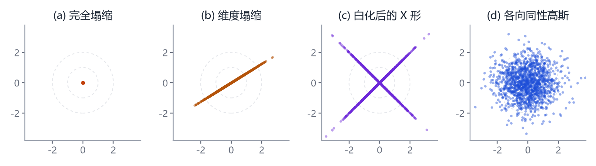
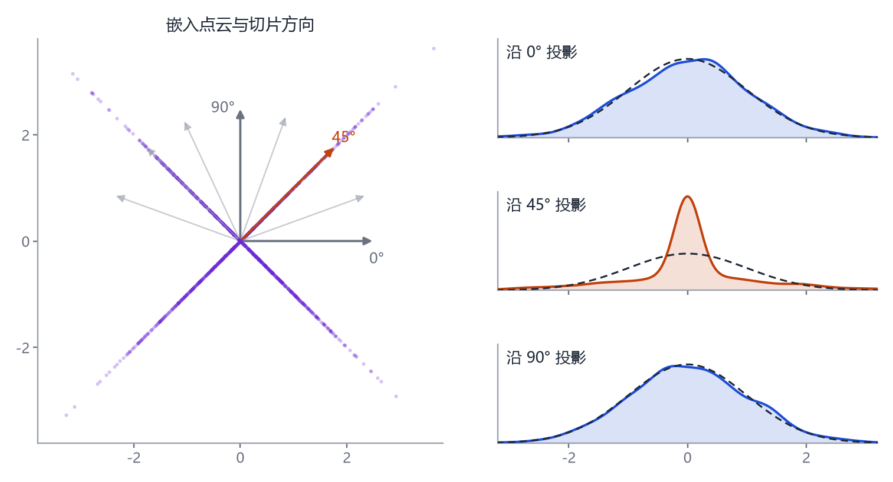
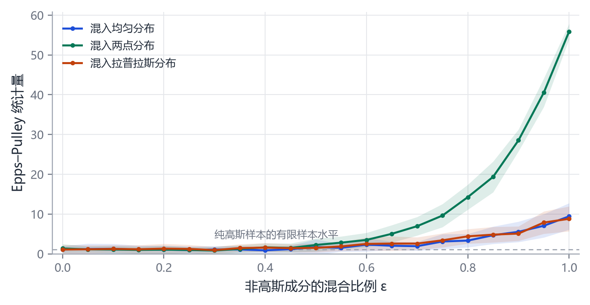

# 第 7 章　把表征捏成高斯

预训练跑完的那个下午，你把五万张图的嵌入取出来，算了一遍协方差矩阵。对角线全在 1.0 上下，非对角线没有一个超过 0.02。按第 6 章的标准，这是一份干净的白化表征，各方向方差为 1，方向之间不相关，塌缩的两种形态都不存在。

然后你取前两个主成分画了一张散点图，图上出现一个 X。

两条对角线从原点向四个角延伸，中间密、两头稀，象限之间是空的。你把横坐标单独画成直方图，标准的钟形；纵坐标单独画，也是标准钟形。协方差矩阵仍然是单位阵。可整体看上去，它离一团圆形的点云差得很远。

这件事说明白化有一个天花板。它约束的是一阶和二阶矩，也就是均值和协方差，而一个分布在满足了这两条之后还有无穷多种长法。第 6 章把白化当成解药，那时要治的病是塌缩。现在病灶换了，药也得换。

## 7.1　二阶矩之外

一个 $K$ 维分布的协方差矩阵有 $K(K+1)/2$ 个独立元素，全部固定下来，用掉的约束是有限的，而分布本身的自由度是无穷的。白化本身是一个线性变换，它能拉长、旋转、缩放，却改不了一个分布在拉长旋转之后还剩几个峰。这有点像体检只量身高、体重、血压，三项都正常，并不能推出这个人没有别的问题。

X 形可以用两行式子造出来。取一个标准正态的标量 $z$，再取一个独立的、等概率取 $\pm 1$ 的符号 $s$，令

$$x = z,\qquad y = s\cdot z .$$

$y$ 的边缘分布是标准正态，因为把一个正态变量随机翻转符号，分布不变。$x$ 与 $y$ 的协方差是 $\mathbb{E}[s z^2]=\mathbb{E}[s]\,\mathbb{E}[z^2]=0$。边缘正态、协方差为单位阵，白化关心的东西它全满足，而两条臂清清楚楚地摆在那里。

<figure class="fig">

<figcaption><b>图 7-1</b>　四种二维嵌入的形态。四个面板共用同一坐标范围，虚线圆半径为 1 和 2。(a) 全部点挤在原点，两个特征值都是 0；(b) 点落在一条直线上，特征值 1.0 与 0；(c) 白化后的 X 形，两个特征值都接近 1，形状却完全不对；(d) 各向同性高斯，这才是目标。</figcaption>
</figure>

四种状态的对比如图 7-1。完全塌缩是原点上的一个点，维度塌缩是一条直线，这两类第 5 章已经讲过。(c) 是新的麻烦，它的协方差与 (d) 几乎一样，光看矩阵分不出来。判断表征长得对不对，需要一个能看见整个分布形状的量。

现实里的嵌入很少长成这么规整的 X，但方向是对的。任何一批真实数据压出来的分布都有形状，有的地方密、有的地方空，有的方向上拖着长尾。白化只负责把那个椭球拉成球，球里面还剩什么形状，它一概不管。

## 7.2　为什么偏偏是高斯

要指定一个形状，先得说清为什么是这个形状。

最直接的理由是各向同性。所有方向的方差相同，意味着没有哪个方向被浪费，也没有哪个方向独大。表征空间被压扁的后果很具体，如果下游任务恰好需要那个被压扁的方向，误差就会放大。你可以拿一叠照片来想。把一千张人脸照压成一摞，每一张都只剩下轮廓的厚度，压在中间那张里的信息并没有消失，只是被挤到了无法取出的位置。白化保证了这摞照片的体积不变，却保证不了它是一叠铺开的卡片而不是一根细杆。LeJEPA 把这写成了两条引理，各向异性在带正则的线性探针里放大偏差，在不带正则的探针里放大方差。论文的实验是 100 个训练点的二分类，用逻辑回归反复拟合，各向同性时估计参数的方差是 0.0056，各向异性时是 0.0801，相差十四倍。同一批数据、同样的总方差，只是几何不同。

第二个理由是熵。熵可以理解成“这份分布还需要多少信息才能被确定”。给定协方差矩阵，高斯在所有分布里微分熵最大，

$$h=\frac{1}{2}\log\left((2\pi e)^{K}\det\Sigma\right),$$

$K$ 是维度，$\Sigma$ 是协方差。熵大意味着不确定性大，也意味着除了二阶矩以外不额外假设任何结构。把目标定成“八个簇”或“一条螺旋”，等于把研究者对数据的猜测写进损失函数。猜对了省事，猜错了就是给模型上了一道锁，以后遇到猜不到的类别只能硬塞进那八个簇里。标准高斯是最不主张的一种写法，它只说你已经知道的那点信息，其余留白。

第三个理由是旋转。任何正交矩阵作用在标准高斯上，结果还是标准高斯，原点不动，方差不变。而表征本来就只在旋转意义下确定，同一批数据训练两次，两次得到的基可以差一个正交变换而同样好用。把目标定成标准高斯，不会和这件事打架。反过来，若规定“第 3 维必须是胡须长度”，就等于钦定了一组基，而这组基是被随机初始化决定的，换一个种子就全变了。

三条理由指向同一个结论，LeJEPA 把它写成了定理。在所有协方差被约束成标量的分布里，各向同性高斯唯一地最小化下游预测的积分平方偏差，k 近邻和核回归两种探针都成立。这句话的意思不是“高斯好看”，而是“在不知道下游任务是什么的前提下，它把最坏情况的损失压到最低”。

拿 k 近邻探针来看，这句话会具体很多。给定一个查询点，在它周围画一个半径固定的球，把球内邻居的标签平均起来当作预测。这个平均准不准，取决于球里的样本能不能代表查询点附近的情况。表征被拉长时，同样半径的球在一个方向上伸得很远，把远处密度低得多的样本也一起算了进来；表征被压扁时，球在另一个方向上几乎没走出几步。球内的密度变化越剧烈，平均出来的标签就越偏。高斯分布让密度在每个方向上按同样的速度衰减，球里装进来的样本在各个方向上都一样近，这个误差就在所有方向上被拉平了。

## 7.3　切开来看

高维分布没法直接比较。两样本检验的复杂度随维度迅速膨胀，密度估计在几十维以上就不可靠。可行的做法是把维度降下来。常用的降维工具是主成分，这里走的是另一条路，随机切片。

取一个单位向量 $a$，把嵌入 $z$ 投影成一个标量 $a^\top z$，就得到一条一维分布。拿它和标准正态比，只需要一个一维的检验。Cramér–Wold 定理保证了这样做不丢信息，如果一个分布沿所有方向的投影都是正态，那么联合分布本身必然是正态。直觉是，分布的全部信息都被它在一维上的影子记录着，方向取遍，信息就取全了。

方向有无穷多个，实际只能抽 $M$ 个。$M$ 要不要随维度指数增长，取决于目标分布有多光滑。高斯非常光滑，随机方向落在“看不出毛病”的区域里的概率很低，论文用 Sobolev 正则性给出了平均误差随 $M$ 下降的界。

还有一个不花钱的细节。方向不必在训练全程固定，每一步重新抽一批就行。固定方向时，模型只需在那几个特定角度上把分布揉成高斯，角度之间的缝隙无人看管；每步重抽，等于让 $M$ 个方向在每个步骤都换一批位置，长期看覆盖了整个球面。论文把这个做法叫白送的覆盖度，消融里重抽方向的曲线在每个方向数上都低于固定的。

<figure class="fig">

<figcaption><b>图 7-2</b>　随机切片。左图是 X 形点云与八个投影方向，橙色为 45°。右图是沿三个方向的一维分布（实线）与标准正态（虚线），三行纵轴各自缩放。沿 0° 与 90° 几乎重合，沿 45° 却有一半质量压在 0 附近。</figcaption>
</figure>

这个想法在二维上的样子如图 7-2。X 形点云沿 0° 和 90° 投影，两条曲线与标准正态贴得几乎分不开；沿 45° 投影，一半样本落到 0 附近，堆成一个尖峰。这两种情形下算出来的峰度，0° 方向是 0.01，45° 方向是 2.84。

这也解释了方向为什么必须随机取。若只检查坐标轴，X 形会满分通过，错误恰恰藏在坐标轴之间的斜方向上。

## 7.4　一维分布之间的距离

切片之后问题降成一维，手上有一串标量 $z_1,\dots,z_N$，要问它们是不是来自标准正态。

论文比较过三类统计量。矩方法看偏度和峰度，实现最简单，毛病在于有限个矩不足以确定一个分布，而要增加矩的阶数，梯度会按阶数增长，训练立刻不稳。累积分布函数一类的方法（Cramér–von Mises、Anderson–Darling）要对样本排序，排序不可微，多卡训练时还会破坏并行。Kolmogorov–Smirnov 检验也属于这一族，它用的是 $\ell_\infty$ 范数，即两条累积分布曲线的最大竖直距离，论文因为这一点把它排除了，最大距离只由曲线上最差的那一个点决定，梯度会变成稀疏的脉冲，训练时大部分样本连信号都收不到。

剩下的选择是特征函数。标准正态的特征函数是 $\varphi(t)=e^{-t^2/2}$，样本的经验特征函数是

$$\hat\varphi(t)=\frac{1}{N}\sum_{j=1}^{N}e^{\,itz_j}.$$

它是一堆复指数的平均值，求导逐项进行，多卡之间做一次 all_reduce 就能拼出全局值，复杂度是 $O(N)$。要理解它量的是什么，可以把特征函数想成密度函数的傅里叶变换。质量怎么摆，被翻译成各个频率上振荡的强弱，两个分布差在哪里，就在频率轴上显形。$t$ 靠近 0 的一段对应整体宽度，$t$ 大的地方对应尖峰和细节，窗函数把两端平衡一下，既不放过尺度上的差异，也不让高频噪声独占。Epps–Pulley 统计量在两者之间度量一个加权的 $L^2$ 距离

$$\mathrm{EP}=N\int_{-\infty}^{\infty}\left|\hat\varphi(t)-\varphi(t)\right|^{2}w(t)\,\mathrm{d}t,$$

$w(t)$ 是窗函数，用来压住远处的振荡。论文的参考实现取 $w(t)=e^{-t^{2}/2}$，积分截到 $[-5,5]$，用 17 个点的梯形公式求值。区间取得不宽是有原因的，窗函数本身随 $t$ 迅速衰减，$|t|$ 超过 5 之后被积项已经小到可以忽略，而特征函数在原点的行为恰好对应分布的矩，最要紧的那一段落在积分区间的正中。

前面的 $N$ 有它的道理。样本越多，$\hat\varphi$ 越接近真值，偏差按 $1/\sqrt{N}$ 缩小，乘上 $N$ 之后统计量的量级就与样本量无关，不同大小的批次可以直接比较。

这个统计量还有一个工程上很关键的性质，梯度有界。对任意一个样本，$|\partial\mathrm{EP}/\partial z_j|\le 4\sigma^{2}/N$，不管数据长什么样都成立。矩方法碰上重尾数据会把梯度推到天文数字，EP 不会，训练因此不需要梯度裁剪来兜底。

<figure class="fig">

<figcaption><b>图 7-3</b>　Epps–Pulley 统计量随非高斯成分比例的变化。三条曲线的混合分布均值为 0、方差为 1，前两阶矩与标准高斯完全一致。ε=0 处不是 0，而是落在 1.1 到 1.4 之间，这是 500 个样本的有限样本噪声底；阴影为 40 次重复的标准差。</figcaption>
</figure>

统计量的行为如图 7-3。三种非高斯成分先各自归一化到均值 0、方差 1，再按比例 $\varepsilon$ 与标准正态混合，混合后的方差始终是 1。白化看不出任何区别，EP 却随 $\varepsilon$ 一路升高。$\varepsilon=1$ 时，混入均匀分布对应 9.4，混入拉普拉斯对应 8.8，混入两点分布对应 55.9。

两点分布的曲线最陡，因为它把质量整个搬到两处，一维形状变化最剧烈。均匀与拉普拉斯在 EP 眼里程度相近，一个是“太方”，一个是“尾巴太厚”，两者与高斯的差距都不如双峰刺眼。统计量对“质量堆在哪儿”比“尾巴多重”更敏感。拿它当训练信号够用，拿它做严格的正态性判定则要另配临界值。

## 7.5　从一个方向到整个空间

SIGReg 的做法直接，抽 $M$ 个单位方向，每个方向算一次 EP，取平均

$$\mathrm{SIGReg}=\frac{1}{M}\sum_{m=1}^{M}\mathrm{EP}\left(\{a_m^\top z_n\}_{n=1}^{N}\right).$$

论文在这里改了一步。定理的写法是取所有方向的最大值，实践里换成平均，因为取最大值时只有少数方向拿得到梯度，其余方向白算。平均让每个方向都贡献一份。

有了它，总损失是两项的加权和

$$\mathcal{L}=\lambda\,\mathrm{SIGReg}+(1-\lambda)\,\mathcal{L}_{\text{pred}},$$

$\mathcal{L}_{\text{pred}}$ 负责让同一张图的不同视图的嵌入靠近，$\lambda$ 平衡两者。整个方法只有这一个超参数，论文推荐的默认值是 0.05。超参数少的好处不只是省事，而是出问题时排查的地方少，换一个数据集也不必从头调一遍。

这个形式和第 6 章的 VICReg 有直接关系。把 EP 换成一个只看前两阶矩的统计量 $\hat\mu^{2}+(\hat\sigma-1)^{2}$，SIGReg 在方向数趋于无穷时就退化成 VICReg。也就是说 VICReg 是这条路的一个特例，它约束均值和标准差；SIGReg 约束整条特征函数曲线。论文对退化版本的态度很明确，按它的定理，只匹配有限个矩会留下塌缩的捷径解，那正是 VICReg 在实践中被观察到的问题。

切片本身也不是新想法。切片 Wasserstein 距离早就在用随机投影把高维的分布比较换成一批一维问题，效率提高很多。区别在于每一维上用什么尺子。Wasserstein 要排序才能算一维的最优传输，那一步不可微，代价也高；EP 只看特征函数，能微分、能并行、梯度还有界。论文还提到，若把 EP 的积分算到精确，每个切片的损失恰好等于一个核 MMD，只不过那个形式是平方复杂度，用不了。

计算代价与维度几乎无关。每个方向只是一次矩阵乘，投影完就变成一维，$M$ 个方向的总代价对维度是线性的。参考实现连分布式同步一起不到五十行。

方向数 $M$ 取多少合适，论文给了消融。ViT-L/14 训 100 轮，方向数 512 时线性探测在 73.7% 到 74.2% 之间，1024 时回到 75% 上下，4096 只再多一点点。即使方向减到 512，损失也没有崩掉，训练曲线的形态与 1024 几乎一样。积分点数从 5 加到 41，同一组配置下的精度几乎不动，波动不超过半个点。这些超参数的不敏感，和前面说的“梯度有界”是同一件事的两个侧面。

塌缩为什么被构造性地排除了，从这个式子能直接看出来。完全塌缩时所有嵌入相同，任何方向上的投影都是一堆相同的数，经验特征函数是 $e^{itc}$，与 $e^{-t^2/2}$ 的距离很大。维度塌缩时，至少存在一个方向，投影后的样本挤在极少的几个值上，EP 同样很大。最小化 SIGReg 和塌缩不相容，这是推导出来的，不是碰巧。

## 7.6　被删掉的那些技巧

过去几年做自监督，配方里总要摆几样东西，停梯度、教师学生网络、精心调的 EMA 动量、上千的批大小、学习率预热与余弦衰减。每一样都要单独调，换一个数据集就得重来。LeJEPA 的实验想把它们一次性去掉。

配方只剩两行，预测损失加 SIGReg，配上 AdamW 和一个固定学习率。在 ImageNet-1k 上预训练再用冻结主干做线性探测，ViT-H/14 到 79%。同一套配方换模型也成立，ViT-Large（304M 参数）在线性探测上 77.1%，ConvNeXtV2-Huge（660M）78.5%，两个数字都是同一份损失、同一组超参数得到的。再往上放大到 1.8B 的 ViT-g，损失曲线依然平滑，没有出现需要靠重启训练来绕开的那种尖峰。

批大小也不再是瓶颈。ViT-L/14 训 100 轮，批大小 128 时线性探测 72.20%，512 时 74.72%，128 已经能跑出可用的表征。这一点对算力有限的实验室意义不小。两个损失项之间的权重也不需要精调，在 ImageNet-100 上扫 $\lambda$，精度曲线是一段平坦的台地，没有一个位置会突然崩掉，论文推荐的 0.05 就落在这段台地中间。

迁移上的对照更能说明问题。八个下游数据集上的平均，LeJEPA 用 304M 的 ViT-L 训 100 轮得到 79.48，对照的 I-JEPA 用 632M 的 ViT-H 训 300 轮是 78.50。模型小一半，轮数少三分之二，平均分还略高。

覆盖面也值得一说。论文在 ImageNet-10 上跑了 timm 里 50 个小于 20M 参数的模型，横跨 8 个架构家族，从 ResNet、ConvNeXt 到 MaxViT、LeViT，冻结主干线性探测的精度落在 91.5% 到 95% 之间。没有哪个架构需要特殊照顾。

还有一条容易被忽略的好处，训练损失本身变得有用了。ViT-base/8 在 ImageNet-1k 上，训练损失与线性探测精度的 Spearman 相关系数是 94.52%。以往自监督的损失和下游表现关系很弱，想比较两个检查点只能反复做线性探测；现在看损失曲线就大致知道谁更好。

域内预训练这一项更值得看。Galaxy10 是一万一千张星系图像、十个类别的数据集，与自然图像差得很远。用默认超参数在它上面直接预训练，线性探测和全量微调都超过了 DINOv2、DINOv3 的迁移结果。这条结论动摇的是“小数据集只能靠大模型迁移”的默认做法。

## 7.7　这个约束不是万能的

高斯目标是一个充分条件，不是必要条件。它保证的是“在不知道下游任务时最安全”，而不是“任何情况下都最优”。如果下游任务已经明确，比如就是分十个星系形态，那么把表征捏成十个簇可能比捏成高斯更省事。高斯不承诺语义，它只承诺信息被摊开、没有被压扁，语义归预测损失那一项管。

唯一性也有限度。各向同性高斯在协方差受标量约束的分布族里是唯一最优，这个“约束”两个字很关键，去掉它，结论要重新证。第 14 章会回到这里，说明在什么条件下表征能唯一确定到旋转。

有限样本的偏差也有明确的形式。用批次估计 EP 会带来 $O(1/N)$ 的偏差，批次越小偏差越大，论文测到批大小为 16 时影响仍然很小。代价也有一点。方向是每步重抽的，同一批数据在不同步上算出的 SIGReg 不完全相同，损失曲线会带一点抖动，方向数越大抖得越轻，这是它和计算量之间的一处权衡。

真正的转变在思路上。第 5 章和第 6 章都在防守，想办法不让表征塌掉；这里换成直接规定它该长成什么样，防守的动作就不需要了。指定一个分布，比列举一堆禁止事项更容易写进损失，也更容易解释清楚。

不过分布只说了“信息怎么摆”，没说“信息是什么”。要让表征带上语义，还需要一个预测任务把它们组织起来。第 8 章进入 I-JEPA 的内部，看它怎么在一张图的两个部分之间做预测。
