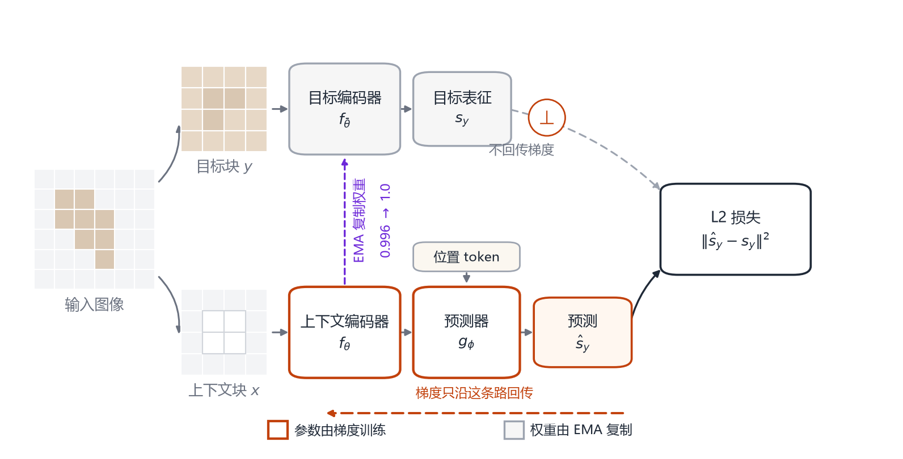
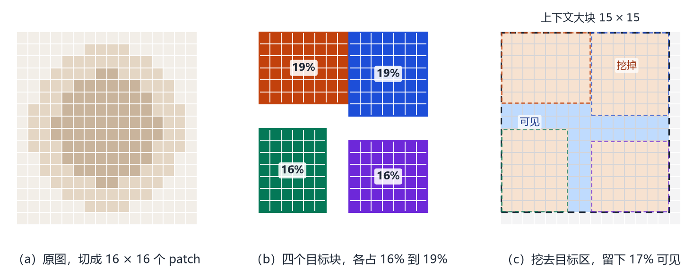
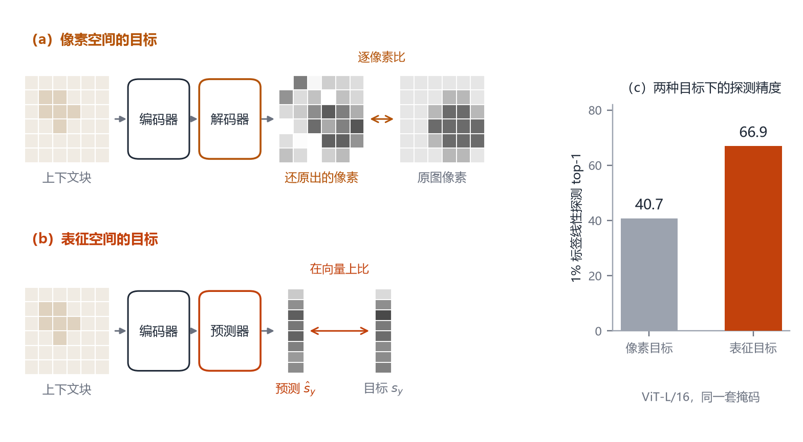

# 第 8 章　在表征空间里预测

一张厨房台面的照片，右下角被撕掉了。剩下的部分有灶台、有砧板、有半只碗。你大概能说出撕掉的那块里有什么，水槽、龙头、也许还有一块抹布。但如果要求你把那块画出来，画到每一颗水珠的位置都对，你做不到，换谁都做不到。

补全一张图有上下两层。上层是语义，那里有一只碗，碗口朝上，旁边是水槽。下层是像素，那里有几百个具体的灰度值，每一个都对应某粒水珠、某道反光。人对下层几乎没有能力，对上层却相当可靠。看到半张脸，你能立刻说出另一半有眼睛、有颧骨、有一道落在下颌上的阴影，却完全没法交代睫毛一根一根长在哪里。

这种不对称不是人的缺陷，是问题本身的性质。语义是被大量样本反复确认过的，像素不是。同一只碗在几百万张照片里出现过，它的形状、姿态、和周围物体的关系高度一致；而碗沿上那道高光的精确形状，只在那一次快门、那一束光下成立。可预测的部分在语义层，不可预测的部分在像素层。这句话值得单独说一遍，因为它决定了后面所有的设计取舍。

2023 年初，Assran 等人在 Meta 的人工智能实验室提出了基于图像的联合嵌入预测架构（Image-based Joint-Embedding Predictive Architecture，I-JEPA），把上面这句话直接写成了一个训练目标。做法很干脆，既然像素层不可预测，那就根本不预测它。模型从一个上下文块出发，预测同一张图里另外几个块的表征。整章要讲的，就是这台机器怎么转起来，以及为什么它转得比预测像素的那一类方法更省、更值。

前几章已经把零件摆齐了，塌缩是怎么回事，不对称结构为什么能挡住塌缩，指数滑动平均的教师网络起什么作用。I-JEPA 是把这些零件装成一台真能训练、真能出结果的机器，而且在装配时做了一个别人没做的选择，把靶子从像素挪到了表征。

## 8.1　把靶子挪到表征空间

先看另一条路上的做法。掩码自编码器（Masked Autoencoder，MAE）遮住一张图的 75%，只把剩下的 25% 送进编码器，再用一个轻量解码器把被遮住的部分还原成像素。这个目标简单、信号密集、扩展性好，微调之后精度很高。

它的问题出在靶子上。给定左侧那片草地，被遮住的区域里草叶朝哪个方向倒，其实有无数种同样合理的答案。模型被迫用同一个输出覆盖所有这些可能，而平方误差下的最优解是它们的条件均值。均值是什么样子？一根模糊的、没有方向的绿影。损失曲线会很好看，因为模糊图与任何一张具体草图的平方距离都不算大，但模型为了这一点点下降，把大量容量花在了拟合不可约的噪声上。

换个说法。你在教一个人画速写，却要求他每一笔都和原照片逐像素对齐。他学到的第一件事是别画细节，第二件事是把所有细节涂成灰色。

I-JEPA 的改法是把靶子换掉。目标不再是那块图里的像素，而是另一个网络看过那块图之后给出的向量。这个向量里，草叶的朝向、瓷砖的接缝、云边的抖动早就被压掉了，留下的是能跨样本稳定的东西，这里有一片草地、它占了多大面积、明暗大概怎么分布。预测一个向量，等于预测一个已经替你做完抽象的目标。

损失函数因此只有一行。设 $\hat{s}_{y_j}$ 是预测器在位置 $j$ 上给出的向量，$s_{y_j}$ 是目标编码器在同一位置给出的向量，$B_i$ 是第 $i$ 个目标块覆盖的 patch 集合，那么

$$
\mathcal{L} = \frac{1}{M}\sum_{i=1}^{M}\sum_{j\in B_i}\left\lVert \hat{s}_{y_j} - s_{y_j}\right\rVert_2^2 .
$$

$M$ 是目标块的个数，默认取 4。$\lVert\cdot\rVert_2^2$ 就是两个向量逐分量相减、平方、求和。整条式子的意思是，在四个目标块的范围内，把每一对向量的欧氏距离平方加起来求平均。

这个目标有一个直接后果，模型从头到尾不需要输出一张图。它没有解码器，没有像素级的重建，论文把它称为非生成式的方法。所有计算都发生在向量空间里，一张 224 像素的图从来没有被还原过。

需要说清一件事，这里的“预测”不是预测未来。上下文块和目标块来自同一张图、同一次拍摄。它预测的是空间上的另一处，不是时间上的下一刻。把时间轴接进来是下一章的事，那时掩码会从二维的方块变成三维的立方体，而损失函数一个字都不用改。

## 8.2　三个网络

I-JEPA 里有三个网络，如图 8-1。它们的参数更新方式各不相同，这一点是整台机器的关键。

<figure class="fig">

<figcaption><b>图 8-1</b>　三个网络的分工。上下文编码器与预测器用橙色边框，梯度只沿这两个网络回传；目标编码器的权重由上下文编码器做指数滑动平均得到，损失对它是常数。</figcaption>
</figure>

上下文编码器 $f_\theta$ 是一个视觉 Transformer（Vision Transformer，ViT）。它只处理上下文块里那些没被遮住的 patch，被挖掉的位置直接不送进去，连占位符都不给。这一点和 MAE 一样，是为了省算力。它不加 [cls] token，输出的是每个可见 patch 对应的一列向量。

目标编码器 $f_{\bar\theta}$ 架构完全相同，权重却不是学出来的。训练开始时，它的参数和上下文编码器一模一样。之后每走一步，它的参数按

$$
\bar\theta \leftarrow m\,\bar\theta + (1-m)\,\theta
$$

往前挪一点，也就是把上下文编码器的新参数掺进来一小部分。$m$ 是动量，初始取 0.996，训练过程中线性升到 1.0。$m$ 越接近 1，目标编码器动得越慢。整个训练过程里，它始终是上下文编码器的一个慢半拍的影子。

为什么要一个影子，第 5 章和第 6 章已经给过答案，这里只说结论。如果两边完全同步，让两个网络一起输出同一个常数就是零损失的全局最优解，塌缩立刻发生。慢半拍之后，靶子在一步之内几乎不动，模型没法靠挪动靶子来降低损失，只能真的去追。第 6 章讲 BYOL 时用的是同一招，I-JEPA 把它继承了下来，论文里也明确说这个设计对基于 ViT 的联合嵌入训练是必需的。

预测器 $g_\phi$ 是第三个网络，也是唯一一个在结构上被刻意做窄的。它的嵌入维度固定为 384 维，而主干 ViT-L 是 1024 维。深度随主干变化，ViT-B/16 用 6 层，ViT-L/16 和 ViT-H/14 用 12 层，ViT-G/16 用 16 层。窄是有意的设计，论文的消融显示，把预测器放宽到和主干一样宽，下游指标反而下降。一个 384 维的瓶颈逼着它只搬运语义，不许夹带主干里的冗余信息。

预测器还需要知道该预测哪一块。因此每个待预测的 patch 都配一个位置 token，它是一个所有位置共享的可学习向量，加上该 patch 的位置编码。要预测四个块，预测器就跑四遍，每一遍只喂进那一块的位置 token，输出那一块里各 patch 的预测向量。

三个网络的分工可以用一句话概括。两个编码器回答“这块图是什么”，预测器回答“从这边的表征出发，那边的表征应该长什么样”。前一件事是感知，后一件事已经是推理的雏形，只不过推理的步子只有一步，跨度只有一张图。

还有一个容易漏掉的观察。整套目标里没有负样本，也没有任何对比损失，甚至没有用到两只不同的图。把不同样本推远这条常见的防塌缩路线在这里被完全放弃了，替代它的是不对称结构和那个慢半拍的靶子。第 6 章讨论过的那套思路，I-JEPA 照单全收。

## 8.3　一张图怎么被切成上下文和目标

掩码的采样规则不复杂，但它决定了任务难不难、靶子有没有语义。整个过程如图 8-2。

<figure class="fig">

<figcaption><b>图 8-2</b>　多块掩码。四个目标块各占全图一成半到两成，长宽比在 0.75 到 1.5 之间；上下文是一个 15×15 的大块，挖去目标区之后只剩蓝色那条带子。</figcaption>
</figure>

输入是 224×224 的图，patch 边长 14，于是切成 16×16 共 256 个 patch。目标块采样 4 个，每块的面积占全图的 15% 到 20%，长宽比在 0.75 到 1.5 之间随机，块与块之间允许重叠。

上下文块是另一套规则。先取一个面积占全图 85% 到 100%、长宽比为 1 的正方形大块，然后把与任何一个目标块重叠的部分整块挖掉。图 8-2(c) 里剩下的蓝色区域就是最终送进上下文编码器的 patch，一条横带加一条竖带，不到原图的五分之一。这种形状看着别扭，却是刻意的，上下文在空间上摊得很开，信息覆盖了整张图，但 patch 数很少，编码器要算的东西也就很少。

这里有一个容易被忽略、影响却很大的细节。目标块是对目标编码器的输出做掩码，不是对输入做掩码。

两种做法的区别在于目标编码器看到了什么。如果对输入做掩码，目标编码器每次只能看到那块残缺的图，其余部分全被遮住，它的输出是一段没有上下文的局部特征。如果对输出做掩码，整张图先完整地过一次目标编码器，然后从输出里按位置取出目标块对应的那些向量，每个向量都带着周围环境的信息。

论文在 ViT-H/16 上做了这个对比，训练 300 轮，用 1% 的 ImageNet 标签做线性探测。输出端掩码得 67.3，输入端掩码得 56.1，差了十一个点。同一套网络、同一套掩码位置，只因为靶子是从完整上下文里取出来的，语义层级就上了一个台阶。

顺带还有一个工程上的好处。整图只前向一次，四个目标块共用这一次计算。换成输入端掩码，四个块就要四次前向，目标编码器这一侧的算力翻四倍。

## 8.4　一次迭代里发生了什么

把上面几段拼起来，一次训练迭代的流程可以按顺序走一遍。这张清单值得记住，因为 I-JEPA 后面所有的变体，包括讲视频的那些，都是在这个骨架上换零件。

1. 取一个批次的图，默认 2048 张。对每张图独立采样上下文掩码和四个目标掩码。
2. 把整张图送进目标编码器，得到 256 个 patch 向量。按四个目标块的位置取出对应的四组向量，这就是靶子 $s_{y(1)},\dots,s_{y(4)}$。这一步不记录梯度。
3. 把上下文块里可见的那些 patch 送进上下文编码器，得到一组向量 $s_x$。
4. 把 $s_x$ 和某一组位置 token 一起送进预测器，输出那一块各位置的预测 $\hat{s}_{y(i)}$。四个块重复四遍。
5. 只在目标块覆盖的位置上算 L2，按上面的式子对四块求平均。
6. 反向传播。梯度进入预测器，进入上下文编码器，到此为止。
7. 用上下文编码器的新参数更新目标编码器，按动量公式掺进去一小部分。
8. 用 AdamW 更新上下文编码器和预测器。学习率在前 15 轮从 $10^{-4}$ 线性升到 $10^{-3}$，之后按余弦退到 $10^{-6}$；权重衰减从 0.04 线性升到 0.4。

第六步和第七步要分清。目标编码器不是“不学习”，它的参数每一步都在变，变得还挺快。它只是不从梯度学习。损失函数对 $s_y$ 的导数被丢掉了，这一侧的参数更新完全由动量公式决定。所以图 8-1 里那条从目标表征通往损失的箭头是灰色虚线，旁边画了一个停梯度的符号。

还有一个细节容易搞混。因为动量最终升到 1.0，训练末尾目标编码器和上下文编码器几乎没有差别。那为什么还要两个网络？因为差别不需要一直存在，只需要在训练过程中存在。正是这段不同步，让模型没法靠“两边一起塌”来偷懒。评估的时候论文用的是目标编码器，把它的输出做平均池化，当作整图表示。

算力上的账也要算清。相比 MAE 这类直接拿像素当靶子的方法，I-JEPA 每一步要多一次整图前向，论文测下来单步慢约 7%。但它的收敛快得多，大约只需要五分之一的迭代次数就能达到同等水平。一慢一快抵下来，净省。一个 ViT-H/14 在 ImageNet 上训练 300 轮，用 16 块 A100，不到 72 小时。

## 8.5　为什么靶子必须是一个向量

到这里可以正面回答那个问题，为什么非得在表征空间里预测，把靶子换成像素就不行吗。三条理由，彼此不重复。

第一条关于噪声。像素里有大量不可约的随机性，草的朝向、布料的褶皱、树影的边缘，给定上下文之后它们仍然有无数种合理取值。用它们当靶子，等于要求模型去拟合一份本质上无法预测的东西，而平方误差会给出一张所有可能性的平均图。第 3 章讲过重建式方法的这个软肋，这里能看到它的量化后果。

第二条关于靶子会动。目标编码器每一步都在更新，同一个目标块在不同时刻给出的向量并不相同。模型没法靠死记“这块区域的平均颜色”过关，因为靶子本身在往语义更清晰的方向漂移。一个会动的靶子天然抑制捷径。

第三条关于目标的形式会塑造模型的形式。要预测一个 384 维的向量，而这个向量里编码的是“这里有一只鸟的背，朝向左侧”，模型就必须在内部表示物体、部件和姿态。要预测 196 个像素值，模型只需要表示颜色和边缘。你要求什么，就得到什么。

实验上的对照非常干净，如图 8-3。同样用 ViT-L/16，同样用多块掩码，只把损失挪到像素空间，1% 标签下的线性探测从 66.9 掉到 40.7。要注意一个不对称，表征目标那一组只训了 500 轮，像素目标那一组训了 800 轮。多训 300 轮还低 26 个点，差距不是训练不足造成的。

<figure class="fig">

<figcaption><b>图 8-3</b>　同一个任务的两种靶子。像素空间要还原具体数值，表征空间只比一个向量；(c) 是 1% 标签下的线性探测，像素目标那组多训了 300 轮，仍然低二十六个点。</figcaption>
</figure>

论文还给了一个直观的证据。把训练好的预测器冻结，用一个额外的解码器把它的输出映射回像素，同一条输入采样多次。不同采样之间保持不变的部分，就是预测器的输出里真正包含的信息，通常是物体的高层面貌，比如鸟的背、车的顶部，姿态还对；而每次都不一样的地方，是纹理、背景、精确边界。预测器确实在说“这里有个朝左的鸟背”，也确实没有在说“这里有三根羽毛”。

## 8.6　掩码的形状决定学到什么

损失函数只有一行，掩码的规则却有一堆数。这些数不是随手定的，论文把每一个都单独拨动过。下面所有数字都来自 ViT-B/16 训练 300 轮、ImageNet 1% 标签线性探测的同一套设置，可以直接横向比较。

目标块的大小最敏感，而且呈现出一条倒 U 形曲线。把块的下界从 0.075 往上挪，指标从 19.2 跳到 39.2，再到 42.4，到 0.15 时达到 54.2。继续放大就往下掉，0.2 到 0.25 是 38.9，0.2 到 0.3 是 33.6。左边这一段说的是块太小就没有语义，靶子里只有纹理，模型学到的也是纹理。右边这一段说的是上下文被挖得太狠，剩下的 patch 不足以推断任何东西。中间那个 0.15 到 0.2 的窗口，恰好是“块里有完整物体、上下文还够用”的位置。

上下文的大小没有拐点，单调上升。面积下限取 0.40 时只有 31.2，0.65 时 47.1，0.75 时 49.3，0.85 时 54.2。上下文越完整，任务越可解，这条曲线没什么意外。

目标块的个数则出现了一个陡坡。只采 1 块时指标是 9.0，几乎没学到东西；2 块 22.0；3 块 48.5；4 块 54.2。一块的时候，任务退化成“从一个位置推到另一个位置”，模型可以靠局部插值蒙混过关，学不到位置之外的东西。多块之后，同一批上下文要同时对应好几个不同位置的靶子，预测器必须理解“我叫你预测哪里”，而不只是“往右平移一点”。位置不确定性就是这样被逼出来的。

掩码的整体形状也被换过。论文的多块策略拿到 54.2；把图切成四个象限、用一个象限预测另外三个，只有 15.5；用一个占 60% 的大块预测其余部分，20.2；随机遮住 60% 的 patch，17.6。三种替代方案的共同点是，靶子要么太大而缺乏结构，要么太散而没有语义。多块策略是唯一同时满足“块够大”和“位置分散”的。

把这一串数字放在一起看，会发现这套方法真正精巧的地方不在损失函数，损失函数就是一行 L2。精巧的地方在于用掩码的形状去规定靶子的语义层级。块多大、挖多狠、挖几处，这三个旋钮直接决定了模型学到的表示处在语义阶梯的哪一级，而它们没有解析解，只能靠消融一格一格试出来。

## 8.7　这套配方换来了什么，又缺什么

ImageNet-1k 线性探测是这类方法最常用的考场。冻结编码器，只在特征上训一层线性分类器。I-JEPA 的 ViT-H/14 训练 300 轮得 79.3，把输入提到 448 分辨率、换成 patch 边长 16 的版本，同样 300 轮得 81.1。ViT-L/16 训练 600 轮得 77.5，ViT-B/16 训练 600 轮得 72.9。

对照组的轮数普遍长得多。MAE 的 ViT-H/14 训 1600 轮得 77.2，data2vec 的 ViT-L/16 训 1600 轮得 77.3，CAE 的 ViT-L/16 训 1600 轮得 78.1。同是 H/14，I-JEPA 只训 300 轮就比 MAE 高两个点；小一号的 ViT-L/16 训 600 轮得 77.5，也已经贴住了训 1600 轮的 CAE。这几个模型里，只有 I-JEPA 在预训练阶段完全不用手工数据增强。

迁移到别的数据集上，优势更明显。同一个 ViT-H/14 的线性探针，在 CIFAR100 上 87.5，在 Places205 上 58.4，在 iNaturalist18 上 47.6。后两个数字分别比 MAE 高出三个点和将近十五个点。语义层级高的表征在细粒度分类上更占便宜，这一点不奇怪。

代价也要说清。目标编码器带来的那次额外前向是实打实的开销，7% 看着不多，放在几万 GPU 小时的规模上就不是小数。这套方法还依赖一批手工设定的超参，目标块的大小窗口、上下文的比例、块的个数，都是人在 224 分辨率、ImageNet 这种数据分布上试出来的。换一个分辨率、换一种图像统计，这些数未必还能用。8.6 节那条倒 U 形曲线说明，窗口是存在的，但窗口的位置是经验性的。

更根本的局限在正样本的构造上。上下文块和目标块来自同一张图、同一次拍摄、同一束光。模型被要求的，是在这张图内部保持一致，而不是在世界面前保持一致。同一只杯子从侧面看和从上方看，在这套目标里根本不构成一对需要被拉近的样本。它对视角、光照、遮挡的稳健性，训练目标没有给出任何保证，只能指望数据量和模型容量去兜。按第 15 章的定义，上下文块和目标块是一对坏视图，它们不是同一个世界的两次观测，而是同一次观测的两次损坏，共享同一个视角、同一束光、同一套成像条件。

这个缺口不是 I-JEPA 的疏忽，而是图像这个模态的天花板。一张静态图里只有一次观测，想要第二次观测，只能人造，而人造的观测就是第 3 章批评过的那种手工增强。视频不一样，同一段视频里相邻的两帧，天然就是同一个世界的两次观测，光照在变、视角在动、物体在移动，这些变化不需要谁来设计。

把掩码从二维的方块搬到三维的立方体，把“同一张图的另一块”换成“同一段视频的另一时刻”，损失函数一个字都不用改。下一章就做这件事。
