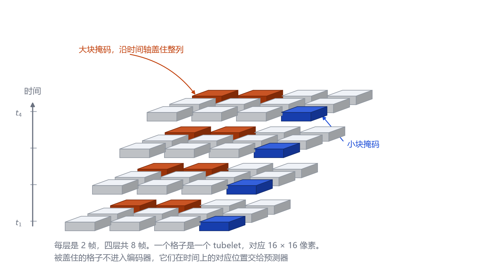
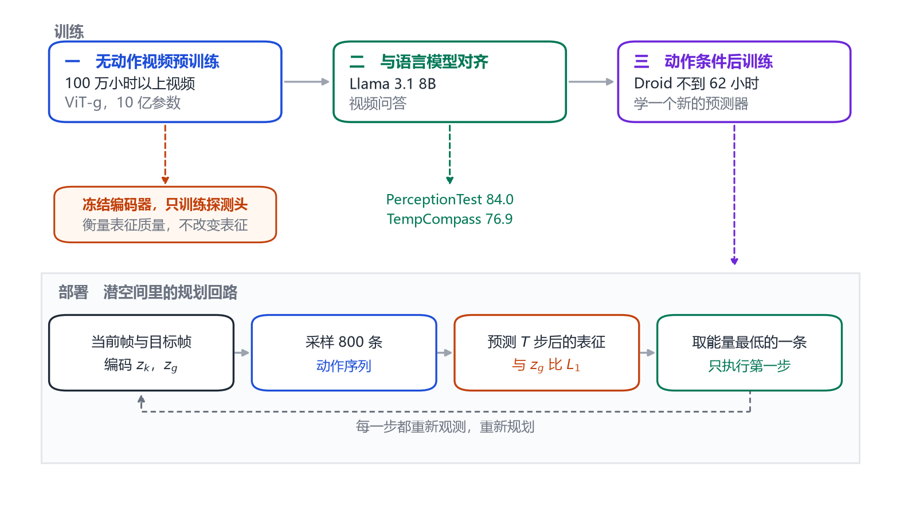

# 第 9 章　从图像到视频

一段十秒钟的手机视频，拍的是有人把桌上的杯子端起来。你按下暂停，得到的每一帧都是静止的画面。单看第三帧，杯子和手都在，看不出谁对谁做了什么。单看第七帧，杯子已经离开桌面十厘米。把两帧放在一起，一个动作就出来了。

第 8 章的 I-JEPA 只看一张图。它把图切成小块，遮住一部分，让模型从剩下的部分预测被遮住的那些块的表征。这个框架里少了一样东西，就是时间。图片给出的是一个瞬间，模型只能学到“这里有什么”；视频给出的是连续的瞬间，模型可以学到“什么在变、怎么变”。

把 I-JEPA 的掩码从平面挪到时空里，就得到 V-JEPA。这个改动听起来只是把二维的块换成立方体，实际影响比它看起来大。视频里的相邻帧几乎一样，一个偷懒的模型可以直接把前一帧的特征抄过来应付预测，这样学不到任何关于运动的东西。掩码要防的正是这种抄近路。

这一章沿着 V-JEPA 到 V-JEPA 2 的路线走。前半段讲结构，后半段讲一个容易混淆的地方。冻结编码器做评估，和冻结编码器做动作条件后训练，是两件目的完全不同的工作。

## 9.1　多出来的一维

一个彩色视频片段在程序里是一个四维数组，三个空间维加一个通道维，通常写成 $T \times H \times W \times 3$。$T$ 是帧数，$H$ 和 $W$ 是画面的高和宽。这个数组里有一部分信息单帧就有，颜色、纹理、物体的位置；另一部分只在时间方向上存在。

有个例子可以自己验证。同一段视频里截两帧，一帧是杯子在桌上，一帧是杯子在手里。两张图的差别是位置和持握关系，但“杯子被拿起来了”这个判断还需要第三样东西，就是两帧的先后顺序。把顺序倒过来，同一个动作变成“杯子被放下了”。像素里没有先后，顺序来自你怎么读它。视频多出来的那个维度，就是把这个顺序写进数据里。

时间还解决了遮挡。一个物体被另一个物体挡住，在一帧里它等于不存在。多看几帧，被挡的东西从左边进去、从右边出来，你就知道后面有个东西在移动。人对世界的很多常识就是这么做出来的，而单张图片提供不了这类证据。一张桌子下面有只猫，只有一条尾巴露在桌沿外，照片里那是一条尾巴；视频里尾巴摆了摆，桌子下面就有了一只猫。

从自监督学习的角度看，视频还有一个更实际的用处。第 8 章说过，I-JEPA 的正样本来自同一张图的两个掩码块，这在第 15 章会被批评成“坏视图”，因为同一个物体的两个裁块共享了太多低级统计量。视频天然提供了另一种东西，同一场景在不同时刻的观测。光照在变，视角在轻微移动，有东西在动，但场景的语义没变。这种“看起来不一样、指的却是同一件事”的配对，恰好是自监督最想要的。

代价是冗余。一秒三十帧，相邻两帧的差异经常只有几个像素。要让模型真的从视频里学到运动，得先把这种冗余掐掉，否则预测任务会退化成复制上一帧。

还有一层代价在数据这一端。文本可以从网上直接抓，清洗一下就能用；视频要解码、要抽帧、要按内容去重，一段一小时的素材处理完可能只剩几分钟有用的片段。第 1 章说过语言模型靠的是“有多少文字就有多少免费样本”，视频没有这份便宜可占。这也是为什么视觉自监督的规模数字总是比语言模型小两三个数量级。

## 9.2　时空 tubelet 与多块掩码

把图片切成小块的做法，到视频里变成切小方块。ViT 处理图像时把 $16 \times 16$ 像素的区域拉成一个词元。V-JEPA 在这两个空间维之外再加一个时间维，取连续 2 帧、每帧 $16 \times 16$ 像素，合成一个 $2 \times 16 \times 16$ 的立方体。这种东西叫时空管（spatio-temporal tubelet），下文就写 tubelet。

一个 16 帧、$224 \times 224$ 分辨率的片段，按 2 帧一管、空间步长 16 像素切下去，时间方向得到 8 段，每个空间方向得到 14 段，总共 $8 \times 14 \times 14 = 1568$ 个词元。单张图是 196 个词元，注意力的矩阵规模差六十多倍。这是视频模型比图像模型贵的直接原因，也是为什么视频预训练的门槛一直是算力而不是想法。

掩码在时空里做，形状和 I-JEPA 不一样。V-JEPA 的论文用了两种掩码。短程掩码取 8 个随机采样块的并集，每块覆盖单帧面积的 15%；长程掩码取 2 个块的并集，每块覆盖 70%。所有块的长宽比在 0.75 到 1.5 之间随机，两种掩码平均下来遮掉约 90%。关键在于每个块都沿整个时间维延伸，而不是只遮某一帧的某个位置。

这个细节值得多说两句。假设只遮第 5 帧的左上角一块，模型可以看第 4 帧和第 6 帧的同一位置，那里的内容和第 5 帧几乎一样，直接抄就完事。遮住整条时间轴上的同一位置，模型手上只剩周围区域和其他时间段，它得靠“这里原本有什么、它可能怎么动”来推断。视频的空间冗余和时间冗余，在这里从帮手变成了必须绕开的陷阱。

还有一个不起眼但影响很大的部件，位置编码。V-JEPA 用的是绝对的正弦位置编码，V-JEPA 2 换成了三维的旋转位置编码，把特征维切成大致相等的三段，分别按时间、高、宽三个轴做旋转。好处在放大时显出来，输入从 16 帧变到 64 帧、从 256 变到 384，绝对编码得重新学一套表，旋转编码只要外推。论文里说这个改动让最大的模型训练更稳。

如图 9-1，四层小方块沿时间轴排开，每层是一个时刻的画面切成 4 乘 3 的网格，橙色那一列在每一层都被遮掉，蓝色那一格也是。模型看到的是每层剩下的格子，要补的是一整列。

<figure class="fig">

<figcaption><b>图 9-1</b>　时空 tubelet 与多块掩码。每一层对应两个视频帧，格子里是一个 $2 \times 16 \times 16$ 的 tubelet。被遮的块沿时间轴贯穿所有层，所以模型无法从相邻帧抄到答案。</figcaption>
</figure>

每个片段还会采样两份掩码，一份短程一份长程，共用同一个目标编码器的输出。一次前向算两个预测任务，目标表征只算一遍，省掉一半开销。论文的消融里，两份掩码比一份好，多个小块比一个整块好。后一条的直觉是，多个小块拼出来的洞形状不规则，模型没法靠“这块大概是个什么均值”来蒙。

## 9.3　预测特征而不是生成画面

V-JEPA 的预测目标和 I-JEPA 一样，是被遮位置的表征，不是像素。损失用 L1，目标由动量编码器给出，梯度只进上下文编码器和预测器。

不做像素重建，这个理由在视频上比在图片上更硬。一段风吹树叶的视频，每一片叶子的位置都由风速、叶柄弹性、上一刻的状态共同决定，本质上接近混沌。要求模型预测这些像素，等于让它拟合一个它看不到输入的随机过程。模型能做的只有输出一个模糊的平均，然后被 L1 惩罚。到了表征空间，这些细节早被编码器压掉了，剩下的“有一片树在动”是可预测的。

论文给了一个训练效率的对比。冻结评估下，V-JEPA 在 Something-Something v2 上的准确率高于像素重建类方法，训练用的墙钟时间明显更短。这个结论有直观解释。像素目标要求每个词元还原成几百个像素值，容量花在纹理和光照上；表征目标只要求还原一个向量，容量花在语义上。同样一块 GPU 时间，后者能看完更多视频。

具体结果是这样。ViT-H/16，384 分辨率，只在视频上训练，冻结主干加注意力探测，Kinetics-400 上 81.9，Something-Something v2 上 72.2。预训练数据是 200 万个视频。论文里还有一句值得记住的话，这些表征在运动和外观两类任务上都表现不错，而且不需要调整模型参数。

Something-Something v2 这个基准值得单独说。它的视频里，人对着镜头做“把某个东西从左移到右”“假装把东西扔出去”这类动作，标签描述的是动作本身，跟物体和场景的外观无关。只靠静态特征几乎做不对。V-JEPA 在这个基准上的分数说明，它学到的东西里有运动，不只有物体。

把这两个数字和后面 V-JEPA 2 的数字放在一起看会更有意思，但先别急，中间还有一层要拆。

## 9.4　冻结主干在测什么

上一节那句“冻结主干加注意力探测”，需要拆开讲，因为后面有一处特别容易混。

冻结主干的意思是编码器权重一个都不更新。在它上面接一个很小的网络，叫注意力探测头（attentive probe）。结构是几层 Transformer，用交叉注意力把编码器输出的一串词元池化成一个向量，再接一个线性分类器。V-JEPA 2 里这个探测头是 4 层，训练时只用目标任务自己的数据。

这个协议测的是表征里有没有某个信息。编码器像一个已经把世界读进脑子的人，探测头是一张答题卡加一支笔。不允许他重新学习，只允许他把已经知道的东西写到卡上。分数高，说明信息在表征里，而且是线性可读的；分数低有两种可能，信息不在，或者信息在但排布得太绕。

那为什么不用微调。微调能让编码器为任务改变自己，分数通常更高，但那时你测的是“这套初始化加上这个任务一起能学到什么”，不再是“这套预训练本身学到了什么”。V-JEPA 2 在语言对齐那一节把这件事说得很直白：冻结视觉编码器给出的是关于视觉特征质量的更干净的信号，微调编码器则给出更好的最终性能。两个数字回答两个不同的问题。

记住这一点，因为 9.7 节要讲的事情跟它长得很像。那里也冻结编码器，也在上面接一个新网络，也只用少量数据训练。区别在于，那里训练出来的预测器是产品本身，不是量具。它要能吃进动作、能在潜空间里往前推演、最后驱动一台真实的机械臂。评估用的是尺子，后训练造的是发动机。把这两件事混成一件，会推出很荒谬的结论，比如“既然冻结的编码器已经能打 77.3，何必再花力气后训练”，或者反过来“既然需要后训练，说明预训练的表征不够好”。

## 9.5　V-JEPA 2 的规模

V-JEPA 给了一个方向，V-JEPA 2 把这条路放大了。数据从 200 万段视频涨到 2200 万段，总时长超过 100 万小时。模型从 3 亿参数的 ViT-L 涨到 10 亿参数的 ViT-g。训练迭代从 9 万步涨到 25.2 万步。输入从 16 帧、256 分辨率，涨到 64 帧、384 分辨率。

这里有一个工程上的做法值得记住，叫渐进分辨率训练。先用短的、低分辨率的片段跑完预热和大部分训练，最后一段才把分辨率和时长提上去。原因是高分辨率的长片段在前向和反向上的开销按平方增长，全程都用它跑，预算撑不住；只在末尾用，模型又已经定型，适应不了新的输入尺寸。把退火那一段留给它，效果和成本都合适。

放大之后的数字。Something-Something v2 上 77.3，比 V-JEPA 的 72.2 高 5.1 个点。这个分数来自 ViT-g 在 384 分辨率下的冻结评估，头上接的还是那个 4 层探测头。也就是说，表征本身变强了，不靠任务数据的补贴。

另一个数字更能说明“预测”这件事。Epic-Kitchens-100 上有个动作预期任务，给一段做菜视频的前若干秒，要求在动作真正发生之前说出下一个动作是什么，指标是 recall-at-5，即正确答案落在前五个候选里的比例。V-JEPA 2 拿到 39.7，论文说这比之前最好的任务专用模型相对高出 44%。

同一个表征，既能分类已经发生的动作，又能预测还没发生的动作，说明它抓住的不只是“现在画面里有什么”，还有“这个场面接下来会往哪走”。这就是世界模型的雏形，但还缺一样东西，动作。它知道人会怎么做菜，不知道一台机械臂推一下会怎样。

## 9.6　把表征接到语言上

在讲动作之前，先补一个分支。V-JEPA 2 除了能分类、能做预期，还能回答关于视频的自然语言问题。

做法借自 LLaVA 那一类多模态模型。视觉编码器输出一串词元，用一个多层感知机把它们投影到语言模型的输入空间，然后按三个阶段训练：先用图像描述数据只训投影层，再用大规模图像问答训整个模型，最后用视频描述和视频问答继续训。语言模型取 Llama 3.1 的 8B 版本，对齐数据是 8850 万条图文和视频文本对。

结果在 8B 这一档里是最好的。PerceptionTest 上 84.0，TempCompass 上 76.9。

这件事的意义不在分数，在顺序。在此之前，一个流行判断是视觉编码器必须先和文本做过对比学习，才能接进语言模型，因为语言模型需要的是“已经和词对齐过的语义”。CLIP、SigLIP 这类编码器就是那么训的。V-JEPA 2 的编码器在预训练阶段完全没见过文字，只见过视频，接一个投影层之后照样能工作得很好。论文把这个当成反例提出来，说这与通常的看法相反。

可以这样理解。语言对齐需要的是表征里有没有可以命名的概念，而不是表征是不是用文本训出来的。一个从视频里长出来的表征，如果它把杯子、拿起、倾斜这些区分开了，投影层要做的只是给它们配上词。反过来，如果表征里只有纹理，配多少词也没用。

这条分支到此为止。它给模型装上了嘴，没给它装上手。

## 9.7　动作条件后训练与规划

回到动作。到这里模型能表征、能预测、能答问，但它对“我做一个动作，世界会怎样”没有概念。预训练时它看到的所有洞都是随机挖的，从来没把某一帧的表征和导致这一帧的那个动作配过对。

V-JEPA 2 的后训练补这一环。编码器继续冻结，只训练一个新的预测器，约 3 亿参数、24 层、16 个注意力头。输入是三样东西按时间交错排成的序列，每一帧的表征、末端执行器的状态、相邻两帧之间状态的变化量。第三样就是动作。对一台 7 自由度的 Franka 机械臂，这个向量是 7 维，前三维是位置增量，中间三维是姿态的欧拉角增量，最后一维是夹爪开合。

预测器用块因果注意力，某个时刻的每个词元只能看当前时刻和之前的动作、状态、画面。输出是下一帧的表征，损失是 L1。除了逐帧的教师强制损失，还加了一项两步的 rollout 损失，把预测器自己的输出喂回去再预测一步，两步都对。加这一项是为了压住推理时的误差累积，因为规划时模型得自己往前滚，没人给它真值。

训练数据是 Droid 数据集里的机器人操作视频。这里要看清楚它的性质。不到 62 小时，约 2.3 万条轨迹，每条三五秒，4 帧每秒，256 分辨率，一台固定机位的相机拍桌面上的机械臂。没有奖励，没有任务名，没有成功标记，只有原始视频和末端状态。这是自监督，不是强化学习。

然后就到规划。给定当前观测的画面和一张目标画面，两张都过编码器，得到 $z_k$ 和 $z_g$。抓取放置这类要经过好几个阶段的任务，光给最终目标不够，论文的做法是额外给两张中间目标的图片，模型先对着“抓住杯子”那张规划 4 步，再对着“杯子到了目标附近”那张规划 10 步，最后 4 步对着终点。这是一条人工切分的时间线，也是这套方法目前的短板之一。

单张目标的情形下，要解的问题是

$$
E(\hat{a}_{1:T}; z_k, s_k, z_g) = \lVert P(\hat{a}_{1:T}; s_k, z_k) - z_g \rVert_1 ,
$$

其中 $\hat{a}_{1:T}$ 是待求的动作序列，$P$ 是那个动作条件预测器的完整前向，$s_k$ 是当前末端状态，$T$ 是规划时域，$\lVert \cdot \rVert_1$ 是逐元素的绝对值和。能量衡量的是，按这条动作序列走 $T$ 步之后，模型想象出来的状态离目标状态有多远。求最小值用交叉熵方法，每一步从高斯分布里采 800 条动作序列，取能量最低的 10 条去更新分布的均值和方差，迭代 10 轮，最后返回均值。

拿到序列之后只执行第一个动作，然后重新观测、重新规划。这套做法叫滚动时域控制，机器人控制里的经典套路。时域取 1 就够了，因为抓取、伸向物体这类任务本身是贪心的，走一步看一步不吃亏。

如图 9-2，上面是三个阶段，下面就是这个回路。

<figure class="fig">

<figcaption><b>图 9-2</b>　V-JEPA 2 的三段训练与部署时的规划回路。第一阶段旁边接出冻结编码器的评估支路，第二阶段引出视频问答成绩，第三阶段把新预测器送进回路。回路每走一步都重新观测。</figcaption>
</figure>

实际的数字。在 RTX 4090 上，每个动作 16 秒。作为对比，论文里拿一个视频生成式的世界模型 Cosmos 做同样的事，采样条数更少、每步要 4 分钟，而 V-JEPA 2-AC 的成功率在所有任务上都更高。原因不难想。像素生成要在几十个去噪步里走完一整幅画面，表征预测只推一串向量。走一条完整轨迹要几十个动作，这个差距会乘以几十。

成功率按 10 次试验平均，两个实验室各测一遍再取平均。伸向目标 100%，抓住杯子 65%、抓住盒子 25%，带着物体伸过去 75%，抓取放置杯子 80%、盒子 65%。两台机械臂所在的实验室都没有采过任何数据，也没有针对这些任务做过训练，目标只是一张照片。

数字里也有不好看的地方。盒子比杯子难抓，因为盒子的边缘和角让接触变得复杂，抓住了也不容易保持。这类失败集中在接触丰富的地方，也就是手指和物体表面真正发生力交换的那一段，而预测器看到的只是接触前后的画面变化，力本身不在输入里。论文自己列了三条限制。相机位置敏感，模型要从单目画面里自己推断动作坐标系的方向，机械臂基座经常不在画面里，这个问题就变得没有定义，实验中换了好几个机位才找到一个稳定的。长时程靠不住，自回归的误差会累积，动作序列的搜索空间又随时域指数增长。目标只能是图片，想说“把杯子放到盘子上”得先拍一张那样的照片。

从图像到视频，模型多了一维；从视频到动作，模型多了一个输入。两次扩展用的是同一副骨架，编码器压出表征，预测器在表征里往前推，代价是多出来的那一维和那一个输入都要用数据填。第 10 章把这件事往一般处说，看看“世界模型”这个词在别的做法里指什么，以及为什么有人坚持要把像素画出来。
