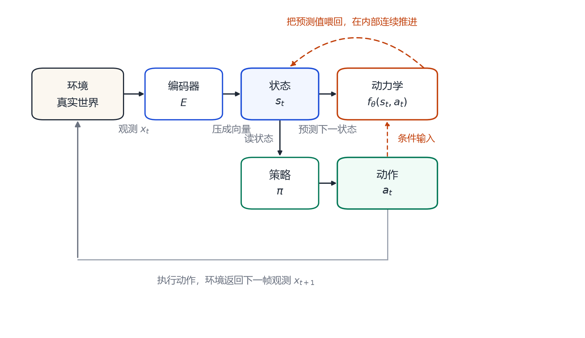
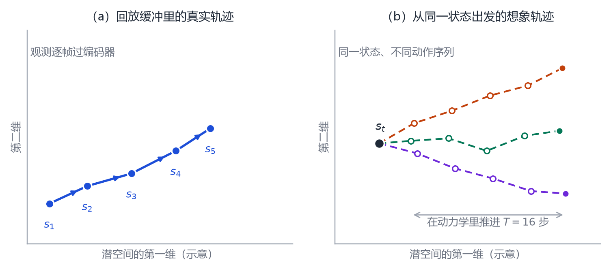

# 第 10 章　世界模型

入冬后的第一个早上，桥面结了一层薄冰。你骑到桥中央，后轮轻轻一滑，身体先于意识做出反应，肩往下压，车把回正，稳住了。事后你大概说不清自己做了什么，但那一刻，脑子里已经预演过“如果现在往左倒会怎么样”。

这种预演每个人都在做。木匠下锯之前会想板子往哪边翘，厨师翻锅之前知道蛋会落在哪个位置，篮球运动员出手的瞬间已经算好了打板的角度。他们都没有真的试一遍，而是在内部的某个模型里试了一遍。

要给机器同样的能力，需要两个东西。一个能把“现在”压成一段可计算的描述，一个知道“做了某个动作之后，这段描述会变成什么”。两件合起来，研究者叫它世界模型（world model）。

这一章讲它怎么被造出来。会看到 2018 年那篇把变分自编码器、循环网络和一个小控制器拼起来的论文，看到 Dreamer 把想象变成真正训练策略的地方，也看到这条路的账记在谁头上。

## 10.1　什么叫世界模型

把时间离散成 $t = 0, 1, 2, \dots$，每一刻有两个量。状态 $s_t \in \mathbb{R}^{n}$ 是这一刻世界的有用信息，动作 $a_t \in \mathbb{R}^{m}$ 是机器这一刻做的事。世界模型的骨架是一条转移函数

$$
s_{t+1} = f_\theta(s_t, a_t),
$$

$f_\theta$ 是带参数 $\theta$ 的网络，给定当前状态和动作，它吐出下一个状态。

这条式子和普通的预测模型只差一个输入，差别却很本质。视频预测模型看前面若干帧，回答“接下来画面会是什么”。世界模型多了一个动作，回答的是“如果我这样推，画面会变成什么”。前者只能看，后者可以被询问。

台球桌是个好例子。看一遍录像，你能猜出这杆球进不进；但要练出一手好球，你需要的是另一种知识，往左偏三度打会怎样，加一点右塞会怎样。这种“如果……就……”的知识必须以动作为自变量，录像本身给不了。

地图和地理的关系可以借来打比方。地图不复制每一棵树，它按比例尺挑出道路、河流、等高线，用一张纸回答“从这里到那里要不要翻山”。世界模型做的事类似，它不复制世界的每一个像素，只保留“动作会把事情推向哪里”所需的那部分结构。比例尺选错了，地图就没用；状态选错了，模型也就只是一个昂贵的视频生成器。

另一个特征是在内部连续用。把 $f_\theta$ 的输出接回输入，再配一个动作，就得到两步之后的状态；重复 $k$ 次，得到一条想象的轨迹。整个过程不碰真实环境，只花几次矩阵乘法。这一点决定了它的经济价值。真实环境的一步可能要等半秒物理时间，可能磨损一次机械臂，可能烧掉一台发动机；模型里的一步只是浮点运算。整个闭环如图 10-1。

<figure class="fig">

<figcaption><b>图 10-1</b>　世界模型的闭环。实线是真实回路，观测经编码器变成状态，状态经策略产生动作，动作作用于环境后变成新观测。橙色虚线是省下的那一段，预测的状态可以直接喂回动力学，在内部连续推进。</figcaption>
</figure>

图 10-1 里那条从动力学指回状态的虚线，是整张图最值钱的一笔。实线围出的部分，机器必须等世界回应才能走下一步；虚线绕过了世界，机器可以自己跟自己推演。所有关于世界模型的说法，归根到底都在讨论这条虚线有多可信。

还有一个特征不那么显眼，却决定了后面所有的分歧，就是状态到底是什么。它可以是一张图，可以是一个 32 维向量，也可以是另一个网络中间层的激活值。选什么当状态，等于选了什么该被建模、什么可以大方丢掉。

有了这个骨架，用途就分成三种。在模型里试几条动作序列，按代价排序挑一条执行，这叫模型预测控制。把策略的更新放在想象出来的轨迹上，这叫在梦里训练。把隐状态直接当特征喂给别的模块，这是把世界模型当表征学习器用。前两种稍后会各给一个例子，第三种留给下一章。

## 10.2　三个零件

2018 年，Ha 与 Schmidhuber 把这件事拆成三个可以分别训练的网络，分别叫视觉 V、记忆 M、控制器 C。拆开的理由很实际，三块的目标不一样，分开训更省事。论文提到端到端一起训原则上可行，只是分开更实用，在一块 GPU 上不到一小时就能训出一个能用的模型。

视觉部分是一个变分自编码器（Variational Autoencoder，VAE）。它由编码器和解码器两半组成，编码器把一帧画面压成一个向量 $z$，解码器再把 $z$ 还原成画面，训练目标是让还原结果尽量接近原图。瓶颈卡在中间那个小向量上，模型想让还原误差小，就必须把画面里真正有结构的东西塞进这几个数。

赛车任务里，$z$ 只有 32 维。画面先被缩到 64×64，一帧有 12288 个数，压到 32 个，比例是 384 比 1。留下来的通常是路面的弯向、车身边缘的位置、速度带来的整体明暗变化；丢掉的是柏油颗粒、远处的云、仪表盘上的小字。这种丢法是有选择的，因为解码器会惩罚那些丢了就看不出原图的细节。

记忆部分是一个带混合密度输出的循环网络（Mixture Density Network RNN，MDN-RNN）。它预测的是

$$
p(z_{t+1} \mid a_t, z_t, h_t),
$$

$a_t$ 是这一步的动作，$z_t$ 是这一步的隐向量，$h_t$ 是循环网络的隐状态。输出不是一个点，而是一组高斯的参数，采样时才落成一个具体的 $z_{t+1}$。这么做是因为环境本身有随机性。如果前方有两条都可能走的路，点预测会把两条路平均成一条夹在中间、现实里根本不存在的小路，控制器学到的东西就全错了。

控制器小得不成比例。它是一层线性映射

$$
a_t = W_c\,[z_t\; h_t] + b_c,
$$

把当前隐向量和循环隐状态拼起来，直接乘一个矩阵得到动作。赛车任务里它只有 867 个参数，整篇论文的三块模型分别是 4348547、422368 和 867 个参数。

训练顺序是固定的。用随机策略采集 10000 条轨迹，拿这些画面训练 V；用训练好的 V 把每一帧换成隐向量，配上当时记录的动作，训练 M；V 和 M 都冻结之后，用协方差矩阵自适应进化策略（CMA-ES）去搜 C 的那 867 个参数。真正要紧的是分工，世界模型从头到尾没看过一眼奖励，它只学画面怎么变；奖励只有控制器知道。

分工的效果可以直接从成绩里读出来。只把 $z_t$ 交给控制器，车开得歪歪扭扭，100 次试驾平均 632 分，标准差 251。给控制器加一层隐层，涨到 788 分。把 $h_t$ 也一起给它，同一个线性控制器突然会切弯了，平均 906 分，标准差 21。论文把连续 100 局平均 900 分定为解出这个环境。

三个数字说明的事情比分数本身重要。$z_t$ 是当下的一张快照，$h_t$ 是循环网络对未来的压缩。控制器拿到 $h_t$，等于拿到了“接下来大概会怎样”的摘要，所以它不用真的规划，也能做出带预判的动作。一个只会对已发生的事做反应的前馈策略，做不到这一点。

用随机策略采数据这一步，在赛车和射击这类任务上够用，因为随机乱开也能覆盖大部分路面，随机乱走也能撞上大部分火球。任务一旦变复杂，问题就来了。有些房间只有先学会开门才进得去，随机策略永远采不到那些画面，模型也就永远学不会门后面是什么。论文在第 5 节专门讨论这一点，解决办法是让训练迭代起来，边学边采，用当前策略去探索模型还陌生的地方。这个想法后来成了 Dreamer 系列的标准配置。

## 10.3　在梦里练车

第二个实验换了个更狠的场地。VizDoom 的 Take Cover 场景里，屏幕另一端的怪物不断扔火球，玩家要尽量活着。这个任务没有显式奖励，存活步数就是分数，单局上限 2100 步，大约 60 秒，连续 100 局平均活过 750 步算解决。

这里 M 多了一项工作，除了预测 $z_{t+1}$，还要预测这一帧之后是否死亡，记作 $d_{t+1}$。有了这一位，M 就能被包装成一个完整的强化学习环境。研究者写了一个 gym 接口套在 M 外面，智能体在里面训练，从头到尾没有一帧真实像素进入 V。

训练完把策略搬回真实游戏。虚拟环境里它活了约 900 步，真实环境里约 1100 步，都远超 750 的及格线。这个结果有点反直觉——梦里比现实更难。

原因在温度。M 输出混合高斯的参数，采样时有一个温度 $\tau$，$\tau$ 越大，落下来的 $z_{t+1}$ 越随机。论文给了五档对照，每一档都在虚拟环境里训练、在真实环境里测试 100 局。$\tau = 0.1$ 时，智能体在虚拟环境里拿到 2086 分，搬到真实环境只剩 193 分，比随机策略的 210 分还低。$\tau = 1.15$ 时，虚拟分数掉到 918，真实分数升到 1092。作为参照，当时 OpenAI Gym 榜单上这个场景的最好成绩是 820。

这组数字值得停下来看。模型越确定，它在自己眼里越完美，策略越容易找到模型的漏洞。假设模型没学会火球撞到墙会反弹，策略就会贴着墙站，因为在它的经验里那是最安全的位置。假设模型没学会连续两帧里火球的位置是相关的，策略就会在两团火球之间直穿过去。这些漏洞在真实环境里会立刻要命。

给模型加噪声，等于给策略配了一个对手。它在梦里遇到的火球更没规律，学出来的躲法就更保守。$\tau$ 从 1.15 抬到 1.30，真实分数从 1092 降到 753，标准差从 556 掉到 139。分数换了一部分，稳定性换回了另一部分。

“梦里很好，醒来很糟”，在这组数字里第一次有了具体的形状。它同时暴露了一件更麻烦的事，误差不是均匀分布在状态空间里的，策略会主动去找误差集中的地方，因为那里往往看起来回报最高。

## 10.4　把想象变成训练场

Dreamer 系列把这件事做成了标准流程。它的世界模型叫循环状态空间模型（Recurrent State Space Model，RSSM），状态被拆成两半

$$
h_t = f_\phi(h_{t-1}, z_{t-1}, a_{t-1}), \qquad
\hat{z}_t \sim p_\phi(\hat{z}_t \mid h_t), \qquad
z_t \sim q_\phi(z_t \mid h_t, x_t),
$$

$x_t$ 是这一帧观测。$h_t$ 是确定性的，由序列模型把历史动作和过去的隐变量压进去，负责记；$z_t$ 是随机的，从一组离散分布里采样，负责表示当下还说不准的部分。$q_\phi$ 是编码器，看得到画面；$p_\phi$ 是动力学预测器，只看得到 $h_t$。

拆开的好处要在想象的时候才显出来。真实训练时 $z_t$ 由编码器看画面得到，想象时没有画面，就改用 $p_\phi$ 采样一个。编码器和解码器都可以不参与，一步想象的代价只剩下几次小矩阵乘法。

策略和价值函数就在这些想象出来的状态序列上更新。从回放缓冲里取一段真实片段，编码成 $s_t$，从这里往前推 $T = 16$ 步。每一步由 actor 采样动作，由动力学产生下一个状态，由奖励头给出 $\hat{r}_t$，由终止头给出 $\hat{c}_t$。折扣因子取 0.997，超出 16 步的部分用 critic 的估值补上，构成 $\lambda$-回报。梯度只在这条想象的链上流动，不经过任何环境。这一段真实片段与想象分叉的对照如图 10-2。

<figure class="fig">

<figcaption><b>图 10-2</b>　真实轨迹与想象轨迹。(a) 回放缓冲里的一段真实片段，逐帧编码成状态序列；(b) 从同一状态出发，策略在动力学上采样三条动作序列，走出三条不同的路。真实世界只会给出其中一条。</figcaption>
</figure>

图 10-2 左右两半是同一件事的两个时刻。左边是已经发生过的，五帧画面变成五个状态；右边是从最后一个状态分叉出去的三种可能。整个分叉只花一次批量前向的时间，而真实世界要验证其中一条，得等 16 步物理时间。

这就是样本效率的来源。真实环境里试一条路要 16 步的时间，模型里试一百条路只要一次前向。省下的样本是用算力换的，而算力比机械臂的时间和磨损便宜得多。Dreamer 系列的每一代都在把这条换算式往更极端的方向推。

代价也在这里埋下。想象轨迹上的每一步都依赖上一步的预测，16 步之后，状态已经离真实数据很远了。

## 10.5　一套超参跨域

Dreamer 的第三代做的事情听起来不像研究，它把同一套超参数丢到 150 多个任务上，一个都不改，然后赢。这些任务横跨 Atari 的 57 个游戏、连续控制的 18 个本体感知任务、20 个纯图像输入的控制任务、23 个专门用来测试信用分配和奖励尺度的 BSuite 环境，还有 Minecraft。

跨域真正的难点是尺度。Atari 的奖励是 0 到 1 的分数，机器人控制的奖励可能是负几百的力矩代价，Minecraft 的奖励稀疏到一整局只出现几次。同一个学习率、同一个熵系数，在这些尺度上不可能同时合适。

论文给的解法是一堆看起来零碎、合起来才成立的技巧：观测和奖励都过一遍 symlog 变换，$\operatorname{symlog}(x) = \operatorname{sign}(x)\ln(1+|x|)$，读出来时用反函数解回去，这样大数值不再主导梯度。动力学损失和表征损失各带一个 stop-gradient，系数不同，并且都被裁在 1 nat 以下不计（1 nat 约等于 1.44 bit），保证表征既不会退化成常数，也不会为了可预测而丢掉细节。所有离散分布都掺进 1% 的均匀分布，让它们永远不可能变成确定分布，KL 不会出现尖峰。回报用 5% 到 95% 分位的差做分母，再做系数 0.99 的指数滑动平均；稀疏奖励下标准差接近零，用标准差会放大噪声。熵系数固定为 $3 \times 10^{-4}$，前提是回报已经被压到 $[0, 1]$ 附近。

结果比任何单项技巧都干净。默认模型 200M 参数，论文另训了 12M 到 400M 共六档，超参一个没动，曲线随规模单调变好，需要的环境交互反而更少。调参这件事在这套目标里已经不敏感了。

这三代之间的跨度也不小。第一代只能做连续控制，第二代在 Atari 上超过了人类水平，第三代才做到一套配置通吃。前两代的进步靠的是模型容量和训练技巧，第三代真正的贡献是把“尺度”这件事从超参数里拆了出去。

Minecraft 是这套配置的验收场。采钻石要求先砍树、做工作台、做木镐、下矿、找铁、做铁镐，一共 12 件物品，全靠稀疏奖励串起来。单局 36000 步，约 30 分钟，熟练玩家大约 20 分钟能拿到钻石。DreamerV3 在 100M 环境步之内让所有种子都采到了钻石，用一块 GPU 训了 9 天。作为对照，VPT 用了 720 块 GPU、同样 9 天，还需要人类玩家的键鼠示范数据。差别不在算力总量，在于前者把预算花在了自己推演上。

**表 10-1**　三代世界模型的对照

| 维度 | World Models（2018） | Dreamer 系列（至 2023） | JEPA 路线（V-JEPA 2-AC） |
|---|---|---|---|
| 状态是什么 | VAE 压出的 32 或 64 维向量 | 确定性隐状态 $h_t$ 加随机隐变量 $z_t$ | 预训练编码器输出的特征向量 |
| 动力学怎么学 | MDN-RNN 预测下一帧的隐向量 | 序列模型加隐变量，KL 平衡与 free bits | 在特征空间里做动作条件预测 |
| 像素解码 | 有，重建每一帧 | 有，重建输入 | 没有 |
| 策略在哪学 | 线性控制器，用 CMA-ES 搜参数 | actor 与 critic 都在想象轨迹上更新 | 不训练策略，用模型预测控制在线选动作 |
| 代表证据 | CarRacing 906±21 | Minecraft 里首个采到钻石 | 62 小时机器人视频，零样本规划 |

表 10-1 里第三列的来历值得单独说一句。V-JEPA 2 先用超过 100 万小时的互联网视频预训练一个视觉编码器，再拿不到 62 小时的无标注机器人视频，在上面训一个带动作输入的预测器。整个过程没有解码器，没有一帧画面被重建。这是下一章的主题。

## 10.6　代价

三代模型一路向上，但世界模型这条路有几笔账必须记清楚，否则很容易把“能生成逼真画面”误当成“理解了世界”。

第一笔是容量账。World Models 里 V 有 434 万个参数，C 有 867 个，比例大约五千比一。像素级重建要求模型记住每一块砖的纹理、每一片叶子的抖动，而这些细节对“往哪开”几乎没有影响。容量被花在了不被决策使用的地方。一张 64×64 的图里，真正决定动作的可能就是路沿的走向和一个模糊的速度感，剩下的都是噪声，而模型必须先把噪声也学会，才能把重建误差压下去。

第二笔是误差账。单步预测误差很小，不代表十几步之后还小。$f_\theta$ 的输出是下一步的输入，第一步的偏差会被当成事实继续往下推。更麻烦的是，模型训练时只见过真实数据的分布，一旦自己的预测把状态推到分布外，误差会突然变大，而且它自己不知道已经出了界。这条曲线在每篇论文里画得都不一样，能确定的只有方向，误差随步长增长，增长快慢取决于任务本身有多可预测。台球比天气可预测，天气比人群可预测。

第三笔是策略的账。10.3 的温度实验是它的实证。策略不是被动地承受模型误差，它会主动去搜索误差。强化学习的目标是最大化回报，模型里哪个区域的回报被高估，策略就往哪里钻，哪怕那个区域在现实中根本不存在。这一类行为在文献里有各种名字，本质是同一件事，模型和策略在互相利用。

既然像素重建这么贵，一个自然的想法是干脆不重建。只保留“对决策有用的那部分”，让预测发生在抽象状态之间。这条路放弃了生成能力，换来了容量和误差上的宽松。它不能生成一段视频给人看，但能直接给控制器提供“下一步会变成什么样”。

两种走法对应两种用途。要当模拟器、要造合成数据、要给人看，就得把像素做好；要给机器人做规划、要在有限算力下反复推演，就该把状态压到只留决策相关的那一部分。第 11 章要走的是后一条，那里会看到预测器怎么接上动作输入，怎么在潜空间里采样几十条轨迹并按代价排序，以及为什么“状态该是什么”这个问题在那里第一次有了明确的答案。

回到结冰的桥面。你之所以没摔，是因为在车轮打滑的那几十毫秒里，身体已经把三种可能的倒法各算了一遍，选了代价最小的那个。要让机器也这样，它需要的不只是一双好眼睛，还需要一个在动手之前先想一遍的习惯。而“想”这件事能不能便宜到反复做，取决于状态被压得有多精简。
