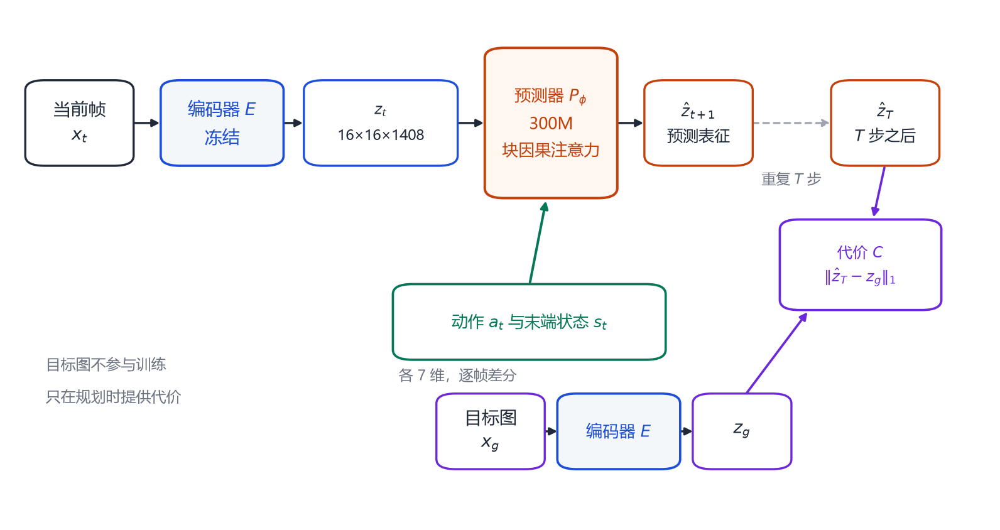
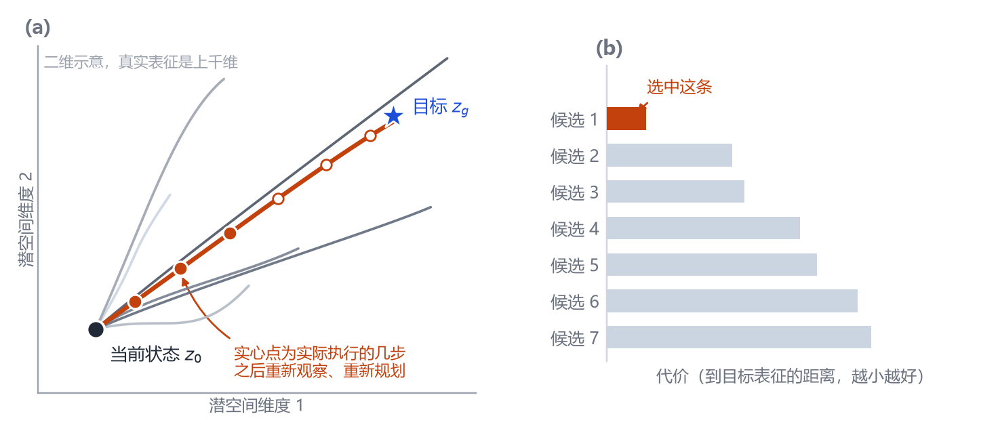

# 第 11 章　让 JEPA 成为世界模型

你伸手去够架子上的杯子，手在半空停了半秒。这半秒里你算了一遍：再往前五厘米会碰到杯沿，抬高两厘米能从上方握住把手。计算发生在动作之前，用的不是视网膜上的图像，而是图像在脑子里的一个粗糙版本。

第 10 章讲过世界模型的基本形状。给它当前状态和一个动作，它给出下一个状态，整个过程可以完全在内部进行，不必真的动手。Ha 和 Schmidhuber 在 2018 年用变分自编码器把游戏画面压成向量，用循环网络预测下一帧的隐状态，再让一个小控制器在“梦”里练习。Dreamer 系列把这套做法推到更多领域，DreamerV3 在同一组超参数下处理 150 多个任务。

这些模型有一个共同前提，内部那个状态可以是压缩过的，不必等于画面。JEPA 把这个前提推到极限，编码器把观察压成向量，预测器直接预测下一个向量，中间没有解码器，损失函数里也没有一个像素。于是问题变得尖锐，一个从不生成图像的模型，凭什么用来做决策。

这一章给两条补丁。一条是动作，让预测器知道谁在做什么；一条是搜索，在潜空间里找出能达到目标的那串动作。

## 11.1　不必预测每一片树叶

窗外有棵树。风一吹，几万片叶子各自抖动，没人能预测每一片的准确位置，初始条件的微小差别会在几秒内放大成完全不同的图案。用像素损失训练的世界模型必须为这些叶子分配容量，它们贡献的误差甚至可能超过画面里那只正在下落的球。

决策用不上这些。要把球接住，需要的是球的位置、速度、落点，不是叶子怎么晃。如果编码器被训练成只保留预测器用得上的信息，叶子这类不可预测的细节会在压缩时被挤掉，因为留住它们对降低预测损失没有帮助。这才是“不重建”的准确含义，不是省掉一个解码器，而是让信息瓶颈的位置由预测任务本身决定。

换一种说法，编码器在划等价类。同一只杯子拍两次，只有背景的窗帘位置不同，把这两张图映到同一个向量是合理的。但要是把杯口朝上和杯口朝下映到同一点，规划就永远学不会翻转杯子。丢什么不是编码器自己说了算，它由训练数据和预测目标共同决定。

这里藏着一个不太稳的地方。等价类划得太粗，预测变得容易，表征里只剩颜色和大致轮廓；划得太细，预测器负担过重，只好去记噪声。JEPA 的训练过程在这两端之间没有显式的约束，靠的是预测器的容量和数据的多样性把平衡点推到合适的位置。第 5 章讲过的塌缩，根子就在这儿。

这也是 V-JEPA 2 分两段训练的原因。前一段在超过 100 万小时的互联网视频和 100 万张图片上做无动作的掩码表征预测，决定表征里能装下什么，物体、材质、运动、场景布局大致都在。后一段只拿不到 62 小时的机器人视频，在冻结的编码器上训练一个带动作输入的预测器，决定这些表征怎么随动作变化。前者给常识，后者给因果。

## 11.2　给预测器加一个动作

原来的 JEPA 学的是 $z_{t+1} = P_\phi(z_t)$，给定现在的表征，猜下一刻的表征。这个目标能逼出物理直觉，但它对“我能改变什么”一无所知。加上动作之后，

$$
z_{t+1} = P_\phi(z_t, a_t).
$$

$z_t$ 是当前帧经过编码器得到的表征，$a_t$ 是这一步执行的动作，$P_\phi$ 是参数为 $\phi$ 的预测器，输出是下一刻的表征。同一个当前状态配上不同动作，会得到不同的未来，模型从此能回答反事实的问题。

V-JEPA 2-AC 是这个式子的一个具体实例。编码器是预训练好的 ViT-g，在整段后训练里保持冻结，每一帧独立编码成 $16 \times 16 \times 1408$ 的特征图。预测器是一个约 3 亿参数的 Transformer，24 层、16 个注意力头、隐藏维 1024。训练数据取自 Droid 数据集，不到 62 小时的桌面机械臂视频，Franka Panda 七自由度手臂加两指夹爪，分辨率 256×256，每秒 4 帧，每条片段 16 帧，正好 4 秒。

动作怎么定义。每帧都记录了末端执行器的状态 $s_k$，七维，前三维是相对机器人基座的位置，接着三维是欧拉角，最后一维是夹爪开合。动作 $a_k$ 取相邻两帧状态之差，也是七维。训练序列因此被写成 $(a_k, s_k, z_k)$ 交错排列的形式，动作、本体感受、视觉表征轮流进入预测器。注意力用块因果掩码，同一时刻的 patch 特征可以看当前和之前的动作与状态，看不到未来。位置编码用三维旋转位置编码，把每个 patch 在时空里的坐标都编进去。

块因果掩码这件事不能省。编码器对每一帧是独立工作的，一帧里的所有 patch 同时得到表征。如果预测器允许同一帧内的 patch 互相看，它就能从相邻 patch 抄到答案，损失掉下去，但模型什么都没学到。掩码把“同一时刻”和“更早时刻”分开，正是为了堵住这条捷径。

动作必须和末端状态一起喂，原因在于动作在世界坐标里是增量，增量的效果取决于起点。同样一条“向前两厘米”的指令，手在桌面高度和在半空，结果完全不同。只给动作不给位置，预测器得自己从图像里反推手在哪，误差会大得多。七维状态是一个廉价的旁路，把最难估的量直接送进去。

损失函数有两项。一项是教师强制，用真实的 $z_{k+1}$ 当监督，逐帧算 L1 距离。另一项是 rollout 损失，把预测器的输出接回输入，连续推几步，再和真实表征比。第二项专门对付误差累积，因为规划时用的正是这种自己喂自己的方式，训练和推理的输入分布必须对得上。距离选 L1 而不是 L2，是因为表征是高维的，个别维度偶尔会冒出很大的偏差，平方会把这种偏差放大成主导项，L1 对它更钝。

整个结构如图 11-1。冻结的编码器把当前帧变成表征，预测器在动作和末端状态的条件下把它往前推一步，推出来的结果再喂回去，重复 $T$ 次。目标图走另一条支路，只经过编码器，最后和预测出来的表征量一个距离。这张图里有三处值得留意，编码器那一路是冻结的，动作那一路只接到预测器上，代价那一路不参与训练，只在规划时用。

<figure class="fig">

<figcaption><b>图 11-1</b>　动作条件 JEPA 世界模型。编码器冻结，把当前帧压成表征；预测器在动作与末端状态下把它推进一步，输出再喂回自身完成多步 rollout。目标图只经过编码器，两端表征的距离就是规划时的代价。</figcaption>
</figure>

## 11.3　代价就是一个距离

规划需要一个目标。这套框架里，目标是一张图片。

把目标图 $x_g$ 编码成 $z_g$，再让预测器从当前状态出发推 $T$ 步，得到的表征和 $z_g$ 之间的差就是代价，

$$
C(a_{1:T}) = \bigl\lVert P_\phi(a_{1:T}; z_0, s_0) - z_g \bigr\rVert_1 .
$$

$P_\phi(a_{1:T}; \cdot)$ 表示把整段动作依次喂进预测器后得到的第 $T$ 步表征。V-JEPA 2-AC 用 L1，DINO-WM 用平方 L2 而且只看最后一步，两者本质相同，都是把“任务完成了吗”翻译成表征空间里的一次测量。

用图片当目标，省掉的东西比想象中多。传统强化学习要写奖励函数，抓取成功给 1，失败给 0，中间过程靠折扣因子连起来。奖励写偏一点，策略就学歪，调奖励往往比调网络更费时间。用目标图，你只要拍一张“杯子已经在盘子上”的照片，剩下的交给编码器。任务描述变成了数据，不再是代码。这也是 V-JEPA 2-AC 能在两个没见过的实验室里直接上手的部分原因，换任务不用改一行程序，换张照片就行。

粗糙的地方也很明显。这个代价只看终点，不看路径。一条穿过桌面的轨迹和一条绕过桌面的轨迹，只要终点相同，代价一样低。真实机器人会撞上去。工程上的补法是加中间项，每一步都算一次到目标的距离，或者加动作平滑惩罚，让相邻动作别跳变。中间项加多了又会引出新问题，路径上每个点都朝目标拉，机器人会贴着障碍物走直线，反而更容易碰。

还有一个更隐蔽的问题。表征空间里的欧氏距离，未必和任务进度成正比。编码器把世界折起来了，距离却是一把直尺。地图上量两点直线十公里，实际要绕山走三十公里，表征空间里也会出现这种直线很近、实际很远的地方。目标附近尤其容易出问题，那里的表征被少数几个样本决定，形状不稳，距离的梯度也跟着不稳。

目标表征本身还有多模态的麻烦。要把杯子放到盘子上，从左边绕和从右边绕都能成，两条路在表征空间里对应两条完全不同的轨迹，终点却是同一个 $z_g$。代价函数看不出这个区别，它只关心终点。于是 CEM 采样出来的候选里，常常一半往左一半往右，top-$K$ 的选择在两种模式之间来回摆，均值落在中间那条撞墙的路上。这是把“目标”压成一个点必然的代价。

## 11.4　采样、排序、走一小步

有了代价函数，规划变成一个优化问题。动作是连续的，代价函数是黑箱，梯度要么不存在，要么存在也不好用。V-JEPA 2-AC 和 DINO-WM 都选了同一个办法，交叉熵方法（Cross-Entropy Method，CEM）。

做法不复杂。要规划 $T$ 步，每一步的动作是一个 $d$ 维向量。先给这 $T \times d$ 个数各配一个高斯分布，初始均值零、方差一。从这个分布里采样 $N$ 条完整的动作序列，每条都喂进预测器，得到 $T$ 步之后的表征，算出代价。按代价排序，取最好的 $K$ 条，用它们的统计量更新均值和方差。再采样、再排序、再更新，重复若干轮。最后取高斯分布的均值作为答案。

排序这一步值得多说一句。它把优化换成了筛选，不需要可导，也不需要知道代价函数长什么样，只要能在给定动作下算出一个数。代价是采样量，维度越高，要覆盖的空间越大，$N$ 得跟着涨。DINO-WM 的模型是可导的，理论上可以直接把代价反传到动作上做梯度下降，他们试过，结论是 CEM 更好，论文没有给出确定解释。一种可能是代价地形不平滑，局部极小太多，梯度一旦走错方向就出不来，而采样至少保证有一批候选散在别处。

图 11-2 是这个过程在二维里的样子。左边那些深浅不一的曲线是同一轮采样的候选轨迹，右边是它们按代价排出来的顺序。排在最前面的那条被挑出来，但只走前几步。

<figure class="fig">

<figcaption><b>图 11-2</b>　潜空间规划示意。左图为同一轮采样出的多条候选轨迹，颜色越深代价越低，最优点附近的那条只执行开头一小段。右图是候选按代价排序的结果。二维坐标仅作示意，真实表征是上千维的。</figcaption>
</figure>

执行的时候只走一小段。V-JEPA 2-AC 每个规划步只执行第一个动作，然后重新观察、重新编码、重新规划。DINO-WM 执行前 $k$ 个动作再重规划。这个“算一长段、走一小步”的循环叫模型预测控制（Model Predictive Control，MPC），也叫滚动时域控制。

为什么非要重规划。原因有两层。预测器有误差，rollout 越长越偏，算到第十步的动作已经建立在漂移的表征上。真实世界还有扰动，地面打滑、物体被碰了一下、相机晃了。重规划把真实观测重新编码成 $z_0$，等于每一步都从“现在实际在哪”重新出发，误差不会一直攒着。开车的人不会在起步时把方向盘角度算到终点，每一秒都在微调，道理一样。

V-JEPA 2-AC 的数字能说明这套流程的代价。规划时用 800 条采样、10 轮迭代、时域 1 步，单个动作需要 16 秒。对比的 Cosmos 是潜扩散视频生成模型，80 条采样、10 轮迭代、时域 1 步，单个动作要 4 分钟，一条完整的抓放轨迹要跑一个多小时。成功率上，V-JEPA 2-AC 在两个实验室的 Franka 手臂上零样本平均，到达目标 100%，抓杯子 65%、抓盒子 25%，把物体放到目标位置分别是 80% 和 65%。Cosmos 在到达任务上拿到 80%，抓取和放置的六项里只有抓盒子一项到 20%，其余都是零。

16 秒一个动作，对桌面操作勉强够用。这个数字也暴露了瓶颈，规划时间几乎全花在前向推理上，采样越多越慢，采样少了又搜不到。抓盒子只有 25%，原因之一就在这里，盒子需要夹爪张得刚好，细调那几维动作要靠密集采样，而采样预算被摊薄了。

## 11.5　两种世界模型的分工

2024 年 DeepMind 的 Genie 走的是另一条路。它在 20 万小时以上的互联网游戏视频上训练，过滤后取 3 万小时、几百款 2D 平台游戏的录像，做出一个 110 亿参数的模型。三个部件各管一段，2 亿参数的视频分词器把每帧变成离散码，3 亿参数的潜动作模型从相邻两帧里反推出 8 种离散的潜动作，101 亿参数的动力学模型按 MaskGIT 的方式逐帧生成，每帧走 25 步采样，帧率 10 帧每秒，序列长度 16 帧。训练时没有任何动作标签，人按一下键，模型把它归到 8 个潜动作里的一个。它的输出是像素，人能直接看，也能直接上手玩。

纽约大学的 Zhou 等人在 2024 年底给出另一个极端。他们完全不训练编码器，直接拿 DINOv2 的 patch 特征当状态，输入图缩到 196×196，得到 14×14 个 384 维的 patch 向量，编码器在训练和测试时都冻结。要学的只有一个预测器，$z_{t+1} = p(z_t, a_t)$，损失是特征空间的平方误差。规划用 CEM 加 MPC，代价是预测终点特征和目标特征的平方距离。他们在迷宫、墙、到达、推 T 形块、绳子和颗粒六个环境上做零样本规划，还比较了梯度下降，结论是 CEM 更好。论文里那个解码器只用来把预测结果画出来给人看，去掉它不影响规划。

两者都能叫世界模型，用途完全不同。Genie 的产物是一段能播放、能交互的视频，价值在生成和体验，也在它能从无标签视频里造出带动作标签的训练数据。DINO-WM 的产物是一个向量，价值在给控制器提供一个可优化的目标。判断该用哪个，看下游需不需要“看”。需要人看、需要造数据、需要检查模型是不是真理解了场景，走生成式。需要一个闭环控制器在十几秒内决定下一步，走潜空间。

中间地带其实更热闹。V-JEPA 2-AC 属于潜空间这一侧，但它前面挂了一个 100 万小时的视频预训练，编码器见过的东西比 DINO-WM 用的 DINOv2 更偏动态。这个差别在静态场景里看不出，在需要理解“东西会怎么动”的任务上会显出来。

## 11.6　四件没解决的事

第一件是表征漂移。预测器的输出是一个向量，这个向量不保证落在编码器能产生的那些向量里。训练时它被真实表征拉着，还算老实；规划时没有真实观测校正，推上十几步，它就滑到编码器从没见过的地方，之后每一步都在错误的输入上继续算。V-JEPA 2-AC 用 rollout 损失缓解这一点，让预测器在训练时就习惯自己那些不完美的输出。缓解不是解决，时域一长照样偏，论文在讨论长时程规划时把自回归的误差累积列在第一条。这正是 MPC 只走一小段的原因。

第二件是长时程。V-JEPA 2-AC 规划时时域只取 1 步，也就是每次只优化一个动作，靠重规划把长程拆成很多短程。抓放任务被拆成三个子目标，依次执行 4 步、10 步、4 步，每达成一个就换下一张目标图。这种手工拆解在演示里够用，离“给一个遥远的目标自己想办法”还差得远。误差随步数增长是自回归的通病，视频生成模型有，潜空间预测器也有，只是表现形式不同，前者糊成一片，后者飘到一个语义上说不通的地方。

第三件是代价怎么定义。目标图只说得清终点，说不清过程。“把杯子放到盘子上，别碰倒旁边的瓶子”这类要求，一张图表达不了。加约束就得回到手写惩罚项，那套麻烦又回来了。多模态目标也是个坑，前面说过，均值会落在两种模式的中间。

第四件是动作空间。七维已经要吃 800 条采样和 10 轮迭代，双臂加灵巧手是几十维，CEM 的采样需求随维数指数上升，很快就算不动。连续高维动作空间上，这套方法还没有便宜的解法。

把这四件事放在一起看，会发现它们都指向同一个来源，世界模型的保真度就是规划能力的上限。模型在哪儿失真，规划就在哪儿失效，而且失真的地方往往正是任务最需要精细控制的地方，接触、遮挡、形变。这也是这套做法和模型无关强化学习的根本差别。后者不需要模型，样本效率低，一次交互只换来一次更新；前者一次真实交互可以换来成千上万次想象，代价是所有想象都建立在模型正确的前提上。DreamerV3 用一套超参数在 150 多个任务上工作，说明这条路走得通，但它同样受制于模型质量。

真正让人意外的是效率差距有多大。V-JEPA 2-AC 只用了不到 62 小时的无标注机器人视频，没有奖励，没有任务标签，就能在两个没见过的实验室里抓取和放置。这个量级的数据，在模型无关的方法里连热身都不够。

从第 9 章到这一章，一条线索慢慢清楚了。V-JEPA 2、V-JEPA 2-AC、DINO-WM、Genie，这些模型的架构不同，训练目标不同，输出形式不同，做的事情却是同一件，把世界的某个侧面压进一个向量空间，在那里预测、搜索、决策。如果它们真的都在描述同一个世界，那么它们压出来的那些向量，会不会慢慢变成同一张地图。这个问题有实验证据，也有争论，是后面几章的主题。
