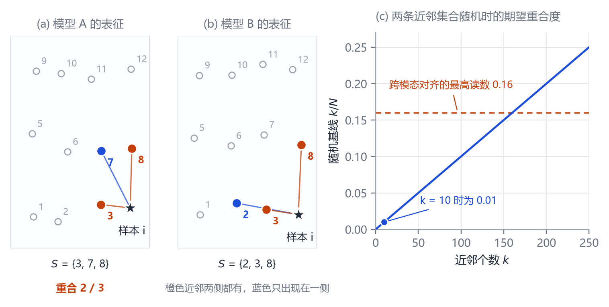
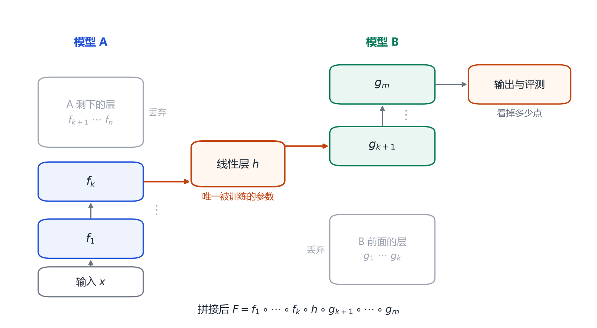

# 第 12 章　趋同的证据

假设有两个人各自画一张城市地图。一个人手里只有打车记录，他知道哪条路常被走、哪两片街区之间要绕很久。另一个人手里只有公交线路图，他知道哪几个站连在一起、换乘要过几个路口。两张图摊在桌上，比例尺不一样，方向也不一样，街区的形状甚至对不上。可你问他们同一个问题，从火车站到美术馆要经过哪几片地方，答案几乎一致。

2024 年，Huh 和几位合作者在一篇论文里报告了类似的事。他们把几十个视觉模型和几十个语言模型两两拿来比，发现这些模型内部对数据的组织方式越来越像。视觉模型看的是像素，语言模型看的是词，两者的训练目标一个是重建被遮住的图块，一个是预测下一个词元，中间没有任何东西告诉它们“第 768 维该对应第 4096 维”。它们却收敛到了相似的几何。

这件事如果成立，后面关于世界模型的讨论都要改一个前提。人们原本默认每个模型关在自己的世界里，各有各的表征；现在得考虑另一种可能，不同的模型其实在逼近同一张地图，只是画法不同。

这一章要处理两个技术问题。一个是怎么度量两个表征空间像不像，另一个是“像”有几种强弱不同的含义。第二个问题比第一个更要紧，后面几章的分歧大多来自把这两种含义混在一起说。

## 12.1 两个模型看到的不是同一件事

先看具体一点。一个用掩码自编码（Masked Autoencoder，MAE）训练的视觉 Transformer，输入是一张 224 乘 224 的图，切成 16 乘 16 的小块，随机遮掉其中一部分，让网络从剩下的块里把遮掉的部分还原出来，损失算在像素上。另一个是几十亿参数的语言模型，输入是一串词元，损失算在下一个词元的概率上。前者的输出是一个一千维上下的向量，后者的隐状态是四千多维度。

按直觉，这两个东西不该有共同语言。输入不一样，输出不一样，连“什么算答对”都不一样。一个在比对颜色和边缘，一个在比对词与词的搭配。它们的参数是从完全不同的数据上、用完全不同的梯度磨出来的，凭什么最终落到同一片地方。在视觉模型之间比的时候，连“这两个样本是同一张图”这样的配对都没有，两个模型各自训练，唯一的联系是它们看过同一批图片，最后却落到了相似的位置。

有个比喻可以说清这种“不同却相通”。两个抄写员抄同一本书，一个用拼音，一个用五笔，抄出来的符号序列毫无相似之处，你没法把一列拼音字母和一段字根对上。但如果让他们各自按“哪两句话意思最接近”把书里的句子排个序，两份排序会高度一致。符号是各自的，句子之间的关系是共有的。模型之间的相似，多半也是这个层面的相似。

具体到图像上，共有的那部分关系可以这么看。给一千张图，里面有猫、狗、汽车、面包，还有同一只猫在不同角度的十几张照片。视觉模型会把同一只猫的照片排在一起。语言模型在处理这些图的说明文字时，也会把提到同一只猫的句子排在一起。它们从未见过对方的输入，却在“这几张该归一堆”上达成了共识。

研究者关心的是这一层。不是问两个向量的坐标能不能对上，而是问同一批样本在两个模型里是不是挨着同样的邻居。这个转向看起来是退让，实际是把一个没法回答的问题换成了一个能测的问题。

## 12.2 只看谁和谁挨着

直接比坐标行不通。两个空间的维度不同，就算维度相同，一个空间整体旋转一下、在某几个方向上拉长一点，坐标就全变了，可它描述的关系一点没变。研究者真正想要的是那种在旋转和缩放之下不动的东西。

做法是这样。取一批同样的样本，比如一千张图片，分别送进两个模型，得到两组向量。对第一个模型里的第 $i$ 个向量 $\phi_i$，在其余向量中找距离最近的 $k$ 个，记下它们的编号，组成集合 $S(\phi_i)$。对第二个模型的对应向量 $\psi_i$ 做同样的事，得到 $S(\psi_i)$。然后数两个集合重合了几个：

$$
\mathrm{mNN}(\phi_i,\psi_i)=\frac{1}{k}\left|S(\phi_i)\cap S(\psi_i)\right| .
$$

$\cap$ 是交集，$|\cdot|$ 是集合的大小。这个数最大是 1，意思是两边选出的 $k$ 个邻居完全一样；最小是 0，一个都不重合。把一批样本上的取值平均一下，就是两个模型的互近邻对齐度（mutual k-nearest neighbor，mNN）。如图 12-1 所示，取 $k=3$、共 12 个样本，样本 4 在模型 A 里的三个近邻是 3、7、8，在模型 B 里是 2、3、8，重合两个，得分三分之二。

<figure class="fig">

<figcaption><b>图 12-1</b>　互近邻的定义。同一批样本分别送进两个模型，星号是当前样本，橙色近邻两边都有，蓝色只在一侧，这一例重合 2 个。右侧曲线是随机情况下的期望重合度 $k/N$，它随 $k$ 上升，所以不同 $k$ 的读数不能直接比。</figcaption>
</figure>

这个指标必须配一条基线才有意义。如果两边的近邻集合是随便选的，各取 $k$ 个，那么交集的期望是 $k^2/N$，其中 $N$ 是样本总数，除以 $k$ 就得到期望得分 $k/N$。论文里取 $k=10$、$N=1000$，基线是 0.01。任何一次测量都要和这个数比，就像考试分数要和班级平均分比。0.08 听起来很小，在 0.01 的基线上就是八倍。

还有一个工程细节值得提。互近邻是在一个小批次里算的，论文取 1000 个样本。批次大小决定了邻居的候选池，读数的绝对值会跟着变，所以报这个数的时候得把 $k$ 和批次大小一起写上，单独一个数字什么都说明不了。

选互近邻而不是别的指标，有一个很实际的理由。它不需要训练任何映射。有些比较方法要先学一个从 A 到 B 的变换，再看好不好用，可是变换本身有自由度，拟合得越用力，越容易凭空造出相似。互近邻只数数，不拟合，所以它给出的相似不会被优化过程污染。这一点在后面的争论里会反复出现。

## 12.3 相似与对齐之间隔着一层

到这里要停一下，把两个词分开。相似说的是近邻结构像，对齐说的是坐标能用一个简单变换对上。前者弱，后者强。

举个名单的例子。一份名单按身高排序，另一份按体重排序。两份名单的顺序大体一致，因为高的人往往也重一些，这就叫相似。但你不能拿身高那一栏的数字直接当体重用，中间差着一个不知道长什么样的函数，这就叫不对齐。相似只保证“谁和谁挨着”，不保证“差多少”。

三种常用的度量，强度依次上升，差别写在表 12-1 里。互近邻只看局部，只要每个样本的邻居对得上就行，全局的距离数值可以完全不同，甚至连邻居的先后顺序都不管，$\{a,b,c\}$ 和 $\{c,a,b\}$ 算同一个答案。中心核对齐（Centered Kernel Alignment，CKA）看的是全局，它把两个模型的相似度矩阵整体拿出来比，取值在 0 到 1 之间，对旋转和各向同性的缩放不敏感。线性映射后可检索更严，要先学一个矩阵 $W$，把 A 的向量乘过去，再看能不能在 B 里找回对应的样本。

**表 12-1**　三种相似度度量的对比

| 度量 | 怎么算 | 衡量什么 | 代价 |
| --- | --- | --- | --- |
| 互近邻 mNN | 数两边 $k$ 近邻集合的重合比例 | 局部邻域结构是否一致 | 不看距离大小，也不管顺序；数值随 $k$ 变化 |
| 中心核对齐 CKA | 比较两个模型的相似度矩阵，取值 0 到 1 | 全局几何是否一致 | 要求过严，跨模型比较时趋势很弱 |
| 线性映射后可检索 | 学一个矩阵 $W$，看映射后能否找回原样本 | 坐标能否被一个线性变换对上 | 需要拟合，$W$ 的自由度可能带来虚假相似 |

三者的强弱不是包含关系，而是三种不同的提问。互近邻问的是“邻居对不对”，CKA 问的是“整体的相似度格局像不像”，线性映射问的是“能不能互换着用”。一个模型可以前两项都高而第三项很低，就像一个只会认脸不会画脸的人。

论文里有一个细节说明了这个阶梯的实际后果。研究者最初用 CKA 测模型之间的对齐，发现趋势非常弱，同模态内部都看不太出来。这个现象 Bansal 等人在 2021 年也遇到过，他们正是因为 CKA 测不出东西，才转去用模型拼接。CKA 的定义太严，它要求所有样本两两之间的距离关系都一致，而模型之间往往只在“近的仍然近”这一点上一致，“远的有多远”早就各说各话。

## 12.4 把两个模型焊在一起

比互近邻更强的证据来自一种叫模型拼接（model stitching）的做法。

把一个模型看成若干层的复合，$f=f_1\circ\cdots\circ f_n$，$\circ$ 表示先做右边再做左边。另一个模型是 $g=g_1\circ\cdots\circ g_m$。在 $f$ 的第 $k$ 层处切一刀，把前半段接到 $g$ 的后半段上，中间垫一个线性层 $h$：

$$
F=f_1\circ\cdots\circ f_k\circ h\circ g_{k+1}\circ\cdots\circ g_m .
$$

$h$ 通常是一个仿射变换，只有一组矩阵和偏置，参数量比任何一层都小得多。训练时 $f$ 和 $g$ 的所有参数都冻住，只调 $h$，然后在任务上测 $F$ 的表现。如果 $F$ 的表现和原来的 $g$ 差不多，说明在 $k$ 这一层，两个模型的表征只差一个线性变换就能互换。整个过程如图 12-2。被剪掉的两段不参与计算，中间的 $h$ 是唯一被训练的部分。

<figure class="fig">

<figcaption><b>图 12-2</b>　模型拼接。A 的前 $k$ 层接上线性层 $h$，再接 B 的第 $k+1$ 层到最后一层，被剪掉的两段不再参与。除 $h$ 之外全部冻结，拼接后测下游任务，掉点少说明两段表征能接上。</figcaption>
</figure>

“掉点”怎么算，通常是把拼接后的模型和原来的 $g$ 放在同一批下游任务上比，看准确率差多少。差得越小，说明 $h$ 要承担的转换越简单。实际做法里切点会从浅到深扫一遍，画出一条“掉点随深度变化”的曲线，曲线平坦的地方就是两个模型最容易互换的位置。

Lenc 和 Vedaldi 在 2015 年做过这件事，两个发现后来被反复引用。一个是在 ImageNet 上训练的模型和在 Places-365 上训练的模型可以拼起来，性能保持得住，说明数据集不同并不妨碍表征兼容。另一个是早层比后层更容易互换，卷积网络前几层学到的东西几乎都是朝向边缘的滤波器，这一点在人眼和人工网络里都成立。

后来的工作把这个结论推得更远。Bansal 等人在 2021 年发现自监督训练的模型和纯监督训练的模型可以互相拼，性能掉得不多。Moschella 等人在 2022 年做了更极端的版本，连 $h$ 都不学，直接把两段接上，仍然能用；他们把一个用英文训练的编码器接到一个法文的解码器上，翻译照样出得来。跨模态的方向也有人试过，Merullo 等人在 2022 年发现单独一个线性投影就足以把视觉模型接到语言模型上，做图文问答和图像描述都还能用。LLaVA 用的也是这个思路，只是把一层线性换成了两层的多层感知机。

拼接之所以比互近邻更有说服力，是因为它要求“接上还能用”，而不只是“看起来像”。但它也有边界。它只在一个切点上做文章，说明的是第 $k$ 层附近兼容，不说明两个网络整体等价。切点挪一挪，结论可能就变。而且 $h$ 的容量是个隐含变量，如果必须给一个很大的 $h$ 才能接上，那“只差一个线性变换”这句话就名不副实了。

## 12.5 七十八个视觉模型

单看两个模型的拼接是轶事，要看趋势得看规模。论文里做了一个横向的比较，一共 78 个视觉模型，来源五花八门。

其中 17 个是 ViT，从 tiny 到 giant 都有，训练目标涵盖 ImageNet-21k 分类、MAE、DINO 和 CLIP，有一部分还在 ImageNet-12k 上做过微调。还有一个是随机初始化的 ResNet-50，作为对照组。11 个是用对比学习训练的 ResNet-50，数据分别是 ImageNet-1k、Places-365 和若干合成图像集。剩下 49 个是 ResNet-18，用对齐性与均匀性损失训练，数据换了一批又一批。

能力用 19 个 VTAB 分类任务来量，做法是冻结主干、只训一个线性分类头。某个任务的准确率达到 78 个模型中最好成绩的 80%，就算这个模型解决了它。对齐度则在 Places-365 的验证集上算，取 1000 张图、$k=10$。

结果是一条清楚的趋势。解决的 VTAB 任务越多，模型彼此之间的互近邻得分越高。把模型按能力分箱，强的那一箱内部紧得很，弱的那一箱里各走各的路。换成二维嵌入看更直观，能力强的模型挤成一小团，能力弱的散在四周。论文在这里引了一句托尔斯泰式的说法，强的模型都是相似的，弱的模型各有各的弱法。Bansal 等人 2021 年把这种可能性叫安娜·卡列尼娜情形。

这里有一个容易被误读的地方。能力强的模型彼此更像，不等于它们各自都更像真相。也可能只是因为它们都被同一个任务压力挤到了同一个角落，而那个角落未必离世界最近。要区分这两种情况，得看对齐度能不能预测别的东西。论文做了一次尝试，把每个语言模型与 DINOv2 的对齐度和它在 Hellaswag 上的得分画在一起，两者接近线性；和 GSM8K 的得分画在一起，则是一条先平后陡的曲线，像涌现的样子。这只是相关，不能说明对齐带来了能力，但它至少排除了“对齐与能力无关”这一种可能。

跨模态那一侧用的是维基百科的图文对，每张图配它自己的说明文字。同一个样本在视觉模型里是一个向量，在语言模型里是它说明文字的向量，两边各取近邻，算重合。结论是语言模型越强，和视觉模型越对齐；反过来，视觉模型越强，和语言模型也越对齐。CLIP 因为有显式的语言监督，对齐度比同规模的纯视觉模型更高。有意思的是，CLIP 在 ImageNet 上微调之后，这个优势反而掉了。

把跨模态那一组曲线放在一起看，最高的一条爬到 0.16 就停住了。

## 12.6 0.16 这个数字

0.16 该算高还是低，论文没有给答案。作者把它写成了一个开放问题：这个分数是说明对齐已经很强、剩下的差距都是噪声，还是说明还差得远、有大块的东西没解释，留给后来的人判断。这种坦白在论文里不常见，也说明这个领域的证据还在积累。

能确定的是它远高于基线。$k=10$、$N=1000$ 时随机基线是 0.01，0.16 是它的十六倍。换句话说，两个模型的近邻重合不是偶然撞上的。但“远高于随机”和“接近完全一致”之间隔着很长的距离，把前者说成后者就是夸大。

还有一层麻烦，指标对超参数敏感。$k$ 取得小，对齐的读数就高；$k$ 取得大，读数被稀释。论文的附录里专门画了这条曲线，$k$ 从 5 一路加到 1000，趋势的清晰度一路下降，到 $k$ 逼近样本数时，近邻几乎等于全体，这个指标也就退化成了某种全局的核比较。所以跨论文比较 mNN 的数值没有意义，只有在同一套 $k$ 和 $N$ 下才有可比性。

换一把尺，结论的形状也会变。论文的附录横向比了八种度量，CKA、无偏 CKA、SVCCA、互近邻、CKNNA、循环近邻、编辑距离近邻、最长公共子序列近邻，在 78 个视觉模型上给出的排序高度相关，但没有一种能完全替代另一种。对齐度不是一个数，而是一族数。

更要紧的是解释上的节制。互近邻高，能说明的是两个模型对“哪些样本属于一类”有共识，不能说明它们学到了同一个世界模型。共识可能来自三个地方。数据是同一个世界产生的，统计结构本来就摆在那儿；任务是相似的，都要预测，都需要物体恒存和视角不变；容量是有限的，装不下无关的细节。这三种解释都不需要“存在一个唯一的真实表征”这个强假设。第 13 章会逐一展开，还会讲到 2026 年出现的一批反驳意见，其中有人指出这类全局指标本身会被模型宽度污染。

所以这一章能给出的结论要写得克制一些。不同架构、不同目标、不同模态的模型，在变大变强的过程中，局部的近邻结构趋于一致，这个现象有可重复的测量支持。至于这种一致是不是“同一张地图”，现在还只是一个有强证据的假设。

## 12.7 洞穴里的影子

Huh 等人给这个假设起的名字是柏拉图式表征假设（Platonic Representation Hypothesis，PRH）。名字来自柏拉图的洞穴寓言。一群囚徒从小被锁在洞里，只能看见火光投在墙上的影子，他们把影子当成世界的全部。训练数据就是那些影子，像素是世界的影子，文字是影子的影子。假设说的是，模型从影子里反推出来的东西，正在逼近洞外的那个世界。

这个比喻有一个恰到好处的地方。两个模型看到的影子完全不同，一个看到的是光影的形状，一个看到的是别人对光影的描述。如果两批囚徒各自从自己的影子里推出了同样的邻接关系，那么共同的东西大概不在墙上，而在墙外。趋同这件事本身就构成了对“外面有东西”的间接证据。

比喻也有它的限度，得说清楚。柏拉图的理念世界是一个形而上的主张，说的是感官世界背后有一个更真实的层级。这里说的完全是另一回事，指的是数据生成过程里那些稳定的、低维的结构，它可以被测量，可以被反驳，也可以在下一批实验里被推翻。名字是修辞，不是论证。论文自己也承认这一点，它把这个想法和科学哲学里的收敛实在论、和 Bansal 等人的安娜·卡列尼娜情形并列，都是在说同一类直觉，没有一个是证明。

证据到这里就摆完了。剩下的是一个更难的问题。如果趋同是真的，它为什么会发生。是容量不够所以只能保留最有用的东西，是任务压力逼着模型学同一批不变性，还是所有模型都在同一份数据上训练所以别无选择。这三种解释各自能走多远，又在哪里打架，是下一章的事。
