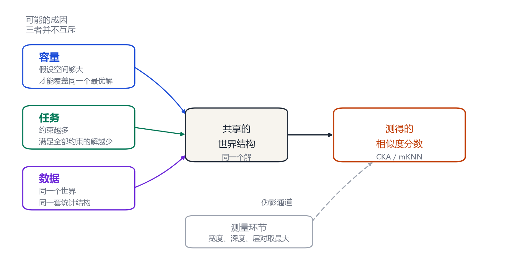
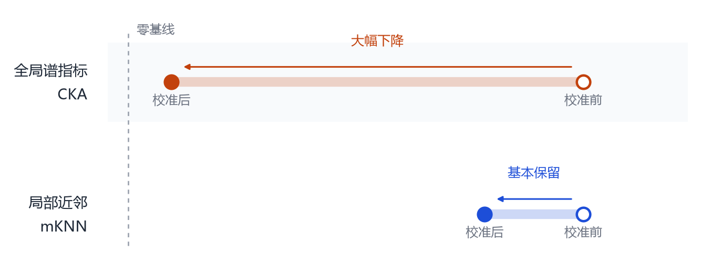

# 第 13 章　三种解释与一场争论

把 12 个语言模型和 17 个视觉模型两两配对，得到 204 对。取 1024 对图文样本，把同一批样本在两边的表征都取出来，算一个相似度分数，再按语言模型的能力把分数排开。画成图，线是往上走的。

这条线在过去两年里被当成了证据。2024 年，Huh 等人在一篇立场文章里提出柏拉图式表征假设（Platonic Representation Hypothesis，PRH），核心主张是随着模型变大，不同模态的表征会收敛到同一个关于现实的统计模型。支撑这个主张的，正是这类随规模上扬的曲线。

可是曲线的斜率有两个来源。一个来源是模型确实越来越接近世界的结构；另一个来源是尺子本身随模型变大而变松。用一把会热胀的钢尺去量三块钢板，量出来的长度一致，可能是因为三块板真的等长，也可能因为三块板都在同一个热车间里，尺子跟着一起被拉长了。要把这两件事分开，得先把尺子放进恒温室。

2026 年有三篇论文在做这件事，切入点不一样。Gröger、Wen 和 Brbić 从测量工具下手，说相似度指标被模型规模污染，校准之后只剩局部近邻还站得住。You、Jang、Mo 和 Jung 接着追问，剩下的究竟是“局部”还是“关系”，答案偏向后者。Li、Ma、Xiong、Chen 和 Zhang 把战场挪到世界模型上，用 DINO-WM 换编码器，看预测器内部会不会自己长出共同的结构。这一章按这个顺序讲，末尾说明一件很容易被混淆的事。

## 13.1　三条可能的因果路径

三条路径都在回答同一个问题，为什么本来就该收敛。它们给出的机制不同，可信度也不同。

一条是容量。Huh 等人的版本很朴素。假设存在一个对所有标准目标都最优的表征，模型越大，假设空间越大，越有可能把这个最优解包进去。小模型的假设空间覆盖不到它，只能停在离初始化最近的那个局部解上，于是彼此不像；大模型覆盖到了，就都落到同一个点上。像几个人在同一片山里找最低处，地图范围小的只能在自家山谷里转，范围大的才能走到同一个盆地。

这条解释还有一个常见的改写，说网络容量有限，装不下场景的全部细节，只能保留对预测最有用的那一部分；不同模型面临的瓶颈一样，留下的东西也就一样。两种说法一个说空间够大所以装得下同一个解，一个说空间不够大所以只装得下同一批东西，方向相反，落点相同，都在说解空间被约束住了。

另一条是任务。每个训练目标都给表征加一条约束，要能分辨猫和狗，要能判断材质，要能接出下一个词。约束越多，同时满足所有约束的表征就越少。Huh 等人把它写成多任务缩放假设，模型解的任务越多，可行解的集合越小，小到只剩一个很窄的锥体。

下一词预测看起来是单一任务，其实不是。要接上“他把杯子推到桌沿，杯子会”，模型得知道物体会掉；要接上“她把冰块放进温水，冰块会”，得知道热传导。文本里藏的是一整套关于世界的约束，只是这些约束从来没有被显式写出来。

第三条是数据同源。所有模型用的数据都由同一个世界产生，图像是这个世界的光学投影，文本是这个世界的人类描述。数据的统计结构决定了最优解长什么样，架构和初始化只影响模型怎么走过去。像三个人画同一座山，笔法各异，山是同一座。

这一条最难检验，因为找不到第二个世界的数据来做对照。

三条并不互斥。Huh 等人自己列了任务通用性、容量、简单性偏置三条假设，并说明它们可能同时起作用。真正的问题不是选哪一条，而是怎么知道图上那条上升的线里，有多少来自它们，有多少来自别的地方。

## 13.2　尺子上的刻度是谁刻的

那条线的纵轴是相似度分数，而分数是一个指标算出来的。最常用的是中心化核对齐（Centered Kernel Alignment，CKA）。给定同一批 $n$ 个样本在两组表征下的矩阵 $X, Y \in \mathbb{R}^{n \times d}$，先算样本之间的相似度矩阵 $XX^\top$ 与 $YY^\top$，各自减去行列均值做中心化，再把两个矩阵拉直算余弦相似度：

$$
\operatorname{CKA}(X,Y) = \frac{\lVert \tilde{Y}^\top \tilde{X} \rVert_F^2}{\lVert \tilde{X}^\top \tilde{X} \rVert_F \, \lVert \tilde{Y}^\top \tilde{Y} \rVert_F},
$$

其中 $\tilde{X}$ 是中心化后的表征矩阵，$\lVert \cdot \rVert_F$ 是把所有元素平方求和再开方。分式的含义是，两个相似度矩阵在互相投影之后还剩多少共同的方向。

举个最小的例子。1024 张图片送进两个模型，各得到 1024 个向量。把向量的两两内积排成矩阵，CKA 要问的就是这两个 $1024 \times 1024$ 的矩阵像不像。如果两个模型都认为第 3 张和第 7 张最像，这两个格子就都对得很大，分数就高。

CKA 的好处是不要求两边维度相同，也不要求样本配对，只要看的是同一批样本。麻烦也在这里，它比较的是样本之间的相似度矩阵，而矩阵的数值受维度和样本量的比值影响。

具体的机制是 $d/n$。样本数固定，维度越大，两个完全独立的表征之间的 CKA 期望就越高，论文给出的量级是 $O(d/n)$。这不是实现的错误，是有限样本下高维协方差估计的噪声。互近邻的零基线是 $O(k/n)$，量级小得多，因为它只比较“谁是谁的邻居”，不比较距离的具体数值。

第二个污染来自深度。逐层比较时，没有人知道该拿哪一层对哪一层，通行做法是把所有层对都算一遍，报告最大值。独立随机变量的最大值的期望大于均值，比较次数越多，最大值越高。128 层对 2 层，即使两边毫无共享信号，前者的报告分数也会更高。

把三条路径和测量环节放在一起，如图 13-1。上面三条实线是真正的因果路径，下面那条虚线不通向共享的世界结构，而是直接通到分数。读者看到的每一个点，都是这两条通路叠加的结果。

<figure class="fig">

<figcaption><b>图 13-1</b>　三条成因与一次测量。三条实线是容量、任务、数据各自的因果路径，虚线是宽度、深度与层对取最大带来的伪影，它绕过共同结构，直接抬高分数。</figcaption>
</figure>

这件事在方法论上很重要。相似度不是仪表读数，它本身是一个统计量，有自己的零分布。要拿它当证据，先得知道“什么关系都没有”的时候它会是多少。

## 13.3　把零假设摆到桌面上

Gröger 等人的办法是置换检验。保持 $X$ 的行不动，把 $Y$ 的行随机打乱，样本之间的对应关系就被破坏了，两组表征变成相互独立。重复 $K$ 次，得到相似度的一个零分布。真实分数如果落在这个分布的中间，就没有证据说两边有关系。

校准分数定义得很直接。从零分布里取一个临界值，观测值低于它就记 0；高于它，就按比例重新缩放到 1。深度那一条要用另一种校准，不是把每个层对分别校准，而是对最终报告的那个统计量本身做零分布。逐项校准之后再取最大值，膨胀依然存在，因为最大值总是挑到噪声里最高的那一个。

零分布这一步不能省。两个人的身高差 2 厘米，这个差算不算大，取决于尺子的精度。测量工具越粗糙，2 厘米越可能只是噪声。零分布在估计的就是这把尺子的精度，它把“独立时该有多高”当成参照，而不是把 0 当成参照。

实验设置是 204 对模型，$d/n$ 从 0.19 到 8，$n=1024$，互近邻取 $k=10$，置换次数 $K=200$，显著性水平 $0.05$。结果是，未校准的 CKA 随模型能力稳定上升，校准之后这条趋势消失了。更能说明问题的是分数与能力排名的相关系数：线性 CKA 从 0.86 掉到 0.45，Procrustes 距离从 0.89 掉到 0.39。局部指标几乎不动，mKNN 保持在 0.85 附近，CKNNA 在 0.87 附近。

图 13-2 是这件事的定性示意。全局指标在校准后塌到零基线附近，局部指标基本保留。

<figure class="fig">

<figcaption><b>图 13-2</b>　校准前后的定性对比。每一行是一个指标，实心点是校准后，空心点是校准前。全局谱指标大幅下降，局部近邻几乎不动。图中不标数值，只表示方向与幅度。</figcaption>
</figure>

还有一条更细的结果。局部距离并不收敛。把小带宽的 RBF 核 CKA 校准之后，对齐也消失了。两个模型都认为样本 A 和 B 是邻居，却并不认为它们一样近。共享的是邻接关系，不是距离。

于是有了亚里士多德表征假设，不同目标、不同数据、不同模态训练出来的网络，收敛到共享的局部邻域关系。名字取自亚里士多德《范畴篇》里的关系范畴，他是柏拉图的学生，把“相对者”单列为一类。全局收敛蕴含局部收敛，因为整个几何对上之后近邻自然对上；反过来不成立。所以这个假设比原来的弱，论文自己也说它是对原假设的收窄，不是推翻。

## 13.4　局部还是关系

You 等人的批评针对的正是“局部”这个词。他们指出，此前的局部与全局对比同时改了两件事，结构尺度（局部还是全局）和比较内容（关系还是度量）。mKNN 是局部的、关系的，CKA 是全局的、度量的。两个变量一起动，结论就分不清是哪一个造成的。

他们搭了一个 $2\times 2$ 的框架。局部关系沿用 mKNN，全局关系新造一个指标，叫 $H_0$ 骨架重合。度量那一侧，在保持关系不变的前提下追加距离一致性要求，用 $\tau$ 控制严格程度。

$H_0$ 骨架重合借的是持续同调。把点云按距离阈值逐渐连边，$H_0$ 记录连通分量的个数，每一条让两个分量合并的边叫死亡边。这些边恰好构成最小生成树，也就是用 $n-1$ 条边把 $n$ 个点连成一棵不断开的树、总长度最小的那棵。骨架重合就是两棵树共有的边占 $n-1$ 的比例：

$$
S_{H_0}(X,Y) = \frac{|T_X \cap T_Y|}{n-1},
$$

$T_X$ 与 $T_Y$ 分别是两组表征上的最小生成树边集。这个指标只问“哪两个点被连起来”，不问边长，因此是纯粹的关系量。最小生成树还有一个好处，它对边长不敏感，同一条边在两边连接的始终是同一对样本，边长差多少不影响它是否被选中，只在距离感知的版本里才进入计算。关系与度量就这样被拆成了两步。

距离感知的版本在此之上加一道检查。对共有的边或共有的邻居，再看两边的距离是否接近。距离先按各自的正距离第 90 百分位归一化，$\tau$ 越小，容忍度越低，要求越严。

结果是，204 对模型的 mKNN 与 $H_0$ 骨架重合在多重比较校正后全部显著。两个指标在模型对层面高度一致，Spearman 相关系数 $\rho = 0.968$。全局关系同样随能力上升，说明关系结构不只在局部成立。

度量一侧的变化很陡。$\tau=1$ 时，局部与全局分别保留 85.6% 和 83.0% 的关系基线；$\tau=10^{-2}$ 时降到 5.8% 和 5.5%。显著模型对的比例在最严的 $\tau=10^{-4}$ 处分叉，局部 89.7%，全局 40.2%。视频与文本的对照复现了同样的形状，143 对全部显著，$\tau=10^{-4}$ 时局部 86.0%，全局 46.9%。

读法因此要改一次。收敛的是关系结构，不收敛的是度量几何；尺度只在最严格的要求下才显出差别。所谓“亚里士多德”里的“局部”其实说窄了，局部只是关系的一种取法，全局的骨架也是关系。

## 13.5　到世界模型上再验一次

前两篇都在图文对上做。图文对有一个天然的疑问，图像和文本都由人产生，都在描述同样的东西，相似可能来自数据，而不是来自世界本身。世界模型提供了一个更干净的场景，它的训练目标是预测下一个状态，不是描述。

DINO-WM 的结构不复杂。一个冻结的视觉编码器把每帧变成一组 patch 特征，一个 6 层的 Transformer 预测器读历史特征和动作，输出下一帧的特征。编码器可以换。换掉编码器，预测器就从完全不同的输入空间开始学。

Li 等人换了四种编码器，DINOv2 的四个尺寸、SigLIP、MAE，再加一个 ResNet18，前三个都是 ViT，ResNet18 是卷积网络。五个环境是 PointMaze、PushT、Wall、Rope、Granular，分别盖住导航、有接触的推物、避障，以及绳子和颗粒这类可变形物体。这几类动力学对表征的要求不一样，如果收敛只在某一个环境里出现，就不算证据。相似度用逐层计算再平均的 m-kNN。参照点选 DINOv2-S 的第 10 轮检查点，理由是它在五个环境里的零样本规划成功率最稳，这是一个按性能挑出来的操作参照，不被当成真理念。

结果分三档。DINO 家族起点就高，因为与参照同源，之后缓慢上升。SigLIP 和 MAE 起点低，上升最明显。ResNet 一直在低位，整个训练窗口里没有明显靠近。

有一个平凡解释需要先排掉。如果预测器只是把编码器的几何原样传下去，那么预测器空间的相似度应该约等于编码器空间的相似度。实际不是这样。从编码器到第 1 轮的预测器，跨模型相似度通常明显下降；从第 1 轮到第 10 轮，又回升。编码器带来的几何先被改写，再被训练塑造成一个更共享的结构。同一模型内部，第 10 轮的预测器状态也不比第 1 轮更像它自己的编码器，这排除了“漂回编码器”的读法。

功能检验用拼接。把两个预测器各切一半，A 的前 3 层接 B 的后 3 层，中间插一个轻量 MLP 适配器，其余参数冻结，然后测规划成功率。PointMaze 上，DINOv2 接 SigLIP 切在 3 层时成功率 0.90，切在 1 层时 0.86。Wall 更能区分，同样的两对模型，3 层是 0.62，1 层只有 0.30，2 层 0.38。

不对称的地方同样有信息。MAE 当前端、DINOv2 当后端时，PointMaze 上还有 0.74，Wall 上掉到 0.02；MAE 接 SigLIP 在 Wall 上是 0.00。适配器能把特征空间对上，却补不出缺失的规划要素，多步自回归又把误差放大。

结论有两面。共享的不只是近邻结构，还有可以迁移的转移因子；共享也有边界，架构不兼容（ResNet 接不进 patch 接口）或能力不足的一端会把这层共享切断。

## 13.6　三条解释各自剩下多少

回到开头那三条路径。校准对它们的影响并不一样。

容量那条被削得最多。原来的证据是“越大越像”，现在这条证据的一大半被归因于 $d/n$ 和层对取最大值。校准之后相关系数从 0.86 掉到 0.45，还剩一点，但已经撑不起“容量是主要机制”这种强度的结论。这不是说容量无关，而是说原来的测量把它放大了。

任务那条拿到了比较直接的证据。DINO-WM 的实验里，环境、数据、目标、预测器架构都一样，只有编码器不同。如果收敛只是把输入特征的相似性原样传下去，第 1 轮的预测器就应该和编码器一样像；实测是先降后升，结构是在转移目标下重新长出来的。不过这个实验并没有把任务和数据分开，所有模型看的仍是同一批轨迹，它排除的是“输入特征自带相似”这一种解释。

数据同源那条仍然成立，但没法单独检验。找不到第二个世界的数据。它更像一个前提，所有模型都在同一个世界上采样，这个前提本身无法证伪，只能靠跨模态也收敛这类间接证据支撑。

Huh 等人还列过第三条假设，简单性偏置，说深层网络的隐式偏好会让大模型挑更简单的解，于是更容易撞在一起。这一条不进上面的校准，也不进 DINO-WM 的实验，它更像一个待检验的猜测。

还有一层容易被忽略。三篇批评彼此也在修正。第一篇说共享的是局部邻域，第二篇说不是局部而是关系，第三篇说关系可以在一个全新的目标下重新长出来。三句话叠起来，比任何一句都窄，也更接近可以检验的东西。

## 13.7　程度问题与条件命题

讲到这里，有一件事必须说清楚，否则下一章会被误读。

上面所有结论的形式都是“程度”。在距离要求最严的一档，204 对里仍有 89.7% 的局部对齐显著，mKNN 与能力的相关系数保持在 0.85，而全局一侧的保留比例从 85.6% 掉到 5.8%。这些数字依赖样本量、指标选择、模型池的构成和显著性水平。换一批模型，数字会变；换一个指标，结论的措辞要改。它们说的是“在这些条件下，收敛到这个程度”。

第 14 章的定理形式完全不同。它是一个条件命题，如果世界是有限状态集合，如果每个模态的渲染函数是单射，如果所有模态共享同一个正样本分布，如果编码器取到总体最优，那么两个模态的最优解只差一个旋转。条件写在前面，结论跟在后面。条件不成立，结论不成立；条件成立，结论没有例外。

两者的关系不是“实验发现，定理证明”。定理不证明 204 对模型显著，实验也不检验定理的前提，因为真实数据有损、样本有限、训练也到不了总体最优。定理回答的是“如果一切理想，为什么必然收敛，收敛到什么”；实验回答的是“在现实的模型池里，收敛发生在哪一层结构上”。

打个比方。热力学第二定律说孤立系统的熵不减，它不告诉你桌上那杯咖啡两小时后是几度。它给的是方向和条件，具体温度要靠另一次计算。定理给的是“在理想条件下解只差一个旋转”，实验室里的相关系数是另一次测量。

条件为什么重要，可以看一个退化的例子。如果渲染函数不是单射，两个不同的世界状态在某个模态里长得一模一样，那个模态的编码器再怎么训练也分不开它们，旋转关系无从谈起。定理的每一条前提，挡住的都是这类退化。

所以读到下一章时，不要把定理当成对 PRH 的证明；也不必因为实验结果只是程度问题，就觉得定理没用。一个是关于极限的陈述，一个是关于现状的陈述，互不替代。

下一章把世界写成有限状态集合，把模态写成渲染函数，把“同一张地图”这件事写成一个矩阵的特征值问题。
