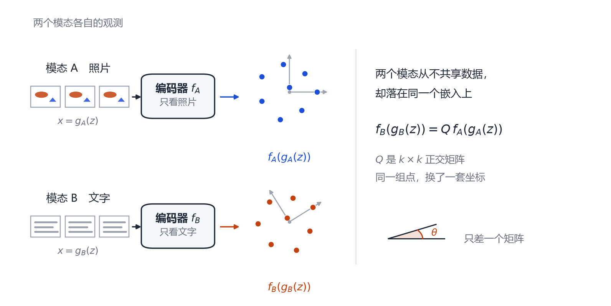
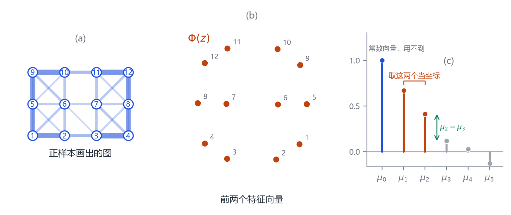
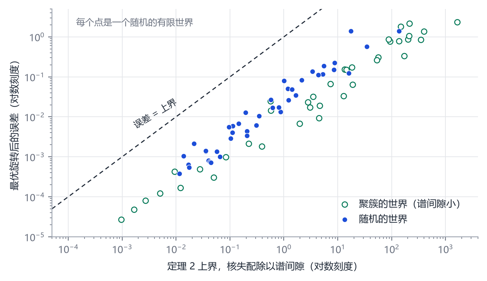

# 第 14 章　从假设到定理

两个人各自画同一个街区的地图。一个习惯把北画在纸的上边，另一个习惯把家门口那条街画在纸的上边。两张纸叠在一起，街道全是歪的，一条也对不上。要解决这件事不需要重画，只要找出一个角度，把上面那张纸转一下，所有街道同时重合。转角是一个数，跟街道在图上的位置无关。

第 12 章讲的那批实验，用这个比喻说就是，不同的模型各自画了一张地图，纸的摆法不同，画的是同一批街道。所谓表征趋同，说的正是这件事。麻烦在于实验只能给出一个相似度数字，说不出“差一个旋转”这种话，也说不出什么时候该差一个旋转、什么时候会差得更多。

这一章把它写成一个条件命题。前件是几条数学条件，后件是“只差一个旋转”。条件摆清楚之后，就能看出它管到哪里、不管哪里。路线是从世界和正样本出发，把正样本写成一张图，看这张图怎样给出坐标，再证明白化 JEPA 的最优解就是这组坐标，然后才是定理一和定理二。

## 14.1　把世界写成一张图

世界是一堆状态，写成 $Z$，一个有限集合，每个状态 $z$ 带一个概率 $p(z) \gt 0$。有限这个条件是定理的一部分，不是图省事。无穷的世界要把求和换成积分，结论形状不变，但测度上的细节会多出好几页。

一个模态把状态变成观测。一次拍摄、一句话、一段录音，都写成 $x = g_m(z)$，$m$ 是模态编号，$g_m$ 叫渲染函数。要求 $g_m$ 是单射，意思是不同的状态一定渲染出不同的观测。这条要求很硬，相机做不到，因为两个不同的场景完全可能拍出同一张照片。它保证“从观测反推状态”这一步不丢信息，定理需要这样一个干净的起点。

正样本的定义是整章的支点。模态 $m$ 的训练数据不是单个观测，而是一对对观测 $(g_m(z), g_m(z'))$，每一对都被声明为同一个场景的两次观察。它们背后的状态对服从一个对称分布 $\pi_m$，$\pi_m(z,z') = \pi_m(z',z)$，而且两个边缘分布都等于 $p$。

边缘等于 $p$ 这一条值得停一下。它说的是，从一对正样本里随便挑一个，挑到的状态服从 $p$，挑另一个也服从 $p$。所以平均永远在同一个分布上做，改变正样本只改变哪些状态被配在一起，不改变哪些状态常见。后面所有的期望都靠这一条才能写成 $\mathbb{E}_p$。

把 $\pi_m$ 画出来就是一张图。节点是状态，边权是 $\pi_m(z,z')$，两个状态成为一对正样本的概率越大，边越粗。对角元是两次观察恰好落在同一个状态上的概率，非对角元是两个不同状态被当成一对的概率。

举一个能算的例子。世界是桌上 12 个位置，杯子在其中一个位置。相机拍一张照片是一种观测，一句“杯子在左前方”是另一种观测。同一个位置的两张照片是一对正样本，同一个位置的两句话也是一对正样本。这个例子里 $\pi$ 的非对角质量集中在相邻位置上，因为隔一格的两次拍摄肉眼分不出差别。

非对角的那部分质量很关键。如果正样本严格落在对角线上，两次观察必须是同一个状态，那么 $\Pi = D$，$K$ 就是单位矩阵，所有特征值都等于 $1$，谱间隙为零，谱嵌入什么都给不出来。真实的正样本总有非对角质量，两次拍摄之间杯子挪了一点，两句话的措辞换了一种，这些“差不多但不是同一个”的状态对被连了起来，图才有形状。正样本连得多远，图的形状就有多粗。这件事在第 15 章会变成一句更硬的话。

整章要走的路线如图 14-1。

<figure class="fig">

<figcaption><b>图 14-1</b>　两个模态各自的观测与编码。左边两行是同一批场景的照片和描述，中间两个编码器互不相见，右边两组点是同一组点，只差坐标系的转角 $\theta$。</figcaption>
</figure>

图 14-1 里两个编码器互不相识，一个只看照片，一个只看文字，训练数据里没有一对配好的跨模态样本。图的下半部分画的是同一个结论，红点云是蓝点云转过 $\theta$ 之后的样子，坐标轴也跟着转，所以两组点在各自的坐标系里位置一模一样。

## 14.2　归一化邻接矩阵

正样本那张图有两个矩阵。一个是 $\Pi$，$\Pi_{zz'} = \pi(z,z')$；一个是 $D = \operatorname{diag}(p)$，对角线上是状态概率。行和满足 $\sum_{z'}\Pi_{zz'} = p(z)$，这正是边缘等于 $p$ 的矩阵写法。

最直接的想法是对 $\Pi$ 做特征分解。先说清这两个词在几何上是什么。一个方阵乘上一个向量，一般会把方向扭歪；有一类特殊向量方向不变，只被拉长或缩短，它们叫特征向量，拉伸的倍数叫特征值。对着一张图做特征分解，就是找出“哪些方向是这张图自己的方向”。

直接拿 $\Pi$ 去分解会立刻碰到一个麻烦。出现得越频繁的状态，它在图上的度数越大，$\Pi$ 的第一特征向量差不多就是“哪里常见”。一条走廊里最常被拍到的那个转角，会把所有坐标都拉向自己，几何结构被频率盖住。

修法是把每一行每一列都除以 $\sqrt{p}$。看着抽象，其实只做了一件事。假设一个状态出现概率 $0.3$，另一个 $0.01$，不归一化时前者那一行的元素加起来比后者大 30 倍，特征分解第一个就抓到它，坐标被“谁常见”支配。除以 $\sqrt{p}$ 之后，每一行每一列都被自己的概率除了下去，常见的状态和罕见的状态在矩阵里被拉平，剩下的差别只是连接方式。定义

$$
K = D^{-1/2}\,\Pi\,D^{-1/2},\qquad K_{zz'} = \frac{\pi(z,z')}{\sqrt{p(z)\,p(z')}} .
$$

$K$ 叫归一化邻接矩阵。它对称，最大特征值恰好是 $1$，对应的特征向量是 $\sqrt{p}$，也就是逐项开方得到的那个向量。代入验一下，$K\sqrt{p} = D^{-1/2}\Pi\mathbf{1} = D^{-1/2}p = \sqrt{p}$。这个特征向量什么也没说，它只是把每个状态的概率重新排了一遍，后面要把它扔掉。

$K$ 和拉普拉斯矩阵是同一件事的两种写法。记 $L = I - K$，$L$ 就是归一化拉普拉斯，$K$ 的大特征值对应 $L$ 的小特征值。取 $K$ 前 $k$ 个非平凡特征向量，等于取拉普拉斯最小的 $k$ 个非平凡特征向量。这条路 2003 年 Belkin 和 Niyogi 走过，叫拉普拉斯特征映射，当时用来降维。这里它是从一个 JEPA 的目标函数里自己长出来的。

把特征值排好，$1 = \mu_0 \ge \mu_1 \ge \cdots$，特征向量记 $v_0 = D^{1/2}\mathbf{1}, v_1, \dots$。谱嵌入（spectral embedding）定义为

$$
\Phi(z) = \frac{1}{\sqrt{p(z)}}\big(v_1(z),\,\dots,\,v_k(z)\big) \in \mathbb{R}^k .
$$

每个状态变成一个 $k$ 维向量，第 $j$ 个坐标是第 $j$ 个特征向量在 $z$ 这一项上的值，再整体除以 $\sqrt{p(z)}$。除以 $\sqrt{p}$ 不是装饰。算一下二阶矩，$\mathbb{E}_p[\Phi(z)\Phi(z)^\top] = I_k$，因为特征向量在 $p$ 加权下正交归一。$\Phi$ 出来的 $k$ 个坐标两两不相关，方差都是 $1$。这正是白化，只不过它是从归一化里自动掉出来的，不是事后补上的一道罚项。

程序上只有几行。

```python
import numpy as np
p = Pi.sum(1)                       # Pi 是正样本矩阵，行和就是 p
K = Pi / np.sqrt(np.outer(p, p))    # 归一化邻接
w, V = np.linalg.eigh(K)            # 对称矩阵，实特征值
w, V = w[::-1], V[:, ::-1]          # 从大到小
Phi = V[:, 1:k + 1] / np.sqrt(p)[:, None]
```

图 14-2 是在一个 12 个状态的小世界上真算出来的结果。

<figure class="fig">

<figcaption><b>图 14-2</b>　12 个状态的合成世界上算出的谱嵌入。(a) 正样本画出的图，线宽是配对概率；(b) 前两个特征向量给出的坐标，把状态摆回一张 4×3 的格子；(c) 特征值，$\mu_2$ 与 $\mu_3$ 之间空出 0.29。</figcaption>
</figure>

图 14-2(a) 里 12 个状态排成 4×3，正样本偏好相邻状态，所以粗线连的是上下左右。(b) 是取前两个特征向量除掉 $\sqrt{p}$ 之后的坐标，12 个点自己排回一张格子，只是被转了、翻了、还拉长了一点。这件事并不神奇。特征向量就是这张图上的低频波形，两个最低频的波形恰好够摆开一个二维格子。(c) 是特征值，$\mu_0 = 1$ 那个常数向量用不到，取来当坐标的是 $\mu_1 = 0.669$ 和 $\mu_2 = 0.411$ 对应的两个。

## 14.3　白化之后只剩方向

JEPA 的目标写成

$$
L_m(f) = \mathbb{E}_{(z,z')\sim\pi_m}\,\ell\big(f(g_m(z)),\,f(g_m(z'))\big) + \Omega(f).
$$

$\ell$ 是预测项，这里取平方距离 $\ell(a,b) = \lVert a-b\rVert^2$，作用是让一对正样本的嵌入尽量靠近。$f: X_m \to \mathbb{R}^k$ 是编码器。$\Omega$ 是反塌缩项，它只看 $f$ 输出的分布，不看具体是哪一对样本。取 $\Omega$ 为白化硬约束，$\mathbb{E}f = 0$、$\mathbb{E}ff^\top = I_k$，塌缩到常数的路就被堵死了。

两个项都对旋转不变。先把正交矩阵说清楚。它是保持长度和夹角不变的方阵，几何上就是一个旋转，也可以带一次镜面反射。$\ell(Qa,Qb) = \lVert Q(a-b)\rVert^2 = \lVert a-b\rVert^2$ 对任何正交矩阵成立，把所有嵌入同时乘一个 $Q$，二阶矩从 $I_k$ 变成 $QI_kQ^\top = I_k$，$\Omega$ 也不变。所以 $f$ 是最优解的话，$Qf$ 也是。解不是一个点，是一条轨道。这句话在 14.4 会变成定理里那个 $Q_m$。旋转不变不是顺手写上去的性质，它是整章结论的模具。目标函数如果偏爱某个方向，最优解就会被那个方向钉住，两个模态的差别也就不再是一个旋转。

反塌缩项有几种常见写法。VICReg 罚方差和协方差，Barlow Twins 让两路特征的相关矩阵靠近单位阵，LeJEPA 的 SIGReg 把嵌入推成各向同性的高斯。前两种只在白化硬约束的极限下落到同一个目标上，而且它们对平移不变，要先中心化才能对上。SIGReg 的约束比白化更强，它的唯一性论文没有证，留成了假设。命题 1 管的是白化这一种，条件写清在哪里，边界就在哪里。

渲染是单射，这带来一个便宜。既然 $g_m$ 一一对应，把 $f$ 换成 $h = f\circ g_m$，就是从状态直接到向量的函数，$h: Z\to\mathbb{R}^k$。换元之后目标函数一模一样，

$$
L_m(f) = L_\pi(h),\qquad L_\pi(h) = \mathbb{E}_{(z,z')\sim\pi}\lVert h(z)-h(z')\rVert^2 + \Omega(h).
$$

模态在目标函数里消失了。换一个模态只是换一套输入坐标，要优化的东西没变。

把平方展开。设 $h = (h_1,\dots,h_k)$，白化给 $\langle h_i,h_j\rangle_p = \delta_{ij}$，其中 $\langle a,b\rangle_p = \mathbb{E}_p[a(z)b(z)]$。利用 $\pi$ 的两个边缘都是 $p$，

$$
\mathbb{E}_\pi\lVert h(z)-h(z')\rVert^2 = 2k - 2\sum_{j=1}^{k}\langle h_j,\,T_\pi h_j\rangle_p ,
$$

$T_\pi$ 是 $\pi$ 定的马尔可夫算子，$(T_\pi h)(z) = \mathbb{E}_{z'\mid z}h(z')$，读作从 $z$ 出发、在正样本那一头取平均。

于是最小化损失等于最大化 $\sum_j\langle h_j,T_\pi h_j\rangle_p$。这一步用 Ky Fan 的最大原理，在 $k$ 个正交归一的函数里，这个和最大不超过 $T_\pi$ 前 $k$ 个特征值之和，取等当且仅当这 $k$ 个函数张成前 $k$ 个特征子空间。把 $T_\pi$ 换成 $K$ 只差一个等距变换，特征值不变，于是

$$
\min L_\pi = 2\sum_{i=1}^{k}(1-\mu_i),
$$

最小值点恰好是 $Q\Phi$，$Q$ 跑遍 $k$ 阶正交群 $O(k)$。前提是 $1 \le k \lt |Z|$ 且 $\mu_k \gt \mu_{k+1}$。这个不等式叫谱间隙。第 $k$ 个和第 $k+1$ 个特征值之间留出空档，前 $k$ 维子空间才唯一，所有最小值点才只差一个旋转。没有空档，子空间本身可以滑动，连“差一个旋转”都谈不上。

图 14-2(c) 里那个空档是 $0.29$。把 12 个状态做成两簇、簇间联系稀一些，间隙会小得多，二维坐标就开始晃。第 15 章会说，正样本设计得不好，间隙是自己变小的。

## 14.4　定理一　共享正样本

先给一个引理，它把渲染从问题里清出去。

引理 1（渲染只换坐标）　若 $g_m$ 单射，则 $f\mapsto f\circ g_m$ 是模态 $m$ 的编码器与函数 $Z\to\mathbb{R}^k$ 之间的双射，且 $L_m(f) = L_\pi(f\circ g_m)$。

定理 1（柏拉图表征定理）　设 $M \ge 2$ 个模态共享同一个正样本分布，$\pi_1 = \cdots = \pi_M = \pi$，且 $L_\pi$ 的最小值点唯一到旋转。则存在一个世界嵌入 $h^\star: Z\to\mathbb{R}^k$，使每个模态 $m$ 的每个最小值点 $f^\star_m$ 都满足

$$
f^\star_m\circ g_m = Q_m h^\star,\qquad Q_m\in O(k),
$$

于是任意两个模态之间只差一个旋转 $Q_mQ_{m'}^\top$。

证明只有一行。由引理 1，$f$ 最小化 $L_m$ 当且仅当 $f\circ g_m$ 最小化 $L_\pi$。$L_\pi$ 的最小值点全在一个旋转轨道 $\{Qh^\star: Q\in O(k)\}$ 上。所以每个 $f^\star_m\circ g_m$ 都落在同一个轨道上，取 $Q_m$ 就是它对应的那个旋转。

读法是这样的。图像 JEPA 和文本 JEPA 各自训练，数据里没有一对配好的图文，两个网络一辈子没见过对方的输出。只要两者的正样本连的是同一批状态对，它们学到的嵌入就是同一个 $h^\star$，差别只有坐标系的摆法。地图是同一张，纸摆的角度不同，而角度一旦找出来，两边就逐点重合。

模态的个数在定理里没有上限，$M$ 可以取到任意大。五个、十个模型各自在自己那堆数据上训，只要共享同一个 $\pi$，就全落在同一个旋转轨道上，两两之间各差一个旋转。第 12 章说的那种“视觉和语言收敛到同一张地图”，在定理里就是这个形状。

除了世界有限这条背景，还有三个条件不能松。唯一到旋转由 14.3 的谱间隙提供。“最小值点”指总体最优，不是训练停下来的那个点。$g_m$ 单射保证观测不丢状态。少一个，结论就不是“差一个旋转”，而是“差得更多”，多出来的那部分正是定理二要量的东西。

有一处容易误读。定理说的是“训练目标的最小值点”，不是“梯度下降会到达的点”。目标函数非凸，白化约束在批量上也只是近似，实际训练能不能落到最小值点，定理不管。

## 14.5　定理二　正样本不一样

现实里 $\pi_1$ 和 $\pi_2$ 不一样。图像的正样本是同一场景的两次拍摄，文字的正样本是同一场景的两句描述，哪一种配对更常见，两个模态各有各的答案。定理一的等号在这里断掉。

记两个模态的归一化邻接为 $K_1, K_2$，谱嵌入为 $\Phi_1, \Phi_2$，$\delta = \mu_k - \mu_{k+1}$ 取 $K_2$ 的谱间隙。

定理 2（核失配界定错位）　设 $\pi_1,\pi_2$ 共享边缘 $p$，$\Phi_1,\Phi_2$ 是它们的谱嵌入，$\delta \gt 0$ 是 $K_2$ 的谱间隙。则

$$
\min_{Q\in O(k)}\Big(\mathbb{E}_p\big\lVert \Phi_1(z)-Q\Phi_2(z)\big\rVert^2\Big)^{1/2}
\le \frac{2\sqrt{2}}{\delta}\min\Big(\sqrt{k}\,\lVert K_1-K_2\rVert_2,\ \lVert K_1-K_2\rVert_F\Big).
$$

左边是配对比较之后的均方根距离。把同一个状态 $z$ 在两个模态里的坐标摆在一起，允许整体转一个 $Q$，取最优的那个 $Q$ 之后还剩多少差。右边两个因子。$\lVert K_1-K_2\rVert_2$ 和 $\lVert K_1-K_2\rVert_F$ 都是核失配的大小，前者看最大的那个方向，后者把所有方向加起来。取小的那个是因为两种估计都成立，谁紧用谁。

分母的位置决定一切。同样的核失配，谱间隙越小，误差上界越大。这跟数值线性代数里的老结果对得上，Davis–Kahan 定理说的正是特征子空间对扰动的敏感度与谱间隙成反比，定理 2 用的是 Yu 等人后来的变体，常数是 $2\sqrt{2}$。

定理的前提里还有一个容易被漏掉的条件，两个核共享边缘 $p$。换成日常语言，两个模态看的必须是同一批状态，而且采样比例差不多。如果文本里谈的全是厨房、图片里全是街道，边缘就对不上，两个矩阵连比较的前提都没了。这条比“正样本接近”更基础，它管的是“两个模态到底在不在看同一个世界”。

读法有两层。第一层，两个模态的正样本越接近，对齐越好。这是“好视图”三个字的数学版本，第 15 章接着说。第二层，谱的两端不一样稳。被大间隙保护的方向，两个模态几乎一定对齐；挤在谱尾、间隙很小的那些方向，可以差得很远。对齐不是一个数，是一串按方向排开的数。

图 14-3 是定理 2 的数值验证，脚本随机生成世界与核，把误差和上界都算出来。

<figure class="fig">

<figcaption><b>图 14-3</b>　定理 2 的数值验证（本书复现）。横坐标是定理右端，纵坐标是最优旋转后的误差，80 个随机世界全部落在对角线下方。</figcaption>
</figure>

80 个世界，状态数从 8 到 39，$k$ 取 1 到 5。每个世界配一对核，第二个核由第一个和另一个无关的同边缘核按比例混合，混合权重在 $10^{-4}$ 到 $1$ 之间按对数均匀取。绿色空心圈是聚簇的世界，谱间隙小，上界自然被推到右边；蓝点是没有结构的随机世界，上界普遍小。所有点都在对角虚线下方，误差最大只有上界的 $0.0999$，中位数 $0.0188$。上界是宽松的，它保证最坏情况，实测通常差一到两个数量级。论文用 300 个世界跑同样的图，最坏情况也只有上界的 $18\%$。

图里绿圈的位置值得看一眼。间隙小的世界，上界被 $1/\delta$ 推到右边，可误差本身并没有跟着涨那么多，所以绿圈整体贴在带的右下沿。这说明谱间隙小的时候，上界的话越来越少，实际误差仍然可以很小。上界给的是保命线，不是预报值。

## 14.6　k 对样本定住那个旋转

定理一说的差一个旋转，到底是哪一个，定理没有回答。

命题 2 分两条。第一条，白化嵌入的任意旋转仍然白化，一阶矩和二阶矩在旋转下都不变，所以只靠无配对样本的前两阶统计量，没法确定两个模态之间的旋转。第二条，若 $n\ge k$ 个状态的嵌入在 $\mathbb{R}^k$ 中张满整个空间，则

$$
\min_{R\in O(k)}\sum_{i=1}^{n}\big\lVert f^\star_1(g_1(z_i)) - R f^\star_2(g_2(z_i))\big\rVert^2
$$

的唯一最小值点就是那个真正的旋转 $Q$。

这个优化叫正交 Procrustes 问题，解是一次奇异值分解。把两组点按行排成矩阵 $A,B$，算 $A^\top B = U\Sigma V^\top$，最优旋转是 $UV^\top$。$k$ 对就够，因为 $k$ 阶正交矩阵的自由度是 $k(k-1)/2$，而一对样本给 $k$ 个方程。

$n \lt k$ 的时候命题失效得很干净。方程不够，Procrustes 目标在一整片子流形上都取到最小值，任何一个能把这 $n$ 个点对上的旋转都算解，剩下的自由度没有任何东西去约束。$n \ge k$ 之外还要“张满”，否则两点重合、三点共线这类取样会让矩阵秩亏，方程数够了却解不出唯一的 $R$。

两条合起来说明配对数据的用处很窄。它只用来定住一个 $k\times k$ 的矩阵，别的东西一概不提供。这也解释了第 12 章那种不训练任何映射、只看近邻重合度的指标为什么能起作用。它用的不是前两阶矩，而是更高阶的几何。有限世界的嵌入分布不可能在旋转下不变，这个不对称就是无配对对齐能走通的理由。

## 14.7　定理说到哪里为止

定理的前提一共四条。世界有限，渲染单射，最小值点指总体最优，解唯一到旋转。

真实训练一样都不完全满足。渲染有损，两个不同场景可能拍出同一张模糊照片。样本有限，训到的是经验分布上的最优点。优化停在局部解，白化约束在批量上只是近似。唯一性也未必成立，谱间隙小的时候前 $k$ 维子空间会滑动。

这四条决定了定理该怎么读。它是一个条件命题，前件写清楚，后件就成立。它不说训练一定成功，只说条件成立时对齐是必然的。把它当成实验观察的证明会读错，第 13 章那场争论里“定理证明了实验现象”的说法就是这么来的。反过来，把它当成空话也读错。它精确地指出了哪几个量决定对齐，而这几个量在实验里都能改。

它也有正面用处，条件里的量都能操作。谱间隙由正样本决定，正样本让同一场景的两次观察更集中，间隙就更大。核失配可以估，两个模态的正样本分布差多少，训练前就能估出来。定理 2 说的是这两个量的比值，一个在分子一个在分母，都能调。

定理 2 里还留着一个没被动过的自由度。它默认正样本是给定的，只在“两个核差多少”上做文章。可如果正样本本身选得不好，失配再小也没用，因为花在干扰上的那些维度根本对不齐，任何旋转都救不回来。这就是下一章要讲的好视图与坏视图。
