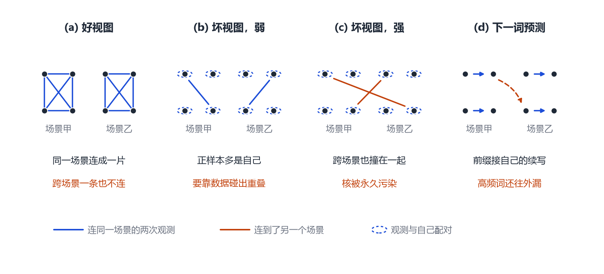
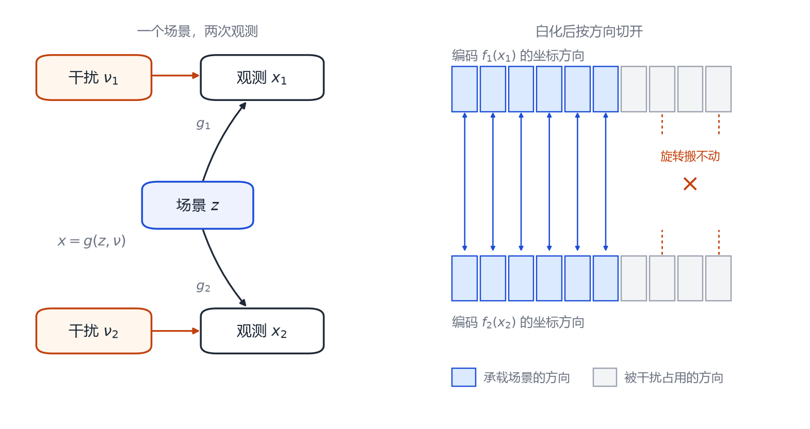
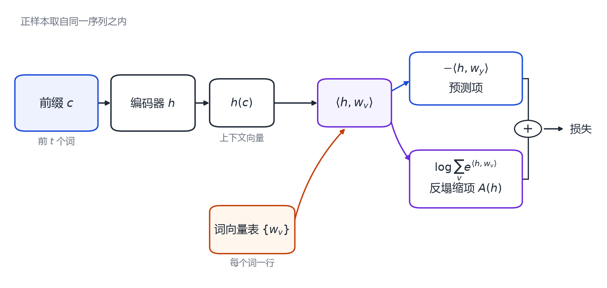

# 第 15 章　好视图与坏视图

一张照片下面挂着五句描述，这是图文数据集里最常见的样子。"一只小狗在沙滩上跑""海边有只狗在玩""沙滩上奔跑的幼犬"，五个人的写法几乎不重样，说的却是同一件事。

换一个做法。取其中一句，随机挖掉两个词，做两次，得到两个残句。"一只小狗在空格上跑"和"一只空格在沙滩上跑"。这两句共享十来个词里的绝大多数，字面上几乎一样。

把这两种配对交给同一个目标，哪一种更能让文本编码器和图像编码器对上？直觉偏向第二种，重叠多，信号强。实验的顺序正好相反，差距还不小。第 14 章把对齐的成败归到正样本上，这一章要说清的是，正样本之间差在哪里。

差别不在重叠多少，在于两次观测共享的是哪一部分。第二种配对共享的是那句话的写法，第一种配对共享的是那张照片。写法是文字的私事，照片两个模态都看得见。

## 15.1 四种配对

按"哪些观测被连起来"分类，正样本分成两族，细分下去有四种。

好视图（good view）指的是同一个场景的两次观测。同一张照片配两句不同的描述，同一段视频的两帧，同一个房间从两个角度拍的两张照片，都算。这个关系由世界给出，不依赖任何一次具体的观察。

坏视图（bad view）指的是同一次观测的两次损坏。一张照片的两个随机裁剪，一句话的两次随机掩码，一段音频的两段随机遮蔽。形状可以很不一样，共同点是都从同一份材料出发。

坏视图还可以按力度再分。弱损坏只动一小块，比如挖掉一句话里的两三个词，两个残句仍然高度相似。强损坏动一大半，比如把七成的词都挖掉，或者把照片裁到只剩一个角。

第四种是下一词预测，它不落在上面两类里。正样本是一段文字的前缀和紧接其后的那个词，这种配对天然就存在，任何一个位置都自带答案。

图 15-1 把这四种摆在同一个画布上。每一格里有甲乙两个场景，各四个观测，连线表示"这两个观测被当成一对正样本"。

<figure class="fig">

<figcaption><b>图 15-1</b>　四种正样本的连接方式。两个场景各四个观测，实线是正样本对，虚线环是观测与自身配对。好视图只在场景内相连，强损坏与下一词预测都会连到另一个场景。</figcaption>
</figure>

图 15-1 的四格可以逐一看。

(a) 好视图把同一场景的四个观测两两相连，一条线也不跨到另一个场景。这个核由"两张图拍的是不是同一个地方"决定，跟你抽到哪几句描述无关。

(b) 弱损坏下，绝大多数配对是"一个观测和它自己"，因为挖掉不同的词之后，每个残句仍然只跟自己最像。两个不同观测被连上，要等它们的残句碰巧相同，这要靠数据足够密。

(c) 强损坏下，残句短到一定程度，跨场景的巧合就变成常态。剩下几个虚词的模式在沙滩上有，在停车场里也有，核于是在任何数据量下都把两个场景混在一起。

(d) 下一词预测的连接很窄。前缀连着它自己的续写，这是一条短边。它还有一类隐式正样本，两个前缀如果后面接同一个词，在最优解附近会互相靠近。一个词元跨不过一个场景，要连起同一场景的两句话需要很长的共享续写链，而高频续写会把不同场景连上。

## 15.2 干扰变量

要形式化"共享措辞"和"共享场景"的差别，得给观测加一个维度。

设世界状态是 $z$，取自一个有限集合。一次观测不是 $z$ 的函数，它还带着一个只属于这次观测的变量 $\nu$，称作干扰变量（nuisance）。观测由

$$
x = g(z, \nu)
$$

生成。照片的 $\nu$ 是机位、光照、曝光时间、被谁拍的。一句描述的 $\nu$ 是用词、语序、句子长短、作者的口气。

$\nu$ 与 $z$ 独立抽取。同一个场景拍两次，得到两个不同的 $\nu$；同一个场景写五句，得到五个不同的 $\nu$。

这里有一个容易滑过去的点。$\nu$ 不是噪声。噪声随机、无结构，平均掉就没了；$\nu$ 是结构化的。同一位作者写十句话，句尾都带同一个语气词；同一台相机拍的十张照片，白平衡都偏暖。模型学这套规律比学场景容易，因为数据里更一致。

$g$ 仍然可以是单射。单射的意思是给定 $(z, \nu)$ 就唯一确定 $x$，不是反过来。从 $x$ 能恢复出 $(z,\nu)$ 这一对，但分不开哪部分是场景、哪部分是干扰。第 14 章假设每个状态只有一个观测，那里没有 $\nu$ 的位置。现在承认一个状态有很多观测，代价就是必须面对这个分不开。

分不开为什么致命，因为跨模态的时候 $\nu$ 没有对应物。机位对视觉系统有用，可是没有一句话决定照片从哪个角度拍，任何旋转都不可能把机位方向和另一个模态的某个方向对上。

于是问题变成一个预算问题。编码器输出的维度固定，白化之后总方差也固定。花在 $\nu$ 上的方向，就是花在"另一个模态看不见的东西"上的方向。

图 15-2 画了这个分解。左半边是生成过程，一个场景配两个独立的干扰，生出两个观测。右半边是一个编码器白化之后的 $k$ 个坐标方向，蓝色那些承载场景，灰色那些被干扰占满。两个模态的蓝格能对上，灰格对不上，因为对面根本没有与之对应的东西。

<figure class="fig">

<figcaption><b>图 15-2</b>　干扰变量的分解。场景与各自的干扰共同生成观测，编码器白化后，一部分方向承载场景、跨模态能对上，另一部分被干扰占满，任何旋转都对不齐。</figcaption>
</figure>

蓝格与灰格的比例不是设计出来的。目标函数里没有任何一项要求"多用蓝格"，它只要求正样本之间的预测误差小。如果正样本允许用干扰来降低这个误差，模型就会用。

## 15.3 花在干扰上的维度收不回来

现在把那句话变成一个下界。

先把编码器标准化。设 $f$ 在观测上的输出已经中心化并白化，也就是均值为零、协方差为单位阵 $I_k$。白化之后，$k$ 个方向上的总方差恰好是 $k$，多占一个方向就必然少占另一个。

把 $f(x)$ 按"给定场景后还剩多少随机性"拆开。条件期望 $u(z) = \mathbb{E}[f(x)\mid z]$ 是 $f(x)$ 里能被场景解释的那部分，剩下的 $f(x)-u(z)$ 是同一场景下仍在变的部分，也就是干扰。前一部分的协方差记作

$$
C_f = \operatorname{Cov}\big(u(z)\big).
$$

因为总协方差是 $I_k$，而 $C_f$ 只是其中一块，所以 $C_f$ 的特征值都落在 $[0,1]$。第 $i$ 个特征值可以读成"场景在第 $i$ 个方向上解释了多少比例的方差"，等于 1 表示这个方向完全由场景决定，等于 0 表示它跟场景毫无关系。

取这些特征值的平方根、求和、再除以 $k$，得到一个数

$$
\rho(f) = \frac{\operatorname{tr} C_f^{1/2}}{k} \in [0,1],
$$

称作场景解释比例（scene-explained fraction）。$\rho=1$ 当且仅当 $C_f = I_k$，也就是给定 $z$ 之后 $f(x)$ 不再有任何变化，$f$ 是 $z$ 的函数。$\rho$ 小，说明编码器把大量方向让给了干扰。

定理 3 说，这笔开销在任何对齐方式下都收不回来。设 $f_1, f_2$ 是两个模态的白化编码器，取同一场景的一对观测 $(x_1,x_2)$，两者各带独立的干扰，那么在所有的正交变换 $Q$ 里取最好的那个，误差仍然满足

$$
\min_{Q \in O(k)} \mathbb{E}\big\lVert Q f_1(x_1) - f_2(x_2)\big\rVert^2 \;\ge\; 2k\Big(1 - \min_m \rho(f_m)\Big).
$$

符号逐个交代。$O(k)$ 是 $k$ 维空间里的旋转与反射，也就是所有保长度、保夹角的线性变换，$\lVert\cdot\rVert$ 是欧氏长度，$m$ 遍历两个模态。右边的 $2k$ 是两个白化向量之间可能的最大平方距离，方向完全无关时就是这个值。

所以 $2k(1-\rho)$ 可以读成"最坏情况乘上浪费的比例"。$\rho=1$ 时下界是 0，允许完美对齐；$\rho=0.5$ 时下界是 $k$，等于说一半预算白花了。

证明的关键只有一步。给定场景后两次观测的干扰独立，互协方差只由两个模态的条件均值 $u(z)$ 和 $w(z)$ 决定，而这两个向量的协方差正是 $C_{f_1}$ 和 $C_{f_2}$。它能分解成一块场景相关部分乘上一个算子范数不超过 1 的残差，取迹之后上界正好是 $k\rho$。干扰是两个模态各自的私事，互协方差里不含这部分信息，最好的旋转也只能把它算作误差。

论文在真实编码器上量过这个数。用 Flickr30k 的 2,014 张验证与测试图，每张五句描述，把文本编码器的五句嵌入求平均，估出 $C_f$，取 $k=32$。好视图 JEPA 的 $\rho$ 是 .804，坏视图是 .655，下一词预测是 .608，三个种子上的波动都不超过 .005。代进定理 3，下界分别是 12.6、22.1、25.1。实测的最好旋转误差是 33.5、39.4、40.3。误差都高于下界，下界本来就只保证"不能低于"。要紧的是顺序，$\rho$ 高的误差小，$\rho$ 低的误差大。$k=128$ 时顺序不变，三者的 $\rho$ 降到 .654、.507、.440。

## 15.4 腐蚀留下了什么

定理 3 说明干扰要花钱，命题 3 说明哪种正样本会花这笔钱。

命题 3 的前一半讲好视图。它把每个模态的观测空间写成有限集合，场景与干扰各有分布，正样本由同一个场景配两个独立抽样的干扰生成。这样构造出来的核是张量积 $\pi \otimes q_m q_m^\top$，$\pi$ 是世界自己的核，$q_m$ 是干扰的分布。它的特征值只有两族，一族是 $\pi$ 的 $\mu_1 \ge \mu_2 \ge \cdots$，另一族全是 0。

只要 $\mu_k \gt \max(\mu_{k+1}, 0)$，也就是第 $k$ 个特征值和后面的拉开了距离，最优解就是 $Q\Phi_\pi(z)$。$\Phi_\pi$ 是世界的谱嵌入，$Q$ 是一个旋转。这个式子里只有 $z$，没有 $\nu$。好视图的编码器因此自动成了场景的函数，$\rho=1$，一个方向都不浪费。这个结论与模态数量无关，与每个状态有多少观测也无关。任意多个模态，只要它们的 $\pi$ 相同，两两之间就差一个旋转。这正是第 14 章定理 1 在有多个观测时的样子。

后一半讲坏视图，结论就没这么好看了。假设一次损坏对状态和干扰的作用可分离，写成两个算子的张量积 $\Gamma = A \otimes B$。$A$ 作用在状态上，$B$ 作用在干扰上。两边的相关性保留度都是从 1 开始单调下降的一串数，记作 $1=\alpha_0 \ge \alpha_1 \ge \cdots$ 和 $1=\beta_0 \ge \beta_1 \ge \cdots$，整个核的特征值就是所有的 $\alpha_i\beta_j$。

取前 $k$ 个特征值。如果其中有 $r$ 个的干扰指标 $j \ge 1$，最优解就有 $r$ 个方向落在干扰上，$\rho = 1 - r/k$，定理 3 给出的下界是 $2r$。判断 $r$ 是否至少为 1 的条件很干净，看 $\beta_1$ 和 $\alpha_k$ 谁大。前者是损坏在干扰上保留的最大相关性，后者是它在世界第 $k$ 个方向上保留的。干扰留得比世界多，就必然有方向被浪费。

这条判据好用，它把"哪种损坏更坏"变成了可以估的量。两个裁剪保留了机位和光照，$\beta_1$ 接近 1；它们对场景的保留没那么强，$\alpha_k$ 会随 $k$ 增大而衰减。$k$ 取大一点，一定有 $\beta_1 \gt \alpha_k$。两次掩码保留的是措辞，同理。

还有一个极端情形。如果损坏完全不动干扰，$B$ 是恒等算子、$\beta_j$ 全等于 1，那么只要干扰集合比 $k+1$ 大，分离条件就塌了，最优解整个落进干扰的特征子空间，$\rho=0$。反过来，把干扰重新随机采样一遍的损坏，一个方向都不浪费。

命题 3 的前提值得盯一下。它讲的是一个编码器、一个空间上的核，跨模态的那句话是由此推出的解释，不是同一条定理的推论。真实数据上的排序是验证，不算证明。

## 15.5 核由视图与数据共同决定

好视图有一个很硬的性质，它诱导的核由设计决定。坏视图没有这个性质。

先把"诱导的核"说清楚。给定一种正样本的分布 $W_m$，不论是好视图、损坏还是两者的混合，都可以问一件事，一对正样本把状态 $z$ 的一个观测和状态 $z'$ 的一个观测连起来的概率是多少。这个概率记作 $\pi_{W_m}(z,z')$，叫做诱导世界核（induced world kernel），上一节那个张量积核是它的特例。

定理 4 用两个量刻画正样本的好坏。第一个是 $\eta_m$，正样本在多大程度上保留了自己的干扰，形式上是把核算子压到"纯干扰函数"子空间之后的最大特征值。第二个是 $\varepsilon_m$，状态与干扰混合的程度，也就是算子把场景函数送到干扰函数、把干扰函数送到场景函数的那两块。好视图的两个量都是 0。

在这两个量之上，定理 4 要求一个间隙条件

$$
\delta_m = \mu_k - \max(\mu_{k+1}, \eta_m) \gt 0,
$$

意思是第 $k$ 个核特征值不但要比下一个大，还要比干扰的保留度大。满足之后，(i) 每一个谱解 $f_m$ 距离"它自己诱导的核的谱嵌入"不超过

$$
\tau_m = \frac{2\sqrt{2}}{\delta_m}\min\big(\sqrt{k}\,\varepsilon_m,\ \sqrt{2}\,\varepsilon^{\mathrm{HS}}_m\big),
$$

而且 $\operatorname{tr} C_{f_m} \ge k - \tau_m^2$，也就是说落进干扰的维度不会超过 $\tau_m^2$ 个。(ii) 两个模态在配对观测上的对齐误差，与"两个诱导核的谱嵌入之间的失配" $d$ 相差不超过 $\tau_1+\tau_2$，而 $d$ 由第 14 章的定理 2 用核之间的距离界定。

读法是这样的。一个谱解学到的，是它自己那套正样本所诱导的核的谱嵌入。好视图的 $\tau=0$，核就是 $\pi$，回到定理 1。坏视图的 $\tau$ 不为 0，而且核 $\pi_{W_m}$ 不是它选的。

这就把"坏视图为什么需要更多数据"讲清楚了。弱损坏下，配对主要发生在观测自己身上，两个不同观测被连上只能靠残句重叠。在以观测为节点、以"是否成为正样本"为边的图上，一个场景的观测本该连成一片，弱损坏只连出许多小碎片，样本越密碎片越容易碰出边。论文在合成世界上量了这个过程，五个类、每类六个状态，需要的到达半径随每个状态的样本数 $N$ 大致按 $\log N / N$ 缩小。到达半径大到能跨场景，对齐就在任何样本量下被封顶。好视图每个状态一个样本就精确对齐。

同一件事在真实数据上也有影子。好视图 JEPA 用比下一词预测少 42 倍的样本达到同样的对齐，这个数留到下一章细说。

核还跟数据的种类有关。字面的可见描述与网页上的替代文本表现不同，后者共享品牌名、共享句式，会把不同场景连起来。坏视图的问题不只是"损坏太弱"，还有"数据把什么算作相似的"。

## 15.6 下一词预测的 JEPA 形式

现在把下一词预测放进这套语言里。

带线性 softmax 头的下一词损失可以原样拆成两项

$$
-\log\frac{e^{\langle h(c), w_y\rangle}}{\sum_{v} e^{\langle h(c), w_v\rangle}}
= -\langle h(c), w_y\rangle + \log\sum_{v} e^{\langle h(c), w_v\rangle}.
$$

$c$ 是前缀，$h(c)\in\mathbb{R}^k$ 是它的嵌入，$\{w_v\}$ 是词向量表，$y$ 是真实的下一个词，$v$ 遍历整个词表，$\langle\cdot,\cdot\rangle$ 是内积。左边是交叉熵，右边第一项只在目标词上有值，第二项要对整个词表求和。图 15-3 把这两条路画了出来。

<figure class="fig">

<figcaption><b>图 15-3</b>　下一词预测的 JEPA 形式。前缀经编码器得到 $h(c)$，与词向量表做内积，一项只在目标词上取值，一项对全表求对数配分，两项相加即损失。</figcaption>
</figure>

命题 4 说这是一个 JEPA，而且三个部件能一一对上。目标编码器是"词到向量"的查表，正样本是同一段文字里的前缀与续写，预测是内积，反塌缩项是那个对数配分函数 $A(h)=\log\sum_v e^{\langle h,w_v\rangle}$。

第二项的角色值得单独说。$A(h)$ 完全不看 $y$，它只看 $h$ 和整张词向量表，作用是把 $h$ 从所有词向量上推开，因为 $h$ 若靠某个 $w_v$ 太近，配分函数就变大，损失就上升。这与对比学习里的均匀性项是一个角色，分母是词表而不是负样本池。命题 4 还给了它一个极限形式，把 logits 除以温度 $t$ 再令 $t\to 0$，$tA(h/t)$ 收敛到 $\max_v\langle h,w_v\rangle$，损失收敛到 $\max_v\langle h,w_v\rangle - \langle h,w_y\rangle$，即目标词的分数离最高分还差多少，当且仅当目标词就是最高分时为零。

真正要紧的是命题 4 的第三条。在条件分布处处非零、维度 $k$ 足够大的情况下，最优解满足

$$
\langle h(c), w_v\rangle = \log p(v\mid c) + b(c),
$$

$b(c)$ 是一个只跟前缀有关的常数。这组解在变换

$$
h \mapsto Gh, \qquad w_v \mapsto G^{-\top}w_v
$$

下完全不变，$G$ 可以是任意可逆矩阵。代入就能验证，$\langle Gh, G^{-\top}w_v\rangle = \langle h,w_v\rangle$，所有 logits 一个都没变，所有条件概率也一个都没变。论文指出，这就是词向量的矩阵分解视角。Levy 和 Goldberg 在 2014 年说明过，这类训练目标等价于分解一个平移后的对数概率矩阵。

所以下一词预测的嵌入最好只能确定到一个可逆线性变换，而不是一个旋转。这句话的分量需要展开。

旋转保长度、保夹角。如果两个模态的嵌入只差一个旋转，那么"这两个向量相距多远""这两个方向夹角多大"在两边是同一件事。第 14 章的正交 Procrustes 找的就是这个旋转，$k$ 对处于一般位置的配对点足以把它定死。

可逆线性变换比旋转大得多，它包含拉伸和剪切。自由度这么大，因为整个目标只用到内积，而内积是两套向量共同定义的。$h$ 是一把尺子，$w_v$ 是另一把。把 $h$ 沿某个方向拉长两倍，同时把 $w_v$ 沿同一方向压短一半，所有内积不变，损失不变，概率分布不变。空间被拉长这件事，目标函数看不见。

后果是距离失去了意义。沿"正式与口语"这个方向把 $h$ 拉伸三倍，同时把对应的词向量压缩三倍，模型的输出一个字符都不会变，但"猫"到"狗"的距离与"猫"到"桌子"的距离之比变了，最近邻检索和谱分解的结果都会变。任何需要比较距离或夹角的跨模态操作，在这个空间里都没有唯一答案。

自由度数目可以对照。旋转有 $k(k-1)/2$ 个，可逆线性变换有 $k^2$ 个，多出来的正是拉伸与剪切。这部分不是两个空间之间的相对量，它作用在每个空间自己的几何上。给定再多配对样本，只要没有额外约束，也只能定出一个线性映射，定不出那个"应该"的旋转。

这也解释了实验里的一个细节。图像侧 768 维，文本侧 384 维，拟合的是行正交的线性映射，论文明确说理论没有覆盖这一情形，理论覆盖的是等维、白化、只差旋转。

再回到正样本。下一词预测的正样本是同一段文字里的前缀与续写，它的核靠共享措辞连文本，不靠共享世界状态。前缀和续写共享整段文字的干扰，作者的口气、话题的用词、标点习惯，一样不落。按命题 3 的读法，它应该把方向花在这些干扰上。这一步是启发式的，因为命题 3 讲的是一模态、一白化编码器，而下一词预测只确定到可逆线性变换。论文把它写成待检验的预测。

第二个隐式正样本来自最优解的形状。所有以同一个词 $v$ 结尾的前缀都会聚到 $w_v$ 附近，这是语言模型随规模增大而逼近的神经坍缩，于是共享续写的前缀互为隐式正样本。这种连接很窄，一个词元跨不过一个场景，要连起同一场景的两句话需要很长的共享续写链；而高频续写会把不同场景连上，虚词、套话、文档风格都在做这件事。

有一组数字可以看这个差别。把同一张图的两句描述拼成一段喂给下一词预测，互 10-NN 从 .042 只挪到 .043，检索 R@1 从 .021 到 .023。同样的正样本当作 JEPA 视图来用，提升完全是另一个量级。

把这一章的几条串起来看。好视图一个动作连通一个场景的全部描述，从不越界，它诱导的核就是世界自己的核。弱损坏只能一格一格地爬，靠数据密度把碎片连起来。强损坏和下一词预测的外溢会跨场景，前者在任何数据量下都被污染，后者要靠高频词的统计去猜边界。

在这之上还有一层更细的损失。坏视图和下一词预测把维度花在干扰上，这部分维度跨模态永远对不齐，定理 3 给了它一个下界，实测的 .804 与 .608 之间的差距就是这笔账。下一词预测还多一层麻烦，它的嵌入连距离都没有定义。说它学不到东西也不对，它学到的是措辞与共现，这两样在文本内部极其有用，语言模型的全部能力都建立在这上面，只是它们不是世界状态。

要补上那部分，只能靠堆数据。这个量有多大，下一章有一个具体的数字。
