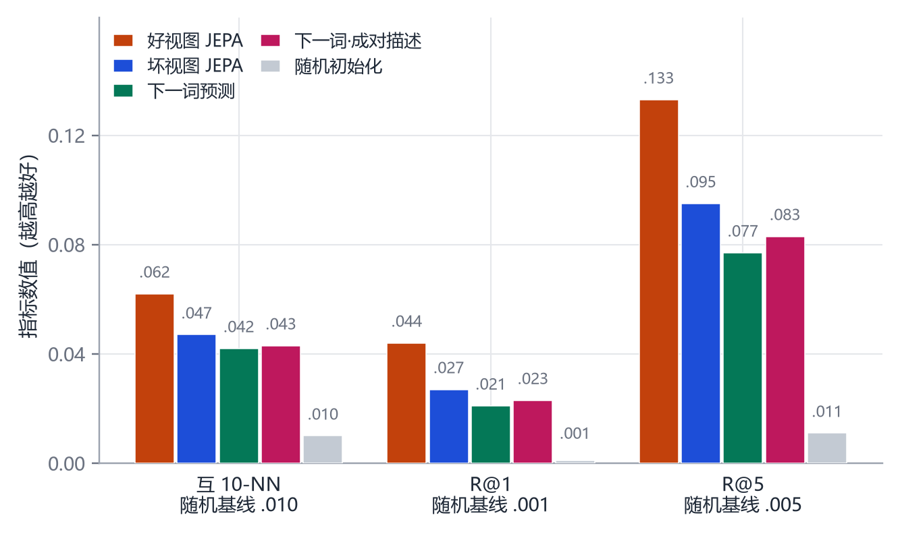
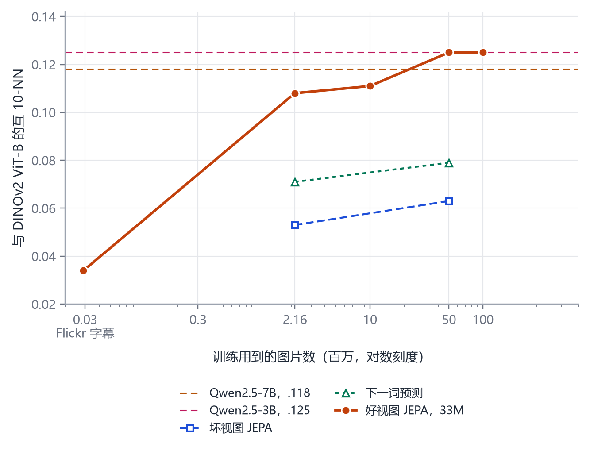
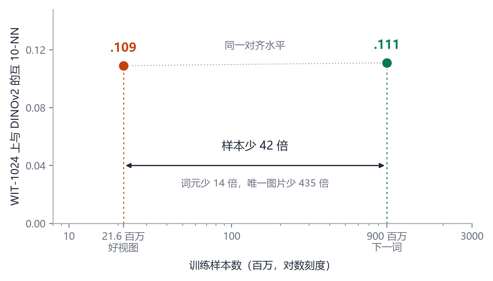

# 第 16 章　四十二倍的差距

假设有两个机房，各跑一个编码器。左边那个只吃图片，右边那个只吃文字，训练脚本里没有任何一行代码让它们交换信息。左边不知道世上有文字，右边不知道世上有像素。训练完成后，把同一批一千个图文对的向量分别算出来，在图像空间里找每张图最近的十个邻居，在文本空间里找每段描述最近的十个邻居，然后数一数这两组邻居有多少重合。

如果两个编码器学到的是两张无关的地图，重合数应该和随便抓阄差不多。如果它们学到的是同一张地图，只是坐标系转了四十五度，重合数会明显偏高。这个数字不需要训练任何东西就能算出来，也没有任何参数可以被调去迎合结论。

四十二倍说的是另一种比较。同一个编码器、同一批文本，用“同一场景的两段描述”当正样本，读到两千一百六十万个样本就达到了某个对齐水平；用“预测下一个词”当目标，要读到九亿个样本才达到同样的水平。前面那个数乘以四十二，才是后面那个数。

这一章把这个实验从头拆一遍。设置怎么搭，指标为什么可信，三张表里的数字各是什么，以及这套设计在哪里可能骗人。

## 16.1　两个从不说话的编码器

数据是 Flickr30k 的标准划分，两万九千张训练图片，每张配五条人工描述，验证集一千零一十四对，测试集一千对。这个数据集小得有点寒酸，好处是每张图有五条独立写出来的描述，正好构成“同一个场景的五次观测”。五条描述在这个实验里不是装饰，它是好视图的物质基础。没有同一张图的五条独立描述，就没有“两次观测”可以挑，后面所有对比都无从谈起。

图像侧是一个 ViT-S/16，把图片切成 16×16 的小块，每张图取两个全局视图（224×224）和六个局部裁剪（96×96）。文本侧是一个十二层、宽度 384 的 BERT，三千三百万参数。为了看规模的影响，同一套代码还训练了 11M、109M、335M 三个宽度的版本。

真正的变量在文本侧的正样本上。三个版本共用同一份数据、同一个目标函数、同一个优化器，只有“哪些文本算作同一个东西的两次观测”这一条不同。

掩码片段版把一条描述切成八段随机连续片段，每段遮掉 15% 的词元，八段互为正样本。它看到的是同一句话的八次损坏。

描述版把八条互为正样本的文本都取自同一张图的不同描述，同样裁剪、同样掩码。它看到的是同一个场景的八次独立描述。

下一词版把 BERT 改成因果注意力，输出层与词嵌入绑定，每次只喂一条描述，目标是预测下一个词元。

两侧用的都是 LeJEPA 目标，也就是对两个全局视图的均值做不变性约束，再加一个各向同性高斯正则（SIGReg，$\lambda = 0.02$）。图像侧和文本侧从头到尾没有共享过一个批次，没有对齐过一次损失。论文在这一段写得很直白，任何编码器都没有见过对方的模态。

训练规模是两百个 epoch、批大小 256、AdamW、学习率 $5\times10^{-4}$、权重衰减 0.05，每个设置跑三个随机种子，报均值和半极差。

## 16.2　一个不用拟合的指标

指标叫互相最近邻（mutual $k$ 近邻，这里 $k=10$）。取一千个测试对，在图像空间里给每张图找十个最近的图，在文本空间里给每段描述找十个最近的描述，看这两组邻居的交集有多大。随机水平是 $10/N$，$N=1000$ 时等于 0.01。

这个指标的可信之处在于它什么都不拟合。没有线性层，没有旋转矩阵，没有温度系数，两个空间各自独立建立，唯一的操作是比较距离和数交集。如果两个编码器之间真的只差一个旋转，邻居关系在旋转下不变，这个数就会高；如果两者学的是不同的东西，旋转也救不回来。

它的短处同样明显。绝对值很小，0.06 和 0.01 之间的差别在直觉上不好把握；它只看局部邻居，看不到全局结构；而且它对两侧表征的“锐度”敏感，一个把样本挤成一团的编码器也可能拿到不低的分数。所以论文配了第二个指标。

读这个数有一个朴素的换算。一千个样本、每个十个邻居，一共一万对邻居关系；随机期望对上一百对，也就是 0.01。0.062 意味着有六百二十对邻居在两个空间里同时成立，0.042 意味着四百二十对。绝对值小，是因为两个空间各自只有一千个点，每个点只被要求对十个对象有判断。

第二个指标直接检验“只差一个旋转”这句话。在一千零一十四对验证数据上拟合一个正交映射，也就是一个 $384\times384$ 的旋转矩阵，然后用它在测试集的一千条描述里做图到文的检索，报 R@1 和 R@5。随机水平分别是 0.1% 和 0.5%。

真正要看的是这个矩阵的体量。$384^2$ 约等于十五万个数字，而两侧编码器各有三千三百万参数。也就是说，两侧的表征如果有共同结构，这个结构几乎全部来自各自独立的训练，用来搭桥的参数只占万分之五。检索分数低，说明桥没搭好或者结构本来就不一致；检索分数高，很难用“拟合出来的”来解释。

两个指标测的东西并不一样。互相最近邻看的是邻域结构是否一致，检索看的是这种一致性能不能被一个线性映射利用。前者更接近定理的陈述，后者更接近实际用途。

## 16.3　三条指标一致地把好视图排在最前

图 16-1 是表 1 的柱状图。三组指标，四种文本编码器加一个随机初始化基线，两百个 epoch 训完的那一轮。

<figure class="fig">

<figcaption><b>图 16-1</b>　Flickr30k 上图像 JEPA 与四组文本编码器的对齐。三条指标上描述版都最高，掩码片段版次之，下一词版最低。数据取自原论文表 1，误差为三个种子的半极差。</figcaption>
</figure>

描述版拿到 0.062 / 0.044 / 0.133，掩码片段版 0.047 / 0.027 / 0.095，下一词版 0.042 / 0.021 / 0.077。三条指标上的排序完全一致。把差距换算成相对值，描述版比掩码版分别高 32%、63%、40%，比下一词版高 48%、110%、73%。

最有信息量的是第四行。研究者把下一词模型改成每次喂进同一张图的两条描述，让它至少能看见“这两句话说的是一回事”。结果 R@1 从 0.021 抬到 0.023，R@5 从 0.077 抬到 0.083。抬了一点，但离描述版的 0.044 / 0.133 还差得远。

这一行把两种解释分开了。差距不是“有没有见过配对数据”造成的，因为这一行见的配对数据和描述版一样多。差距出在正样本的构造上。下一词模型的正样本是前缀和续写，两条描述即使并排放着，模型也只是在学“这句话后面接那句话”的概率，而不是在学“这两句话指向同一张图”。描述版的正样本直接就是同一个场景的两次观测，目标函数在拉近它们时，没有别的信息可以依赖，只能去抓场景。

随机初始化那一行是 0.010 / 0.001 / 0.011，和随机水平 0.010 / 0.001 / 0.005 几乎重合。这说明指标没有给任何人送分，也说明前三行的数字虽然小，但都是从零开始真挣来的。

两百个 epoch、十四万五千条描述，这个规模下所有数字都低。低不要紧，要紧的是排序稳定，而且三个种子的半极差在 0.001 到 0.008 之间，远小于组间差距。

## 16.4　换一个更强的图像侧

Flickr 上的图像编码器是自己从零训的 ViT-S，只见过两万九千张图。把它换成冻结的 DINOv2 ViT-B/14，一个在数量级大得多的图片上做过自监督、参数也多得多的模型，问题就变成“文本侧能不能追上一个成熟得多的对手”。

换图像侧还有一个方法上的好处。如果图像侧一直用自己训的小模型，那么“文本侧对齐得好不好”就可能被图像侧本身的毛病带偏，比如它可能把两万九千张图里没出现过的概念压成同一个点。换成冻结的 DINOv2，图像侧成为一个不动的参照物，同一批文本编码器在它面前排队，比较的就不再是两套自训模型的巧合，而是一侧固定、另一侧可变的条件。

表 2 给的是这一组。描述版 0.232 / 0.246 / 0.346，掩码版 0.132 / 0.133 / 0.207，下一词版 0.122 / 0.118 / 0.213。零样本的 Qwen2.5-0.5B 是 0.098 / 0.135 / 0.240，预训练的 BERT-base 是 0.093 / 0.149 / 0.273。

互相最近邻这一列最能说明问题。描述版 0.232 是 Qwen2.5-0.5B 的两倍多，是 BERT-base 的两倍半，而它只是一个三千三百万参数、只在字幕上训过两百轮的模型。邻居结构对齐得好，说明两个空间在局部上摆得一样，这件事和参数多少、数据多少没有直接关系。

检索这两列要小心读。描述版在测试集上 0.246，而把旋转从一千对验证数据换成三万对训练加验证数据之后，同样的编码器升到 0.346。Qwen2.5-0.5B 从 0.135 升到 0.240，BERT-base 从 0.149 升到 0.273，都涨了，描述版仍然领先。这说明检索分数有一部分被旋转估计的精度卡住，真正决定上限的是邻居结构。

有一个数字需要摆出来，免得读者对 0.232 产生过高的想象。同一个实验里，Flickr 图像 JEPA 与 DINOv2 之间是图像对图像，互相最近邻只有 0.101，R@1 是 0.217。文本侧对 DINOv2 的 0.232 竟然高于图像侧对 DINOv2 的 0.101。原因不难想，那个图像侧模型很小、见得太少，它和 DINOv2 的差异比文本侧更大。所以互相最近邻不是“对齐百分比”，它的绝对尺度取决于两侧编码器各自离“理想表征”有多远，能横向比较的只有同一张表里的行。

## 16.5　从字幕走到网页文本

Flickr 的五条人工描述是稀缺资源。换成网页，可以拿到每张图的替代文本和两条机器重写的描述，数量级完全不同。研究者用 Recap-DataComp 的文本训练同一个三千三百万参数的编码器，那两条重写描述由一个基于 LLaMA-3-8B 的图像描述模型生成。

评测集换成了 WIT-1024，这是 Huh 等人做柏拉图式表征假设时用的基准。论文强调自己的模型没有在它上面训练过。图像侧仍然是冻结的 DINOv2 ViT-B。

<figure class="fig">

<figcaption><b>图 16-2</b>　WIT-1024 上的互 10-NN 随训练图片数上升。描述版从 Flickr 字幕的 0.034 升到五千万张图的 0.125，与 Qwen2.5-3B 持平并高于 7B。数据取自原论文图 9 与第 4.1 节。</figcaption>
</figure>

只在 Flickr 字幕上训练时，这个编码器在 WIT 上只有 0.034。换成两万一千六百张图的文本，升到 0.108；一千万张，0.111；五千万张，0.125；一亿张，还是 0.125，种子之间最多差 0.009。曲线在五千万处拐平。

那张图上还画了两条水平线，Qwen2.5-3B 的 0.125 和 Qwen2.5-7B 的 0.118。三千三百万参数、没有做过下一词预测也没有做过掩码词预测的编码器，在五千万和一亿张图的文本上追平了三亿和七十亿参数的语言模型。参数差九十倍到两百倍，对齐水平一样。

那张图里还有两条短线，是同一批数据、同一个编码器、只改正样本构造的对照组。两万一千六百张图时，掩码版 0.053、下一词版 0.071，描述版 0.108。把图片数加到二十三倍（五千万张），掩码版 0.063、下一词版 0.079，描述版 0.125。数据翻二十三倍，两条坏视图的曲线只爬了 0.01 上下，好视图爬了 0.017，差距反而拉大。

检索这条线也在涨。Flickr 上的 R@1 从一千万张图时的 0.348 升到五千万的 0.376、一亿的 0.402，而一个宽三倍的 109M 模型在五千万张图上拿到 0.408，和只用 Flickr 加 COCO 字幕训出来的最好成绩 0.400 打平，却一条 Flickr 或 COCO 的描述都没见过。

## 16.6　同一个编码器的两条曲线

到这一步，好视图和下一词之间的差别还混着参数、数据、训练步数。要把它变成一个干净的数字，得把所有变量按住。

研究者用同一个 109M 的 BERT-B，同一批 Recap-DataComp 文本，只改正样本，训练两个模型。描述版读到两千一百六十万个样本，WIT 上是 0.109；下一词版读到九亿个样本，WIT 上是 0.111。论文特别注明，下一词版没有更早的检查点可以评分，所以这两个点就是全部证据。把它画到对数横轴上，如图 16-3。

<figure class="fig">

<figcaption><b>图 16-3</b>　同一个 109M 编码器达到同一对齐水平所需的样本数。横轴对数刻度，纵轴是 WIT-1024 上的互 10-NN。两点取自原论文第 4.2 节，中间不插值。</figcaption>
</figure>

两千一百六十万乘以四十二，等于九亿零七百二十万。样本少四十二倍，这是第一个换算。一个好视图样本要读三条文本，所以词元数只少十四倍。九亿个样本对应九亿四千万张图的文本，两千一百六十万对应两百一十六万张图，唯一图片数少四百三十五倍。三个倍数说的其实是同一件事，词元那一条最保守。

样本数打平时差距更大。同样是两千一百六十万个样本，三千三百万参数的编码器上，描述版 0.108，下一词版只有 0.071。

这个比较有一个容易被忽略的前提，两侧的算力配置并不相同。描述版用批大小 256、学习率 $10^{-4}$，下一词版用批大小 2048、学习率 $2\times10^{-4}$，各自用适合自己规模的配方。也就是说，四十二倍不是把对手的配置削弱之后得到的。

再把规模放大到九亿样本，论文表 3 汇总了结果。109M 的描述版在 WIT 上拿到 0.184，高于 Qwen2.5-72B 的 0.154、Llama-3-70B 的 0.151 和 CLIP 文本编码器的 0.124；线性 CKA 是 0.507 对 0.418；COCO 的五千对测试上 0.161 对 0.108；换成 CLIP ViT-H/14 做图像侧，0.230 对 0.210。这个模型读了一千一百六十亿个词元，对手读了一万五千亿到一万八千亿，参数最多大六百六十倍，词元多一百倍以上。

这些点连起来不是随机的，论文把它们写成了一条公式。设训练样本数为 $M$、图片数为 $N$、训练条目中带好视图的比例为 $q$，则

$$
\mathrm{R@1} = a + d\log M + b\log\!\left(1 + \frac{q^{\alpha} M^{\beta} N^{\gamma}}{c}\right),
$$

$a,d,b,c,\alpha,\beta,\gamma$ 都是拟合出来的常数，第一项加第二项是坏视图自己也能爬到的那条底，对数项是好视图额外带来的那部分。用四十五个格子的结果拟合，均方根误差 0.007。然后拿它去预测八十五个没跑过的设置，$M$ 从三百万到一亿三千三百万，误差 0.0093，而同一个设置换一个种子重跑，差别是 0.0096。预测和重跑的误差一样大，这条曲线也就到了种子噪声的地板。沿等对齐线看，样本每多一倍可以换掉的 $q$ 是次线性的，$q \propto M^{-0.30}$；唯一图片数的指数只有 $\gamma = 0.19$，说明光堆图片、不改善视图，作用很小。

## 16.7　这些数字没有说明的事

一套实验设计得再干净，也有它照不到的地方。

描述版的正样本是“从一条描述里裁出的连续片段”。如果把整条描述直接当视图，R@1 从 0.246 掉到 0.185，跌了两成半；把裁剪改轻一点，取描述 70% 到 100% 的一段，是 0.202，跌了一成八。掩码比例从 15% 调到 30%、视图数从八改成四或十二、批大小翻倍、宽度换成 192 或 768，这些旋钮的影响都在 0.016 以内。差距主要来自裁剪这个动作，而裁剪之所以有用，可能是因为它让两条描述在长度和位置上错开，减少了“同一句话”这种表面相似。这一点论文只给了数字，没有给解释。

训练不稳定。不加梯度裁剪时，三十六个用默认正则权重的跑里有三个塌缩。塌缩来得很突然，有一个种子在第四十九轮还有 0.243，到第五十九轮就掉到随机水平。所以那些“好视图总能赢”的结论，前提是模型没有塌。这是联合嵌入预测架构的老问题，第五章讲过，这里只是再确认一次它在真实规模上仍然存在。

“纯文本”这个词要打引号。Recap-DataComp 的两条重写描述是由一个图像描述模型看着图写出来的，里面已经蒸馏了图文对齐的信息。三千三百万参数的编码器没有见过像素，但它读的文字是见过像素的模型写的。这一层间接性无法消除，只能记住。

好视图本身需要一种配对信息。在 Flickr 上它是标注，在网页上是同一条链接下的替代文本与重写描述。要把“哪些文本描述同一个场景”认出来，就已经用到了场景级的对应关系。这个要求比图文配对弱得多，但不是零。定理说的是给定好视图之后两侧会重合，没说好视图从哪来。

宽度这一条还没兑现。五千万张图时，宽三倍的 109M 模型在 WIT 上只有 0.116，不如 33M 的 0.125；两万一千六百张图时是 0.109 对 0.108，也只是打平。检索分数倒是随宽度涨，Flickr 上 11M、33M、109M、335M 分别拿到 0.335、0.367、0.400、0.376，到 335M 反而回落。规模在这个任务上还没有表现出语言模型那种平滑的收益。

两个基准测的东西也不完全一样。Flickr 的测试集只有一千对，几乎全是日常场景，模型在这上面得分的空间被样本量卡住；WIT 有一千零二十四对，取自维基百科的图文，领域和训练语料差得更远，论文还专门用两百个八百对的随机子集去量它的波动。同一套编码器在两个基准上排序一致，这一点比任何单个数字都更说明问题。

把这一章的数字压成一句话：两侧从来没有见过对方的模态，只共享“什么和什么属于同一个场景”这一个信息，就能在邻居结构上对齐到语言模型几十倍规模才达到的水平。剩下的问题是这句话能拿来做什么。如果两个表征真的只差一个旋转，那么这个旋转可以解出来，解出来之后可以干很多事，比如让一个只读过文字的模型去描述它从没见过的图片。
