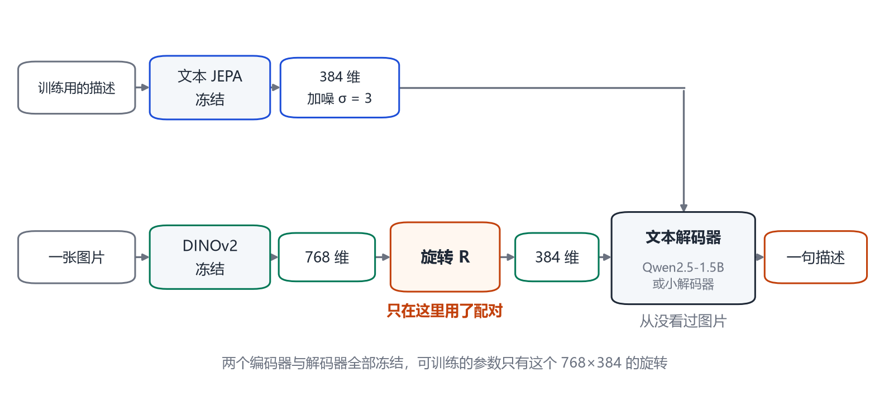
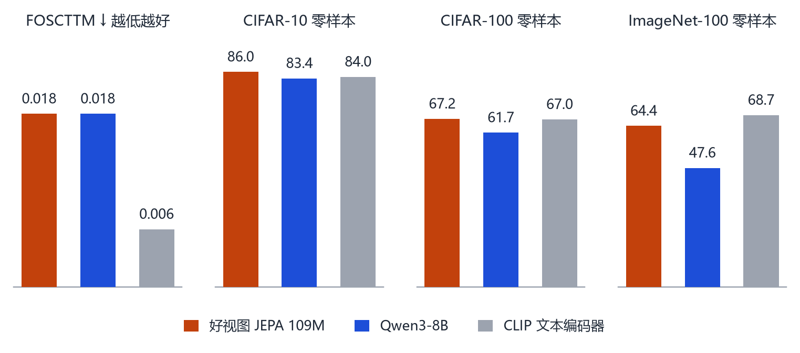
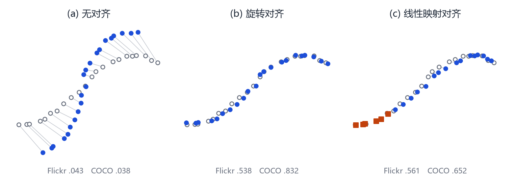

# 第 17 章　一个旋转能做什么

假设你手上有两个编码器。一个看图片，一个读文字，各自独立训练，训练的时候谁也没见过谁。现在给你一张没见过的照片，要你写一句描述。常规做法是收集几十万图文对，训练一个跨模态模型，让两个编码器在配对数据上互相拉扯。可如果这两个空间之间只差一个旋转，你要学的东西就只有一个矩阵。

这个矩阵有多大，可以先算一算。图像编码器输出 768 维，文本编码器输出 384 维，映射是 768 乘 384，二十九万个数字，扣掉行正交的约束之后剩下 22 万个。作为对比，一个 1.5B 的语言模型有十五亿个参数，是它的七千倍。前面几章把“不同模态的表征只差一个旋转”从观察推成了定理，这一章把定理当工具用，看这个旋转究竟能换来什么。

换来的东西比预想的多。它能让一个从没见过图片的解码器描述照片，能让两批从没配对过的数据互相对齐，还能把在照片上估出来的旋转直接用到视频上。换不来的东西也一样清楚，后面会一条条摆出来。

## 17.1　把旋转解出来

先把记号摆好。图像侧的配对向量排成矩阵 $A$，文本侧的排成 $B$，两边的第 $i$ 列描述同一个场景。要找的是一个正交矩阵 $R$，让

$$
\min_{R^\top R = I}\ \lVert A - RB\rVert_F^2 .
$$

正交矩阵在几何上就是一个旋转，允许带一次镜像。它保长度、保夹角，所以对齐的时候不会把一团点压扁或者拉长，只是整体转过去。这一点很关键，后面会看到好处和代价都从这里来。

这个优化有闭式解，一步到位。算 $M = AB^\top$，对它做奇异值分解 $M = USV^\top$，取 $R = UV^\top$ 就是最优解。不需要梯度下降，不需要迭代。这个方法叫正交 Procrustes，名字很老，统计学里原本用来比较两组形状。

它做的事其实很朴素。想象两张描图纸，各画了一组点，画的是同一座城市的十个路口。一张纸被转过一个角度，另一张没有。两张叠在一起，路口全对不上；把上面那张转一下，它们就重合了。Procrustes 找的就是这个转动的角度，只不过它一次处理几百个点，而且这些点住在 384 维里，纸面只有两维。

为什么要限制成正交，可以从自由度看出来。不加约束的线性映射有 $d_a d_b$ 个自由度，384 维对 384 维时是十四万个，它能把你给的任何 $k$ 对点映到任何地方，训练集上误差为零，换一批数据就散架。旋转只有 $k(k-1)/2$ 个自由度，384 维时七万三千多个，刚好是全矩阵的一半。少掉的那一半，是“不许拉伸”。

配对的数量也有讲究。命题 2 说，$k$ 对处于一般位置的配对足以唯一确定旋转，少于 $k$ 对时解不唯一。论文里有个小实验能看出这条边界的实际形状。只用 30 对配对拟合旋转，再借助无配对数据精修，描述器在 Flickr 上拿到 CIDEr .169；而用 1014 对配对做最近邻检索，只有 .158。三十对定不住一个 384 维的旋转，但已经比检索强一点。

维度不一样时，旋转装不下。图像侧 768 维，文本侧 384 维，得用行正交的线性映射，也就是 $d_b$ 行互相垂直、每行长度为一。它的自由参数是

$$
d_a d_b - \frac{d_b(d_b+1)}{2},
$$

第一项是全矩阵的元素数，第二项是行正交归一化掉的约束数。768 与 384 代进去是 22 万。论文里最好的那个描述器把 DINOv2-g 与 DINOv3-L 的特征拼成 5120 维，参数是 190 万。图像与文本之间要学的全部东西，就是这么多。

## 17.2　一个只在文本上训练的解码器

要造一个图像描述器，常规做法是训练一个编码器加解码器，在几十万图文对上端到端优化。这里换个做法，解码器只在文本上训练。

具体是这么几步。取一个文本 JEPA，它把每条描述压成 384 维向量，冻结。再取一个因果 transformer 当解码器，输入是这条描述自己的嵌入，输出是这条描述逐词展开的序列。整个训练过程里没有一张图片。为了防止解码器把输入当成精确的文本嵌入来死记，训练时给嵌入加高斯噪声。

噪声强度不是调出来的，是算出来的。设噪声的范数是嵌入范数的 $\sigma$ 倍，加噪后的向量与原向量的期望余弦是 $(1+\sigma^2)^{-1/2}$。旋转之后，一张图和它自己的描述平均余弦只有 $c \approx .3$，把这个数代进去，$\sigma = \sqrt{c^{-2}-1} \approx 3$。论文用的正是 3，并且在 0.5 到 4 的扫描里，迁移效果确实在 3 附近最好。这条式子把“加多少噪声”从一个凭手感定的超参数，变成了一个可以从数据里测出来的量。

噪声的两头都不行。加得太大，解码器学会彻底忽略输入，输出永远是“一条街上有一只狗”这种最保险的句子；加得太小，它只会复述训练时见过的那些嵌入，遇到带误差的输入就崩。中间那个合适的位置，由对齐残差 $c$ 定下来。

要描述一张图，就把图送进冻结的 DINOv2 得到 768 维，乘上旋转变成 384 维，交给解码器。整个流程里唯一在图文对上拟合过的东西就是那个旋转，如图 17-1。

<figure class="fig">

<figcaption><b>图 17-1</b>　旋转对齐的描述器。上排只用文本训练解码器，下排描述新图片时才第一次出现图像。橙色标出全流程唯一在图文对上拟合的部分，两个编码器与解码器都冻结。</figcaption>
</figure>

结果比预期好。Flickr 的 1000 张测试图上，用 1014 对配对拟合的旋转，CIDEr 到 .396；用 30k 对拟合到 .431；只给 300 对是 .317，100 对是 .244。作为对照，随机旋转只有 .043，用同一个旋转做最近邻检索、把最像的描述原样搬过来，是 .188。

随机旋转那个 .043 值得看一眼。它说明解码器在没有对齐的情况下仍然在输出通顺的句子，因为它只学过“从向量到句子”，输入是一团噪声它也照写，只是写的内容和图无关。CIDEr 奖励常见词组，所以这些套话还能拿到分。这个基线提醒一件事，评价描述器的时候，光看句子通不通顺没有意义。

跨数据集也能用。旋转在 Flickr 上拟合，描述器在 COCO 的 5000 张测试图上到 .668，BLEU-4 是 .199，随机旋转是 .038。COCO 的图片和 Flickr 的图片不是一回事，题材和配比都不一样，旋转还能站住，说明它学到的是两个空间之间的关系，不是 Flickr 那批配对的具体细节。

再往上堆规模。把解码器换成 Qwen2.5-1.5B，只在文本上微调；图像侧用 DINOv2-g 加 DINOv3-L；采样 32 条描述做共识解码。Flickr 到 .519，COCO 到 .838。换成论文自己训的小解码器，是 .538 与 .832。从 .668 到 .838 是一层层加上去的，更大的图像编码器、更强的语言模型、共识解码，每一步都有贡献。

这个数字还不是最好的。在 COCO 上专门用图文对训练的描述器能到 .918（CapDec）和 .912（DeCap），它们背后是 4 亿图文对。这条路的价值不在最高分，在于配对数据只碰了 22 万个参数。

## 17.3　视频没有单独的编码器

视频这条线本来要另起一套。视频编码器、视频文本对、时间建模，都是钱。但如果两个空间只差一个旋转，而一帧照片和一段视频落在同一个空间里，那么视频不需要新的编码器。

做法简单到有点粗。均匀取 8 帧，各自过 DINOv2，各自乘旋转，把 8 个 384 维向量取平均，交给同一个解码器。编码器和解码器都没见过视频。

在 MSR-VTT 的 2990 个测试片段上，对着每个片段的 20 条人工描述评，CIDEr 是 .246。演示用的那张映射（在 30k Flickr 配对和 20 万网络图文对上拟合）到 .268。

这些数字要和谁比。跟零样本的描述器比，用 CLIP 编码器搭的 ZeroCap 是 .058，MAGIC 是 .074，DeCap 在 .150 到 .186 之间。跟专门的视频语言系统比，VideoCoCa 是 .271，用了 1.44 亿视频文本对；TOPA 是 .329；在 MSR-VTT 描述上训过的解码器是 .348。一个从没见过视频的系统，落在“零样本”和“专门训练”中间。

平均帧为什么有用。一帧是一个场景的一次观测，带着自己的干扰，取的是哪一帧、有没有运动模糊、构图怎么切。平均把这些干扰抵掉，留下的是场景。这也是定理 3 的推论，多次观测的平均更接近世界状态本身。数字上能看到，片段与描述的互 10-NN，用中间帧是 .148，用 8 帧平均是 .167。

检索也能跨过去。同一个在照片上拟合的旋转，把 16.5% 的描述对到了正确的片段；CLIP ViT-B/32 用 4 亿图文对训出来，是 31.2%。差一半，方向是对的。

缺点也要说。生成的句子是图片描述的腔调，平均 11.4 个词，MSR-VTT 的人工描述是 9.3 个词。它常常漏掉动作和对话，因为这两样在单帧里看不出来。8 帧平均等于把视频当成一叠照片，时间结构没有被用上。

## 17.4　一对配对数据都没有

命题 2 的第一句话很硬。白化之后，旋转仍然是白化，所以两团点云的前两阶矩，也就是均值与协方差，在任何旋转下都一样，靠它们永远找不出旋转。这条结论把一批常见做法判了死刑，匹配均值、匹配协方差、做线性 CCA，全都停在这里。

有限世界留了一个后门。如果世界有无穷多个状态，嵌入分布可以恰好是各向同性的高斯，那时旋转真的没有痕迹。真实世界是有限的，几十万个场景，分布由有限个点撑起来，不可能旋转不变。簇的形状、点与点的相对距离，这些高阶结构里带着世界的指纹。定理说两个好视图编码器把这些指纹记得一样，于是可以靠指纹把旋转找回来。

Schnaus 等人的方法就是这么做的。两团点云各自聚成 30 个簇，先按簇的统计量粗配，再用最优传输在点级别上精修一个正交映射，交替 100 轮，每轮 1 万个点，重启 30 次。整个过程不看任何一对配对。

评测协议也照他们的原样。DINOv2 ViT-B/14 对文本编码器，映射在 COCO train2014 的两半上拟合，一半的图配另一半的描述，然后在 40504 对 val2014 上评。指标是 FOSCTTM，意思是“比真配对更近的样本占多大比例”。一张图的真描述如果排在最近的第一位，比它更近的样本是零个，记 0；如果它排在中间，有一半样本比它近，记 .5。所以这个数越小越好，0 是完美，.5 等于瞎猜。

把文本编码器换成一个 109M 的好视图 JEPA，结果如图 17-2。FOSCTTM .018，CIFAR-10 零样本 86.0%，CIFAR-100 67.2%，ImageNet-100 64.4%。同样条件下重跑的 Qwen3-8B 是 .018、83.4%、61.7%、47.6%。CLIP 的文本编码器，4 亿图文对训出来的，是 .006、84.0%、67.0%、68.7%。下一词预测在同一批文本上有一半的种子直接失败，FOSCTTM .287，CIFAR-10 只有 25.5%。对方论文里报告的最好零样本结果是 CIFAR-10 82%、CIFAR-100 62%、ImageNet-100 56%，这三项也都被超过。

有一个细节要说明。坏视图 JEPA 在 COCO 上也对齐得不错，FOSCTTM .026。这一组对比真正分开的是 JEPA 与下一词预测，好视图与坏视图的差距要到 Flickr 上才显出来。

<figure class="fig">

<figcaption><b>图 17-2</b>　完全不使用配对数据的对齐结果。三组文本编码器在四个指标上的对比，数据取论文 Table 4。第一格 FOSCTTM 越小越好，后三格是零样本准确率，越高越好。</figcaption>
</figure>

一个 109M 的模型在两个指标上打平 8B，在另外两个上超过它。这不说明小模型更聪明，只说明这两件事在测不同的东西。语言模型的表征里混着措辞与共现，对齐到图像空间的时候，那部分变成了噪声，还占着维度。

Flickr 上的池子小得多，各 15007 张图与 15007 条描述。零配对时，109M 的好视图 JEPA 让 16.4% 的测试图第一条就取到正确描述，15 次运行的标准差是 10.4%，随机是 0.1%；其他编码器，包括 CLIP、MPNet、BERT、Qwen2.5-0.5B，都在 0.3% 以下。用这样一张映射，零配对的描述器能到 CIDEr .158，而在 30k 配对上拟合的旋转是 .430，随机映射是 .028。

## 17.5　为什么不能换成更自由的映射

既然旋转能用配对拟合，为什么不干脆放开成一个普通的线性映射。它的参数更多，在训练分布上一定拟合得更好。

数字上确实如此，代价也一并付了。同样在 30k Flickr 配对上拟合，不受约束的线性映射在 Flickr 上到 .531，比旋转的 .504 还高一点；换到 COCO 就掉到 .635，旋转是 .802。加上共识解码是 .561 对 .538，以及 .652 对 .832。两层 MLP 更差，两边都输。自由度换来的是在训练分布上的拟合，赔进去的是在别处的不成立，如图 17-3。

<figure class="fig">

<figcaption><b>图 17-3</b>　三种对齐程度的二维示意。空心圈是文本空间，实心点是图像空间映射之后的位置。橙色方块是拟合用的六对配对，图下数字是同一设置下 Flickr 与 COCO 的 CIDEr。</figcaption>
</figure>

几何上的区别一眼能看出来。旋转是刚体运动，两团点的形状只能整体转，形状本身不变；线性映射可以拉伸、可以剪切，它能把几个点摆到任意位置，代价是把整团点拉歪。图 17-3 的第三格就是这样，橙色的几对配对贴得很准，往右走的点一个个偏出去。

这个差别在低维里看得最清楚。二维平面上，旋转只有一个参数，线性映射有四个，多出来的三个正好是拉伸与剪切。维度升到 384，旋转有七万三千个参数，线性映射有十四万个，多出来的那七万个还是在描述同一件事，允许形状变。

这条区别解释了跨数据集那一节的现象。旋转在 Flickr 上只能做一件事，把整个空间转过去，所以它一旦在 Flickr 上对了，说明两个空间的形状本来就一致，换到 COCO 还是对的。线性映射在 Flickr 上做的是“把这几百个点摆好”，摆好之后形状已经不是原来的形状，换一批图像，那些被拉出来的变形就露出来了。

换句话说，约束越紧，能拟合的东西越少，能迁移的东西越多。这句话在机器学习里不新鲜，但在这里它有一个精确的形式：约束到正交群，自由度从十四万个降到七万三千个，而配对一旦够多，这七万三千个数就被完全定住。

旋转也不是万能的。旋转后图像与描述的平均余弦是 .3，两个向量只有三成是同向的，剩下七成对不上。那部分是渲染丢掉的信息，旋转补不回来。旋转能做的，是把两个空间里“关于世界的那部分”对齐，剩下的残差属于每个模态自己的损失。

## 17.6　天花板在哪里

定理的前提要先交代。它是总体最优的陈述，说的是无穷多数据下最优解长什么样，有限样本能不能走到那里，靠的是网络的归纳偏置。它假设世界有限、渲染是单射、各模态的边缘分布匹配。真实模态是有损的，一张照片说不全一个场景，所以这些前提在真实数据上只是近似。

最要紧的一条限制在正样本从哪来。好视图要求知道哪些文本描述同一个场景。Flickr 上每张图五条描述，COCO 上每张图五条，这个分组是人给的。它没有进损失函数，但进了正样本的定义。配对信息从后门进来了，不是通过跨模态损失，而是通过“哪两段文本算同一个场景”这句判断。

Recap 那批数据的问题更具体。每张图三条文本，其中两条是 LLaVA 写的图像描述，而 LLaVA 建在 LLaMA-3-8B 上，视觉那头是 CLIP ViT-L/14。也就是说，这些“文本视图”里带着从图文训练蒸馏出来的信息。论文自己做了对照，把两条描述换成 alt-text 加一个纯文本模型写的复述，WIT 上的互 10-NN 从 .107 掉到 .060。这个落差说明，跟语言模型、跟 CLIP 比的那部分结论依赖这些文本；而不同视图之间的比较用的是同一批文本，不受影响。

图像侧也不算严格的好视图。按论文自己的定义，除 MSR-VTT 之外，图像编码器都是坏视图 JEPA，正样本是同一张图的两个裁剪。所以“两个好视图编码器”这个前提，在实验里只有文本那一侧成立。

覆盖面还有缺口。定理说的是任意多个模态，实验做的是图像与文本，加上视频的一点延伸。音频、动作、触觉都还没有大规模验证。动作尤其麻烦，它的正样本不好定义，什么算“同一个场景下的两次操作”本身就是个研究问题。

把这些限制叠起来看，这一章所有结果都建立在同一个前提上，两个编码器各自都学到了世界的形状。前提成立的时候，一个旋转就够；而前提成立不成立，在训练完成之前没人知道，只能等对齐的残差给答案。$c = .3$ 这个不起眼的数字，就是这一章所有结果背后的体检指标。

## 17.7　还没走的路

把好视图扩展到视频与动作。视频的正样本可以是同一段视频的两个片段，这类数据现成；动作的正样本要难得多，得靠机器人或模拟器采集，还要先定义什么叫同一个场景。这一步走出去，定理才从两模态变成多模态。

把 JEPA 与语言模型接起来。这一章的解码器已经是个雏形，语言模型只当解码器，不当编码器，它把 384 维向量翻成句子，不负责理解世界。LLM-JEPA 一类工作走得更远，把语言模型的隐状态直接当表征来预测，让预训练好的语言能力进入 JEPA 的目标函数。

把对齐这一步压缩成一个旋转，当成多模态系统的默认假设。现在的做法是先攒配对再联合训练，代价是几十万到几亿对。如果两个编码器各自在自己的模态上训练干净，最终只需要 22 万个参数对齐，那么多模态系统的工程形状会变。数据不必配对，模型不必共享，接口是一个旋转。

地图不是领土。这句话在这一章有了具体的形状。两个编码器各自画了一张地图，坐标系不同，比例尺不同，把其中一张转过去，路口的相对位置对得上。对得上这件事本身是关于世界的一个事实，它很难从两个毫不相干的数据集里碰巧出现。

22 万个数字装不下世界。它装下的是两个空间之间的一个角度。这个角度之所以值得一路追到这里，是因为它出现的位置很稳定，换数据、换编码器、换模态，它还在那里。

剩下的工作有两件。一件是把这个角度量得更准，让残差从 .3 往下走；另一件是把它用到还没有人验证过的模态上去。两件都不容易，但都比把模型再放大十倍更接近问题的根。
