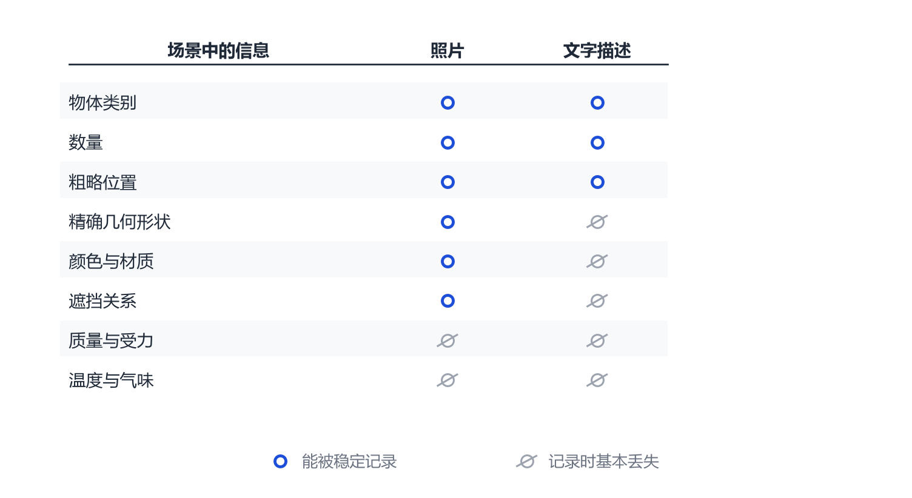

# 第 1 章　预测下一个词的天花板

在手机输入法里敲下“今天天气”四个字，候选栏会跳出“不错”“很好”“怎么样”，你按下其中一个，句子就完成了。这个动作太普通，普通到没人会去想它背后发生了什么，可正是同一件事被放大到几千亿参数、几十万亿词的规模之后，才有了今天这批能写代码、能答法律问题、能模仿任何一位作家笔调的语言模型。它们做的事情从头到尾没有变过：给定前面的文字，猜下一个词是什么。

过去十年里，这件事被做到了极致。模型从几千万参数长到几千亿参数，训练语料从几亿词长到几十万亿词，于是人们开始用“智能”这个词来描述它们的行为。但只要把问题换一个问法，边界就露出来了：桌上的杯子被推到桌沿，会不会掉下去。语言模型能给出一个像样的答案，可这个答案来自它读过的句子，而不是来自它对桌子、杯子和重力的任何一次观察。

这一章想说明的就是这条边界在哪里。所谓天花板，不是说模型到此为止不能更强，而是说在这个目标函数之下，再多的参数也换不来某几类知识，因为那些知识根本没有出现在训练信号里。这不是要否定语言模型，恰恰相反，只有先看清它的目标函数把它带到了什么地方，才能理解后来那条路线为什么要换一个目标。

## 1.1　一句话的概率

一句话出现的可能性，可以拆成一连串条件概率的乘积。设句子由词 $w_1, w_2, \dots, w_n$ 组成，那么整句话的概率等于每一个词在它前面所有词给定之后出现的概率连乘起来，写成公式就是 $p(w_1,\dots,w_n)=\prod_{t=1}^{n}p(w_t\mid w_1,\dots,w_{t-1})$。这个等式不涉及任何假设，它只是概率论里的链式法则，意思是只要有一个函数能够在看到前 $t-1$ 个词时给出第 $t$ 个词的概率分布，整个句子的概率就算得出来，而语言模型要学的正是这个函数。

训练目标因此变得非常干净。给模型一段真实文本，让它逐词预测下一个词，把每次预测的概率取对数再取负，加起来求平均，就得到交叉熵损失 $\mathcal{L}=-\frac{1}{n}\sum_t \log p_\theta(w_t\mid w_{1:t-1})$，模型参数沿着这个损失的梯度往下走。损失越小，说明模型给真实文本打的分越高；工程上常用的另一个指标叫困惑度，它是交叉熵取指数，含义是“模型在每一步平均要在多少个候选词之间犹豫”，困惑度为 10 大约相当于每步在十个词里挑一个。

交叉熵有一个性质值得在进入下一节之前说清楚。它惩罚的是模型给正确答案分配的概率太低，而不是模型给错误答案分配了多少，所以一个模型完全可以同时认为“不错”有六成可能、“很好”有三成可能，只要真实答案是其中之一，损失就不算大。这条性质让模型在训练时不必在候选之间做非此即彼的决定，也让它能把“几个说法都说得通”这件事保留下来，后来的大模型之所以能在语气和风格上显得灵活，很大程度上要归功于这个损失函数没有逼它二选一。

还有一个容易被忽略的细节：整个训练过程不需要任何人工标注。文本本身就是标签，前一个词是输入，后一个词是答案，互联网上有多少文字就有多少条免费的训练样本。这是语言模型能够长到今天的根本原因，也是它和视觉、机器人这些领域的最大差别，后两者的数据要么需要采集，要么需要执行动作，成本高了好几个数量级。

## 1.2　从查表到注意力

最早的做法是数数。统计语料里“今天天气”后面出现过多少次“不错”，再除以“今天天气”出现的总次数，得到的就是条件概率，这叫 n-gram 模型，n 通常取 2 到 5。数数的办法有一个绕不过去的问题：假设词表有一百万个词，那么三元组共有 $10^{18}$ 种组合，而任何语料里出现过的组合都只是其中极小的一部分，绝大多数组合的计数是零，模型只能给它们零概率。语言是开放的，人每天都在造新句子，靠记忆历史片段无法覆盖新的组合。

分词这一步值得单独提一句，因为后面所有的讨论都建立在它之上。模型处理的不是字符也不是词，而是介于两者之间的词元，一个常见的中文词元表有四万到十五万条，生僻字会被拆成几个字节，常见词组会被合并成一条；切分方式决定了模型看到的世界有多粗，同一个句子换一套词元表，要预测的序列就变了，它能注意到的规律也跟着变。这是语言模型的第一道约束，也是它和“直接在像素上工作”的模型最根本的差别之一。

神经网络的解法是把词变成向量。每个词对应一个几百维的实数向量，意思相近的词向量也相近，于是“今天天气不错”和“今日天气很好”虽然字面完全不同，在向量空间里却落在相近的位置，模型从前者学到的规律可以迁移到后者。这个想法在 2003 年由 Bengio 等人系统地实现，称作神经网络语言模型，它第一次让“相似”变成了可以计算的东西。

真正让规模起飞的，是 2017 年提出的 Transformer。它的核心是注意力机制，处理句子中某个位置时，模型会向所有位置发出一个“查询”，每个位置拿出自己的“键”来匹配，匹配程度高的位置获得更大的权重，然后把这些位置的“值”加权求和，作为当前位置的新表示，写成矩阵形式就是 $\mathrm{Attention}(Q,K,V)=\mathrm{softmax}(QK^\top/\sqrt d)V$。矩阵的形状说明了它在做什么：$QK^\top$ 是一张“谁该看谁”的打分表，softmax 把每一行变成概率，再乘上 $V$ 就是把信息按权重搬运过来；多头注意力只是把这个过程并行做几次，让不同的头关注不同的关系，有的头盯语法搭配，有的头盯指代，有的头盯远处的主题。

这一步的计算量随序列长度平方增长，序列翻一倍，要算的打分对就翻四倍。上下文窗口从两千词元扩到十万，算力需求涨的不是五十倍而是两千五百倍，这也是为什么长上下文在工程上那么贵，以及为什么模型对“开头说过什么”经常记不牢，注意力要在几万个候选里分配有限的权重。注意力本身不区分位置，所以还要给每个词加上位置编码，再加上残差连接和层归一化，几十层网络才能稳定训练，最后的输出层把每个位置的向量映射回词表大小，经过 softmax 得到一个概率分布，整个过程如图 1-1。

<figure class="fig">

<figcaption><b>图 1-1</b>　下一词预测的流程。左侧的上下文被逐层编码，最后一个位置的向量经过输出层变成词表上的概率分布，采样得到下一个词，再把它接回输入，如此循环。</figcaption>
</figure>

图 1-1 里有一条回环的箭头，它标出了这类模型最关键的性质：生成是逐词的，每产出一个词，这个词就变成下一步输入的一部分。写文章、写代码、写对话，本质上是同一个循环在重复，区别只在于喂进去的上下文不同。

## 1.3　规模带来的意外

把模型变大、数据变多，损失会平滑下降。2020 年，Kaplan 等人发现这种下降在很大的范围内遵循幂律，用双对数坐标画出来接近直线，这条经验规律后来被称为缩放定律，它让“把模型做大”从一种赌博变成了一种可以预算的工程决策。损失对参数和数据都呈幂律下降，意味着多花十倍算力通常能换来确定的一截改进，投入和产出之间的关系是可以提前估算的。

更让研究者意外的是能力的涌现。一个只被训练来预测下一个词的模型，在参数量超过某个量级之后，突然能做算术、能翻译、能根据几个例子学会新任务；GPT-3 有 1750 亿参数，训练语料约 3000 亿个词元，它没有为这些任务中的任何一个做过专门设计。这些能力从哪来，目前没有公认的答案，一种解释是要把下一个词预测得足够准，模型不得不自己在内部重建文本背后的规律，语法是规律，事实是规律，逻辑推理也是规律，文本是这些规律的记录，学会压缩文本也就学会了一部分规律。

这个解释有实验支持。研究者训练模型下黑白棋，输入只是棋谱的文字记录，模型从没被告知棋盘长什么样，训练完成后，从它的中间层可以线性解码出棋盘的当前状态，连每个格子上有没有棋子都能读出来。类似地，在语言模型的中间层做线性探针，能读出词性、句法树、实体关系，甚至地理位置的方向，这些结果说明模型为了预测下一步，确实自己发明了一套内部表示。

代价是这条路的边际收益在变小。高质量文本正在被用完，剩下的增量要靠合成数据、多轮筛选和更贵的数据清洗，而每一档规模提升都要重新走一遍训练，成本曲线比损失曲线陡得多。更麻烦的是，缩放定律描述的是平均意义上的改进，它不保证每一个具体能力都随规模平滑提升，有些能力在某个规模之前几乎为零，过了那个点才突然可用，这种不连续性让“再大一点就好了”变成了一个不太可靠的预期。

## 1.4　它学到的到底是什么

到这里可以正面回答一个问题：语言模型内部到底有没有世界的模型。答案是有一部分，但这一部分有明确的适用条件。

支持“有”的证据不算少。探针实验能从中层读出方位、颜色、物体类别，甚至有研究发现模型内部的表示会随句子描述的空间关系发生系统性变化，比如“猫在桌子下面”和“猫在桌子上面”对应两个不同的方向。这些都不是训练目标直接要求的，是模型为了把下一个词预测准而顺带学到的副产品。

但这个结论有一个前提常常被忽略：这些实验大多在“世界状态可以被文本完整记录”的领域里做。棋谱就是这样，每一步棋都写在记录里，棋盘状态和文本之间是一一对应的，凡是这样的领域，预测下一个符号就等于预测世界状态。文本描述的场景不是这样，一张厨房照片里包含物体的形状、材质、遮挡关系、光照方向、物体之间的支撑与接触，而这些信息在“一个厨房的台面上放着杯子”这句话里几乎全部丢失。

更关键的是，读出来的都是静态属性，没有一条是“如果我这样做，会怎样”。因果和干预在文本里几乎不留痕迹，因为写文章的人只记录结果，不记录反事实，没有人会写“我把杯子往左推了三厘米，它移动了二点七厘米，因为桌面摩擦系数是零点三”。缺少这类句子，模型就没有办法从文本里学到力和运动之间的定量关系，它能学到的只是“推了会动”这种定性的关联。

## 1.5　文本是世界的投影

文字记录的是世界的一个投影，投影保留了轮廓，丢掉了深度。这个比喻值得展开，因为它决定了后面所有设计的取舍。

<figure class="fig">

<figcaption><b>图 1-2</b>　场景信息在照片与文字中的保留情况。物体类别、数量、粗略位置能被两者稳定记录，精确几何、颜色材质、遮挡关系在写成句子时基本丢失，而质量、受力、温度连照片也记不下来。</figcaption>
</figure>

图 1-2 把这件事拆成了八行。物体类别、数量、粗略位置这三类信息，照片能记，文字也能记，所以语言模型在这几项上表现很好，问它“桌上有没有杯子”几乎不会错。精确几何形状、颜色与材质、遮挡关系这三类，照片能记而文字记不住，于是模型只能靠常识补，补得对不对取决于它读过的类似场景多不多。最后两行，质量与受力、温度与气味，连照片都记不下来，文字更没有办法，这也是为什么涉及力的推理，语言模型总是显得含糊。

后果很具体。语言模型可以说出“杯子被推到桌沿会掉下去”，因为这类句子在语料里出现过无数次；同一个模型在描述一张杯子悬在半空的图片时，也可能写出通顺的句子，因为在文字层面“杯子在桌子上方”并没有什么不合法的地方。它没有那种“东西会往下掉”的直觉，只有“这些话常一起出现”的统计。

还有一类信息丢得更彻底，就是动作。文本里出现动作时，写的几乎都是结果：他推开了门，她把杯子放回架子，球滚进了草丛。至于用了多大的力、手的轨迹是什么形状、接触面是滑还是涩，这些执行细节从来没有人记录，因为读者不需要它们也能读懂故事。可对一个要动手的系统来说，恰恰是这些被省略的量决定了动作能不能成功，模型从文本里学到的“推开”是一个语义标签，不是一个可以被控制器执行的轨迹。

再举一个更细的例子。问模型“把一杯水放进冰箱，两小时后水会变多还是变少”，它能答对，因为蒸发、结冰、体积这些概念在文本里有大量讨论；但如果问“这杯水放在这块倾斜的玻璃板上，会不会滑下去”，答案取决于玻璃的倾斜角度、水的重量、杯子底部的材质、有没有水膜，这些量在文本里根本没有被记录，模型只能猜，而猜错的代价在真实场景里可能是一次打翻。

## 1.6　给它看图也不行吗

这里有一个绕不过去的反驳。现在的模型早就不只读文字了，它们能看图、能听声音、能处理视频，既然输入里已经有了像素，前面说的“文本是影子”是不是就不成立了。

要看清楚这件事，得看多模态模型内部发生了什么。一张图进来，先经过一个视觉编码器被切成小块，每块变成一个向量，再经过一层投影压成几十到几百个词元，和文字的 token 拼在同一条序列里，接下来的事情和纯文本模型完全一样，仍然是预测下一个词元。图片被翻译成了一种特殊的“词”，然后进入同一个目标函数，这条流水线里确实有视觉，但目标没有变。

视觉编码器本身通常是自监督训练的，它确实在像素上工作，也确实学到了形状、材质、空间关系这类东西，DINOv2 一类的模型就是靠这个吃饭的；但把视觉特征接到语言模型上的那一步靠的是海量图文对，训的是“这张图对应这段文字”，模型最后学到的是图文之间的统计对应，而不是“杯子在桌沿会掉”这样的物理规律。

信息也在这一步被压缩。一张 224 像素的图有十几万个数值，压成几百个词元之后，能保留的只是被图文对反复强化过的那部分，倾斜角度、摩擦系数、杯底和桌面之间的水膜，这些量在图文对里从来没有被标注过，压缩时自然留不下来。有一个更细的证据：把同一个视觉问题用文字描述给纯文本模型，和把图片直接给多模态模型，两者的答案往往高度一致，连错误都一致，这说明图像通道提供的增量信息比想象中少，模型主要还是靠语言先验在答题，视觉在这里起的作用更像一个索引，帮你把问题定位到某段语言知识上。

所以换模态不等于换目标。只要训练信号仍然是“下一个词元”，模型就会继续把世界压成符号之间的关联，真正的改变要发生在目标这一层，也就是让模型去预测状态本身，而不是预测描述状态的词。

## 1.7　目标函数决定学什么

把问题归到根上，会发现不是模型不够大，而是目标不一样，下一个词预测的目标是让文本的似然最大，任何能提高似然的东西都会被保留，包括真实的物理规律，也包括纯粹的文体习惯、套话、标点偏好。模型没有理由区分这两类知识，因为目标函数不区分，它甚至没有理由把“重力”表示成一个独立的变量，只要把“杯子”“桌沿”“掉”这几个词的联系记牢，预测就已经足够准了。

要让它必须理解世界，得换一个目标，不是问“下一个词是什么”，而是问“接下来世界会变成什么样”。这个问题有三个难点，第一个是世界状态不是现成的符号，得先有一个表示；第二个是未来往往不唯一，同一只手伸向杯子可能拿起它也可能推开它，模型要能表示这种多分支的可能；第三个是世界状态是连续的，而模型的输出必须是可比较的，要判断两个状态像不像得先有一个度量，要在这个度量上做预测又得保证它不会退化。语言模型不用操心第三件事，因为词表天然给了它一个离散的、固定的坐标系，后来的路线没有这份便宜，它必须自己造一个坐标系，还要保证这个坐标系在训练中不会塌掉。

前两个难点对应后文要讲的两件东西：表征和预测器。把观察压成一个向量，再用一个网络预测“在这个向量上世界会怎么变”，这套组合有一个名字，叫联合嵌入预测架构。它和语言模型的差别不在于用不用神经网络，而在于预测发生在哪个空间里，以及这个空间是怎么被约束出来的。

下一章从最基础的问题开始。既然要在向量上做预测，先得说清楚一串数字凭什么能代表一张图，这种代表到底丢掉了什么，以及丢掉之后剩下的那部分为什么还够用。这三个问题看起来是同一个问题的三种问法，实际上对应三件不同的事：映射、取舍和评价，它们构成了后面所有章节的地基。
