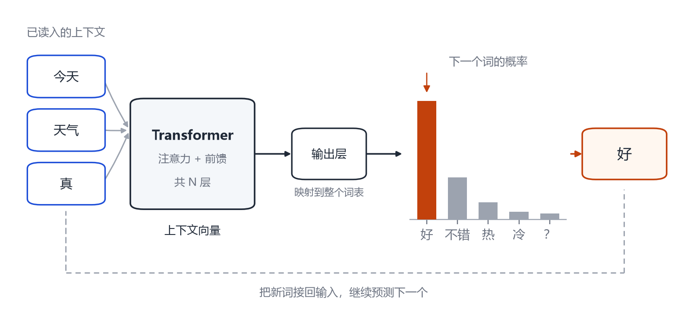
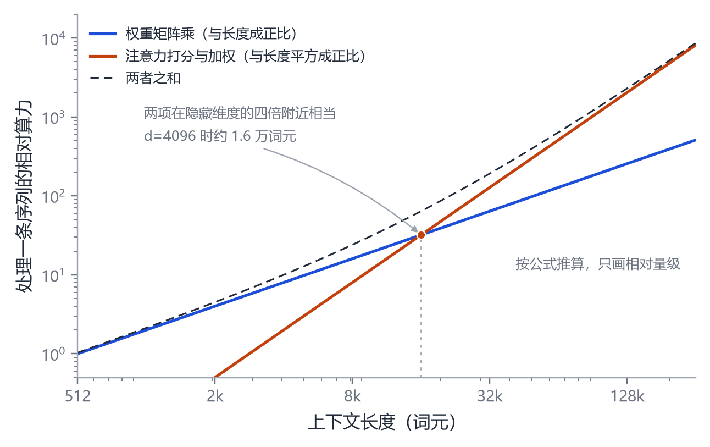
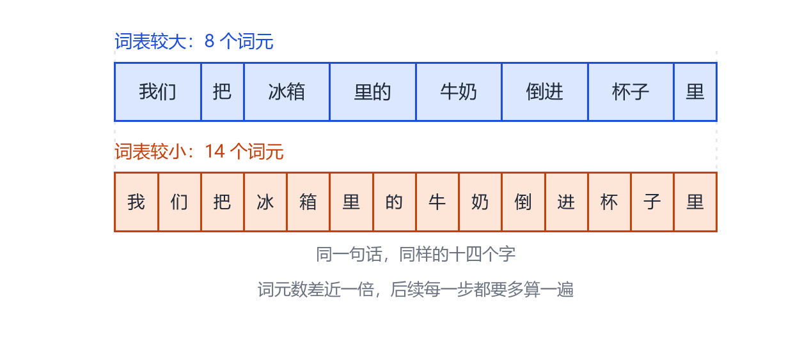

# 第 1 章　预测下一个词的天花板

在手机输入法里敲下“今天天气”四个字，候选栏会跳出“不错”“很好”“怎么样”，你按下其中一个，句子就完成了。这个动作太普通，普通到没人会去想它背后发生了什么，可正是同一件事被放大到几千亿参数、几十万亿词的规模之后，才有了今天这批能写代码、能答法律问题、能模仿任何一位作家笔调的语言模型。它们做的事情从头到尾没有变过：给定前面的文字，猜下一个词是什么。

过去十年里，这件事被做到了极致。模型从几千万参数长到几千亿参数，训练语料从几亿词长到几十万亿词，于是人们开始用“智能”这个词来描述它们的行为。但只要把问题换一个问法，边界就露出来了：桌上的杯子被推到桌沿，会不会掉下去。语言模型能给出一个像样的答案，可这个答案来自它读过的句子，而不是来自它对桌子、杯子和重力的任何一次观察。

这一章想说明的就是这条边界在哪里。所谓天花板，不是说模型到此为止不能更强，而是说在这个目标函数之下，再多的参数也换不来某几类知识，因为那些知识根本没有出现在训练信号里。这不是要否定语言模型，恰恰相反，只有先看清它的目标函数把它带到了什么地方，才能理解后来那条路线为什么要换一个目标。

## 1.1　一句话的概率

一句话出现的可能性，可以拆成一连串条件概率的乘积。设句子由词 $w_1, w_2, \dots, w_n$ 组成，那么整句话的概率等于每一个词在它前面所有词给定之后出现的概率连乘起来，写成公式就是 $p(w_1,\dots,w_n)=\prod_{t=1}^{n}p(w_t\mid w_1,\dots,w_{t-1})$。这个等式不涉及任何假设，它只是概率论里的链式法则，意思是只要有一个函数能够在看到前 $t-1$ 个词时给出第 $t$ 个词的概率分布，整个句子的概率就算得出来，而语言模型要学的正是这个函数。

训练目标因此变得非常干净。给模型一段真实文本，让它逐词预测下一个词，把每次预测的概率取对数再取负，加起来求平均，就得到交叉熵损失 $\mathcal{L}=-\frac{1}{n}\sum_t \log p_\theta(w_t\mid w_{1:t-1})$，模型参数沿着这个损失的梯度往下走。损失越小，说明模型给真实文本打的分越高；工程上常用的另一个指标叫困惑度，它是交叉熵取指数，含义是“模型在每一步平均要在多少个候选词之间犹豫”，困惑度为 10 大约相当于每步在十个词里挑一个。

交叉熵有一个性质值得在进入下一节之前说清楚。它惩罚的是模型给正确答案分配的概率太低，而不是模型给错误答案分配了多少，所以一个模型完全可以同时认为“不错”有六成可能、“很好”有三成可能，只要真实答案是其中之一，损失就不算大。这条性质让模型在训练时不必在候选之间做非此即彼的决定，也让它能把“几个说法都说得通”这件事保留下来，后来的大模型之所以能在语气和风格上显得灵活，很大程度上要归功于这个损失函数没有逼它二选一。

还有一个容易被忽略的细节：整个训练过程不需要任何人工标注。文本本身就是标签，前一个词是输入，后一个词是答案，互联网上有多少文字就有多少条免费的训练样本。这是语言模型能够长到今天的根本原因，也是它和视觉、机器人这些领域的最大差别，后两者的数据要么需要采集，要么需要执行动作，成本高了好几个数量级。

## 1.2　从查表到注意力

最早的做法是数数。统计语料里“今天天气”后面出现过多少次“不错”，再除以“今天天气”出现的总次数，得到的就是条件概率，这叫 n-gram 模型，n 通常取 2 到 5。数数的办法有一个绕不过去的问题：假设词表有一百万个词，那么三元组共有 $10^{18}$ 种组合，而任何语料里出现过的组合都只是其中极小的一部分，绝大多数组合的计数是零，模型只能给它们零概率。语言是开放的，人每天都在造新句子，靠记忆历史片段无法覆盖新的组合。

分词这一步值得单独提一句，因为后面所有的讨论都建立在它之上。模型处理的不是字符也不是词，而是介于两者之间的词元，一个常见的中文词元表有四万到十五万条，生僻字会被拆成几个字节，常见词组会被合并成一条；切分方式决定了模型看到的世界有多粗，同一个句子换一套词元表，要预测的序列就变了，它能注意到的规律也跟着变。这是语言模型的第一道约束，也是它和“直接在像素上工作”的模型最根本的差别之一。

神经网络的解法是把词变成向量。每个词对应一个几百维的实数向量，意思相近的词向量也相近，于是“今天天气不错”和“今日天气很好”虽然字面完全不同，在向量空间里却落在相近的位置，模型从前者学到的规律可以迁移到后者。这个想法在 2003 年由 Bengio 等人系统地实现，称作神经网络语言模型，它第一次让“相似”变成了可以计算的东西。

真正让规模起飞的，是 2017 年提出的 Transformer。它的核心是注意力机制，处理句子中某个位置时，模型会向所有位置发出一个“查询”，每个位置拿出自己的“键”来匹配，匹配程度高的位置获得更大的权重，然后把这些位置的“值”加权求和，作为当前位置的新表示，写成矩阵形式就是 $\mathrm{Attention}(Q,K,V)=\mathrm{softmax}(QK^\top/\sqrt d)V$。矩阵的形状说明了它在做什么：$QK^\top$ 是一张“谁该看谁”的打分表，softmax 把每一行变成概率，再乘上 $V$ 就是把信息按权重搬运过来；多头注意力只是把这个过程并行做几次，让不同的头关注不同的关系，有的头盯语法搭配，有的头盯指代，有的头盯远处的主题。

这一步的计算量随序列长度平方增长，序列翻一倍，要算的打分对就翻四倍。上下文窗口从两千词元扩到十万，算力需求涨的不是五十倍而是两千五百倍，这也是为什么长上下文在工程上那么贵，以及为什么模型对“开头说过什么”经常记不牢，注意力要在几万个候选里分配有限的权重。注意力本身不区分位置，所以还要给每个词加上位置编码，再加上残差连接和层归一化，几十层网络才能稳定训练，最后的输出层把每个位置的向量映射回词表大小，经过 softmax 得到一个概率分布，整个过程如图 1-1。

<figure class="fig">

<figcaption><b>图 1-1</b>　下一词预测的流程。左侧的上下文被逐层编码，最后一个位置的向量经过输出层变成词表上的概率分布，采样得到下一个词，再把它接回输入，如此循环。</figcaption>
</figure>

图 1-1 里有一条回环的箭头，它标出了这类模型最关键的性质：生成是逐词的，每产出一个词，这个词就变成下一步输入的一部分。写文章、写代码、写对话，本质上是同一个循环在重复，区别只在于喂进去的上下文不同。

## 1.3　规模带来的意外

把模型变大、数据变多，损失会平滑下降。2020 年，Kaplan 等人发现这种下降在很大的范围内遵循幂律，用双对数坐标画出来接近直线，这条经验规律后来被称为缩放定律，它让“把模型做大”从一种赌博变成了一种可以预算的工程决策。损失对参数和数据都呈幂律下降，意味着多花十倍算力通常能换来确定的一截改进，投入和产出之间的关系是可以提前估算的。

更让研究者意外的是能力的涌现。一个只被训练来预测下一个词的模型，在参数量超过某个量级之后，突然能做算术、能翻译、能根据几个例子学会新任务；GPT-3 有 1750 亿参数，训练语料约 3000 亿个词元，它没有为这些任务中的任何一个做过专门设计。这些能力从哪来，目前没有公认的答案，一种解释是要把下一个词预测得足够准，模型不得不自己在内部重建文本背后的规律，语法是规律，事实是规律，逻辑推理也是规律，文本是这些规律的记录，学会压缩文本也就学会了一部分规律。

这个解释有实验支持。研究者训练模型下黑白棋，输入只是棋谱的文字记录，模型从没被告知棋盘长什么样，训练完成后，从它的中间层可以线性解码出棋盘的当前状态，连每个格子上有没有棋子都能读出来。类似地，在语言模型的中间层做线性探针，能读出词性、句法树、实体关系，甚至地理位置的方向，这些结果说明模型为了预测下一步，确实自己发明了一套内部表示。

代价是这条路的边际收益在变小。高质量文本正在被用完，剩下的增量要靠合成数据、多轮筛选和更贵的数据清洗，而每一档规模提升都要重新走一遍训练，成本曲线比损失曲线陡得多。更麻烦的是，缩放定律描述的是平均意义上的改进，它不保证每一个具体能力都随规模平滑提升，有些能力在某个规模之前几乎为零，过了那个点才突然可用，这种不连续性让“再大一点就好了”变成了一个不太可靠的预期。

## 1.4　它学到的到底是什么

到这里可以正面回答一个问题：语言模型内部到底有没有世界的模型。答案是有一部分，但这一部分有明确的适用条件。

支持“有”的证据不算少。探针实验能从中层读出方位、颜色、物体类别，甚至有研究发现模型内部的表示会随句子描述的空间关系发生系统性变化，比如“猫在桌子下面”和“猫在桌子上面”对应两个不同的方向。这些都不是训练目标直接要求的，是模型为了把下一个词预测准而顺带学到的副产品。

但这个结论有一个前提常常被忽略：这些实验大多在“世界状态可以被文本完整记录”的领域里做。棋谱就是这样，每一步棋都写在记录里，棋盘状态和文本之间是一一对应的，凡是这样的领域，预测下一个符号就等于预测世界状态。文本描述的场景不是这样，一张厨房照片里包含物体的形状、材质、遮挡关系、光照方向、物体之间的支撑与接触，而这些信息在“一个厨房的台面上放着杯子”这句话里几乎全部丢失。

更关键的是，读出来的都是静态属性，没有一条是“如果我这样做，会怎样”。因果和干预在文本里几乎不留痕迹，因为写文章的人只记录结果，不记录反事实，没有人会写“我把杯子往左推了三厘米，它移动了二点七厘米，因为桌面摩擦系数是零点三”。缺少这类句子，模型就没有办法从文本里学到力和运动之间的定量关系，它能学到的只是“推了会动”这种定性的关联。

## 1.5　文本是世界的投影

文字记录的是世界的一个投影，投影保留了轮廓，丢掉了深度。这个比喻值得展开，因为它决定了后面所有设计的取舍。

<figure class="fig">

<figcaption><b>图 1-2</b>　场景信息在照片与文字中的保留情况。物体类别、数量、粗略位置能被两者稳定记录，精确几何、颜色材质、遮挡关系在写成句子时基本丢失，而质量、受力、温度连照片也记不下来。</figcaption>
</figure>

图 1-2 把这件事拆成了八行。物体类别、数量、粗略位置这三类信息，照片能记，文字也能记，所以语言模型在这几项上表现很好，问它“桌上有没有杯子”几乎不会错。精确几何形状、颜色与材质、遮挡关系这三类，照片能记而文字记不住，于是模型只能靠常识补，补得对不对取决于它读过的类似场景多不多。最后两行，质量与受力、温度与气味，连照片都记不下来，文字更没有办法，这也是为什么涉及力的推理，语言模型总是显得含糊。

后果很具体。语言模型可以说出“杯子被推到桌沿会掉下去”，因为这类句子在语料里出现过无数次；同一个模型在描述一张杯子悬在半空的图片时，也可能写出通顺的句子，因为在文字层面“杯子在桌子上方”并没有什么不合法的地方。它没有那种“东西会往下掉”的直觉，只有“这些话常一起出现”的统计。

还有一类信息丢得更彻底，就是动作。文本里出现动作时，写的几乎都是结果：他推开了门，她把杯子放回架子，球滚进了草丛。至于用了多大的力、手的轨迹是什么形状、接触面是滑还是涩，这些执行细节从来没有人记录，因为读者不需要它们也能读懂故事。可对一个要动手的系统来说，恰恰是这些被省略的量决定了动作能不能成功，模型从文本里学到的“推开”是一个语义标签，不是一个可以被控制器执行的轨迹。

再举一个更细的例子。问模型“把一杯水放进冰箱，两小时后水会变多还是变少”，它能答对，因为蒸发、结冰、体积这些概念在文本里有大量讨论；但如果问“这杯水放在这块倾斜的玻璃板上，会不会滑下去”，答案取决于玻璃的倾斜角度、水的重量、杯子底部的材质、有没有水膜，这些量在文本里根本没有被记录，模型只能猜，而猜错的代价在真实场景里可能是一次打翻。

## 1.6　给它看图也不行吗

这里有一个绕不过去的反驳。现在的模型早就不只读文字了，它们能看图、能听声音、能处理视频，既然输入里已经有了像素，前面说的“文本是影子”是不是就不成立了。

要看清楚这件事，得看多模态模型内部发生了什么。一张图进来，先经过一个视觉编码器被切成小块，每块变成一个向量，再经过一层投影压成几十到几百个词元，和文字的 token 拼在同一条序列里，接下来的事情和纯文本模型完全一样，仍然是预测下一个词元。图片被翻译成了一种特殊的“词”，然后进入同一个目标函数，这条流水线里确实有视觉，但目标没有变。

视觉编码器本身通常是自监督训练的，它确实在像素上工作，也确实学到了形状、材质、空间关系这类东西，DINOv2 一类的模型就是靠这个吃饭的；但把视觉特征接到语言模型上的那一步靠的是海量图文对，训的是“这张图对应这段文字”，模型最后学到的是图文之间的统计对应，而不是“杯子在桌沿会掉”这样的物理规律。

信息也在这一步被压缩。一张 224 像素的图有十几万个数值，压成几百个词元之后，能保留的只是被图文对反复强化过的那部分，倾斜角度、摩擦系数、杯底和桌面之间的水膜，这些量在图文对里从来没有被标注过，压缩时自然留不下来。有一个更细的证据：把同一个视觉问题用文字描述给纯文本模型，和把图片直接给多模态模型，两者的答案往往高度一致，连错误都一致，这说明图像通道提供的增量信息比想象中少，模型主要还是靠语言先验在答题，视觉在这里起的作用更像一个索引，帮你把问题定位到某段语言知识上。

所以换模态不等于换目标。只要训练信号仍然是“下一个词元”，模型就会继续把世界压成符号之间的关联，真正的改变要发生在目标这一层，也就是让模型去预测状态本身，而不是预测描述状态的词。

## 1.7　目标函数决定学什么

把问题归到根上，会发现不是模型不够大，而是目标不一样，下一个词预测的目标是让文本的似然最大，任何能提高似然的东西都会被保留，包括真实的物理规律，也包括纯粹的文体习惯、套话、标点偏好。模型没有理由区分这两类知识，因为目标函数不区分，它甚至没有理由把“重力”表示成一个独立的变量，只要把“杯子”“桌沿”“掉”这几个词的联系记牢，预测就已经足够准了。

要让它必须理解世界，得换一个目标，不是问“下一个词是什么”，而是问“接下来世界会变成什么样”。这个问题有三个难点，第一个是世界状态不是现成的符号，得先有一个表示；第二个是未来往往不唯一，同一只手伸向杯子可能拿起它也可能推开它，模型要能表示这种多分支的可能；第三个是世界状态是连续的，而模型的输出必须是可比较的，要判断两个状态像不像得先有一个度量，要在这个度量上做预测又得保证它不会退化。语言模型不用操心第三件事，因为词表天然给了它一个离散的、固定的坐标系，后来的路线没有这份便宜，它必须自己造一个坐标系，还要保证这个坐标系在训练中不会塌掉。

## 1.8　分词与词表

换目标之前，语言模型这套做法还有三笔账没有算清，算清了才知道要换掉的究竟是什么。第一笔账在入口，模型读到的并不是字，1.2 节提到词元的那句话被一带而过，其实它决定了后面所有的账。把文字切成词元序列的程序叫分词器（tokenizer），它由一张固定的词表和一套切分规则构成。训练开始以后这张表不再改动，模型的输入输出都只能在表里取值。

最常见的做法叫字节对编码（byte pair encoding，BPE），Sennrich 等人在 2016 年把它用到机器翻译的子词切分上，思路借自一种压缩算法。做法是从单个字符开始，反复统计语料里相邻两个单位一起出现了多少次，把出现最多的一对合并成新单位加进词表，然后重来一遍。经典的教学例子是一小撮英文片段，low 出现 5 次，lower 出现 2 次，newest 出现 6 次，widest 出现 3 次，初始词表里只有 l、o、w、e、r、n、s、t 这些字母。第一轮统计出的最高频对是 e 和 s，newest 里 6 次，widest 里 3 次，合计 9 次，于是 es 成为一个词元。

第二轮里 est 同样 9 次，再合并一次，第三轮把 est 与词尾标记合成一体。low 走另一条路，l 与 o 合成 lo，再与 w 合成 low，常见词于是整条进了词表，lower 停在 low 加 er 的位置。合并在统计上跑，不在语言学规则上跑，所以词表里会长出“里的”这种不像词的片段，也会长出只有语法意义的词尾碎片。合到哪一层停手，由词表大小这个上限决定，切得越粗，同一段内容占的格子越少。

中文的切分和英文不太一样，原因在字节。现在的分词器几乎都从 256 个字节起步，任何字符都能用若干字节拼出来，词表里因此没有未知词。一个汉字在 UTF-8 里占三个字节，常见字因为出现次数多，很快被合并成一个词元，生僻字合并不起来，退回到两三个字节的组合。所谓中文一个字一个词元不是设计出来的，而是统计出来的，常用字恰好被合到了单字这一层。

词表大小是一个必须提前定下的取舍。词表大，同样的内容切出来的词元少，序列短，注意力和生成的步数都少；代价是输出层那个把向量映射回词表的矩阵跟着变大，词表每扩一倍，这部分参数也多一倍。词表小，输出层便宜，序列拉长，而计算量对长度是平方级的，长上下文时代价很快反超。如图 1-3，两条曲线在隐藏维度的四倍附近相交，宽度四千的模型大约落在一万六千词元。这个位置由公式推算得出，换一个宽度，交点跟着移。

<figure class="fig">

<figcaption><b>图 1-3</b>　处理一条序列的算力怎么随上下文长度变化。蓝线是权重矩阵乘，橙线是注意力打分与加权，两者在隐藏维度四倍附近相交，虚线标出交点；曲线按公式推算，只表示量级。</figcaption>
</figure>

词表的分配还带着语料的偏心。训练语料里英语占大头，合并统计自然向英语倾斜，常见的词根词缀很快成形，别的语言只能分剩下的位置，于是同一段意思在不同语言里占的词元数并不相等。常见的情况是英文最省，其他语言要多花一截。这件事在工程上很具体，账单按词元算，长文档处理按词元算，模型一次能读多少材料也按词元算。

所以多少个字和多少个词元是两件事。字数由文本决定，词元数由文本加词表共同决定，中间隔着一层切分，同一个句子换一个分词器，词元数可以从八个变到十四个。如图 1-4，上行八块，下行十四块，两行总宽一样，块却碎得多。这个差别不只是记账问题，它改变了模型看到的结构。八个词元里“里的”是一个整体，模型不必再学“里”和“的”怎么组合，十四个词元里每个字都独立，模型得自己把两个字拼起来。

<figure class="fig">

<figcaption><b>图 1-4</b>　同一句中文在两种词表下的切分。上行八块，下行十四块，总宽相同，块越碎后续每一步要处理的词元越多。切分方式为示意。</figcaption>
</figure>

分词器定下的边界会一路传到最上层。词表里没有的东西只能一个碎片一个碎片拼出来，拼出来的结果在概率上天然吃亏；词表里有的东西可以整块复制，包括整块的错误。第 3 章比较几条自监督路线时会看到，目标空间选在像素、离散码还是连续向量上，和这里选词表是同一类决定。两边都是先定一个离散化的粒度，再让后面的学习去适应它。

## 1.9　一次预训练的账

1.3 节说规模提升是可以预算的工程决策，预算这个词值得落到具体数字上。一次预训练的开支分四块，数据、算力、人力和试错、评测，前两块可以算，后两块只能估。最容易忽略的是后两块，真正让项目延期的也是它们。所以先把能算的算清楚，算的过程本身就说明了这套设计为什么长成现在这个形状。

数据来源大致四类，脾气各不相同。网页是量的主力，Common Crawl 一个月的转储就有几十亿个网页，覆盖面广但质量参差；书籍提供长程连贯的叙述，是模型学会一段话怎么推进的主要来源。代码是另一套语言，缩进、括号、命名都有严格结构，训练它的同时也在训练符号操作的精确性；对话数据带轮次结构，教模型分清谁在说话、什么时候该停。这四类在语料里的比例，直接决定了模型的能力画像。

GPT-3 的配比可以当一个具体样本。它训练用了 3000 亿个词元，其中过滤后的 Common Crawl 占 60%，WebText2 占 22%，两套书籍语料各占 8%，英文维基占 3%（GPT-3 论文表 2.2）。这些百分比是采样权重，不是语料规模的比例，Common Crawl 有 4100 亿个词元，权重 60%，训练 3000 亿个词元时只被看了 0.44 遍，维基只有 30 亿个词元，权重 3%，却被反复看了 3.4 遍。高质量的小语料被重复使用，低质量的大语料被压低权重，这是用一点过拟合换整体质量的做法。

清洗的顺序有讲究。先按规则粗筛，去掉乱码、导航条、重复模板和语言不对的文档。再用分类器给每篇文档打质量分，正例是维基、书籍这类人工筛选过的文本，负例是原始抓取，分数低的整篇丢掉。之后才是去重，末尾还要做污染检查，把和评测集重叠的部分剔掉。去重放在打分之后，是因为重复文档会把分类器看到的分布带偏，同一篇好文章抄了一百遍，它在正例里就有一百份话语权。重复的代价也不只是磁盘，模型会把重复段落整段背下来，训练损失和验证损失一起降，实际是泄漏；更隐蔽的是模板重复，同一个框架生成的成千上万条商品页字面不同、结构相同，GPT-3 用文档级的模糊去重清掉它们。

算力的账有一个粗略的换算法。一次前向每个参数做一次乘加，反向每个参数算两个与梯度有关的量，合起来大约是每个词元每个参数 6 次浮点运算，于是训练总开销可以写成 $C\approx 6ND$，其中 $N$ 是参数量，$D$ 是训练用到的词元数。这个式子由 Kaplan 等人在 2020 年的缩放定律里给出，只统计权重矩阵上的乘法，忽略了注意力里与长度相关的项，所以它是一张量级表，不是精确账单。它把模型多大和看了多少数据放进同一个单位里比较，GPT-3 3B 的参数是 RoBERTa-Large 的近十倍，两者预训练花的算力都在 50 petaflop/s-days 上下，差别全在被喂了多少词元。

换成 GPU 天更直观。假设一个 70 亿参数的模型要看 2 万亿个词元，$6ND$ 是 $8.4\times10^{22}$ 次浮点运算。一张 A100 的 bf16 稠密算力峰值约 312 TFLOPS，按四成利用率算，有效算力是每秒 $1.2\times10^{14}$ 次，除下来约 7790 GPU 天，也就是两百张卡跑满四十天。四成不是随手取的数，卡间通信、显存带宽、流水线气泡都会吃掉一部分，所以这个估算偏低，真实账单还要加上调试、重启和失败重跑。

这个估算漏了一块，就是上下文。$6ND$ 里的 6 只算权重，注意力里打分和加权求和的开销叠在每个词元上，合起来按长度的平方增长，图 1-3 画的就是这两项。短上下文时它微不足道，长度到了几万词元就和权重项平起平坐，参数没变，词元数没变，账却翻了几倍。所以做预算时先问最长的一条样本有多长，比问模型多大更能决定要买多少卡。

把这几笔加起来会发现，预训练真正的瓶颈不是模型结构，而是看过多少好词元。这解释了数据清洗、去重、配比这些不性感的工作为什么成了核心竞争力。还有一件事值得记住，语言模型的损失有一个天然下界，把概率平均摊给整个词表，交叉熵就等于词表的熵，再懒的模型也收不到零。第 4 章会看到，联合嵌入路线没有这份保险，损失可以一路降到零，那才是塌缩问题的起点。

## 1.10　三种典型的失败

要把边界说清楚，最好的办法是看它在哪出错。语言模型的错误有很强的规律性，同一类问题它错得整齐，换一个模型还是错在同一处，这说明错误不是随机噪声，而是结构性的。下面三种最典型，每一种都回到文本是投影这条主线。幻觉来自投影里没有那个点，组合推理来自投影里丢掉了约束，时间和计数来自两套坐标系对不上。

幻觉（hallucination）指的是模型给出流畅、具体、但并不存在的答案。它可能编一个不存在的论文标题，也可能给一个不存在的作者配上正确的生卒年。长尾事实在语料里出现零次或一两次，条件概率没有得到足够的计数支撑，模型只能按这类文本长什么样去补，人名该有的音节、年份该有的范围它都学得很好，唯独那个具体的事实没有学过。输出在形式上完全合格，在内容上完全落空，而损失函数也只检查形式，所以它没有区分这两件事的动机。

生成是逐词的，错误一旦写进上下文，就成了后面的条件。模型在第二步会把第一步编出来的细节当成事实继续展开，越写越具体，越具体越自信，这条路径常被叫作滚雪球。校准（calibration）是同一件事的另一面，模型给出的置信度本该和它答对的频率对得上，实际却常常是高置信地答错，因为语料里的陈述句几乎都带着确定语气。指令微调可以教会它说“我不知道”，但那只是学会了一种说法。

组合推理是第二类。给三条约束，甲比乙高，乙比丙高，问甲和丙谁高，模型答得对；约束加到五条，中间再夹着否定和转折，正确率就掉下去。原因在于每一步的中间结果都要同时装进那一个隐状态里，而文本里没有任何句子要求这两条推理的结论必须一致。模型学到的是局部模式，哪句话后面常跟哪句话，不是一个必须自洽的约束系统，步数一多，偏差就在隐状态里累加。

第三类是时间。模型的参数是训练语料那个时间截面的一张快照，训练结束之后世界继续变，参数不会跟着变。它知道“今年”这个词的用法，不知道今年发生了什么，问它一个训练截止之后的事件，它要么说不知道，要么用截止前的相似事件去顶替。检索能补上一部分，把最新的文档塞进上下文，可检索补的是事实，补不了这件事改变了什么。

计数和精确算术是同一个问题的另一个面。数字进模型之前要先被切分，而切分不按十进制位对齐，1234 可能被切成 12 和 34，也可能是 1 和 234，取决于词表里恰好有什么。位对齐一旦丢了，竖式加法里逢十进一的机制就没有落脚的地方。模型在小数字上表现好，因为这类加法在语料里出现得足够多；位数一多答案就开始漂，而且漂得很像，量级对、尾数错。这不是模型不聪明，是目标函数从来没有要求它在整个计算过程中保持一个进位状态。

三种失败放在一起看，形状是一样的。文本这份投影缺了那一维，模型不会留白，它会用投影里最像的东西把空缺填上，填得越像越难被发现。评估也难，因为错误和正确答案在字面上一样通顺。第 13 章比较不同模型画出的地图时会回到这件事，地图上缺失的区域不会被标成空白，而是被最近的地名填满。这些毛病不是训练得不够，是目标函数只检查形式，形式对了、内容错了也照样得分，换目标要换的正是这一层。

前两个难点对应后文要讲的两件东西：表征和预测器。把观察压成一个向量，再用一个网络预测“在这个向量上世界会怎么变”，这套组合有一个名字，叫联合嵌入预测架构。它和语言模型的差别不在于用不用神经网络，而在于预测发生在哪个空间里，以及这个空间是怎么被约束出来的。

下一章从最基础的问题开始。既然要在向量上做预测，先得说清楚一串数字凭什么能代表一张图，这种代表到底丢掉了什么，以及丢掉之后剩下的那部分为什么还够用。这三个问题看起来是同一个问题的三种问法，实际上对应三件不同的事：映射、取舍和评价，它们构成了后面所有章节的地基。
