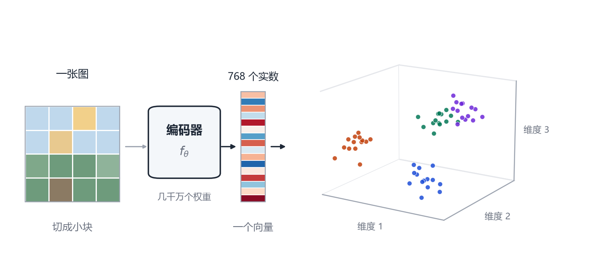
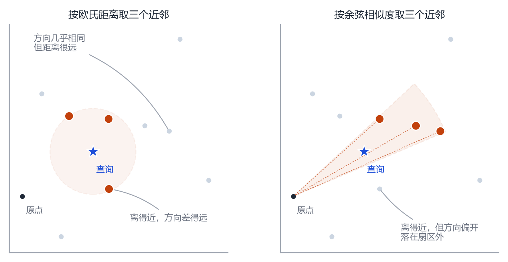
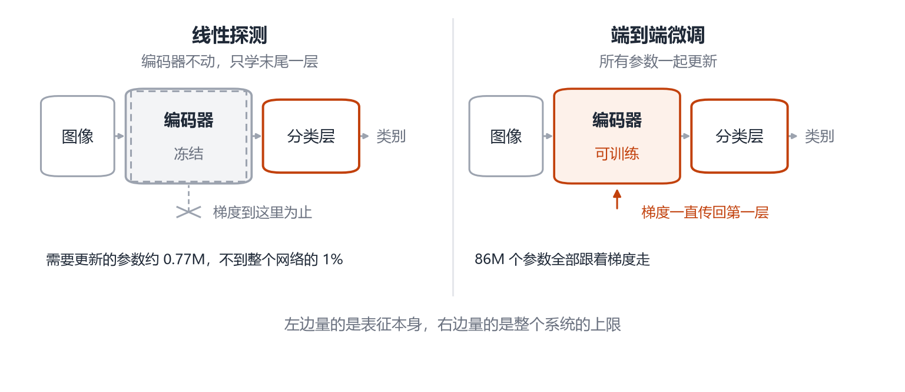
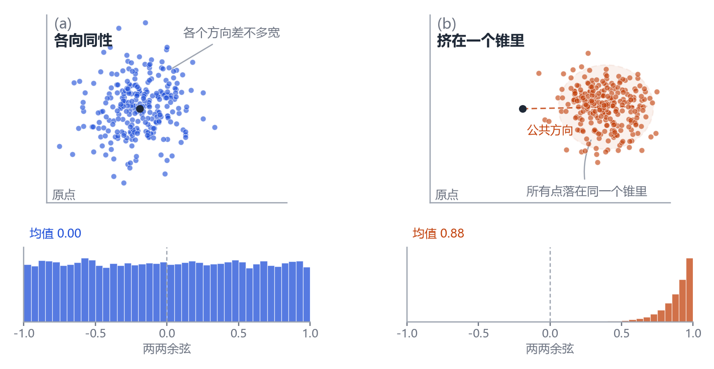
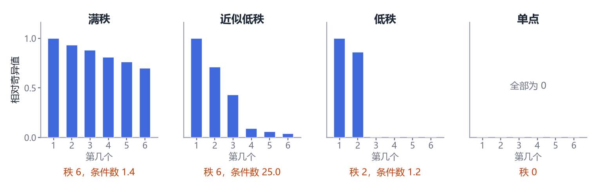

# 第 2 章　表征是把世界折起来

手机相册里有一个搜索框，你输入一个“雪”字，三年前冬天拍的照片就被翻了出来，一张是雪地上的脚印，一张是结冰的窗玻璃，一张是夜里路灯下飘着的雪片，还有一张是雪停之后小区门口那堆发灰的雪。没有人给这些照片打过标签，也没有人告诉过程序雪长什么样，可它确实从几千张照片里把这四张挑了出来，还按相似程度排好了顺序。这件事听起来很朴素，把每张照片变成一串数字，再比较远近，剩下的活交给排序。朴素的地方也正是可疑的地方，一串数字凭什么能代表一张图，又凭什么说两张图的数字比另外两张更近。这一章要回答的就是这两个问题。

答案分两层。一层是映射，说清一张图怎么经过一个网络变成一个点；另一层是几何，说清这些点在空间里的位置为什么有意义。两层缺一不可，因为只讲映射，你会以为向量是一张缩小了的图，只讲几何，你又不知道那些位置是从哪来的。这一章的大部分篇幅落在第二层，原因是第一层在今天的工程里已经成了标准件，而第二层决定了你能不能判断一个表征值不值得用。

上一章停在一个地方。语言模型每预测一个词，都是在词表上分配一次概率，而词表本身就是一套现成的坐标，一万个词就是一万个格子，格子之间的距离和顺序由人定好，模型只需要在上面挪动权重。一旦目标从预测词换成预测世界，这套坐标就没有了，因为世界的状态不是离散符号，没有人替你排好格子。所以在向量上做预测之前，得先自己造一套坐标，并且要能说清这套坐标凭什么可用。

## 2.1　有损但够用

图书馆的书脊上贴着一个索书号，它丢掉了书名、作者、封面颜色和纸张厚度，只保留一件事，这本书该插在书架的哪一格。想找一本书，你不用从第一排走到最后一排，顺着号码走到那一排，再在那一格里扫两眼就够了。索书号当然是有损的，一本小说和一本小说史研究完全可能挨在一起，两本讨论同一主题的书也可能被分到相隔很远的两个区。但它够用，因为你要的从来不是还原这本书，而是在几十万册里把范围缩小到一格。

地铁线路图做的是同一件事。图上两站之间的距离和真实距离没有关系，一号线和二号线被画成两条笔直的线，换乘站被放大成一个圆圈。它丢掉了地理，保留了连接关系和换乘顺序，凭这张图你能规划出一条少换乘的路线，却没法知道两站之间要走几分钟。有人第一次看到按真实比例画的地铁图会觉得陌生，因为头脑里那张图早就换成了拓扑版本。

这两个例子指向同一个动作，表征的核心是选择丢掉什么。索书号丢掉内容，地铁图丢掉距离，图像表征丢掉像素的具体排布。丢什么由后面的任务决定，不由数据决定，同一只猫从左前方拍和从右前方拍，两张图的像素值几乎没有一个对得上，但它们说的是同一只猫。所以一个称职的图像表征应该把这两张图放到很近的位置，把猫和沙发放到较远的位置，像素层面的差异是它该丢掉的，语义层面的差异是它该保留的。

## 2.2　一张图变成一个点

表征（representation）这个词指的就是这个压缩动作，做这件事的网络叫编码器（encoder）。编码器是一个带参数的函数，输入一个对象，输出一个向量，参数写在函数名右下角的 $\theta$ 里，表示这一整套权重。它没有把见过的图存起来，也没有一张从图片到编号的对照表，它学的是一套压缩规则，任何一张新图丢进去都能得到一个向量。规则和查表的差别在于外推，规则可以处理训练时从没见过的输入，查表遇到新图就失效。把输入、编码器和输出的关系写成式子，就是下面这一行。

$$
z = f_\theta(x) \in \mathbb{R}^{d}
$$

式子里 $x$ 是原始对象，可以是一张图、一段音频、一帧视频或者一个句子；$\theta$ 是网络里几千万个权重；$d$ 是向量维度，也就是这一列实数有多少个。$z$ 就是 $x$ 的表征，也叫嵌入（embedding）或特征（feature），三个叫法多数场合适用，只在强调训练得到的向量时更常用嵌入。维度 $d$ 通常远小于原始输入的数值个数，一张 224 像素见方的彩色图有 50176 个像素、150528 个数值，压到 768 维就是压掉了两个数量级。压缩发生在这一次前向计算里，被丢掉的部分不是随手扔的，网络保留的是让训练目标变小的那部分信息。

以视觉 Transformer（Vision Transformer，ViT）为例，一张 224 像素见方的图被切成 16 像素见方的小块，每边 14 块，一共 196 块，每块拉直成一个向量，经过若干层注意力交换信息，汇成一个向量。切块是一次取舍，块越大细节丢得越多，块越小计算量涨得越快，16 是精度和成本之间的折中。ViT-Base 输出的是 768 维向量，整个模型 8600 万参数（ViT 论文表 1），DINOv2 的 ViT-B/14 也是 768 维，ViT-S/14 是 384（DINOv2 论文表 17）。两者训练目标不同，向量长度却一样，说明维度只规定容量，不规定装什么。

<figure class="fig">

<figcaption><b>图 2-1</b>　一张图变成空间里的一个点。左侧图像被切成小块送进编码器，输出一列实数，右侧把这串数的前三维画成坐标，四种颜色是四个类别，散点为示意数据。</figcaption>
</figure>

如图 2-1，左边是一张被切开的小图，中间是编码器，右边是这串数字在三维空间里的位置，只取了前三维。这张图容易带来一个误解，以为向量里有一格专门记录“这里有个杯子”，这件事留到 2.5 节再说。现在只需要看右边那一簇点，同类的东西挤在一起，不同类的分开，这件事不是巧合，是训练目标在几千万个权重上逼出来的结果。表征的价值全部落在这种相对位置上，不落在任何单个数字上，一串数换一个顺序重排，位置关系就全变了。

## 2.3　距离和夹角

有了点，就有了比较，两个向量之间最常用的两种量法，一种看距离，一种看方向。欧氏距离量的是两个点之间的直线距离，把每一维上的差平方、加总、再开根号，就得到这个数。两个向量的方向差得越远，或者长度差得越大，这个数就越大，因为它同时受长度和方向影响。余弦相似度只看夹角，把两个向量的内积除以它们各自的长度，长度被约掉，剩下的只有方向。两种量法都在回答像不像，回答的却是不同的问题，这一点值得写成一个式子看清楚。

$$
\lVert z_a - z_b \rVert_2 = \sqrt{\sum_{i=1}^{d}(z_{a,i} - z_{b,i})^2}
$$

式子里 $z_{a,i}$ 是向量 $z_a$ 的第 $i$ 个分量，$z_b$ 同理，$d$ 是维度数，求和符号把每一维上的差平方之后加总，开根号得到最终的距离。余弦的写法是 $\cos(z_a, z_b) = z_a^\top z_b / (\lVert z_a \rVert \lVert z_b \rVert)$，分子是内积，分母是两个向量长度之积。夹角越小，余弦越接近 1，两个向量垂直时余弦为 0，方向完全相反时为 $-1$。这个量只关心角度，不关心长度，所以一条很短的箭头和一条很长的箭头可以完全同向。

两个人从同一个路口出发，一个朝正北走了一百米，另一个朝正北走了一公里。余弦相似度说他们的方向完全一致，欧氏距离说他们此刻隔了九百米，两个答案都对，前者问的是一路上有没有拐弯，后者问的是现在离得多远。以图搜图把这件事做成了工程，图库里每张图先编码成向量存好，查询时把输入的图编码一次，然后在这堆向量里找最近的若干个。如果所有向量都归一化到单位长度，余弦和欧氏给出的排序完全一样，因为此时 $\lVert z_a - z_b \rVert^2 = 2 - 2\cos(z_a, z_b)$，两点距离和夹角一一对应。

两者只有在长度不被约束时才分道扬镳，而长度常常没有意义，因为网络里到处是归一化层，训练目标也经常把向量往单位球面上拉。更深一层的理由跟维度有关，在高维空间里随机撒点，任意两点的距离会趋近同一个值。在 768 维里取 1500 对随机向量，两点距离的平均值是 39.18，标准差 0.96，相对波动 2.44%，所有点对看起来都差不多远，距离这个量几乎失去了分辨力。方向没有这个问题，两个随机向量的夹角分布仍然铺得很开，这也是深度学习里的表征比较绝大多数用余弦的原因。

<figure class="fig">

<figcaption><b>图 2-2</b>　同一批点，两种度量选出不同的近邻。左图欧氏距离只看虚线圆内的点，右图余弦只看虚线扇区内的方向，星号是查询点，橙色是被选中的三个邻居。</figcaption>
</figure>

如图 2-2，同一批点用两张面板各摆一次，左边按欧氏距离选出三个近邻，右边按余弦选出三个近邻，两份名单并不相同。左图里右上方那个点和查询点的方向几乎一致，只因为离得远而没被选中。右图里正下方那个点离查询点很近，方向却偏开一大截，落到了扇区外面。检索系统报告“找回了最相似的十张”，你得先问它用的是哪种相似，用欧氏距离它会偏向整体亮度、对比度接近的图，用余弦它会偏向构图和内容接近的图，两种都不是错的，只是筛选标准不同。

## 2.4　怎么判断一个表征好不好

一个编码器训练完了，怎么判断它学到的表征是好是坏，最直接的办法是拿它去做下游任务，看准确率。这里面有个陷阱，如果把编码器和分类器一起训练，编码器会为了这个任务改变自己，测出来的就是这套系统能做到多好，而不是这个表征本身有多好。想单独考察表征，必须把编码器冻住，让梯度不往回传，被测的东西在测量过程中就不会变。这个区别落在梯度上，如图 2-3，左边那条箭头是断的，右边那条一路通到底。

线性探测（linear probe）就是这么做的，编码器的权重全部冻结，只在它输出的向量上接一个线性分类器，训练这个分类器。分类器能学的东西只有一件，给 768 个方向各配一个权重，再加一个偏置，输出 1000 个类别的分数。这样一个几乎不会思考的模型就能把类别分对，说明类别信息在表征里已经是线性可分的，也就是类别在空间里被摆平了，一刀切得开。这个线性层要学多少参数，输入 768 维、输出 1000 类，一共 76.8 万个，占 ViT-Base 8600 万参数的 0.89%，不到百分之一。剩下那 99% 的能力全部凝固在冻结的权重里，线性层只是把这些能力读出来。

<figure class="fig">

<figcaption><b>图 2-3</b>　线性探测与端到端微调的差别。左边编码器冻结，梯度停在半路，只训练末尾一层；右边所有参数一起更新，两部分量的不是同一件事。</figcaption>
</figure>

图 2-3 里那条断掉的箭头是关键，它保证了被测的东西在测量过程中不会被改坏，右边那条完整的箭头则让整个网络跟着任务一起动。I-JEPA 的评测用的就是左边这个协议，自监督预训练结束后冻结编码器，在完整的 ImageNet-1K 训练集上训练一个线性分类器（I-JEPA 论文第 5 节）。两种用法各有各的用处，想知道这套系统在任务上能做到多好，该用右边；想比较两个编码器谁的向量更有用，只能用左边。线性探测分数低也不一定说明表征差，有可能语义关系是弯的，一条直线切不开，换一个更强的探测头分数就上去了，所以它给出的是下界而不是判决。

另一类量法不训练任何参数。k 近邻分类（k-nearest neighbors，kNN）直接看每个样本在表征空间里最近的 k 个邻居是什么类别，投票决定，它读的是空间里的局部结构。如果一个表征的邻居几乎全是同一类，说明这片区域是干净的；如果邻居里混进了奇怪的样本，说明那片区域被压扁了，几类东西叠在了一起。这种量法便宜、直观，缺点是只看局部，看不出全局的类别边界画在哪里。检索用的 R@1 是另一个角度，它统计查询一张图时第一条结果就正确的比例，直接对应产品里那一次搜索有没有失败。

这几个指标测的是不同侧面，背后的直觉是同一个，好用的表征让语义相近的东西挨着，而且这种相邻关系能用简单的方式读出来。线性探测把这个直觉推到了极限，它要求相邻关系简单到一条直线就能切开。同一个编码器在不同数据集上的分数也不能直接横比，类别数、任务难度和输入分辨率都可能不一样。把两个数字并排放进表格而不交代这些条件，很容易读出一个并不存在的差距。

## 2.5　维度不是概念

回到 2.2 节留下的那个误解，768 维的向量，是不是有 768 个格子，每个格子管一个属性。把训练好的 ViT 打开看，找不到哪一维专门对应“有没有耳朵”或者“是不是金属”，随机挑一维出来，它可能对“毛茸茸的”“在户外”“颜色偏暖”都有反应，反应的方向还不一样。这种存法叫分布式表示（distributed representation），一个概念不是某一维的值，而是很多维一起构成的一个模式。像一杯咖啡的香气，不是某一个分子决定的，是几十种分子按比例混出来的结果，少一种味道会变，但不会消失。

这种安排有一个直接后果，就是冗余，同一个信息会在多个维度上以略微不同的组合重复出现。好处是抗噪，坏处是难解释，你没法指着某一维说这就是狗，只能指着一片方向说往这边走更像狗。更极端的版本叫叠加（superposition），当需要表示的概念数量远多于维度数量时，网络会把多个概念塞进同一批维度，让它们各自占用不同的方向，代价是概念之间互相有轻微干扰，收益是能装下远多于 768 个概念的东西。近几年用稀疏自编码器把这些叠在一起的方向拆开，是可解释性研究的一条主线。

有一个简单的检验能说明信息是分散的。把向量的某几维随机置零，再跑线性探测，性能会平滑下降，不会突然崩掉；如果真是一维一个属性的存法，删掉关键那一维，对应的类别应该直接归零，实际看到的曲线是缓坡，不是悬崖。实践上这意味着两件事，别指望从单个维度读出语义，那条路基本走不通；维度数量也不等于概念数量，384 维的 DINOv2 ViT-S/14 能区分的视觉概念远多于 384 个。反过来看，如果一个概念真的只占一维，它对噪声就毫无抵抗力，那一维被扰坏，概念就没了，分布式存法用冗余换来的正是这种韧性。

## 2.6　空间有形状

散点图容易给人一种错觉，以为表征空间是均匀铺开的，哪里都能放东西。真实的表征空间不是这样，数据占据的区域非常小，形状还很怪，所有猫的图挤成一条弯弯曲曲的带子，所有车的图挤成另一条，两条带子在某些地方靠近，在另一些地方远离。这种“高维空间里的一张低维曲面”的假设叫流形假设（manifold hypothesis），它说的不是数据真的落在一张完美的曲面上，而是说数据的有效自由度远小于名义维度。一张 224 像素见方的彩色图有五万个像素、十五万个数值，能拍出来的内容却受物理世界的规律限制，自由度小好几个数量级。表征网络做的事情，可以理解为把这张曲面摊到一个更好操作的空间里。

簇还有层次。狗和金毛的距离小于狗和汽车的距离，狗和汽车的距离又小于狗和云的距离，这层结构不是谁写进去的，是数据本身的相似关系在空间里的投影。检索系统能工作，靠的就是这层结构，你搜一张金毛的照片，返回的是别的狗，不会先返回一辆车。层次也会偏，训练数据里某一类被拍得特别多，它在空间里占的地方就会变大，邻居名单也跟着偏。

流形之上还有方向。早期的词向量研究里有一个流传很广的演示，king 减去 man 加上 woman，结果最接近 queen，三个向量做加减居然算出了第四个词。这类演示说明某种语义差别可以表示成一个大致恒定的位移，性别在空间里对应一个箭头。这个例子被过度宣传了，它在部分词上成立，在另一部分上不成立，结果对语料、词频和是否归一化都很敏感，换一套语料重训，成功的例子会换一批。但它指向的东西是真的，如果某个语义变换近似是一个平移，那么一个线性模型就能完成这个变换，这正是线性探测能奏效的几何解释。所谓语义被摆平，指的就是关系变成了方向，方向可以用矩阵乘出来。

## 2.7　折法由目标决定

到这里可以正面回答一个隐含的问题，表征空间的样子是谁定的。答案是训练目标，同一批图片换一个损失函数，得到的几何完全不同。用分类目标训练，网络只关心一件事，让不同类别的点在空间里能被平面切开，类内的点可以散得很开，只要不越界就行。于是同一只猫在不同光照下的两张照片可能被放到相距很远的位置，因为分类器不需要它们靠近，它只需要那条分界线画得对。这也是分类模型的特征直接拿去做检索往往不好用的原因。

用对比学习训练，目标变成让同一张图的两个增强视图靠近、让不同图的表征远离。这时候同一只猫的十几个变体会被拉成一个紧致的簇，簇与簇之间留出空隙，几何变成一个个岛。岛的边缘清楚，岛内的密度也均匀，检索和 k 近邻在这种几何上都表现得好。代价是这种几何对增强方式很敏感，你规定了哪些变换不该改变语义，空间就照着这个规定长，规定错了，簇也会拼错。

用重建目标训练，网络必须能还原被遮住的像素，纹理、边缘、光照这些细节都会被保留下来，表征里装了大量低级信息，语义反而被稀释，几何由像素相似度主导，两张颜色接近但内容不同的图会挨得很近。三种训练目标，三种空间，同一个模型在不同论文里报告的表征质量差那么多，一部分原因就是它们测的可能不是同一种东西。同一个网络的不同层也不一样，浅层更像像素，保留边缘和颜色，深层更像语义，丢掉具体长相，做分割常从浅层取特征，做分类常从深层取。所谓这个模型的特征，其实是一族特征。

这也解释了迁移学习里一个反复出现的现象。在 ImageNet 上学到的表征搬到医学影像上，前面几层几乎可以直接用，后面几层往往要重训，浅层学的是边缘和色块，跨领域通用，深层学的是类别边界，换一批类别就不作数了。于是什么是好表征就没有唯一答案，好这个字永远相对于某个下游任务，做细粒度分类需要保留纹理，做语义检索需要丢掉纹理。一个 768 维的 BERT-Base 和一个 768 维的 DINOv2 ViT-B，维度一样，装的东西完全不是一回事。

## 2.8　编码器的几种形态

前面几节把编码器当成一个整体，只关心它吐出来什么向量，不关心里面长什么样。这一节打开盒子，看几种常见的实现，以及它们在结构里预先写进了哪些假设。这些假设叫归纳偏置（inductive bias），指的是网络在看到任何数据之前就已经认定的事，比如相邻的像素更可能属于同一个物体。归纳偏置决定了网络学起来有多省力，也决定了它的上限。同一套训练目标换一种骨架，得到的几何可能完全不同，原因往往在这些事先写死的假设。

卷积神经网络（convolutional neural network，CNN）的假设最直观，一个卷积核只在一小块窗口里取值，然后带着同一组权重在整张图上滑动。这样做带来两个后果，一是局部性，每个输出只看到邻近的几个输入，远处的信息要经过很多层才能传过来；另一个是平移等变（translation equivariance），输入整体平移一格，输出特征图也整体平移一格。等变和不变要分清，等变说的是位置跟着动，不变说的是位置信息被丢掉，卷积堆到很深层再把特征汇聚成一个向量，才近似得到平移不变。代价是感受野要靠层数堆出来，两层 3×3 卷积只看得到 5×5 的范围，想让画面左上角和右下角的信息相遇，得堆到十几层以上。

视觉 Transformer 换了一套假设。图被切成 16 像素见方的小块，每一块当成一个词，自注意力让任意两块在第一层就能直接交换信息。距离不再是先验，一块在画面中央还是角落，对它和另一块的关系没有预设影响，位置信息只能靠位置编码额外加进去。灵活度很高，代价是网络得从数据里学会“相邻的块通常相关”这种连小孩都知道的事，参数效率因此变差。MLP-Mixer 走得更远，块内与块之间各做一次多层感知机，交替堆叠，连注意力都省掉，思路是混合可以沿两个轴分开做。

ViT 的论文里有一个直接对照，能说明先验和数据之间的交换关系。只在 ImageNet 的 130 万张图上预训练时，大一号的 ViT-Large 反而不如 ViT-Base，加正则也只能缓解；换到 2100 类的 ImageNet-21k（1400 万张）之后，两者成绩接近；只有在 3 亿张图的 JFT-300M 上，大模型才显出全部好处（ViT 论文第 4.3 节）。论文还给了线性 few-shot 探测的曲线，ResNet 在小预训练集上更好，但更早进入平台期，ViT 随着数据增长继续往上爬。骨架的差别只在数据量小的时候明显，数据一多就被抹平。

归纳偏置可以看成一种免费的信息，数据少的时候它顶替了缺失的样本，所以结构越强越划算；数据多的时候它变成一副笼子，限制了模型能表达的函数族，假设更少、容量更大的一方反而赢，所谓“哪种网络更好”因此没有统一答案。放到 JEPA 的语境里，I-JEPA 用 ViT 做骨架，是因为被预测的目标块和上下文块之间的关系经常是非局部的，狗的头在左上角、尾巴在右下角。要让这两块的信息相遇，卷积得堆很多层，注意力一次就连上了。代价是它对数据的胃口，第 3 章讲预训练配方时会回到这里。

## 2.9　各向异性

2.3 节说余弦只看方向，这句话隐含了一个前提，各个方向在空间里的地位差不多。真实情况常常不是这样。各向同性（isotropic）指空间在各个方向的方差一样，样本像一团圆形的雾；各向异性（anisotropic）指空间有偏好方向，样本像被风吹斜的雨。判据落在协方差矩阵上，这个矩阵的对角线是各维的方差，其余是两两之间的相关，特征值可以读成各个主方向上的方差。各向同性时这些特征值彼此接近，矩阵差不多是单位阵乘一个常数；各向异性时它们相差很多，最大的与最小的可以差几十倍甚至上千倍。

训练出来的表征经常落在后一种情况。把几十万条文本编码成向量，两两算余弦，得到的分布不是以 0 为中心的钟形，而是整体偏高的一个窄峰，多数向量彼此“看起来都挺像”。所有点挤在一个圆锥里，轴由数据里反复出现的公共成分决定。原因有两个，训练目标只约束相对关系，正样本靠近、负样本远离，从没规定整体应该以原点为中心，于是整团点可以漂到任何位置；网络里还有大量共享结构，层归一化、偏置项、高频词，它们在不同输入上给出同一个方向的偏移，累加起来就成了那条公共轴。

后果是余弦的绝对值失去意义，只剩下排序可用。在 768 维各向同性的情况下，两个随机向量的余弦以 0 为中心，标准差约 0.036，余弦 0.15 已经偏出四个标准差；而在所有点余弦都在 0.87 附近的空间里，0.87 只说明这对向量不算离群，说明不了相似。同一个阈值不能跨模型、跨数据集用。检索系统里的 0.7 门槛换一个编码器就全部失效，因为门槛落在分布的哪个位置变了；把两组向量放在一起比平均余弦，比的其实是各自锥角有多窄，不是语义是否对齐。

各向异性还会伤到下游的线性模型。LeJEPA 那篇论文给了两条引理，一条说它放大线性探测的偏差，另一条说它放大方差。论文的图 3 里给了数字，同样的总方差、条件数 20 的二维分布，用 100 个训练点重复抽样拟合逻辑回归，各向同性时方差是 0.0056，各向异性时是 0.0801，相差十四倍（LeJEPA 论文第 3.3 节）。偏差那一侧更绝对，估计出来的参数与真实参数之间的余弦，只有在各向同性时才等于 1，一旦分布偏斜，加大样本量也修不回来。

处理办法有三层。最直接的是减均值，把锥的轴挪回原点；再进一步是白化（whitening），先减均值再乘一个矩阵把协方差拉成单位阵，Ermolov 等人的论文把它直接写进了损失函数，式子是 $W_V(v-\mu_V)$，$W_V$ 是白化矩阵，$\mu_V$ 是批内均值，$v$ 是原始特征。白化会改变几何，原来远的可能变近，语义上的排序也跟着动，所以更稳的做法是换掉绝对余弦，只用排序，比如只看最近的 k 个邻居，或者用互近邻（mutual nearest neighbor），要求 a 在 b 的近邻里、b 也在 a 的近邻里。第 13 章比较不同模型压出来的地图时只能用这类指标，原因就在这里。

如图 2-4，左边是各向同性的三维样本投影到平面上，点绕着原点铺开，各个方向差不多宽；右边的点是同一团噪声平移到离原点三步远的地方，形状没变，位置变了。两边减去均值之后的协方差都接近单位阵乘一个常数，可两两余弦的分布完全不同。左边在 -1 到 1 之间铺得很平，右边九成六挤在 0.6 以上。这张图想说明，各向异性不一定来自方差结构，均值的方向本身就足以改变余弦的含义，所以比较两组向量前先看一眼均值范数与平均余弦，比调阈值有用。

<figure class="fig">

<figcaption><b>图 2-4</b>　各向同性与锥形分布。(a) 三维样本投影到平面；(b) 同一团噪声整体平移出原点。下排是两两余弦的分布，左宽右窄，数据为示意。</figcaption>
</figure>

## 2.10　子空间与秩

上一节的锥说的是整体的偏斜，这一节把形状写成几个可以直接计算的量。一组向量能够张成的所有位置叫张成空间（span），意思是把这些向量按任意权重相加能到达的地方。如果二十个向量每一个都能写成其中两个的线性组合，这二十个向量就没有带来新方向，张成空间只有二维。这种独立方向的个数叫秩（rank），它不超过向量的维度，也不超过向量的个数。

把 n 个样本的向量摞成一个 n 行 d 列的矩阵，秩就是这个矩阵里真正独立的方向数。奇异值分解（singular value decomposition，SVD）把它拆成三块，左边一组正交方向、中间一排非负的奇异值、右边一组正交方向，奇异值按从大到小排。每个奇异值衡量数据在对应方向上有多少伸展，第一个对应最长的方向，最末一个对应最短的那个。分解只需要数据本身，是检查表征形状最省事的一把尺子。

回到二维，情况最好想象。一堆点在平面上随机铺开，两个方向都有伸展，秩是 2。如果这些点其实落在一条斜线上，只是采样时带了很小的抖动，那么最短方向上的伸展非常小，第二个奇异值可能只有第一个的百分之一。名义上秩仍然是 2，因为这些点严格来说不在一条直线上；可从实际用途看，它们是一维的。这里的分界不是数学上的零，而是一个阈值，秩因此是一个相对于精度的概念，不是一个绝对的性质。

两个奇异值的比值给出另一个量，最大除以最小，叫条件数（condition number）。比值接近 1，说明各个方向差不多长，空间是圆的。比值很大，说明有一个方向被拉得很长，另一个方向几乎被压平，空间是扁的。条件数衡量稳定性，下游要做最小二乘拟合时，条件数大的方程组会把输入里的小扰动放大成解里的大偏差，数值计算里把这种情况叫病态（ill-conditioned）。

如图 2-5，四个点集的奇异值摆在一起，柱高都按第一个奇异值归一。满秩的那个六根柱子差不多高，条件数 1.4；近似低秩的那个前三根高，后三根塌到第一根的百分之几，名义上秩还是 6，条件数却是 25。低秩的那个只有两根非零，秩为 2；单点那个所有样本是同一个向量，六根柱子全为 0，秩为 0。第四种就是第 4 章要正面处理的塌缩，所有输入映射到同一个点，任意两个样本的余弦都等于 1，表征里没有剩下任何能用来区分的信息。

<figure class="fig">

<figcaption><b>图 2-5</b>　四个点集的相对奇异值。从左到右为满秩、近似低秩、低秩、单点，柱高按第一个奇异值归一，下方标出秩与条件数，数据为示意。</figcaption>
</figure>

秩的用处在于把名义维度和实际用量分开。一个 768 维的表征，如果只有 30 个奇异值值得一提，剩下 738 维装的都是抖动，那么它的有效维度是 30 而不是 768。维度是容量上限，秩是实际用量，条件数描述这个用量分布得匀不匀，三个数一起看才够。第 4 章会把奇异值折成一个数来算有效秩，这里先记住一条，塌缩不是某一维变成零，而是整片方向一起被压平。

表征是把世界折起来。折法有很多种，每一种都保留一部分褶皱，压平另一部分，折得好不好取决于你接下来要展开哪一面。这个说法还提醒一件事，两个不同来源的向量放在一起比较之前，先得问它们的折法是否可比，维度相同不构成任何保证。第 13 章会回到这个问题，那里问的是不同模型压出来的向量会不会其实是同一张地图。

自监督学习要解决的问题，就是在没有标签的情况下怎么定义哪些东西应该相似，这个定义写下来，空间的形状就定了。后面所有的下游任务都在这套形状上工作，形状定歪了，再好的分类头也补不回来。下一章讲三条已经走通的路，它们的分歧不在网络结构，而在怎么从数据里造出正样本。三条路的代价各不相同，第 4 章会解释其中最省的那一条为什么也最危险。
