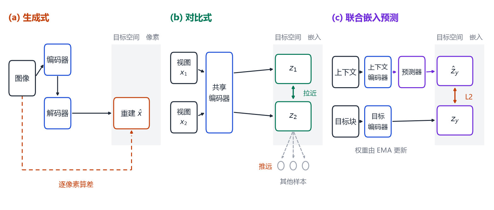
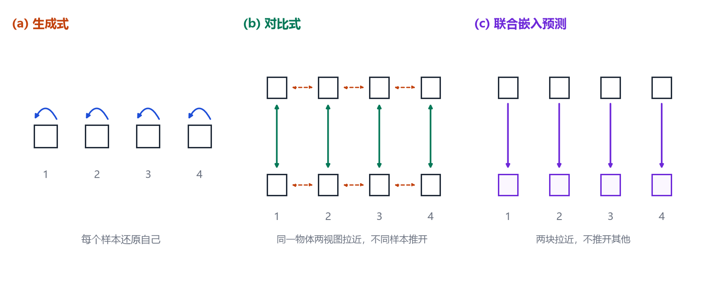
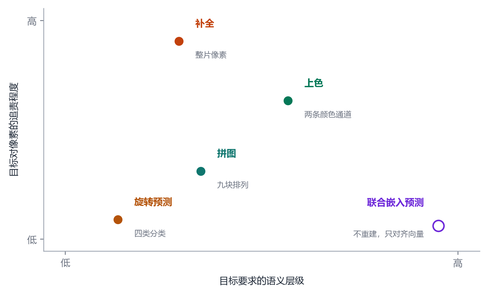
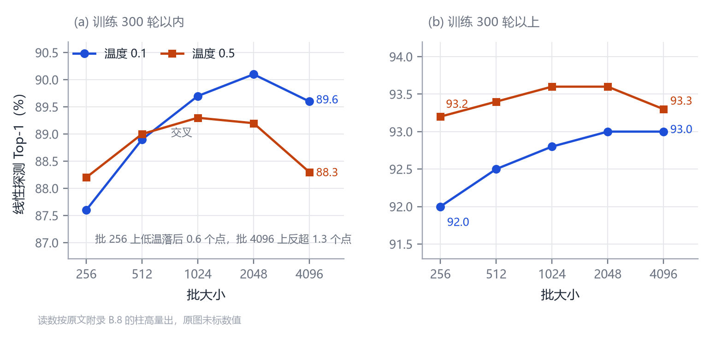

# 第 3 章　三条自监督路线

一块硬盘里装着一千万张照片，没有一张附带标签，而你要用它训练出一个能认出杯子的网络。监督学习在这里启动不了，因为它要求每张图片旁边站着一个标准答案，答案得由人一条一条写下来，一秒钟写一条，不吃不睡也要写上四个月。标注本身还带着损耗，同一个人上午和下午对同一张图的判断都可能不同，何况几十个人分头去做。一张没有标签的照片并没有因此变得没有信息，只是信息藏在别的地方，等着被某种方式问出来。

人是怎样学会看东西的，这个过程里没有谁在旁边写答案。一个孩子看着杯子被推下桌沿，听见响，看见碎片，从此知道这类东西掉下去会碎，他没有被告知过“杯子”这个词的定义，得到的是一个可以反复使用的预期。真实世界给出的监督信号一直在流动，只是它不以标签的形式出现，而是以“这件事接下来变成了什么”的形式出现。看见的事情和随之发生的事情之间那条稳定的联系就是信号。

上一章说到，一张图可以被压成一串几百个数字，这串数字丢掉大量细节，却仍然保留了能支持判断的那部分结构，也说到训练目标不同，压出来的空间形状就不同。自监督要做的，就是把“哪些东西应该被放在一起、哪些应该被分开”写成损失函数，让空间自己长出形状来。这条路线诱人的地方在于它不需要人，代价在于它也不告诉模型什么是对的。三条主流路线的回答并不一样，差别却决定了模型把容量花在什么地方。

三条路线都可以用同一句话开头，取一份数据，造出它的两个版本，再规定这两个版本之间的关系。生成式要求第二个版本能被还原成第一个版本，对比式要求它被认作同一个东西并且和别人的版本区分开，联合嵌入预测式只要求它的表征能被预测出来。这一章按这个顺序依次讲开，收尾时把三条路线放在一张表里对照，让它们的取舍显形。

## 3.1　把答案从数据里拆出来

遮是其中一种拆法，一张图遮掉中间一半，让模型把那一半补回来，题干和答案来自同一张图。看两遍是另一种拆法，同一张照片裁出左边一块和右边一块，一次调亮一次调暗，得到两个版本，让模型认出它们出自同一个场景。还有一种拆法也是遮，但不要求补回像素，只要求说出被遮住的地方在语义上是什么，就像看半张脸，不画睫毛，只判断那边还有一只眼睛。三种拆法各配一种损失，分别算在像素上、两个向量的相似度上、两个向量之间的距离上。

桌上一副打散的拼图能把三条路线的分工讲清楚。生成式的做法是把每块拼图放回原位，评价标准是图案对不对得上，做错的时候错在颜色和纹理。对比式的做法是拿两副不同的拼图分别打散混在一起，让模型指出哪两块属于同一副，它不必知道图案画的是什么，只要知道两块来自同一个来源。联合嵌入预测式的做法是只看拼图的一角，让模型说出剩下的部分大概由什么构成，但不要它把图案画出来。

这类人为设计出来的任务在文献里叫代理任务（pretext task）。代理任务本身没有实用价值，没有谁真的需要模型把一张图的拼图拼回去，有用的是模型为了完成它而被迫记住的东西。选什么样的代理任务，等于选什么样的归纳偏置，遮住一块让人去补，模型学到的是纹理的连续性，让两个视图对齐，模型学到的是对裁剪和颜色不敏感的身份。同一批数据换一道题，学到的表征几何就换了一套，这一点在后面每条路线里都会再出现。

三条路线的骨架可以并排放在一起看，如图 3-1，三张子图的画法完全一致。左边是观测，中间是网络，右边灰底的一栏是损失落脚的地方，三个灰格里装的东西并不相同，生成式装的是像素，另外两条装的是嵌入向量。前两栏几乎一样，都是一个输入过一个网络得到某种表示，分岔出现在第三栏，生成式把表示送回解码器，对比式把表示拿去和别的表示比，联合嵌入预测式把表示拿去预测另一个表示。

<figure class="fig">

<figcaption><b>图 3-1</b>　三条路线的结构对比。三张子图共用一套画法，从左到右是观测、网络、损失落脚的空间，差别在损失落在像素还是嵌入，以及要不要靠负样本把别的样本推开。</figcaption>
</figure>

## 3.2　把遮住的部分画回来

生成式自监督的源头是自编码器（autoencoder）。编码器把输入压成一个向量，解码器再把这个向量还原成输入，两端的结构可以完全对称。损失是原始输入和还原结果之间的逐像素平方差，写成公式是下面这个样子。式子里的答案不是别人给的标签，而是输入自己，所以这类方法天生不需要人工标注，代价是它必须对每一个像素的数值负责。

$$
\mathcal{L} = \lVert x - D(E(x)) \rVert^2 .
$$

这里 $x$ 是输入图像，$E$ 是编码器，$D$ 是解码器，$\lVert \cdot \rVert$ 表示把整张图的差值平方之后求和。这个目标有一个明显的漏洞，中间那个向量如果足够宽，网络可以学成恒等映射，把输入原样搬到输出，损失降到零而什么也没有学到。瓶颈就是用来堵这个漏洞的，它逼着网络在有限的宽度里做选择，决定哪些信息值得留下、哪些可以扔掉。

2018 年的 BERT 提供了另一条思路，它不去压缩中间向量，而是把输入句子里 15% 的词换成占位符，让模型根据上下文猜出原来的词。图像上的对应版本叫 BEiT（BERT Pre-Training of Image Transformers），2021 年由 Bao 等人提出，它把一张 224 像素的图切成 14 乘 14 共 196 个小块，用块状掩码遮掉大约 40%，再让模型预测每个被遮的块在词表里对应哪一个编号。这套词表来自一个事先训练好的离散自编码器，码本大小是 8192，每一块图最终被映射成这 8192 个编号当中的一个。

这套安排让 BEiT 的目标既不是像素，也不是纯粹的语义。词表是人为定义的，8192 个编号彼此之间没有远近关系，模型预测的是一个类别而不是一个位置，所以它不必为某块草地的具体亮度负责。代价是它并不完全从零开始，那个离散自编码器已经在大量图像上训练过一遍，BEiT 借用了它形成的视觉先验，词表本身带着上一轮训练留下的偏见。

掩码自编码器（Masked Autoencoder，MAE）把目标搬回了像素，做法在 2021 年由 He 等人给出。一张 224 像素的图切成 16 乘 16 的小块，一共 196 块，随机遮掉 75%，只有剩下的 49 块进入编码器，编码器看到的输入比原图小得多。编码器的输出和一组可学习的位置标记一起交给一个轻量解码器，由它把整张图补出来，损失只算在被遮住的块上，可见的块不参与，因为那些块的答案本来就摆在输入里。省下来的计算不小，原文报告的训练时间比把标记留在编码器里快 2.8 倍。

75% 这个数字值得停一下，它是原文一格一格试出来的。BERT 的典型比例是 15%，视觉领域更早的工作大多落在 20% 到 50% 之间，MAE 一开口就要遮掉四分之三。原文的消融显示，比例往上抬，线性探测的准确率跟着涨，遮 10% 时是 54.6%，遮 75% 时是 73.5%，差出将近二十个百分点。微调对比例不那么敏感，40% 到 80% 的区间都还能用，遮得更狠才会明显掉下来。

为什么文字遮 15% 就够，图像要遮到 75%，原文给的解释是两种信号的密度不同。语言是人写出来的，一句话里几乎每个词都承担信息，遮掉几个词，剩下的上下文不足以插值，模型必须理解句法才能补回来。图像是自然信号，空间冗余大，缺一块往往能从邻居推出来，遮得少的时候，模型只要看四周的颜色就能蒙对。比例得一直往上抬，抬到插值失效为止，任务才变得值得做，题目太简单，模型就会走捷径。

遮住一张人脸的右半边，你能说出右边应该有一只眼睛、半个鼻子、一段下颌线，但你画不出每一根睫毛的走向。MAE 要求模型把这些也画出来，画得越准说明记住的纹理越多，而记住纹理和理解物体并不是一回事。容量是有限的，花在草叶和睫毛上的那部分，就不能花在“这是一片草地”“这是一个人的侧脸”上。这条天花板写在目标函数里，只有改掉损失的形式才能绕开。

## 3.3　拉近与推远

对比式换了一个问题，它不问被遮住的是什么，只问这两个东西是不是同一个。SimCLR（Simple Framework for Contrastive Learning of Visual Representations）的流程短得可以口述，取一张图，做两次随机增强，裁剪、翻转、颜色抖动、模糊，得到两个视图，两个视图过同一个编码器得到两个向量，损失要求这两个向量接近，同时要求它们远离同一批里其他图的所有向量。整条流水线里没有任何一处需要标签，唯一需要人决定的是增强函数长什么样。

MoCo（Momentum Contrast）改的是负样本从哪来。它维护一个队列，把过去若干个批次的向量存下来当负样本，队列长度取 65536，比一个批次大出几十倍，字典的大小因此不再被显存里的批大小卡住。队列里的向量由另一套参数编码，这套参数不跟梯度走，而是按 0.999 的动量慢慢向主编码器靠拢，几十步之前存进去的向量才不会因为参数突变而失效。原文的消融说，队列从 256 加到 65536，线性探测的准确率从 54.7% 升到 60.6%。

推远这一步是这类方法能够成立的关键。如果只要求正样本对彼此接近，把所有输入都映射成同一个向量就能让损失归零，这个解在数学上完美，在实用上一无是处。负样本的作用是给“靠近”这件事设一个下限，锚点必须同时远离同一批里的其他样本，把所有东西挤成一团的捷径才被堵死。这个问题叫表征塌缩，第 4 章会专门拆开看，现在只需要记住它是所有只做对齐的目标共同的病。

增强函数实际上在替人回答一个问题，哪些差异可以忽略。一张猫趴在窗台上的照片，裁一次剩下猫头和窗框，再裁一次剩下猫背和窗外的树，两个视图共享的东西只有一件，这是同一只猫在同一个窗台上。颜色抖动告诉模型颜色不重要，模糊告诉模型清晰度不重要，裁剪告诉模型位置不重要，这些假设在很多场景下成立，在另一些场景下不成立。一张图裁得太狠，两个视图可能只剩两块草地，模型学到的就是草地和草地相似。

把这件事写成可以优化的形式，得到的是 InfoNCE，这个损失最早由 van den Oord 等人在 2018 年提出。设一个视图经过编码器得到向量 $z_i$，它的另一个视图得到正样本 $z_i^{+}$，同一批里其他图给出 $K$ 个负样本 $z_j^{-}$。这一对样本要付的代价是下面这个式子，它衡量的是正样本有没有从 $K+1$ 个候选里被挑出来。一个批次里每一对都算一遍再取平均，就是这一步的损失。

$$
\ell_i = -\log \frac{\exp\left(\operatorname{sim}(z_i, z_i^{+}) / \tau\right)}
{\exp\left(\operatorname{sim}(z_i, z_i^{+}) / \tau\right) + \sum_{j=1}^{K} \exp\left(\operatorname{sim}(z_i, z_j^{-}) / \tau\right)} .
$$

这里 $\operatorname{sim}$ 是两个向量归一化之后的余弦相似度，$\tau$ 是一个很小的温度常数，$\log$ 是自然对数。整个式子的形状是 softmax 加交叉熵，分母把正样本和所有负样本的指数放在一起求和，分子只有正样本。最小化它就是让正样本在候选里的份额变大，$\ell_i$ 越小，说明模型把正样本挑出来的把握越大，也说明它把别的样本压得越低。

温度控制着这个分布的尖锐程度。除以一个很小的 $\tau$，指数把分数之间的差距放大，softmax 几乎只盯着最难的那几个负样本；除以一个较大的 $\tau$，分布变平，所有负样本分到差不多的权重。SimCLR 在 0.1、0.5、1.0 三个候选里比较过，训练到收敛时 0.5 的表现最好。负样本要多少也有讲究，批大小从 256 加到 8192，8192 张图配两张视图，每个正样本对就配上了 16382 个负样本，这个数字解释了对比学习早期为什么那么吃显存。

还有一个麻烦藏在负样本的取法里。负样本是从同一批里随手取的，取到同一类的概率不低，一张猫的图当锚点，负样本里可能正好有另一只猫。目标要求把它们推开，可它们本来就应该靠近，这个矛盾叫假负样本，批越大撞上的机会越多。所以这条路线在细粒度任务上总差一口气，原因不是它学不到东西，而是它的目标里混进了错的要求。

## 3.4　只对齐两个向量

第三条路线把目标从像素挪到向量，代表是 I-JEPA（Image Joint-Embedding Predictive Architecture），2023 年由 Assran 等人提出。它有三个网络，上下文编码器看图像的一部分，目标编码器看另一部分，预测器从上下文的向量出发去猜目标那部分的向量。损失是两个向量之间的平方距离，写法与自编码器那个式子几乎一样，只是等号右边换成了一个向量，$P$ 是预测器，$E_{\text{ctx}}$ 与 $E_{\text{tgt}}$ 分别是上下文编码器和目标编码器，$x$ 是可见的上下文块，$y$ 是被遮住的目标块。

和 MAE 相比，差别只在等号右边那一项。MAE 要求还原像素 $y$，这里要求逼近目标编码器给出的 $E_{\text{tgt}}(y)$。像素里有一根草的弯曲、一片叶子的高光，向量里没有这些东西，目标编码器把一片草压成“这里有一片绿色的东西”，预测器只需要猜到这个程度。要求变松了，能被猜中的东西就只剩语义，这正是这条路线想要的效果。

预测器是一个比编码器窄得多的网络，它接上下文编码器的输出，还接一组位置标记，告诉它该猜哪个位置上的块。位置必须显式给进去，否则同一个上下文可以对应很多个目标块，模型无从下手；窄是故意的，预测器太宽它自己就能把任务做完，上下文编码器反而学不到东西。这套结构里没有解码器，输出不是给人看的图像，而是一个只在训练时用来算损失的向量，训练结束之后留下的是上下文编码器。

和对比式相比，区别在于没有负样本。分母那个求和项消失了，剩下的只是两个向量之间的距离，按上一节的说法这应该立刻塌缩。实际没有塌缩，原因在目标那一端一直在动，目标编码器的权重是上下文编码器的滑动平均，它慢半步。上下文编码器想塌缩到常数时，目标端还停在塌缩之前的位置，预测误差反而变大，这一步的滞后把它自己拽了回来。这个机制不完美，超参数一变它就可能失效，第 4 章讲塌缩的机制，第 5 章把 I-JEPA 的每一步走一遍。

## 3.5　三个问题把它们分开

把三条路线并排看，会发现骨架其实很像，都是输入过网络得到某种东西，再和另一个东西比。真正分岔的地方集中在三个问题上，逐个问一遍，路线之间的差别就清楚了。损失算在哪个空间，决定了模型必须为哪些细节负责，也决定了它需不需要一个解码器。有没有显式的负样本，决定了它靠什么防止塌缩，因为只做对齐的目标天然带着一个把所有输入挤成一团的解。目标从哪里来，决定了它被迫理解到什么程度，这一条最容易被漏掉。

第一个问题最直观。生成式的损失算在像素或者离散编号上，对比式和联合嵌入预测式算在嵌入向量上，前者要为每一根草负责，后者只为一个已经被压过的表示负责。有意思的是 MAE 原文试过把重建目标换成离散的 dVAE 词元，也就是 BEiT 的做法，线性探测的准确率反而从 73.9% 掉到 71.6%。目标空间不是越抽象越好，抽象的目标需要更强的约束才撑得住。

第二个问题决定防塌缩的手段。对比式有负样本，而且要多，8192 的批或者 65536 的队列都是为了把负样本堆够；另外两条没有负样本，就得用别的办法堵住常数解，生成式靠的是重建目标本身足够难，联合嵌入预测式靠的是目标端的滞后。手段不同，代价也不同，负样本的成本是显存和假负样本，滞后的成本是对超参数敏感。

第三个问题问的是目标从哪里来。生成式的目标是输入自己，问题与答案完全重合；对比式的目标是同一个物体的另一次观测，答案换了一层外壳；联合嵌入预测式的目标是另一块的向量，答案已经被压过一遍。三种目标携带的信息依次减少，要求的抽象程度依次升高，它们各自把哪些样本拉近，如图 3-2。三个子图里，(b) 多出来的横向虚线正是对比式和另外两条的区别，(c) 只保留一条向下的实线，样本之间互不干涉。

<figure class="fig">

<figcaption><b>图 3-2</b>　三种目标各自把哪些样本拉近。四个样本各占一列，实线表示拉近，虚线表示推远，生成式只让样本回到自己，对比式还要推开别人，联合嵌入预测式不推。</figcaption>
</figure>

图 3-2 里最值得比较的是 (b) 和 (c)，两张图的实线一样多，都是一个样本内部的两条观测连在一起，区别只在于有没有那些虚线。负样本不是可有可无的补丁，它是整个目标函数成立的前提，去掉它之后，目标就得靠结构上的不对称来维持，而结构上的不对称是会被训练过程钻空子的。三个问题对着三条路线各问一遍，得到表 3-1，表格里最右两列是真正需要权衡的地方。

**表 3-1**　三条自监督路线的对比。目标空间决定模型要为哪些细节负责，负样本决定它靠什么防止塌缩。

| 路线 | 目标空间 | 负样本 | 典型方法 | 主要风险 |
|---|---|---|---|---|
| 生成式 | 像素或离散词元 | 不需要 | 自编码器、MAE、BEiT | 容量花在不可预测的细节上 |
| 对比式 | 嵌入 | 需要，且要多 | SimCLR、MoCo | 依赖数据增强，负样本成本高 |
| 联合嵌入预测式 | 嵌入 | 不需要 | BYOL、I-JEPA | 表征塌缩 |

## 3.6　预测不等于预测未来

JEPA 里的“预测”很容易被读成预测未来，这个误读会让人对后面所有设计产生错误的期待。在 I-JEPA 里，被预测的是同一张图的另一个块，上下文块和目标块来自同一时刻，两者之间没有时间差。模型学到的是这个场景的这一部分和那一部分在语义上怎么对应，桌面上有杯子，杯子旁边有椅子，而不是接下来会发生什么。

这个区别不小。如果目标真是预测未来，模型就必须知道动力学，知道杯子被推会移动，知道球会往下掉，知道水会顺着倾斜的玻璃板流下去。I-JEPA 的训练目标没有这么强，它只要求空间上的可预测性，一张静态照片里的语义结构就足够训练它。反过来说，这也解释了一个常见的误判，以为这类架构必须先有视频才能开工，其实静态图像里就有很多可以互相预测的部分。

预测未来是这套架构在世界模型里的用法。把另一块换成下一帧，把同一张图换成同一段视频，把目标编码器换成带动作条件的预测器，JEPA 就成了世界模型，能回答“如果这样做，画面会怎么变”。这条路在后面几章会走，从视频到动作条件，每一步都在给“预测”加上一个维度。目标块要选得够大也出于同样的考虑，块太小，模型靠周围的纹理就能插值猜出来，学到的表征也就停在纹理层面，这和 MAE 必须遮掉 75% 是一回事。

三条路线走到这里，问题已经收窄，生成式要还原细节，对比式要分辨样本，联合嵌入预测式只要两个向量对齐。第三种最省，不需要解码器，不需要负样本，不需要为像素负责，也最危险，因为它的最优解可以是一个把所有输入都映射到同一个点的常数函数，损失为零而信息为零。要把这个危险看清楚，得先把“对齐”写成一个可以最小化的量。下一章从一副打散的拼图开始，讲能量，讲为什么一个只往下压的目标会自己找到那条最省事的捷径。

## 3.7　代理任务的谱系

第 4 章的拼图先放一放，三条路线还有几处细节没说透。最早的代理任务既不是掩码也不是对比，而是 2015 到 2018 年的一批手工题目。Noroozi 和 Favaro 在 2016 年把图切成九块打乱，让网络说出原来的排列；Pathak 等人在同一年挖掉图像中央一大块，让网络补回来；Zhang 等人同年做上色，把彩色图变成灰度，让网络预测丢掉的颜色；Gidaris 等人在 2018 年把图转四个角度，让网络判断转了多少度。这四道题后来都被掩码与对比两条主线盖了过去，它们暴露的问题却留在了今天的配方里。

旋转是四道题里最便宜的一道，一张图只转四个角度，答案是一个四分类标签，网络不需要解码器，也不需要比对分支。它的问题也在这里，判断转了多少度并不需要认出物体，图像边缘的方向分布本身就带着很强的线索，模型学到的往往是这类纹理通常朝上这种统计，而不是这是一个杯子。Gidaris 等人报告过，这样训出来的卷积核搬到分类、检测和分割上都能用，增益却有限。

拼图把答案换成一个排列，九块图打乱之后，网络要说出这是哪一种排列，答案空间是九的阶乘，实际只用一小部分。这道题比旋转难，因为它要求模型比较块与块之间的内容，草地要接草地，桌沿要接桌沿，只看单独一块判断不出来。麻烦也在这里，块与块的交界处留着像素级的连续性，两块能不能接上，一条细线的走向就能回答，模型于是把容量花在接缝上。原文试过在块与块之间留出空隙，让接缝不再直接相邻。

上色换了一条思路，把彩色图的亮度留下、颜色抽走，让网络把颜色补回来。Zhang 等人 2016 年的做法把颜色空间切成一批离散的格子，预测落到哪一格，损失用交叉熵而不是平方差，因为同一种物体可以有好几种合理的颜色，用平方差只会得到一片灰。长处是颜色常常由语义决定，天是蓝的，草是绿的，模型要答对就得先知道那一块是什么。短处是通道太窄，一张图的大部分信息在形状和位置上，靠颜色训出来的表征在吃几何的任务上帮助有限。

补全是四道题里离今天最近的一道。Pathak 等人在 2016 年提出上下文编码器，把图像中央一大块挖掉让网络补回来，补出来的像素要接近原图，补出来的区域还要骗过一个判别器。加对抗损失的动机很实际，只用平方差补出来的东西是糊的，糊成一团的区域在统计上离真实图像很远。这套安排已经有了掩码重建的骨架，缺的是比例，挖掉中央四分之一和随机挖掉四分之三，难度差着量级。

把四道题摆在一张平面上，如图 3-3，横轴是目标要求的语义层级，纵轴是目标对像素的追责程度，点的位置是定性的，不来自任何测量。旋转落在左下角，答案只有四个类别；拼图往右挪一点，它要求块与块的内容相容；上色再往右上，颜色要对而位置不变；补全站在最高处，整片挖掉的区域都得在像素上成立。四个点都没有落在右下角，那个位置要求语义又不追责像素，当时没有人手上有这样的目标。

<figure class="fig">

<figcaption><b>图 3-3</b>　四类早期代理任务在语义层级与像素追责平面上的位置。旋转与拼图只要一个类别，补全要为整片像素负责，右下角的空心点是后来才出现的联合嵌入预测。</figcaption>
</figure>

难度由人手工设定，是这批任务共同的软肋。答案的模态一改，学到的表征就换一套，训练中间没有旋钮可调。掩码重建把旋钮做进了比例里，遮一成和遮七成半是两个难度；对比学习把旋钮做进了负样本的数量里，批大小和队列长度都能拨。两条主线活得下来，不是因为题目更聪明，而是因为难度可以连续滑动。右下角那个空档后来被 3.4 节的联合嵌入预测填上了，图 3-3 的空心点就是它。

## 3.8　MAE 与 BEiT 的逐项对比

掩码路线上有两个绕不开的名字，BEiT 和 MAE，骨架完全一样，切块、遮掉一部分、让模型把被遮的部分交代出来，差别集中在四处，预测什么、遮多少、编码器看到什么、解码器多轻。两者都用 ViT 做主干，都在 ImageNet-1K 上预训练，报告的数字可以大体对齐。这四处不是独立的旋钮，动一处，其余三处的取舍跟着变。3.2 节讲过两者的流程，这里只把差别挑出来并排看。

预测什么决定了损失的形式。BEiT 借一个离散自编码器把每块图压成 8192 个编号当中的一个，被遮的块要预测编号，损失是交叉熵，梯度只落在被选中的码字和几个竞争者身上。MAE 直接回归像素，损失是平方差，每个像素都要负责，目标里保留的细节因此多得多。离散目标的好处是细节被压掉了，模型不必为一根草的弯曲付出代价，代价是词表要另外训一遍，BEiT 用的 dVAE 在 2.5 亿张图上训过，借了别人的先验。

遮多少和怎么遮是一体的。BEiT 遮 40%，方式是块状，每次挑一个至少 16 块大小的矩形，长宽比随机，一块一块盖，直到遮够数。MAE 遮 75%，方式是逐块独立随机。形状的差别来自编码器的用法，BEiT 的编码器看到全部 196 个位置，被遮的块用掩码标记占位，比例再高也省不下计算；MAE 的编码器只吃可见的 49 块，遮得越多算得越快，75% 既是难度也是省钱的手段。

解码器的轻重跟着目标走。BEiT 的预测头是一层线性映射，把编码器输出接到 8192 类上，没有多余的 Transformer。MAE 配了一个 8 块深、512 宽的解码器，运算量只有 ViT-L 每个标记的 9%，看起来可有可无，实测很要紧。深度从 1 块加到 8 块，线性探测从 65.5% 升到 73.5%，微调却几乎不动，84.8% 到 84.9%。一种解释是专门用于重建的那几层被放在了编码器外面，编码器的输出因此停在更抽象的位置。

成本这一项要小心地读。BEiT-B 预训练 800 轮，批大小 2048，用 16 张 V100 跑了大约五天；MAE 的 ViT-L 跑 800 轮用了 15.4 小时，账记在 128 个 TPU-v3 核上。两边硬件不同，不能相除得出倍数，能说的是 MAE 的编码器只处理四分之一的标记，原文报告同样跑一轮比 BEiT 快 3.5 倍。精度上两者很接近，ViT-B 微调 BEiT 是 83.2%、MAE 是 83.6%，ViT-L 的线性探测都是 73.5%。成本与精度的差距都落在半个点以内，选哪一个更多取决于手上有多少算力和多少耐心。

把这几项并排放进表 3-2，最容易看出来的是分歧不在精度，而在路径。BEiT 选了更抽象的目标，代价是多一个词表和一个更重的编码器；MAE 选了更笨的目标，换来更简单的流程和更快的训练。两篇论文的消融给出了相反的结论，BEiT 说目标换成像素掉 1.8 个点，MAE 说目标换成词表在微调上只多出 0.4 个点，线性探测反而降。差异来自掩码比例和编码器是否只看可见块，目标空间从不单独起作用，它得和遮多少一起调。离散码这条路没有白走，第 11 章的图像分词器还会用到。

**表 3-2**　MAE 与 BEiT 的逐项对比。数字取自两篇原文，成本一行的硬件不同，只能看量级。

| 项目 | BEiT | MAE |
|---|---|---|
| 预测目标 | dVAE 词表里的编号，8192 类 | 每个像素的值 |
| 损失 | 交叉熵 | 平方差 |
| 掩码比例 | 40% | 75% |
| 掩码形状 | 块状，最小 16 块，长宽比随机 | 逐块独立随机 |
| 编码器输入 | 全部 196 块，被遮的用标记占位 | 只有可见的 49 块 |
| 解码器 | 一层线性预测头 | 8 块深、512 宽，占单标记运算量的 9% |
| 词表来源 | DALL-E 的 dVAE，2.5 亿张图 | 不需要 |
| ViT-B 微调 | 83.2% | 83.6% |
| ViT-L 线性探测 | 73.5% | 73.5% |
| 800 轮预训练 | 16 张 V100 约五天 | 128 个 TPU-v3 核 15.4 小时 |

## 3.9　温度与批大小的耦合

温度看起来只是一个缩放因子，实际它和批大小一起决定负样本怎么被用。把 InfoNCE 分母里的 softmax 摊开，每个负样本分到的权重由它和锚点的相似度决定，温度越小，权重越集中在最像正样本的那几个上。批越大，这样的难负样本越多，低温才有东西可挑；批很小的时候，低温会把几乎全部梯度压在两三个样本上，等于白买了负样本。这个耦合在 SimCLR 的附录里看得最清楚。

SimCLR 原文附录 B.8 在 CIFAR-10 上给过一组读数，主干是 ResNet-50，冻住之后做线性探测。训练不足的时候，也就是 300 轮以内，温度 0.1 随批大小单调上升，批 256 时 87.6%，批 4096 时 89.6%，涨了两个点；温度 0.5 几乎不动，88.2% 到 88.3%。两条线在批 1024 附近交叉，批 256 上低温落后 0.6 个点，批 4096 上反超 1.3 个点，如图 3-4 的左图。这几组数按原文柱子的高度量出，原图没标数值，误差在十分之一个点上下。

<figure class="fig">

<figcaption><b>图 3-4</b>　温度与批大小的耦合。左图是训练不足时的读数，低温随批大小爬升并与高温交叉；右图是收敛之后的读数，高温稳定领先。数值按原文附录 B.8 的柱高量出。</figcaption>
</figure>

训练到收敛之后，曲线换了形状。300 轮以上，温度 0.5 在每一档上都领先，读数落在 93.2% 到 93.6% 之间，几乎不随批大小动；温度 0.1 从 92.0% 爬到 93.0%，差距从 1.2 个点缩到 0.3 个点。原文的结论写得克制，收敛后 0.5 最优且与批大小无关，而 0.1 随批大小改善，可能暗示最优点在向 0.1 挪。低温并不是批大就更好，它只是批大时少损失一些，最好的位置仍然留给 0.5。

为什么会这样，一个有用的直觉叫有效负样本数。softmax 的权重分布有一个熵，熵取指数可以读作真正参与梯度的样本个数，温度降低，这个数变小；批大小决定候选有多少，温度决定其中多少真的出力。批小的时候候选本来就少，再把权重一集中，有效数掉到个位数，名义上的负样本成了纸面数字；批大的时候候选多，低温才挑得出足够多的难样本。这个说法是定性的，解释趋势够用，不能当公式。

这条耦合有两个直接的后果。换批大小要重扫温度，不能把 8192 批上用的 0.1 抄到 256 批上；显存不够把批减半，最省事的补偿是把温度往上抬一档。另一个后果和假负样本有关，批越大，同类样本撞进负样本的机会越多，低温会把这些错的要求压得更狠。温度调得再好也改不了一件事，负样本是这个目标成立的前提，去掉它，对齐目标会自己找捷径，第 4 章把这条捷径摊开看。
