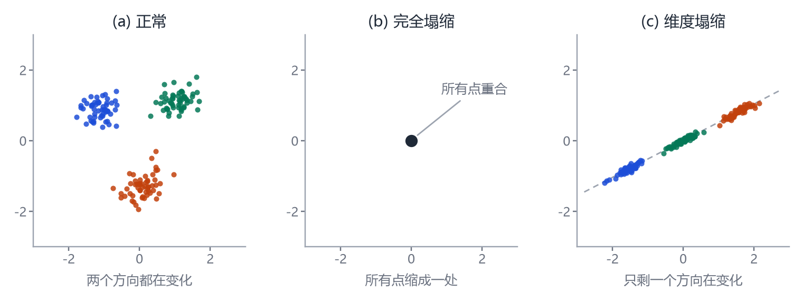
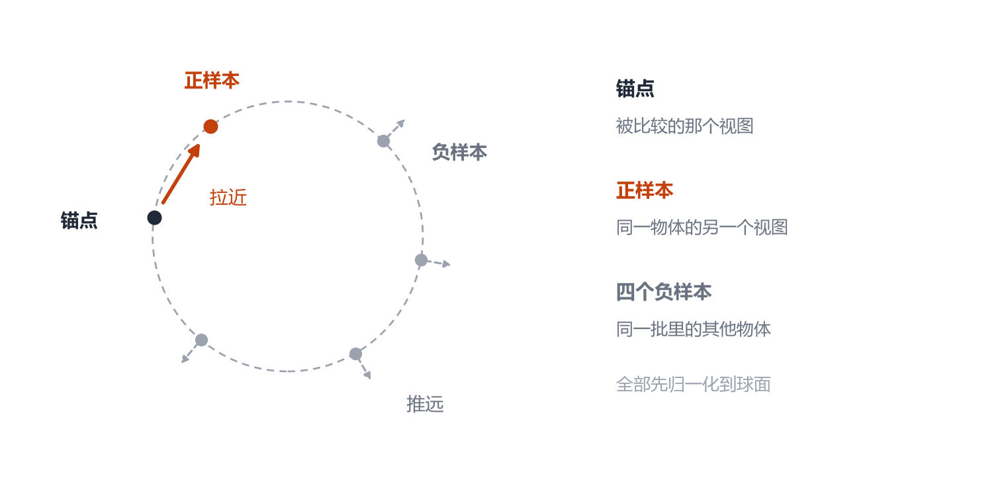

# 第 4 章　模型为什么会偷懒

晚自习里两个人被分到同一份卷子，老师说判分只看两份答案像不像，越像分越高，至于题有没有算对，不在这条规则管得着的范围里。按这个规则，最省力的做法不是各自把题做出来，而是一个人写、另一个人照抄，答案一致，分就满了。如果连抄都懒得抄，两个人在每道题后面都写一个零，同样能拿满分，因为评分标准从头到尾只比较两份答案之间的差异。这套规则本身并不荒谬，它在大多数时候确实能区分认真和不认真，只是它有一个一步就能走到的漏洞，而这个漏洞恰好落在所有做法里最省力的那一条上。

上一章把自监督的三条路线摊开比较过，其中最省的一条叫联合嵌入预测式，它不重建像素，也不需要负样本，只要求同一张图的两个视图变成两个彼此接近的向量。这条路线省下来的成本很实在，代价却藏在一个不起眼的地方，目标函数只有一句话，让两个向量靠拢，而这句话有一个几乎不用搜索就能走到的解。把所有输入都映射成同一个向量，两个视图的差就是零向量，损失精确地等于零，训练到这里就结束了。

这个现象叫塌缩（collapse），它的麻烦不在于让损失变大，恰恰相反，它把损失压到最小，让曲线和数字看起来都很健康，只有跑下游评测的时候才会发现，这个编码器其实什么也没学到。拿地图打比方，一张把整座城市缩成一个点的地图，问路时永远不会报错距离，因为它从不给出距离；塌缩的表征也是这个点，它没有说谎，只是什么也没说。

这一章要讲清四件事：常数解为什么是全局最优而不是一个可以绕开的局部陷阱，塌缩有哪两种形态，它为什么在训练日志上留不下痕迹，以及人们用哪三类办法把它挡住。每一类办法内部怎么运作，分别属于后面几章和进阶篇的内容，这里只讲到能看出它堵住了哪条路为止，判断的标准始终是同一句，它把信息约束加在了哪里。

## 4.1　常数解是全局最优

把这个流程写成式子只需要几个符号。编码器记作 $f_\theta$，一张图 $x$ 经过裁切、翻转、调色两次，得到两个视图 $x_1$ 和 $x_2$，损失取这两个嵌入之间的平方距离，写成下面这一行。它衡量的东西很朴素，就是同一个物体在两个视图下的向量隔了多远，这一行也是整章后面所有讨论的起点。

$$
\mathcal{L}(\theta)=\mathbb{E}_{x}\left\lVert f_\theta(x_1)-f_\theta(x_2)\right\rVert^2 ,
$$

$\theta$ 是编码器的全部参数，$\lVert\cdot\rVert$ 是欧氏长度，期望对数据分布和随机增强一起取，所以这个损失不针对某一张图，而是对所有图同时成立。这个量非负，最小值是零，而取任意一个常向量 $c$、让 $f_\theta(x)=c$ 对所有输入都成立，任何一对视图的差都是零向量，损失精确地等于零。这个解与 $c$ 取什么值无关，零不是一个孤立的点，而是一片连续的区域。

关键的一点在于，这个坏解不需要搜索。梯度下降最怕的是局部极小值旁边立着高墙，得靠运气才能翻出去；常数解不是这样，它在损失面上占据一整片平坦的谷底，从随机初始化出发，两个分支的输出只要开始互相靠近，剩下的梯度里就只剩继续收缩的份量，没有把不同样本推开的力量。收缩是一个没有阻力的方向，每一步都被往前推一点点，走完用不了多久。所以塌缩不是训练出了意外，而是训练太顺利，顺利到沿着最省力的方向一路滑到了底。

结构上再加一个预测器也救不了。有些方法不比两个嵌入本身，而是让一支的输出先过一个小网络，再去拟合另一支的输出，损失写成两个量之间的平方距离，常数解照样成立，只要让那个小网络把常向量原样送出来就行，多加的几层只改变了路径，没有改变终点。从信息的角度看更清楚，这个解把整个数据集压成了一个点，下游任务拿到这样的向量，两只不同的猫和一把椅子没有区别，因为它们的坐标完全相同。零损失和零信息在这里是同一件事，而目标函数只看得见前一件，它被设计出来衡量两个视图像不像，从来没有被要求衡量这些向量一共能区分多少东西。

## 4.2　两种塌缩

完全塌缩是最彻底的一种，所有输入的嵌入完全重合，表征空间的每一个方向都作废。上面那个常数解走到底就是它，点云缩成一个点，任何基于距离的比较都失去意义，任意两张图的相似度都是最大值，检索系统会把整个图库的第一条结果当作答案返回。这种塌缩其实最容易发现，因为它连形状都不剩，看一眼散点图就知道出了问题。

更常见也更难发现的是维度塌缩。嵌入没有全部变成同一个点，但所有点挤在一条线、一张面，或者某个低维子空间里，名义上编码器输出几百上千维，实际能自由变化的方向远远没有这么多，其余维度几乎不动。形状还在，尺寸已经不对了，这就是它容易被漏掉的原因。具体到常见模型，落差可以很大，ResNet-50 加一层全局池化之后输出 2048 维，ViT-B 每个图元的输出是 768 维，两个数字都是论文里写明的配置，编码器的最后一层确实有这么宽。

要看清楚这件事，得看一批向量的奇异值。把 $N$ 张图的嵌入摞成一个 $N$ 行、$d$ 列的矩阵做奇异值分解，得到的奇异值衡量点云在各个主方向上伸展了多长，第一个对应最长的方向，第二个对应与它垂直的方向里最长的那条，依次往下。奇异值大，说明数据在这个方向上有变化；奇异值接近零，说明所有点在这个方向上几乎重合，这个方向形同虚设。把奇异值取对数画成曲线，曲线的形状就是表征实际用掉了几个维度，谱线太平说明很多方向在空转，谱线掉到零说明那些维度彻底死了。

Jing 等人在 2022 年做过这个测量。他们取一个在 ImageNet 上按 SimCLR 配方训好的模型，把嵌入向量收集起来算协方差矩阵，再分解出奇异值谱，每个嵌入是 128 维，谱线画出来之后有相当一部分奇异值直接掉到零。同一篇论文还做了一组对照，把投影头去掉再训一遍，表征空间的谱反而塌得更厉害，也就是说那个只在训练时使用、下游评测时丢掉的小网络，正起着把维度撑开的作用。三种状态的差别如图 4-1。

<figure class="fig">

<figcaption><b>图 4-1</b>　三种状态的二维示意，三个子图共用同一坐标范围。左图三类各自成团，两个方向都有伸展；中图所有点重合在一处；右图三类退化成一条直线上的次序，只有一个方向有厚度。</figcaption>
</figure>

三个子图共用一套坐标轴，点云的体积可以直接比较。中图是急症，一眼就能看出来；右图是慢性病，外形还在，能用上的方向已经没了。判断一个表征健不健康，光看它有没有缩成一个点不够，还得看它有没有被压平，因为后者不会让任何一条现成的指标变红，它藏在几十个看起来都在工作的维度里面。

维度塌缩的代价比完全塌缩隐蔽得多。信息没有全部丢光，直线上的先后次序还在，一个线性分类器有时仍能分开一部分类别，指标不会掉到随机水平，于是它可以在很多次实验里蒙混过关。丢掉的是余量，名义上那么多维可以分摊不同的语义差别，实际只有很少几个方向在工作，剩下的方向是死区，而死区上的梯度接近于零，训练后期很难自己长回来。

具体的影响可以想像人脸识别这类任务。它要求表征同时做两件方向相反的事，忽略光照方向和拍摄角度，保留骨相上的细微差别，前者要求丢掉信息，后者要求留住信息，本来可以让它们占用不同的方向。维度塌缩把这些差别挤进同一小撮方向里，两件事开始互相干扰，只要换一种光源，同一个人的向量就漂到别人那一侧去了。也有例外，如果被压掉的方向本来只承载噪声，压掉等于一次免费的降维；麻烦在于编码器没有依据判断哪个方向是噪声，它压掉谁取决于初始化、数据分布和优化路径，不由语义决定。

## 4.3　损失曲线看不出来

塌缩最难对付的地方是它不留痕迹。训练日志上，损失平滑下降，最后收敛到一个很低的数，看起来是一次漂亮的收敛，跑完评测才发现冻结编码器训出来的线性分类器，准确率和闭着眼睛猜差不多。看到这种曲线，人的第一反应是调小学习率或者多训几轮，而真正的问题在目标函数的结构里，调参不会让它消失，只会让它换一个位置出现。

Chen 和 He 在 2021 年的 SimSiam 里留了一组对照，把这件事摆得很清楚。同一个网络、同一套超参、同一份数据、同样的增强，唯一的差别是梯度要不要从一支流回另一支，也就是用不用停梯度（stop-gradient，回传时把一支的梯度切断，让它不参与更新）。用停梯度，ImageNet 线性探测 67.7%；去掉它，准确率变成 0.1%。去掉了停梯度的那一组，损失很快跌到这个目标函数可能的最低点，保留停梯度的那一组也在平稳下降，两条曲线从形状上都看不出异常，日志里分不出高下。

0.1% 这个数字值得多看一秒。ImageNet 有一千类，随机猜的期望正确率正好是千分之一，所以 0.1% 不是效果差，是彻底没学到东西，编码器的输出对所有图片都一样，分类器只能输出同一个答案。同一篇论文还拆掉预测器再训了一遍，准确率同样是 0.1%，说明这条路线上两个部件都不能少，缺一个就退回常数解。结构里少掉的那一小块，正好就是拦住收缩的那只手。

原因说穿了很简单，损失衡量的是目标函数被满足了多少，不是表征里还剩多少信息。塌缩恰恰是这两件事分道扬镳的地方，目标被完美满足，信息被彻底抹掉，而损失只对前一件事敏感。只看损失，等于只看两个人的答案抄得像不像，不看答案对不对，抄得越整齐，评分越高。

## 4.4　三类解法的分工

既然根源是目标只说了什么应该相似，没说信息要保留多少，那么所有解法的实质都是往目标里补一条信息约束，区别只在这条约束从哪里来。按这个方法分类，现成的做法可以归成三堆，一堆从样本之间的关系来，一堆从网络的对称性来，一堆从嵌入的统计量来，比按方法名字排队清楚得多。换句话说，问题不在于约束够不够强，而在于这条约束管的是不是该管的那件事。

从样本关系来的那一堆，做法是明确规定不同的东西应该分开，用负样本把它们互相推开，对比学习走的是这条路。从网络对称性来的那一堆，抓住的是塌缩需要两支同时朝同一方向移动、并且这个移动在两边都得到奖励这一点，那就让两支不完全一样，一支带预测器而另一支不带，或者一支的梯度被切断、参数被冻结，BYOL 和 SimSiam 走的是这条路。从嵌入分布来的那一堆，盯的是塌缩留下的统计痕迹，某些方向的方差接近零、不同方向之间高度相关，那就把这些量直接写进损失，规定方差不能太小、维度之间不要互相重复，白化、VICReg 和 Barlow Twins 走的是这条路。

这三堆并不互斥，实际的方法常常各取一点，有的用动量又加中心化，有的在白化之外还保留停梯度。它们对付的是同一个敌人，只要有一条约束真的堵住了那条捷径，方法就能站住，至于这条约束写得多漂亮，对结果影响不大。所以读这些论文的时候，与其记结构图，不如先问一句，它把信息量写在了哪里。

这里有一个反复出现的张力。不变性要求同一个物体的不同视图靠得近，信息量要求不同的物体离得远，两条要求指向相反的方向。约束给得太松，模型走捷径，塌缩；给得太紧，模型被迫把本来可以忽略的细节也编码进去，比如光照角度、裁剪位置、镜头有没有虚焦，不变性就没了。每一类解法都是在这条线上找自己的位置，位置不同，代价也不同。

对比学习这一堆的几何可以画出来。一批样本先归一化到单位球面上，其中一个当锚点，另一个来自同一物体的视图当正样本，其余都算负样本，损失要求模型在这批候选里把正样本认出来，如图 4-2。先归一化这一步不是装饰，不归一化的话，把所有向量的长度一起缩到接近零，距离也会跟着变小，塌缩就多了一条更好走的路；把向量放到球面上，长度这个自由度被拿掉，距离只剩夹角一个来源，才能干净地讨论谁和谁像。

<figure class="fig">

<figcaption><b>图 4-2</b>　InfoNCE 的两股力。橙色实线把锚点拉向正样本，灰色虚线把四个负样本各自推远，两者方向相反，所以所有向量重合的解不再是低损失解。</figcaption>
</figure>

两股力合起来正好破坏了常数解。假设所有向量都相同，锚点与正样本的相似度和锚点与负样本的相似度一样大，softmax 在众多候选上只能均匀分配概率，正样本被认出来的机会是候选个数分之一，损失达到它可能的最大值。常数解从全局最优变成了最差解，信息约束就是这样被塞进去的。代价是负样本要够多，SimCLR 把批大小从 256 加到 8192，于是一个正样本能配上 16382 个负样本；MoCo 换了个思路，用一个长度为 65536 的队列存历史批次的键，键那一侧的编码器以 0.999 的动量缓慢跟随，负样本数量就不再受当前批大小的限制。

## 4.5　不对称结构与统计约束

BYOL（Bootstrap Your Own Latent）把负样本整个去掉了，改在结构上做一处不对称。它有两套网络，在线网络是编码器加预测器，吃一个视图；目标网络只有编码器，吃另一个视图，参数不走梯度，而是对在线网络的参数做指数滑动平均。损失是在线网络的预测与目标网络的输出之间的平方距离，梯度只从在线那一侧流回。Grill 等人在 2020 年的论文里，滑动平均系数从 0.996 起步，训练过程中逐渐升到 1，批大小 4096，跑在 512 块 TPU v3 上，整个训练没有负样本，也没有显式的统计约束，它却没有塌缩。

SimSiam 把结构削到最简。去掉动量，目标网络就是在线的副本，参数不更新也不接收梯度，只留一个预测器和那处梯度切断，批大小 512。这两个方法给出的直觉是，要让两支同时塌到同一个常数，它们得沿着同一方向一起移动，而且这个移动要在两边都得到奖励；梯度只从一支流出，另一支就是一块固定的靶子，靶子不会主动往锚点那边挪。塌缩需要两边合谋，停梯度取消了合谋的可能。

BYOL 刚出来时，很多人不信这套结构能自己站住，怀疑真正起作用的是批归一化。批归一化在批内做统计，等于把不同样本的信息混进了每个样本的输出，确实有可能起到类似负样本的作用。SimSiam 的对照把这条解释挡了回去，两个对照组用的是完全相同的批归一化配置，只是其中一个去掉了停梯度，它就塌了。所以批归一化对优化的稳定性有帮助，但没有证据说它能防塌缩。

第三堆办法不问样本之间的关系，也不动网络结构，它直接盯住这批向量的统计量。最朴素的写法是白化，把一批嵌入的均值减掉，再让协方差矩阵变成单位阵，协方差矩阵的对角元是各维的方差，非对角元是两维之间的协方差，变成单位阵意味着每个方向的方差都是 1、任意两个方向不相关，几何后果是点云被拉成一个各向同性的球，原来被压扁的方向被撑开。某个方向方差接近零这件事，在这个约束下直接违反规则，而规则写在损失里，违反就要付代价。

白化的代价是算得贵。协方差矩阵是 $d$ 行 $d$ 列的，求逆的计算量随 $d$ 的三次方增长，批内样本数少于维度的时候这个矩阵还不可逆，只能加一个小常数或者先降维，所以后来的方法多半改成只约束对角线，再顺手把非对角元压一压。VICReg（Variance-Invariance-Covariance Regularization）把这件事拆成三项，分别管该近的要近、别挤扁、别重复记账，Bardes 等人在 2022 年的论文里给不变项和方差项的系数都是 25，协方差项是 1，批大小 2048。Barlow Twins 用同一个思路，算两个视图嵌入之间的互相关矩阵，希望它接近单位阵，对角线上的元素管信息量，非对角线上的元素管冗余，Zbontar 等人在 2021 年把后者叫作冗余削减，这个名字借自神经科学家 Barlow 在 1961 年提出的假设。

这一类的好处是不依赖大量负样本，对批大小也没那么敏感。Barlow Twins 的论文里报告，批大小降到 256 时性能几乎不受影响，作为对照的 SimCLR 在同样批大小下掉大约 4 个百分点。代价是要对整个批次的协方差或互相关做运算，批内样本之间的相关性会渗进梯度，批太小的时候估计本身也不稳。

## 4.6　该盯哪个数字

既然损失看不出问题，监控就得换几个量。最直接的是嵌入的统计量，SimSiam 报告正常训练时输出每个通道的标准差接近 $1/\sqrt{d}$，$d$ 是嵌入维度，这个数值说明点均匀散布在单位超球面上；一旦输出挤成一团，这个标准差会迅速掉向零，图上看就是一条平躺在横轴上的线。这个量便宜到几乎不占成本，只要在前向时顺手算一下。

第二个量是奇异值谱，以及由它算出的有效秩，做法是把归一化后的奇异值当成一个概率分布，取熵再取指数，得到一个实际用掉了几个方向的估计。它比标准差多提供一层信息。第三个量是下游探针，把编码器冻住，在上面训一个线性分类器或者 k 近邻分类器，看它能不能把类别分开，SimSiam 直接把 k 近邻准确率画在训练曲线旁边当监视器，因为它比损失更能反映表征的质量。这三种手段测的是同一件事，只是粒度不同，标准差看整体有没有收缩，谱看收缩发生在哪里，探针看缩掉的那部分对任务有没有影响。三个量一起看，塌缩就很难藏住，而只看损失，等于把体温计换成了心情记录。

塌缩这件事的教训不在技术层面。一个只写什么应该相似的目标函数是不完整的，它描述了一种关系，没有描述关系的两端应该携带多少信息，补上后面这句话，方法才能真正工作。再往深一层看，塌缩不是某个实现的缺陷，而是这一类目标的默认结局，谁走这条路，谁都得回答同一个问题，凭什么不让所有东西变成一个点。

三类解法给出的答案分别来自样本关系、优化路径和分布形状。还有第四种回答，既不约束样本之间的相对位置，也不约束二阶统计量，而是直接规定整个表征应该服从什么分布，把形状当成前提而不是后果，这条路属于进阶篇的范围。眼下要记住的是，只要目标里仍然只有一句靠得近，塌缩就会一直在那里等着。

损失该长什么样，到这里已经有了轮廓，剩下的是把它装进一个具体的结构。下一章换一个更直接的问题：既然要在表征空间里做预测，那个预测器到底长什么样，靶子又该由谁提供。I-JEPA 的答案是拿同一张图的另一块当靶子，用一层很薄的预测器去猜它的表征，这个安排为什么能同时避开重建像素和负样本，又凭什么不会滑回常数解，下一章会把它的每一次前向拆开来看。
