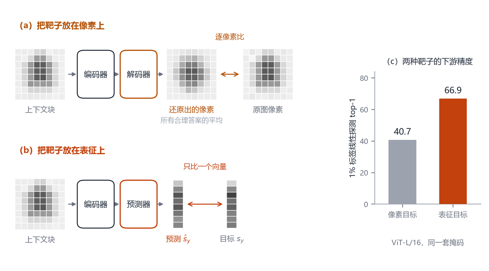

# 第 5 章　在表征空间里预测

一张厨房台面的照片，右下角被撕掉了。剩下的部分有灶台、有砧板、有半只碗，你大概能说出撕掉的那块里有什么，水槽、龙头，也许还有一块抹布；但如果要求你把那块画出来，画到每一颗水珠的位置都对，你做不到，换谁都做不到。补全一张图其实有上下两层：上层是语义，那里有一只碗、碗口朝上、旁边是水槽；下层是像素，那里有几百个具体的灰度值，每一个都对应某粒水珠、某道反光。人对下层几乎没有能力，对上层却相当可靠，看到半张脸就能立刻说出另一半有眼睛、有颧骨、有一道落在下颌上的阴影，却完全没法交代睫毛一根一根长在哪里。

这种不对称不是人的缺陷，而是问题本身的性质。语义是被大量样本反复确认过的，像素不是：同一只碗在几百万张照片里出现过，它的形状、姿态、和周围物体的关系高度一致，而碗沿上那道高光的精确形状，只在那一次快门、那一束光下成立。可预测的部分在语义层，不可预测的部分在像素层，这句话决定了本章所有设计取舍的来由。

2023 年初，Assran 等人在 Meta 的人工智能实验室提出了基于图像的联合嵌入预测架构，做法很干脆：既然像素层不可预测，那就根本不预测它，模型从一个上下文块出发，去预测同一张图里另外几个块的表征。这个想法听起来只是把靶子挪了个位置，实际影响却比它看起来大得多，因为一旦预测发生在表征空间里，模型要回答的问题就从“这里该是什么颜色”变成了“这里该有什么东西”。

## 5.1　把靶子挪到表征空间

先看另一条路上的做法。掩码自编码器遮住一张图的四分之三，只把剩下的四分之一送进编码器，再用一个轻量解码器把被遮住的部分还原成像素，这个目标简单、信号密集、扩展性好，微调之后精度很高。它的问题出在靶子上：给定左侧那片草地，被遮住的区域里草叶朝哪个方向倒，其实有无数种同样合理的答案，模型被迫用同一个输出覆盖所有这些可能，而平方误差下的最优解是它们的条件均值，均值是一根模糊的、没有方向的绿影。

损失曲线会很好看，因为模糊图与任何一张具体草图的平方距离都不算大，但模型为了这一点点下降，把大量容量花在了拟合不可约的噪声上。换个说法，你在教一个人画速写，却要求他每一笔都和原照片逐像素对齐，他学到的第一件事是别画细节，第二件事是把所有细节涂成灰色。

I-JEPA 的改法是把靶子换掉。目标不再是那块图里的像素，而是另一个网络看过那块图之后给出的向量，这个向量里草叶的朝向、瓷砖的接缝、云边的抖动早就被压掉了，留下的是能跨样本稳定的东西：这里有一片草地、它占了多大面积、明暗大概怎么分布。预测一个向量，等于预测一个已经替你做完抽象的目标。

损失函数因此只有一行。设 $\hat{s}_{y_j}$ 是预测器在位置 $j$ 上给出的向量，$s_{y_j}$ 是目标编码器在同一位置给出的向量，$B_i$ 是第 $i$ 个目标块覆盖的 patch 集合，那么损失等于四个目标块上所有位置的距离平方的平均值，写成 $\mathcal{L}=\frac{1}{M}\sum_{i=1}^{M}\sum_{j\in B_i}\lVert\hat{s}_{y_j}-s_{y_j}\rVert_2^2$，其中 $M$ 是目标块个数，默认取 4。整条式子的意思很直白，在四个目标块的范围内，把每一对向量的欧氏距离平方加起来求平均；模型从头到尾不需要输出一张图，没有解码器，也没有像素级的重建，一张 224 像素的图从来没有被还原过。

需要说清一件事，这里的“预测”不是预测未来。上下文块和目标块来自同一张图、同一次拍摄，它预测的是空间上的另一处，不是时间上的下一刻；把时间轴接进来是下一章的事，那时掩码会从二维的方块变成三维的立方体，而损失函数一个字都不用改。

## 5.2　三个网络

I-JEPA 里有三个网络，它们的参数更新方式各不相同，这一点是整台机器的关键，如图 5-1。

<figure class="fig">

<figcaption><b>图 5-1</b>　三个网络的分工。上下文编码器与预测器用橙色边框，梯度只沿这两个网络回传；目标编码器的权重由上下文编码器做指数滑动平均得到，损失对它是常数。</figcaption>
</figure>

上下文编码器是一个视觉 Transformer，它只处理上下文块里那些没被遮住的 patch，被挖掉的位置直接不送进去，连占位符都不给，这一点和掩码自编码器一样，是为了省算力；它不加类别 token，输出的是每个可见 patch 对应的一列向量。目标编码器架构完全相同，权重却不是学出来的：训练开始时它和上下文编码器一模一样，之后每走一步，参数按 $\bar\theta\leftarrow m\bar\theta+(1-m)\theta$ 往前挪一点，也就是把上下文编码器的新参数掺进来一小部分，$m$ 是动量，初始取 0.996，训练过程中线性升到 1.0。整个训练过程里，它始终是上下文编码器的一个慢半拍的影子。

为什么要一个影子，前面的章节已经给过答案，这里只说结论：如果两边完全同步，让两个网络一起输出同一个常数就是零损失的全局最优解，塌缩立刻发生；慢半拍之后，靶子在一步之内几乎不动，模型没法靠挪动靶子来降低损失，只能真的去追。这个机制不完美，但对基于 Transformer 的联合嵌入训练来说是必需的，第 8 章的 BYOL 用的是同一招。

预测器是第三个网络，也是唯一一个在结构上被刻意做窄的。它的嵌入维度固定为 384 维，而主干 ViT-L 是 1024 维；深度随主干变化，ViT-B 用 6 层，ViT-L 和 ViT-H 用 12 层，ViT-G 用 16 层。窄是有意的设计，把预测器放宽到和主干一样宽，下游指标反而下降，因为一个 384 维的瓶颈会逼着它只搬运语义，不许夹带主干里的冗余信息。预测器还需要知道该预测哪一块，因此每个待预测的 patch 都配一个位置 token，它是一个所有位置共享的可学习向量加上该 patch 的位置编码，要预测四个块就跑四遍，每一遍只喂进那一块的位置 token。

三个网络的分工可以用一句话概括：两个编码器回答“这块图是什么”，预测器回答“从这边的表征出发，那边的表征应该长什么样”。前一件事是感知，后一件事已经是推理的雏形，只不过推理的步子只有一步，跨度只有一张图。

## 5.3　一次迭代里发生了什么

把上面几段拼起来，一次训练迭代的流程可以按顺序走一遍。这张清单值得记住，因为后面所有的变体，包括讲视频的那些，都是在同一个骨架上换零件。

第一步，取一个批次的图，默认 2048 张，对每张图独立采样上下文掩码和四个目标掩码。第二步，把整张图送进目标编码器，得到 256 个 patch 向量，按四个目标块的位置取出对应的四组向量，这就是靶子；这一步不记录梯度。第三步，把上下文块里可见的那些 patch 送进上下文编码器，得到一组向量。第四步，把这组向量和某一组位置 token 一起送进预测器，输出那一块各位置的预测，四个块重复四遍。第五步，只在目标块覆盖的位置上算 L2，按上面的式子对四块求平均。第六步反向传播，梯度进入预测器，进入上下文编码器，到此为止，然后用上下文编码器的新参数按动量公式更新目标编码器，最后用优化器更新上下文编码器和预测器。

第六步和第七步要分清。目标编码器不是“不学习”，它的参数每一步都在变，变得还挺快；它只是不从梯度学习，损失函数对靶子的导数被丢掉了，这一侧的参数更新完全由动量公式决定，所以图 5-1 里那条靶子的箭头是虚线，旁边画了一个停梯度的符号。

目标编码器为什么用滑动平均而不是直接复制一份冻结的参数，这里值得多说一句。完全冻结的靶子在一开始就固定了，模型只要学会去拟合这个固定的随机表征就能让损失降下去，而这份随机表征和图像内容没有关系，学它等于学噪声；完全同步的靶子又会跟着在线网络一起动，两边可以合谋塌缩。滑动平均落在两者之间，它每一步都在变，但变得比在线网络慢，于是靶子既有语义又不会跑掉，这个中间位置是动量系数在控制的。

还有一个细节容易搞混：因为动量最终升到 1.0，训练末尾目标编码器和上下文编码器几乎没有差别。那为什么还要两个网络？因为差别不需要一直存在，只需要在训练过程中存在，正是这段不同步让模型没法靠“两边一起塌”来偷懒；评估的时候用的是目标编码器，把它的输出做平均池化当作整图表示。

## 5.4　为什么靶子必须是一个向量

到这里可以正面回答那个问题：为什么非得在表征空间里预测，把靶子换成像素就不行吗。理由有三条，彼此不重复。

第一条关于噪声。像素里有大量不可约的随机性，草的朝向、布料的褶皱、树影的边缘，给定上下文之后它们仍然有无数种合理取值，用它们当靶子等于要求模型去拟合一份本质上无法预测的东西，而平方误差会给出一张所有可能性的平均图。第二条关于靶子会动。目标编码器每一步都在更新，同一个目标块在不同时刻给出的向量并不相同，模型没法靠死记“这块区域的平均颜色”过关，因为靶子本身在往语义更清晰的方向漂移，一个会动的靶子天然抑制捷径。

第三条关于目标的形式会塑造模型的形式。要预测一个 384 维的向量，而这个向量里编码的是“这里有一只鸟的背，朝向左侧”，模型就必须在内部表示物体、部件和姿态；要预测 196 个像素值，模型只需要表示颜色和边缘。你要求什么，就得到什么，这条规律在第六章讨论掩码形状时还会再出现一次。

实验上的对照非常干净。同样用 ViT-L/16，同样用多块掩码，只把损失挪到像素空间，1% 标签下的线性探测从 66.9 掉到 40.7，而且要注意一个不对称：表征目标那一组只训了 500 轮，像素目标那一组训了 800 轮，多训 300 轮还低 26 个点，差距不是训练不足造成的。

<figure class="fig">

<figcaption><b>图 5-2</b>　同一个任务的两种靶子。像素空间要还原具体数值，表征空间只比一个向量；右侧是 1% 标签下的线性探测，像素目标那组多训了 300 轮，仍然低二十六个点。</figcaption>
</figure>

论文还给了一个直观的证据。把训练好的预测器冻结，用一个额外的解码器把它的输出映射回像素，同一条输入采样多次，不同采样之间保持不变的部分就是预测器的输出里真正包含的信息，通常是物体的高层面貌，比如鸟的背、车的顶部，姿态还对；而每次都不一样的地方是纹理、背景、精确边界。预测器确实在说“这里有个朝左的鸟背”，也确实没有在说“这里有三根羽毛”。

## 5.5　掩码的形状决定学到什么

损失函数只有一行，掩码的规则却有一堆数，这些数不是随手定的，论文把每一个都单独拨动过。下面所有数字都来自 ViT-B 训练 300 轮、ImageNet 1% 标签线性探测的同一套设置，可以直接横向比较。用 1% 标签而不是全量标签，是因为全量训练时不同设置之间的差距会被更多的数据抹平，反倒看不出掩码策略的优劣，这一点在评测小模型时尤其明显。

目标块的大小最敏感，呈现出一条倒 U 形曲线。把块的下界从 0.075 往上挪，指标从 19.2 跳到 39.2，再到 42.4，到 0.15 时达到 54.2；继续放大就往下掉，0.2 到 0.25 是 38.9，0.2 到 0.3 是 33.6。左边这一段说的是块太小就没有语义，靶子里只有纹理，模型学到的也是纹理；右边这一段说的是上下文被挖得太狠，剩下的 patch 不足以推断任何东西；中间那个 0.15 到 0.2 的窗口，恰好是“块里有完整物体、上下文还够用”的位置。

上下文的大小没有拐点，单调上升，面积下限取 0.40 时只有 31.2，0.65 时 47.1，0.75 时 49.3，0.85 时 54.2，上下文越完整任务越可解，这条曲线没什么意外。目标块的个数则出现了一个陡坡，只采 1 块时指标是 9.0，几乎没学到东西，2 块 22.0，3 块 48.5，4 块 54.2；一块的时候任务退化成“从一个位置推到另一个位置”，模型可以靠局部插值蒙混过关，多块之后同一批上下文要同时对应好几个不同位置的靶子，预测器必须理解“我叫你预测哪里”，而不只是“往右平移一点”，位置的不确定性就是这样被逼出来的。

<figure class="fig">

<figcaption><b>图 5-3</b>　多块掩码。四个目标块各占全图一成半到两成，长宽比在 0.75 到 1.5 之间；上下文是一个 15×15 的大块，挖去目标区之后只剩蓝色那条带子。</figcaption>
</figure>

掩码的整体形状也被换过。多块策略拿到 54.2，把图切成四个象限、用一个象限预测另外三个只有 15.5，用一个占 60% 的大块预测其余部分是 20.2，随机遮住 60% 的 patch 是 17.6，三种替代方案的共同点是靶子要么太大而缺乏结构，要么太散而没有语义，多块策略是唯一同时满足“块够大”和“位置分散”的。

把这一串数字放在一起看，会发现这套方法真正精巧的地方不在损失函数，损失函数就是一行 L2；精巧的地方在于用掩码的形状去规定靶子的语义层级。块多大、挖多狠、挖几处，这三个旋钮直接决定了模型学到的表示处在语义阶梯的哪一级，而它们没有解析解，只能靠消融一格一格试出来。

## 5.6　这套配方换来了什么

ImageNet-1k 线性探测是这类方法最常用的考场，冻结编码器，只在特征上训一层线性分类器。I-JEPA 的 ViT-H/14 训练 300 轮得 79.3，把输入提到 448 分辨率、换成 patch 边长 16 的版本，同样 300 轮得 81.1；ViT-L/16 训练 600 轮得 77.5，ViT-B/16 训练 600 轮得 72.9。

对照组的轮数普遍长得多。掩码自编码器的 ViT-H/14 训 1600 轮得 77.2，data2vec 的 ViT-L/16 训 1600 轮得 77.3，CAE 的 ViT-L/16 训 1600 轮得 78.1，同是 H/14，I-JEPA 只训 300 轮就比掩码自编码器高两个点；小一号的 ViT-L/16 训 600 轮得 77.5，也已经贴住了训 1600 轮的 CAE。这几个模型里，只有 I-JEPA 在预训练阶段完全不用手工数据增强，这一点在后面的章节会被反复提起。

读这些数字要注意协议。线性探测冻结了整个编码器，只训练最后一层，测的是“表征里有没有可以直接读出来的类别信息”，它给出的是下界而不是上限；如果放开微调，同一个编码器通常还能再涨几个点，但那时的分数里混进了任务数据的影响，就不再是纯粹的预训练质量。论文之所以把轮数标得那么清楚，是因为线性探测对训练长度很敏感，训 300 轮和训 1600 轮的模型放在一起比，本身就不公平，所以同一张表里 I-JEPA 的那几行都是短轮数，对照组都是长轮数，差距是在对 I-JEPA 不利的前提下测出来的。

迁移到别的数据集上，优势更明显。同一个 ViT-H/14 的线性探针，在 CIFAR100 上 87.5，在 Places205 上 58.4，在 iNaturalist18 上 47.6，后两个数字分别比掩码自编码器高出三个点和将近十五个点。语义层级高的表征在细粒度分类上更占便宜，这一点不奇怪，因为细粒度分类要区分的正是部件和姿态，而不是颜色和纹理。

代价也要说清。目标编码器带来的那次额外前向是实打实的开销，单步慢约 7%，看着不多，放在几万 GPU 小时的规模上就不是小数；不过它的收敛快得多，大约只需要五分之一的迭代次数就能达到同等水平，一慢一快抵下来是净省，一个 ViT-H/14 在 ImageNet 上训练 300 轮，用 16 块 A100 不到 72 小时。这套方法还依赖一批手工设定的超参，目标块的大小窗口、上下文的比例、块的个数，都是人在 224 分辨率、ImageNet 这种数据分布上试出来的，换一个分辨率、换一种图像统计，这些数未必还能用。

## 5.7　它缺什么

更根本的局限在正样本的构造上。上下文块和目标块来自同一张图、同一次拍摄、同一束光，模型被要求的是在这张图内部保持一致，而不是在世界面前保持一致；同一只杯子从侧面看和从上方看，在这套目标里根本不构成一对需要被拉近的样本。它对视角、光照、遮挡的稳健性，训练目标没有给出任何保证，只能指望数据量和模型容量去兜。

按后面第 8 章的定义，上下文块和目标块是一对坏视图，它们不是同一个世界的两次观测，而是同一次观测的两次损坏，共享同一个视角、同一束光、同一套成像条件。这个缺口不是 I-JEPA 的疏忽，而是图像这个模态的天花板：一张静态图里只有一次观测，想要第二次观测只能人造，而人造的观测就是第 3 章批评过的那种手工增强。

图像侧还有一处细节值得注意，就是分辨率与块大小的耦合。224 分辨率下 14 像素一个 patch，切成 16×16 共 256 块，目标块取 15% 到 20% 时覆盖的是一组完整的物体；换到 448 分辨率，同样的 14 像素 patch 变成 32×32 共 1024 块，如果还按 15% 取，块大了一倍，覆盖的可能是两个物体加一段背景，语义反而变糊。论文里那个 81.1 的版本正是把分辨率提到 448 之后重新选了块大小的结果，这也说明掩码参数不是可以跨分辨率照抄的常数。

视频不一样。同一段视频里相邻的两帧，天然就是同一个世界的两次观测，光照在变、视角在动、物体在移动，这些变化不需要谁来设计。把掩码从二维的方块搬到三维的立方体，把“同一张图的另一块”换成“同一段视频的另一时刻”，损失函数一个字都不用改，下一章就做这件事。
