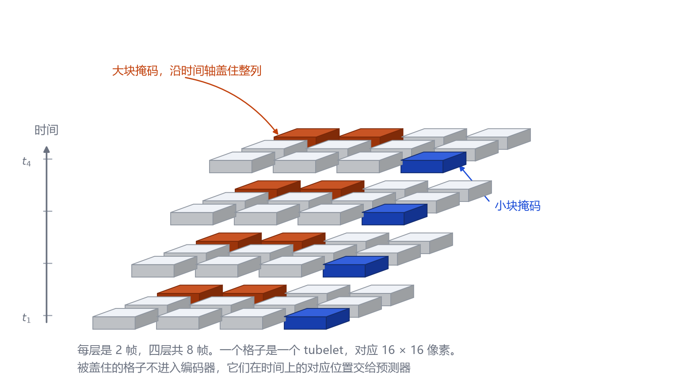
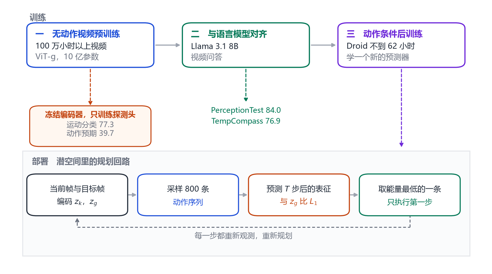

# 第 6 章　从图像到视频

用手机拍一段十秒钟的视频，画面里有人把桌上的杯子端起来。按下暂停，第一帧是静止的照片，杯子和手都停在原处；拖到末尾，杯子已经握在手里。单独看任何一帧，你能说出画面上有什么东西、它们在哪里，却说不出发生过什么。把两帧按顺序放在一起，中间那一层东西才浮出来，手先靠近，杯子离开桌面，然后停在半空。视频比图像多给的就是这一样东西，这一章要讲的，是怎么把它变成可以训练的信号。

上一章的 I-JEPA 只看一张图。它把图切成小块，遮住其中几块，让上下文编码器算出可见部分的表征，再让预测器去猜被遮那几块的表征，靶子由动量编码器给出。这套做法里少了一样东西，就是时间。图片给出的是一个瞬间，模型只能学到这里有什么；视频给出连续的瞬间，模型才有机会学到什么在变、往哪个方向变。把掩码从平面挪到时空里，实际要处理的麻烦是新的。

麻烦出在冗余上。一秒三十帧，相邻两帧的差异经常只有几个像素，模型只要把前一帧的特征抄过来，就能在被遮的位置上交出一份几乎正确的答案，损失降下去了，关于运动的东西一点没学到。图片上的掩码没有这个问题，因为一张图里没有上一帧可抄。视频模型必须先把这条捷径堵死，才谈得上从视频里学到东西。

这一章沿着 V-JEPA 到 V-JEPA 2 的路线走，中间要拆开一个特别容易混的地方。冻结编码器做评估，和冻结编码器做动作条件后训练，两件事都叫冻住主干、在上面接一个新网络，目的却相反。前者是拿尺子量表征，后者是造发动机，把表征变成能预测未来的东西。把这两件事当成一件，会推出很荒谬的结论，比如觉得既然冻结的编码器已经够用，后面那些功夫就白花了。

## 6.1　多出来的一维

一个彩色视频片段在程序里是一个四维数组，通常写成 $T \times H \times W \times 3$，其中 $T$ 是帧数，$H$ 和 $W$ 是画面的高和宽，3 是红绿蓝三个通道。这个数组里的信息可以粗分成两类：一类单帧就有，颜色、纹理、物体在画面上的位置；另一类只在时间方向上存在，它不在任何一帧里，而在帧与帧的关系里。前一类决定画面像不像，后一类决定画面接下来会怎样。拿掉时间维，后一类信息会整个消失。

顺序是最容易被低估的一条。同一段视频里截两帧，一帧杯子在桌上，一帧杯子在人手里，两张图的内容差不多，差别只在谁先谁后。把顺序倒过来放，同一个动作就从拿起来变成了放下，语义跟着翻转，而画面一个像素都没变。像素本身没有先后，先后来自你怎么读这个数组，所以时间这一维不是多存了一些数字，而是给这些数字排了一个不可交换的次序。

遮挡是第二条。一个东西被另一个挡住，在那一帧里它等于不存在，单帧模型没有办法把它补回来，因为它手上没有证据。多看几帧，被挡的东西从左边进去、从右边出来，你就能推断中间有个东西在移动。桌沿下露出一条尾巴，照片里那只是一条尾巴，可视频里尾巴摆了摆，桌子下面就有一只猫。这类证据只在时间方向上存在，图像的训练根本没有机会见到。

视频对自监督学习还有一个更实际的用处。I-JEPA 的正样本来自同一张图的两个掩码块，这一对视图共享了太多低级统计量，光照、相机、纹理都一样，模型很容易靠这些表面线索把两块对上，而不是靠语义。视频天然提供另一种配对，同一场景在不同时刻的观测，光照在变，视角在轻微移动，有东西在动，但场景的语义没变。这种看起来不一样、指的却是同一件事的样本，恰好是自监督最想要的难度。

## 6.2　时空管与贯穿时间轴的掩码

把图片切成小块的做法搬到视频里，块就变成了立方体。ViT 处理图像时把 $16 \times 16$ 像素的区域拉成一个词元，V-JEPA 在这两个空间维之外再加一个时间维，取连续 2 帧、每帧 $16 \times 16$ 像素，合成一个 $2 \times 16 \times 16$ 的立方体。这种东西叫时空管，英文写作 spatio-temporal tubelet，下文就写 tubelet。一个 tubelet 是模型处理的最小单位，它同时带着一点空间信息和一点时间信息，后面所有的掩码都是在它这一层做的。

数量可以算出来。一段 16 帧、$224 \times 224$ 分辨率的片段，按 2 帧一管、空间步长 16 像素切下去，时间方向得到 8 段，每个空间方向得到 14 段，总共 $8 \times 14 \times 14 = 1568$ 个词元。同样分辨率的单张图只有 196 个词元，词元数差八倍，而注意力要在每两个词元之间算一次相关，矩阵规模差的是六十多倍。这是视频模型比图像模型贵的直接原因，也是同样一块 GPU 能看的样本少得多的原因。

掩码在时空里做，形状和 I-JEPA 不一样。V-JEPA 用了两种掩码，短程掩码取 8 个随机块的并集，每块覆盖单帧面积的 15%，长程掩码取 2 个随机块的并集，每块覆盖 70%。两种情况下每个块的长宽比都在 0.75 到 1.5 之间随机取，块是多个叠起来取并集的，两种掩码平均下来都遮掉约 90% 的位置。遮得这么狠不是为了难为模型，而是因为视频里可抄的东西太多，遮少了任务就退化成复制。

真正起作用的细节是每个块都沿整个时间维延伸，而不是只遮某一帧的某个位置。假设只遮第 5 帧的左上角，模型可以去看第 4 帧和第 6 帧的同一位置，那里的内容和第 5 帧几乎一样，抄过去就完事了。把同一块在时间轴上从头盖到尾，模型手上只剩周围区域和其他时间段，它必须靠这里原本有什么、它可能怎么动来推断。视频的空间冗余和时间冗余，在这个设计里从帮手变成了必须绕开的陷阱。

每个片段还会采样两份掩码，一份短程一份长程，两份共用一个目标编码器的输出，一次前向算两个预测任务，靶子只算一遍。两份合起来也比只采一份好，几个小块拼出来的洞比一个整块好。位置编码也换了一茬，V-JEPA 2 把绝对的正弦编码换成三维的旋转位置编码，特征维切成三段，分别按时间、高、宽三个轴旋转。好处在放大时显出来，输入从 16 帧变成 64 帧，绝对编码得重学一套表，旋转编码只要外推。

如图 6-1，四层小方块沿时间轴排开，每层是两帧叠成的一段画面，切成 4 乘 3 的网格，标红的两格和标蓝的一格在每一层都被遮掉。模型看到的是每层剩下的格子，要补的是同一位置在四个时间点上的表征，周围也没有可以借的格子。这张图想说明的只有一件事：被遮的位置在时间上是连着的。模型抄不到相邻帧的邻居。

<figure class="fig">

<figcaption><b>图 6-1</b>　时空 tubelet 与多块掩码。每层代表两帧，一个格子是一个 $2 \times 16 \times 16$ 的立方体；被遮的格子在四层里位置相同，所以模型没法从相邻帧抄到答案。</figcaption>
</figure>

## 6.3　预测表征而不是画像素

V-JEPA 的预测目标和 I-JEPA 一样，是被遮位置的表征，不是像素。损失用 L1，也就是把预测向量和靶子向量的每一维差值取绝对值再求和，靶子由动量编码器给出，梯度只进上下文编码器和预测器。这套安排和图像上的 JEPA 没有区别，靶子同样是一串向量。搬到视频上之后理由却更硬，因为视频里不可预测的成分比图片里多得多。

一段风吹树叶的视频就是例子。每一片叶子的位置都由风速、叶柄的弹性、上一刻的姿态共同决定，初始条件上一点微小差别，几帧之后就放大成完全不同的画面。要求模型预测这些像素，等于让它拟合一个看不到输入的随机过程，它能做的只有输出一片模糊的平均。到了表征空间，这些细节早被编码器压掉了，剩下的有一片树在动、动的方向大致朝右是可以预测的。

从容量上看，两种目标的差别也很直白。像素目标要求每个词元还原成几百个像素值，模型必须把容量花在纹理、光照、噪点上；表征目标只要求还原一个向量，容量花在语义上。同样一块 GPU 的时间，后者能看完更多视频，等价于在同样的预算下见到更多数据。论文的对比支持这一点，同样的架构下 V-JEPA 在冻结评估上超过几个像素重建的基线，看过的样本还更少。

具体结果是这样。最大的模型是 ViT-H/16，输入 384 分辨率，只在视频上训练，预训练数据约 200 万段，冻结主干加一个注意力探测头，Kinetics-400 上 81.9，Something-Something v2 上 72.2，ImageNet 上 77.9。ImageNet 那一项有点意外，因为这个模型从没见过静止图片的标注，全部视觉经验都来自视频，却能在图像分类上打到和图像自监督方法接近的水平。论文把它当成证据，从视频里学到的表征本身就包含外观信息。

Something-Something v2 值得单独说一句，因为它的分数比 Kinetics 更能说明问题。它的视频里，人对着镜头做把某个东西从左移到右、假装把东西扔出去这类动作，标签描述的是动作本身，和物体、场景的外观没有关系。只靠静态特征几乎做不对，一个只会认物体的模型在这里拿不到高分。V-JEPA 在这个基准上的表现说明它学到的东西里有运动，不只有物体，而且结论来自冻结评估。

## 6.4　冻结主干在测什么

冻结主干的意思是编码器的权重一个都不更新。在它上面接一个很小的网络，叫注意力探测头，英文是 attentive probe，结构是几层 Transformer，最上面一层用交叉注意力把编码器输出的一串词元池化成一个向量，再接一个线性分类器。V-JEPA 2 里这个探测头是 4 层，训练时只用目标任务自己的数据，编码器一动不动。整个协议里唯一在学的东西就是探测头，它的参数量相对主干可以忽略。

这个协议测的是表征里有没有某个信息。编码器像一个已经把世界读进脑子的人，探测头是一张答题卡和一支笔，不允许他重新学习，只允许他把已经知道的东西写到卡上。分数高，说明信息在表征里，而且排布得足够规整，几层注意力加一个线性层就能取出来；分数低有两种可能，信息根本不在，或者信息在但排布得太绕。两种失败的处理方式不同，看分数时要配合别的实验判断。

那为什么不用微调。微调能让编码器为任务改变自己，分数通常更高，但那时你测的是这套初始化加上这个任务一起能学到什么，不再是预训练本身带来了什么。论文把这件事说得很直白，冻结编码器给出的是更干净的信号，微调给出更好的最终性能。记住这一层区别，后面的动作条件后训练和它长得很像，也冻结编码器，区别在于那里训出来的预测器是产品本身，不是量具。

## 6.5　一百万小时之后

V-JEPA 给出了方向，V-JEPA 2 把这条路放大。数据从 200 万段涨到 2200 万段，总时长超过 100 万小时；模型从 3 亿参数的 ViT-L 涨到 10 亿参数的 ViT-g；训练迭代从 9 万步涨到 25.2 万步；输入从 16 帧、256 分辨率，涨到 64 帧、384 分辨率。四项里最贵的是分辨率那一项，因为长片段和高分辨率的开销不是线性涨的。帧数翻四倍、边长翻一倍半，每个片段的计算量涨了一个数量级还多。

工程上的解法叫渐进分辨率训练。25.2 万步里的大部分用 16 帧、256 分辨率跑，收尾的 1.2 万步才切到 64 帧、384 分辨率，让模型在退火阶段适应新的输入尺寸。原因是高分辨率长片段在前向和反向上的开销按平方增长，全程都用它跑，预算撑不住；只在收尾阶段用，模型又已经定型，适应不了。论文报告这个安排把达到同等输入的训练时间省了 8.4 倍。

放大之后的数字。Something-Something v2 上 77.3，比 V-JEPA 的 72.2 高 5.1 个点，这个分数来自 ViT-g 在 384 分辨率下的冻结评估，头上接的还是那个 4 层探测头。也就是说表征本身变强了，不是靠任务数据补贴出来的。同一张表里，V-JEPA 2 在运动理解类任务上普遍领先，在外观类任务上和最好的图像编码器基本持平，这个分布很符合它的训练来源，它见过的东西全是会动的。

另一个数字更能说明预测这件事。Epic-Kitchens-100 上有个动作预期任务，给一段做菜视频的前若干秒，要求在动作真正发生之前说出下一个动作是什么，指标是 recall-at-5，也就是正确答案落在前五个候选里的比例。V-JEPA 2 拿到 39.7，论文说这比之前最好的任务专用模型相对高出 44%。同一个表征既能判断已经发生的动作，又能猜还没发生的动作，说明它抓住的不只是现在画面里有什么，还有这个场面接下来会往哪走。

## 6.6　接上语言

在讲动作之前，先补一个分支。V-JEPA 2 除了能分类、能做预期，还能回答关于视频的自然语言问题，做法借自 LLaVA 那一类多模态模型。视觉编码器输出一串词元，用一个多层感知机把它们投影到语言模型的输入空间，这一步不做池化，剩下的部分交给语言模型，384 分辨率下每一帧产生 288 个视觉词元。语言模型取 Llama 3.1 的 8B 版本。

训练分三阶段。第一阶段只训投影层，用图像描述数据，让视觉词元和词的对应关系先建立起来，主干都不动；第二阶段用图文描述加图像问答，把语言模型也放开；第三阶段换到视频描述和视频问答，让模型学会处理时间上的变化。三个阶段的数据量逐级变大，用来对齐的图文和视频文本对达到 8850 万条。这个顺序和教人看图类似，先认东西，再答问题，之后才看一段过程。

结果在 8B 这一档里是最好的。PerceptionTest 上 84.0，TempCompass 上 76.9，这两个基准考的是视频里的时序推理和物理常识，不是简单的物体识别。分数之外更值得说的是次序，在此之前流行一个判断，视觉编码器必须先和文本做过对比学习，才能接进语言模型。V-JEPA 2 的编码器在预训练阶段完全没见过文字，接一个投影层之后照样工作得很好。

可以这样理解这件事。语言对齐需要的是表征里有没有可以命名的概念，而不是表征是不是用文本训出来的。一个从视频里长出来的表征，如果它已经把杯子、拿起、倾斜这些区分开了，投影层要做的只是给它们配上词；反过来，如果表征里只有纹理和颜色，配多少词也没用。这条分支到此为止，它给模型装上了嘴，没给它装上手。

## 6.7　学一个带动作的预测器

回到动作。到这一步，模型能表征、能预测、能答问，但它对“我做一个动作，世界会怎样”没有概念。预训练时它看到的洞都是随机挖的，它学到的是这一段画面被遮住了、补上它，从来没有把某一帧的表征和导致这一帧的那个动作配过对。视频里有人拿起杯子，模型学到的是这个动作通常怎么演，不是机械臂推一下杯子会滑多远，前者只需要画面，后者需要动作和画面的对应记录。

V-JEPA 2 的后训练补这一环。编码器继续冻结，只训练一个新的预测器，约 3 亿参数、24 层、16 个注意力头，注意力是块因果的，某个时刻的每个词元只能看当前时刻和之前的动作、状态、画面。输入是三样东西按时间交错排成的序列，每一帧的表征、末端执行器的状态、相邻两帧之间状态的变化量。第三样就是动作，对一台 7 自由度的 Franka 机械臂，这个向量是 7 维，前三维是位置增量，中间三维是姿态的欧拉角增量，第七维是夹爪的开合。

训练数据是 Droid 数据集里的机器人操作视频。不到 62 小时，约 2.3 万条轨迹，每条三五秒，4 帧每秒，256 分辨率，一台固定机位的相机拍桌面上的机械臂。没有奖励，没有任务名，没有成功标记，只有原始视频和末端状态，这是自监督，不是强化学习。损失有两项，一项是逐帧的教师强制，用真值喂进去预测下一帧的表征；另一项是两步的 rollout，把预测器自己的输出喂回去再预测一步，两项都要对。

然后就到规划。给定当前观测的画面和一张目标画面，两张都过编码器，分别得到当前状态 $z_k$ 和目标状态 $z_g$。规划要找的是一条动作序列，让模型想象出来的终点尽量靠近 $z_g$。把这件事写成能量，就是

$$
E(\hat a_{1:T}; z_k, s_k, z_g) = \lVert P(\hat a_{1:T}; s_k, z_k) - z_g \rVert_1 ,
$$

其中 $\hat a_{1:T}$ 是待求的动作序列，$P$ 是动作条件预测器的完整前向，$s_k$ 是当前末端状态，$T$ 是规划时域，$\lVert \cdot \rVert_1$ 是逐元素的绝对值和。能量衡量的是，按这条动作序列走 $T$ 步之后，模型想象出来的状态离目标状态有多远。求最小值用交叉熵方法，每一步从高斯分布里采 800 条动作序列，取能量最低的 10 条去更新分布的均值和方差。这个过程重复 10 轮，返回均值。

拿到序列之后只执行第一个动作，然后重新观测、重新规划，这套做法叫滚动时域控制。时域取 1 就够用，因为抓取、伸向物体这类任务本身是贪心的，走一步看一步不吃亏。速度上的差距很大，在单张 RTX 4090 上，V-JEPA 2 每算一个动作要 16 秒，拿来对比的视频生成式世界模型每步要 4 分钟。原因不难想，像素生成要在几十个去噪步里画出整幅画面，表征预测只推一串向量。三段训练和这个回路放在一起，如图 6-2。

<figure class="fig">

<figcaption><b>图 6-2</b>　V-JEPA 2 的三段训练与部署时的规划回路。第一段旁接出冻结评估支路，第二段引出视频问答成绩，第三段的新预测器进入下方的回路，每走一步都重新观测。</figcaption>
</figure>

成功率按 10 次试验统计，两个实验室各测一遍，再把两边平均起来。伸向目标 100%，抓住杯子 65%、抓住盒子 25%，带着物体伸过去 75%，抓取放置杯子 80%、盒子 65%。两台机械臂所在的实验室都没有采过任何数据，任务也没有专门训练过，目标只是一张照片。数字里也有不好看的地方，盒子比杯子难抓，因为盒子的边缘和角让接触变得复杂，抓住了也不容易保持。

失败集中在接触丰富的那一段，也就是手指和物体表面真正发生力交换的地方，而预测器看到的只是接触前后的画面变化，力本身不在输入里。论文自己列了三条限制，相机位置敏感，机械臂基座经常不在画面里，动作坐标系就变得没有定义。长时程也靠不住，自回归的误差会累积，搜索空间又随时域指数增长。目标只能是图片，要说把杯子放到盘子上，得先拍一张那样的照片。

从图像到视频，模型多了一维；从视频到动作，模型多了一个输入。两次扩展用的是同一副骨架，编码器把观测压成表征，预测器在表征里往前推，代价是多出来的那一维和那一个输入都要用数据填。有意思的是两次扩展的规模完全不对称，第一层用了一百万小时的互联网视频，第二层只用了不到 62 小时的机器人数据。前者教它世界长什么样，后者只教它动作怎么改变世界。

这条路线走到这里，还差一步才配得上世界模型这个词。它能在表征空间里推演，但推演的质量取决于编码器当初压掉了什么，压掉的部分里可能有规划真正需要的信息。它能在新环境里零样本完成任务，但每个动作要算 16 秒，一条完整的抓取放置几十个动作，加起来就是几分钟。更要紧的是它没有奖励、没有任务名，也没有失败的原因，目标一律以图片形式给出。

第 7 章换一个角度看这件事。同样叫世界模型，有人坚持要把像素画出来，理由是只有画出来才能被人检查，才能被当成环境来训练策略；也有人认为画像素是浪费，因为决策需要的从来不是一张图。两条路线在什么算理解这个问题上给出的答案不同。分岔点恰好是这一章反复出现的那个选择，预测发生在像素上，还是发生在表征上。
