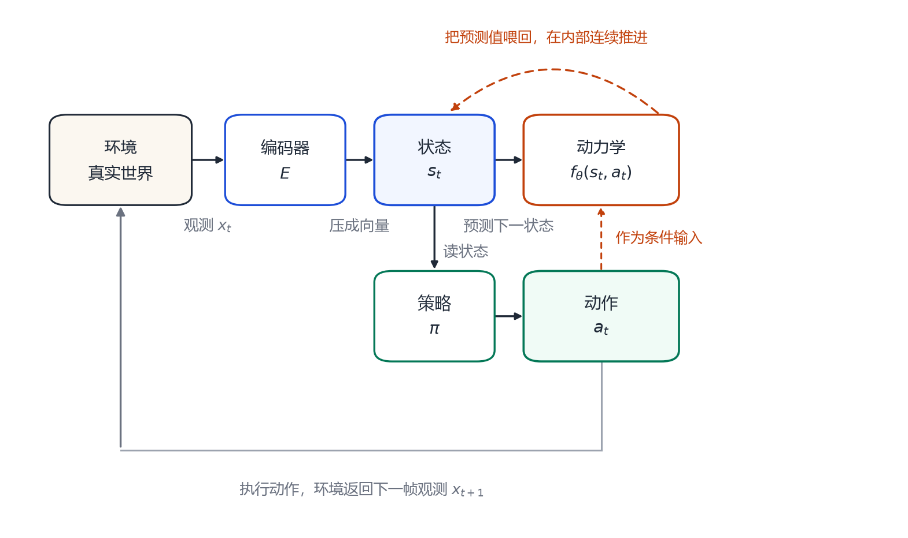
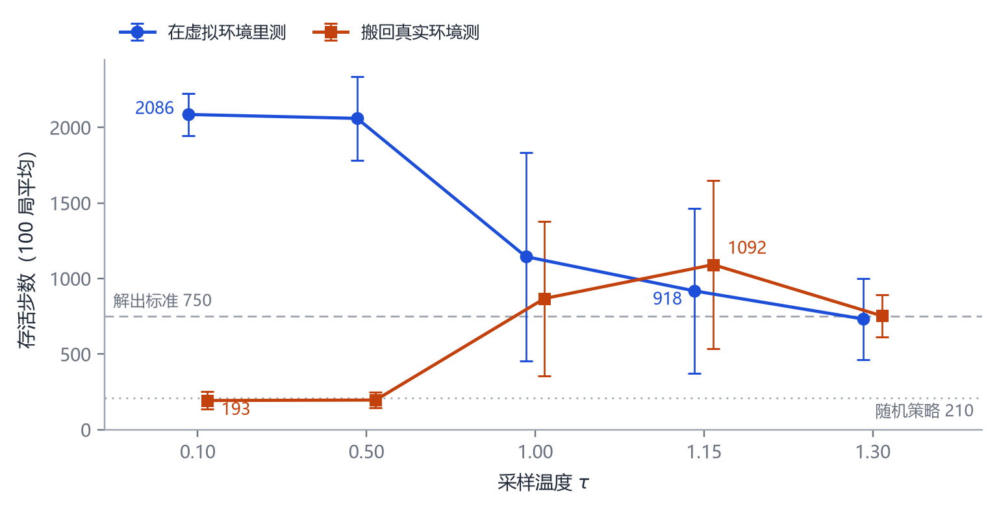
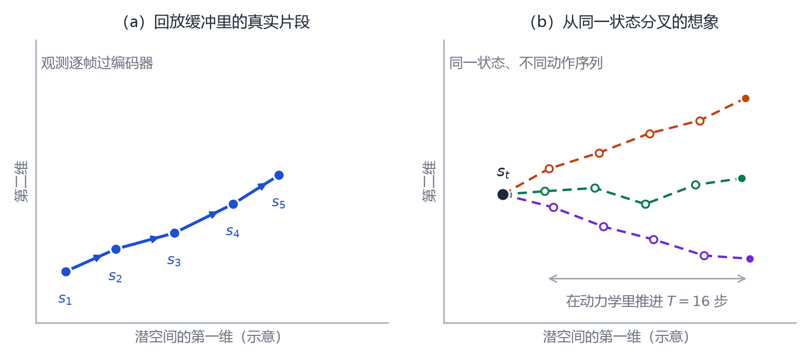

# 第 7 章　世界模型是什么

入冬后的第一个早上，桥面结了一层薄冰，你骑到桥中间，后轮轻轻一滑，人晃了一下。还没等你判断出发生了什么，肩膀已经往下压，车把已经往滑动的那一侧回，车身稳住了。事后你大概说不清自己做了什么，但在车轮打滑的那几十毫秒里，身体已经把往左倒、往右倒、扶正这三种结局各演了一遍，然后选了代价最小的那一个。这种预演每天都在发生，木匠下锯之前会想板子往哪边翘，厨师翻锅之前知道蛋会落进锅里的哪个位置。篮球运动员出手的瞬间已经算好了打板的角度，他们都没有真的试一遍，而是在心里的某个模型里试了一遍。

要让机器也有这个习惯，需要两样东西。一样是能把“现在”压成一段可计算描述的东西，另一样是知道“做了某个动作之后，这段描述会变成什么”的东西。两样合起来，研究者叫它世界模型（world model）。这个定义把工程上两件不同的事绑在了一起，一件叫表征，一件叫动力学，前者决定能看见什么，后者决定能预演多远。

上一章看到的那条路已经走到了门口。V-JEPA 2 在不到 62 小时的机器人视频上训练了一个带动作输入的预测器，让预测这件事第一次可以被动作询问。可它只交代了结果，没交代这套内部预演由哪些零件组成、能便宜到什么程度、在什么地方会骗人。这一章补的正是这三个问题，讲法要往回退一步，退到 2018 年那篇把三个网络拼起来、在一块 GPU 上不到一小时训完的论文。

## 7.1　把预演写成一条式子

把时间切成离散的刻度 $t=0,1,2,\dots$，每一刻有两个量。状态 $s_t$ 是这一刻世界的有用信息，写成一个实数向量，长度记作 $n$。动作 $a_t$ 是机器这一刻做的事，也是一个向量，长度记作 $m$。世界模型的骨架是一条转移函数，它拿这一刻的状态和动作，算出下一刻的状态。

$$
s_{t+1} = f_\theta(s_t, a_t),
$$

$f_\theta$ 是带参数 $\theta$ 的网络，参数就是一堆要学的数。这条式子和普通的预测模型只差一个输入，差别却很要命。视频预测模型看前面若干帧，回答接下来画面会是什么；世界模型多一个动作，回答如果我这样推会变成什么。前者只能看，后者可以被询问，由看变成问，模型才可能被放进一个决策回路里。

台球桌能说明这个区别。看一遍录像，你能猜出这杆球进不进；要练出一手好球，你需要的是另一种知识。往左偏三度会怎样，加一点右塞会怎样，这些都得亲自试过才知道。这种“如果……就……”的知识必须以动作为自变量，录像里只有已经发生的那一杆。地图也类似，它不复制每一棵树，只按比例尺挑出道路和等高线，回答从这里到那里要不要翻山。状态选错就像比例尺选错，模型只是一个昂贵的视频生成器。

第二个特征是它可以在内部连着用。把 $s_{t+1}$ 接回输入，再配一个动作，就得到两步之后的状态；重复 $k$ 次，得到一条完全想象的轨迹。全程不碰真实环境，只花几次矩阵乘法。真实环境的一步要等物理时间，可能磨坏一次机械臂，模型里的一步只是浮点运算。整个闭环如图 7-1。

<figure class="fig">

<figcaption><b>图 7-1</b>　世界模型的闭环。实线是真实回路，观测经编码器变成状态，状态经策略产生动作，动作作用于环境后变成新观测。橙色虚线是省下的那一段，预测的状态可以直接喂回动力学，在内部连续推进。</figcaption>
</figure>

图 7-1 里最值钱的是那条从动力学指回状态的橙色虚线。实线部分必须等世界回应才能走下一步，虚线绕过了世界，机器可以自己跟自己推演。所以关于世界模型的所有说法，归根到底都在讨论这条虚线有多可信。可信度的上限不在网络多大，而在那个被反复搬运的状态里装了什么。状态可以是一张图，可以是一个 32 维向量，也可以是另一个网络中间层的激活值，选什么当状态，等于选了什么该被建模、什么可以大方丢掉。

有了这个骨架，用途可以分成三种。在模型里试几条动作序列，按代价排序挑一条执行，这条用法叫作模型预测控制。把策略的更新放在想象出来的轨迹上，这叫在梦里训练，好处是样本便宜。前两种各有一个实验做证，第三种把隐状态当特征喂给别的模块，用途不同，代价也不同，要等到下一章。

## 7.2　三个可以分开训练的零件

2018 年，Ha 与 Schmidhuber 把这件事拆成三个可以分别训练的网络，叫视觉 V、记忆 M、控制器 C。拆开的理由很实际，三块的目标不一样，分开训更省事。论文提到端到端一起训原则上可行，实际分开更实用，训出一个能用的模型在一块 GPU 上不到一小时。一块卡、一个小时就能跑通整条回路，这件事比它的分数更值得记住。

视觉部分是一个变分自编码器（Variational Autoencoder，VAE）。编码器把一帧画面压成向量 $z$，解码器把 $z$ 还原成画面，目标是让还原结果接近原图。瓶颈卡在中间那个小向量上，想把误差压下去，就必须把画面里真正有结构的东西塞进这几个数。赛车任务里 $z$ 只有 32 维，画面缩到 64×64 后一帧有 12288 个数，压到 32 个，比例是 384 比 1。

留下来的是路面的弯向、车身边缘的位置、速度带来的明暗变化，丢掉的是柏油颗粒和仪表盘上的小字。这种丢法是有选择的，解码器会惩罚那些丢了就看不出原图的细节。这里已经埋下一个问题，对还原最要紧的地方，不一定是对开好车最要紧的地方。柏油质感在重建误差里占比不小，在打方向盘时却没有一点用处。

记忆部分是一个带混合密度输出的循环网络（Mixture Density Network RNN，MDN-RNN）。它学的不是下一个隐向量的取值，而是一个条件分布 $p(z_{t+1}\mid a_t,z_t,h_t)$，给定动作 $a_t$、隐向量 $z_t$ 和循环隐状态 $h_t$，下一个隐向量会落在哪里。输出是一组高斯的参数，采样时才落成一个具体的 $z_{t+1}$。环境本身有随机性，如果前方有两条都能走的路，点预测会把两条平均成一条现实中不存在的小路，在那种路上学出来的控制器全是错的。

控制器小得不成比例，只是一层线性映射 $a_t = W_c[z_t\,h_t] + b_c$。它把当前隐向量和循环隐状态拼成一个长向量，乘矩阵加偏置得到动作，$W_c$ 与 $b_c$ 是要学的参数。赛车任务里它只有 867 个参数，同一篇论文里三块模型分别是 4348547、422368 和 867。视觉那块比控制器大五千倍，这个比例说明看和记要花力气，做决定只要一层。

训练顺序是固定的。用随机策略采 10000 条轨迹，训练 V。用训好的 V 把每一帧换成隐向量，配上记录的动作训练 M。V 和 M 都冻结之后，用协方差矩阵自适应进化策略（CMA-ES）搜 C 那 867 个参数。真正要紧的是分工，世界模型从头到尾没见过一眼奖励，它只学画面怎么变，奖励只有控制器知道。

分工的效果可以直接从成绩里读出来。只把 $z_t$ 交给控制器，车开得歪歪扭扭，100 次试驾平均 632 分，标准差 251。加一层隐层涨到 788 分，还是不稳；把 $h_t$ 也一起给它，同一个线性控制器突然会切弯了，平均 906 分，标准差 21。论文把连续 100 局平均 900 分定为解出这个环境。906 分刚过线，21 的标准差说明它每次过得都比较稳。

三个数字说明的事情比分数重要。$z_t$ 是当下的一张快照，$h_t$ 是循环网络对未来的压缩。控制器拿到 $h_t$，等于拿到一份接下来大概会怎样的摘要，不用真的推演也能做出带预判的动作。一个只会对已发生的事做反应的前馈策略做不到这一点，这也解释了为什么从 632 跳到 906 那一步，比加隐层涨到 788 那一步大得多。

随机策略采数据在赛车和射击这类任务上够用，因为随机乱开也能覆盖大部分路面。任务一旦变复杂，有些房间只有先学会开门才进得去，随机策略永远采不到那些画面。论文第 5 节的办法是让训练迭代起来，边学边采，用当前策略去探模型陌生的地方。这个做法后来成了 Dreamer 系列的标准配置。

## 7.3　在梦里练车，醒来考试

第二个实验换了个更狠的场地。VizDoom 的 Take Cover 场景里，屏幕另一端的怪物不断扔火球，玩家要尽量活着。这个任务没有显式奖励，存活步数就是分数，单局上限 2100 步，大约 60 秒。连续 100 局平均活过 750 步算解决，这是一个谁都能复核的及格线。

这里 M 多了一项工作，除了预测 $z_{t+1}$，还要预测这一帧之后是否死亡，记作 $d_{t+1}$。有了这一位，M 就能被包装成一个完整的强化学习环境。研究者写了一个 Gym 接口套在 M 外面，智能体在里面训练，从头到尾没有一帧真实像素进入编码器。训练的代价从此和画面分辨率无关，只和隐空间的维度有关。

训练完把策略搬回真实游戏，虚拟环境里活了约 900 步，真实环境里约 1100 步，两个数都远超及格线。按理说梦里的分数该更高，因为模型只会往对自己有利的方向错。这里反过来，梦里反而更难，原因藏在采样的温度上。M 输出混合高斯的参数，落成一个 $z_{t+1}$ 时要过一个温度 $\tau$，$\tau$ 越大，采样越随机，梦里的火球就越没规律。

论文给了五档对照，每一档都在虚拟环境里训练、在真实环境里测 100 局，结果如图 7-2。$\tau = 0.1$ 时虚拟环境里拿到 2086 分，搬到真实环境只剩 193 分，比随机策略的 210 分还低。$\tau = 1.15$ 时虚拟分数掉到 918，真实分数升到 1092。当时 OpenAI Gym 榜单上这个场景的最好成绩是 820。

<figure class="fig">

<figcaption><b>图 7-2</b>　采样温度与存活步数。蓝色是在虚拟环境里测得的分数，橙色是同一批策略搬回真实游戏后的分数，竖线是 100 局的标准差。温度低时两条线相差一千多步，在 1.15 附近交叉，再往上抬，真实分数跟着往下掉。</figcaption>
</figure>

模型越确定，它在自己眼里越完美，策略越容易找到模型的漏洞。假设模型没学会火球撞墙会反弹，策略就会贴着墙站，因为在它的经验里那是最安全的位置。假设模型没学会连续两帧里火球的位置相关，策略就会在两团火球之间直穿过去。这些漏洞在真实环境里会立刻要命，而在梦里它们是最好的策略。

给模型加噪声，等于给策略配了一个对手。它在梦里遇到的火球更没规律，学出来的躲法就更保守。$\tau$ 从 1.15 抬到 1.30，真实分数从 1092 降到 753，标准差从 556 掉到 139。分数换了一部分，稳定性换回了另一部分，这条取舍没有最优解，它是一个要按任务刻度去调的旋钮。

梦里很好、醒来很糟这件事，在这组数字里第一次有了具体的形状。它同时暴露了一件更麻烦的事，误差不是均匀撒在状态空间里的，而是集中在模型没怎么见过的地方。策略会主动去找这些地方，因为那里的预测看起来最有利可图。模型错得越多的地方，越容易被当成机会，这个正反馈是整条路线最脆的一处，也是后面所有防作弊手段要对付的东西。

## 7.4　把状态拆成两半

Dreamer 系列把这件事做成了标准流程，它的世界模型叫循环状态空间模型（Recurrent State Space Model，RSSM）。RSSM 把状态拆成两半，一半确定，一半随机。确定的那一半记作 $h_t$，由序列模型把历史动作和过去的隐变量压进去，负责记住发生过什么。随机的那一半记作 $z_t$，从一组分布里采样，负责表示当下还说不准的部分。为什么非要分成两半，理由要到想象的时候才看得出来。

真实训练时 $z_t$ 由编码器看着画面得到，它有画面这个靠山。想象时没有画面，只能改用动力学预测器，从 $h_t$ 推断一个 $z_t$ 出来。编码器和解码器都可以不参与，一步想象的代价只剩几次小矩阵乘法，比一次真实前向便宜得多。如果只有一个随机变量，想象的第一步就得靠猜，猜错之后整条轨迹都是错的。

策略和价值函数就在这些想象出来的状态序列上更新。从回放缓冲里取一段真实片段，编码成起点状态，从这里往前推 16 步。每一步由 actor 采样动作，由动力学产生状态，由奖励头给出奖励，由终止头给出是否结束。折扣因子取 0.997，超出 16 步的部分用 critic 的估值补上，拼成一条完整的回报。梯度只在这条想象的链上流动，不经过任何环境，对照如图 7-3。

<figure class="fig">

<figcaption><b>图 7-3</b>　真实轨迹与想象轨迹。(a) 回放缓冲里的一段真实片段，逐帧编码成状态序列；(b) 从同一状态出发，策略采样三条不同的动作序列，在动力学上走出三条路，真实世界只会给出其中一条。</figcaption>
</figure>

图 7-3 左右两半是同一件事的两个时刻。左边已经发生过，五帧画面变成五个状态；右边是从末端状态分叉出去的三种可能。整个分叉只花一次批量前向的时间，真实世界要验证其中一条，得等 16 步物理时间。省下的样本是用算力换的，而算力比机械臂的时间和磨损便宜得多。

代价也埋在同一处。想象轨迹上的每一步都依赖上一步的预测，16 步之后，状态已经离真实数据很远了。模型自己并不知道这一点，它会继续用已经偏掉的状态往前推，越往后越像自己的幻觉。所以想象的长度是一个要调的参数，太短学不到长程，太长学到的是自己的错误。

## 7.5　一套配置走遍一百五十个任务

Dreamer 的第三代把同一套超参数丢到 8 个领域、150 多个任务上，一个都不改，然后赢了。这些任务横跨离散动作与连续动作、视觉输入与低维输入、稠密奖励与稀疏奖励。换一个领域还能用同一套配置，才叫真的不敏感。这条标准比多拿几分难得多，因为分数的绝对值只在同一个环境里可比。

跨域真正的难点是尺度。Atari 的奖励是 0 到 1 的分数，机器人控制的奖励可能是负几百的力矩代价，Minecraft 的奖励稀疏到一整局只出现几次。同一个学习率、同一个熵系数在这些尺度上不可能同时合适。论文花了大半篇幅把观测、奖励、回报变换到相近的量级，读的人容易把它当成零碎技巧。其实它回答的是一个更基本的问题，一个目标函数能不能在不同的世界里都有意义。

默认模型 200M 参数，论文另训了 12M 到 400M 共六档，超参一个没动。曲线随规模单调变好，需要的环境交互反而更少。算力多给一倍，能换来确定的一截性能，也能换回一部分需要交互的样本。调参在这套目标里已经不敏感了，瓶颈不在超参，而在容量和数据这两样东西上。

Minecraft 是这套配置的验收场。采钻石要先砍树、做工作台、做木镐、下矿、找铁、做铁镐，一共 12 件物品，全靠稀疏奖励串起来。单局 36000 步，大约 30 分钟，熟练玩家大约 20 分钟能拿到钻石。DreamerV3 在 100M 环境步之内让所有种子都采到了钻石，用一块 GPU 训了 9 天。作为对照，VPT 用了 720 块 GPU 训同样 9 天，还需要人类的键鼠示范，差别在于预算花在自己推演上还是看人怎么做上。

这些数字容易被读过头。它说明一套固定配置能在差别极大的环境里都学到东西，不说明模型内部有了一张可以拿出来看的世界地图。要知道后者，得先知道它记住了什么、在哪些地方会错，而这两件事这类评测给不出。分数是行为层面的证据，内部状态的证据要另找办法拿。

## 7.6　三笔账

三代模型一路向上，但这条路有几笔账必须记清楚，否则很容易把能生成逼真画面当成理解了世界。生成得逼真和预测得准不是一回事，预测得准和决策做得好又是一回事，三者之间隔着两道坎。这三层各有自己的失效方式，混在一起谈，结论就会飘。账算不明白，模型再大也只是个更贵的录像机。

一笔是容量账。World Models 里视觉那块有 434 万个参数，控制器有 867 个，比例大约五千比一。像素级重建要求模型记住每一块砖的纹理、每一片叶子的抖动，这些细节对往哪开几乎没有影响。一张 64×64 的图里，真正决定动作的可能就是路沿的走向和一个模糊的速度感。剩下都是噪声，而模型必须先把噪声也学会，才能把重建误差压下去。

另一笔是误差账。单步误差小，不代表十几步之后还小，$f_\theta$ 的输出是下一步的输入，偏差会被当成事实往下推。模型训练时只见过真实数据的分布，一旦预测把自己推到分布之外，误差会突然变大。而且它自己不知道已经出了界，仍然按原来的把握往下走。这条曲线在每篇论文里画得都不一样，能确定的只有方向，误差随步长增长，快慢取决于任务本身有多可预测。

还有一笔记在策略头上，7.3 的温度实验就是它的实证。策略不是被动地承受模型误差，它会主动去搜索误差，因为找漏洞比学本事便宜。强化学习要最大化回报，模型里哪个区域的回报被高估，策略就往哪里钻，哪怕那个区域在现实中根本不存在，只要模型说它在，策略就去。模型和策略在互相利用，这一类行为在文献里有各种名字，本质是同一件事。

## 7.7　重建与不重建

既然像素重建这么贵，一个自然的想法是干脆不重建。只保留对决策有用的那部分，让预测发生在抽象状态之间，容量和误差都会松一口气。这条路放弃了生成能力，换来的是同样算力下更长的想象。它不能生成视频给人看，却能直接告诉控制器下一步会变成什么样，表 7-1 把三代模型摆在了一起。

**表 7-1**　三代世界模型的对照

| 维度 | World Models（2018） | Dreamer 第三代（2023） | JEPA 路线（V-JEPA 2） |
|---|---|---|---|
| 状态是什么 | VAE 压出的 32 或 64 维向量 | 确定性隐状态 $h_t$ 加随机隐变量 $z_t$ | 预训练编码器输出的特征向量 |
| 动力学怎么学 | MDN-RNN 预测下一帧的隐向量 | 序列模型加隐变量，在潜空间里预测 | 在特征空间里做动作条件预测 |
| 是否重建像素 | 重建每一帧 | 重建输入画面 | 不重建 |
| 策略在哪学 | 线性控制器，用 CMA-ES 搜参数 | actor 与 critic 都在想象轨迹上更新 | 不训练策略，用模型预测控制在线选动作 |
| 代表证据 | CarRacing 906±21 | Minecraft 里采到钻石 | 62 小时机器人视频做零样本规划 |

表里第三列的来历值得单独说一句。V-JEPA 2 先用超过 100 万小时的互联网视频预训练视觉编码器，再拿不到 62 小时的无标注机器人视频训一个带动作输入的预测器。整个过程没有解码器，没有一帧画面被重建。训练完直接搬到真机上做规划，这是不重建这条路走得最远的一次，细节是下一章的主题。

两种走法对应两种用途。要当模拟器、要造合成数据、要给人看，就得把像素做好，成本高也只能认。要给机器人做规划、要在有限算力下反复推演，就该把状态压到只留决策相关的那一部分，越精简越好。中间地带也有，只重建一部分、只解码一部分，代价和收益都落在两者之间。选哪一边，取决于你要的是一个能看的世界，还是一个随时能被反复询问的世界。

回到结冰的桥面。你之所以没摔，是因为在车轮打滑的几十毫秒里，身体已经把三种可能的倒法各算了一遍，选了代价最小的那个。要让机器也这样，它需要的不只是一双好眼睛，还需要一个在动手之前先想一遍的习惯。而想这件事能不能便宜到反复做，取决于状态被压得有多精简。

下一章要看的，正是把动作正式接进潜空间预测之后，这套习惯怎么变成一个能用的规划器。那里会看到一个很朴素的判决方式，把目标图编码成向量，再和预测出来的向量比距离。距离小就往前走一步，距离大就换一个动作再算一遍。这套办法没有奖励函数，却能在真机上伸手、开门、搬东西。

