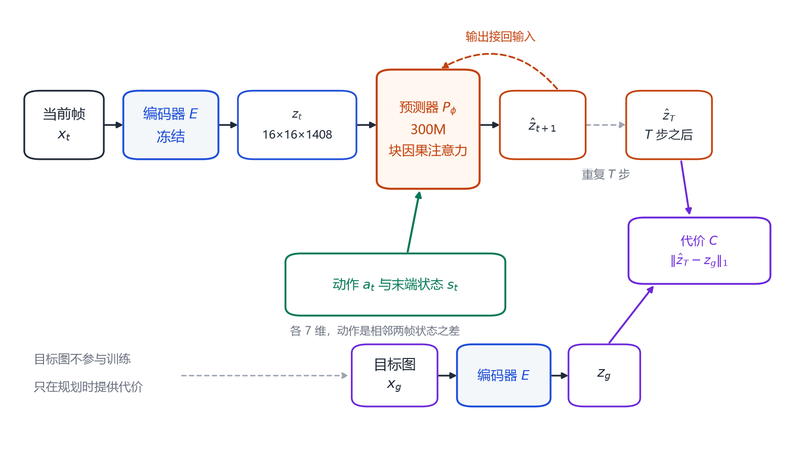
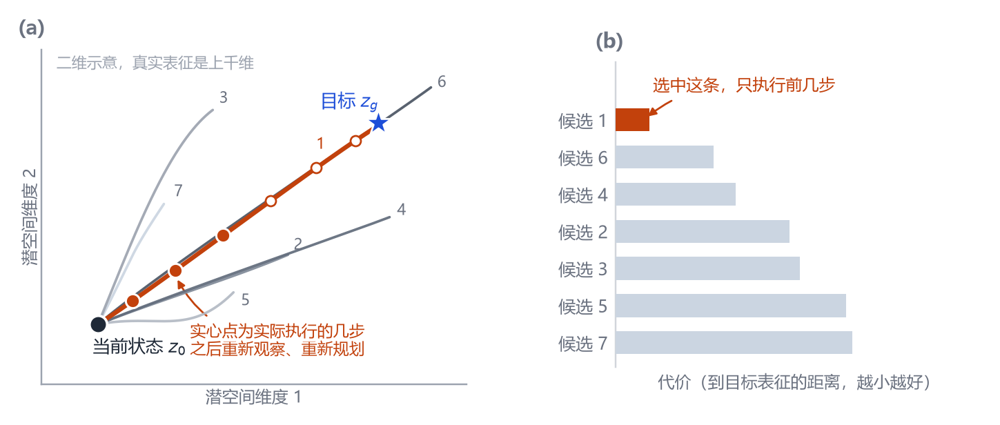
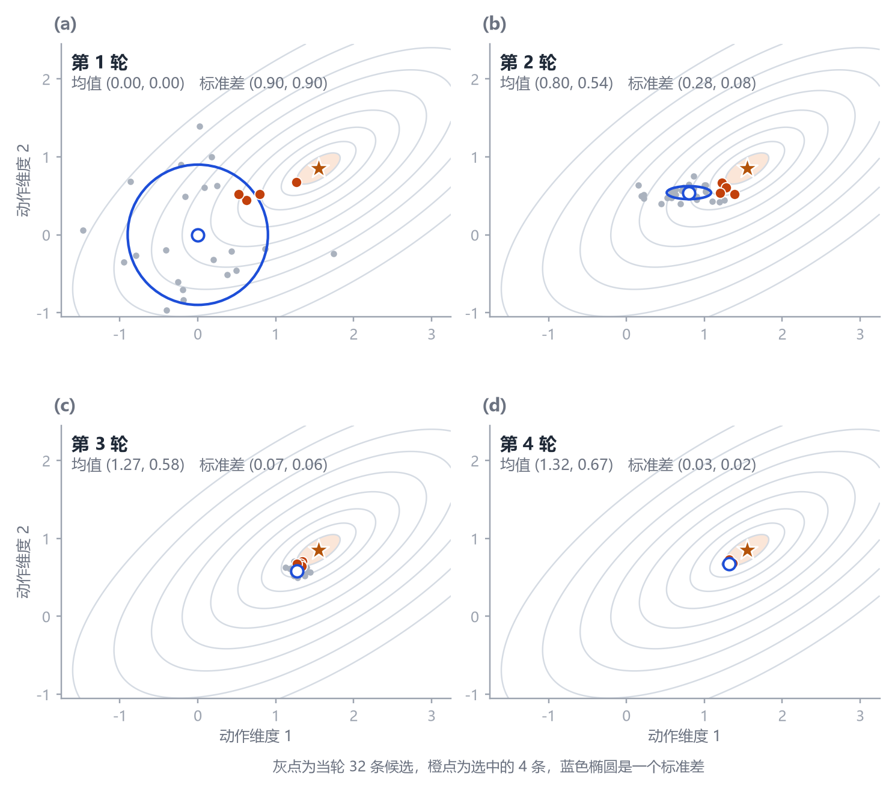
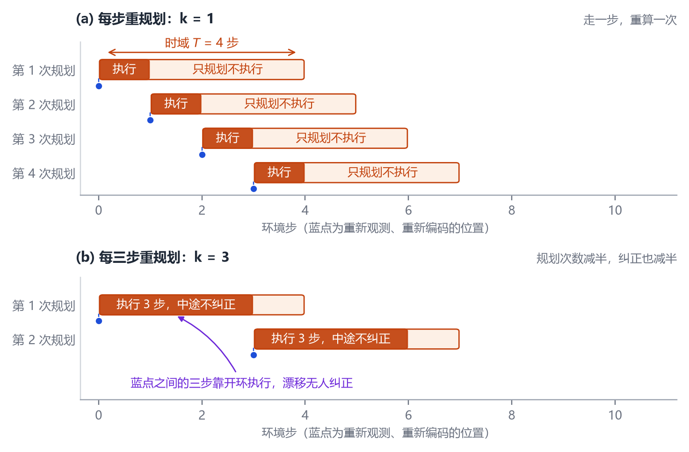

# 第 8 章　让世界模型动起来

你伸手去够架子上的杯子，手在半空停了半秒才落下。这半秒里眼睛没有移开，身体也没有做别的动作，但一件很复杂的事已经做完了：杯子离指尖还有多远，手再往上前进多少会碰到杯沿，从上方还是侧面握住把手，抓空的后果是什么。这些判断没有一个来自真实的接触，全部来自一次内部预演，而这次预演之所以有用，是因为它足够快，也足够准，快到能在手落下之前完成，准到能让手落在正确的位置。

上一章把世界模型的骨架拆开看过，也交代了这条路的三笔账：容量要花在多少细节上，误差会以多快的速度累积，策略会不会主动去钻模型的空子。章末留下两条岔路，一条继续把画面重建出来，另一条只在特征空间里预测，后者的损失函数里连一个像素都没有。岔路一旦走上，问题就变得尖锐，一个从不生成图像的模型，凭什么指挥一只机械臂。

这一章给两个补丁。一个是动作，让预测器知道是谁在改变世界，并且知道改变发生在什么起点上；一个是搜索，在特征空间里找出能达到目标的那一串动作。两个补丁都不动编码器，动的是预测器和规划回路，因为表征在预训练阶段已经学会了怎么描述世界，缺的是怎么在这个描述上做选择。这两件事凑齐，世界模型才从能预测变成能用，也才有资格被叫做规划器。

## 8.1　动作让预测变成干预

原来的联合嵌入预测架构学的是 $z_{t+1} = P_\phi(z_t)$，给定当前表征猜下一刻表征。这个目标能逼出一些物理直觉，因为要猜准下一帧，模型不得不把物体的位置、运动方向、遮挡关系编码进去，但它对“我能改变什么”一无所知。加上动作之后，目标变成

$$
z_{t+1} = P_\phi(z_t, a_t),
$$

$z_t$ 是当前帧经过编码器得到的表征，$a_t$ 是这一步执行的动作，$P_\phi$ 是参数为 $\phi$ 的预测器，输出下一刻的表征。同一个当前状态配上不同动作会得到不同的未来，模型从此能回答反事实的问题，而反事实正是控制的前提：控制器要问的从来不是世界会变成什么样，而是我这样做世界会变成什么样。

动作必须和末端状态一起喂进去，理由很朴素，动作在世界坐标里是一个增量，增量的效果取决于起点。同样一条向前两厘米的指令，手在桌面高度执行和在半空执行，结果完全不同，预测器如果只看增量，就得先自己从画面里反推手在哪，这个误差会一层层放大。V-JEPA 2-AC 的做法是把七维末端状态当作一条廉价的旁路直接送进预测器，前三维是相对机器人基座的位置，接下来三维是欧拉角表示的姿态，第七维是夹爪的开合。相机看不到基座的时候，这条旁路尤其重要，因为动作坐标轴本身就得靠猜。

V-JEPA 2-AC 是上面式子的一个具体实例，每个零件的尺寸都能在论文里查到。编码器是预训练好的 ViT-g，在整段后训练里保持冻结，每一帧独立编码成 $16 \times 16 \times 1408$ 的特征图；预测器是一个约 3 亿参数的 Transformer，24 层、16 个注意力头、隐藏维 1024。注意力用块因果掩码，同一时刻的 patch 特征可以看当前和之前的动作与状态，看不到未来。这一条不能省，因为编码器对每帧独立工作，一帧内所有 patch 同时得到表征，如果允许同帧的 patch 互相看，预测器就能从相邻 patch 抄到答案，损失掉下去而模型什么都没学到。

训练数据来自 Droid 数据集，不到 62 小时的桌面机械臂视频，机器人是七自由度的 Franka Emika Panda 加两指夹爪。原始片段通常只有三四秒，为了让每条样本都装满四秒，短于四秒的片段被丢掉，剩下的按 256×256 分辨率、每秒 4 帧重采样，正好得到 16 帧一段的片段。动作由相邻两帧的末端状态相减得到，也是七维，一段 16 帧的片段因此配出 15 个动作。这些数据里没有奖励，没有任务名，也没有成功失败的标记，只有画面和末端状态两样东西。

损失函数有两项。一项是教师强制，用真实的 $z_{k+1}$ 当监督逐帧算 L1 距离；另一项是 rollout 损失，把预测器的输出接回输入连续推几步，再和真实表征比。第二项专门对付误差累积，因为规划时用的正是这种自己喂自己的方式，训练和推理的输入分布必须对得上。距离选 L1 而不是平方误差，是因为表征维度很高，个别维度偶尔会冒出很大的偏差，平方会把它放大成主导项，L1 对这种偏差更钝。整个结构如图 8-1，三条支路互不干扰，只有预测器和代价在两处汇合。

<figure class="fig">

<figcaption><b>图 8-1</b>　动作条件 JEPA 世界模型。冻结的编码器把当前帧压成表征，预测器在动作与末端状态下推进一步，输出接回输入完成 T 步 rollout。目标图只经过编码器，两端表征的距离就是规划时的代价。</figcaption>
</figure>

图 8-1 里有三处值得留意，它们决定了这个模型能做什么、不能做什么。编码器那一路是冻结的，意味着表征的形状在预训练阶段就定死了，后训练只学这些表征怎么随动作变化，不学表征该长什么样。动作那一路只接到预测器上，不进入编码器，因为编码器看的是单帧图像，动作不在画面里。代价那一路不参与训练，只在规划时提供方向，换一个任务只需要换一张目标图，这也是它比重新训练一个策略便宜的地方。

## 8.2　代价就是一个距离

规划需要一个目标，这套框架里的目标是一张图片。把目标图 $x_g$ 编码成 $z_g$，再让预测器从当前状态出发推 $T$ 步，两端表征之间的距离就是代价，

$$
C(a_{1:T}) = \bigl\lVert P_\phi(a_{1:T}; z_0, s_0) - z_g \bigr\rVert_1 .
$$

$a_{1:T}$ 是待优化的整段动作，$s_0$ 是当前末端状态，$P_\phi$ 把整段动作依次喂进去之后输出第 $T$ 步的表征，$\lVert \cdot \rVert_1$ 是逐元素绝对值之和。V-JEPA 2-AC 用这个 L1 形式，DINO-WM 用平方 L2 且只看终点那一步，两者本质相同，都是把“任务完成了吗”翻译成特征空间里的一次测量。

用图片当目标，省掉的东西比想象中多。传统强化学习要写奖励函数，抓取成功给 1、失败给 0，中间过程靠折扣因子连起来，奖励写偏一点策略就学歪，调奖励往往比调网络更费时间。用目标图，你只要拍一张“杯子已经在盘子上”的照片，剩下的交给编码器，任务描述从代码变成了数据。V-JEPA 2-AC 能在两个没在训练集里出现过的实验室里零样本上手，换任务不用改一行程序，这件事和代价函数的形状直接相关。

粗糙的地方同样明显。这个代价只看终点，不看路径，一条穿过桌面的轨迹和一条绕过桌面的轨迹只要终点相同，代价一样低，真实机器人会撞上去。工程上的补法是加中间项，每一步都算一次到目标的距离，或者加动作平滑惩罚让相邻动作别跳变；中间项加多了又会引出新问题，路径上每个点都朝目标拉，机器人会贴着障碍物走直线，反而更容易碰。

还有一个更隐蔽的问题，特征空间里的欧氏距离未必和任务进度成正比。编码器把世界折起来了，距离却是一把直尺，地图上量两点直线十公里，实际要绕山走三十公里，特征空间里也会出现这种直线很近、实际很远的地方。目标附近尤其容易出问题，那里的表征被少数几个样本决定，形状不稳，距离的梯度也跟着不稳，机器人会在离目标几厘米的地方来回试探。

目标表征本身还有多模态的麻烦。要把杯子放到盘子上，从左边绕和从右边绕都能成，两条路在特征空间里对应两条完全不同的轨迹，终点却是同一个 $z_g$。代价函数看不出这个区别，它只关心终点，于是采样出来的候选常常一半往左一半往右，按代价选出的那一批在两种模式之间来回摆，取均值就落在中间那条撞墙的路上。这是把目标压成一个点必然要付的代价，除非代价本身能表示哪条路都行。

## 8.3　采样、排序、走一小步

有了代价函数，规划变成一个优化问题，而要优化的对象是一段连续动作。代价函数是黑箱，梯度要么不存在，要么存在也不好用，V-JEPA 2-AC 和 DINO-WM 都选了同一个办法，交叉熵方法（Cross-Entropy Method，CEM）。这个办法把优化换成反复的采样与筛选，既不需要梯度，也不需要知道代价函数长什么样，只要能在给定动作下算出一个数。

细节值得走一遍。要规划 $T$ 步，每步动作是一个 $d$ 维向量，先给这 $T \times d$ 个数各配一个高斯分布，初始均值零、方差一。从这批分布里采样 $N$ 条完整的动作序列，每条都推 $T$ 步，得到 $T$ 步之后的表征并算出代价。按代价排序取最好的 $K$ 条，用这 $K$ 条的统计量替换原来的均值和方差，分布因此收窄到有希望的区域。再采样、再排序、再更新，重复若干轮，返回高斯分布的均值作为答案。

排序这一步把优化换成了筛选，不需要代价可导，也不需要知道它长什么样，只要能在给定动作下算出一个数。代价是采样量，维度越高，要覆盖的空间越大，$N$ 得跟着涨，而每条候选都要跑完整段 rollout，算力随之线性上升。DINO-WM 的模型是可导的，理论上可以直接把代价反传到动作上做梯度下降，作者试过，结论是 CEM 更好，论文没有给出确定解释，一种可能是代价地形不平滑、局部极小太多，梯度一旦走错方向就出不来，而采样至少保证有一批候选散在别处。

这个过程在二维里的样子如图 8-2，左边那些深浅不一的曲线是同一轮采样的候选轨迹，右边是它们按代价排出来的顺序。真实场景里这个循环要跑十几轮，每轮几百条候选，V-JEPA 2-AC 用 800 条采样、10 轮迭代、时域 1 步，在单张 RTX 4090 上算一个动作要 16 秒。作为对照的 Cosmos 是潜扩散视频生成模型，80 条采样、10 轮迭代、时域 1 步，算一个动作要 4 分钟，一条完整的抓放轨迹要跑一个多小时。

<figure class="fig">

<figcaption><b>图 8-2</b>　潜空间规划示意。左图是同一轮采样的七条候选轨迹，颜色越深代价越低，橙色那条只执行开头几步，实心点标出真正执行的部分。右图是候选按代价排序的结果。</figcaption>
</figure>

表 8-1 把两边的代价和结果并排放，能看出采样预算花在了什么地方。同一组任务上，V-JEPA 2-AC 的到达成功率是 100%，抓杯子 60%、抓盒子 20%，把杯子放到目标位置 80%、盒子 50%；Cosmos 只有到达这一项拿到 80%，抓取的杯子和放置的两项都是零。换成两个实验室的平均，V-JEPA 2-AC 的抓杯子是 65%、抓盒子 25%，两项放置任务是 80% 和 65%。

**表 8-1**　潜空间规划与视频生成模型在同一组桌面任务上的对照。数字取自两个实验室中的第二处，两边用同一块显卡做规划。

| 模型 | 采样数 | 迭代轮数 | 时域 | 单动作耗时 | 到达 | 抓杯 | 抓盒 | 放杯 | 放盒 |
|---|---|---|---|---|---|---|---|---|---|
| V-JEPA 2-AC | 800 | 10 | 1 | 16 秒 | 100% | 60% | 20% | 80% | 50% |
| Cosmos | 80 | 10 | 1 | 4 分钟 | 80% | 0% | 20% | 0% | 0% |

抓盒子只有 20% 到 25%，这个数字本身有信息。盒子比杯子好抓，可行的抓法更多，但它要求夹爪张得刚好，两指开合的时机和幅度都得准，而这几维动作恰好落在采样最稀疏的地方，800 条候选摊到七维空间里，每一维分到的覆盖都很少。杯子的抓法单一，一根手指伸进杯口、沿杯沿收拢，容错空间反而大一些。同一套采样预算在不同任务上效果差别这么大，说明规划的能力不只取决于模型预测得多准，还取决于搜索在那几维上有没有足够密的候选。

## 8.4　为什么每一步都要重新规划

执行的时候只走一小段。V-JEPA 2-AC 每个规划步只执行第一个动作，然后重新观察、重新编码、重新规划，这个“算一长段、走一小步”的循环叫模型预测控制（Model Predictive Control，MPC），也叫滚动时域控制。DINO-WM 的做法略有不同，执行前几个动作再重规划，本质一样，都是让真实观测不断把规划拉回现实。

非要重规划的原因有两层。预测器有误差，rollout 越长越偏，算到第十步的动作已经建立在漂移的表征上；真实世界还有扰动，地面打滑、物体被碰了一下、相机晃了。重规划把真实观测重新编码成起点，等于每一步都从“现在实际在哪”重新出发，误差不会一直攒着。开车的人不会在起步时把方向盘角度算到终点，每一秒都在微调，道理一样。

这套流程的代价也很直接，一个动作 16 秒，而每个动作只让机器人动一小段，真正在动的时间远少于等规划的时间。抓放任务因此被手工拆成三个子目标，依次执行 4 步、10 步、4 步，每达成一个就换下一张目标图，第一张是抓住，第二张是搬到目标附近，第三张是放下。这种拆解在演示里够用，离“给一个遥远的目标自己想办法”还差得远。

把这条路线和不用模型的强化学习放在一起看，差别在样本效率。不用模型的方法一次真实交互只换来一次更新，而这里一次交互可以换来成千上万次想象，代价是所有想象都建立在模型正确的前提上。DreamerV3 用一套超参数在八个领域的一百五十多个任务上工作，说明这条路走得通，但它同样受制于模型质量，模型在哪儿失真，策略就在哪儿学歪。

## 8.5　两种世界模型的分工

2024 年 DeepMind 的 Genie 走的是另一条路。它在互联网上的 2D 平台游戏视频上训练，按关键词筛出 5500 万段 16 秒片段，进一步过滤后留下 680 万段，合计约 3 万小时，分辨率 160×90、每秒 10 帧，整个模型有 110 亿参数。三个部件各管一段，2 亿参数的视频分词器把每帧变成离散码，3 亿参数的潜动作模型从相邻两帧里反推出 8 种离散的潜动作，101 亿参数的动力学模型按 MaskGIT 的方式逐帧生成，每帧走 25 步采样。训练时没有任何动作标签，8 个潜动作完全从画面之间的变化里学出来，交互时人按下的键再被对上其中一个，像给一台没有说明书的机器重新贴标签。

Genie 的产物是像素。给定一段提示帧和一串潜动作，它把接下来的画面一帧一帧生成出来，人能直接看，也能直接上手玩，价值在生成和体验，也在它能从无标签视频里造出带动作标签的训练数据。潜动作虽然不是人按的键，但它在不同画面上含义稳定，足够训练一个跟着视频学操作的智能体。判断它算不算世界模型，看的是它能不能被询问，能对“如果我这样按，画面会变成什么样”给出答案，就算。

纽约大学的 Zhou 等人在 2024 年底给出另一个极端。他们完全不训练编码器，直接拿 DINOv2 的 patch 特征当状态，输入图缩到 196×196，得到 14×14 个 384 维的 patch 向量，编码器在训练和测试时都冻结。要学的只有一个预测器，参数量约 1900 万，损失是特征空间的平方误差，规划用 CEM 加 MPC，代价是预测终点特征和目标特征的平方距离，采样规模是 100 条、10 轮。他们在迷宫、墙、到达、推 T 形块、绳子和颗粒六个环境上做零样本规划，那个解码器只用来把预测结果画出来给人看，去掉它不影响规划。

两者都能叫世界模型，用途完全不同。需要人看、需要造数据、需要检查模型是不是真理解了场景，走生成式；需要一个闭环控制器在十几秒内决定下一步，走潜空间。前者的输出是一段能播放的视频，后者的输出是一个向量，视频可以被眼睛检验，向量只能被代价函数检验，这条差别决定了它们在工程上几乎无法互换。

中间地带其实更热闹。V-JEPA 2-AC 属于潜空间这一侧，但它前面挂了一个超过 100 万小时的视频预训练，编码器见过的东西比 DINO-WM 用的 DINOv2 更偏动态，物体怎么动、场景怎么变都在预训练里出现过。这个差别在静态场景里看不出来，在需要判断“东西会怎么动”的任务上会显出来，也是它敢拿一个不到 62 小时的数据集去后训练的原因。

## 8.6　四件没解决的事

一件是表征漂移。预测器的输出是一个向量，这个向量不保证落在编码器能产生的那些向量里，训练时它被真实表征拉着还算老实，规划时没有真实观测校正，推上十几步就滑到编码器从没见过的地方，之后每一步都在错误的输入上继续算。V-JEPA 2-AC 用 rollout 损失缓解这一点，让预测器在训练时就习惯自己那些不完美的输出。缓解不是解决，时域一长照样偏，论文在讨论长时程规划时把自回归的误差累积列在第一条。

一件是长时程。V-JEPA 2-AC 规划时时域只取 1 步，也就是每次只优化一个动作，靠重规划把长程拆成很多短程，论文自己划定的范围是十六秒之内的预测。抓放任务被拆成三个子目标，每达成一个换一张目标图，这种手工拆解把“怎么办”留给了人。误差随步数增长是自回归的通病，视频生成模型有，潜空间预测器也有，只是表现形式不同，前者糊成一片，后者飘到一个语义上说不通的地方。

一件是代价怎么定义。目标图只说得清终点，说不清过程，“把杯子放到盘子上，别碰倒旁边的瓶子”这类要求，一张图表达不了，加约束就得回到手写惩罚项，那套麻烦又回来了。多模态目标也是坑，前面说过，均值会落在两种模式的中间。代价是整个回路里唯一由人指定的部分，它一旦写不准，前面省下的标注成本会以另一种形式回来。

一件是动作空间。七维已经要吃 800 条采样和 10 轮迭代，双臂加灵巧手是几十维，CEM 的采样需求随维数指数上升，很快就跑不动。论文提出的几条出路，比如减少每个时间步的采样和迭代、在想象里训练一个前馈策略给规划做初值、或者改用梯度规划，都还停留在设想阶段。

除这四件之外，论文还承认一个更朴素的毛病，相机位置换一下，成功率会明显变化。动作坐标轴是从单目画面里间接推出来的，训练时没有相机标定信息，机器人基座在不少视角里根本不在画面内，这个推断就变成病态问题。实验中的相机位置是人工试出来的，试到一组在所有任务上都还行的位置才固定下来，这个细节提醒人，模型的输入并不只是世界，还包括了拍摄世界的那只眼睛。

## 8.7　交叉熵方法的四个步骤

把交叉熵方法拆成采样、评估、选精英、更新四步，每一步都对应一个可以单独拧的旋钮，四个旋钮合起来决定一次规划有多贵、有多准。采样先要决定分布长什么样，规划 $T$ 步、每步 $d$ 维动作，朴素写法是维护一个 $Td$ 维高斯，协方差矩阵有 $(Td)^2$ 个数，$T$ 取十、$d$ 取七就接近五千个，几百条样本估不出来。所以实践里一律退化成对角高斯，每个数只配一个均值和标准差，代价是放弃各维动作之间的相关性，做不到“前面动得快、后面动得慢”这种整段协调。初始标准差也要试，太大则样本落在没意义的地方，太小则第一轮就采不到有用的东西。

评估这一步最贵，也最不能省，因为预测器的输出是唯一的判断依据。DINO-WM 在 A6000 上测过，批大小 32 的一次前向是 0.014 秒，100 条样本乘 10 轮等于一千次前向，加上 rollout 本身的串行依赖，一次完整规划实测要 53 秒。时间几乎全花在让一千条轨迹排队走过同一个 1900 万参数的 Transformer 上，所以“多采一点、准一点”这条路很快会见底。选精英是在排好序之后取前 $K$ 条，$K$ 与 $N$ 的比值一般落在十分之一到四分之一，比值太小，新分布由极少数样本决定，方差一步塌到底，比值太大，分布收窄得慢，十轮走不了多远。

更新是把均值和标准差换成精英的均值和标准差，位置平移到有希望的区域，宽度收窄到精英散开的范围，然后重采样进入下一轮。有的实现会把上一轮的标准差按系数混进新一轮以防塌得太快，那属于工程习惯，不是方法本身的要求。收缩过程在二维里看得最清楚，代价面设成一个倾斜的椭圆，最优点在 (1.55, 0.85)，初始分布以原点为中心、两向标准差都是 0.9。每轮采 32 条、取最好的 4 条，四轮的变化如图 8-3。

第一轮之后均值移到 (0.80, 0.54)，标准差变成 0.28 与 0.08，椭圆被压成一条很扁的横带；第三轮移到 (1.27, 0.58)，标准差 0.07 与 0.06；第四轮移到 (1.32, 0.67)，标准差只剩 0.03 与 0.02，图上已经看不出宽度。这些数字里有两件事需要分开看，均值一直在朝最优点走，四轮走完全程的八成多，方向判断可靠，可方差收得比均值快得多，第二轮就有一个方向掉到初值的十分之一以下，此后每轮只能挪很小的距离，四轮结束时离最优点还差将近 0.3。还有一件更不体面的事，第二轮的最好代价是 0.139，比第一轮的 0.113 还差，因为分布收窄后采样点落在更小的范围里，运气稍差就抓不到更好的候选。这条方法从不保证每一轮都变好，方差先塌、位置还没到，就是常说的早熟。

<figure class="fig">

<figcaption><b>图 8-3</b>　交叉熵方法的四轮收缩。四个面板依次是每一轮采样所用的分布，蓝圈为一个标准差，灰点是当轮 32 条候选，橙点是选中的 4 条。方差比均值收缩得更早、更快。</figcaption>
</figure>

于是它的隐含假设露了出来，它假设好解的附近还有更好的解，靠局部采样做局部搜索，代价面在一段距离之内必须足够单调。碰上多峰地形，精英可能一半落在这个峰、一半落在那个峰，均值被拉到两峰之间的鞍部，下一轮从鞍部采样，两边都够不着。这正是 8.2 里说的目标多模态在搜索这一端的表现。样本量、精英比例、初始方差这三个数能缓解这个问题，缓解不了根子上的假设，因为不论怎么调，它看到的都只是自己采到的那几十个点。

## 8.8　多久重新规划一次

8.4 说每一步都要重新规划，理由讲过了，但没说这个频率为什么可以调。规划一次要 16 秒（V-JEPA 2-AC）或 53 秒（DINO-WM），机械臂执行一段动作是秒的量级，两者差十几倍到几十倍，机器人绝大部分时间不是在世界里动，而是在等规划器算完。重规划频率就是在这笔账上做选择的旋钮，它决定多久重新看一眼世界。两个极端各自对应一种已知的失败，开环只规划一次、把一段动作从头执行到尾，延迟几乎为零，但模型第 2 步偏了，第 8 步只会偏得更远；每步重规划把真实观测当新起点，误差不积累，代价是每个动作都要付一次完整的规划开销。

中间地带是每 $k$ 步重规划，成本摊到 $k$ 个动作上，单个动作分摊的时间降到 $1/k$，可 $k$ 步之间是开环的，模型漂移、外界扰动、执行误差都在这段窗口里累积。时域 $T$ 和执行步数 $k$ 常被混为一谈，$T$ 是往前看多远，决定规划器能不能安排“先退再进”这类绕行，$k$ 是往下走多远，决定真实世界多久纠正一次。V-JEPA 2-AC 取的是最极端的一组，$T=1$ 配 $k=1$，完全不做前瞻，靠重规划把短视拼成长程。这种配置在抓取这类局部单调的任务上能用，在需要先远离目标的场景里会失效，因为它连暂时吃亏这个选项都没有。

把两种频率并排放在一起，差别比文字描述直观，如图 8-4。上半是每步重规划，四次规划各执行一步，蓝点很密；下半是每三步重规划，规划次数减半，两个蓝点之间隔着三步开环执行。图里还有一件容易被忽略的事，$k$ 大一些省下的不只是算力，真实观测每编码一次，起点就换一次，两次编码之间的细微差别会被规划器当成世界变了。动作序列因此出现小幅跳变，执行起来一顿一顿，加大 $k$ 让动作更连贯，连贯的代价是迟钝。

<figure class="fig">

<figcaption><b>图 8-4</b>　两种重规划频率的时序对照。浅色段是规划出来却不会执行的部分，实色段是真正走下去的步数，蓝点是重新观测与重新编码的位置。$k$ 越大，两次纠正之间暴露在开环下的步数越多。</figcaption>
</figure>

工程上有几种折中，比如观测偏离预测超过阈值才触发重规划，比如把上一轮的均值当这一轮的初始分布以缩短收敛，比如先在想象里训一个前馈策略给出候选、再在候选附近精细采样。这些做法都能把 16 秒压下去一些，压不到实时的量级，因为一次规划要跑上千条 rollout，这个结构性开销不是调参能消掉的。真正决定能不能进车间的，是模型能不能一次前向吐出整段动作，而不是采样优化写得多巧。这条限制也解释了为什么这套系统只在抓放这类被手工拆成三段的短任务上演示。

## 8.9　六个环境各考什么

DINO-WM 的实验设计把“世界模型好不好”拆成六个可以分别验证的能力，而不是一个笼统的分数。迷宫是二维平面上被力驱动的小球，动作直接给两个方向的力，小球带速度、加速度和惯性，2000 条随机轨迹就够训。墙是两个房间中间隔一道墙、墙上开一个门，考的是绕行，墙和门位置随机的版本用了 10240 条轨迹，专门测模型能不能把“墙”和“门”当成概念而不是固定像素。推块要在 25 步内把推杆和 T 形块同时推到目标位形，18500 条数据由专家轨迹加噪声回放得到，考的是接触瞬间那几十个像素里发生了什么。绳子和颗粒用同一个 XArm 仿真，前者把软绳从任意形状摆到目标形状，后者把约一百个颗粒推成指定形状，各只有 1000 条 20 步的随机动作。

这六个环境的排列本身就是一条难度曲线，从刚体导航到接触丰富的推，再到可变形物体，越往后越依赖对整体形状的把握而不是对像素的复现。这就解释了冻结的 DINOv2 特征为什么够用，patch 特征保留了空间排布，绳子和颗粒的细节虽然逐像素无法预测，“这条绳子大致是 S 形”在特征图上却有对应物，而一个整图向量把这些排布压没了。评测协议也分两种，前四个各采 50 组初始与目标算成功率，绳子和颗粒的仿真步进太慢，只测 10 组，用倒角距离衡量形状差。那两列是距离不是成功率，和前面四列不能直接比大小。

结果上，DINO-WM 在迷宫 0.98、墙 0.96、到达 0.92、推块 0.90，绳子与颗粒的倒角距离是 0.41 和 0.26。作为对照，DreamerV3 是 1.00、1.00、0.64、0.30 和 2.49、1.05，TD-MPC2 四项成功率全为零。TD-MPC2 的零不是能力问题，它需要奖励信号来塑造潜空间，而这些离线数据里没有奖励，它在起跑线上就被卡住了。这个对比说明离线世界模型的价值，数据里只有画面和动作，也能训出够用来规划的表征。

冻结特征有三条理由，论文用一组消融把它们钉住了。感知是通用任务，为每个环境重学编码器既浪费又没数据，绳子和颗粒只有 1000 条 20 步的轨迹，从这么点数据里学不出好特征，编码器冻结之后六个环境还共用一把尺子，代价函数可以直接比较。换成别的预训练特征，性能掉得很明显，R3M 在推块上是 0.42，ImageNet 预训练的 ResNet-18 是 0.20，只取 DINOv2 整图向量的 DINO CLS 是 0.44，用 patch 特征是 0.90。迷宫那一列大家都接近满分，看不出差别，难度一提上来，特征有没有保留空间结构就成了分水岭。

解码器的位置很特殊，它单独训练，只吃编码器输出的 patch 特征重建原图，损失不回传给预测器。论文试过把重建损失也加到预测器上，推块的成功率从 0.92 掉到 0.80，说明把图重建得清楚和预测得准是两个目标，混在一起会互相拖累。它的用途是给人看，规划出来的轨迹解码成画面，人可以判断路线合不合理，而在规划回路里它一次都不出现。另一个消融和 8.1 里那条“块因果掩码不能省”是同一件事的两面，历史长度取 1、2、3 时，带掩码的推块成功率是 0.76、0.88、0.92，不带的是 0.76、0.36、0.08。

历史越长，不带掩码的版本掉得越狠，因为训练时它能偷看未来帧，学到一种测试时根本拿不到的输入。数据量也有类似的单调关系，推块的数据从 200 条加到 18500 条，成功率从 0.08 一路上到 0.92。把这些放在一起，一个判断就清楚了，这套系统的上限由表征决定，剩下的由搜索和数据的量去补。特征选对了，1900 万参数的预测器加 100 条采样的 CEM 就能在六个环境里做零样本规划，特征选错了，同样的预算下推块成功率只剩两成。

把这四件放在一起看，会发现它们都指向同一个来源，模型的保真度就是规划能力的上限。模型在哪儿失真，规划就在哪儿失效，而且失真的地方往往正是任务最需要精细控制的地方，接触、遮挡、形变，这几样恰好也是最难用像素损失约束的。接触面的摩擦、软物体的形变、手臂自身的遮挡，这些量在一帧 256×256 的画面里往往只占几十个像素，却直接决定了动作能不能成。

真正让人意外的是效率差距有多大。不到 62 小时的无标注机器人视频，没有奖励，没有任务标签，只靠画面和末端状态，就能在两个没见过的实验室里完成到达、抓取和放置，这个数据量在不用模型的方法里连热身都不够。代价写在另一栏，每个动作 16 秒，一条完整轨迹要跑好几分钟，机器人大部分时间在等规划器算完。

从第 6 章讲视频，到第 7 章讲世界模型，再到这一章讲怎么让它动起来，一条线索慢慢清楚了。V-JEPA 2、V-JEPA 2-AC、DINO-WM、Genie，这几个模型的架构不同，训练目标不同，输出形式不同，做的事情却是同一件：把世界的某个侧面压进一个向量空间，在那里预测、搜索、决策。如果它们真的都在描述同一个世界，那么它们压出来的那些向量，会不会慢慢变成同一张地图，这个问题有实验证据，也有争论。
