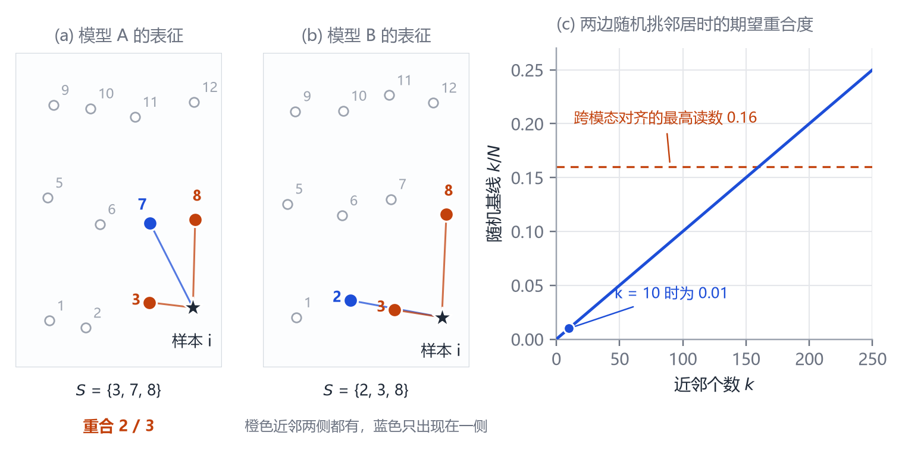
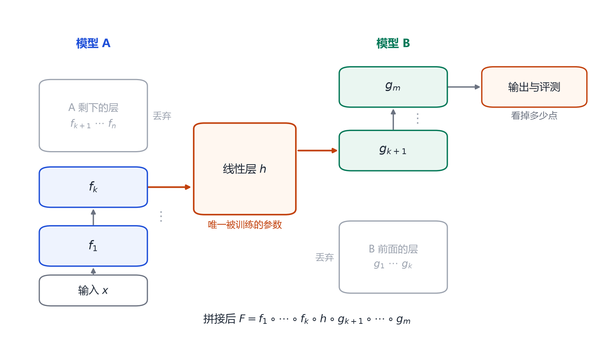
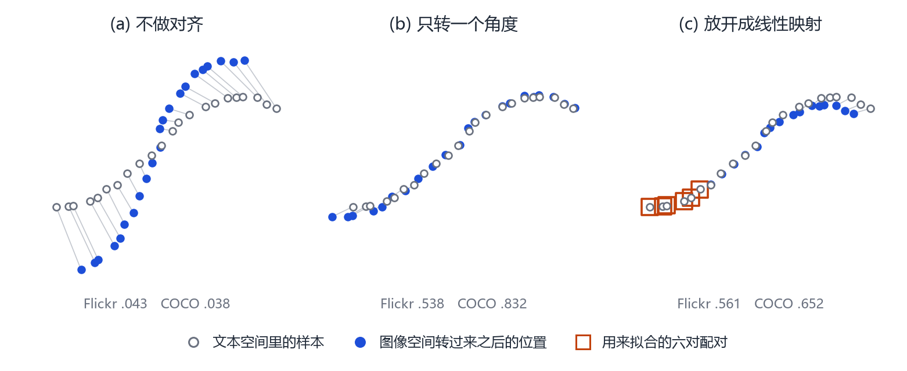

# 第 9 章　同一张地图

上一章结尾问过一句，如果那几个模型真的都在描述同一个世界，它们压出来的向量会不会慢慢变成同一张地图。这句话可以换一个更硬的问法：如果每个模型都在为同一个世界建坐标系，那么两套坐标之间应该存在某种关系。因为每个模型都是各自训练、各自收敛的，没有任何东西规定它的第 768 维要跟别人的第 4096 维对应。可是如果把同一批样本送进两个毫不相干的模型，事情就变得可以测量了：你要看的不是坐标对不对得上，而是它们各自把哪些样本排在了一起。

这件事有一个很早的比喻。两个人抄同一本书，一个用拼音，一个用五笔，抄出来的符号序列没有一处相同，你没法把一列字母和一段字根对上。但如果你换一个要求，让他们各自按“哪两句话意思最接近”把书里的句子排个序，两份排序会高度一致。符号是各自选的，句子之间的关系是书里本来就有的，所以抄写方式再怎么不同，也改不掉那一层关系。模型之间的相似，多半也是这个层面的相似，因为训练目标、数据格式、输出维度都可以不同，只有“这几个样本该归一堆”是它们不得不共同面对的。

这件事如果成立，前面几章关于世界模型的说法就要改一个前提。原本默认每个模型关在自己的世界里，各有各的表征，跨模型比较只是拿两套无关的坐标系硬凑；另一种可能是不同的模型在逼近同一张地图，只是画法不同，比例尺和方向都不一样。2024 年，Huh 和几位合作者把这个想法写成了论文，名字借自柏拉图的洞穴寓言，叫柏拉图表征假设（Platonic Representation Hypothesis，PRH）。这一章要做的，是把这句话从一个比喻变成几个可以测量的数字，再看这些数字能撑起多大的结论。

## 9.1　只看谁和谁挨着

直接比坐标行不通，理由有三个。两个空间的维度常常不同，一个 768 维一个 4096 维，逐维比较无从下手；就算维度相同，把整个空间旋转一下，或者在某几个方向上拉长一点，坐标就全变了，可它描述的关系一点没变；更麻烦的是训练过程里没有任何一项损失会去约束坐标的绝对位置。所以要找的是一个在旋转和缩放之下不动的量，它只关心谁和谁靠得近。

做法是这样的。取一千张同样的图片，分别送进两个模型，得到两组向量，第一组记作 $\phi_1,\dots,\phi_N$，第二组记作 $\psi_1,\dots,\psi_N$，下标相同表示它们是同一张图。对第一个模型里的第 $i$ 个向量 $\phi_i$，在其余向量中找出距离最近的 $k$ 个，把它们的下标收成一个集合 $S(\phi_i)$；对第二个模型的 $\psi_i$ 做同样的事，得到 $S(\psi_i)$。然后数两个集合重合了几个元素，除以 $k$ 归一化，就得到这一对样本的互近邻得分

$$
\mathrm{mNN}(\phi_i,\psi_i)=\frac{1}{k}\left|S(\phi_i)\cap S(\psi_i)\right| .
$$

式子里 $\cap$ 表示两个集合的交集，$|\cdot|$ 表示集合里元素的个数，$k$ 是取的近邻个数，$\mathrm{mNN}$ 是互近邻（mutual k-nearest neighbor）的缩写。把一千个样本上的得分平均一下，就是这两个模型的对齐度：它取 1 意味着两边选出的邻居完全一样，取 0 意味着一对都没撞上。图 9-1 用一个小例子把这个数算了一遍。十二个样本，$k$ 取 3，样本 4 在模型 A 里的三个近邻是 3、7、8，在模型 B 里是 2、3、8，重合的是 3 和 8，得分三分之二，而这个数字没有单位，也不受两个空间维度不同的影响，因为它只用到“谁离谁近”这一件事。

<figure class="fig">

<figcaption><b>图 9-1</b>　互近邻的计算。(a) 与 (b) 是同一批样本在两个模型里的位置，样本 4 的三个近邻在 A 是 3、7、8，在 B 是 2、3、8，重合两个；(c) 是两边随机挑邻居时的期望重合度，它随 $k$ 上升。</figcaption>
</figure>

这个指标必须配一条基线才有意义。如果两边的近邻是随便挑的，各挑 $k$ 个，那么交集大小的期望是 $k^2/N$，其中 $N$ 是样本总数，除以 $k$ 之后得到期望得分 $k/N$。论文里取 $k=10$、$N=1000$，基线就是 0.01，也就是图 9-1 右侧那条斜线在横轴十的位置上的高度。任何一次测量都要跟这个数比：0.08 听起来很小，在 0.01 的基线上就是八倍，属于“不可能是碰巧”的量级。

有两件工程上的事要提前交代，否则后面的数字会被误读。互近邻是在一个小批次里算的，批次多大，候选池就多大，读数的绝对值跟着变，同一个模型对在 1000 个样本和 128 个样本上算出来的数不一样，因为“最近”这件事在更大的池子里更难撞上。另一件是它不需要拟合任何映射，有些比较方法要先学一个从 A 到 B 的变换再看好不好用，可变换本身有自由度，拟合得越用力越容易凭空造出相似，互近邻只数数，所以它给出的相似不会被优化过程污染。

## 9.2　相似不等于对齐

把两件事分开说。相似说的是近邻结构像，对齐说的是坐标能用一个简单变换对上，前者弱，后者强。一份名单按身高排序，另一份按体重排序，两份顺序大体一致，因为高的人往往也重一些，这叫相似；但你不能拿身高那一栏的数字直接当体重用，中间差着一个不知道长什么样的函数，这叫不对齐。相似只保证“谁和谁挨着”，不保证“差多少”，也不保证“能互换着用”。

三种常用的度量，强度依次上升，差别写在表 9-1 里。互近邻只看局部，只要每个样本的邻居对得上就行，全局的距离数值可以完全不同，连邻居的先后顺序都不管，$\{a,b,c\}$ 和 $\{c,a,b\}$ 算同一个答案。中心核对齐（Centered Kernel Alignment，CKA）看的是全局，它把两个模型的相似度矩阵整体拿出来比，取值在 0 到 1 之间，对旋转和各向同性的缩放不敏感。线性映射后可检索更严，要先学一个矩阵 $W$，把 A 的向量乘过去，再看能不能在 B 里找回对应的样本。

**表 9-1**　三种相似度度量的对比

| 度量 | 怎么算 | 衡量什么 | 代价 |
| --- | --- | --- | --- |
| 互近邻 mNN | 数两边 $k$ 近邻集合的重合比例 | 局部邻域结构是否一致 | 不看距离大小，也不管顺序，数值随 $k$ 与批次变化 |
| 中心核对齐 CKA | 比较两个模型的相似度矩阵 | 全局几何是否一致 | 要求过严，跨模型比较时趋势很弱 |
| 线性映射后可检索 | 学一个矩阵 $W$，看映射后能否找回原样本 | 坐标能否被一个线性变换对上 | 需要拟合，$W$ 的自由度可能带来虚假相似 |

这三者的强弱不是包含关系，而是三种不同的提问。互近邻问的是邻居对不对，CKA 问的是整体的相似度格局像不像，线性映射问的是能不能互换着用。一个模型可以前两项都高而第三项很低，就像一个只会认脸不会画脸的人，他知道谁跟谁长得像，却画不出那张脸。反过来也成立，一个容量很大的映射可以在训练样本上做到很高的可检索率，而邻居结构早就被它拉歪了。

## 9.3　把两个网络焊起来

比互近邻更强的证据来自一种叫模型拼接（model stitching）的做法，它的要求从“看着像”升级成了“接上还能用”。把一个模型看成若干层的复合，$f=f_1\circ\cdots\circ f_n$，$\circ$ 表示先算右边再算左边；另一个模型是 $g=g_1\circ\cdots\circ g_m$。在 $f$ 的第 $k$ 层处切一刀，把前半段接到 $g$ 的后半段上，中间垫一个线性层 $h$，被剪掉的两段不再参与计算，拼出来的模型是 $F=f_1\circ\cdots\circ f_k\circ h\circ g_{k+1}\circ\cdots\circ g_m$，整个过程如图 9-2。

<figure class="fig">

<figcaption><b>图 9-2</b>　模型拼接。A 的前几层接上一个线性层 $h$，再接上 B 的后几层，两侧其余部分丢弃；除了 $h$ 之外全部冻结，拼接后在任务上看掉多少点。</figcaption>
</figure>

这个 $h$ 通常是一个仿射变换，只有一组矩阵和一个偏置，参数量比任何一层都小得多。训练时 $f$ 和 $g$ 的所有参数都冻住，只调 $h$，然后把拼好的模型放到下游任务上测，看它的表现比原来的 $g$ 差多少。差得越小，说明 $h$ 要承担的那个转换越简单；如果只差一个线性变换就能接上，那么在 $k$ 这一层，两个模型的表征就是可以互换的，接上之后网络并不觉得自己换了半个脑子。

“掉点”怎么读，实际做法里有一套流程。切点从浅到深扫一遍，每个位置画一个点，得到一条掉点随深度变化的曲线，曲线平坦的地方就是两个模型最容易互换的位置。Lenc 和 Vedaldi 在 2015 年做过这件事，两个发现后来被反复引用：一个是在 ImageNet 上训练的模型和在 Places-365 上训练的模型可以拼起来，性能保持得住，说明数据集不同并不妨碍表征兼容；另一个是早层比后层更容易互换，因为卷积网络前几层学到的东西几乎都是朝向和边缘的滤波器。

后来的工作把这个结论推得更远。Bansal 等人在 2021 年发现自监督训练的模型和纯监督训练的模型可以互相拼，性能掉得不多。Moschella 等人在 2022 年做了更极端的版本，连 $h$ 都不学，直接把两段接上，仍然能用：一个英文编码器接到法文解码器上，翻译照样出得来。跨模态也有人试，Merullo 等人在 2022 年发现单独一个线性投影就足以把视觉模型接到语言模型上，做图文问答和图像描述都还能用，LLaVA 用的是同一个思路，只是把一层线性换成了两层的多层感知机。

拼接比互近邻更有说服力，因为它要求“接上还能用”，一条能跑通的下游任务比一个相关系数难伪造。它的边界也很清楚。它只在一个切点上做文章，说明的是第 $k$ 层附近兼容，不说明两个网络整体等价，切点挪一挪结论可能就变。$h$ 的容量是个隐含变量，如果必须给一个很大的 $h$ 才能接上，那“只差一个线性变换”这句话就名不副实了，你测到的其实是那个大 $h$ 的拟合能力。

## 9.4　七十八个视觉模型

单看两个模型拼一次是轶事，要看趋势得看规模。论文里做了一次横向比较，一共 78 个视觉模型，来源很杂。其中 17 个是视觉 Transformer（Vision Transformer，ViT），从 tiny 到 giant 都有，训练目标涵盖 ImageNet-21k 分类、掩码自编码、DINO 和 CLIP，有一部分还在 ImageNet-12k 上做过微调；还有 1 个随机初始化的 ResNet-50 当对照组，11 个用对比学习训练的 ResNet-50，以及 49 个用对齐与均匀性损失训练的 ResNet-18。

能力的量法是用 19 个 VTAB 分类任务做线性探测，冻结主干只训一个分类头。某个任务的准确率达到 78 个模型中最好成绩的八成，就算这个模型解决了它，于是一个模型的能力可以写成一个零到十九之间的数。对齐度则在 Places-365 的验证集上算，取 1000 张图、$k=10$，这一集与 VTAB 的任务数据不重叠，虽然两者都是自然图像，这样一来能力与对齐度就不是在同一批数据上量的。

结果是一条相当清楚的趋势。解决的 VTAB 任务越多，模型彼此之间的互近邻得分越高；按能力分箱之后，强的那一箱内部贴得很紧，弱的那一箱里各走各的路。换成二维嵌入看更直观，能力强的模型挤成一小团，能力弱的散在四周，像一群人在雾里各朝一个方向走。论文在这里引了一句托尔斯泰式的说法，强的模型都是相似的，弱的模型各有各的弱法，Bansal 等人 2021 年把这种可能性叫作安娜·卡列尼娜情形。

这里有一个容易被读错的地方，值得停下来。能力强的模型彼此更像，不等于它们各自都更接近真相，也可能只是因为它们都被同一类任务压力挤到了同一个角落，而那个角落未必离世界最近。论文把语言模型与 DINOv2 的对齐度和它在常识推理基准上的得分画在一起，两者接近一条直线；和小学生数学应用题的得分画在一起，则是一条先平后陡的曲线，像涌现的样子。这只是相关，不能说对齐带来了能力，但它至少排除了“对齐与能力无关”这一种可能。

## 9.5　跨模态的读数

跨模态的比法要绕一个弯，因为图和文不在同一个输入空间里，没法直接取同一批样本。论文用的是维基百科的图文对，每张图配它自己的说明文字，图像侧送进视觉模型得到向量，文本侧把说明文字送进语言模型也得到向量，于是同一个样本在两个空间里各有一个位置。样本量取 1024 对，$k$ 仍然是 10，随机基线还是 0.01 上下，因为 10 除以 1024 与 10 除以 1000 差不了多少。

结论的形状很清楚。语言模型越大、下一词预测得越准，它和 DINOv2 的对齐度就越高，两者接近一条直线；反过来，视觉模型越大越强，它和语言模型的对齐度也越高，每一组视觉模型都各自往上走，斜率不同但方向一致。CLIP 因为有显式的语言监督，对齐度比同规模的纯视觉模型更高，这是它训练时就被拉向文本空间的结果。有意思的是 CLIP 在 ImageNet 上微调之后，这个优势反而掉了，说明对齐度测的是表征怎么组织数据，不是它在某个任务上有多准。

把跨模态那一组曲线放在一起看，最高的一条爬到 0.16 就停住了。这个数字是随机基线的十六倍，说明两个模型在“哪些样本属于一类”上确实有共识，不是偶然撞上的；可它离满分 1 还隔着很长的距离，把前者说成后者就是夸大。论文作者自己也把它写成了一个开放问题：这个分数是说明对齐已经很强、剩下的差距都是噪声，还是说明还差得远、有大块的东西没解释，留给后来的人判断。这种坦白不常见。

## 9.6　一个旋转

到这里可以说一个比“局部邻居一致”更强的说法。如果两个空间之间只差一次旋转，那么把一个空间的坐标搬到另一个空间要学的东西就只有一个矩阵，不需要几十万对图文、不需要端到端训练、也不需要两个网络共享任何一层。这个矩阵有多大可以先算一算：图像编码器输出 768 维，文本编码器输出 384 维，映射是 768 乘 384 的矩阵，二十九万个元素，扣掉行正交的约束之后剩下 22 万个自由参数。作为对照，一个十五亿参数的语言模型是它的七千倍。

为什么要把映射限制成正交。正交矩阵在几何上就是一个旋转，允许带一次镜像，它保长度、保夹角，所以对齐的时候不会把一团点压扁或者拉长，只是整体转过去。自由度上看得更清楚：384 维对 384 维时，不受约束的线性映射有十四万七千个参数，旋转只有七万三千个，少掉的那一半，正好是“不许拉伸”这条约束吃掉的。约束越紧，能拟合的东西越少，能迁移的东西越多，这个取舍后面会用分数兑现。

要验证这个说法，需要一件能把旋转变成产出的任务，图像描述正好合适。常规做法是收集几十万图文对，训练编码器和解码器端到端优化；这里的做法反过来了，解码器只在文本上训练：取一个文本模型把每条描述压成 384 维向量并冻结，再取一个因果 Transformer 当解码器，输入是这条描述自己的嵌入，输出是它逐词展开的序列。为了防止解码器把输入当成精确的文本嵌入死记下来，训练时给嵌入加了高斯噪声，噪声强度不是调出来的，是从对齐残差算出来的：旋转之后，一张图和它自己的描述平均余弦只有 0.3，要让加噪后的余弦也等于 0.3，噪声的相对强度就是 3。

描述一张新图时，把它送进冻结的 DINOv2 得到 768 维，乘上旋转变成 384 维，交给解码器，解码器从来没有见过图片，它看到的只是一个与文本嵌入同维、带着残差的向量，因此它写出的句子更像在翻译，而不是在描述。整个流程里唯一在图文对上拟合过的东西就是那个旋转，两个编码器和解码器全程不动，配对数据只碰了 22 万个参数，如图 9-3。

<figure class="fig">

<figcaption><b>图 9-3</b>　三种对齐程度的二维示意。空心圈是文本空间的样本，实心点是图像空间映射过来之后的位置，橙色方框标出用来拟合的六对配对，每格下面是同一设置下在 Flickr 与 COCO 上的 CIDEr。</figcaption>
</figure>

结果比预期好。用一个小解码器，在 COCO 的五千张测试图上，这个系统拿到 0.668 的描述评分（CIDEr，取值 0 到 1），而随机旋转只有 0.038。把解码器换成十五亿参数的语言模型，图像侧换成更大的两个编码器，再把采样出的三十二条描述投票合成一条，分数从 0.668 一路加到 0.838。这个数字还不是最好的，专门用四亿图文对训练的描述器能到 0.912 以上，但那条路的代价是四亿对配对，这条路只碰了 22 万个参数。

图 9-3 要说明的是约束为什么不能放松。左格是完全不对齐，两团点各转各的，连线乱成一团；中格只允许整体转一个角度，形状对上了，多数点贴得很近；右格放开成不受约束的线性映射，它多出来的自由度足够把训练那六对配对摆得几乎严丝合缝，代价是把没参与拟合的那一段拉歪了。分数上也是这个关系，线性映射在 Flickr 上比旋转高一点（0.561 对 0.538），换到 COCO 就掉到 0.652，旋转还有 0.832。多出来的参数换来了训练分布上的拟合，赔进去的是别处的不成立。

旋转也不是万能的，这一点同样要写在明处。对齐之后，一张图和它自己的描述平均余弦只有 0.3，也就是两个向量只有三成是同向的，剩下七成对不上。那部分是渲染丢掉的信息，一张照片说不全一个场景，旋转补不回来；它能做的只是把两个空间里“关于世界的那部分”对上，残差属于每个模态自己的损失，换更大的矩阵也压不下去，只会把噪声一起拟合进去。

## 9.7　观察不是证明

把这一章的证据摊开看，能下的结论要克制一些。不同架构、不同目标、不同模态的模型，在变大变强的过程中，局部的近邻结构趋于一致，这个现象有可重复的测量支持，也有多个独立的研究组从不同角度报告过；至于这种一致是不是“同一张地图”，这个说法现在是一个有强证据的假设，强度来自它在很多设置下都成立，而不是来自某个决定性的实验。有几种解释不需要“唯一真实表征”这个强假设，也能说明同样的现象：数据是同一个世界产生的，统计结构本来就摆在那儿，任何能压缩数据的模型都会被它拉向同一个方向；任务是相似的，都要预测、都需要视角不变，压力相同则解相同；容量是有限的，只好保留最有用的那部分。

度量这一侧也有麻烦。对齐全靠一个指标，而这个指标对 $k$、对批次、对特征预处理都敏感，换一把尺结论的形状会变；已有工作指出这类相似度指标本身会被网络的宽度和深度干扰，模型变大之后，即使没学到更多东西，读数也可能被推高。这意味着“越强越像”这条趋势里，有多少是真的收敛到同一个解，有多少是指标对规模的机械反应，目前还分不干净。

Huh 等人给这个假设起的名字来自柏拉图的洞穴寓言，一群囚徒从小被锁在洞里，只能看见火光投在墙上的影子，还以为那就是世界的全部。训练数据就是那些影子，像素是世界的影子，文字是影子的影子，假设说的是模型从影子里反推出来的东西正在逼近洞外的那个世界。这个比喻有一个恰到好处的地方，两个模型看到的影子完全不同，一个看光影的形状，一个看别人对光影的描述，如果两批囚徒各自推出了同样的邻接关系，那么共同的东西大概不在墙上。比喻也有它的限度，柏拉图的理念世界是一个形而上的主张，这里说的其实是数据生成过程里那些稳定的、低维的结构，它可以被测量，也可以被下一批实验推翻，名字是修辞，不是论证。

所以这一章停在一个观察上。模型之间确实在趋同，趋同到什么程度有了可以引用的数字，而这些数字背后是一个还在争论的解释：为什么趋同，什么条件下不趋同，趋同了之后能不能当工具用。这三个问题本章都回答不了，但它们的形状已经清楚了，都是关于条件的。往下走之前，还有一个更基础的问题没有交代，如果两个空间真的只差一个旋转，那么训练过程中是什么力量把两个各自为政的网络推到同一个形状上去的。理解了这股力量，才谈得上追问它什么时候失效，而一旦开始追问条件，问题就从“是不是”变成了“在什么情况下是”，这也是本章留到最后没有回答的那一半。
