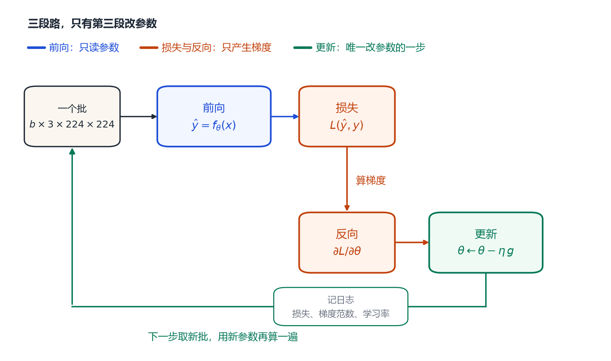
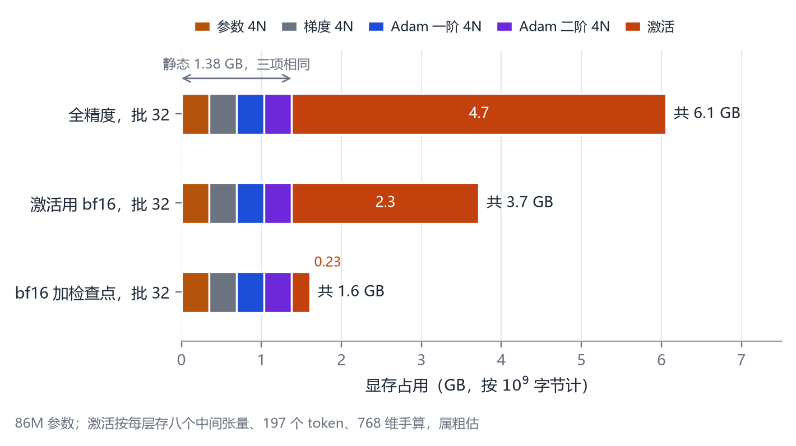
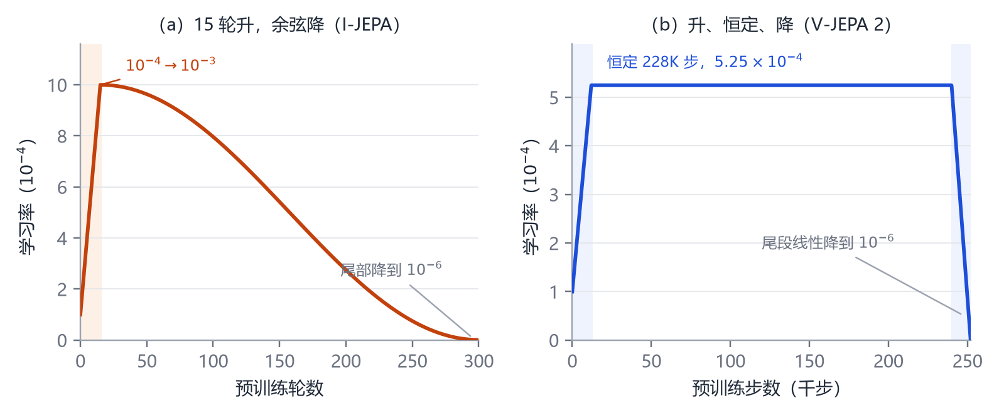
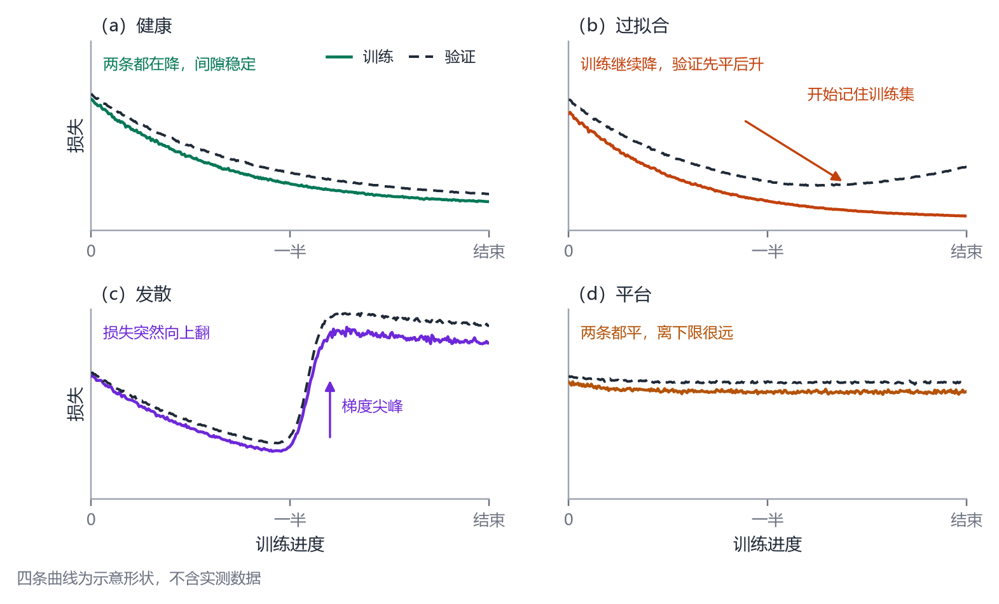

# 第 9 章　一次训练里到底发生了什么

凌晨两点，终端里一行行日志往上滚，每一行只有几个数。走到第几步、损失是多少、学习率调到多少、这一步花了多少毫秒，都挤在那一行里。你照着论文附录把配方抄下来，数据路径改好，超参照填，脚本跑起来了，屏幕上没有报错。可这行数字到底是怎么从一堆图片变成一次参数改动的，中间每一段各自在做什么、代价花在哪里、坏了会以什么形状坏，配方里一个字都没写。

上一章把世界模型推到机械臂上，讲的是模型怎么在特征空间里预演和搜索，那些讨论都发生在一个已经训练好的模型身上。第 5 章到第 7 章反复出现的那些目标函数，联合嵌入预测、掩码重建、动作条件预测，在论文里都被写成一行公式。公式和一次真实的训练之间隔着很长一段工程。这一段里没有新思想，全是取舍，但取舍错了，思想跑不起来。

配方抄下来跑不动的情况比想象中常见，而且原因几乎都落在那四个地方，很少是模型结构本身有毛病。数据管道给出的批和论文里的不是一回事，损失的分母悄悄改变了梯度的尺度。优化器的状态和预热没有配套，显存账算错则让人只能开一个很小的批。这四件事有一个共同点，它们的症状都出现在损失曲线上，看上去像同一个病，而开药之前得先分清是哪一段坏了。

下面按时间顺序走一遍，从取一个批开始，到参数被改掉、日志被写下为止。每一段都交代它在做什么、为什么必须这样做，以及做错时曲线会变成什么样。走完之后你会发现，调参这件事被高估了。真正决定一次训练能不能成的，是这几段里那些不显眼的约定，它们中的大多数在论文里只是一行小字。

## 9.1　从数据到批

一次迭代里发生的事可以画成一个圈，如图 9-1。取一个批、前向算出损失、反向算出梯度、优化器改一遍参数，然后回到开头，用新的参数取下一个批。这个圈里的三段路性质完全不同，前向只读参数，反向只产生梯度，只有更新那一步真正改动了权重。9.1 讲那一批数据是怎么来的，9.2 讲前向和损失，9.3 算清这些中间结果占多少显存，9.4 讲反向与更新。

<figure class="fig">

<figcaption><b>图 9-1</b>　一次迭代的三段路。蓝色是前向，只读取参数；橙色是损失与反向，只产生梯度；绿色是优化器更新，唯一改动权重的一步。</figcaption>
</figure>

批是从数据集里一个个取出来的。数据集对象只约定两件事，长度和按下标取一个样本，至于怎么读、怎么缓存、要不要开多进程，框架一概不管。取样本时读一张图、解码、做增强、连同标签一起返回，一次只处理一个。之所以按需取而不是把几百万张图一次读进内存，是因为数据集体积通常远大于内存，而且增强要求每次取到的结果不同，同一张图在不同轮里必须变成不同的样子。

增强（augmentation）就发生在这一次取样本里，跑在 CPU 上，由若干个工作进程并行完成。最常用的一种是随机裁剪再缩放（RandomResizedCrop），从原图里裁一块面积占比 0.08 到 1.0 的区域，长宽比在 3/4 到 4/3 之间随机，再拉回固定尺寸。这组参数在 SimCLR 的附录里写得很清楚，后来的视觉自监督工作大多沿用。增强不只是为了让模型见过更多变化，在自监督里它还是标签的来源，同一张图的两个视角被当作正样本对，视角之间的差异全部由这几行裁剪和配色决定。

单个样本取出来之后必须被拼成一个张量，这一步叫拼接（collate）。这活儿听起来只是堆叠，约束其实很强，因为一个批要作为一次矩阵乘的输入，所有样本的形状必须完全一致。224 像素见方的图裁歪一点都拼不进去。所以尺寸统一这件事被压到了增强里，裁剪之后一律拉回 224；变长序列没有这个便利，只能补到最长再带一个掩码，让后面的计算知道哪些位置是填充。

拼接还常被用来采样那些每个样本不同、但一个批内必须一样的东西。I-JEPA 的掩码就是这样处理的，论文里明说掩码采样写在拼接函数里、跑在数据加载进程中。同一张显卡上的上下文掩码尺寸被强制设为一致，因为尺寸不同就拼不成张量。这条细节说明批的形状会反过来限制算法的自由度，一个在数学上完全允许的设计，落到实现里可能因为不好拼而被改成另一种样子。

取样本的顺序由采样器决定，每轮开始前重新打乱一次。这件事看着无关紧要，实际决定了梯度是不是有偏，如果数据按类别排好序，一个批里全是同一类，批统计量和梯度方向都会跟着类别走。模型学到的顺序就成了数据顺序的副产品。不满一个批的尾巴通常被丢掉，因为它的大小和别的批不同，算出来的梯度尺度也不同，偶尔还会把批归一化的统计量带偏。

批、步、轮这三个词经常被混用，其实指的是三件事。一次前向用到的样本数叫批，一次参数更新叫步，把整个数据集的下标走一遍叫轮。三者之间的换算取决于批大小，I-JEPA 用 2048 的批，ImageNet-1k 一百多万张图走一轮是六百多步，三百轮下来十九万步；MAE 的批是 4096，一轮三百多步，1600 轮折合五十万步。论文喜欢用轮报数，因为轮和数据集规模绑在一起，换数据集也能比；工程上更常用步，因为步和数据无关，切分训练和安排学习率都按步算。

轮这个单位只有在数据量固定、每个样本每轮恰好用一次的时候才有明确含义。一旦增强是随机的，一轮结束时你并没有把数据看过一遍，只是把下标走了一遍；一旦数据是视频片段或者可以无限采样的语料，一轮干脆不存在，训练长度只能用步来定。数据管道还有一处容易误诊的地方。工作进程开得太少、增强太重时显卡会周期性等数据，日志里的步耗时忽长忽短，损失曲线跟着出现锯齿，看上去像优化出了问题，实际上是数据没喂上。

## 9.2　前向与损失

前向（forward）把一个批的像素变成一组分数。图像先被切成小块、拉成向量、加上位置编码，穿过若干层注意力和前馈网络，最后一层输出一个 $b \times C$ 的矩阵。$b$ 是批大小，$C$ 是类别数，每一行是一张图的 $C$ 个分数。这些分数叫对数几率（logits），没有上界也没有下界，相互之间只比大小有意义，一张图被分到哪一类取决于哪一列最大。

从分数到损失中间隔着一步归一化。softmax 把一行分数变成一组正数、加起来等于一，第 $i$ 个分数越大，对应的概率越接近一；交叉熵（cross-entropy）取正确类那一项概率的负对数，正确类的概率越接近一，损失越接近零。实现里通常把这两步合起来用 log-sum-exp 算。先算概率再取对数会在概率极小时丢掉全部精度，甚至在浮点里变成零再取对数得到负无穷，那一步是后面 NaN 的第一个来源。

损失要不要除以批大小，是一处看起来无关、实际上决定学习率含义的选择。对一个批求和，梯度会随批大小线性放大，等于把学习率偷偷乘了一个 $b$；取平均，梯度才和批大小无关。MAE 的预训练用了一条明确的线性缩放规则，学习率等于基准值乘以批大小再除以 256，批翻倍学习率就翻倍，前提正是损失取了平均。如果损失求和又照抄了别人的学习率，实际步长会大出几十倍，前几百步就发散。

平均这件事还有一个更隐蔽的分母。MAE 只在被遮住的 patch 上算重建误差，被遮住的比例是 75%，如果改成在所有 patch 上平均，未遮的部分贡献的误差恒为零，等效于把损失整体乘了 0.25，梯度也跟着小四倍。I-JEPA 的损失摊在四个目标块上，先在每块内部平均再跨块平均，于是面积大的块和面积小的块权重相同。如果改成按像素平均，大块就会主导梯度，模型把容量花在容易预测的大片区域上。分母选谁，等于决定模型把力气花在哪里。

标签平滑（label smoothing）改的是标签那一侧。把正确类的目标从 1 改成 0.9，剩下 0.1 平均分给其余类别，交叉熵就不再鼓励正确类的分数无限增大，模型的输出分布也不会一路尖锐到底。这样做的直接好处是抑制过度自信，间接好处是对标错的样本更钝，一个被错标的样本给出的梯度不再是一个巨大的推力。代价是输出的概率不再是频率意义上的校准值。做蒸馏或者定置信度阈值时要记住这一点，I-JEPA 在少样本微调时用的就是 0.1。

自监督训练的损失和分类损失差一层。分类的标签来自人，损失下降直接对应预测人给的答案变准；自监督的目标来自同一张图的另一个视角、另一块区域或者另一个编码器，损失的下降只说明预测器对这些目标的拟合变好了。这两件事不能划等号。一个把所有输入映射成常数的模型也能把预测误差压到很低，第 4 章讲过这个解为什么稳定。损失仍然是必要的诊断，它坏了后面都不用谈，但它好了并不等于表征有用。

## 9.3　显存账

训练跑到一半报显存不足，第一反应往往是模型太大。可占用显存的是四项东西相加，参数只是其中一项，而且常常不是最大的那一项。参数和梯度要存，优化器的两个矩要存，前向过程中留下的中间张量也要存，前后两项的量级可以差出十倍。四个人分一张卡，谁都能把卡吃满，只盯着其中一个人算，永远算不明白为什么换了个批大小就装不下了。

前三项是静态的，只要知道参数量就能直接算出来，跟网络跑什么任务没有关系。参数本身占 4 个字节，梯度占 4 个字节，Adam 的一阶矩和二阶矩各占 4 个字节。四项加起来，每个参数 16 个字节，和批大小无关，只和参数个数成正比。模型只要开始训练，这笔钱就得先付出去，而且从头到尾不变，写成式子就是这样一笔账。这笔账在训练开始之前就能算出来，不需要跑一行代码，也不需要知道数据长什么样。

$$
M_{\text{静态}} \approx 16N
$$

式子里 $N$ 是参数个数，算出来的是字节数。ViT-B 的 $N$ 是 8600 万，代进去是 1.38 GB，这个数和批大小无关，只随参数规模变。四项里没有一项是可选的，梯度不存就没法更新，矩不存就不是 Adam。换句话说，一个 8600 万参数的模型，光是站在那儿不动就要 1.38 GB，换一张卡、改一个批，这笔钱一分不少。这 1.38 GB 是死的，改批大小动不了它一分，能动的只有后面那一项。

四份数据都按 32 位浮点算，理由各不相同。梯度必须和参数同精度才能直接相加，省成半精度会引入一层额外的舍入误差。两个矩必须留在 32 位，因为二阶矩是梯度的平方，量级跨度极大，用半精度表示会把小梯度那一端压成零，尺度估计就废了。这四份加起来正好是参数量乘 16，所以显存的第一笔账永远是线性的，模型大一倍，这笔钱就多一倍。

真正的变数在激活（activation）上，也就是前向过程中被留下来、反向要用的那些中间张量。反向传播需要每一层的输入和若干中间结果，框架默认把它们全部保存在显存里，一层都不释放。这些张量本身没有价值，训练结束就扔，但它们是反向能不能算的前提。所以激活的大小不取决于模型有多少参数，而取决于网络有多深、输入有多大、一次塞了多少个样本。

按 ViT-B 的结构粗算一遍，每层每样本留下八个张量。包括两次归一化的输出、一次 QKV 投影、注意力的分数与 softmax 结果、一次输出投影、前馈网络的中间层和激活后的结果。每个张量是 197 个 token 乘 768 维，八个合计约 305 万个浮点数。12 层是 3660 万个，一个样本约 146 MB，批 32 就是 4.7 GB。加上 1.38 GB 的静态部分一共 6.1 GB，如图 9-2 和表 9-1。这个数字不是测出来的，是按张量形状乘出来的，真实实现可能少存几个中间结果，量级不会差太远。

<figure class="fig">

<figcaption><b>图 9-2</b>　ViT-B/16 在批 32 下的显存分解。三根柱子的静态部分都是 1.38 GB，差别全在激活，全精度 4.7 GB，换成 bf16 后 2.3 GB，再加梯度检查点只剩 0.23 GB。</figcaption>
</figure>

**表 9-1**　ViT-B/16 在批 32 下的显存账，按每参数字节数与张量形状手算，属粗估。

| 项目 | 每参数字节 | 估算 | 随批大小变化 |
|---|---|---|---|
| 参数 | 4 | 0.344 GB | 否 |
| 梯度 | 4 | 0.344 GB | 否 |
| Adam 一阶矩 | 4 | 0.344 GB | 否 |
| Adam 二阶矩 | 4 | 0.344 GB | 否 |
| 静态小计 | 16 | 1.38 GB | 否 |
| 激活（fp32） | — | 4.7 GB | 线性增长 |
| 合计 | — | 6.1 GB | — |

这八个张量里最贵的是注意力分数，12 个头乘上 197 乘 197，一层就有 46 万个元素，占了每层总量的 15%。它的体积随 token 数的平方增长，输入从 224 换成 448，token 数从 196 变到 784，分数张量变成原来的 16 倍。激活总量因此涨到接近原来的四倍。这就是显存紧张时先降分辨率再降批的理由，批只让激活线性变化，分辨率让它平方变化，两个旋钮的量级完全不同。

降批、降精度、做检查点，三种对策各有代价，图 9-2 的三根柱子把它们摆在一起。批降到 8，激活降到四分之一，代价是批统计量更抖、梯度更吵。精度换成 bf16，激活减半，代价是把数值风险换成了另一类。梯度检查点（gradient checkpointing）只保留每层的输入，反向时重算一遍前向，激活降到十分之一以下，代价是每次迭代多出一遍前向的算力，三者能叠加，叠到哪一层取决于你缺的是显存还是时间。

账算准了仍然可能报不足，原因是显存碎片。框架并不是按字节向显卡要内存，而是一次性预留一大块自己分配，训练中途出现一个形状奇怪的张量，这块预留区里就可能找不到连续的空白，于是明明还有余量却分配失败。变长输入、偶尔冒出来的一个超大批、评估时换上的高分辨率图，都是碎片的来源。工程上的做法是固定所有张量的形状，或者把评估放到另一个进程里跑。

这笔账还有一个反直觉的推论。小模型、小批的时候静态部分占大头，把批从 32 降到 16 几乎省不出什么，卡还是装不下；大模型、大批的时候激活占大头，一个批大小就能决定成败。所以同一个显存优化技巧在不同规模上效果差别极大，别人省下四分之三不等于你也能省。看到一个 1.6 GB 的数字就以为换到自己的模型上也能省四分之三，是最常见的误判。

## 9.4　反向与更新

存下来的那些激活，就是为了这一刻用的。反向（backward）从那个标量损失出发，用链式法则把导数一层层往回传，每个参与计算的参数都拿到一个偏导数，也就是梯度。这个过程只做一次，代价大致是同一次前向的两倍，因为每一层既要算对输入的导数，也要算对权重的导数。梯度的方向是损失上升最快的方向，所以参数要往反方向挪一小步，挪多远由学习率决定。

最朴素的梯度下降在深度网络上几乎不能用，原因是每个参数的梯度尺度差得太远。嵌入层的梯度常常在 $10^{-6}$ 量级，某些归一化层的参数可能在 $10^{-2}$ 量级。同一个学习率要么让前者原地不动，要么让后者一步炸掉。自适应矩估计（Adaptive Moment Estimation，Adam）给每个参数单独记两个数，梯度的滑动平均 $m$ 提供方向，梯度平方的滑动平均 $v$ 提供尺度，更新时把 $m$ 除以 $\sqrt{v}$，尺度就被约掉了。

$$
\theta_t = \theta_{t-1} - \eta\,\frac{\hat m_t}{\sqrt{\hat v_t} + \epsilon}
$$

式子里 $\theta_t$ 是这一步更新之后的参数，$\eta$ 是学习率，$\hat m_t$ 与 $\hat v_t$ 是修正过的两个矩。$\epsilon$ 是一个极小的数，加在分母上防止除零。$\hat m_t$ 等于 $m_t$ 除以 $1-\beta_1^t$，$\hat v_t$ 等于 $v_t$ 除以 $1-\beta_2^t$，$\beta_1$ 和 $\beta_2$ 控制两个平均记多久的历史，$t$ 是已经走过的步数。把 $\sqrt{\hat v_t}$ 放进分母，等于给每个参数配了一个自己的刻度。MAE 把这两个数取成 0.9 和 0.95，比默认的 0.999 小得多，二阶矩因此对最近的梯度更敏感。

那两个带帽子的量是偏差修正，修正的是平均从零开始的痕迹。$m$ 和 $v$ 都被初始化为零，前几步的滑动平均被这个零拉低，越早的步被拉得越狠。除以 $1-\beta^t$ 之后，第一步的 $\hat m$ 正好等于当前梯度，$\hat v$ 正好等于当前梯度的平方，更新方向和尺度都能解释。少了这一步，最初几步的有效步长会被一个还没建立的估计扭成一个奇怪的值，而 Adam 的状态一旦记下这批异常数值，要走很多步才能洗掉。

预热（warmup）处理的正是这最初几百步。这时二阶矩只见过很少几个梯度，估计的方差很大，除下来可能给出一个异常大的有效步长。与此同时参数还在随机初始化的位置上，梯度方向由噪声主导，一步迈大了就进到坏区域，之后要花很多步爬回来。批越大这个风险越高，因为大批给出的梯度虽然平均得更干净，方向一旦错了，错得更整齐。

三份公开配方在这一点上给出的数字差别很大，原因不在预热本身，而在批的大小不同。I-JEPA 用 2048 的批，前 15 轮把学习率从 $10^{-4}$ 线性升到 $10^{-3}$；V-JEPA 2 用 3072 的批，前 12000 步从 $10^{-4}$ 升到 $5.25\times10^{-4}$；MAE 的预热是 40 轮。单位也不统一，有的按轮报，有的按步报，换算成步三者都在几千到一万步的量级。没有一份配方敢在前一百步就把学习率开到峰值，因为那几步的梯度最不可信。

预热之后学习率怎么走，两种配方给出了两种答案，如图 9-3。左边是余弦衰减，从峰值沿余弦曲线降到 $10^{-6}$，I-JEPA 的三百轮就这么走，好处是尾段降得慢，模型有时间在低学习率下把细节磨平。右边是先升、恒定、再降，V-JEPA 2 在 12000 步预热之后把 $5.25\times10^{-4}$ 保持了 228000 步，再用 12000 步线性降到 $10^{-6}$。这样安排让恒定段里可以随时改输入的分辨率和片段长度，不必重算整条曲线，论文在降温阶段正是把帧数和裁剪尺寸一起提了上去。

<figure class="fig">

<figcaption><b>图 9-3</b>　两种真实配方里的学习率。左图 I-JEPA 的 300 轮，前 15 轮线性升到 $10^{-3}$ 后余弦降到 $10^{-6}$；右图 V-JEPA 2 的 252000 步，12K 步升、228K 步恒定、12K 步线性降。</figcaption>
</figure>

权重衰减（weight decay）作用在参数本身，不在梯度上，这一句是理解 AdamW 的关键。把 $\lambda\theta$ 直接加进损失里，它对梯度的贡献会被 Adam 的自适应缩放除一遍，梯度大的参数反而被罚得轻，衰减强度就和参数大小脱了钩。把衰减从梯度里拿出来，每一步先按学习率把参数乘一个 $1-\eta\lambda$，再走 Adam 那一步，惩罚就和梯度尺度无关了。I-JEPA 让衰减系数从 0.04 线性升到 0.4，V-JEPA 2 恒定在 0.04，两者都不对偏置和归一化层的增益做衰减，这是工程惯例，理由更多来自经验而不是推导。

一次迭代里改动的参数，并不全由梯度决定。第 4 章和第 5 章反复出现的那个目标编码器，参数来自另一个编码器的指数滑动平均（Exponential Moving Average，EMA），每一步只吸收一点点新参数。动量 0.996 意味着吸收 0.4%，I-JEPA 还让这个动量随训练线性升到 1.0，越到后期目标越静止。反过来，冻结的参数一步都不动，V-JEPA 2-AC 后训练时整个 ViT-g 编码器都被冻住，把梯度关掉省下的不只是显存，还有一整套反向计算。

梯度裁剪（gradient clipping）是更新前的最后一道闸。算出整个模型所有梯度的范数，如果超过阈值，就把所有梯度按同一个比例缩小，只改长度不改方向。它对付的是偶发的尖峰，一个异常批给出的梯度可能是平时的几十倍，不裁就会把参数打飞。V-JEPA 2 的解码器把阈值定在 1.0，训练视觉自监督模型时这是个常见值。定得太低会让训练变慢，因为正常的梯度也被反复缩小。

## 9.5　混合精度与梯度累积

混合精度（mixed precision）这个词里的混合，指的是同一份计算里同时用了两种浮点格式。半精度浮点（fp16）用 5 位存指数、10 位存尾数，能表示的最大值约 65504，超过就变成无穷。脑浮点（bfloat16，bf16）用 8 位存指数、7 位存尾数，指数位和单精度一样宽，能表示的范围也基本一样，代价是有效数字只剩两三位。这个差别决定了两种格式的用法，fp16 精度高但一碰就溢出，bf16 不怕溢出但算得粗。

一次前向里最费时间的是矩阵乘，这部分交给张量核心（Tensor Core）用低精度算，累加仍然在 32 位里做；层归一化、softmax 这些对数值敏感的操作留在 32 位。参数另存一份 32 位的主权重（master weight），更新时在 32 位上加减，再把结果截成低精度交给下一次前向。之所以要留这份主权重，是因为梯度的更新量常常比参数本身小几个数量级。参数如果只用低精度存，加上一个小量等于什么都没加，训练会静悄悄地停住，而损失曲线看上去还在缓慢下降。

混合精度省下来的显存比想象中少。按这一套做法算一遍，低精度权重 2 字节、主权重 4 字节、梯度 4 字节、两个矩 8 字节，每个参数合计 18 字节，比纯 32 位的 16 字节还多。真正省下的只有激活，以及数据在内存和显存之间搬运的带宽，后者往往才是这一招在工程上的主要收益。所以中小模型上开混合精度，显存数字可能反而不好看。大模型上它是必需品，因为激活占了绝对多数，那一半才值得省。

半精度训练出 NaN，多数不是玄学，来源集中在几处。fp16 的表示上限是 65504，注意力分数在长序列上很容易冲过去，冲过去就变成无穷，无穷减无穷就是 NaN。梯度小于最小正规数会下溢成零，一堆零乘起来还是零，参数就再也不动；损失里的对数作用在零上会得到负无穷。数据里如果混进一批全黑的图，层归一化的分母接近零，除出来的值能直接喂给下一步。

fp16 的常规补法是损失缩放（loss scaling）。把损失乘一个大数，让梯度落回可表示区间，反向之后再除回来，遇到溢出就自动调小这个倍数。这套机制要在框架里显式打开，忘了开就不是混合精度，而是半精度硬算，前者通常稳定，后者通常在第几百步出 NaN。bf16 换掉了溢出这一整类问题，代价是尾数只有 7 位，两个相近的大数相减会丢掉有效数字，累加几万个很小的数时偏差比 fp16 明显。

梯度累积（gradient accumulation）解决的是另一个方向的矛盾。想用大批又装不下时，把批切小，连续算几个小批的梯度攒着不更新，攒够了再更新一次。累积在数学上等价于把几个小批拼成一个大批，前提是每个小批的损失都取了平均、并且按小批的样本数做了加权，否则拼出来的梯度是有偏的。有一处真正不等价，批归一化（BatchNorm）的均值和方差在批内算，累积出来的小批各有各的统计量，拼不成大批的那一个。

层归一化没有这个问题，因为它在每个样本内部算，这也是 Transformer 容易做累积的原因。最容易犯的错是把学习率按小批设，累积四次等于有效批大了四倍，学习率却还停在小批的档位上，训练会慢得看不出在学。反过来也有坑，按有效批设了学习率却只用了小批的显存，梯度噪声比预想的大，前几百步容易抖。这两种错在日志上的样子完全不同，一个像不学，一个像发散。

累积还改变了日志的含义。一个 step 里可能算了四次前向，日志如果每算一次就写一行，曲线会变得又密又抖，看上去像损失不稳。正确的做法是在 step 边界把几个小批的损失按样本数加权平均，写一行。预热步数、总步数这些量也要按 step 计，因为优化器只在那时动一次，按小批算会把预热拉长成四倍，而论文里的预热步数是按大批判的。

## 9.6　四种坏曲线

训练出了问题，唯一便宜的证据是曲线，因为它是这套系统里少有的、不用额外花钱就能拿到的记录。一条曲线里有三样东西可以读，训练和验证两条线的相对位置、绝对水平离任务的下限有多远、线的粗细也就是噪声有多大。这三样东西的组合能区分出大部分常见病，如图 9-4，四种形状对应四类原因。每一种形状都有各自该查的地方，顺序也很重要，先排除发散和平台，再谈过拟合。

<figure class="fig">

<figcaption><b>图 9-4</b>　四种损失曲线形状，均属示意。健康是两条同降、间隙稳定；过拟合是训练续降、验证先平后升；发散是损失骤然上翻；平台是两条都平、离下限很远。</figcaption>
</figure>

健康的样子是两条线一起下降，间隙大致稳定，噪声随批增大而变细。间隙本身有信息，间隙小说明训练集和验证集同分布、模型还没有开始记样本。间隙在训练后期缓慢拉开是正常的，因为训练集上的随机裁剪和验证集上的中心裁剪本来就不是同一个分布，这个差不能全算成过拟合。读曲线时还要看纵轴是不是对数刻度，早期的快速下降和后期的一点点改善，只有在对数坐标下才分得清。

损失从一开始就不降，是四类病里最容易查也最容易误判的一类。可能的原因有学习率小了三个数量级、参数被冻住了却没意识到、数据管道的标签和图像错位、掩码采样返回了空集、损失的分母写错。查的办法不是继续调超参，而是拿十个样本过拟合一遍。如果一百步内损失降不到接近零，问题一定在代码里而不在数据量上，这个动作几分钟就能做完，比再读一遍论文管用。

损失突然向上翻，通常发生在训练的中段而不是开头，形状是先正常下降、某一小段陡峭上升、然后停在一个高位。常见原因是学习率偏大、fp16 溢出、某一个批的数据异常，或者梯度范数出现了尖峰。对策有几个层次，加梯度裁剪、延长预热、跳过这一步、把学习率降一档。要留意的是发散之后即使损失回落，参数也可能已经被推到另一个盆地，检查点必须按固定间隔存，否则只能从头再来。

训练损失继续降、验证损失先平后升，是最容易被误读成训练得好的形状。在自监督里这条曲线的含义要绕一层，验证损失是同一个代理任务在留出集上的值，它上升说明模型记住的是这些样本的具体样子，而不是可迁移的规律。可行的对策是加增强、加权重衰减、加随机深度、早停。更根本的一条是先确认验证集足够大，几千张图的验证集上，一个点的波动就能造出一条假曲线。

数据泄漏（data leakage）不会让曲线难看，反而会让曲线好看得离谱，这是它危险的地方。自建数据集最常见的泄漏是同源重复，同一段视频抽出的两帧分别进了训练集和验证集，或者同一张图的两个压缩版本被分到了两边，用爬来的图片做数据集时，近似重复的比例可以高到不可忽略。症状是线性探测的数字高得不像这个规模该有的水平，换一个真正无关的测试集就掉下来。查法是做一次最近邻检索，把验证集的每个样本在训练集里找最像的一张，人工看前几十个，重复的那批一眼就能认出来。

一个 step 该记什么，决定了以后能查出什么。损失、学习率、梯度范数、步耗时、当前批的样本数，这五个数一行，再每隔若干步记一次激活的均值和方差，基本够用。缺了梯度范数，发散时只能看到损失翻上去，分不清是数据还是优化器；缺了步耗时，数据管道的瓶颈会被误诊成模型太慢。这些数字本身不解决问题，它们只负责把问题缩小到一段代码，而缩小到一段代码之后，剩下的工作就回到读源码上了。

## 9.7　先定位，再调参

把一次迭代走完，会发现所谓调参，大部分工作不是搜索超参，而是定位坏在哪一段。数据段的病在曲线上表现为锯齿和平台，损失段的病表现为尺度和量级不对，优化段的病表现为前几百步就发散或者尾段不收敛，显存段的病表现为想开的批开不起来。四段各自有明确的检查动作，按顺序排除，比随机试参数快得多。也比把希望寄托在更大的模型上靠谱，后者只是在赌硬件能盖住前一段的错误。

这几段里的约定没有一条是 JEPA 特有的。交叉熵怎么取平均、Adam 的状态为什么留在 32 位、激活为什么随分辨率平方增长，这些问题在任何一个 Transformer 上都成立。但它们对 JEPA 更关键，因为 JEPA 没有标签，损失曲线的诊断力比监督学习弱一截，一个把输入映射成常数的塌缩解同样能让损失漂亮地下降。第 4 章讲过的那个塌缩解在这里会伪装成健康曲线，只有梯度范数和特征秩的变化能把真假分开。

所以会看曲线只是一个起点，它保证你排除掉那些本来就不该开始的训练，而排除本身就是省下几周算力的工作。曲线正常之后，剩下的问题变成这个表征到底有没有用。损失回答不了它，训练集上的准确率也回答不了它，需要换一把尺子去量。下一章讲的就是这几把尺子怎么用，以及它们各自会在哪里给出误导的读数。
