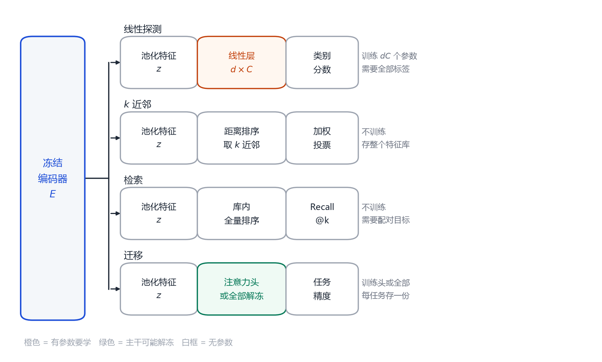
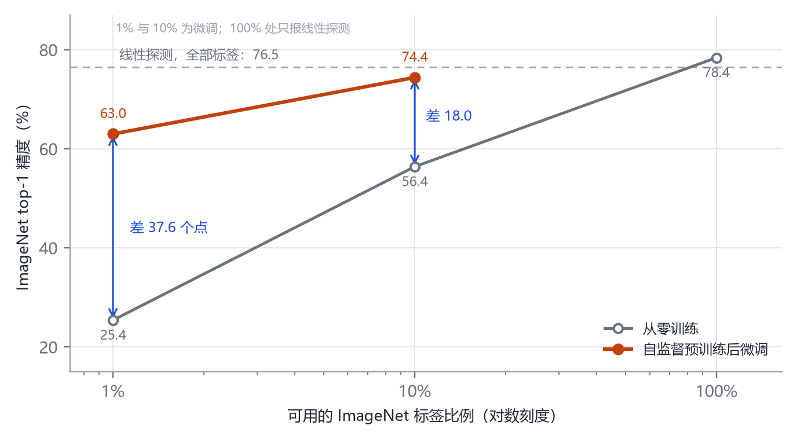
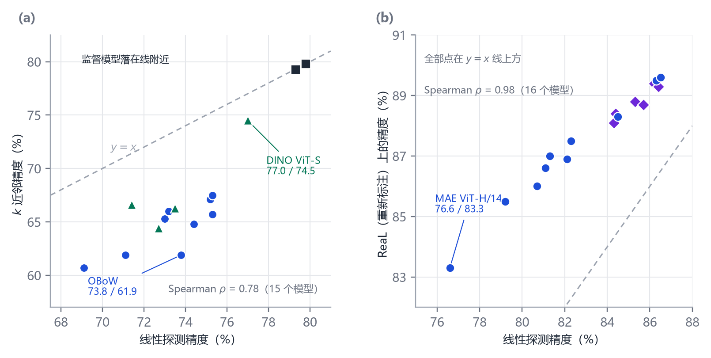
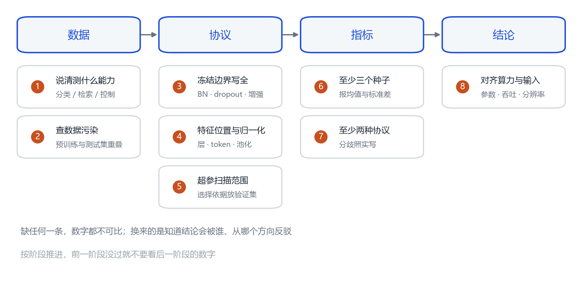

# 第 10 章　怎么判断一个表征好不好

买二手镜头的人都知道，卖家给的样片大多是逆光下的花、顺光下的猫，光圈全开，虚化漂亮，看上去没有一张不合格。真正判断一支镜头值不值那个价，得把它拧到自己的机身上，拍同一个人、同一面墙、同一段暗光，再放到电脑上逐张看边缘和暗角。表征的评测是同一件事：训练脚本最后打印的那个数，相当于卖家给的样片，它确实来自这套系统，也确实好看，可它不回答你真正想问的问题。

上一章把一次训练从数据到更新拆开看过，教的是怎么读损失曲线，怎么从曲线形状里认出过拟合、发散和平台。会看曲线是必要的一步，因为曲线坏了，后面的评测都不必做，模型自己都没收敛，测出来的数字只是噪声。但曲线好并不能推出表征好，这两件事之间有一条真实的缝，缝里藏着这一章要处理的问题。

缝有多大，可以用一组现成的数字量出来。同样是 ViT-H/14，用 MAE 的方式预训练之后，特征做 20 近邻分类只有 49.4% 的准确率，把同一份冻结特征接一个线性分类器能到 76.6%，两者差 27 个百分点。编码器没变，特征没变，变的只是读法，同一个 76.6 在一种读法下是"能用"，在另一种读法下是"很差"。这就说明单独一个百分比没有意义，必须连同"用哪种读法读出来的"一起说。

所以要换一个视角：不问模型在训练目标上做得多好，而问这个向量空间里，哪些东西被放在了一起，这个排布能不能被一段很便宜的读出头利用。四把常用的尺子都是这个问法的不同测法，它们的区别在于读出头有多复杂、要不要标签、算力花在哪里。这一章把这四把尺子逐个拆开，再看协议细节里最容易漏掉的六处，最后给一份八条的清单。

## 10.1　训练损失测的是别的东西

训练损失是一个代理任务的分数，代理任务与下游任务之间只共享一个编码器，其余部分各说各话。MAE 的代理任务是还原被遮住的像素，还原得好意味着编码器记住了颜色、纹理、边缘走向，这些都是像素层面的统计。分类关心的事情完全不同，它只要求"猫"和"狗"在空间里分成两堆，猫的毛色和背景纹理对它没有用处。当编码器把容量花在纹理上，线性探测还能从高维特征里挑出语义方向，kNN 就挑不出来，因为最近的邻居是沿着纹理排的，不是沿着类别排的。

塌缩是另一种更极端的错位。损失函数只约束"预测和目标要接近"，没有约束"不同的输入要得到不同的输出"，于是把所有输入映射到同一个点是一个合法解，损失为零，表征的秩为一。第 4 章讲过这个解为什么稳定，这里要记的是它的后果：损失曲线完美，下游全线崩溃。判断一个目标函数有没有这个漏洞，看它有没有显式限制输出之间的差异，负样本、方差项、白化都是补这个漏洞的办法。

还有一层更微妙的关系，损失下降的速度与表征变好的速度不同步。预训练早期的损失下降主要来自学会一些廉价的不变量，比如忽略整体亮度、对齐局部纹理，这些能力让损失掉得很快，却不一定让类别分得更开。到了后期，损失已经进入平台区，表征的几何还在缓慢调整，这时候停在半步和走完全程，损失差不了多少，线性探测能差一个点以上。用损失曲线去挑检查点，挑到的往往不是下游最好的那个。

不同方法的损失根本不能互相比较，这一点常被忽略。交叉熵、L1、平方误差、对比损失的量纲完全不同，同一份数据上一个 0.9 的对比损失和一个 2.3 的重建损失之间没有可比性，连“哪个更好”这个问题都不成立。能比的是同一条曲线在不同检查点上的形状，或者同一个目标两次运行之间的差别。论文里把两种方法的损失画在同一张图上，通常只是想说明两者都在下降，并没有给出“谁更好”的证据。

合理的做法是把损失当成体温计。体温能告诉你有没有发烧，判断不了你能不能跑完五公里；损失能告诉你训练有没有坏，判断不了表征有没有用。体温计坏了要先修，所以发散、NaN、长期不降这些毛病必须先排除，这一步不能跳。曲线正常之后，问题就交给外部尺子，而外部尺子的共同点是编码器冻结、读出头很小、只用一小段带标签的数据去问它能做什么。

冻结这个动作是整套评测的地基。一旦编码器参与训练，读出头就有机会把编码器改成它自己喜欢的样子，测出来的就不是"这份表征有多好"，而是"这份表征经过改造能有多好"。后者当然也有价值，但那是另一个问题，两者非常容易混为一谈。这也是四把尺子里最容易被含混过去的一处，后面的协议细节还会再碰到它。

## 10.2　四把尺子

线性探测（linear probing）是最常用的一把。把编码器冻住，把每张图过一遍得到特征向量，再把标签盖在上面训练一个线性层，输入是 $d$ 维特征，输出是 $C$ 个类别的分数，参数总共 $d \times C$ 个。训练到收敛，看验证集准确率。它测的是一件很具体的事：这些类别在特征空间里能不能被一组平面切开。能切开，说明语义信息已经被摆成了线性可读的形式；切不开，说明信息可能还在，但藏得太深。

这把尺子的读数在同一批模型上很稳定，绝对水平也不低。SimCLR 用 ResNet-50 的四倍宽度版本，线性探测在 ImageNet 上到 76.5%；DINOv2 的 ViT-g/14 到 86.5%；I-JEPA 的 ViT-H/14 用 300 轮预训练到 79.3%，同期 MAE 的 ViT-H/14 用了 1600 轮到 77.2%。最后一对数字值得停一下，因为架构一样、下游协议一样、数据一样，差别只在预训练目标，一个在特征空间里预测，一个重建像素，五倍的训练轮数没有补上这 2.1 个点。

线性探测也有明确的偏向。它偏爱“信息被摆成线性可读”的表征，会低估那些信息还在、但需要非线性才能读出来的表征。反过来，它容易被高维特征喂饱，维度越高，随便找一组平面把训练集切开的可能性越大，所以在小数据集上，维度大的模型天然占便宜，这个偏差与表征质量无关。同一个编码器换个池化方式、换一层特征，读数能变一两个点，10.3 会细说这些缝。

读出头本身可以换容量，线性是最保守的一档。往上换成两层 MLP，精度通常涨一两个点，涨的这部分说明信息在，只是需要一点非线性才能取出来；再往上换成注意力探测头，就接近冻结迁移了，测的东西也从“线性可分”变成“这套特征配一个小 Transformer 能做什么”。容量越大，读数越高，可比性越低，因为头本身的参数量和训练配方开始主导结果。一个实用的折中是线性与 MLP 两种探测一起报，两者差距大的模型，值得单独看看它的特征到底长什么样。

第二把尺子是 kNN。做法更简单，把训练集的特征全部存下来，来一个测试样本，算它和库里每个特征的余弦相似度，取最近的 $k$ 个让它们投票。DINO 的报告里扫过不同的 $k$，20 在多数设置下最好，于是 20 成了这套协议的默认值。整个过程没有参数要学，没有学习率要扫，一次前向就能跑完，代价只是存下整个训练集的特征。

这把尺子量的是局部紧致性。同一个类别的样本如果挤在一起，最近的邻居几乎都同标签，kNN 就高；如果类别之间只是能被一个平面分开，同类样本却散得很开，kNN 就低。数字上的差别很明显，SimCLR 的 ResNet-50 线性 69.1、kNN 60.7，差 8.4 个点；BYOL 的 ResNet-50 是 74.4 对 64.8，差 9.6 个点；而监督训练的 ResNet-50 两项都是 79.3，几乎不差。监督信号把同类样本压成一团，自监督目标只要求"这两张图是同一张图的两种变形"，没有要求同类样本互相靠近。

也正因为便宜，kNN 常被拿来当训练过程的监控指标。DINOv2 的作者写明他们优化时看的是 kNN，理由是线性探测的精度被 kNN 从下方托住，一个模型如果 kNN 上不去，线性探测也很难高；而且线性探测对学习率敏感，同一份特征跑两次能差出不小的幅度，kNN 没有这个问题。这句话本身就是一条评测经验，先用便宜、方差小的指标筛，再用贵的指标确认。

第三把尺子是检索。准备一个库和一个查询集，每个查询在库里按特征距离排序，看正确的目标有没有落进前 $k$ 名，

$$
\mathrm{Recall@}k=\frac{1}{|Q|}\sum_{q\in Q}\mathbf{1}\left[\mathrm{rank}(q)\le k\right],
$$

$Q$ 是查询集，$|Q|$ 是查询的个数，$\mathrm{rank}(q)$ 是查询 $q$ 对应的正确目标在排序里的位置，$\mathbf{1}[\cdot]$ 是条件成立取 1、不成立取 0 的指示函数。这个数说的是排序对不对，不是分类对不对，两者在标签空间里的含义不同。

检索的用处在于它不需要类别体系。很多东西说不清属于哪一类，却能说清"这两个是同一个东西"，指纹、商品图、同一段厨房操作的不同时刻都属于这一类。V-JEPA 2 在 Epic-Kitchens-100 的动作预测任务上报的是 recall-at-5 39.7，相对此前最好成绩提升 44%，这个任务要求模型看完一段视频后预测接下来几秒会发生什么，正确答案是 3568 个动作标签里的一个，用 recall-at-5 而不是 top-1，是因为动作的起止边界本身就带歧义。

检索最容易骗人的地方是库的大小。在一万张的库里排进前十，比在一百万张的库里排进前十容易得多，同一个模型在两个库上的 R@10 可以差十几个点，所以报告里必须写清库有多大、查询集有多少、距离用余弦还是欧氏。这条要求看起来是格式问题，实际上是可比性问题，不写库大小，数字就没有分母。

检索还有几个变体值得知道。R@k 只看命中，不看排序的质量，改进版是平均精度（mean Average Precision，mAP），把每个查询的排序曲线下的面积算出来再平均，对“正确目标排在第 3 还是第 30”更敏感。DINOv2 在 Oxford-M 上报的就是 mAP，他们还发现 KoLeo 这一项正则让实例检索提升 8% 以上，而分类指标几乎不动，说明检索测的是特征在样本层面的分散程度，跟类别可分性不是同一件事。

第四把尺子是迁移，分两档。冻结主干、只训练一个比线性层更复杂的头，叫冻结迁移，V-JEPA 2 用的就是这一档，编码器不动，上面接四层 Transformer 组成的注意力探测头，最后一层用一个可学习的查询向量做交叉注意力，把整段视频的 patch 特征汇总成一个向量再分类。放开全部参数一起训练，叫微调，DINOv2 的 ViT-g/14 线性 86.5、微调 88.5，涨 2 个点。

这两档测的不是同一件事。冻结迁移测"这份特征作为特征有多好"，微调测"这份特征作为初始值有多好"，一个模型可以特征很强而微调收益很小，也可以特征一般但微调之后追上来。微调的代价是每个下游任务存一份完整模型，一个十亿参数的编码器接十个任务就是十份权重；而且微调会把表征改掉，测完之后它已经不是原来那个东西，同一份预训练权重没法回头再用于别的任务。

四把尺子摆在一起，差别可以归到三个维度上：读出头有多复杂，从零参数到全部参数；要不要标签，检索和 kNN 都不要；算力花在哪里，训练读出头、存特征库、还是跑整段微调。图 10-1 把它们画在同一条编码器后面，四条支路共用左边那个冻结的方块，右侧的说明写清每一路在训练什么、需要什么条件。

<figure class="fig">

<figcaption><b>图 10-1</b>　四种评测协议。四条支路共用同一个冻结编码器，橙色表示有参数要学，绿色表示主干可能被解冻。右侧标出每种协议要训练什么、需要什么样的数据。</figcaption>
</figure>

图里最右边那一列是四种协议各自的盲区。线性探测看不见非线性可读的信息，kNN 看不见"线性可分但局部不紧"的结构，检索依赖库的构成，微调会把被测对象改掉。四把尺子没有一把能单独给出结论，实践中的做法是至少跑两种，看它们是否指向同一个方向；两个协议分歧的时候，分歧本身比任何一个数字都更有信息量。

## 10.3　协议里的六个细节

冻结这个词听起来没有歧义，实现起来其实有很多缝。CNN 里的批归一化层在前向时会更新滑动均值方差，不切到评估模式，测试样本的统计量就和训练时混在一起，读数会飘；ViT 里没有这个问题，但 dropout 与随机深度必须关掉，否则同一个样本过两遍会得到两个特征。数据增强也要停，训练时的随机裁剪在评测时应该换成确定性的中心裁剪，尺寸还要和预训练时对齐，差几个像素就会影响位置编码的插值。

取哪一层、取哪个位置，是第二个容易含糊的地方。分类任务通常取最后一层的类别 token，或者对所有 patch 特征做平均池化，I-JEPA 的做法是两者都试，从平均池化和最后四层平均池化拼接里挑较好的那个，因为它的预训练目标里没有类别 token 这一项，那个位置的向量没有得到过专门训练。密集预测任务要 patch 级特征，取全局向量会把位置信息抹掉。写报告时"用最后一层特征"这句话不够，要说清是哪个位置、怎么池化。

归一化与度量是第三个。特征做了 L2 归一化之后，点积等于余弦，距离被压到 $[-1,1]$ 之间，线性层和 kNN 的行为都会变；不做归一化，模长大的样本会主导距离，一个亮度高的样本能把整批邻居换掉。白化是更强的处理，减均值、除协方差，把特征空间的各向异性压平，线性可分性通常会上涨，但白化矩阵是从数据估出来的，估得不准会把有用的方向一起抹掉。

输入分辨率与帧数是第四个，也是最容易被忽略的一个。V-JEPA 2 的 ViT-g 在 256 分辨率下 SSv2 是 75.3，ViT-g384 在 384 分辨率下是 77.3，可这两个数字之间不只有分辨率，后者还用了 64 帧而不是 16 帧，空间裁剪从 3 个加到 8 个，时间裁剪也从 2 个加到 8 个。2 个点里没有任何一份可以单独归给分辨率。看到“我们的模型高了两个点”这种说法，要先问清除了模型还换了什么。

视频任务还要多一层聚合。V-JEPA 2 的评测里，每个测试样本要抽若干个片段，每个片段再做若干空间裁剪，所有裁剪的预测取平均才算一个样本的答案，SSv2 用 16 帧、2 个时间裁剪、3 个空间裁剪，K400 用到 8 个时间裁剪。裁剪数从 3 加到 8，精度能涨一截，这一截既不属于模型也不属于表征，属于你把同一个测试样本看了几遍。报告里不写这个数，跳论文比较就没有基准。

类别不平衡是第五个。ImageNet 的验证集每类五十张，平衡得不像真实世界；换成医院的影像、工厂的缺陷图，正类可能只占百分之一。这时候 top-1 会被多数类吃掉，一个把所有样本都判成"正常"的分类器能有 99% 的准确率，看上去无可挑剔。合适的指标是每类召回率的平均，或者宏平均 F1，kNN 在长尾数据上尤其吃亏，因为头部类的样本多，最近的邻居里几乎全是它们。

测试集本身有版本问题。同一个 DINOv2 ViT-g/14，在 ImageNet 验证集上线性探测 86.5%，在重新标注过的 ReaL 版本上是 89.6%，差距来自原验证集里标错的那些图，它们把上限压低了。换到重新采集的 ImageNet-V2，数字又会往下掉，因为拍摄条件和分布都变了。三个数字都是真的，说的是三件事，原始标注里的噪声、干净标注下的上限、分布偏移下的泛化，论文里写"ImageNet 86.5"通常指第一个。

还有一件和统计有关的小事。验证集五万张时，一个百分点对应五百张图，看起来精细；换成自己划的一万张测试集，80% 的精度对应的标准误是 $\sqrt{0.8\times0.2/10000}\approx0.4$ 个百分点，两个标准误就是 0.8，两个模型差 0.5 个点在统计上分不开。这个算式很便宜，却能让很多"轻微提升"的结论变得诚实。

标签预算决定了这些细节有多重要。标签越少，探测的方差越大，不同表征之间的差距反而越明显。SimCLR 的实验里，用 1% 的 ImageNet 标签微调，自监督预训练的 ResNet-50 到 63.0%，从零训练同样架构只有 25.4%，差 37.6 个点；标签加到 10%，两者变成 74.4% 对 56.4%，差距缩到 18 个点；标签全给，冻结特征的线性探测是 76.5%，从零训练能到 78.4%，预训练的优势几乎消失。

<figure class="fig">

<figcaption><b>图 10-2</b>　精度随标签比例的变化。两条曲线的差距从 1% 处的 37.6 个点缩到 10% 处的 18 个点，全量标签时预训练不再占优。虚线是冻结特征的线性探测，100% 处原文未给全量微调的数值。</figcaption>
</figure>

图 10-2 的两条曲线因此不是"预训练总是更好"的证据，而是"预训练的收益集中在标签稀缺的一端"。这条规律对评测有直接的含义，如果你的下游任务有上百万张标注，用线性探测上的差距去推断微调之后的差距，多半会高估。少标签的实验才看得出表征的差别，而少标签实验的方差也最大，两件事要一起考虑。

## 10.4　六个容易骗人的地方

在测试集上调超参是最常见的一种。线性探测有几个超参要扫，学习率、权重衰减、训练轮数、要不要用 LARS，如果每扫一组就在测试集上看一次分数，最后报的是这组超参在测试集上的最好成绩，不是这份表征的真实水平。I-JEPA 的做法是把范围写进论文，扫三个参考学习率和两个权重衰减，选择依据放在验证集上，这个流程本身就可以抄。判断一篇论文有没有踩这个坑，看它有没有写清扫描范围。

单种子是第二种。自监督预训练从随机初始化开始，数据顺序、增强采样、负样本构成都带随机性，同一份配方跑两次，线性探测差半个点是常事。要判断两个模型的差别是不是真的，至少三个种子，报均值和标准差；如果误差棒重叠，正确的结论是"这次实验没有分辨出差别"，而不是"我们的方法略好"。这句话说出来不好听，但它能省下后面几个月的返工。

第三种是挑指标。DINOv2 的消融表里有两行很能说明问题，加上 LayerScale 和较高的随机深度之后，kNN 涨 0.9 而线性探测掉 1.2；把原型数加到 12.8 万，kNN 涨 1.2 而线性探测掉 0.1。同一份改动在一个指标上是进步，在另一个指标上是退步，报告里只出现有利的那一个，读者就没法知道另一面。KoLeo 项的效果正好相反，它让实例检索提升 8% 以上，其他指标几乎没动。

第四种是把不同规模放在一起比。DINO 的对比表里同时列了参数量和每秒处理的图片数，一个 375M 参数的 ResNet 打赢 23M 的 ResNet 不算本事，同算力下的比较才有意义。I-JEPA 的论文专门强调它在相同算力预算下比 MAE 好，这个说法比"我们的精度更高"严格得多。评测报告里出现"我们的模型在某个基准上更好"，值得先找一找算力那一栏在哪里。

第五种是数据污染。预训练数据从网上抓，下游测试集也在网上，两者之间可能藏着近重复的图片，一旦有，线性探测会虚高，因为模型在预训练时就见过答案的近似版本。DINOv2 在构建 LVD-142M 时专门做了去重和检索，这类工作在论文里通常只有一段，但它决定了后面所有下游数字的可信度。评估一份表征时，“预训练数据里有没有这个测试集”这个问题必须有人回答，回答不了，数字就只能当作上限来看。

第六种是基准饱和。ImageNet 验证集上排名靠前的线性探测都挤在 86 到 87 之间，DINOv2 的 ViT-L/14 是 86.3，ViT-g/14 是 86.5，差 0.2 个点，而五万张验证集上这个差别的标准误比它更大。在这种区间里报“我们高 0.2 个点”，实际上是在报一次掷硬币的结果。合理的做法是换更难的基准，或者报多个基准的平均，让真实的差别有机会从噪声里露出来。

这五种问题的共同点是它们都不改变模型，只改变读数的解释。模型没变，特征没变，数字变了，因为协议里藏了一个选择。图 10-3 用两组真实数据说明同一件事的另一面，不同指标之间的相关性很高，差距却可以大到二十多个点，一个数字代表不了一份表征。
<figure class="fig">

<figcaption><b>图 10-3</b>　三种指标的一致性。(a) 十五个模型的线性探测与 $k$ 近邻精度，监督模型落在线附近；(b) 十六个模型在干净标注上的精度，全部点都在对角线上方。两个面板的相关系数由脚本从原始数值算出。</figcaption>
</figure>

左边那组是 DINO 论文表 2 里的十五个模型，横轴线性探测、纵轴 kNN，两列的排序大体一致，说明它们测的方向有重叠；自监督的那十三个点全落在对角线下方，差 2.5 到 11.9 个点，两个监督训练的点正好落在线上。右边那组是 DINOv2 论文表 4 里的模型，横轴线性探测、纵轴 ReaL 上的精度，所有点都挤在右上方，因为干净标注让每个模型的分数都往上走，相关系数到 0.98。

图里最扎眼的是 MAE 那个点。它的 kNN 只有 49.4，比同样 ViT 架构的 DINO ViT-S/8 低 29 个点，线性探测 76.6 却只低 2.6 个点。一个指标说它差得离谱，另一个说它还算能用，两个说法都对，因为它们问的是不同的问题：像素重建训练出来的特征把语义信息留在了高维的线性组合里，没有压成局部聚类，线性层能顺着方向找出来，最近的邻居找不出来。

## 10.5　八条清单

把前面几节收成一张可执行的清单，每次评测之前过一遍，缺哪条补哪条。清单的价值不在于全面，而在于把那些"默认大家都这么做"的约定写出来，让不同实验室的数字能放在一起看。图 10-4 把这八条按四个阶段排开，从左到右是数据、协议、指标、结论，前一阶段没过，后一阶段的数字就不用看了。

<figure class="fig">

<figcaption><b>图 10-4</b>　评测清单的四个阶段与八条检查项。数据与协议决定数字能不能被人复现，指标与结论决定数字能不能被人相信，前一阶段没过，后一阶段的数字就没有意义。</figcaption>
</figure>

前两条管数据。

1. 说清测的是什么能力。分类、检索、密集预测、控制各自对应不同的协议，用分类协议去评价一个为控制训练的表征，结论没有意义，因为它测的是语义的可分性，不是动力学的可预测性。同一次评测里如果混了两种能力，报告要分开写。
2. 交代预训练数据与测试集的关系。去重做过没有，测试集是原始版本、重新标注的版本，还是重新采集的版本，预训练语料里有没有这个数据集。这一条写不清，后面的数字只能当上限看。

中间四条管协议。

3. 冻结的边界写全。哪些层参与、批归一化在什么模式、dropout 与随机深度关没关、增强换成了什么。这些细节单独看都像琐事，合起来能解释一个点的差距。
4. 特征的位置与归一化写全。哪一层、哪个 token、怎么池化、有没有做 L2 归一化或白化。跨论文比较时，这一条不一致的比例最高。
5. 读出头的超参扫描范围与选择依据。范围要写，验证集怎么划要写，最优点的曲线也要给，只报一个最好成绩等于没报。
6. 随机种子至少三个，报均值和标准差。差 0.3 个点就说"更好"，在大多数视觉基准上站不住。

最后两条管结论。

7. 至少跑两种协议，把分歧写出来。线性探测高而 kNN 低，说明表征是线性可分但不局部紧致，这个信息比任何一个单一分数都有用；两个协议都高，结论才稳。
8. 对齐算力与输入。参数量、吞吐、分辨率、帧数、裁剪数，五项里少写一项，别人就没法判断你赢在哪。同算力下赢才叫赢，同输入下赢才叫表征好。

这八条里最容易被跳过的是第六条和第七条，因为它们让结论变弱。多种子会把"提升了 0.6 个点"变成"没有分辨出差别"，双协议会把一个漂亮的数字变成两个互相牵制的数字。评测的目的不是让结果好看，而是让自己知道在哪里会被反驳，一份经得起追问的评测，通常比一份漂亮的评测更值钱。

## 10.6　尺子本身也要校准

回到开头那个问题，一个表征好不好，取决于你要它做什么。分类要线性可分，检索要局部紧致，控制要平滑可预测，三个要求落在同一个向量空间里会互相拉扯，把类别压得越紧，局部细节丢得越多，预测下一帧就越难。没有一份表征能在这三件事上同时做到最好，这也是同一个编码器在不同论文里排名会不一样的原因之一。

能做的事是把尺子校准好，再接受它的局限。校准的意思是知道每一把尺子测什么、偏向什么、在什么条件下会给出错误的读数，知道读数的误差有多大，知道两个数字差多少才算真的有差别。做完这些，76.6 和 79.3 才有意义，否则它们只是两个百分比，谁高谁低全看是谁报的。

## 10.7　把评测嵌进训练流程

训练脚本隔若干轮存一次检查点，挑哪个不能只看验证损失。预训练的验证损失衡量的是代理任务，而你要的答案在另一套读法里，两者在后期经常分道扬镳，损失进了平台，线性探测还在缓慢爬升。做法是划一小份带标签的验证集，固定一种便宜协议，逐个检查点跑一遍，再按这套协议的分数挑。验证集和协议都在挑选之前定好，测试集只在最后被读一次。

挑选本身会消耗精度预算。一万张验证集上 80% 的精度对应 0.4 个百分点的标准误，从十个检查点里取最高的那一次，取到的往往是噪声偏上的，峰值因此比真实水平高出一截。这笔乐观偏差如果又被算进最终结果，读者拿到的就是一个偏高的数字，而他无法还原。把挑选和报告拆成两个动作就能避开，前者在验证集上做，后者在测试集上只做一次，验证集曲线作为选择依据附在附录。

另一件要固定的是评测脚本，预处理、特征归一化、读出头超参，只要有一处变动，两次评测就不可比。预处理要写清裁剪尺寸、像素怎么减均值除方差、视频抽几帧、时空各裁几次，10.3 列过这些缝有多宽。特征这一侧要写清取哪一层、哪个位置、怎么池化、做没做 L2 归一化。读出头这一侧要写清学习率、权重衰减、批大小与训练轮数。把这些收进一个带版本号的配置文件，日志里打印出来，同版本号的数字才允许并排进表。

工程上还能再省一点，否则固定协议迟早被绕过。特征只跟检查点和预处理有关，可以只算一次，存盘时把检查点哈希与预处理版本写进文件名，超参扫描在这份缓存上做，换一组参数只要几分钟。测试集的特征同样缓存，缓存之后锁到报告定稿。这条约定挡的是“再看一眼”的诱惑，因为看过测试集之后做的任何决定都会让数字失效。

报告里给一个数字时至少要带上三样东西，种子数、标签比例、协议名。种子数决定它有没有误差棒，只跑一个种子时，79.3 这个数落在哪一侧全看初始化。标签比例决定它在讲曲线的哪一段，1% 与 10% 的差距比很多方法之间的差距都大。协议名决定它是在哪种读法下取的，线性探测与 kNN 不在同一个刻度上。表 10-1 是直接照抄的模板，哪一栏填不出来，那次实验就还缺一块。

**表 10-1**　一份评测报告模板。左列是字段，中列写填什么，右列写漏掉的后果。

| 字段 | 填什么 | 漏掉的后果 |
|---|---|---|
| 协议 | 线性探测、kNN 写明 $k$、检索写明库大小 | 读数没有刻度 |
| 读数 | 测试集上保留一位小数的数 | 说不清从哪里来 |
| 标签比例 | 1%、10%、100%，注明是读出头的比例 | 不知在曲线哪一段 |
| 种子数 | 至少三个，报均值与标准差 | 分不清差别与噪声 |
| 超参范围 | 学习率与权重衰减的扫描区间，依据在验证集 | 无法复现 |
| 输入设置 | 分辨率、帧数、空间与时间裁剪数 | 赢了不知道赢在哪 |

把这张表填满，一次评测才算做完，填不满的地方就是下一轮实验的清单。数字之间能互相说话，半年之后回头看才有判断可做，而不是对着一堆百分比猜哪个更好。这套流程还默认标签干净、类别固定，等文字接进来，连一个样本该对应几个标签都要重新约定，那时候这张表还要多出几栏。多出来的那一栏往往最难填，也最值得先想清楚。

这一章讲的都是图像和视频，标签是一张图一个类别，检索是图找图，被测的东西和测量的手段在同一种模态里。把文字接进来之后，评测会立刻变难，两个模态的向量被放进同一个空间，尺子要同时量两种东西，"这一段文字描述的那张图"和"这张图"之间的距离怎么算才对，标签又该由谁来定。第 11 章从 CLIP 的双塔结构讲起，看图文对齐是怎么把两个空间压成一个的。
