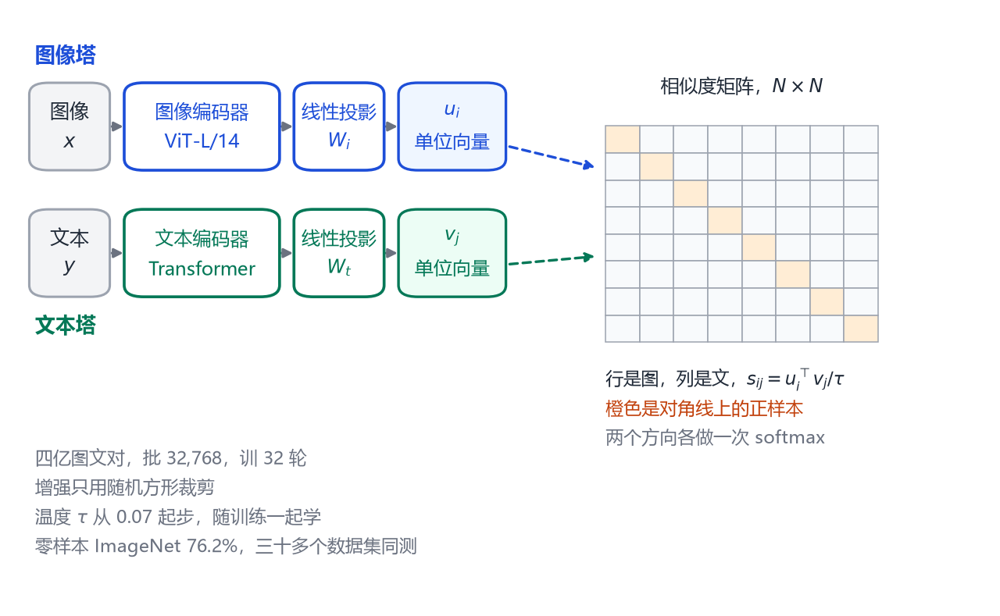
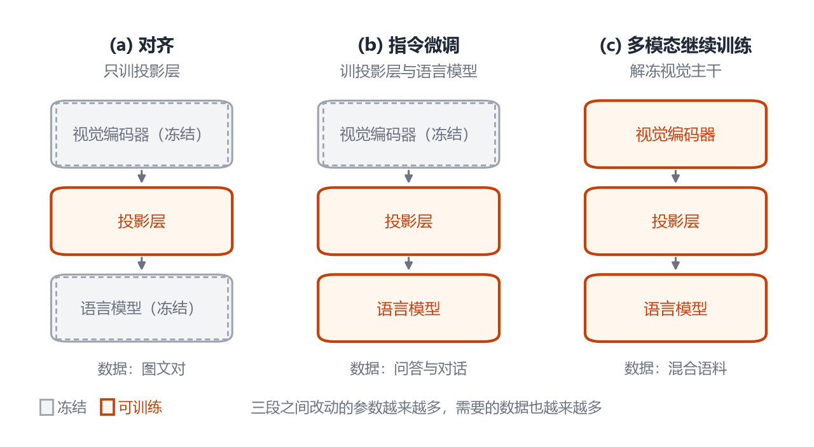
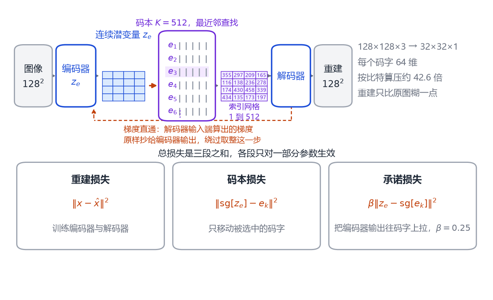
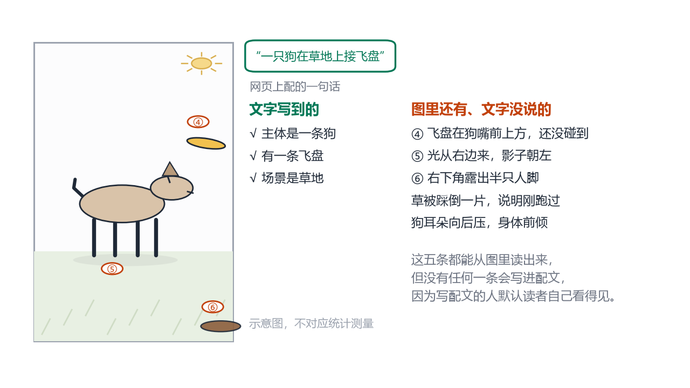

# 第 11 章　从文字到图像

第 10 章讲的是怎么判断一个表征好不好，那把尺子对所有表征都成立，不管它是怎么训出来的。前面几章里的表征都是从像素自己长出来的，对比学习靠同一张图的两个视图，掩码方法靠遮住一块再补回来，世界模型靠预测下一帧，这些办法的共同点是没有人告诉模型"这张图里是什么"，所有约束都来自图像内部的结构。这一章换一个监督来源，用文字。网页上一张图和它旁边那句话天然构成一对，把它们放进同一个空间，图这边得到的向量就能被一句话检索到，反过来也成立。

这件事在 2021 年被做到了足够大的规模。Radford 和几位合作者从互联网上收集了四亿个图文对，训练出一个叫 CLIP 的模型（Contrastive Language-Image Pre-training，对比语言图像预训练）。最好的那个版本在 ImageNet 上做零样本分类拿到 76.2%，追平了当年用一百二十八万张标注图训出来的 ResNet-50，而它一张 ImageNet 的图都没见过。

值得先看清这个任务到底要求什么。给模型一批图、一批句子，让它判断哪句话配哪张图，看起来比"分成一千类"简单，其实要求更细。判断的对象是一整句话，词序、修饰关系、"叼着"还是"追着"都要落进向量里，否则同一张图的两句不同描述就分不开。它不需要输出标签，只需要把配对的两条拉近、把不配对的推开，这一点和第三章的对比学习是同一件事，只是正样本换成了另一种模态。

这一章分四步。先看双塔结构和它的损失，再看 SigLIP 把 softmax 换成 sigmoid 之后为什么小批量也能训，然后看视觉语言模型怎么把对齐好的编码器接进语言模型，最后看图怎么被压成一串离散码。收尾那一节要说清楚一件事，对齐是入口，不是理解。

## 11.1　两张塔与一张相似度表

CLIP 的结构朴素得有点出人意料。一张图进图像编码器，一句话进文本编码器，两个编码器互不相干，各自输出一个向量，再各接一个线性投影，把向量送到同一个维度上。两个向量都做 L2 归一化，长度变成 1，于是它们的点积就是夹角的余弦，取值落在负一到一之间。如图 11-1 所示，整个模型就是两座塔加一张相似度表，塔与塔之间除了最后那一次点积，没有任何信息交换。

<figure class="fig">

<figcaption><b>图 11-1</b>　CLIP 的双塔结构。图和文各自经过编码器与线性投影，归一化后两两求余弦，得到一个方阵，橙色对角线是正确配对，训练就是让对角线变亮、其余变暗。</figcaption>
</figure>

训练时取一个批，比如 32,768 对图文，图像侧得到 32,768 个向量，文本侧也得到这么多，两两做点积就得到一个三万二千多行、同样多列的方阵。对角线上的元素是真正配对的那一对，其余全是负样本，目标很直接，让对角线上的数变大，让其他位置的数变小。写成式子就是对称的 InfoNCE 损失

$$
L=-\frac{1}{2N}\sum_{i=1}^{N}\left[\log\frac{e^{s_{ii}/\tau}}{\sum_{j=1}^{N}e^{s_{ij}/\tau}}+\log\frac{e^{s_{ii}/\tau}}{\sum_{j=1}^{N}e^{s_{ji}/\tau}}\right].
$$

式子里 $N$ 是批大小，$u_i$ 是第 $i$ 张图的向量，$v_j$ 是第 $j$ 句话的向量，$s_{ij}=u_i^{\top}v_j$ 是它们的余弦相似度，$\tau$ 是温度，$e$ 是自然常数。括号里第一项固定一张图，在所有句子里挑出配对的那句；第二项固定一句话，在所有图里挑，分母换成了这一列的和。

两个方向都要，因为两个方向的候选集不一样。一张图通常只配一句话，一句话却可能配好几张图，只做一个方向，模型会学会用"最像的那张"敷衍过去，另一边的排序就烂掉了。这也是对比学习里那句老话的具体版本：负样本的分布决定了模型学到什么，图找文和文找图面对的负样本分布并不相同。

数据的构造方式比损失更影响最终能力。四亿对图文不是随机抓的，而是用五十万个查询词去搜，把每条查询返回的结果收下来，尽量覆盖广的视觉概念；一个概念如果没有人搜过，它就不在训练集里。这个做法有一个直接后果，训练集的分布反映的是搜索行为而不是世界的分布，热门概念能有几十万张图，冷门概念可能一张都没有。数据也没有经过人工清洗，只做了去重，所以噪声比例相当高，而对比学习对这种噪声的容忍度，恰恰是靠大批量和大量负样本撑住的。

温度 $\tau$ 控制 softmax 的软硬。$\tau$ 小，指数被放大，分布尖锐，梯度几乎全落在最难的几个负样本上；$\tau$ 大，分布平缓，所有负样本都被温和地推开，但学到的边界会松。CLIP 没有把 $\tau$ 当超参去调，而是把它写成可学习的参数，初值取 0.07，并且把 logits 的缩放上限卡在一百倍，因为训练早期温度太小会让梯度爆掉。这个 0.07 后来几乎成了默认值，很多复现直接固定住不再学。

零样本分类的读法值得单独说一句。把数据集的类别名做成一批句子，"一张狗的照片""一张猫的照片"，送进文本编码器得到一组向量；来一张新图，算它和每个类别向量的相似度，取最大的那个当答案。换个角度看，文本编码器相当于一个超网络，它读一句话就生成一组分类器的权重，图像编码器只是把图映射到能让这组权重直接乘上去的空间里。CLIP 论文自己给了一个更锋利的说法，每一步预训练都相当于在一个有三万二千多个类、每类只有一个样本的代理数据集上做优化。

结果这一栏，76.2% 的零样本 ImageNet 准确率是常被引用的那个数，top-5 是 95%。更值得看的是它在三十多个数据集上的整体表现，OCR、地理定位、动作识别都能零样本做，不少任务上接近全监督的专用模型，但在细粒度分类和计数上明显吃力。代价也不小，最大的 ResNet 版本在 592 块 V100 上训了 18 天，最大的 ViT 版本在 256 块 V100 上训了 12 天，这在 2021 年是相当大的开销。

有两个细节容易被忽略，却直接决定了后来能不能复现。一个是增强，CLIP 只用了随机方形裁剪，没有颜色抖动，也没有高斯模糊，理由是数据量足够大，过拟合不是主要矛盾。另一个是投影层，它只有一层线性变换，没有用 SimCLR 那种带激活的两层多层感知机。作者说两种写法在训练效率上看不出区别，并猜非线性投影在纯自监督里更重要，是因为它要和图像增强的细节相互适配。

把这几件事放在一起，能看出一条很明确的设计哲学。目标函数只买"配对的排前面"这一件事，其他都不要，它不要求模型知道图里有几个物体，也不要求它理解"没有"这个词的作用，只要在这三万多条候选里把正确的那条挑出来。这个要求足以逼出一套相当通用的视觉表征，也正好划出了它的能力边界，第五章末尾提到的那些失败案例，根子都在这里。

## 11.2　把 softmax 换成 sigmoid

softmax 那个分母是个麻烦。它要对整个批的所有相似度做归一化，分布式训练时每块卡只算了自己那一小片，得把所有卡上的向量收集起来才能算出分母，这一步叫 all-gather。批越大，通信量越大，显存也越吃紧，而对比学习又偏偏需要大批才有足够多的负样本，两件事互相拉扯了几年。

SigLIP 的做法是把"多选一"改成"逐对判断"。每一对图和文都当成一个独立的二分类问题，配对的标签是正，不配对的标签是负，用 sigmoid 加交叉熵，所有对加起来取平均，写成式子

$$
L=-\frac{1}{N}\sum_{i=1}^{N}\sum_{j=1}^{N}\log\sigma\!\left(z_{ij}\left(t\,u_i^{\top}v_j+b\right)\right),
$$

其中 $\sigma$ 是 sigmoid 函数，把任意实数压到零到一之间；$z_{ij}$ 是标签，配对时取 $+1$，不配对时取 $-1$；$t$ 是温度，实际优化的是它的对数，保证始终为正；$b$ 是一个可学习的偏置。标签带着符号乘进 logits 里，正样本希望 logits 越大越好，负样本希望越小越好，一个式子同时管两边，而且它关于图和文是对称的。

这一改最直接的后果是不再需要全局分母。每一对的损失只跟这一对有关，梯度可以本地算完，不必把整批向量收集到一处，显存和通信都不再随批大小成比例膨胀。论文的说法是"把批大小和任务的定义解耦"，意思是任务不再隐含地定义成"在这批里挑一个"，而变成"判断这一对配不配"，批只影响估计的方差，不影响任务的形状。

小批量下的差别很大。用 softmax 时批小了负样本就少，模型很容易落到一个平庸的解上；换成 sigmoid 之后，批小于一万六时优势明显，随着批增大差距逐渐缩小，到三万二左右基本追平，再往上两者的收益都开始饱和。论文里还把批推到一百万试过，能训起来，但没有更好，结论是"三万二就够，不必为了负样本数量去堆卡"。

偏置那一项看着像个小修补，作用却比想象中大。sigmoid 目标里负样本的数量远多于正样本，训练初期模型为了压低损失，会把所有 logits 一起往下压，正样本也被压得没有区分度。加一个初值为 $-10$ 的偏置，等于把起点挪回"配对与不配对大致均衡"的先验附近，早期的过度纠正就不会发生。论文在八千的批、九亿个样本上做了消融，ImageNet 零样本从 62.0 提到 63.0，Oxford Pets 从 81.8 提到 82.4，CIFAR-100 从 59.9 提到 61.0，三个数据集同向；把偏置初值换成 0，三项都掉回去。

换损失不是没有代价。softmax 的分母天然保证"一行里只有一个正样本"，这种排他性对图文对是合适的约束；sigmoid 把每一对独立看待，等于放弃了它，配对的唯一性只剩标签在表达。换来的好处是抗噪，网页图文对里有大量错配，sigmoid 对这种噪声更稳，论文里把图像换成均匀噪声、把文本换成随机词、把批内配对顺序打乱，三种腐蚀下 sigmoid 训出来的模型掉得都更慢。

效率上有一组数字能说明变化有多大。SigLiT 用四块芯片训一天就到 79.7% 的 ImageNet 零样本，SigLIP 从零开始训五天、32 块 TPUv4 到 73.4%，论文给出的对照是 CLIP 大约需要 10 天、256 块 TPUv3。这组对比出自 SigLIP 自己的论文，口径未必完全对齐，但数量级的差别是清楚的，省下来的主要是通信和显存，不是算力本身。

规模还在往上走。按 DINOv3 论文的梳理，SigLIP 2 和 Perception Encoder 这类模型已经在四百亿对以上的图文数据上训练，其中最大的 Perception Encoder 读了八百六十亿个样本，全局批大小十三万一。这个量级已经和语言模型的语料同一档次，说明"用文字监督视觉"这条路并没有撞到天花板，只是越来越贵，而且贵的部分不在模型结构上。

## 11.3　一根投影层与三段训练

视觉语言模型（Vision-Language Model，VLM）的骨架可以写成一串三个部件：视觉编码器、投影层、语言模型。如图 11-2 所示，图进来，编码器把它变成一组特征，投影层把特征翻译成语言模型能读的词向量，语言模型接着往下生成。整件事里最不起眼的是中间那一小段，参数量常常只占千分之几，但它决定了两个空间能不能接上、接上之后能不能用。

<figure class="fig">

<figcaption><b>图 11-2</b>　VLM 三段训练的一般写法。灰底虚线框是冻结的参数，橙色是这一步可训练的参数，从左到右被改动的部分越来越多，需要的数据和算力也随之增加。</figcaption>
</figure>

投影层有两种常见写法。一种是单层线性映射，LLaVA 的第一版用的就是这个，好处是参数少、训得快，坏处是它只能做仿射变换，视觉特征和词向量之间的差异如果太大就补不回来。另一种是两层带激活的多层感知机，容量大一些，能拟合更复杂的对应关系。V-JEPA 2 把视频编码器接到 Llama 3.1 8B 上时用的就是不带池化的多层感知机，每帧出 288 个视觉词元，直接铺在文本词元前面。

训练通常分三段，分段的依据不是数据量，而是这一步允许改动哪些参数。第一段叫对齐，视觉编码器和语言模型都冻住，只训投影层，数据是图文对，目标是让视觉特征落进词向量空间里合适的位置。这一段最便宜，也最安全，因为它不会破坏任何一边已经学好的东西。代价是能补的东西有限，投影层只会做翻译，翻译不出来的部分只能留在原地，这就是第十三章讲拼接时那个线性层 $h$ 的容量问题。

第二段叫指令微调，视觉编码器仍然冻住，投影层和语言模型一起训，数据换成问答和对话。这一段教的是格式和任务，看到图之后该按什么方式回答，什么时候该说"图里没有"，什么时候该给出一个数。风险也在这里，语言模型的容量远大于投影层，如果数据里的问题有一半可以靠常识猜对，模型很快会学会不看图直接答，因为那条路更省力。这种现象在文献里被反复报告，检测办法是把图换成空白或者换成别的图，看答案掉多少。

第三段叫多模态继续训练，视觉编码器也解冻，混入纯文本语料，用更大的数据量一起训。这一段的作用是让视觉特征反过来适配语言模型的需求，而不只是被翻译过去。V-JEPA 2 的缩放实验里，把编码器从三亿参数加到十亿、输入分辨率从 256 提到 512，视频问答的平均分随之上升，说明这一段不是可有可无的收尾。代价是灾难性遗忘，视觉编码器原本擅长的细粒度识别会退化，纯文本能力也会掉，所以纯文本数据必须混进去当锚。

V-JEPA 2 提供了一个按数据分段的版本，和上面按参数分的版本对照着看很有意思。它的第一段只用图像描述训投影层，第二段用大规模图像问答训整个模型，第三段换成视频描述与视频问答，让模型逐步适应从静态图到连续帧的输入。编码器在整条流程里可以冻住，也可以一起放开，作者的说法是冻住能得到关于视觉特征质量的干净信号，放开则整体效果更好，两个设置的用途不同，一个用来比较编码器，一个用来追指标。在 8B 规模上，这套流程在 PerceptionTest 上到 84.0 的测试集准确率，MVP 的成对准确率比同规模的最好结果高 4.8 个点，TempCompass 高 4.2 个点。

三段的分工可以这样理解。第一段决定"能不能接上"，第二段决定"会不会用"，第三段决定"用得好不好"。它们对应三种不同性质的失败：接不上的表现是答非所问，句子通顺但和图无关；不会用的表现是格式对、内容空，回答像模板；用不好的表现是简单问题能答、需要细看的问题就糊。诊断一个 VLM 时先看它错在哪一类，比笼统地说"效果不好"有用得多。

还有两件事需要点明。三段式不是唯一解，也有工作把中间两段合并，或者从一开始就让视觉编码器和语言模型一起训。但三段式流行有它的道理，每一段都能单独评估，每一段的失败模式都能单独观察，出了问题知道该回头调哪一段，这在工程上比省一轮训练更值钱。另一件事是数据配比的隐性作用，同样的三段，图文对、问答对、纯文本的比例不同，最后的能力形状就不同，而这个比例在多数公开配方里是没有解释的。

把这三段看成三种"改动的力度"，还能得到一个更有用的推论。改投影层相当于只换插头，改语言模型相当于改下游的读法，改视觉编码器相当于改上游的世界观。改得越深，越要小心原来那套表征的形状被弄坏，这也是为什么很多团队在第三段只解冻最后几层，而不是整块放开。

## 11.4　把图变成码

语言模型的世界里只有词元。要让它在同一个循环里生成图像，图必须先变成一串离散的符号，这件事叫图像离散化，做这件事的模型叫图像分词器（image tokenizer）。最早把它做干净的是 VQ-VAE，向量量化变分自编码器，van den Oord 和同事在 2017 年提出，结构简单到可以用一张图讲完。

结构分三截。编码器把一张图压成一个网格，每个格子上是一个连续向量；一个码本里存着 $K$ 个向量，每个叫一个码字；对网格上的每个位置，在码本里找距离最近的那个码字替换掉它，连续的网格就变成了一张整数索引表；解码器拿这张索引表还原图像。如图 11-3 所示，论文里的设置是 128×128 的彩色图压成 32×32 的网格，码本里 512 个码字，每个 64 维，重建出来的图只比原图糊一点。

<figure class="fig">

<figcaption><b>图 11-3</b>　图像离散化。编码器输出连续向量，逐位置在码本里找最近的码字，换成 1 到 512 的索引，解码器再还原；下方三项损失各管一部分参数，梯度绕过取整直通回编码器。</figcaption>
</figure>

量化这一步写成式子就是把连续向量 $z_e$ 换成码本里最近的那个码字 $e_k$，其中下标 $k$ 取使欧氏距离最小的那个。这个"取最小"没有梯度，反向传播到这里就断了。VQ-VAE 的处理办法叫直通估计，反向时把解码器输入端拿到的梯度原样抄给编码器输出，假装量化是一个恒等变换。这个近似很粗暴，但够用，后来的图像分词器基本都沿用它，图 11-3 里那条虚线回路画的就是这件事。

损失由三段组成，各管一部分参数。重建损失比较输入和重建输出，同时训练编码器和解码器；码本损失把被选中的码字往编码器输出上拉，只移动码字，不动编码器；承诺损失反过来把编码器输出往码字上拉，防止编码器输出的数值范围越漂越远。承诺项前面有个系数 $\beta$，论文取 0.25，并且在 0.1 到 2.0 之间试过，结果不敏感。式子里那个 $\mathrm{sg}$ 表示停梯度，前向时是恒等，反向时不传梯度。

压缩比可以自己算一遍。128×128 的彩色图有 49,152 个字节，按比特算是 393,216 比特；32×32 的索引表，每个索引有 512 种可能，需要 9 个比特，一共 9,216 比特。两者相除约 42.6，这是论文里给出的数字，指的是信息量上的压缩，不是像素数的比值。真正让它出名的是还原质量，在这个压缩比下，重建图的语义和主体结构都还在，只是纹理细节会磨平。

换成语言模型的账本，成本立刻显形。一张 224×224 的图按 16 像素一格切成 14×14 个块，是 196 个词元；如果用 32×32 的离散网格，就是 1024 个词元，比一段两百字的说明还长。分辨率越高、细节越多，词元数按面积增长，序列长度很快超出语言模型的上下文。这条约束解释了为什么生成式多模态模型对图像分辨率那么保守，也解释了为什么后来的分词器都在往"更少的词元、更大的信息量"上使劲。

好处也很实在。一旦图和文变成同一种东西，就可以拼在一条序列里，用同一个下一词预测目标训练，图像生成和文本生成不再需要两套架构。这条路线上的模型通常先把图像分词器训好、冻住，再训一个自回归的大模型，分词器的好坏直接决定生成质量的上限。码本太小，细节全丢；码本太大，索引的分布变得稀疏，模型学不动。死码是另一个常见毛病，训练一段时间后码本里有一部分码字永远不被选中，等于白占容量，实践中要靠重新初始化或者熵正则去救。

还有一条路是把语义特征离散化，而不是把像素离散化。码本里的每个码字对应一块语义区域，切出来的词元更短、更抽象，代价是重建不出细节，只能用来做理解，不能用来生成。这两条路的取舍和下一章要讲的规划问题其实是同一个形状，表征压得越狠越好预测，能还原的东西就越少，压缩率与可用性之间那条线画在哪里，取决于后面要拿它做什么。

## 11.5　看图说话不等于看懂

到这里该把一件事说破。图文对训练出来的模型在很多测试上表现惊人，但它学到的核心是"这张图和哪句话最配"，而不是"这张图里发生了什么"。这两件事在简单样本上重合度很高，因为配文通常就是画面主要内容的摘要；在稍微复杂一点的样本上它们就分开了，分开的地方正是模型出错的地方。

原因在数据本身。网页上的配文不是为训练写的，它是商品标题、相册说明、新闻图注，写的人默认读者已经看见了图，所以只写"值得一说的那部分"。一张狗接飞盘的照片，配文大概只写"一只狗在草地上接飞盘"，不会写飞盘在左上还是右上，不会写光从哪边来、影子朝哪边，也不会提右下角露出的半只人脚。如图 11-4 所示，左边是画面，右边两栏分别是文字写到的和图里还有的，两栏的长度差就是这道缺口。

<figure class="fig">

<figcaption><b>图 11-4</b>　图文对的覆盖缺口。左栏三句是配文会写的，右栏五条是图里看得见、配文不会写的：位置关系、光与影、画面边缘的杂物、地面痕迹、动物的姿态。</figcaption>
</figure>

这道缺口有一个很直接的后果，凡是需要靠"没写出来的那部分"才能完成的任务，对比学习都做不好。CLIP 论文自己列了一串失败案例，卫星图像分类、交通标志识别、淋巴结点检测，以及在一组合成场景里数物体个数。这些任务的共同点是需要精确的、结构化的信息，而这类信息恰好是配文最不愿意写的。论文的原话是这些任务上它的表现"接近随机"，并坦率地说，还有很多任务它做不了，只是没人测过。

数字上看更清楚。零样本 CLIP 在大多数数据集上比线性探测低 10 到 25 个百分点，只有五个数据集的差距在 3 个点以内。它大致相当于在同样的特征上做四样本的线性分类，比十六样本的最好结果略差。手写数字 MNIST 上它只有 88%，比直接在原始像素上做逻辑回归还低，原因是预训练数据里几乎没有手写体，这说明它绕不过分布偏移，只是把"所有数据都在分布内"当成了假设。

还有一个更隐蔽的问题，来自配文与任务的不匹配。CLIP 论文做过一次数据重叠检查，在 35 个下游数据集里找预训练集中出现过的近似重复图，结果九个数据集完全没有重叠，中位重叠率 2.2%，平均 3.2%。最高的是 Country211，一个按国家做地理定位的数据集，重叠率 21.5%，可它的准确率只涨了 0.2%，因为那些图的原始配文常常根本不提地点。数据在训练集里，答案却不在文字里，这个例子把"描述覆盖不到的部分"讲得很彻底。

从这个角度重看对比目标，它的偏好很清楚。一个批里三万多条候选，模型只要抓住最能区分的那几个特征就够了，是狗还是猫，是室内还是室外，是白天还是夜晚。至于狗有几条腿、影子的方向、盘子里剩几个苹果，这些从来不会成为区分这几万条候选的关键，于是也就没有梯度去逼模型学。目标函数买的是可区分性，不买完整性，这个区别在论文的指标上看不出来，在需要精确信息的任务上立刻显形。

这条边界对下游有实际影响。把 CLIP 当检索用，效果好，因为检索问的就是"哪句话最像"；把 CLIP 当视觉问答的骨干用，就得额外补结构化的东西，比如检测框、分割掩码、深度，或者干脆换一个在视频上做过预测训练的编码器。第五章的 I-JEPA 和第六章的 V-JEPA 走的是另一条路，不靠文字，靠"同一场景的不同视角应该互相可预测"来逼出结构，代价是学出来的东西不能被一句话直接检索到。

配文的来源决定了缺口的大小。商品图的标题会写材质、尺寸、颜色，不会写背景；新闻图注会写时间、地点、人物，不会写构图；相册说明常常只有一句"今天天气不错"。同一个模型在商品图上可能很准，在生活照上就明显变差，因为前者的文字虽然短，却恰好覆盖了任务需要的那几个属性。这解释了一个常见的困惑，同一套权重在不同数据集上的零样本表现差得让人意外，差别往往不在图像分布，而在那些数据集的文字描述习惯。

所以两句话都要留着。文字给了视觉一个极其廉价的监督信号，四亿对数据不需要人工标注，这是它不可替代的地方；文字同时是一份有偏的摘要，只记录了写作者认为值得记录的部分，而写作者假设你已经看见了一切。把这两句合起来，才是对图文对齐的准确描述，只留前一句会高估它，只留后一句会低估它。

## 11.6　对齐是入口，不是终点

回到主线。CLIP 这类模型做的事情是把图和文放进同一个坐标系，让"像不像"变成一个可以算的数。这一步的价值不该被低估，它让视觉模型第一次可以不靠人工标注就获得开放词表的能力，也让语言模型有了接视觉的插口，后来的多模态模型几乎都从这个插口进去。但它给出的东西是一个入口，进去之后还有很长的路。

对齐好之后，常见的用法有三种。第一种是检索，拿一句话去找图，或者拿一张图去找句子，按余弦排序就行，不需要额外训练。第二种是零样本分类，把类别名写成句子当查询，本质还是检索，只是候选集换成了类别名。第三种是给视觉语言模型做第一段，让投影层从这个已经对齐的空间里学映射，起点比随机初始化高得多。三种用法的共同点是都只用到"排序"这一件事，没有一种要求模型说清楚画面里究竟有什么。

有三件事它没有解决，而且不是靠加大数据能解决的。计数与空间关系要靠结构化的中间表征，一个整体向量装不下"三个苹果在盘子左边"这种话；因果与动作要靠预测，知道"推一下会怎样"需要模型在时间上滚几步，而图文对里没有下一步；时序理解要靠视频，单帧的图配一句静态的描述，天然缺掉"接下来"这个维度。这三件事分别落在后面几章里。

第 13 章会给出一个可以量化的说法。跨模态那一组里对齐度最高的一对模型，互近邻得分爬到 0.16 就停住了，是随机基线的十六倍。这个数字既可以读成"已经很强"，也可以读成"还差得远"，取决于你要求它做什么。如果要求是检索和零样本分类，0.16 已经够用；如果要求是看懂，那它只是一个开始，而且这个开始离终点相当远。

还有一层区别值得记住。对齐度衡量的是两个空间把样本排得有多像，不衡量每个空间内部装了多少东西。两个模型可以把同一批样本排得高度一致，同时对世界一无所知，就像一个只认得谁和谁同班、却叫不出任何人名字的人。所以对齐好是必要条件，不是充分条件，把它当成能力指标会读错。

下一章换一个问题。前面所有内容都在说怎么得到一个表征、怎么判断它好不好、怎么把它接到别的地方，但智能体真正在做的事情是另一件，在动手之前先在脑子里试一遍。这件事需要一个能预演的模型，也需要一套在预演里搜索的办法。搜索的基本形状、启发式怎么用、连续空间里怎么采样、树搜索怎么回传，是第 12 章的内容。
