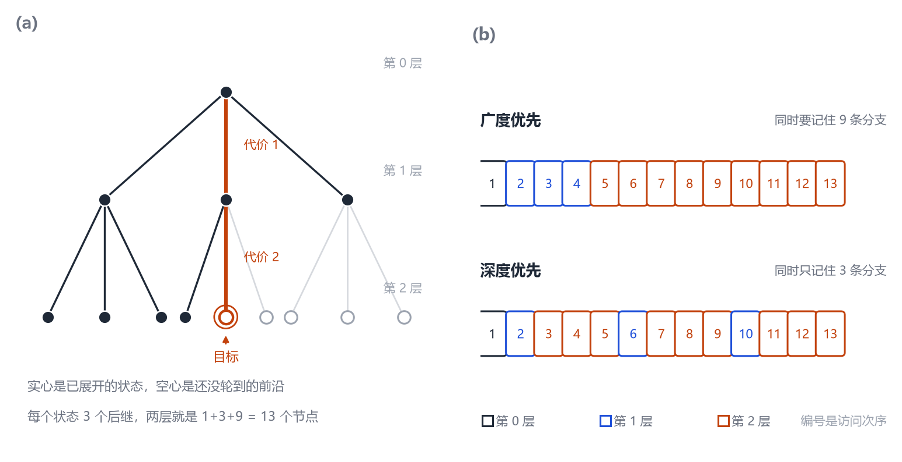
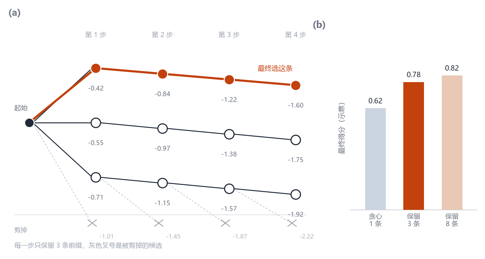
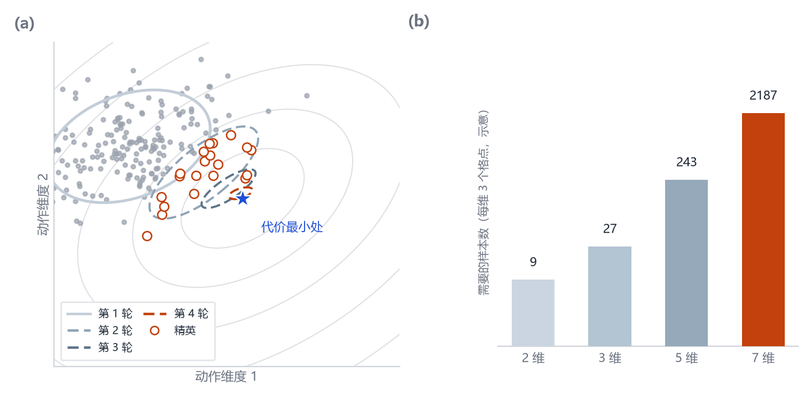
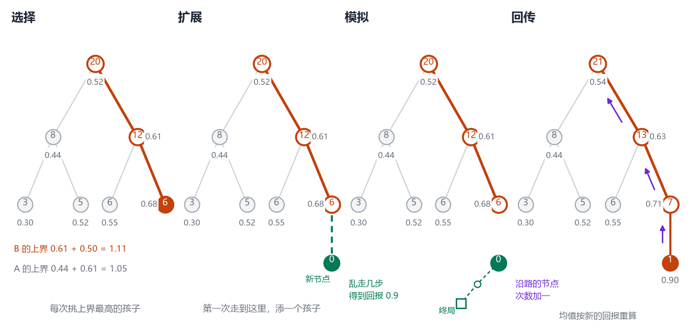

# 第 12 章　在脑子里试错

搬进一间空房子，家具怎么摆是一个反复试的过程。床靠窗还是靠门，书桌放得下就要牺牲一把椅子，沙发转过来会挡住插座。多数人不会真的把每件家具抬起来挪一遍，而是先站在客厅中央看一会儿，在脑子里把几种摆法过一遍，挑一个看上去最顺的，再动手。这几十秒里发生的事情，和机器人规划一次抓取在结构上是一回事，只是速度、精度和容量差别很大。

上一章讲图文怎么被放进同一个空间，讲的是给世界找一个可以比较的度量。度量一旦有了，问题就变成另一个样子：既然能算出"现在的样子"离"想要的样子"有多远，接下来该往哪走。描述世界和改变世界之间隔着一层选择，选择需要在一堆还没有发生的可能里挑一个，这件事叫搜索。度量回答的是差多少，选择回答的是往哪补，两件事用的是两套工具。

第 8 章那个每算一个动作要 16 秒的循环，做的正是搜索。它在冻结的表征空间里采样一串动作，把每一串喂给预测器推演到终点，再拿终点和目标比距离，最后留下最好的一串，只执行开头一点点。那时只交代了怎么采样、代价怎么算、为什么要重规划，没有交代这套流程的来历，也没有回答一个自然的问题：换成别的问题，还该用同样的搜法吗。

这一章把搜索本身拆开来看。离散问题里搜索树长什么样，语言生成里为什么要同时保留好几条路，连续动作里采样和梯度各自能做什么，大深度问题里怎么把算力花在刀刃上，几种情形排下来会看到，方法的名字不同，内核都是同一句话：拿一个能预演的模型当沙盘，在上面把还没发生的事先走一遍。

## 12.1　一次搜索要交代的四件事

任何一次搜索，动笔之前都要把四件事说清楚：状态是什么，动作是什么，做完动作之后状态怎么变，以及怎么判断一条路好不好。这四个词单看很抽象，换成地铁就具体了。你站在几号线的哪一站，这是状态；能坐哪条线、往哪个方向，这是动作；坐完这一段到了哪站，这是转移；全程花多少分钟、换几次乘，这是代价。四件事写下来，搜索才是一个能跑的程序，否则只是一句"想办法过去"。

拼图是另一个例子。九宫格里八个方块一个空格，状态是这九格的排列，动作是把空格旁边的方块推进空格，代价是推一次算一步，目标是排成图案。搜索树从这里长出来，根节点是开局，每条边是一次移动，每个节点是移动之后的局面。树的形状由动作的个数决定，每一步有几个选择叫分支因子，从根走到叶要几步叫深度，两者乘起来就是这棵树的体量。

树和图的区别值得单独说一句，因为它直接影响程序怎么写。拼图里先把空格往左推再往上推，和先往上推再往左推，有时候会落到同一个局面。局面是图上的点，路径是图上的边，同一张图可以被展开成无数棵树，展开的时候同一个局面会被重复放进去很多次。重复的代价是算力，一个局面在一层里出现两次，它下面的整棵子树就要算两遍，所以真正跑搜索的程序都会带一个记录表，记下哪些局面已经见过。

体量增长得有多快，算一下就知道。分支因子取 3、深度取 2，一共 1+3+9 等于 13 个节点，手画得出来。同样的分支因子走 8 层，节点数变成 9841，已经画不下了。把分支因子换成 10、深度换成 10，节点数是 100 亿，这个数字超过了任何一段程序能在几秒里看完的范围。围棋每一步有几百个合法落点，一盘棋两百手左右，这个乘方没有任何机器承受得起，所以搜索从来不是穷举，穷举只是它的极限形式。

既然看不完，就要决定先看哪里。广度优先搜索按层推进，先把离根一步的所有局面展开，再展开两步的，再展开三步的。它的好处是可靠，每条边的代价都一样时，它第一次碰到目标，那条路就是最短的。它的代价写在内存上，前沿那一圈会随层数指数变宽，一层有九个节点时还不觉得，到第二十层就是三十多亿个。

深度优先搜索走另一条路，抓住一个分支往下钻，钻不动了再退回来换一个。它的内存开销小，只需要记住每一层还没试过的兄弟，深度是 20、每层 3 个兄弟，也就是 60 个待办。它的毛病是不保证最优，第一个碰到的目标可能是一条绕了很远的弯路，而且如果某个分支深得没有底，它会一直往下钻，永远回不来。两种顺序如图 12-1，同一棵树，广度优先是横着扫，深度优先是竖着扎。

<figure class="fig">

<figcaption><b>图 12-1</b>　搜索树与两种展开顺序。(a) 里实心是已展开的状态，双圈是目标，橙色路径的两次移动共花代价 3；(b) 是同一棵树的两种访问次序，色块深浅对应层数，广度优先按层横推，深度优先沿一支扎到底。</figcaption>
</figure>

图 12-1 的右半边值得多看一会儿，两种顺序访问的是同一批节点，只是次序不同。广度优先那一行颜色是分段的，浅色、中色、深色各占一段，因为它把一层走完才进下一层；深度优先那一行颜色是交错的，进去、出来、再进去，像走迷宫时用手扶着左墙。前沿那一栏的差别更实在，广度优先同时攥着 9 条分支，深度优先只攥着 3 条。两行格子并排放着，广度优先的代价压在内存上，深度优先压在最坏情况上。

边的代价不一样时，广度优先就不够用了。从家到公司，地铁两站加步行十分钟，公交直达但堵车四十分钟，站数少的那条不一定快。这时候要把"先展开哪一层"换成"先展开累计代价最小的那个"，按代价排队，这就是一致代价搜索，Dijkstra 算法是它的标准写法。代价可以是时间、电量、碰撞风险，也可以是一句"别碰倒旁边那瓶水"折算出来的惩罚，代价怎么写，搜索就往哪个方向偏。

回到"在脑子里试错"这句话，搜索的本质是把模型当成棋盘，反复问它"如果我这样走，会变成什么样"。每问一次要花一次前向，问多少次、按什么顺序问、问完怎么记账，就是不同搜索算法的区别所在。第 8 章那个 800 条采样、10 轮迭代的循环，只是这套记账方式里的一种，适合动作连续、代价不可导的场合，并不适合所有问题。

## 12.2　启发式与只留几条路

穷举看不过来，就要给节点排个队，让有希望的先被展开。排队需要一个打分，打分里除了已经花掉的代价，还可以加一项对未来的估计。从当前局面到目标大概还要多少代价，这个估计叫启发式函数，记作 $h(s)$，$s$ 是当前状态。导航里的直线距离是最常见的启发式，它永远不超过实际要开的路程，因为路不会比直线更短，这种"不高估"的性质叫可采纳。

把已花代价 $g(s)$ 和估计代价 $h(s)$ 加起来，按这个和排队，就是 A* 算法。它比一致代价搜索聪明的地方在于，累计代价相同的两个节点里，它先展开那个看起来离目标更近的，于是大量明显没戏的分支被压到最后，甚至永远轮不到。A* 能不能保证找到最优解，取决于 $h$ 有没有高估；高估得不多时它快但可能略过最优，不高估时它慢一点但结论可靠，工程上常在这条线上调。

语言生成把这个框架逼到了墙角。下一个词有几万个候选，一句话 20 个词，候选序列是几万的 20 次方，这个数比可观测宇宙的原子数还大。更要紧的是没有回头路，模型一次只吐一个词，吐出去就进了上下文，不会像拼图那样把方块拿回来重摆。既要往前走，又没有可靠的 $h$，因为"这句话离好答案还有多远"没人算得出来，剩下能做的只有一件事，在每一步保留几条看起来最好的路。

这就是束搜索（beam search）。它每步从当前保留的 $k$ 条前缀各自往后扩展若干个候选，把新的候选按累积对数概率排序，只留下前 $k$ 条，其余丢掉。$k$ 叫束宽，取 1 就是贪心，每一步只留最好的一个。图 12-2 画的是 $k=3$ 的情形，四步之后每条前缀的分数都是负的累积对数概率，越往后越低，因为概率相乘取对数就是相加，每加一项都在往下扣。

<figure class="fig">

<figcaption><b>图 12-2</b>　束搜索保留三条前缀。(a) 每一步从三条前缀往后扩展，按累积对数概率留下分数最高的三条，灰色叉号是被剪掉的候选，橙色是最后选中的那条；(b) 束宽从 1 加到 8 时最终得分的示意，收益在前几步最明显。</figcaption>
</figure>

为什么要留多条，看图里的第二步就能明白。分数最高的那条前缀走的是最顺的一条路，可它下一步能接的词都不太好，累积分数掉得比旁边那条快。只留一条的话，程序没有机会发现这件事，它会沿着最顺的开头一路走到底，最后交出一个开头漂亮、后半截别扭的句子。多留两条，等于给开头一般的分支一个翻身的机会，代价是每步要多算几个候选。

工程上这件事没那么贵。$k$ 条前缀共享同一段开头，注意力里的键值缓存可以复用，一次前向就能并行算出所有候选的下一个词分布，所以束宽从 1 加到 4，计算量的增长远小于四倍，显存里的缓存才跟着线性涨。这也是束搜索在机器翻译和语音识别里流行了十几年的原因，它的性价比在当时的硬件上几乎无可替代。

它有一个必须打补丁的毛病，长度偏置。累积对数概率是负数相加，句子越长扣得越多，同样好的两句话，短的那句分数天然更高，束搜索于是偏爱早停，翻译出来常常偏短。通行的补法是长度归一化，把总分除以长度的某个幂，或者用平均对数概率排序。这个补丁不改变搜索过程，只改变排序的标准，可它一改，排在前面的候选就换了一批人，说明分数这把尺子本身就是结论的一部分。

束搜索搜的不是"最好的答案"，而是"每一步看起来都不错的答案"。这句话听起来像文字游戏，实际上决定了它能做什么、不能做什么。写一句话，局部通顺和整体通顺高度相关，所以这个近似够用；解一道需要先绕远再回头的数学题，局部好看的前几步可能正是死路，束搜索就会稳定地错过正确答案。宽度 $k$ 取 4 到 8 是常见做法，再大收益递减，这个范围是工程惯例，不是哪篇论文的结论。

把这个过程和人的思考对照一下。人写长句子时也会同时握着几个说法，写到一半发现某个说法接不下去，退回去换一个，束搜索就是这件事的机械化版本，只是它的"退回"只发生在没写下去之前，写下去的字不会真的删掉。真正能删掉重来的搜索，需要一棵树，而不是一排并行的前缀，人退回去时把字真的划掉了，束搜索只能把候选从名单里划掉。

## 12.3　动作是连续的，树长不出来

机械臂的动作写出来是七个实数，前三个是末端的位置，中间三个是姿态，最后一个是夹爪的开合。每个实数都能取无穷多个值，动作空间不再是几个分支，而是一整片连续的区域。树在这里失效，因为每个节点都有无穷多个孩子，展开一层就永远展不完。这一节要看的是，在一片连续的区域里怎么找出一条好的动作序列。

最直接的办法叫随机打靶。给整段动作设一个范围，在这个范围里均匀地采 $N$ 条完整的序列，每条都送进模型推演一遍，算出代价，挑代价最低的那条执行。它简单到几乎没有超参数，也不需要模型可导，缺点是浪费，绝大多数样本落在明显不行的区域。样本够多时它能覆盖整片区域，样本不够时它连一个像样的解都碰不到。

为什么样本会不够，算一笔账就清楚。假设每一维只分 3 个格点，2 维空间需要 9 个样本，3 维需要 27 个，5 维需要 243 个，7 维需要 2187 个。真实任务要求的分辨率远高于 3 个格点，这个数字还要按分辨率的维数次方再涨。图 12-3 的右半边画的就是这条曲线，横轴是维数，纵轴是对数刻度上的样本数，7 维那一根比 2 维高了两百多倍，而这还是最粗的划分。这个增长速度不是工程问题，是维数的本性，加机器也只能把曲线整体往右挪一点。

<figure class="fig">

<figcaption><b>图 12-3</b>　交叉熵方法的采样与收缩。(a) 是二维动作空间里的四轮迭代，灰点是第一轮的两百个样本，空心圈是其中代价最低的二十个，实线到虚线是分布逐轮收窄的过程；(b) 是每维三个格点时覆盖整个空间所需的样本数，随维数指数上升。</figcaption>
</figure>

交叉熵方法（Cross-Entropy Method，CEM）把这笔账摊到多轮里。它不要求一轮就采到好解，而是每一轮都根据上一轮的结果调整采样范围。一轮包含四步：按当前的高斯分布采样一批动作序列，逐条推演并算出代价，留下代价最低的一小批当精英，用这批精英的均值和协方差替换原来的分布。下一轮从收窄之后的分布里再采，重复十轮左右，最后返回均值。写成式子是这样，$\mu$ 和 $\Sigma$ 是分布的均值与协方差，$\mathcal{E}$ 是这一轮的精英集合，$|\mathcal{E}|$ 是精英个数：

$$
\mu \leftarrow \frac{1}{|\mathcal{E}|}\sum_{a\in\mathcal{E}} a,\qquad
\Sigma \leftarrow \frac{1}{|\mathcal{E}|}\sum_{a\in\mathcal{E}} (a-\mu)(a-\mu)^\top .
$$

均值往精英密集的方向挪，协方差描述这片区域有多宽、朝哪个方向斜，下一轮的样本就沿着这个形状铺开。精英如果散在一条斜线上，协方差就把这个倾斜记下来，样本跟着斜着铺；精英如果挤成一团，下一轮就几乎只在原地打转。收敛的快慢由精英比例决定，取得太多，分布收得慢，取得太少，容易被一次运气带走。图 12-3 的左半边是四轮的真实收敛过程，第一轮均值在 (2.3, 8.4)，第二轮挪到 (5.1, 7.3)，第三轮 (6.0, 6.7)，第四轮 (6.5, 6.5)，方差从 6.4 掉到 0.1，分布从铺满半张图收成一个点。

这套做法为什么有效，可以用一句话概括：它在分布的空间里做梯度下降，只是用样本代替了梯度。每轮把概率质量搬到代价低的地方，搬的幅度由精英的离散程度决定，精英散得开就大步走，精英挤在一起就小步挪。它不需要代价可导，不怕地形有坑，代价函数是个黑箱也能用，这三点正好对上世界模型规划的需求。

真实系统里的参数是这样的。V-JEPA 2-AC 每个动作采 800 条序列，迭代 10 轮，每轮取前 10 条当精英，规划时域只取 1 步，单张 RTX 4090 上算一个动作 16 秒。DINO-WM 的规模小一些，100 条样本、10 轮迭代，在 A6000 上算一个动作 53 秒，它的模型单次前向只要 0.014 秒，同一台机器上跑一遍真实仿真要 3 秒，两边的差距正是"在脑子里试"和"真的去试"的差距。两边的时域都只取一步，时域一长，每条候选的推演成本按步数成倍上涨，采样预算马上就不够分。

模型可导的时候，还有第三条路，直接对动作求梯度。代价是动作的函数，模型是可微的，把代价对动作求导，沿着负梯度方向走几步，理论上比采样精确得多，需要的样本也少。DINO-WM 的作者试过这条路，结论是 CEM 在他们的任务上更好。论文没有给出确定的原因，一个合理的猜测是代价地形不平滑，局部极小太多，梯度一旦走进某个坑就出不来，而采样每一轮都重新铺开，至少保证有一批候选落在别处。

三种做法的取舍可以这样看。随机打靶最便宜，只在维度很低或者有大量并行算力时好用；CEM 把算力花在已经证明有希望的区域，维数到七维还能撑住；梯度下降最精确，但它要求模型可导、代价平滑、初值不离谱，三条里缺一条就可能失效。第 8 章末尾提到的动作空间难题，根子就在这里，7 维要 800 条采样，双臂加灵巧手是几十维，同一条曲线往右移几格就跑到图外去了。

绕开维度灾难的办法有几类，都还在探索。把动作降到低维的子空间里搜，比如只搜末端轨迹的几个关键点，中间用插值补出来；把常用动作做成技能库，让搜索在技能这一层进行，而不是在每个关节上；先用一个学出来的策略给出初值，让 CEM 从一个不太差的地方开始收窄。这三种办法的共同点是缩小搜索的空间，而不是让搜索变聪明。

## 12.4　蒙特卡洛树搜索的四个阶段

有些问题的动作本来就是离散的，深度却很大，而且一步走得好不好，要走到终局才知道。围棋落一子，看不出输赢；化学合成选一条路线，成败在最后一步；游戏里做一个决定，回报在几十步之后。这类问题的搜索树又宽又深，束搜索不回头，随机打靶没有结构，需要一种能把算力按需分配到各条分支上的办法。蒙特卡洛树搜索的做法是把预算摊到很多次从根到叶的往返上，每次只走一条路，走完把结果记在路过的节点上。

蒙特卡洛树搜索（Monte Carlo Tree Search，MCTS）就是这种办法。它的核心是一棵不断长大的树，每次迭代从根出发走一条路，走到叶节点，把叶节点展开一点，从那儿随机走到底得到一个结果，再把这个结果沿路回传，更新沿途每个节点的统计量。一轮迭代包含四个阶段，选择、扩展、模拟、回传，如图 12-4。

<figure class="fig">

<figcaption><b>图 12-4</b>　蒙特卡洛树搜索的四个阶段。选择阶段从根往下挑上界最高的孩子，B 的上界 1.11 高于 A 的 1.05；扩展阶段在叶子上添一个新节点；模拟阶段从新节点随机走到终局，得到回报 0.9；回传阶段沿路把访问次数加一、均值重算，B2 的均值从 0.68 升到 0.71。</figcaption>
</figure>

选择阶段要解决一个矛盾，是继续押注当前看起来最好的分支，还是去试试还没怎么走过的分支。只押注前者，一个早期运气好的节点会吸走所有预算，别的分支永远得不到机会；只探索后者，等于放弃已有的信息。UCB1 这个打分把两者写在一行里，$w_i$ 是节点 $i$ 的累计回报，$N_i$ 是它被访问的次数，$N$ 是父节点的访问次数，$c$ 是控制探索强度的常数：

$$
\mathrm{UCB1}(i)=\frac{w_i}{N_i}+c\sqrt{\frac{\ln N}{N_i}} .
$$

前一项是利用率，回报越高越容易被选中；后一项是探索项，访问次数越少，这一项越大，于是冷门分支会被定期光顾。$\ln N$ 随总访问量缓慢增长，保证探索的力度不会随着时间衰减到零。常数 $c$ 决定探索的整体分量，取大了更愿意试冷门分支，取小了更相信当前的最好成绩，围棋程序里这个值通常靠实验调出来。图 12-4 里 B 的均值 0.61、访问 12 次，A 的均值 0.44、访问 8 次，代进去得到 1.11 和 1.05，B 胜出，尽管它的均值优势只来自 12 次试验，这个差距还不够稳。

扩展阶段是把选择走到头的那条路再往前接一步。图里的 B2 还没有孩子，走到它就停下来，给它添一个新节点，这个新节点的统计量是零访问、零回报。模拟阶段从这个新节点开始，按随机策略一路走到终局，得到一个回报，图里是 0.9。这一次模拟可能运气好也可能运气坏，单看没有意义，它的作用是把一个未知的局面变成一个带噪声的观测值。

回传阶段把这个观测值送回根节点。沿途每个节点的访问次数加一，累计回报加上这次的回报，均值随之更新。B2 原来 6 次访问、均值 0.68，加进一个 0.9 之后变成 7 次、0.71；B 原来 12 次、0.61，变成 13 次、0.63；根节点从 0.52 挪到 0.54。一次迭代只改动了四个数，可上万次迭代之后，访问次数的分布就自动把预算集中到了有希望的分支上，不需要任何人告诉它哪里值得看。

蒙特卡洛三个字的分量在模拟阶段。随机走到底得到的回报噪声很大，一次 0.9 可能只是碰巧，但同一个节点被访问几百次之后，均值的标准差按访问次数的平方根缩小，估计就慢慢靠住了真实值。这个性质和抛硬币一样，抛十次看不出正反面的比例，抛一万次就看得出来。搜索用的不是精确的评估，而是大量粗糙评估的平均，这也是它能在没有解析解的问题上工作的原因。

工程上还有两个细节决定它能不能用。一个是树的复用，棋子落下之后，原来的子树可以提上来当新的根，之前算过的统计量不必扔掉，这一步能把有效迭代数提高好几倍。另一个是并行，不同的模拟可以同时进行，代价是它们看到的统计量略有滞后，需要一些技巧来减少冲突。AlphaGo 在 2016 年把 MCTS 和两个网络接起来，一个网络给出落子的先验，另一个网络代替走到终局的模拟，前者让搜索少走弯路，后者让每次评估更便宜。

和束搜索比，MCTS 的差别在于它会把预算不均匀地分配。束搜索每步固定保留 $k$ 条，不管某条路明显更好还是明显更差；MCTS 的访问次数是一个动态的分配，好的分支被反复访问，差的分支被逐渐遗忘。它还能处理随机性，模拟走到底得到的是一整个分布的样本，而不是一条确定的路。代价是它需要一棵可以反复访问的树，状态要能存下来、比较、恢复，这对连续控制就不太友好。

## 12.5　模型不准，搜索就白搜

前面几节都默认一件事，模型说的是真话。搜索在模型里试错，试出来的结论全部建立在模型给出的转移和代价上，模型错了，搜索越努力，错得越彻底。这不是危言耸听，而是有具体机制的，搜索会主动去找模型里最乐观的那条路，哪里的预测偏低、哪里的代价被低估，它就往哪里钻。模型没有说谎的动机，它只是把训练数据里的偏差原样交了出来，而搜索恰好只认这份偏差。

举个具体的例子。一个在视频上训练出来的预测器，对摩擦力的估计偏小，物体在它眼里滑得比现实更远。规划器很快会发现，贴着桌边推一下，让物体自己滑到目标位置，既省动作又省时间，代价比老老实实推过去低得多。在模型里这条路线是可行的，在真实桌面上物体滑到一半就停了。搜索没有犯错，它忠实地优化了给定的代价，错的是代价背后的那个世界。

这种失败有个名字，叫模型利用，意思是策略找到了模型的漏洞，把漏洞当成了世界的规律。它的一个反直觉之处是，搜索越充分，问题越严重。预算少的时候，规划器只能找到几条平庸的路，这些路在真实世界里也大致可行；预算多了，它有足够的机会翻出那些专门针对模型偏差的路线，于是模型里的回报越来越高，真实世界的成功率反而往下掉。曲线在某个预算处达到峰值，之后掉头向下。

缓解的办法都指向同一个方向，别让模型单独说了算。短时域加反复重规划是最通用的一条，只信模型几步之内的预测，走几步就回到真实观测上重新开始，误差来不及累积就被截断，这正是第 8 章讲的模型预测控制。用一组模型代替一个模型，取它们预测的悲观值，也能压住那些只在某个模型的偏差里成立的路线，代价是算力翻倍。持续用真实数据校正模型，是把偏差从源头消掉，代价是机器人得不断回到真实世界里试。

从这里能看清基于模型的强化学习站在什么位置。它把一件事拆成两半，一半是用真实交互的数据学一个模型，另一半是在模型里生成大量虚拟经验来训练策略。Dyna 在 1990 年代就把这两半接了起来，每做一步真实动作，就用模型补做若干步想象。DreamerV3 是这条路线近年最完整的一次工程实现，它在 8 个领域、150 多个任务上用同一套超参数工作，这个结果说明模型的不准可以被算法设计吸收一部分。

两个极端之间有一个光谱。一端是纯反应式策略，输入当前观测，一次前向直接输出动作，便宜、快、可以在 10 赫兹的控制频率上跑，但换一个目标就得重新训练，因为它把"要去哪里"焊死在了参数里。另一端是纯规划，模型不变、代价不变，换目标只需要换一张目标图，代价是每个动作要算十几秒。V-JEPA 2-AC 站在靠近规划的那一端，抓放任务因此被手工拆成三个子目标，机器人大部分时间在等规划器算完。

中间地带是让策略给规划打下手。策略可以先给出一个大概的动作用来当 CEM 的初值，让分布从一个不太差的地方开始收窄，省掉前几轮的盲目采样；也可以把规划出来的动作序列当成监督信号，蒸馏进一个前馈网络，部署时用网络代替搜索。AlphaGo 之后的一系列工作走的都是这条路，搜索在训练时提供高质量的标签，策略在推理时把这些标签背下来，搜索的慢换来策略的快。

预算和精度的关系还有一个容易被忽略的维度，时域。规划三步和规划三十步，需要的搜索量差一个数量级，而模型误差随时域增长，三十步之外的表征已经飘得不成样子。有效时域因此不是随便定的，它由模型的保真度和任务的容错度共同决定。容错高的任务，比如走到大致位置就行，可以把时域拉长；容错低的任务，比如把杯子卡进杯托，只能短时域加高频重规划。

说到底，规划能力的天花板由模型决定，搜索只是把这个天花板下面的空间尽量填满。模型在哪儿失真，搜索就在哪儿失效，而且失效的方式往往很隐蔽，它不会报错，只会给出一个在模型里完美、在现实里荒唐的动作。第 8 章列的四件没解决的事，表征漂移、长时程、代价定义、动作空间，每一件都可以翻译成搜索的语言，表征漂移是树上的节点不可信，长时程是树太深，代价定义是排序的尺子不准，动作空间是分支因子太大。

## 12.6　算力和沙盘

把这一章的几个方法放在一起，会看到它们其实在回答同一个问题：算力有限，该往哪里花。广度优先和深度优先不分配，先来后到；A* 用启发式把明显没戏的分支压后；束搜索在每一步砍掉大部分候选，用并行的前缀换深度上的确定性；CEM 把样本集中到有希望的区域，用多轮迭代换单轮的粗糙；MCTS 把访问次数当成预算，让好的分支自己争取到更多算力。这些办法的差别，本质上是把有限的提问次数分配给了树的不同部位。

会搜索的智能体，前提是有一个能预演的模型。没有模型，搜索只能发生在真实世界里，试错的成本就是真实的代价，一次碰撞、一次打翻、一次耗时几分钟的移动。有了模型，试错搬到了脑子里，一次前向几十毫秒，一天可以试几百万次。这也是第 7 章和第 8 章花那么多篇幅讲世界模型的原因，模型不是为了好看，它是搜索的沙盘，沙盘的质量直接决定了搜索的意义。

沙盘和地图的比喻在这里可以收一下。模型是一张地图，搜索是在地图上找路，代价函数是你要去的地方。地图画错了，找得越认真，走得越偏；地图画得粗，能找到大方向，但走不到精确的位置；地图只有一部分，搜索就只能在那部分里打转。三种失败对应三种工程上的取舍，也对应前面几章反复出现的那些数字，16 秒、53 秒、0.014 秒，都是这张地图的画法和翻看速度。

从第 9 章的训练循环，到第 10 章的评测尺子，到第 11 章把图像和文字放进同一个空间，再到这一章在表征空间里搜索，入门篇讲的东西到这里基本齐了。剩下的一个问题是前面埋了很久的，如果这些模型真的都在描述同一个世界，它们各自画出来的地图，能不能互相翻译。这件事有实验证据，也有争论，下一章拿数字来说。
