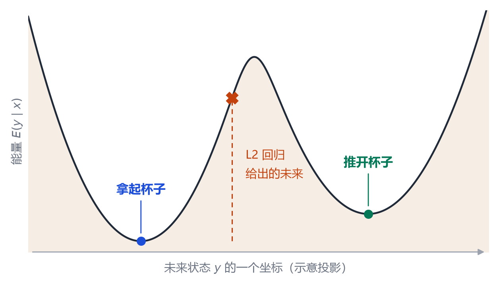
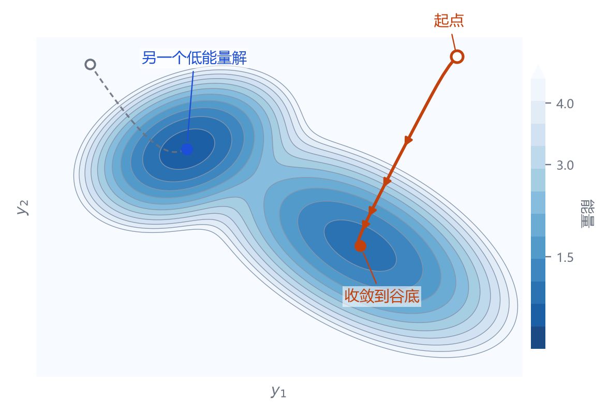
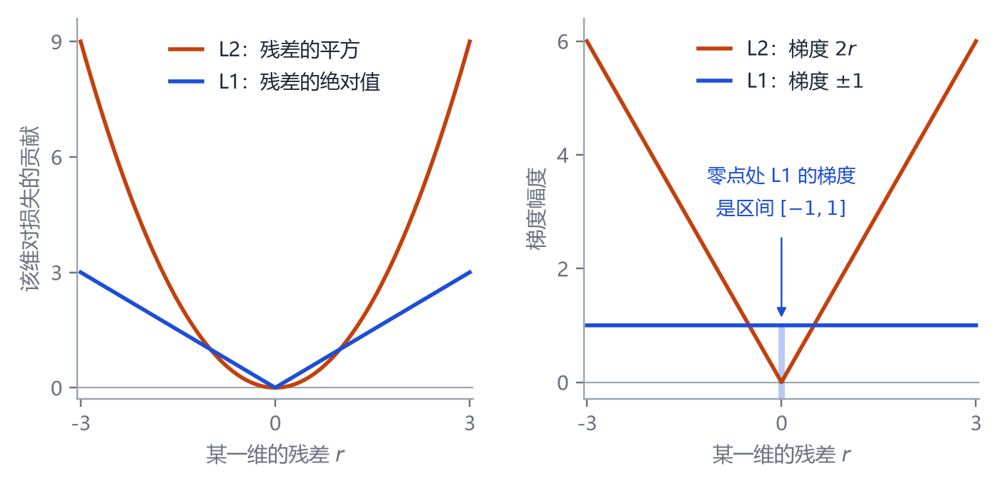

# 第 1 章　能量的语言

桌上摊着一副没拼完的拼图，你拿起一块，试着往几个空位里塞，角度不对就卡住，凸起顶着边缘怎么也按不下去。换一个空位再试，某一次凸起滑进凹槽，边缘严丝合缝，手停在那里不再动了。这个判断快到你不觉得它在算什么。可要把它写成一段程序，写下来的必然是一个数，这个数衡量这一块放在这里的合适程度。

把这个合适程度叫成能量，是一套借来的说法，物理学里的能量有单位、有守恒律，这里什么都没有，只剩下一条排序关系。低的代表兼容，高的代表不兼容，一个标量就把这两件事的关系讲完了。所以分数本身可以随意改刻度，加 100 或者乘 2 都不改变任何判断，只要所有候选一起改。拼图这一步之所以轻松，只是因为候选太少，五个空位挨个试一遍，最笨的办法也够用。

换成预测，麻烦立刻出现，给定现在，未来的候选有无穷多个，你没法像拼图那样挨个试。语言模型把这件事化成逐词分类，每个位置的候选是有限的词表，所以它能用一个 softmax 把分数变成概率。未来的画面、机械臂位姿、动作序列都没有一张固定候选表，只能在高维连续空间里找低处。这一章讲的就是这个打分函数，它怎么变成概率，为什么地形不止一个坑，走通这张地形要付什么代价。到目前为止这些结论都成立，但还停在“值得这么做”的层面。

## 1.1　兼容是一个标量

把打分写成函数，记作 $E(x,y)$，输出一个实数，$x$ 是给定的那一半，$y$ 是候选的那一半，两者都由编码器压成向量。$E$ 小表示兼容，$E$ 大表示不兼容，函数的形状没有任何附加约束，不必非负，不必归一化，也不必存在下界。这一点常被误解，以为能量必须输出正数或者对应某种物理量。其实只要它能排序就够用了。插头和插座是个好例子，对的插头插进去两片金属贴合，拿两个插头对着顶谁也进不去。

兼容不一定对称，钥匙能开锁，锁开不了钥匙，所以 $E(x,y)$ 和 $E(y,x)$ 完全可以写成两个不同的函数。写成条件能量 $E(y \mid x)$ 就已经承认了这一点，给定现在去看未来，和给定未来反推现在，难度差得很远。视频预测里这个差别尤其明显，从一帧推出下一帧是近似确定的物理过程。倒推则可能有一整类解，被遮住的物体、看不见的手、桌子底下的地板都无从确定。这一条不对称在机器人上尤其要紧。

同一个兼容还能在不同的地方衡量，两张图配不配，可以直接在像素上算差值，也可以先各自压成向量再算距离。选哪个空间，等于选在哪个层面上定义像，像素层面会把同一只杯子换了个角度判成不兼容，向量层面可能判成兼容。JEPA 把能量定义在表征里，等于宣布像素级差异不重要，物体身份、空间关系、运动方向才重要。这个选择后面会反复出现，掩码怎么采、目标块多大，都绕不开它。

## 1.2　配分函数算不出来也没关系

能量和概率之间有一座桥，它的写法只有一行，却决定了后面所有的工程取舍，包括为什么归一化可以不算。地形的谷底应该对应高概率，山顶对应低概率，这个方向不能反。落差还要能被指数放大，否则一点小差异在概率上几乎没有区别，多峰的结构也会被压平。把这两条要求写成式子，就得到条件玻尔兹曼分布。

$$
p(y \mid x) = \frac{e^{-E(y \mid x)}}{Z(x)}, \qquad Z(x) = \int e^{-E(y \mid x)}\,\mathrm{d}y .
$$

其中 $E(y \mid x)$ 是条件能量，$e^{-E}$ 把越低越好翻译成越大越好，同时保证结果是正数。$Z(x)$ 叫配分函数，它把所有候选的分数累加起来，作用只是让概率的总和等于 1。用指数而不是别的单调函数有一个具体理由。对象由互不影响的几部分组成时，整体能量是各部分之和，整体概率是各部分之积，指数正好把加法变成乘法。这条性质在把多个约束拼成一个模型时天天用得上。

$Z$ 的问题在于它是一次全空间积分，而 $y$ 的空间是几百到几千维，一张 256×256 的彩色图有将近二十万个维度。这个积分没有任何办法精确计算，蒙特卡洛只能覆盖其中极小的一块。高维空间里极小的一块意味着几乎抽不到有代表性的样本。所以能量模型从不真的去算 $Z$，它只学 $E$，把 $Z$ 留在式子里当摆设。凡是需要 $Z$ 的算法在这里都走不通。

比较两个候选时，摆设就消掉了，两个概率相除，$Z$ 约掉，只剩能量的差，写作 $p(y_1)/p(y_2)=e^{-(E(y_1)-E(y_2))}$。也就是说能量差就是对概率比取对数，这条读法比公式本身有用。差 0.7 约为两倍，因为 $\ln 2$ 等于 0.693，差 2.3 约为十倍，因为 $\ln 10$ 等于 2.303。这两个换算值得记住，读论文里那些 0.5、2.6 之类的能量值时，脑子里能立刻换成相差一倍半、十几倍。严格说，这个差值就是对数似然比，两个候选谁更可能是真值，只取决于它。

## 1.3　固定现在之后的地形

预测用的是条件能量，记作 $E(y \mid x)$，固定 $x$ 之后，它就退化成 $y$ 上的一个普通函数，预测于是变成在这张地形图上找低处。杯子在桌沿，一只手从右边伸过来，候选之一是手握住杯子上抬，候选之二是手把杯子往左推，候选之三是杯子悬在原地、手从它中间穿过去。前两个能量低，第三个能量高，因为手穿过固体这件事在训练数据里从没出现过。把候选按能量排开，就得到如图 1-1 所示的一维曲线，横轴是把未来压到一个坐标上的示意投影。真实未来是几百维的向量，压到一维只为画得出来。

<figure class="fig">

<figcaption><b>图 1-1</b>　一维能量地形。横轴是把几百维未来压到一个坐标上的示意投影，两个谷对应拿起杯子和推开杯子两种合理未来，谷底能量相差 0.50；橙色叉号是平方误差给出的条件均值，落在两谷之间的坡上。</figcaption>
</figure>

曲线有两个谷，横坐标分别在 -1.20 和 1.12，谷底能量一个取 0、另一个取 0.50，按 $p \propto e^{-E}$ 折算，两者概率相差约 1.65 倍。两谷之间隆起一道墙，墙顶在横坐标接近 0 处，能量 3.39，对应手一半在拿一半在推这种物理上不成立的状态。墙的左坡陡、右坡缓，坡度由两侧分布的方差决定。地形不是物理引擎算出来的，是从数据里学出来的。见过很多次手抬起杯子，那片区域就被压低了，从没见过手穿过杯子，那片区域就留得很高。

条件能量有两种常见写法，一种把 $x$ 和 $y$ 拼在一起送进网络，网络直接吐一个数，另一种先用两个编码器把两者各自压成向量，再在向量之间算距离。后者定义的能量，地形是以 $P(s_x)$ 为圆心的一圈圈同心等高线，$s_x$ 是条件表征，$P$ 是预测器。这种写法省事，但它天然只有一个谷。预测器一旦用平方误差训练，谷底就落在条件均值上，1.5 会说明这个谷底为什么可能是最糟的位置。

## 1.4　多峰不是噪声

多峰不是数据的噪声，它有来源，而且来源不同，处理办法也不同。一类来源是未来真的有岔路，行人走到路口，左转和右转都是合理行为，两个候选之间不存在更正确的那个。一类来源是观测缺失，被遮挡的手最后去了哪里，模型看不到，只能靠先验猜。还有一类在模型里，两个差别很大的状态被编码器映到相近的向量上，于是多个 $y$ 都对同一个 $s_x$ 兼容，这叫表征折叠。

读到多峰，最容易犯的错是以为模型不够大。加大容量、加长训练、换更强的骨干，确实能让拟合更准，但准的方向是更准地拟合均值，或者更准地挑一个峰。歧义本身一点没少，因为它写在条件分布里，与参数量无关。工程上的判据很直接，看同一个输入下多次预测的分散程度，如果分散随着上下文变长而缩小，那是信息缺失。如果信息补足之后分散仍在，那就是真歧义，只能靠多峰的表达能力去承载。

对称性是最好用的例子，一个抽屉可能被推回去，也可能被拉出来，两者在某一帧里长得几乎一样。模型给出的两个候选都合理，谁也不比谁更对。再如从一张两人对坐的侧面照预测下一秒，谁先开口完全取决于没被拍到的表情。这类歧义在像素上是两张完全不同的图，在表征上是两个相距很远的向量。它们中间那一大片区域没有任何真实状态与之对应，恰恰最容易被回归模型占据，所以多峰不是要消掉的东西，而是要表达的东西。

## 1.5　均值落在没有人的地方

L2 回归是最常见的预测损失，也是绝大多数世界模型的默认选项，它简单、稳定、梯度好算。它的最优解还有一个闭式答案，一步推导就能得到，不用迭代也不用调参，几乎所有像素重建目标都从这一项开始。设 $f(x)$ 是预测网络，在平方误差下最小化 $\mathbb{E}\lVert y-f(x)\rVert^2$，对 $f(x)$ 求导并令其为零，得到的就是条件均值。这个结论本身没有问题，问题出在均值这个词上。

$$
f^{*}(x) = \mathbb{E}[y \mid x] .
$$

其中 $\mathbb{E}[\cdot \mid x]$ 表示在现在为 $x$ 的条件下对 $y$ 求期望，也就是把每个候选未来按概率加权平均。这个式子还带来一个常被忽略的推论，平方误差能达到的最小期望损失正好是条件方差。写成 $\mathrm{Var}(y \mid x)$ 的迹，这部分误差无论模型多大都降不下去，它就是歧义本身的度量。工程上这条推论很实用，看到 L2 损失卡在某个值不动，先别怀疑优化器，先估一下同一情形下未来的方差。如果地板就在那里，训练早就收敛了。

回到图 1-1，两个谷在 -1.20 和 1.12，按各自的概率加权，均值落在 -0.27，能量 2.63，是那个较浅谷底的五倍多。这个点同时得罪了两个正确答案，还落在物理上不成立的位置。可它就是平方误差意义下的最优解，而且稳定地、可重复地给出，换一个随机种子也还是这个点。更麻烦的是逐维独立，L2 把多维的 $y$ 拆成每一维各自回归，得到的点在联合分布里可能落在密度极低的地方。两个峰分布在对角线两端时，每个维度的边缘分布都是对称的双峰，均值正好在中间那条没人走的空走廊上。

图像上的后果更直观，两个未来分别是手抬起杯子和手把杯子推开，逐像素平均得到的是一只半透明的手穿过一只半透明的杯子。这个平均结果在平方误差下最优，却不是任何一个可能发生的未来。行人预测是老例子，一个人站在路口，下一步可能左转也可能右转，各占一半，L2 回归给出的是原地不动。损失很小，答案没用，两个指标同时成立。单点输出的模型在训练集和验证集上都不难看，用起来才发现它从来不给一个能执行的答案。

这类失败不会报错，只会让成功率莫名其妙地低一截，排查时最容易被归因到数据不够。在表征空间里做预测，均值问题会变轻，但不会消失，两个未来的表征差别很大时，它们的平均仍然是一个谁也不像的向量。如果差别只体现在光照和噪声上，表征的均值可能仍然合理，这就是把预测目标放在表征上比放在像素上划算的地方。反过来，如果给定 $x$ 之后未来确实只有一个答案，L2 就是合适的，问题从来不在 L2 本身。

## 1.6　往下走的几条路

如果 $y$ 是连续向量，找低点最直接的办法是梯度下降，迭代式只有一行，比任何搜索都省事。代价是每步都要算一次对 $y$ 的梯度，这要求能量对 $y$ 可微。$\eta$ 是步长，$\nabla_y$ 指向能量上升最快的方向，前面加一个负号就成了下降最快的方向。这一步只用到局部信息，不需要知道地形整体长什么样。步长和起点是这套办法仅有的两个旋钮。

$$
y \leftarrow y - \eta \,\nabla_y E(y \mid x) .
$$

步长太大会在山谷里来回横跳，步长太小会在平缓处磨很久，这两种失败在日志里分别表现为曲线抖动和曲线停滞。反复迭代，点就滑进离它最近的谷，落点由起点决定而不由全局结构决定。如果地形只有一个谷，起点在哪都无所谓。正因为谷不止一个，起点才成了必须认真对待的超参数，这一点在后面所有规划系统里都会反复出现。

如图 1-2 所示，两条轨迹从不同起点出发，一条从 (2.30, 1.80) 一路下坡，落到 (1.05, -0.65)，另一条从 (-2.45, 1.70) 出发，落到 (-1.20, 0.60)。两边看着差不多，落点完全不同，起点只差一点，落点差了一整个谷。这不是算法有缺陷，是地形本身的性质。图里等高线的疏密还说明另一件事，谷底附近很平，末尾几十步的位移几乎看不出来，半山腰很陡，一步能走很远，等高线画到同一张图上，两个盆地的边界才看得清。

<figure class="fig">

<figcaption><b>图 1-2</b>　二维能量等高线与两条下降轨迹。颜色越深能量越低，两条轨迹起点不同、落点也不同，说明推理落到哪个谷取决于从哪里出发，与算法本身是否收敛无关。</figcaption>
</figure>

工程上的应对是并行放很多起点，或者在下坡途中加一点噪声，让点有机会翻过矮脊再滑下去，这套做法叫退火。还有一类做法是先学一个提议分布，让它专门往低能量区域送候选，再在候选里挑。取最小和采样也是两件不同的事，下游只要一个动作时取最低的就够，要评估风险就得让每个谷按概率被访问到。几种办法都在用额外算力换不漏掉谷，所以规划时的采样数总是被压到算力能承受的边缘。

V-JEPA 2-AC 用的是交叉熵方法，它属于采样这一类，但比随机采样聪明。每个规划步里，动作序列的每一维被当成一个高斯分布，初始均值取零、方差取一，采 800 条候选，取能量最低的 10 条更新均值和方差，重复 10 轮。整个过程不需要对动作求梯度，只要能把一条候选序列送进预测器、算出一个标量能量就够。算出整条序列之后只执行第一步，看一眼新画面再从头规划，这叫滚动时域控制。理由是世界模型一定会飘，预测得越远越不准。

## 1.7　损失必须成对出现

能量函数里有一堆参数，学习就是调这些参数，让正确的配对能量低，错误的配对能量高。只做前一半会出事，把所有正确配对的能量都压到很低，最优解是把 $E$ 变成常数、处处为零，损失为零，函数却什么也没学到。只做后一半也会出事，把所有错误配对的能量抬到很高，最优解是 $E$ 处处很大。两种极端方向相反，结果一样，都是地形变成一张没有起伏的纸。

所以损失必须成对出现，同一个 $x$ 之下，正确的 $y$ 要比错误的 $y$ 低，而且要低出一个可测量的差距。一个常见写法是把负能量当成未归一化的对数概率送进交叉熵，$y^{+}$ 是正确的那一个，分母里的 $y_i$ 包括正确样本和一批负样本。这个式子和对比学习里的 InfoNCE 是同一个东西，只是把相似度换成了负能量。它把成对比较做成了对一个批次里所有候选的排序，负样本越多，学到的能量面分辨得越细，所以批次大小不只是显存问题。

$$
\mathcal{L} = -\log \frac{e^{-E(x,y^{+})}}{\sum_i e^{-E(x,y_i)}} .
$$

另一种写法更直接，要求正确配对与错误配对的能量差超过一个余量 $m$，写成 $\max(0,\, m + E(x,y^{+}) - E(x,y^{-}))$。余量防止模型把差距压到刚好为零就收手，也防止训练后期梯度消失。负样本从哪来是个工程问题，图像可以从同一批数据里取别的样本，视频可以取别的时间点。取错了会出问题，把语义上其实是正例的样本当负样本，能量会被推到不该高的地方。这叫假负样本，它在地形上压出一个假的坑，批次越大风险越高。

顺带说清一件事，L2 损失本身就是一种能量，$E(x,y)=\lVert f(x)-y\rVert^2$，它的地形是一个以 $f(x)$ 为底的抛物面，只有一个谷。JEPA 的训练损失看上去只是把预测拉近目标，实际动作是在能量面上给正确的位置挖坑，同时把别处垫高。挖坑需要负样本，或者需要别的机制来代替负样本。后面几章讲的白化、停梯度、动量教师都是替代品，它们不改变挖坑这个目标。

## 1.8　为什么 V-JEPA 2-AC 用 L1

要谈这个选择得先交代设定，V-JEPA 2-AC 把目标图像的表征记作 $z_g$，把想象出来的第 $T$ 步表征记作 $P(\hat a_{1:T}; s_k, z_k)$。$s_k$ 是末端执行器状态，$z_k$ 是当前帧特征，$\hat a_{1:T}$ 是待搜的动作序列。能量定义成这两者的 L1 距离，规划就是这个能量的最小化。编码器是冻结的 ViT-g，特征图 16×16×1408，动作是 7 维向量，规划时域取 1。后训练损失也用 L1，教师强制那项取 15 帧，另加一项两步的 rollout 损失。

用 L1 而不是 L2，第一条理由是它对离群维度不敏感。L1 的最优解是逐维中位数，L2 的最优解是逐维均值，均值会被少数极端值拉动，中位数不会。1408 维的表征里，少数维度残差特别大是常态，物体边缘、纹理高频处、运动模糊都会让某些通道差得远。L2 把这些维度平方之后权重急剧放大，假设某一维的残差是其余各维的十倍，它在总损失里的份额是 6.6%，同样的情形下 L1 只给它 0.71%。中位数解因此更愿意把大多数维度对齐，而不是去迁就那一两个坏维度。

第二条理由是梯度的尺度。L1 对每一维的次梯度恒为 $\pm 1$，不管残差是 0.1 还是 10，给出的信号一样强。L2 的梯度是 $2r$，残差大时步子大，接近谷底时信号按比例衰减，在优化器眼里就是每个维度被重视的程度不同，而 L1 给出的重视程度是均匀的。如图 1-3 所示，两条曲线并排画在两张子图上，左边是单维残差对损失的贡献，右边是梯度幅度。

<figure class="fig">

<figcaption><b>图 1-3</b>　L1 与 L2 的损失与梯度。左图纵轴是单维残差对损失的贡献，右图是梯度幅度，L2 随残差线性增长，L1 恒为 1、零点处是一条区间，所以它不靠梯度也能被搜索。</figcaption>
</figure>

这两条曲线各有好处，L2 的梯度在接近解时自动变小，等于内置了衰减的学习率，收敛更稳。L1 的等幅梯度在远处不爆炸，在近处不消失，代价是收尾时会在谷底附近来回跳，需要靠衰减步长收住。V-JEPA 2-AC 的用法把这件事变简单，它在推理时根本不走梯度。搜索过程不看梯度尺度，只看能量面的形状是否好搜，这也是理解它为什么能跑起来的关键。

第三条理由是几何，而且这条最像工程决定。规划时采样的动作被限制在半径 0.075 的 L1 球里，对应末端执行器单步最大位移约 13 厘米，作者给的理由是大动作对模型来说属于分布外。L1 球是菱形，允许某一维给足、其他维接近零的稀疏动作，L2 球是圆的，要求各维按比例同步变化。机械臂的实际运动常常是主要动一个关节、其他关节微调，菱形比圆形更贴这个结构。

代价当然有，L1 在零点不可微，用一阶方法直接优化会卡住，这也是选择不需要梯度的搜索方法的一个隐含理由。作者报告说这个能量面相对平滑且局部凸，单目标到达任务里末端能进到目标位置 4 厘米以内。同样的规划预算下，它的延迟是每个动作 16 秒，而基于视频生成的 Cosmos 模型用 80 条采样、10 轮精化要 4 分钟。两者差了 15 倍，一条完整的抓放轨迹在后者上要跑一个多小时。

这里必须澄清一件事，换 L1 并不解决多峰，一维两个峰等权时中位数也落在两峰之间，和均值一样糟。三个层次要分清，输出一个函数而不是一个点，解决的是多峰的表达问题；用 L1 而不是 L2，解决的是离群维度和梯度尺度；用搜索而不是一次前向，解决的是落在哪个谷里。混在一起谈，就会得出 L1 能处理多峰这种站不住的结论。同一个团队的 I-JEPA 用的是表征之间的平均 L2 距离，V-JEPA 与 V-JEPA 2-AC 换成了 L1，这一层的取舍没有定理保驾护航。

把总账算一遍，能量视角把预测从一个点估计问题变成一个函数估计问题。模型要输出整张地形，而不是地形上的一个位置，换来的是对多峰的容忍，以及一种把选择推迟到推理时的姿态。代价是推理时必须搜索，算力换来决定落在哪个谷里。地形也是靠数据堆出来的，目标只压正确样本，没有机制把别处垫高，整张地形会一起塌下去。这时候损失很小，地形却没有形状，模型对任何输入都给出同一个答案。

下一章拆这件事，它的名字叫塌缩。要看清它，得先学会读几张图，一条奇异值谱、一组每通道标准差、几个下游探针的数字。这些工具决定了你能不能在训练跑到一半时判断出地形正在变平，而不是等下游指标掉下来。等指标掉下来才回头找原因，浪费的不只是算力，还有对这条路线本身的信心。
