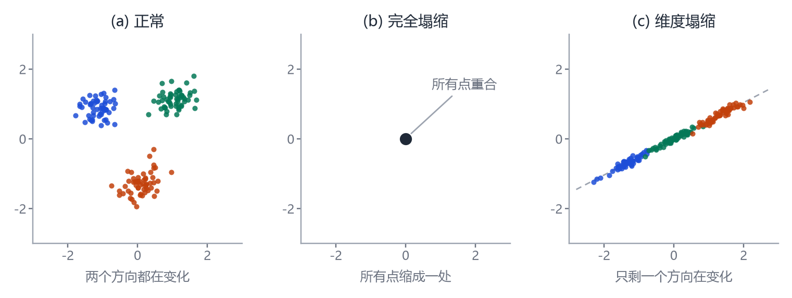
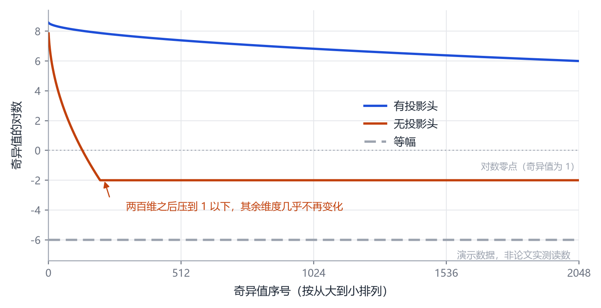
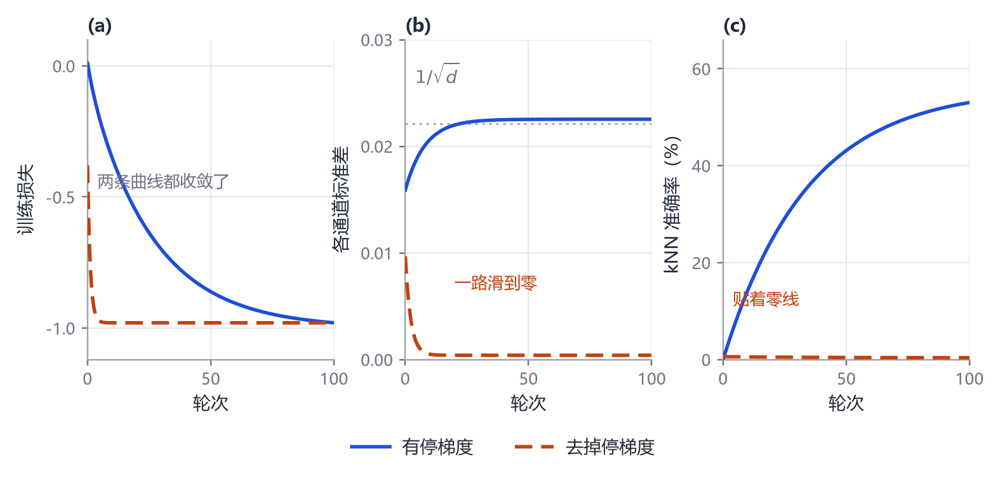

# 第 2 章　塌缩的解剖

训练跑到后半程，损失曲线在面板上贴着底部走平，从画图的角度看这是一次干净的收敛。停下来做一次线性探测（linear probe），把编码器冻结，只在它的输出上训一个逻辑回归，得到的准确率停在随机猜的水平，也就是一千个类里蒙对一个的概率。回看训练日志找不到任何一条报警，因为面板上从头到尾只有损失这一条线。编码器没有坏，权重没有炸成 NaN，优化器也没有失步，整个过程在数值上是健康的。

问题出在目标函数身上，它想要的东西已经被完整地拿到了，而它想要的东西恰好不够用。上一章把预测问题写成能量面，说推理是在地形上找低处，学习是把正确样本的能量压低、把错误样本的能量抬高。这套说法有一处软肋，当压低能量最省力的办法是把整个输入空间压成一个点时，能量视角本身不会拦住你，它甚至会觉得这是一个漂亮的解。把这件事拆开需要三样东西，一是把塌缩写成可以推导的式子，二是把它变成可以测量的数，三是对照实验，同一个网络只改一处，看结果差多少。

解剖这个词用在这里不算夸张。塌缩（collapse）不是偶发的训练事故，它更像一块组织的病理切片，只要按正确的方式切、染色、放到镜下，形状是固定的，认得一次，以后每次都能认出来。切片的价值在于可重复，同一个症状换一个数据集、换一个主干，读数的走势仍然是同一组。这一章大部分篇幅会花在怎么切和怎么看上，因为现场真正缺的往往不是解法清单，而是一眼看出现在是哪种塌缩的能力。

## 2.1　常数解为什么是全局最优

把两个视图拉近这件事写成式子之前，先把符号定下来。编码器记作 $f_\theta$，参数是 $\theta$，一张图 $x$ 经过两次随机增强得到两个视图 $x_1$ 和 $x_2$，两者之间的差异只来自增强带来的扰动，模型本身没有别的输入。这一点划定了后面所有讨论的边界，也决定了这条损失能管到哪些不变性。损失取两个嵌入之间的平方距离，写成

$$
\mathcal{L}(\theta)=\mathbb{E}_{x}\left\lVert f_\theta(x_1)-f_\theta(x_2)\right\rVert^{2},
$$

期望同时对数据分布和随机增强取，$\lVert\cdot\rVert$ 是欧氏长度，也就是把各维之差平方求和再开方。这个损失非负，下界是零，训练要做的就是把这个期望往零推，推到零意味着两个视图的嵌入完全重合。它的形状和最小二乘一样，区别只在于被拉近的不是预测值与标签，而是同一个物体被扰动出来的两个版本。

取 $f_\theta(x)=c$，$c$ 是任意一个常向量，那么对任何一对视图都有 $f(x_1)-f(x_2)=0$，损失精确等于零，一步就到全局最优。麻烦的地方在于 $c$ 可以是空间里的任何一个点，于是最优解不是孤立的极值点，而是一整片连续的最低区域，区域里每一点的梯度都是零，优化器停在哪里都对，也停在哪里都错。梯度下降从随机初始化出发，只要两个分支的输出开始互相靠近，剩下的梯度就只剩收缩方向的分量，把不同样本推开的力量在目标函数里根本不存在。这片区域之所以危险，是因为它足够宽，宽到每一条下降路径都能走进去。

为什么初始化之后特别容易滑进去，值得说细一点。随机初始化的网络对同一物体的两个视图给出的向量几乎无关，输出的散布在各个方向上都差不多，此时梯度的主要成分是把这一对向量拉近，而拉近对所有方向同时生效，等于把整个点云一起缩小。缩小的过程没有阻力，因为损失随距离单调下降，距离越小梯度幅值越小但方向不变，于是点云一路收缩，收到尺度很小的时候每个方向的方差都接近零，正好落进那片最低区域。整个过程里没有任何一项力量说过这些方向应该保留，目标函数对此保持沉默。

批归一化经常被当成反例拿出来，说它把方差钉住了所以不会塌。这个说法只对了一半，批归一化把每个通道的标准差归到一，确实挡住了整个点云缩成一个点，但它只钉住尺度的总量，不规定这些方差分布在哪些方向上。点云完全可以在一张薄片上摊开，厚度接近于零而宽度达标，此时归一化的检查全部通过，表征的实际维度却已经掉到二。后面几节会看到，这种尺度正常、形状塌掉的组合是工程上最常见也最难发现的一种。

在结构上加一个预测器也救不了。有些方法不比两个嵌入，而是让一支先过一个小网络 $P$ 再去拟合另一支，损失写成 $\lVert P(f(x_1))-f(x_2)\rVert^2$。常数解照样成立，取 $P(c)=c$ 就行，多加的那几层只改变了路径，没有改变终点。真正起作用的是别的东西，比如把一支的梯度在回传时切断，也就是停梯度（stop-gradient），这件事在 2.5 节有一组很干净的对照。还有一处细节要交代，就是归一化到单位球面这一步，把每个向量除上自己的长度之后，长度这个自由度被彻底拿掉，塌缩只剩下方向重合一条路可走。

## 2.2　完全塌缩与维度塌缩

塌缩有两种形态，程度不同，后果也不同。完全塌缩是最彻底的一种，所有输入的嵌入完全相同，一百张不同的图进来，出去的是一百个一模一样的向量，表征空间的维度全部作废。维度塌缩要温和一些，嵌入没有全变成一个点，但所有点挤在一条线、一张面或者某个低维子空间里，名义上编码器输出 2048 维，实际能自由变化的方向远远没有这么多。这两种形态在损失上是同一个数，都是零或者接近零，所以从曲线上分不出来。

要看清这件事，得把点云在一批向量上的伸展情况画出来，也就是 2.3 节要算的奇异值谱。先用眼睛看一个二维的版本，如图 2-1，三个子图共用同一套坐标轴，可以直接比较点云的体积。左图是健康状态，三类各自成团，两个方向都有厚度；中图是完全塌缩，所有点落在一处，图上只剩一个黑点；右图是维度塌缩，三类退化成一条直线上的次序，垂直于这条线的方向几乎没有厚度。

<figure class="fig">

<figcaption><b>图 2-1</b>　三种状态的二维示意，三个子图共用同一坐标范围。左图三类各自成团、两个方向都有厚度，中图所有点重合在一处，右图三类退化成一条直线上的次序。</figcaption>
</figure>

三个子图放在一起，能看出为什么这两种塌缩的应对方式不一样。中图是急症，一眼就能看出来，训练日志上的损失通常也会露出马脚，因为它往往对应着常数解被精确达到。右图是慢性病，形状和次序都还在，只是尺寸不对了，一个线性分类器有时还能分开一部分类别，于是准确率掉得不难看，问题就被掩盖过去。维度塌缩的代价可以说得更具体，人脸识别的下游任务要求表征同时做两件相反的事，忽略光照方向和拍摄角度，保留骨相上的细微差别。两件事本来可以占用不同的方向，维度塌缩把它们挤进同一小撮方向里，一调阈值就两头冒烟。

也有例外。如果被压掉的那些方向本来只承载噪声，压掉是好事，等于一次免费的降维，很多自监督表征在下游比监督表征更好用，一部分原因就在这里。麻烦在于编码器没有依据判断哪个方向是噪声，目标函数只说两个视图要像，没有说留下来的方向要覆盖数据的变异。于是它压掉哪个方向取决于初始化、数据分布和优化路径，不由语义决定，同一个模型换一个随机种子，活下来的方向可能完全不同。这一点在复现别人的工作时尤其值得记住，谱线的细节不可移植，只有形状的规律可以。

## 2.3　把谱算出来

测量塌缩的标准做法是算一批向量的奇异值谱，步骤不多。取一份固定数据，通常是验证集，过一遍编码器得到 $N$ 个 $d$ 维向量，把均值减掉，再算协方差矩阵 $C=\frac{1}{N}\sum_{i=1}^{N}(z_i-\bar z)(z_i-\bar z)^{\top}$，其中 $z_i$ 是第 $i$ 个样本的嵌入，$\bar z$ 是这批嵌入的均值，$N$ 是样本数，$d$ 是嵌入维度。$C$ 是一个 $d\times d$ 的对称半正定矩阵，对 $C$ 做奇异值分解（singular value decomposition，SVD）$C=USV^{\top}$，$S$ 对角线上的 $\sigma_1\ge\sigma_2\ge\cdots\ge\sigma_d$ 就是各主方向上的方差，按从大到小排好，得到的序列就是谱线。

奇异值的含义很直白，第 $k$ 个奇异值衡量点云在第 $k$ 个主方向上的方差，第一个对应方差最大的方向，第二个对应与它垂直的方向里方差最大的，依次往下。把 $\log\sigma_k$ 按 $k$ 画成一条曲线，横轴是序号，纵轴取对数，这条曲线的形状就是表征的实际维度分布。健康的谱线缓慢下降，末尾仍停在零以上；塌缩的谱线在前几十到几百维里断掉，之后贴着底部走平，那条平线就是死区。取对数是有讲究的，谱线两端的方差能跨好几个数量级，线性坐标上后段全部重合在零附近，只有对数坐标才看得出尾巴还剩多少。

单看谱线的形状还不够，工程上需要一个数，把实际用了几个方向压成一个标量，这个数叫有效秩（effective rank）。做法是把奇异值归一化成概率 $p_k=\sigma_k/\sum_{j}\sigma_j$，再取熵的指数，得到 $r_{\mathrm{eff}}=\exp\left(-\sum_{k=1}^{d}p_k\log p_k\right)$，其中 $p_k$ 是第 $k$ 个方向占总方差的比例，$\log$ 是自然对数。如果方差平均摊在 $d$ 个方向上，每个 $p_k$ 都等于 $1/d$，熵取到最大值 $\log d$，取指数正好回到 $d$；如果方差全压在第一个方向上，熵接近 0，取指数得到 1。

这几步在 numpy 里不到二十行，下面这段可以直接拿去改。它的输入是一批已经算好的嵌入，形状是样本数乘维度，返回谱线、有效秩和每个通道的标准差，最后那个量是 2.6 节要用的另一个读数。代码里没有训练逻辑，只是把上面三步按顺序写出来，拿去用的时候只要换掉输入的 z，其余部分一个字都不用动。

```python
import numpy as np

def spectrum(z):
    z = np.asarray(z, dtype=np.float64)       # (N, d)
    z = z - z.mean(axis=0, keepdims=True)     # 减均值
    cov = z.T @ z / z.shape[0]                # d×d 协方差
    s = np.linalg.svd(cov, compute_uv=False)  # 奇异值，已降序
    p = s / s.sum()
    eff = np.exp(-(p * np.log(p + 1e-12)).sum())
    return s, eff, z.std(axis=0).mean()
```

代码里有三处容易踩的坑。奇异值分解给的是 $C$ 的奇异值，$C$ 半正定，所以它们等于特征值，也等于各方向的方差，不需要再开方。$p$ 里加的那个小数是为了防止零的 log 变成负无穷，取值要小到不影响正常项，又要大到能兜住零。样本数必须大于维度，否则协方差的秩最多到 $N-1$，谱线后段全零是采样造成的，不是塌缩。

有效秩有一个必须记住的性质，它对整体尺度不敏感。把所有奇异值同乘一个常数，$p_k$ 一点不变，$r_{\mathrm{eff}}$ 也一点不变，这意味着完全塌缩的表征会得到一个很高的有效秩，因为它的方差在所有方向上一样大，只是绝对值都接近于零。本章插图脚本里那三条演示谱线算出来的有效秩分别是 765.2、6.6 和 2048.0，最后那个数属于完全塌缩的那条，正好说明这个指标单独用会给出完全相反的结论。也正因为如此，看谱线要同时看高度和形状，高度由前几个奇异值的绝对大小给出，形状由有效秩给出。

## 2.4　2048 维的谱线

把谱线真正画出来看，最有名的一组测量来自 Jing 等人在 2022 年的工作。他们训练 SimCLR，主干是 ResNet-50，在 ImageNet 上跑一百个轮次，投影头是两层多层感知机，输出 128 维，训练目标和数据增强都按 SimCLR 的原始配方。测量在验证集上做，取一批样本过一遍编码器，对嵌入的协方差矩阵做奇异值分解，横轴是奇异值序号，纵轴取对数，这套流程被系统地用在视觉表征上。

结果分成两半，一半在意料之中，一半不在。意料之中的是投影空间里也有奇异值掉到零，128 个方向里只有一部分在起作用，说明对比损失并没有把整个空间用满。不在意料之中的是表征空间的差别，把编码器的输出单独拿出来测，维度是 2048，不经过投影头，没有投影头的模型谱线在前段维持高位、之后很快塌到接近零，加了投影头的模型谱线平坦得多，整条曲线缓慢下降，末尾仍然远离底部。两种状态如图 2-2，图中曲线是按典型形状合成的演示数据，不是论文里的原始读数。

<figure class="fig">

<figcaption><b>图 2-2</b>　三个健康程度的奇异值谱，横轴是 2048 个奇异值的序号，纵轴取对数。蓝色谱线压得最慢，橙色在前两百维内折断，灰色整条贴在底部。曲线为演示数据。</figcaption>
</figure>

这张图的形状值得多看一眼，因为它解释了投影头为什么在工程上几乎是必需的。投影头接在编码器后面，通常两三层全连接，只在训练时使用，下游评测时整段丢掉。它的存在让对比损失作用在一个更宽、更自由的辅助空间里，编码器的输出不必直接承受把同类拉到一起的全部压力，于是表征空间里那些本来会被压掉的方向活了下来。

Jing 等人给出的解释有两条，分别对应两种训练条件。增强太强的时候，同一个物体被裁得只剩一小块、颜色被改得面目全非，两个视图之间共享的信息本来就很少，编码器能做的只是把剩下那点共性提取出来。其余方向因为对损失没有贡献而被压平，论文里把这件事写成一条推论，说的是强增强会让表征的协方差矩阵变低秩。另一条来自优化本身，过参数化的线性网络在梯度下降下会自发收敛到低秩解，这是隐式正则化，和数据无关，只和网络的形状与优化路径有关。两条合起来说明，维度塌缩不是某个损失函数写错了，它是目标只要求相似、而网络有能力偷懒这两件事碰在一起的产物。

这条线索还引出一个反直觉的设计，DirectCLR。既然投影头的作用本质上是一个线性变换，而线性变换的行为只由它的奇异值决定，正交部分可以省掉，剩下的就该是一个对角矩阵，而且是一个低秩的对角矩阵。于是他们把投影头换成一个固定的、只保留前若干个维度的对角缩放，可训练参数一个不留，在 ImageNet 线性探测上超过了带可训练投影头的 SimCLR。这个结果对复现的人有一个直接提醒，投影头的容量不是越大越好，重要的是让损失不要直接压在表征空间上。

## 2.5　停梯度的对照

塌缩最难受的地方是它不留痕迹，而这一点可以用一组极干净的对照量化出来。Chen 和 He 在 2021 年的 SimSiam 里做了这件事，主干 ResNet-50，在一千类的 ImageNet 上预训练一百个轮次，批大小 512，输出维度 2048，预测器是两层网络，中间层 512 维。对照组之间只差一件事，梯度是否从一支流回另一支，其余的网络结构、超参、数据顺序全部保持不变。

保留停梯度的时候，ImageNet 线性探测的准确率是 67.7%，五次独立试验的标准差是 0.1；把停梯度去掉，准确率变成 0.1%，也就是一千类里随机猜的水平。两次训练的损失都降到了这个损失函数能达到的最低值，对称化之后写作 $-1$，从曲线上看不出任何区别。图 2-3 把三条曲线并排放在一起，落差就很直观，损失那一栏两条线都收敛到底，虚线甚至收敛得更快。

<figure class="fig">

<figcaption><b>图 2-3</b>　停梯度有无时的三条曲线，横轴是预训练轮次。损失都收敛到底，标准差只有一条维持在 1/√d 附近，kNN 准确率一条上升、一条贴着零线。曲线按论文形状重绘。</figcaption>
</figure>

标准差那一栏才是真正的报警器。有停梯度的曲线爬升到 $1/\sqrt{d}$ 附近并稳住，去掉停梯度的曲线在头几个轮次里就滑到零，而 kNN 那一栏跟着分成两条，一条稳步上升，另一条从头到尾贴着零线。三条曲线里只有一条在说真话，它偏偏不在默认的日志里，需要主动去算，这就是很多项目到很晚才发现问题的原因。

为什么损失看不见这件事，值得从定义上说清楚。损失衡量的是目标函数被满足了多少，不是表征里还剩多少信息，而塌缩恰恰是这两件事分道扬镳的地方，目标被完美满足，信息被彻底抹掉。0.1% 这个数字也可以换个读法，它不是效果差，它是什么都没学到，一千个类里蒙对一个的概率正好是千分之一。这里还要补一句反向的提醒，随机水平的准确率本身不足以证明塌缩，训练发散的模型同样会给出随机水平。判断塌缩要三条证据同时成立，损失降到最低、输出标准差趋零、谱线贴底，缺一条都得另找原因。

## 2.6　监控三件套

把上面这些读数整理成一套每天都能看的监控，只需要三样东西，它们测的是同一件事的不同粒度。标准差看整体有没有缩，奇异值谱看缩在哪些方向，下游探针看缩掉的那部分对任务有没有影响。三样都在训练中间跑，不必等训完，因为塌缩一旦发生，后面的轮次基本是白跑，越晚发现浪费越大。

第一个读数是每通道标准差，测法是把一个批次的输出先做 $\ell_2$ 归一化，再逐通道算标准差，最后对所有通道取平均。SimSiam 报告，正常训练时这个数接近 $1/\sqrt{d}$，$d$ 是输出维度，代入 2048 得到 0.0221。这个值可以推，如果归一化之后的向量在单位球面上各向同性、近似高斯，每个通道分到的方差就是 $1/d$，开方就是 $1/\sqrt{d}$，所以它不是一个经验常数，而是一个理论上的参照点。偏离这个参照点往下走，说明有方向在共享同一份方差，走得越低，共享得越厉害。

第二个读数是奇异值谱和有效秩。谱要看两件事，前段的高度和后段的水平，前段高说明主方向上的方差充足，后段不贴地说明还有一批方向在起作用。有效秩把谱压成一个数，但它对尺度不敏感这个性质必须记住，塌缩到零的表征会给出最大的有效秩，因此这两个读数必须成对出现。第三个读数是下游探针，冻结编码器，在它的输出上训一个线性分类器，或者直接跑 k 近邻分类，SimSiam 把 kNN 准确率当作训练进度的监视器，理由是它比损失更能反映表征的质量。三个读数都在固定的验证子集上算，样本数取到维度的若干倍，尾部奇异值才不会被噪声抬起来。

## 2.7　从症状到动作

现场排查时，按方法名找答案通常不灵，因为同一个症状能由好几种原因引起，按症状查反而快。下面这张表把三种典型读数、它们对应的结构性原因和第一步该动的东西放在一起。顺序是从结构往超参走，先确认梯度路径和损失项都接对了，再谈学习率和温度，因为结构错了调超参基本无效。

**表 2-1**　三种读数的诊断与第一步动作

| 读数 | 形态 | 结构性原因 | 第一步动作 |
|---|---|---|---|
| 标准差一路趋零，谱线整体贴底 | 完全塌缩 | 梯度路径上没有东西阻止两支合谋 | 查停梯度、负样本、方差项是否真的生效 |
| 标准差正常，谱线在前一两百维内折断 | 维度塌缩 | 损失直接压在表征空间，或增强过强 | 加投影头，或把增强降一档 |
| 标准差偏低但不到零，谱线整体下移 | 尺度漂移 | 归一化、温度或白化的数值没配好 | 查归一化层与温度，重算参照值 |

表格第一行的判断有一个前提，就是先确认梯度路径。停梯度写错位置、指数滑动平均的目标网络意外接收了梯度、负样本因为掩码错误全被过滤掉，这些都属于代码里写了而实际没生效，读数和结构性缺失一模一样。查这种问题不要看配置文件，要在反向传播之后打印几个参数的梯度范数，看该为零的地方是不是真的为零。第二行是最常见的，也最容易被误判，投影头缺失、投影头太窄、增强过强，三种情况都会让谱线在前段折断。

区别在于前两种改结构就能缓解，第三种要动数据管道。判断的办法是做一次增强强度扫描，把裁剪比例和颜色抖动的强度各降一档，看谱线尾部的水平有没有抬起来，抬起来了就是增强的问题。第三行看起来像塌缩，其实不是，尺度的整体漂移会让标准差掉到 $1/\sqrt{d}$ 以下，但谱线的形状是完整的，有效秩也没有明显下降，下游探针通常还能正常工作。这种状态下把学习率调小、把温度调高，往往就能回到正常区间，把这一行和第一行分开，能省掉很多不必要的改动。

这一章要带走的判断是，塌缩不能靠损失来监控，它必须靠统计量来监控。损失是目标函数的自评，而塌缩是目标函数被完美满足的一种方式，自评在这件事上没有分辨力，只有外部测量才有。再往前一步，所有解法都在往目标里补一条信息约束，最直接的一条是把嵌入的协方差矩阵钉成单位阵，也就是白化。白化解决的是二阶矩，二阶矩之外的东西它管不了，一个边缘正态、协方差单位阵的点云仍然可以有完全错误的形状，这件事留到第 4 章。

这一章做的是诊断，诊断能告诉你塌了没有、塌在哪一层，不能告诉你为什么某个结构就能挡住。第 3 章从最反直觉的那一类开始，完全没有负样本，只有停梯度、动量和一项对协方差的约束。先拆结构，再拆每一项的消融，看看到底是哪一件东西在阻止两支合谋，最后把几种解释摆在一起对照。