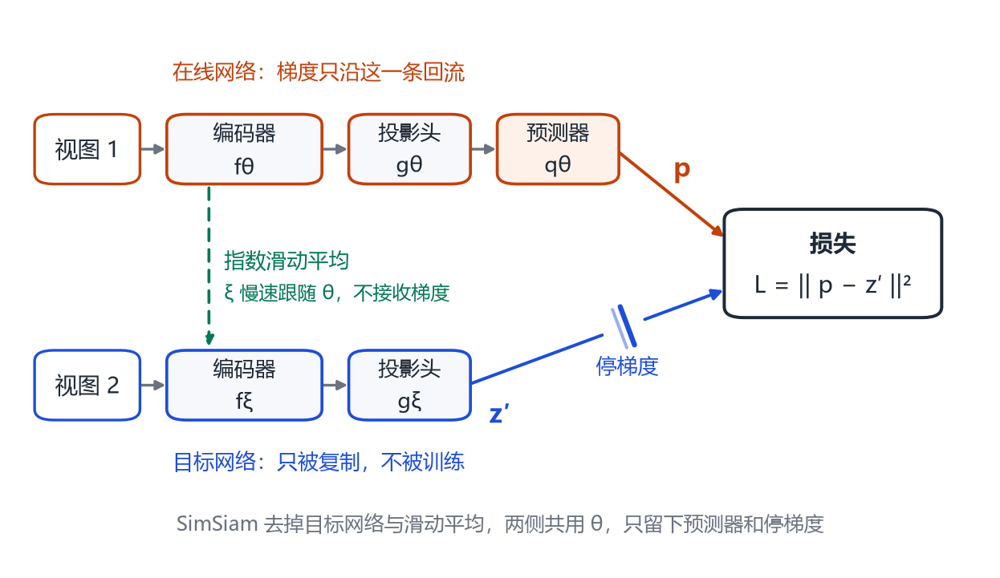
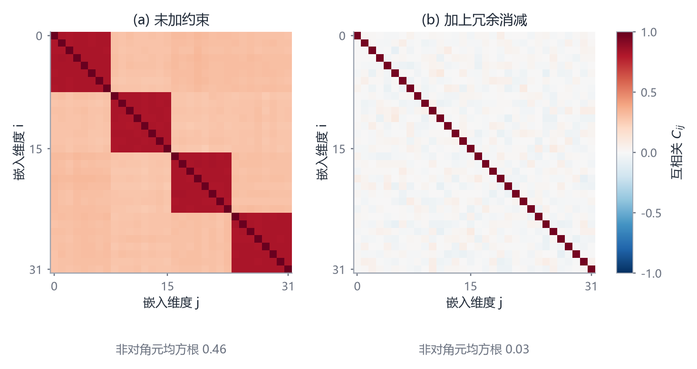
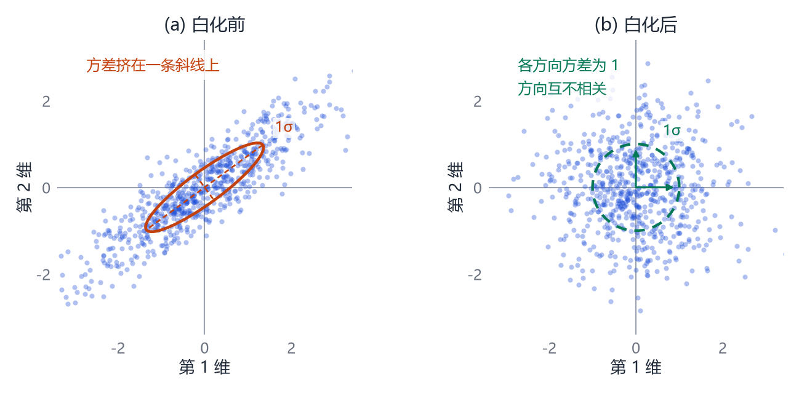

# 第 3 章　不用负样本的训练

上一章把塌缩拆成两半来看。一半是所有样本被映射到同一个向量，另一半是维度之间互相复制，名义上有一千维，实际能用的方向只剩几十个。对比学习靠负样本同时治住了这两种病，因为把别的样本推开这件事，天然要求每个样本占住自己的一块地方。代价藏在前提里，同一批里必须恰好有足够多的别人，而且这些别人不能被增强变换弄成近似正样本。

去掉负样本之后仍然能训练的实验，在 2020 年前后集中出现。BYOL 在 ImageNet 上用 ResNet-50 训练 1000 轮，batch 4096 摊在 512 块 TPU v3 上，线性评估的 top-1 是 74.3%。Barlow Twins 用同样的数据集与骨干、1000 轮、batch 2048，拿到 73.2%。VICReg 在同一套设置下也落在 73.2%，与同期的对比学习方法站在同一条线上。领先的那组靠的是大 batch 与大量负样本，差的这一个点落在增强与轮数上。问题因此变得很尖锐，既然唯一被优化的量是两个视图要一致，凭什么不塌。

答案分成两路。一路改结构，让两个分支不再对称，梯度只从其中一边回传，BYOL 与 SimSiam 走的都是这一路。另一路改统计量，不碰梯度也不碰结构，直接在表征的协方差上加约束，Barlow Twins、VICReg 与 W-MSE 属于这一路。两路要办的是同一件事，都是把不许所有东西挤在一起这条要求从样本之间挪走。区别只在于挪到哪儿，一路挪到梯度上，一路挪到维度上。

两种代价的形状不一样。结构派的账算在时间上，因为两个分支的更新速度不再一致，多出一个必须小心调的系数。统计量派的账算在 batch 上，因为协方差得有足够多的样本才估得准，这两种代价都比 batch 必须几千轻一些，但都不是零。弄清它们各自落在哪一步，才知道换数据集、换显存预算的时候该动哪个旋钮。

## 3.1　三个零件与一条断开的梯度

BYOL 的装配值得逐个零件看一遍，如图 3-1。一张图取两个增强视图，视图 1 进在线网络，视图 2 进目标网络。在线网络有三个零件，编码器 $f_\theta$、投影头 $g_\theta$ 与预测器 $q_\theta$。目标网络只有前两个，参数记作 $\xi$，与 $\theta$ 是两套不同的数。两个视图来自同一张图，用同一套增强，这与对比学习一致。前向传播时两条分支各自独立地算出向量，损失只比较它们最终给出的那两个结果。

$$
\mathcal{L}_{\theta,\xi} = \left\lVert q_\theta(z_\theta) - \operatorname{sg}(z'_\xi) \right\rVert_2^2
$$

式中的 $z_\theta$ 是在线分支的投影输出，$z'_\xi$ 是目标分支的投影输出。$\operatorname{sg}$ 是停梯度（stop-gradient），意思是这一项在反向传播时被当成常数，梯度不往 $\xi$ 里流。实践里会把两个视图的位置对调再算一遍，两次取平均。两个分支于是轮流当学生，谁也没有被永久钉在靶子上，这一手叫对称化。对称化之后损失在形式上对称，梯度却仍然只走一条路，这个不对称正是整套方法赖以成立的地方。

$\xi$ 不靠梯度更新，它由 $\theta$ 的指数滑动平均得到，写成 $\xi \leftarrow \tau\,\xi + (1-\tau)\,\theta$。其中的 $\tau$ 是动量系数，取值接近 1，所以 $\xi$ 走得很慢。这个式子在显存上是要花钱的，因为目标网络是第二份完整权重。实现上它是一次逐元素的原地更新，不经过优化器，因此没有动量缓冲，也不参与权重衰减。训 ResNet-50 时这点开销可以忽略，换成 ViT-g 那种量级的骨干，它就得提前算进预算里。

尺寸的选择不是随手定的。编码器输出 2048 维的池化特征，投影头先升到 4096 维、接批归一化与 ReLU、再压到 256 维。预测器套用与投影头相同的形状，它不改变维度，只改变数值。训练用 LARS，基础学习率 0.2 按 batch 线性缩放，权重衰减是 1.5 乘 10 的负 6 次方。1000 轮跑下来，一个 ResNet-50 在 512 块 TPU v3 上大约 8 小时，评估时投影头与预测器一起扔掉。这套尺寸后来被 Barlow Twins 与 VICReg 放大到三层 8192 维，思路没变，都是给训练空间留出足够多的维度。

<figure class="fig">

<figcaption><b>图 3-1</b>　BYOL 与 SimSiam 的结构。上方在线网络带预测器，下方目标网络只被滑动平均复制，梯度在进入目标分支之前被断开；SimSiam 去掉目标网络与动量，两侧共用一组权重。</figcaption>
</figure>

图 3-1 里那道断开的符号是全图的关键。它标出的不是一条数据通路的缺口，而是一条梯度通路的截断。数据照样从目标网络流向损失，梯度却不能从损失流回目标网络，前向与反向在同一个位置分了岔。停梯度容易被当成实现细节，实际上它是这套方法里唯一不可替换的零件，看清这一点，后面所有关于为什么不塌的解释才有地方落脚。

## 3.2　三种解释的分量

停梯度为什么有用，文献里给过三种说法，它们站得稳的程度并不一样，最朴素的一种讲合谋。如果两边都收梯度，把输出压成常数就是最省力的解。而且它稳定，因为两个分支同时朝对方移动，各走一步就碰头。碰头处必然是中间某处，初始化没有结构时，那里就是所有人的平均值。钉住一端之后，另一端要靠近它只能自己动，这能解释去掉停梯度为什么塌，却没说明留着它为什么不塌。

第二种说法来自 SimSiam 的作者，把停梯度读成另一套优化问题在交替求解。他们引入一组辅助变量，把每个样本的表征当成可以被直接指定的量。然后固定一组、优化另一组，像期望最大化算法（Expectation-Maximization，EM）那样轮换。停梯度在这个框架里不是技巧而是必然，因为求解 $\theta$ 的那一步里，辅助变量本来是常数。多步交替给出了支持，每步交替 68.1%，10 步 68.7%，100 步 68.9%，一整轮才交替一次落到 67.0%。

第三种说法是 BYOL 论文自己的，也是三者里最接近数学的一支。假设预测器已经最优，即 $q^\star(z_\theta)=\mathbb{E}\left[z'_\xi\mid z_\theta\right]$，把它代进损失，损失就变成条件方差之和 $\sum_i \operatorname{Var}(z'_{\xi,i}\mid z_\theta)$。条件方差有一条单调性，$\operatorname{Var}(X\mid Y,Z)\le\operatorname{Var}(X\mid Y)$，多给一个条件只会让方差变小。所以主动丢掉在线分支的信息，不可能让这个损失下降。反过来，只要在线分支退化成常数 $c$，条件方差就成了 $\operatorname{Var}(z'_\xi\mid c)$，比带着信息时更大，常数解因此不稳定。

这段推导有一个前提被明确写在括号里，就是预测器必须已经最优。BYOL 的原文正是用这个前提去解释动量网络。硬拷贝 $\theta$ 到 $\xi$ 同样能把新的变化传过去，问题出在突变会让预测器一下子落后很多。条件方差的重写随即失效，损失也就退回可以靠塌缩降低的状态。动量网络的职责不是提供一个稳定的靶子，而是维持预测器的近似最优，这句话把动量、预测器、停梯度串成了一条因果链。

动量系数 $\tau$ 的取值因此不是随手定的。BYOL 让它从 0.996 起步，按余弦曲线在训练结束时升到 1，写法是 $\tau=1-(1-\tau_{\text{base}})(\cos(\pi k/K)+1)/2$，$k$ 是当前步，$K$ 是总步数。0.996 意味着每一步只有千分之四的新参数渗进目标网络，训练后期连这千分之四也没有。太快会把目标网络拖着一起跑，两个分支又回到同时移动的局面。$\tau$ 等于 1 则把它冻在初始化那一刻，在线网络去拟合一个随机表征，学到的东西没有意义。

消融把这个判断钉住了。BYOL 的附录表 21 在 300 轮、batch 4096、64 块 TPU v3 的设置下，把动量整个去掉改成硬拷贝，再给预测器的学习率乘一个系数 $\lambda$。基线带动量是 72.5%，$\lambda$ 取 0 时是 0.01%，也就是完全塌缩。取 1 时 5.5%，取 2 时 62.8%，取 10 时 66.6%，取 20 时 66.3%，曲线在 2 到 10 之间爬得最陡。这说明没有动量这件事可以被预测器学得更快部分补偿，但补不满；SimSiam 的脚注引 BYOL 的 arXiv 第三版，把同一组实验记作 66.9%，两个数字是同一次消融的两个版本读数。

## 3.3　SimSiam 的四组消融

SimSiam 把 BYOL 拆到只剩骨架，拆完还能跑，才说明哪些零件真的承重。两个视图过同一个编码器 $f$，其中一边接预测器 $h$，另一边停梯度。损失是负余弦相似度，取值范围从 -1 到 1，最小值 -1 意味着两个方向完全一致。没有目标网络，没有动量，batch 只要 512。预测器是 2048 维输入、512 维瓶颈、2048 维输出的三层结构，瓶颈层带批归一化。两个分支共用同一组权重，所以它是最纯粹的孪生网络，既没有教师，也没有队列。

四组数字摆在一起就能称出重量。默认配置的 ImageNet 线性评估是 67.7%，五次试验的标准差 0.1。去掉预测器，掉到 0.1%；把预测器留着但固定在随机初始化的权重上，1.5%。学习率不做余弦衰减，倒是还有 68.1%。四组都用 100 轮预训练，骨干、增强、batch 相同，变的只是那一处。前三组说明预测器不能省，而且它不仅要存在，还必须能学。第四组说明调度只是精度问题，与塌不塌无关。

0.1% 这个数要小心读。SimSiam 的论文专门加了注，说准确率等于随机水平并不足以断定发生了塌缩。损失发散也会给出同样的结果，那是一条完全不同的失败路径。真正的证据在训练曲线上，去掉停梯度之后损失立刻掉到最小值然后停在那里。$\ell_2$ 归一化之后每个通道的标准差从接近 $1/\sqrt{d}$ 掉到零，而 $1/\sqrt{d}$ 正是均匀分布在单位超球面上的理论值。

还有一个反直觉的地方需要点出来，不对称本身并不解决问题。把预测器加在一边、让两边结构不同，这个差异并没有阻止塌缩。去掉停梯度之后架构一模一样，结果照样是 0.1%。批归一化也被同样的逻辑洗清了嫌疑，因为两组对照用的是同一套 BN 配置。BN 影响的是优化难易，去掉投影头里的全部 BN 之后准确率只有 34.6%，补回隐层到 67.4%，再补到输出层才到 68.1%。

batch 的大小在这一族方法里显得宽松得多。SimSiam 的对照表从 64 排到 4096，准确率依次是 66.1%、67.3%、68.1%、68.1%、68.0%、67.9%、64.0%。256 到 2048 之间几乎是平的，4096 掉下来是因为标准 SGD 在大 batch 上本来就难调。这个平坦区间是对比学习给不出的，SimCLR 在 256 的 batch 上精度会掉大约 4 个百分点。原因是负样本数量跟着 batch 一起缩水，而这族方法根本不数负样本。把学习率按 batch 缩放、把优化器换成 LARS，是这类方法常用的两个补偿手段，原文这张表只用了标准 SGD。

## 3.4　预测器为什么必须可训练

预测器的作用要从增强变换说起。同一张图裁两块，一块偏左、一块偏右，颜色抖动与高斯模糊各自随机。这两次变换会让同一个物体的两个表征之间产生系统性偏移，方向取决于这一批样本用了哪些变换。如果直接要求两边相等，编码器有两条路可走。一条是把偏移编码进去，让表征跟着裁剪位置变化；另一条是把所有输入压成同一个值，后者更省力。

预测器提供了一个可以弯曲的中间层，它吸收掉两个视图之间的系统性偏移，让编码器只负责内容。SimSiam 的作者把这个直觉写成一行式子，最优预测器近似等于对增强分布取期望，$h(z)=\mathbb{E}_{T}\left[z_T\right]$。其中 $T$ 是一个随机增强，$z_T$ 是加了该增强之后的表征。单次观测永远不等于期望，这个差值就是梯度的来源。如果 $h$ 是恒等映射，差值恒为零，最优解立刻退回常数，这正是去掉预测器会掉到 0.1% 的原因。

BYOL 那边有一个更硬的版本。前面提过，预测器最优时损失等于条件方差之和，而这个量对常数解取不到最小值。条件越多方差越小，把在线分支的信息全丢掉只会让方差变大。反过来说，如果真去对 $\xi$ 最小化这个量，得到的会是一个塌缩的目标。所以 $\xi$ 必须靠滑动平均跟着 $\theta$ 走，不能对损失求梯度，这三件事各自堵住一个出口，缺一件就漏一处。

学习率的关系比结构更能说明问题。BYOL 的附录表 22 给预测器与投影头各乘一个系数，当预测器的系数小于或等于投影头的系数时，表征要么塌缩要么明显变差。只有预测器学得更快，硬拷贝权重才勉强能跑。表 21 里 $\lambda$ 取 0 的那一格是 0.01%，预测器一动不动，等于退回恒等映射，这个读数与 SimSiam 的 0.1% 是同一件事的两种呈现。

结构本身很朴素，2048 维输入、512 维瓶颈、2048 维输出，隐层带批归一化，输出层既没有归一化也没有激活。原文报告瓶颈比等宽更稳，但这不是关键，关键在它必须可学，而且学习速度不能落后。工程上有一条容易踩的坑，把预测器的学习率一起放进统一调度里降下来。或者给它单独加权重衰减，精度会莫名其妙地掉几个点，原因就在这里。

## 3.5　对角线与非对角线

换一条完全不同的路。不去动结构，也不去动梯度，只在表征的统计量上加约束，让两个视图的互相关矩阵长得像单位阵。这条路的好处是不用管两个分支怎么交互，坏处是所有约束都得从一批样本的统计量里算出来。Barlow Twins 的做法是先把两路嵌入各自按维度标准化，减均值、除标准差。标准化这一步不能省，否则矩阵里的数会随嵌入的尺度飘，损失也跟着飘。

$$
C_{ij} = \frac{\sum_b z^A_{b,i}\, z^B_{b,j}}{\sqrt{\sum_b (z^A_{b,i})^2}\sqrt{\sum_b (z^B_{b,j})^2}}
$$

式中的 $b$ 遍历 batch 里的样本，$i$ 与 $j$ 遍历嵌入的维度。$C_{ij}$ 就是视图 A 的第 $i$ 维与视图 B 的第 $j$ 维在这批样本上的相关系数。取值落在 -1 到 1 之间，对角元是两个视图同一维的相似度。整个矩阵的形状是 $d$ 乘 $d$，$d$ 是投影头的输出维度，Barlow Twins 取 8192，于是它是一张八千多行的对照表。这个矩阵有六千七百万个元素，单精度下要占两百多兆显存，算起来却只是一次矩阵乘法，代价几乎全落在把它估准上。

$$
\mathcal{L} = \sum_i (1-C_{ii})^2 + \lambda \sum_i \sum_{j \neq i} C_{ij}^2
$$

损失要求这个矩阵尽量接近单位阵。第一项管对角线，第二项管非对角线，$\lambda$ 是两项的权重，原文在 ImageNet 上搜到 $5\times10^{-3}$ 最好。两项分工很清楚，对角线上的元素是同一维在两个视图之间的相关，把它拉向 1 就是要求表征对增强不变。非对角线上的元素是两个不同维度之间的相关，把它拉向 0 就是要求不同维度各说各的事。前一项防止塌缩，后一项防止冗余，两个病一次治。

图 3-2 是一个 32 维的演示，4096 个样本，两路共享一个分块的协方差结构、各自再叠一点独立噪声。左图直接算出的互相关矩阵，对角线均值 0.99，非对角元有明显方块，均方根 0.46。右图先用一半样本估出互协方差矩阵的逆平方根做变换，再在另一半样本上重算。非对角元的均方根降到 0.03，只剩采样噪声留下的小斑点。用一半估、另一半验，是为了不让矩阵自己拟合自己。

<figure class="fig">

<figcaption><b>图 3-2</b>　Barlow Twins 的互相关矩阵（32 维随机嵌入、4096 个样本的演示数据，非真实训练结果）。左图对角线接近 1 而非对角块很大，维度之间高度冗余；右图非对角元被压到 0.03 左右，每一维各自携带不同的信息。</figcaption>
</figure>

真实的训练结果在 ImageNet 上，ResNet-50 线性评估 73.2% 的 top-1 和 91.0% 的 top-5。训练用 1000 轮、batch 2048、LARS、学习率按 batch 线性缩放、权重衰减 1.5 乘 10 的负 6 次方。32 块 V100 跑 124 小时，同一套硬件上重跑的 BYOL 用 4096 的 batch 花 113 小时，两者在同一量级。原文强调 batch 小到 256 也能用，只要对每个 batch 单独搜一遍学习率。参与估计的样本少了八倍，估出来的相关系数抖得厉害，精度却几乎不动。这个鲁棒性来自约束落在维度上，而不落在样本之间。

## 3.6　三个显式的项

VICReg 把同一件事拆成三个显式的项，每一项都有一个直白的名字。方差项要求每一维在 batch 上的标准差不要低于阈值，写作 $v(Z)=\frac{1}{d}\sum_{j}\max\left(0,\ \gamma-S(z_j,\epsilon)\right)$。其中 $z_j$ 是第 $j$ 维在整批样本上的取值向量，$S$ 是加了小常数 $\epsilon$ 的标准差。$\gamma$ 是目标标准差，原文取 1，$\epsilon$ 取 $10^{-4}$。协方差项把非对角元平方求和再除以维数压向 0，不变项是两个视图嵌入之间的均方距离。三项各自独立，谁也不替代谁，这一点与 Barlow Twins 只用两项的结构不同。

三项加权求和，权重 $\lambda=\mu=25$、$\nu=1$。结果是 73.2% 的 top-1 和 91.1% 的 top-5，与 Barlow Twins 在小数点后一位上分不出高低。设置也一样，1000 轮、batch 2048、展开层三层 8192 维。有意思的地方在标签稀少的时候，同一张表里 BYOL 只用 1% 与 10% 的 ImageNet 标签做微调，top-1 是 53.2 与 68.8，Barlow Twins 是 55.0 与 69.7，VICReg 是 54.8 与 69.5。两个统计量派方法在线性评估上打平，却在微调时一致领先一到两个点，说明线性探针只测了表征的一个侧面。

一个容易被跳过的细节是标准差与方差的选择。VICReg 的论文专门解释了为什么 hinge 套在标准差上而不是方差上。若直接用方差，取值接近均值时梯度会趋近于 0，而这恰恰是最需要推力的时候。栏杆装在了悬崖最滑的一段，塌缩反而更容易发生。换成标准差，梯度在 0 附近更大，塌缩的入口被堵得更紧，同一个约束写成等价的不同形式，优化行为可以差很远。

批大小的账也算得细。VICReg 的附录把 batch 从 128 排到 4096，每个尺寸单独搜一遍基础学习率。256 掉 0.7%、128 掉 1.2%、4096 掉 0.8%，都在可接受范围内。这个结论与 Barlow Twins 的报告一致，说明统计量派的 batch 需求确实比对比学习松。它与 Barlow Twins 的关系也近，冗余项就是协方差项。区别在于 Barlow Twins 用对角线代替了显式的不变项，而 VICReg 把不变性写成独立的均方距离，权重可以单独调，调不动的时候还有地方退。

## 3.7　白化一次解决两个问题

对角线拉向 1、非对角线拉向 0，这两句话在几何上是一件事。给一批向量算协方差矩阵 $\Sigma$，它描述的是这批点围成的椭球，主轴方向是特征向量，轴长是特征值的平方根。某一维方差接近 0，椭球就在那一维上被压扁。两维高度相关，椭球就被拉长在一条斜线上，看着很长其实只占了一个方向，判断表征健康与否看这只椭球就够了。

白化是乘上 $\Sigma^{-1/2}$，也就是先把 $\Sigma$ 分解成 $V\Lambda V^\top$，把特征值开方取倒数再拼回去。它的作用是把每条主轴的长度缩到 1，椭球变成球，球心挪到原点。图 3-3 是一个二维例子，左图两个主方向的方差是 2.762 与 0.138，差二十倍。点云挤在一条斜线上，右图两个方向的方差都是 1，两维的相关系数是 -0.03。两张图的样本是同一批，白化只换了一套坐标系，没增删一个点。

<figure class="fig">

<figcaption><b>图 3-3</b>　白化前后的二维点云（700 个样本的演示数据）。左图协方差的主轴一长一短，点云沿斜线分布；右图乘上协方差矩阵的逆平方根后两个方向方差都变成 1，相关系数接近 0。</figcaption>
</figure>

为什么一个操作能同时堵住两个出口，塌缩是每一维的方差都变成 0，白化把每一维的方差钉在 1。冗余是两个维度说的是同一件事，白化把任意两维的相关系数钉在 0。前者是表征退化成一点，后者是表征退化成一条线或者一个低维子空间。两件事看起来不同，在协方差的谱上却是同一类病，都是某些特征值掉了下去，白化直接把整条谱按到 1。

举个能想象的例子。假设一批照片的表征里，第一维记的是画面有多亮，第二维记的是色调有多暖。这两个量天然同涨同落，晴天拍的照片又亮又暖，这样的两维等于只有一维，容量白白浪费。白化把这条相关抹平之后，第二个维度被迫去找别的差别，比如室内还是室外，容量不是训练目标直接要来的，是被统计约束逼出来的。

代价在于 $\Sigma$ 只能从一批样本上估。$d$ 维协方差有 $d(d+1)/2$ 个自由参数，样本数少于 $d$ 时估出来的矩阵必然奇异，白化无从谈起。Ermolov 等人在 2021 年提出的 W-MSE 把这个想法直接做成损失。实现时把 batch 切成若干子批，子批大小取嵌入维度的两倍，用子批内部的样本估白化矩阵。再换一组排列重估几次取平均，用重采样压住估计的方差。

这也解释了这类方法对 batch 的依赖和对比学习不同。对比学习要大 batch，是因为负样本要多；白化要大 batch，是因为协方差要估得准。方向不一样，但都逃不开一批样本要足够多这个前提。区别在于前者的需求随负样本数量线性增长，后者的需求随维度平方增长。粗算一笔账，嵌入维度翻四倍，协方差里的自由参数翻十六倍，而负样本的需求只翻四倍。

还有一点要留意。$\Sigma^{-1/2}$ 不是唯一的，任何正交矩阵左乘它都还是白化矩阵。得到的是同一个球面上的一次整体旋转，换成城市地图的说法，把整张图转三十度，任意两个街区的距离没变。谁在谁的东边也没变，这个自由度说明白化把解收窄到了一个等价类。没有收到一个点，而二阶矩能管的也就到这里为止。

把这一章的办法摆在一起看，会发现它们都在出口处设卡。停梯度堵住两边一起躺平这条路，动量把目标端推慢半拍，白化与去相关堵住维度挤成一团这条路，去相关顺手还管了冗余。堵的位置不同，目的一样，都是先让模型自由决定什么该靠近什么，再在表征离开之前把形状挡回去。这个顺序很重要，先学关系再管形状，比一开始就把形状写死要灵活。

代价也各不相同。停梯度把优化变成两个时间尺度的问题，动量系数成了一个必须小心调的超参。白化让 batch 的统计量变成约束的一部分，batch 一小就估不准。去相关要求投影头的维度足够大，否则没有足够的维度可推，8192 这个数字不是随便写的，它是给冗余留出的余量。换到样本少、类别少的小数据集上，先崩的往往不是目标函数而是这些前提。

二阶矩能管住椭圆，管不住形状。设想一批二维表征，每一维的分布都是标准正态，协方差恰好是单位阵。白化看了会认为它完全合格，可这些点其实排成一个 X 形，四个角上各有一簇，中间是空的。这个反例说明白化的天花板在哪里，它只钉住了均值和协方差，更高阶的结构一概不管。下游任务要的恰恰是那些被高阶结构记录下来的关系，第 4 章从这张 X 形图讲起。
