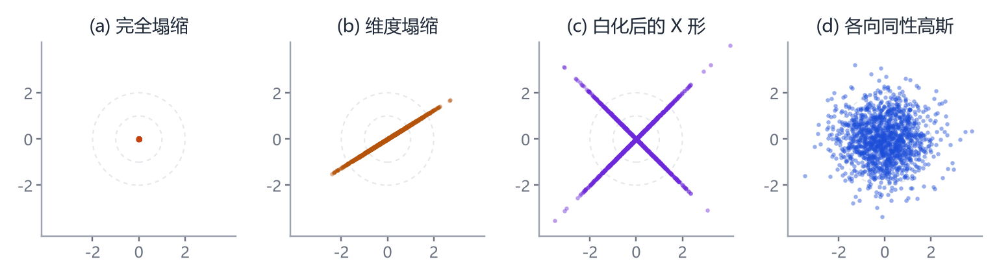
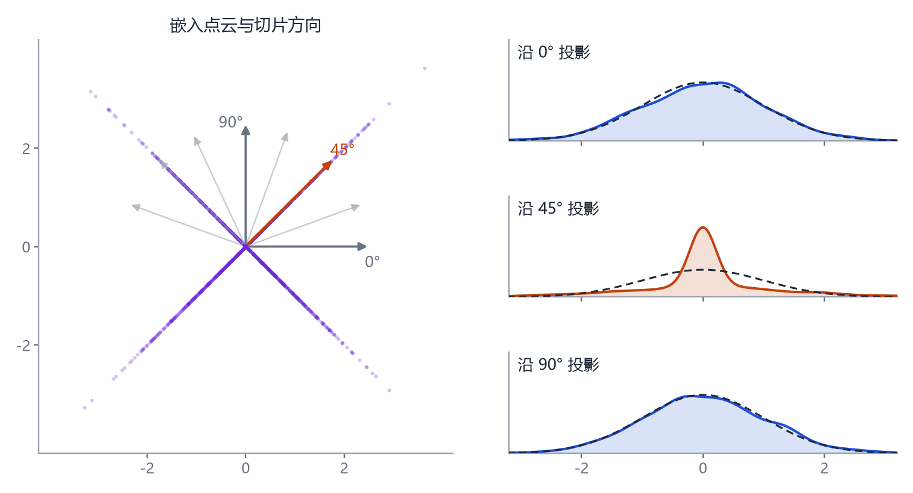
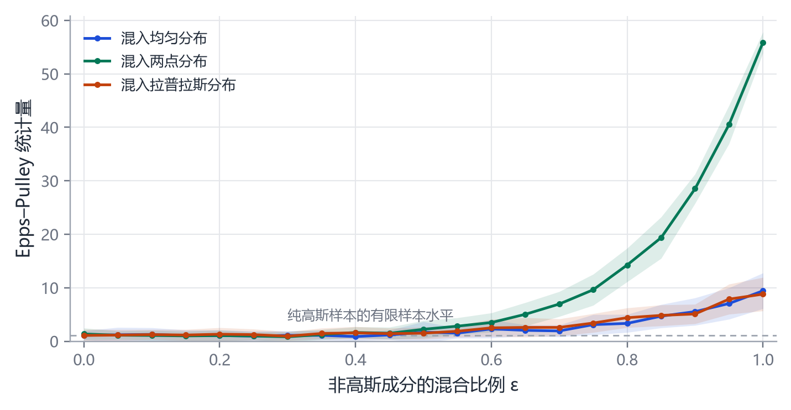

# 第 4 章　把表征捏成高斯

上一章收尾时留下的问题很具体。白化把协方差矩阵压成单位阵，VICReg 用方差项与协方差项做了同一件事，两者都能让损失漂亮地降下去，也能让第 2 章那套监控指标全部转绿。可是把嵌入投影到前两个主成分上看一眼，画出来的往往不是一团圆点，而是一道弯月、几个分开的簇，或者中间被挖空的一个环，它的协方差仍然是单位阵。约束落在二阶矩上，而形状活在二阶矩之外。

这一章要处理的就是二阶矩之外的那部分。做法不再是往损失里加一条禁令，而是直接指定表征应该服从哪个分布，也就是各向同性标准高斯（isotropic standard Gaussian）。指定分布之后，"不许塌缩"从一条需要反复调参来维持的经验规则，变成一条能够推出来的结论。Balestriero 与 LeCun 在 2025 年的 LeJEPA 里把这套论证写成了定理，也写出了能直接跑的代码，本章大部分内容围绕这份工作展开。

要回答的问题有四个。目标为什么偏偏是高斯，而不是别的什么分布；高维分布没法直接比较，怎么把它降成一维问题；降维之后用什么尺子量两堆标量的差距；这把尺子怎么变成一个能进反向传播的损失项。四个问题串起来就是 SIGReg（Sketched Isotropic Gaussian Regularization，草图化各向同性高斯正则）的完整推导，推导之后再看它在 ImageNet 上的实测数字，以及它管不到的地方。顺序不能颠倒，因为每一步的结论都是下一步的前提，跳过任何一步都会在调参时变成猜谜。

如果只想先记住结论，可以这样概括：每一步抽若干随机方向，把嵌入投影成若干条一维样本，用 Epps–Pulley 统计量逐个比较它们与标准正态的距离，取平均，乘以权重加进总损失。整段实现不到五十行 PyTorch。多卡同步只需要一次 all_reduce，除了平衡系数 $\lambda$ 之外没有别的超参数要调。听起来太省事，省事的部分恰恰来自前面那些推导。

## 4.1　二阶矩之外的那个 X

先把反例造出来，因为它决定了后面所有设计要防什么。取一个标准正态的标量 $z$，再取一个独立且等概率取 $\pm1$ 的符号 $s$，令横坐标 $x=z$、纵坐标 $y=s\cdot z$，这对 $(x,y)$ 就是那个 X 形。$y$ 的边缘分布是标准正态，因为把一个正态变量随机翻符号不改变它的分布。协方差里的交叉项是 $\mathbb{E}[sz^2]=\mathbb{E}[s]\,\mathbb{E}[z^2]=0$，所以协方差矩阵恰好是单位阵。

$$x=z,\qquad y=s\cdot z$$

这份数据能通过任何只看一阶二阶矩的检查。均值是零，方差是一，协方差非对角为零，白化之后原样不动，VICReg 三项里方差项与协方差项都已经到最优。可是它离一团球形的点云差得很远，两条臂上密、象限之间空，平面上大半的面积密度是零。四种状态的对比见图 4-1，那张图值得在开始调参之前就看一遍。

<figure class="fig">

<figcaption><b>图 4-1</b>　四种二维嵌入的形态，四个面板共用同一坐标范围，虚线圆半径为 1 与 2。(a) 完全塌缩，两个特征值都是 0；(b) 维度塌缩成一条线；(c) 白化后的 X 形，特征值与 (d) 几乎相同而形状完全不对；(d) 各向同性高斯，这才是目标。</figcaption>
</figure>

图 4-1 的四个面板里，(a) 与 (b) 是第 2 章讲过的两类塌缩，(c) 是刚造出来的 X，(d) 才是想要的形状。(c) 与 (d) 的特征值分别是 1.07、0.97 和 0.997、0.912，差得不多，光看谱分不出谁是谁，差别全在点的位置上。一个沿着两条对角线排，一个铺满整个平面。这说明第 2 章那套谱线监控有一个盲区，谱对了不代表形状对了，而盲区正好落在最要命的地方。

真实嵌入当然不会长成这么规整的 X。它更可能是几个分不开的簇、一条卷起来的月牙、一个被挖空的甜甜圈，或者某个语义方向被拉得特别长。共同点是毛病都不在二阶矩上，白化这类线性变换也改不了它们，因为线性变换只能把椭球拉成球，球里面还剩什么结构，它一概不管。要管这件事，得有一个能看见整条分布曲线的量。

## 4.2　为什么目标偏偏是高斯

指定一个形状，总得说清为什么是这个形状，否则就是拿研究者的偏好当先验塞进损失函数里。LeJEPA 给了三条理由，分别对应下游预测的稳定性、分布本身的信息量、以及与表征的旋转自由度是否打架。三条理由讲完会落到一条定理上，那条定理说的是在所有总方差相同的分布里，各向同性高斯最不容易在下游任务上翻车。这三条听上去像是审美偏好，其实是关于最坏情况的论证，换成别的分布就有一条会断。

第一条理由是各向异性会放大线性探针的误差。表征被某个方向压扁之后，如果下游任务恰好需要那个方向的信息，探针就得用很大的系数把它放大回来，噪声跟着一起放大。论文用一个小实验把这件事量了出来：二维二分类，100 个训练点，用逻辑回归在反复重采样的训练集上拟合，各向同性时估计系数的方差是 0.0056，各向异性时是 0.0801，相差十四倍，而两者的总方差完全一样。同一批数据，只是几何不同，估计的稳定性就差了一个数量级。

第二条理由是熵。给定协方差矩阵，高斯在所有分布里微分熵最大，而且这个最大值只由协方差的行列式决定，别的什么都不掺进来，写成式子就是下面这一项，等号右边只剩一个行列式。

$$h=\frac{1}{2}\log\left((2\pi e)^{K}\det\Sigma\right),$$

其中 $K$ 是嵌入维度，$\Sigma$ 是协方差矩阵，$e$ 是自然常数。熵大意味着除了已经写进协方差的那点信息之外，不再额外假设任何结构。留白不是偷懒，而是承认训练数据里没有说的东西不该由损失函数替数据开口。把目标设成"八个簇"或者"一条螺旋"，等于把研究者对数据的猜测焊进损失函数，猜对了省事，猜错了就是给模型上一道锁，以后遇到猜不到的类别只能硬塞进那八个簇里。

第三条理由是旋转不变。任何正交矩阵作用在标准高斯上，结果还是标准高斯，原点不动，方差不变；而表征本来就只在旋转意义下确定。同一批数据训练两次，两次得到的基可以差一个正交变换而同样好用。把目标定成标准高斯，不会和这件事打架。反过来，若规定"第 3 维必须是胡须长度"，就等于钦定了一组由随机初始化决定的基，换一个种子就全变了。

三条合起来，LeJEPA 写成了一条定理：在所有协方差被约束成标量的分布族里，各向同性高斯唯一地最小化下游预测的积分平方偏差，k 近邻探针与核回归探针都成立。定理里"协方差被约束成标量"这个条件不能丢，它保证比较是在同等总方差下进行的，去掉之后结论要重新证。落到 k 近邻上，这句话的意思是，固定半径的球里能装进多少邻居、这些邻居的密度差多少，决定了平均出来的标签偏不偏。高斯让密度在每个方向上按同样的速度衰减，球在各个方向装进来的样本一样近。

## 4.3　切开来看

高维分布没法直接比。两样本检验的复杂度随维度膨胀，密度估计在几十维以上就不可靠，直接在 $K$ 维上做分布匹配，需要的样本量会失控。可行的路子是把维度降下来再比，降维工具有两种可以选，主成分和随机投影，这里取后者，理由是它不需要先估协方差，也不依赖数据本身，抽一个方向就能用。这条路径还有个附带的好处，投影只是一次矩阵乘，代价对维度是线性的，嵌入从 384 维涨到 1024 维也不会变贵。

取一个单位向量 $a$，把嵌入 $z$ 投成一个标量 $a^\top z$，就得到一条一维分布，问题变成"这条一维分布是不是标准正态"。Cramér–Wold 定理保证这样切不丢信息：如果两个随机向量沿所有方向的投影都同分布，那么它们本身同分布。反过来说，X 形与高斯在 0° 和 90° 上几乎没有区别，在 45° 上却天差地别，只检查坐标轴会把错误整片漏掉。所以方向集合必须是随机的，而且必须落在坐标轴之间的空隙里，这一点在实现上比在推导里更容易被忽略。

<figure class="fig">

<figcaption><b>图 4-2</b>　随机切片。左图是 X 形点云与八个投影方向，橙色为 45°；右图是沿 0°、45°、90° 的一维分布（实线）与标准正态（虚线），三行纵轴各自缩放。第一行与第三行几乎重合，第二行堆出一个尖峰。</figcaption>
</figure>

这个想法在二维上的样子如图 4-2。左图是点云和八个方向，右图是三个方向上投影后的密度与标准正态的对比：沿 0° 与 90° 两条曲线几乎和虚线贴在一起，峰度分别是 0.01 与 0.00。沿 45° 有一半质量压在 0 附近，鼓成一个尖峰，峰度 2.84。同一个分布，换一个角度量，结论从"完全正常"变成"明显不对"，这就是随机方向比坐标轴可靠的原因。

方向有无穷多个，实际只能抽 $M$ 个，$M$ 要不要随维度指数增长，取决于目标分布有多光滑。高斯非常光滑，论文用 Sobolev 正则性给出了平均误差随方向数下降的界，方向数取到与维度同阶就够，所谓维度灾难在这里并没有发生。还有一个不花钱的细节，方向不必在整个训练过程中固定，每一步重新抽一批就行。固定方向时模型只要在那几个角度上把分布揉圆，角度之间的缝隙无人看管；每步重抽，累计覆盖的方向数随训练步数线性增长，论文把这件事叫作白送的覆盖度，消融里重抽的曲线在每个方向数上都低于固定的那条。

## 4.4　一维上的尺子

切片之后问题降成一维，手上是一串标量，要问它们是否来自标准正态。这一步的选择比想象中重要，因为损失项能不能训、训得稳不稳，完全由它决定。论文比较了三类统计量，矩、累积分布函数、特征函数，前两类各有硬伤，第三类胜出，理由值得逐条看清楚。选错尺子的代价不是精度掉一点，而是训练根本走不动，或者走到一个和想要的分布无关的位置上。

矩方法看偏度和峰度，实现最简单，问题在于有限个矩不足以确定一个分布。论文有一条定理专门讲这件事：只匹配前 $K$ 阶矩，即使 $K$ 很大，也不能推出两个分布相同，于是最小化这样的目标会留下塌缩的捷径解。想靠增加阶数补救也不行，第 $k$ 阶矩的梯度范数随 $k$ 增长，重尾数据上会直接炸掉，训练不得不靠梯度裁剪兜底，而裁剪本身又是一个要调的超参数。这个毛病在训练里表现为损失前几十轮降得很快，之后卡在一个不低的位置，看起来像学习率没调好，实际上是目标函数里留了捷径。

累积分布函数这一族包括 Cramér–von Mises、Anderson–Darling、Watson，都要先对样本排序。排序在单卡上是 $O(N\log N)$，可它破坏了随机梯度下降最好的那个性质，也就是样本之间彼此独立可以并行，多卡训练时还要额外的同步开销。排序本身不可微，得靠松弛近似，每一种近似又引入新的超参数。Kolmogorov–Smirnov 检验被单独排除，因为它用的是 $\ell_\infty$ 范数，最大竖直距离只由最差的那一个点决定，梯度变成稀疏的脉冲，大部分样本拿不到信号。

剩下的是特征函数。标准正态的特征函数是 $\varphi(t)=e^{-t^2/2}$，样本的经验特征函数是 $\hat\varphi(t)=\frac{1}{N}\sum_{j=1}^{N}e^{\,itz_j}$，它是一堆复指数的平均，求导逐项进行，多卡之间做一次 all_reduce 就拼出全局值，复杂度是 $O(N)$。把它想成密度函数的傅里叶变换，质量怎么摆就被翻译成各个频率上振荡的强弱。Epps–Pulley 统计量在经验特征函数与目标之间度量一个加权的 $L^2$ 距离，

$$\mathrm{EP}=N\int_{-\infty}^{\infty}\left|\hat\varphi(t)-\varphi(t)\right|^{2}w(t)\,\mathrm{d}t,$$

$N$ 是样本数，$w(t)$ 是窗函数，参考实现取 $w(t)=e^{-t^{2}/2}$，积分截到 $[-5,5]$，用 17 个点的梯形公式求值。17 看着不多，论文的消融说明它够用。截断带来的误差比有限样本噪声小得多，窗函数本身已经把远端压没了。前面的 $N$ 有它的道理，样本越多 $\hat\varphi$ 越接近真值，偏差按 $1/\sqrt{N}$ 缩小，乘上 $N$ 之后统计量的量级与样本量无关，不同大小的批次可以直接比较。

梯度有界是它被选中的决定性理由。对任意一个样本，$|\partial\mathrm{EP}/\partial z_j|\le 4\sigma^{2}/N$，其中 $\sigma$ 是窗函数的带宽，这个界与数据长什么样无关，重尾也好、双峰也好，梯度都不会越界。矩方法碰上重尾会把梯度推到天文数字，EP 不会，因此训练里不需要梯度裁剪这道保险，也不需要在换数据集时重新估一个裁剪阈值。统计量的实际行为如图 4-3。

<figure class="fig">

<figcaption><b>图 4-3</b>　Epps–Pulley 统计量随非高斯成分比例的变化，三条曲线的均值为 0、方差为 1，前两阶矩与标准高斯一致。ε=0 处落在 1.1 到 1.4 之间，是 500 个样本的有限样本噪声底；阴影为 40 次重复的标准差。</figcaption>
</figure>

图 4-3 里三种非高斯成分先各自归一化到均值 0、方差 1，再按比例 $\varepsilon$ 与标准正态混合，混合后的方差始终是 1，白化看不出任何区别。$\varepsilon=1$ 时，混入均匀分布对应 9.43，混入拉普拉斯对应 8.81，混入两点分布对应 55.90。两点分布最陡，因为它把质量整个搬到两处，一维形状变化最剧烈；均匀与拉普拉斯在 EP 眼里程度相近，一个是太方，一个是尾巴太厚。曲线陡不陡直接对应惩罚的力度，双峰这类错误一出现就被压下去，重尾则要积累到一定程度才被察觉。

读这条曲线要先把噪声底减掉。$\varepsilon=0$ 处三条曲线都不为零，落在 1.09 到 1.36 之间，这是 500 个样本、40 次重复下的有限样本水平。这不是方法本身有偏，而是统计量在有限样本上的固有下限。它也提醒一件事，EP 是个统计量而不是距离，它的零点随样本量移动，拿它做严格的假设检验要另配临界值，拿它当训练信号则不必，因为优化关心的是相对变化。

## 4.5　SIGReg 与那一个超参数

把方向与统计量拼起来就是 SIGReg。每一步抽 $M$ 个单位方向 $a_1,\dots,a_M$，每个方向算一次 EP，取平均。论文在定理里写的是取所有方向的最大值，实践里换成平均，因为取最大值时只有少数方向拿得到梯度，其余方向白算一遍。有了这一项，总损失是两项的加权和，

$$\mathcal{L}=\lambda\,\mathrm{SIGReg}+(1-\lambda)\,\mathcal{L}_{\mathrm{pred}},$$

$\mathcal{L}_{\mathrm{pred}}$ 负责让同一张图的不同视图的嵌入靠近，$\lambda$ 平衡两者，整份配方只有这一个超参数。取平均而不是取最大值还有一个副作用，各方向的梯度量级差不多，更新不会全压在某一个方向上。

实现顺序值得交代一句，因为顺序错了会白跑。嵌入先在批维上取出来，乘上方向矩阵得到 $N\times M$ 的投影，再乘上积分节点得到 $N\times M\times T$ 的张量，取复指数、在批维上求平均得到每个方向的经验特征函数，与高斯窗比较后做梯形积分，乘上全局批大小。方向要按全局步数设种子，否则各张卡抽到不同的方向，all_reduce 平均出来的东西既不是这个方向也不是那个方向。四步里最容易写错的是积分，节点数取奇数才能让梯形公式把对称区间的中点算进去，取偶数会让 $t=0$ 附近那一段被跳过。

$\lambda$ 的取法有实测支撑。ImageNet-100 上训 ResNet-50 四百轮，$\lambda$ 在 $10^{-3}$ 到 $10^{-1}$ 之间扫，2、4、8 个视图各画一条曲线，精度在整个区间里平稳，没有哪个位置会突然崩掉，论文因此推荐 0.05 作为默认值。视图多时最优点会略微往大的一侧偏，因为预测项被平均的次数变多，需要多给正则一点权重。工程上的含义是这一项不必精调，换数据集时沿用同一个值即可。

这个形式和上一章的 VICReg 有直接关系。把 EP 换成一个只看前两阶矩的统计量 $\hat\mu^{2}+(\hat\sigma-1)^{2}$，SIGReg 在方向数趋于无穷时就退化成 VICReg。也就是说 VICReg 是这条路的一个特例，它约束均值和标准差；SIGReg 约束整条特征函数曲线。论文对这个退化版本的态度很明确，按那条"有限个矩不足以确定分布"的定理，只匹配有限个矩会留下塌缩的捷径解，而这正是 VICReg 在实践中被观察到的毛病。

切片本身也不是新想法，切片 Wasserstein 距离早就在用随机投影把高维比较换成一批一维问题。区别在每一维上用什么尺子。Wasserstein 要排序才能算一维最优传输，那一步不可微，代价也高；EP 只看特征函数，能微分、能并行、梯度还有界。论文还提了一句，若把 EP 的积分算到精确而不是用梯形近似，每个切片的损失恰好等于一个核 MMD，只不过那个形式是平方复杂度，用不了。

塌缩为什么被构造性地排除，从这个式子直接能看出来。完全塌缩时所有嵌入相同，任何方向上的投影都是一堆相同的数，经验特征函数退化成 $e^{itc}$，与 $e^{-t^2/2}$ 的距离很大；维度塌缩时至少存在一个方向，投影后的样本挤在极少的几个值上，EP 同样很大。最小化 SIGReg 与塌缩不相容，这是推出来的，不是碰巧。它意味着配方里不需要停梯度、不需要教师网络、也不需要精心安排的视图不对称，那些东西原本都是为了堵住塌缩这条捷径。论文还用合成数据验证了一步：512 维样本，只把前两维改成 X 形，其余维已经是高斯，直接用梯度下降最小化 SIGReg，每步重抽十几个方向，那两维会被掰回该有的样子。

## 4.6　实测

论文的配方只剩两行，预测损失加 SIGReg，配 AdamW 与常规的预热余弦调度。ImageNet-1k 上预训练，冻结主干做线性探测，ViT-H/14 到 79%。同一套配方换模型也成立，ViT-Large（304M 参数）77.1%，ConvNeXtV2-Huge（660M）78.5%，两个数字来自同一份损失与同一组超参数。模型放大到 1.8B 的 ViT-g，损失曲线依然平滑，没有出现需要靠重启训练绕开的尖峰。

批大小不再是瓶颈这一点值得单独说。ViT-L/14 训 100 轮，批大小 128 时线性探测 72.20%，256 时 74.15%，512 时 74.72%，1024 时反而回落到 74.07%。128 就能跑出可用的表征，对只有几张卡的实验室意义不小。这一点和 EP 的结构有关，批估计带来的偏差是 $O(1/N)$ 的确定项，论文测到批大小 16 时影响仍然很小，不必靠大 batch 把噪声压下去。

SIGReg 自己的超参数也不敏感。ViT-L/14、ImageNet-1k、100 轮、冻结主干线性探测，积分区间取 $[-5,5]$ 时，方向数 512 配 5、17、41 个积分点分别是 73.71、74.21、74.15，方向数 2048 时是 74.50、74.80、74.77。积分点从 5 加到 41 是八倍，精度只动半个点。方向数从 512 加到 2048 是四倍，换来不到一个点。区间收窄到 $[-1,1]$ 才会明显掉，因为窗函数在 $|t|\gt 5$ 之外已经衰减到可以忽略，而在 $[-1,1]$ 里只看到了分布最平的那一段。

迁移与架构面的结果更能说明问题。八个下游数据集上的平均，LeJEPA 用 304M 的 ViT-L 训 100 轮得到 79.48，对照的 I-JEPA 用 632M 的 ViT-H 训 300 轮是 78.50，模型小一半，轮数少三分之二，平均分还略高。论文在 ImageNet-10 上跑了 timm 里 50 个小于 20M 参数的模型，横跨 8 个架构家族，从 ResNet、ConvNeXt 到 MaxViT、LeViT。冻结主干线性探测的精度落在 91.5% 到 95% 之间，没有哪个架构需要特殊照顾。

还有一条容易被忽略的好处，训练损失本身变得有用了。ViT-base/8 在 ImageNet-1k 上，训练损失与线性探测精度的 Spearman 相关系数是 94.52%。以往自监督的损失和下游表现关系很弱，想比较两个检查点只能反复做线性探测，现在看损失曲线就大致知道谁更好，这直接省掉大量评估算力。域内预训练也值得看，Galaxy10 是一万一千张星系图像、十个类别的数据集，与自然图像差得很远，用默认超参数直接在上面预训练四百轮，线性探测与全量微调都超过了 DINOv2、DINOv3 的迁移结果。

## 4.7　它管不到的地方

高斯目标是一个充分条件，不是必要条件。它保证的是在不知道下游任务时最安全，而不是在任何情况下都最优。如果下游任务已经明确，比如就是分十个星系形态，把表征捏成十个簇可能比捏成高斯更省事。高斯不承诺语义，它只承诺信息被摊开、没有被压扁，语义归预测损失那一项管，两项缺一不可，却也不互相替代。

唯一性也有限度。定理里那句"协方差受标量约束"是关键条件，它保证比较是在等总方差下做的，去掉之后结论要重新证，而且在无约束的情形下最优分布可能退化成一族。论文没有声称高斯是唯一能用的目标，只说在这个族里它是唯一最优，读结论时要把这个限定一起读进去。否则容易把它当成一条普适律，用到不满足条件的表征上。

工程上还有两处代价要认。批估计带来的偏差是 $O(1/N)$ 的确定项而不是随机噪声，小批次时会让正则略微偏松，想要的分布和实际到达的分布差一点点。方向每步重抽，同一批数据在不同步上算出的 SIGReg 不完全相同，损失曲线会带一点抖动。方向数越大抖得越轻，这是它和计算量之间的权衡，读曲线时要能分清抖动与发散。

真正的转变在思路上。此前的做法都在防守，想办法不让表征塌掉，而这里换成直接规定它该长成什么样，防守的动作就不需要了。指定一个分布比列举一堆禁止事项更容易写进损失，也更容易向别人解释清楚，排查问题时只需看一条曲线离目标有多远。防守型的损失要等塌缩真的发生才知道没防住，指定型的目标随时能算出还差多少。

不过分布只说了信息怎么摆，没说信息是什么。要让表征带上语义，还需要一个预测任务把它们组织起来，正则这一侧的工作到此为止。这个分工也解释了为什么后面的章节都在预测任务上做文章。第 5 章进入 I-JEPA 的内部，看它怎么在一张图的两个部分之间做预测，以及那些掩码参数里哪些真的重要。
