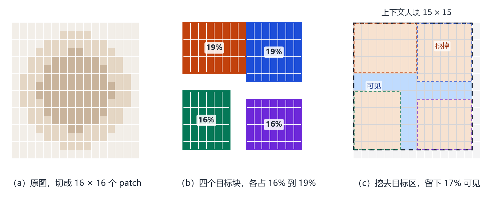
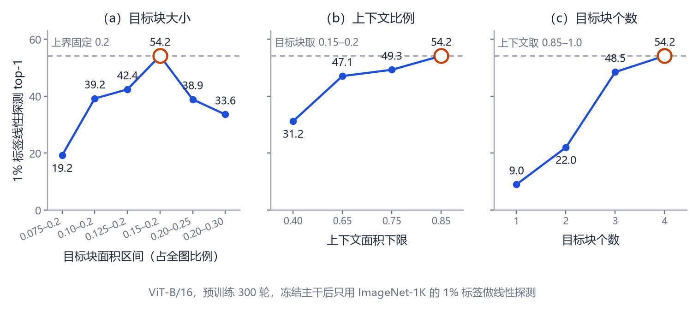
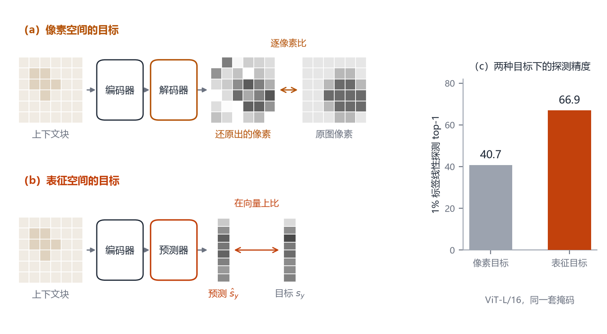

# 第 5 章　I-JEPA 的装配

论文的附录 A 篇幅不长，掩码规则几条，优化器参数五行，照抄进配置文件半小时就能跑起来。可是同一份配置换一台机器往往复现不出同一个数，原因很少是代码写错。多数差异来自那些没被写进表格的决定，目标块从哪个分布里采、上下文挖到什么程度算够、预测器窄到什么尺度才叫窄。这些决定论文都用消融表交代过，只是散在正文与附录里，需要按装配的顺序重新排一遍。

想象手上有一张 224 像素见方的图，patch 边长 14，于是切成 16×16 共 256 个格子。要训练这台机器，得先回答一串很具体的问题。四个目标块各占多少面积，长宽比在什么范围里随机，上下文那个大块留多宽，和块重叠的部分怎么处理，掩码打在输入端还是输出端。每个问题论文都给了默认值，也给了改动的后果，装配的工作就是把默认值和后果配在一起看。

第 4 章把目标函数钉在了一个形状上，随机切片、Epps–Pulley 统计量、塌缩被构造性排除，那些讨论都停在损失这一层。有了稳定的目标，架构才有意义，因为目标不稳定的时候，任何结构上的改动都会被塌缩淹没，好坏看不出来。这一章接着往下走，把三个网络、一套掩码、一份训练配方装成一台真能跑出数的机器。装好之后再回头看每个旋钮各自在替什么说话。

每个数字都和它的设置绑在一起，因为进阶篇里的数字几乎不能脱离协议单独引用。同一个模型，线性探测与微调能差出七八个点，224 与 448 分辨率能差出两个点，1% 标签与全量标签差得更多。装配的顺序也有讲究，先定结构，再定掩码，优化器放在后面。前两步决定了任务难不难，优化器只决定能不能走到那个难度。

## 5.1　三个网络与一行损失

上下文编码器 $f_\theta$ 是一个标准 ViT，只处理上下文块里可见的那些 patch，被挖掉的位置连占位符都不给。这一点与 MAE 一致，省下来的算力相当可观，因为编码器的成本按 patch 数走。目标编码器 $f_{\bar\theta}$ 结构完全相同，初始化时与它一致，之后每一步只按动量掺进一点点。预测器 $g_\phi$ 是第三个网络，也是唯一一个被刻意做窄的，它吃上下文编码器的输出加一组位置 token，吐出被预测那一块里每个 patch 的向量。

损失函数只有一行，写法上没有权重项、没有温度系数、没有对比项，也没有负样本。设 $\hat{s}_{y_j}$ 是预测器在位置 $j$ 给出的向量，$s_{y_j}$ 是目标编码器在同一位置给出的向量。$B_i$ 是第 $i$ 个目标块覆盖的 patch 集合，$M$ 是目标块个数、默认取 4。这四个符号各管一件事，谁在预测、谁在提供靶子、在哪些位置算距离、算几个块。把这四样东西凑在一起，损失写成

$$
\mathcal{L} = \frac{1}{M}\sum_{i=1}^{M}\sum_{j\in B_i}\left\lVert \hat{s}_{y_j} - s_{y_j}\right\rVert_2^2 .
$$

式子里的 $\lVert\cdot\rVert_2^2$ 是把两个向量逐分量相减、平方、求和，整条式子的意思是在四个块的范围内把所有位置上的距离平方平均掉。它只管两个向量离得多远，不管各自有多大，所以有一条捷径能把它压到零。让两边都输出同一个常数，距离处处为零，损失曲线会漂亮得让人放心。挡住这条捷径的不是损失，是目标编码器那一步动量更新，5.5 节还会回到这里。

因为没有解码器，这套方法从头到尾不输出一张图，一张 224 的图在训练中从来没有被还原过，论文把它称作非生成式的方法。评估时用的是目标编码器，把它的输出按 patch 做平均池化，得到整图表示，再接一个线性分类器。这个细节在复现时经常弄错，有人顺手去拿上下文编码器。两者在训练末尾权重几乎一样，可论文报的每一个数都来自目标编码器，换一个就得重新对表。

照着重写时有三处容易写错，而且错了不报错，只让指标低几个点。一处是目标侧的张量有没有 detach，漏掉这一句，梯度会沿目标编码器回传，不对称结构直接失效，前期看不出异常，后期可能真的塌。另一处是按位置平均还是按块平均，四个块面积不同，先算每块的均值再对四块平均，与把所有位置拉平求一个均值，结果不一样。还有一处是掩码取 patch 索引还是像素掩码，后者会让编码器读到被遮挡的像素。

目标编码器不从梯度学习，参数却每一步都在变，方式是把自己往上下文编码器那边挪一点。挪的幅度由动量 $m$ 控制，$m$ 从 0.996 线性升到 1.0。这个区间看着窄，作用却相当于把靶子的记忆长度从几百步一路拉到无穷，训练早期的靶子还跟得上，越往后越像一块钉住的板子。写成式子就是

$$
\bar\theta \leftarrow m\,\bar\theta + (1-m)\,\theta ,
$$

其中 $\theta$ 是上下文编码器的参数，$\bar\theta$ 是目标编码器的参数。$m$ 越接近 1，靶子动得越慢，一步之内几乎静止，模型没法靠挪动靶子来降低损失，只能真的去追。训练末尾两边几乎没有差别，可是差别不需要一直存在，只需要在过程中存在。这段不同步就是防塌缩的全部机制，也是这一册后面所有变体都要保留的那个零件。

## 5.2　掩码怎么采样

采样规则可以拆成四条。目标块采四个，允许互相重叠，每块面积占全图的 15% 到 20%。长宽比在 0.75 到 1.5 之间随机。上下文是一个面积占 85% 到 100%、长宽比固定为 1 的大块，与任何目标块重叠的部分整块挖掉。整个过程如图 5-1，左边是原图，中间是四个目标块，右边是挖完之后真正送进上下文编码器的 patch。这四条规则各自都有默认值，也各有一条消融曲线在后面等着。

<figure class="fig">

<figcaption><b>图 5-1</b>　多块掩码的规则。四个目标块各占 16% 到 19% 的面积，长宽比在 0.75 到 1.5 之间；上下文是一个 15×15 的大块，挖去目标区之后只剩那条蓝带，可见 patch 约占全图 17%。</figcaption>
</figure>

图 5-1(c) 里蓝色那一片就是最终可见的上下文，按同一套规则数下来只占全图 17.2%。这个比例由本章的绘图脚本算出，不是论文原文。它的意义在于同时满足两个目标，上下文在空间上摊得很开，一条横带加一条竖带覆盖整张图，信息足够推断那边有什么。可见 patch 又很少，编码器的计算量按 patch 数走，省下来的正好是这部分。

实现上有一个坑。采样对每张图独立做，可同一个 batch 里每张图可见的 patch 数不同，张量就拼不起来。论文的处理方式是把同一张 GPU 上所有上下文掩码的 patch 数限制成一致，目标掩码同理，采样器写在 data loader 的 collator 里，几行 PyTorch 就够。代价是同一张卡上的图片共享一个可见比例，好处是前向可以整批做，这条设计不影响正确性，只影响吞吐，最容易被复现者忽略。

面积比例要理解成块里能装下多少东西，而不是块在屏幕上有多大。224 分辨率、patch 边长 14 时，0.15 的面积折合 38 个 patch，勉强装得下一个中等大小的物体。0.075 折合 19 个，通常只装得下一段纹理。这就是后面那条倒 U 曲线左边的物理来源，块小到装不下一个完整物体，靶子里就没有语义可学。所以这个数不要只记成 0.15，要记成 38 个 patch，后者才能跟着分辨率一起换算。

## 5.3　掩码打在输出端

两种做法的区别只有一处，掩码打在目标编码器的输入端，还是打在它的输出端。打输入端是 MAE 的路子，被遮住的区域不送进编码器，编码器只看到那块残缺的图。打输出端是 I-JEPA 的路子，整张图先完整地过一次目标编码器，得到每个 patch 一个向量，再按目标块的位置把对应的那些取出来。换句话说，目标块在后一种做法里只是取数的范围，不是一块遮挡的板子，编码器看到的始终是完整输入。

论文在 ViT-H/16 上对比过这两种做法，训练 300 轮，用 1% 的 ImageNet 标签做线性探测。输出端掩码得 67.3，输入端掩码得 56.1，差十一个点。两组的网络结构、掩码位置、训练轮数都相同，唯一变的是靶子从哪里取。这十一个点买到的是一种信息，每个靶子向量在生成的时候都带着周围环境，它知道这块区域旁边是草地还是墙面。把这条差别记住，后面所有关于掩码位置的讨论都从它派生。

从信息的角度看，输入端掩码得到的向量是“一块孤立的图长什么样”，输出端掩码得到的是“这块图在一整张图里扮演什么角色”。前者必然更偏纹理，因为局部外观在没有上下文时本来就不确定。后者已经被注意力与全图其他位置混合过，颜色和边界被平均掉，留下位置、尺度、物体类别这类跨样本稳定的东西。用前一种当靶子，等于让模型去预测一个它自己都没把握的量。

算力上的差别是四倍。输出端掩码只前向一次，四个目标块共用这一次计算；输入端掩码要四次前向，每块一次，因为每块看到的残图不同。目标编码器与上下文编码器同样大，多三次前向相当于把编码侧的成本翻了两倍多。也就是说这十一个点里有一部分是白拿的，它不需要额外迭代，只需要改一行取数逻辑。论文在这一处引了 data2vec，说明这条路不是 I-JEPA 独有的。

## 5.4　预测器为什么是窄的

预测器的嵌入维度固定 384，主干 ViT-L 是 1024，ViT-H 与 ViT-G 更宽。深度随主干走，ViT-B/16 配 6 层，ViT-L/16、ViT-H/16、ViT-H/14 配 12 层，ViT-G/16 配 16 层。注意力头数与主干保持一致，这一点与宽度不同，宽度是压死的常数，头数跟着主干变，每个头分到的维度因此被压窄。整台机器里，384 是唯一一个不随主干放大的宽度参数，作用像一把固定孔径的筛子，主干再宽也只能从这个孔径里通过。

深度是有用的。论文在 ViT-L/16 上训练 500 轮，对比 6 层与 12 层，1% 标签线性探测分别是 64.0 与 66.9，差将近三个点。这说明预测器承担的工作比把向量线性搬过去要复杂，它得根据位置 token 决定往哪个方向推理。层数太少，做不了这种带条件的搬运，输出的向量里只有平均过的邻居信息。换句话说，它不是恒等映射外面套一层投影，而是一次带位置的推理，层数就是推理的步数。

宽度反向。把 384 放宽到 1024 反而掉点，论文的 Table 14 报的是 70.7 与 68.4，384 那组高两点三。这里要留意协议，这一组是 1% 标签下的微调而不是线性探测，两个数字不能与 66.9 直接比，混在一起会把结论读反。复现时这类协议错位是最常见的事故，因为两张表都写着 ViT-L/16。这也是整章最反直觉的一处，加宽不是变慢一点，而是变差两个多点。

窄的道理可以这样理解，预测器的任务是把上下文里已经提炼好的信息搬到另一个位置，它不需要重建细节，只需要选对语义。给它 1024 维，它会把上下文里的冗余一并搬过去，损失是降了，可搬过去的成分里有大量与预测无关。这些成分通过梯度反过来影响上下文编码器，让它保留更多低层信息。压到 384 维相当于在通道上加了一个信息瓶颈，作用与第 3 章的投影头类似，只是挡的是搬运过程的冗余，不是输出端的塌缩。

位置 token 的构造是每个待预测 patch 一个向量，由所有位置共享的一个可学习向量加上该 patch 的位置编码组成。要预测四个块，预测器就跑四遍，每遍只喂进那一块的位置 token。四遍之间上下文编码器的输出是复用的，只有位置 token 在变。所以把 $M$ 设为 4 的额外成本主要落在预测器上，编码器那一侧没有重复计算。这也解释了为什么目标块从 1 加到 4 时训练时间涨得比想象中慢，真正变贵的是预测器那几层窄网络。

## 5.5　训练配方

优化器是 AdamW，batch 2048，学习率在前 15 轮从 $10^{-4}$ 线性升到 $10^{-3}$，之后按余弦退到 $10^{-6}$。权重衰减在全程从 0.04 线性升到 0.4，目标编码器的动量从 0.996 线性升到 1.0。这套配置在论文里只占五行，其中一半有消融撑腰，另一半是从 MSN 与 DINO 沿用的惯例，两类参数的调试方式完全不同。改动任何一行都要重新对齐结果，尤其是权重衰减，它在两张表里给出的方向相反。

预热 15 轮不是把惯例搬过来。训练刚开始时两边的参数完全相同，靶子与预测的差别只来自输入不同。此时若用大学习率，两边会同步剧烈变化，慢半拍的效果被冲掉，不对称结构提供的稳定性也就没了。预热让参数先在小步长上把两边的差异建立起来，之后才放大步长，代价是前 15 轮几乎不降的损失曲线，看到这条曲线不要以为配置错了。

权重衰减的策略换过一次。论文对比了 0.04 到 0.4 的线性增长与固定 0.05，ViT-L/16 训 600 轮，前者在 1% 标签微调上是 69.4、全量线性探测是 77.8。后者微调 70.7、线性探测 76.4。两条线一升一降，说明小权重衰减更利于微调，大权重衰减更利于线性探测。论文选前者是因为它的主表全是线性探测，这个选择本身是协议的函数，不是普适最优。

batch 2048 在 16 张 A100 上是每卡 128 张，224 分辨率的图这个量放得下，448 就未必，patch 数从 256 涨到 784，激活值跟着涨三倍。显存放不下时的常规做法是梯度累积，不过动量更新按优化器步数走，累积四步再更新一次，等于把动量的有效时间尺度拉长四倍。学习率也与 batch 绑在一起，2048 配 $10^{-3}$ 的峰值，换到 512 就得往下调，否则前几个 epoch 的梯度噪声会被放大。动量升到 1.0 之后靶子完全冻结，末尾阶段更像一个普通的回归问题，至于为什么非升到 1.0 不可，论文没给消融，只说是沿用 MSN 与 DINO。

## 5.6　三条消融曲线

三个旋钮各有一条曲线，画在一起如图 5-2。所有点来自同一套设置，ViT-B/16、预训练 300 轮、冻结主干后用 ImageNet-1K 的 1% 标签做线性探测，每次只改一个旋钮，其余保持默认。三条曲线之间可以横向比较，与主表的绝对值不能直接比，因为主表用的是更大的主干和更长的轮数。图上那条虚线是默认配置的成绩 54.2，三个子图的最优点都落在它上面，说明默认值是逐个旋钮试出来的，不是一次拍定的。先看形状，再看峰值落在哪里。

<figure class="fig">

<figcaption><b>图 5-2</b>　掩码三个旋钮的消融。左图目标块面积呈倒 U 形，中间上下文比例单调上升，右图目标块个数在 1 到 4 之间陡升；空心圈标出默认配置，虚线是它的成绩 54.2。</figcaption>
</figure>

目标块大小最敏感，形状是倒 U。下界从 0.075 起，指标 19.2；抬到 0.10 是 39.2，0.125 是 42.4，0.15 到 0.2 这个默认区间是 54.2；继续放大就掉，0.2 到 0.25 是 38.9，0.2 到 0.3 是 33.6。左边这一段说的是块太小装不下物体，靶子里只剩纹理。右边这一段说的是块太大，上下文被挖得太狠，剩下的 patch 不足以推断任何东西。峰值落在 0.15 到 0.2，恰好是块里有完整物体、上下文还够用的位置。

上下文没有拐点，单调上升，面积下限取 0.40 时只有 31.2，0.65 时 47.1，0.75 时 49.3，0.85 时 54.2。这条曲线没有内生的最优，上下文越完整，任务越可解，指标就越高，而默认值 0.85 已经贴着上界 1.0，没有更多可给的。实践中这一项的正确读法是在算力允许的范围里尽量大。代价是可见 patch 变多，前向变慢，这一项与上一项在算力上互相拉扯。

目标块个数出现一个陡坡。只采 1 块时指标 9.0，几乎没学到东西；2 块 22.0；3 块 48.5；4 块 54.2。一块的时候任务退化成从一个位置推到另一个位置，偏移量固定，模型可以靠局部插值蒙混过关。3 块到 4 块还涨了 5.7 个点，说明这个旋钮在 4 附近没有饱和，只是再往上加会让上下文被挖得更空，论文也没有测 5 块以上。每多一块就多一遍预测器前向，而前两项只改取数范围，不改前向次数。

掩码的整体形状也被换过四种。多块策略 54.2；把图切成四个象限、用一个象限预测另外三个，15.5；用一个占 60% 的大块预测其余部分，20.2；随机遮住 60% 的 patch，17.6。三种替代方案的共同点是靶子要么太大而失去结构，要么太散而没有语义。象限方案最惨，因为一个象限里通常装着好几个物体，上下文只剩另一片场景，对应关系太弱。三个旋钮都无量纲，却随数据的物体尺度变化，换一个数据集就要重扫。

## 5.7　与 MAE、data2vec、CAE 的对照

ImageNet-1K 的线性探测是这类方法最常用的考场，冻结编码器，只训一层分类器。I-JEPA 的 ViT-B/16 训 600 轮得 72.9，ViT-L/16 训 600 轮得 77.5，ViT-H/14 训 300 轮得 79.3。把输入提到 448 分辨率、换成 patch 边长 16 的 ViT-H/16，同样 300 轮得 81.1。对照组的轮数普遍长得多，下面的数字要连轮数一起读。读这张表时先看轮数那一列，再看精度，顺序反过来会得出完全不同的结论，对照表总要把轮数标在方法名旁边，原因就在这里。

MAE 的 ViT-B/16 训 1600 轮得 68.0，ViT-L/16 得 76.0，ViT-H/14 得 77.2；data2vec 的 ViT-L/16 训 1600 轮得 77.3；CAE 的 ViT-B/16 得 70.4，ViT-L/16 得 78.1。同样是 H/14，I-JEPA 只训 300 轮就比 MAE 高两个点。小一号的 ViT-L/16 训 600 轮得 77.5，贴着训 1600 轮的 CAE。这几个模型里只有 I-JEPA 在预训练阶段完全不用手工数据增强，所以这组对比真正说明的是目标空间的差别，不是谁的配方更精细。轮数差最小也有 2.7 倍，最大到 5.3 倍，精度却贴得很近，这两件事放在一起才是这组对比的重点。

1% 标签下差距更明显。data2vec 的 ViT-L/16 是 73.3，MAE 的 ViT-L/16 是 67.1、ViT-H/14 是 71.5，I-JEPA 的 ViT-L/16 是 69.4、ViT-H/14 是 73.3、448 分辨率下是 77.3。这个数据集上每类只有十二三张图，模型基本靠预训练的表征在撑。同一套掩码只把靶子从向量换成像素，ViT-L/16 训 800 轮只有 40.7，表征目标那组训 500 轮是 66.9，如图 5-3。预训练省下的那些轮数，在小样本上直接兑现成了精度差，像素那组多训 300 轮还是低二十六个点，差距只会比看上去更大。

<figure class="fig">

<figcaption><b>图 5-3</b>　两种靶子的对照。像素空间要还原具体数值，表征空间只比一个向量，右侧柱状是 1% 标签下的线性探测；像素那组多训 300 轮，仍然低二十六个点。</figcaption>
</figure>

这个方向值得多看一眼。论文还给了更细的证据，把训练好的预测器冻结，用一个额外的解码器把输出映射回像素，同一条输入采样多次。不变的部分通常是物体的高层面貌，比如鸟的背、车的顶部，每次都不一样的部分是纹理、背景、精确边界。预测器在说这里有个朝左的鸟背，没说这里有三根羽毛。迁移上优势更明显，同一个 ViT-H/14 的线性探针，CIFAR100 上 87.5，Places205 上 58.4，iNaturalist18 上 47.6，MAE 是 77.3、55.0、32.9，data2vec 是 81.6、54.6、28.1。

不过它不是全面领先。Clevr 的物体计数任务上 I-JEPA 线性探测 86.7，MAE 是 90.5，深度预测两者都是 72.4，这类任务依赖局部而精确的几何信息，而几何在语义靶子里恰好被平均掉了。算力上的账是另一头，预训练一个 ViT-H/14 不到 1200 GPU 小时，比 iBOT 的 ViT-S/16 快 2.5 倍以上，比 MAE 的 ViT-H/14 省十倍以上。单步其实更慢，多一次整图前向让它慢约 7%，可收敛只要五分之一的迭代次数，一慢一快抵下来还是净省。16 张 A100 训一个 ViT-H/14、300 轮，不到 72 小时。全量微调上，448 那个模型 300 轮得 87.1，MAE 训 1600 轮得 87.8，轮数差 5.3 倍，精度差 0.7 个点。

## 5.8　换分辨率之后

224 分辨率、patch 边长 14，切成 16×16 共 256 个 patch；448 分辨率、patch 边长 16，切成 28×28 共 784 个，是原来的三倍多。这个换算决定了换分辨率时哪些东西必须动。掩码的比例无量纲，看起来不用改。可一个占 15% 面积的目标块在 224 上是 38 个 patch，在 448 上变成 118 个，块里能装下的东西从一个物体变成一个物体加半个场景。分辨率变了，patch 的物理尺寸也变了，掩码的绝对大小跟着变，比例却不会提醒你这件事。

需要重调的有三项。目标块的面积区间要往下压，让块里的 patch 数与原来相当，否则靶子的语义变粗；上下文的下限也要跟着压，因为可见 patch 数涨了三倍，计算量与显存都跟着涨；batch 与学习率要按新的 token 数重新对齐。论文自己在 448 分辨率上用的是 patch 边长 16 的 ViT-H/16，序列长度因此是 784 而不是 1024。位置编码得按新的网格重算或插值，这一步论文里没有单独交代，却是换分辨率时最先出问题的地方。

数据规模的变化有对照。同一个 ViT-H/14 换成 ImageNet-22k，300 轮的预算换成等价的 900 轮，CIFAR100 从 87.5 涨到 89.5，iNaturalist18 从 47.6 涨到 50.5，计数任务从 86.7 涨到 88.6，深度预测从 72.4 涨到 75.0。Places205 反而从 58.4 掉到 57.8，再换 ViT-G/16，CIFAR100 还是 89.5，Places205 到 59.1，iNaturalist18 到 55.3。数据变多对多数任务有帮助，模型变大只在语义任务上兑现，场景分类在数据换成 22k 之后已经饱和了。这个规律对复现的意义是，如果你的下游任务偏场景级，把预训练数据从 1k 换到 22k 可能一点用都没有，反而白付了三倍的训练预算。

把装配清单收在一处，结构上是三个网络加一行 L2，掩码上是四个块加一个挖空的上下文，预测器上是一个 384 维的瓶颈，配方上是 2048 的 batch 与从 $10^{-4}$ 到 $10^{-3}$ 的预热，剩下是三个比例旋钮需要在你的数据上重扫。这一套没有一处是推导出来的，全是在消融表上摸出来的，所以复现的本质不是抄参数，而是理解每个参数在替什么说话。抄错一个数还好查，抄对了一个在别处不成立的数，才是复现里最难发现的错。清单只是起点，不是答案。

这套机器的天花板不在配方里。上下文块与目标块来自同一张图、同一次拍摄、同一束光，模型被要求的是在这张图内部保持一致，而不是在世界面前保持一致。同一只杯子从侧面看和从上方看，在这套目标里根本不构成一对需要被拉近的样本。它对视角、光照、遮挡的稳健性，训练目标没有给出任何保证，只能指望数据量与模型容量去兜。

要补上这个缺口，需要的是同一个世界的两次真观测，而不是同一次观测的两次损坏。视频里相邻的两帧天然满足这一点，光在变、视角在动、物体在移动，这些变化不需要谁来设计。下一章把掩码从二维的方块搬到三维的立方体，把同一张图的另一块换成同一段视频的另一时刻。损失函数一个字都不用改。
