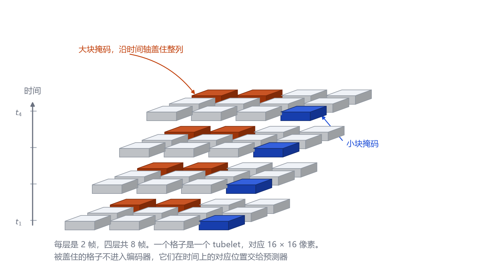
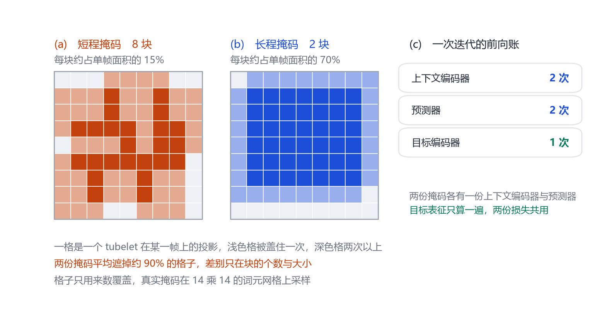
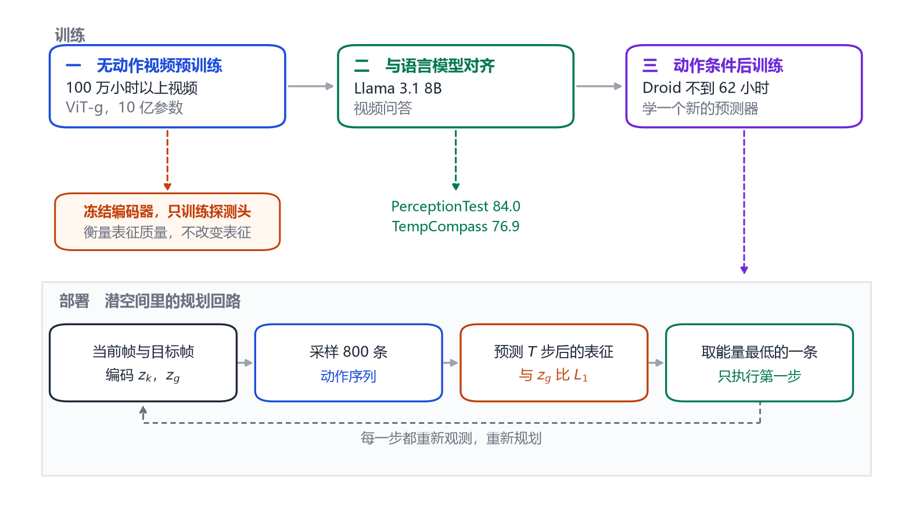
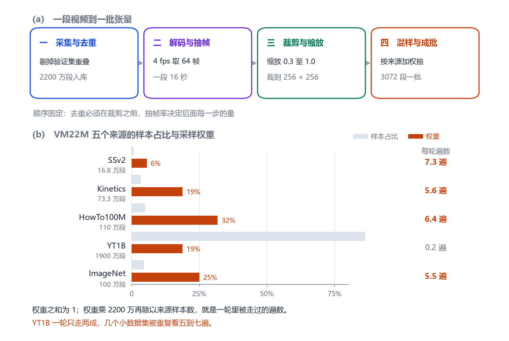
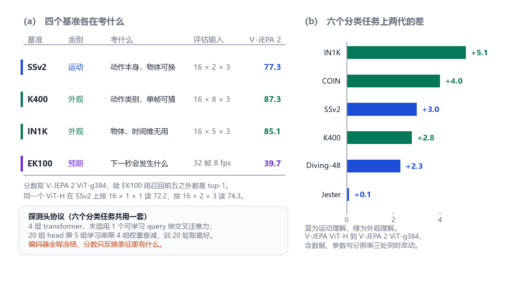

# 第 6 章　V-JEPA 的两个版本

一段十秒钟的手机视频，拍的是有人把桌上的杯子端起来。单看第三帧，杯子和手都在画面里，看不出谁对谁做了什么；单看第七帧，杯子已经离开桌面十厘米，可它是被拿起来的还是被碰倒的，静态的一帧仍然说不清。把这两帧按真实先后放在一起，一个动作才浮出来，顺序倒过来读，同一个位移就变成放下。视频比图像多出来的那一维，装的就是这种前后关系。

上一章停在 I-JEPA 的装配细节上，也停在它自己的边界上。图像能提供的正样本只有一张图的两个裁块，两者共享同一套光照、纹理与背景统计量，模型很容易靠这些便宜的线索把损失压下去。视频给的是另一种配对，同一个场景在不同时刻的观测，视角在轻微移动、光线在变、有东西在走，语义却没有变。这种看起来不一样、指的却是同一件事的样本，是自监督最想要的材料。

从图像搬到视频并不是把张量改个形状那么简单。一秒三十帧，相邻两帧的差异经常只有几个像素，如果掩码只盖住某一帧的角落，模型抬眼看看前后两帧的同一位置就能把答案抄过来。损失降得很快，学到的却是一个复制粘贴的恒等映射。这条捷径是视频预训练的第一个陷阱，后面所有关于掩码形状与采样比例的设计，本质上都在绕开它。

这一章沿着 V-JEPA 到 V-JEPA 2 的路线走，把两代的规模账摊开，再看这条路线怎么接上语言、怎么接上动作。中间有一处特别容易混的地方，冻结编码器做评估和冻结编码器做后训练，前者是量具，后者是产品本身，第 6.8 节讲后者，章末再把两者摆在一起。每个数字都会带上它是在什么设置下拿到的。这一行的分数离开协议就没有意义。

## 6.1　多出来的一维

一个彩色视频片段在程序里是四维数组，写成 $T \times H \times W \times 3$，其中 $T$ 是帧数，$H$ 和 $W$ 是画面的高与宽，末尾的 3 是颜色通道。这个数组里的信息可以分成两类，一类单帧就完整，颜色、纹理、物体此刻的位置与形状。另一类只在时间方向上存在，谁向谁移动、什么东西先出现、什么动作导致了眼前的结果。第一类图像模型已经处理得不错，第二类它一点都拿不到。

顺序这件事值得单独说清楚，因为它无法从任何一个单帧里读出来。同一段录像里截两帧，一帧杯子在桌上，一帧杯子在手里，两张图的差别是位置和持握关系。而要判断杯子被拿起来了，还需要第三样东西，就是这两帧的先后。像素本身不带时间戳，顺序来自你怎么读这段数组，把索引倒过来喂进去，同一段数据描述的就是另一个动作。

时间还顺带解决了遮挡。一张桌子底下藏着猫，只有一截尾巴露在桌沿外面，照片能给出的结论就是这里有一条尾巴。视频里尾巴摆了摆，桌子底下就有了一只猫。人对世界的大部分常识都是这么攒起来的，一个东西短暂消失又出现，你就知道它没有消失，只是被挡住了。这类证据单张图片提供不了，而它恰好是预测下一步所需要的那种知识。

相邻帧几乎一样，这份冗余把掩码的形状逼出一个硬约束。目标块不能只盖住某一帧的一块区域，而要沿着整个时间维延伸，把一个空间位置在所有帧上一齐盖住。V-JEPA 2 的训练超参表里，空间方向的掩码比例是一个从 0.15 到 0.7 的区间，时间方向的掩码比例写死成 1.0。这个 1.0 不是随手填的默认值，它是整条路线的防作弊条款，也是后面所有掩码抽样的前提。

## 6.2　tubelet 与 1568 个词元

ViT 处理图像时把画面切成 $16 \times 16$ 像素的方块，每块拉直成一个词元。视频要在两个空间维之外再加一个时间维，取连续 2 帧、每帧 $16 \times 16$ 像素，合成一个 $2 \times 16 \times 16$ 的立方体，文献里叫时空管（spatio-temporal tubelet），下文就写 tubelet。实现上它是一次三维卷积，卷积核的形状正是 $2 \times 16 \times 16$，时间步长 2、空间步长 16。一层卷积就把视频变成了词元序列，剩下的工作交给 Transformer。时空管这个名字强调的是三个方向上的连续性，不是三次独立的切块。

词元数可以直接算出来。16 帧、$224 \times 224$ 分辨率的片段，时间方向切成 8 段，每个空间方向切成 14 段，特征图是 $8 \times 14 \times 14$，拉平之后得到 1568 个词元。同一套切法用在单张图片上只给 196 个词元，两者相差 8 倍，而注意力的开销按词元数的平方涨，1568 对 196 在注意力矩阵上是六十多倍的差距。这个数字解释了为什么视频模型的训练成本一直比图像模型高一个台阶。

放大之后这个差距会再放大一次。64 帧、$384 \times 384$ 的输入，时间方向 32 段、每个空间方向 24 段，一共 18432 个词元，是 1568 的十一倍多。注意力矩阵则是 1568 那一档的一百三十多倍，这串数不用跑模型就能核对，切块规则本身是确定的，换一张分辨率也只是重算一遍。它也是 V-JEPA 2 非要做渐进分辨率训练的直接原因，全程用最大输入跑一遍，预算根本撑不住。

## 6.3　两类掩码与双掩码摊销

V-JEPA 用两种掩码，短程与长程，形状不同，作用也不同。短程掩码取 8 个随机采样块的并集，每块覆盖单帧面积的 15%，块与块可以重叠，拼出来的洞是一串不规则的小窟窿。长程掩码只取 2 个块，每块覆盖 70%，洞是一大片。两种掩码里所有块的长宽比都在 0.75 到 1.5 之间随机取，采样之后平均遮掉约 90% 的格子。两份掩码不是二选一，而是同时采样。

图 6-1 换了一种看法，不看单帧平面，而看时间轴。四层小方块沿时间方向排开，每层是 2 帧，每层切成 $4 \times 3$ 的网格，橙色那一列在每一层都被遮掉。模型看到的是每层剩下的格子，要补的是一整列跨时间的格子。它没办法从上下帧的同一位置抄答案，只能靠周围区域有什么、那里可能怎么动来推断。被遮的格子只有位置信息进预测器，内容完全不进编码器。

<figure class="fig">

<figcaption><b>图 6-1</b>　时空 tubelet 与多块掩码。每层对应两个视频帧，一个格子是一个 $2 \times 16 \times 16$ 的 tubelet。被遮的块沿时间轴贯穿所有层，所以模型无法从相邻帧抄到答案。</figcaption>
</figure>

为什么小块拼出来的洞比一大块更好，论文给了消融也给了解释。一块整齐的大洞被遮掉之后，模型可以从四周推断出这块区域的平均长相，很多场景里这个平均值就够把损失降下去。而一串不规则的窟窿没有统一的均值，模型只能逐个位置去推断那里原本有什么。掩码的作用不只是删掉信息，还要把用统计量蒙过去这条路一并堵上。

每个片段还会采两份掩码，一份短程一份长程，于是一次迭代要同时算两个预测任务。上下文编码器和预测器得各跑一次，因为两份掩码的输入不一样，这部分开销省不掉。目标编码器不用，它看的是完整片段，两份掩码共享同一份目标表征。如图 6-2，前面两个各算两次，第三个只算一次，省下来的正是这一份。

<figure class="fig">

<figcaption><b>图 6-2</b>　两类掩码的形状与双掩码的前向账。左两图的深浅表示格子被盖住的次数，右图列出一次迭代里三个网络各跑几遍。目标编码器只跑一遍，这是双掩码摊销的全部收益。</figcaption>
</figure>

这笔账在消融里是划算的。论文比较了每个片段采一份掩码与采两份掩码，两份更好，作者的解释是两种块大小诱导出互补的预测任务，一个逼模型看局部细节，一个逼它铺开整片区域。工程上要注意的是两份损失共用同一个目标，目标那一侧有停梯度，两份掩码不会互相拉扯。梯度只从各自的预测端流回共享的上下文编码器。

## 6.4　位置编码：从正弦表到三维旋转

V-JEPA 用的是三维绝对正弦位置编码，直接加在 $8 \times 14 \times 14$ 的特征图上，三个轴各有一套频率，加完再拉平。绝对编码的好处是实现简单、位置信息明确。坏处是它本质上是一张长度固定的表，模型在 16 帧、224 分辨率上学会的位置关系，换到 64 帧、384 分辨率就得重新学或者插值。位置表一变，前面学到的注意力模式也跟着漂。这一点小分辨率时不显眼，放大后就成了问题。

V-JEPA 2 换成了三维旋转位置编码（3D Rotary Position Embedding，3D RoPE）。做法是把特征维切成大致相等的三段，分别对应时间、高、宽三个轴，每一段只做一维旋转，转角由该轴上的坐标决定。旋转编码表达的是相位差，两个词元之间的相对位置体现在它们相差多少相位，而不是各自被贴了哪个绝对编号。换长度时不需要重学一张表，这是它与正弦表的根本区别。

论文给这个改动的理由只有一句，说 3D RoPE 相比绝对正弦编码能让最大的模型训练更稳。这句话要按字面读，它讲的是稳定性，不是外推能力。旋转编码在结构上确实更容易外推到没见过的长度，但 V-JEPA 2 没有把外推单独做成一张消融表。把它读成换了 RoPE 就能随便放大是过度引申，真要做分辨率外推，还得自己测。

## 6.5　第一代的两百万段视频与 81.9

V-JEPA 的预训练数据叫 VideoMix2M，从若干公开视频数据集混合采样，规模约 200 万段视频。每个片段取 16 帧，帧与帧之间隔 4 帧，所以一个片段覆盖原视频的 64 帧，按每秒 30 帧算大约是 2 秒。空间上统一缩放到 $224 \times 224$，最大的主干是 ViT-H，6 亿参数。论文另外训了 ViT-L 的 224 版本和 ViT-H 的 384 版本用于对照。64 帧是抽样跨度，不是输入长度，模型真正看到的仍旧是 16 帧。

配方本身很朴素，值得抄下来的只有几项。迭代 9 万步，批大小 3072（384 版本用 2400），学习率在前 1.2 万步从 $2\times10^{-4}$ 线性升到 $6.25\times10^{-4}$，之后按余弦降到 $10^{-6}$。预测器是一个窄 ViT，12 层、宽度 384，注意力头数与主干保持一致，输出端用 L1 与目标表征对齐。目标编码器的权重是上下文编码器权重的指数滑动平均，整个流程不用类别标签，也不用任何文字。

读数是这样。ViT-H 主干冻结，在它上面接一个注意力探测头，只用目标任务自己的数据训练这个头。Kinetics-400 上 81.9，Something-Something v2 上 72.2，ImageNet-1K 上 77.9。Something-Something v2 值得多看一眼，它的视频里人对着镜头做把东西从左移到右这类动作，标签只描述动作，跟物体和场景的外观无关。只靠静态特征几乎做不对，72.2 说明表征里有运动，不只有物体。这个数在 6.6 节会被推到 77.3。

这三个数字换一套协议就不一样了。V-JEPA 2 的论文用统一协议重测了同一个编码器，Something-Something v2 上读到 74.3，比原论文高两个点，差别不在模型，在评估时用几个片段、裁几次。原论文用 8 个片段，V-JEPA 2 的协议对这个基准用 $16 \times 2 \times 3$，也就是 16 帧、2 个时间裁、3 个空间裁。跨论文横比分数之前先看协议，这条经验在视频这一行比在图像那边更要紧。

## 6.6　放大到十亿参数

V-JEPA 2 把这条路按四个旋钮同时拧大。数据从 200 万段视频涨到 2200 万段，总时长超过 100 万小时，另外掺了 100 万张图像。编码器从 3 亿参数的 ViT-L 换到 10 亿参数的 ViT-g，预测器大小不变，仍是一个 ViT-small 量级的网络。训练从 9 万步延到 25.2 万步，输入从 16 帧、256 分辨率提到 64 帧、384 分辨率。四个旋钮里只有数据要重新采集清洗，另外三个是配方与预算问题。

论文把这四项拆开各自记了一笔账，都以 200 万段视频上的 ViT-L 为基线。数据从 200 万涨到 2200 万，六项分类任务平均高 1.0 个点；模型从 3 亿参数换到 10 亿，再高 1.5 个点。迭代从 9 万延到 25.2 万，再高 0.8 个点；时空分辨率一起提上去，训练和评估时都用长片段与高分辨率，平均分推到 88.2。四笔账每一项都不到一点五个点，没有哪一项单独占大头，这是这条路线在大规模上还算健康的一个信号。

真正省钱的改动是渐进分辨率训练。ViT-g 如果从头就用 64 帧、$384 \times 384$ 训练，论文估算要大约 60 个 GPU 年。改成前面用 16 帧、256 分辨率跑完预热和主体，只在末尾的退火阶段把时长与分辨率提上去，论文报的加速是 8.4 倍。三段的比例是 1.2 万步预热、22.8 万步恒定学习率、1.2 万步退火，退火那一段才升到 64 帧和 384。批大小全程 3072，抽帧率保持每秒 4 帧，而权重衰减和目标编码器的滑动平均系数被固定成两个常数，0.04 与 0.99925。第一代那两套爬坡调度被去掉了，省下来的是调参的工夫而不是算力。

放大之后的读数是这样的。Something-Something v2 上 77.3，比第一代的 72.2 高 5.1 个点，仍然是冻结主干加注意力探测头。Epic-Kitchens-100 上有一个动作预期任务，给一段做菜视频的前若干秒，要求在动作真正发生前说出下一个动作，指标是正确答案落进前五个候选的比例。V-JEPA 2 拿到 39.7，论文说这比此前最好的任务专用模型相对高 44%。同一个表征既能分类已发生的动作，又能预测还没发生的动作，这是世界模型的雏形，但它还缺一样东西。

## 6.7　把表征接到语言上

在讲动作之前，先补一条岔路。V-JEPA 2 除了能分类、能做预期，还能回答关于视频的自然语言问题，做法借自 LLaVA 那一类多模态模型。视觉编码器输出一串词元，一个多层感知机把它们投影到语言模型的输入空间。语言模型取 Llama 3.1 的 8B 版本，投影层不改变视觉编码器，只负责把视觉词元的坐标系挪到语言模型能读的地方。

训练按三个阶段推进，每一阶段放开的参数不一样。第一阶段只训投影层，数据是图像描述，目的是先把视觉词元和词对齐。第二阶段放开整个模型，用大规模图像问答继续训；第三阶段加上视频描述和视频问答，让模型适应一帧之外的时序。整套流程用 8850 万条图文与视频文本对，在 384 分辨率下每帧折成 288 个视觉词元。

结果在 8B 这一档里是最好的，PerceptionTest 上 84.0，TempCompass 上 76.9。把对齐数据从 1800 万条扩到 8850 万条，PerceptionTest 涨 1.3 个点，TempCompass 涨 4.2 个点，说明这条路的瓶颈一度在数据量而不在编码器。论文同时报了一个反直觉的对比，冻结视觉编码器时下游分数略低，但那组数字衡量的是视觉特征本身的质量。把编码器放开微调，最终分数更高，可你测的已经是这套初始化加上这批数据一起能学到什么。

这件事的意义不在分数，在顺序。在此之前，一个流行的判断是视觉编码器必须先和文本做过对比学习才能接进语言模型，因为语言模型需要已经和词对齐过的语义。V-JEPA 2 的编码器在预训练阶段完全没见过文字，只见过视频，接一个投影层之后照样能用，论文把这当成一个反例提出来。语言对齐要的是表征里有没有可以命名的概念，而不是这份表征是不是用文本训出来的。

## 6.8　动作条件后训练与规划

到这里模型能表征、能预测、能答问，但它对“我做一个动作，世界会怎样”没有概念。预训练时它看到的所有洞都是随机挖的，从来没有把某一帧的表征和导致这一帧的那个动作配过对。后训练补的就是这一环，做法仍然是把编码器冻住，在它上面学一个新预测器，参数量约 3 亿，24 层，16 个注意力头，隐藏维 1024。这份样本量撑不起一次完整预训练，撑得起一个预测器。

输入是三样东西按时间交错排成的序列，每帧的表征、末端执行器的状态、相邻两帧之间状态的变化量。第三样就是动作，对一台 7 自由度的 Franka Panda 机械臂，状态是 7 维向量，前三维是末端位置，中间三维是姿态的欧拉角，剩下一维是两指夹爪的开合。动作是相邻两帧状态的差，同样 7 维。数据取自 Droid 里不到 62 小时的机器人操作视频，每段三五秒，采样成 256 分辨率、每秒 4 帧、16 帧一个片段。

损失由两项相加，一项逐帧的教师强制（teacher forcing），一项两步的 rollout。教师强制那一项让预测器在给定真实历史时预测下一帧的表征，长度 $T$ 取 15。rollout 那一项把预测器自己的输出喂回去再预测一步，$T$ 取 2，而且只反传一步的梯度。加后一项的理由在推理时才显出来，规划时没人给真值，模型得自己往前滚，滚两步就发散的话，规划出来的动作序列没有意义。

注意力被约束成块因果（block-causal）。某个时刻的每个词元只能看当前时刻和之前时刻的动作、状态与画面，看不到未来。这条约束不只是为了模仿因果，它保证了同一个预测器在闭环里可以只用当下观测就往前推，不必等未来的帧到齐。动作、状态、画面在同一时刻内可以互相看，跨时刻则只能往回看，这是块这个词的含义。

规划就是在这个预测器上解一个最小化问题。给定当前观测的画面与一张目标画面，两张都过编码器得到 $z_k$ 与 $z_g$。再找一个动作序列，使预测器想象出来的终点状态尽量靠近目标，能量写成下面这个式子。式子里 $\hat{a}_{1:T}$ 是待求的 $T$ 步动作序列，$s_k$ 是当前末端状态，$P$ 是动作条件预测器的完整前向，$\lVert \cdot \rVert_1$ 是逐元素绝对值之和。

$$
E(\hat{a}_{1:T}; z_k, s_k, z_g) = \lVert P(\hat{a}_{1:T}; s_k, z_k) - z_g \rVert_1 ,
$$

这个量衡量的是按这条动作序列走完之后，模型想象的状态离目标有多远。求最小值用交叉熵方法（cross-entropy method），每一步从高斯分布里采 800 条动作序列。取能量最低的 10 条去更新分布的均值与方差，迭代 10 轮，再取这条分布的均值。这套做法不需要梯度穿过预测器，代价是每一次规划都要真跑八千次前向，延迟全压在采样上。抓取放置这类任务的瓶颈因此不在优化算法。

时域取 1，也就是只规划下一步，执行完这个动作立刻重新观测、重新规划，机器人控制里把这叫滚动时域控制。抓取、伸向物体这类任务本身是贪心的，走一步看一步不吃亏。时域一长，搜索空间随时域指数增长，误差也会累积，所以短时域反而是这套方法的默认选择。代价是每走一步都要重算一次规划，在单张 RTX 4090 上，采 800 条样本、迭代 10 轮，算一个动作要 16 秒。

16 秒这个数字要和另一条路线放在一起才有意义。论文拿一个基于潜扩散的视频生成式世界模型做同样的规划，采 80 条样本、迭代 10 轮，算一个动作要 4 分钟。采样条数少十倍，单个动作却慢十五倍，因为像素生成要在几十个去噪步里走完一整幅画面，而表征预测只推一串向量。一条完整的抓取放置轨迹有几十个动作，这个差距会乘上几十。

成功率按 10 次试验平均，两个实验室各测一遍再取平均。伸向目标 100%，抓住杯子 65%、抓住盒子 25%，带着物体伸过去杯子和盒子都落在 75%，抓取放置杯子 80%、盒子 65%。两台机械臂所在的实验室都没有采过数据，也没有针对这些任务训练过，目标只是一张照片。数字里不好看的地方集中在接触，盒子比杯子难抓，因为边和角让手指与物体表面的力交换变复杂，而预测器看到的只有接触前后的画面变化。

论文自己列了三条限制，每一条都能对上工程上的一个坑。相机位置敏感，模型要从单目画面里推断动作坐标系的方向，机械臂基座经常不在画面里，这个问题就变得没有定义。长时程靠不住，自回归误差积累；目标只能是图片，想说把杯子放到盘子上，得先拍一张那样的照片。如图 6-3，三个阶段和部署时的规划回路画在一起，回路每走一步都重新观测。

<figure class="fig">

<figcaption><b>图 6-3</b>　V-JEPA 2 的三段训练与部署时的规划回路。第一阶段旁接出冻结编码器的评估支路，第二阶段引出视频问答成绩，第三阶段把新预测器送进回路，回路每步重新规划。</figcaption>
</figure>

## 6.9　从一段 mp4 到一批张量

前八节按配方讲，从掩码讲到规划，中间一直有个环节没有交代，一段手机拍的 mp4 到底怎么变成 $16\times3\times256\times256$ 的张量。这件事看起来只是读文件，实际上决定了训练里 GPU 有多少时间在真算，几百万段视频躺在磁盘上，解码要靠 CPU，数据侧一旦跟不上，再漂亮的配方也只能跑出打折的吞吐。判断数据侧跟不跟得上有一个笨办法，盯 GPU 利用率有没有规律性的下跌，跌下去的那一段就是预取队列空了。整条管线可以切成四道关，去重、抽帧、裁剪、混样，顺序不能随便调换，改一处，代价就落在后面每一道关上。

第一道是去重。VideoMix2M 由 HowTo100M、Kinetics-400/600/700 与 Something-Something v2 混合而成，混合之前先剔掉与这几个数据集验证集重叠的片段，剩下约 200 万段才进训练，因为预训练数据里一旦混进了评估集的画面，后面再高的分数也无法解释。视频去重比图像难得多，同一段片子经常被转码、裁边、改帧率之后重新上传，字节哈希对不上，只能抽若干帧做感知哈希再比。这道关还必须排在裁剪之前，裁过之后原图已经丢了，想再比对就得回头重解一遍视频。

第二道是抽帧。第一代取 16 帧、帧间隔 4，覆盖原视频的 64 帧，按每秒 30 帧算约两秒多，论文给出的说法是每段约三秒；第二代在预训练里改成每秒 4 帧，64 帧正好 16 秒。抽帧率是整条管线里最便宜也最贵的超参，便宜是因为它只是一个整数，贵是因为它决定了模型看到的世界有多快，同一段动作按 4 fps 抽出来只剩几个关键姿态。实现上不会把整段顺序解完再挑，而是先算出需要的 64 个帧号，让解码器按关键帧跳着解，一段 16 秒的 30 fps 视频有 480 帧，按 4 fps 只要 64 帧，解码量降到七分之一上下。解好的帧要不要落盘是另一笔账，一段 16 帧 $256\times256$ 的 uint8 片段约 3.1 MB，2200 万段全存是 69 TB，多数管线宁可存压缩视频加一份预转码副本，用 CPU 换磁盘。

第三道是裁剪，短边缩放的比例从 0.3 到 1.0 之间取，长宽比从 0.75 到 1.35 之间取，两个区间都写死在预训练脚本里。裁掉画面边缘等于挪动了相机，第 6.8 节说规划对相机位置敏感，一部分原因可以追到这里，模型见过各种取景，却从来没有见过带绝对坐标的样本。上限那边同样有代价，裁得太狠会把关键物体裁到画面外，动作与画面对不上，这一条样本就成了噪声。下限 0.3 是这套配方里写死的取值，再往下放，画面里剩下的东西往往不足以支撑一个动作。

第四道是混样，VM22M 的权重表给五个来源各一个系数，加起来正好 1，这张表并不是按样本数分的，YT1B 有 1900 万段、占样本总数的八成六，权重只有 0.188，HowTo100M 只有 110 万段、占 5%，权重 0.318。把权重乘上 2200 万再除以各来源的样本数，得到每个来源在一轮里被走过的遍数，SSv2 约 7.3 遍，HowTo100M 约 6.4 遍，Kinetics 约 5.6 遍，ImageNet 约 5.5 遍，YT1B 只有 0.22 遍，如图 6-4。这个倒数关系解释了轮数为什么随数据量下降，第一代 9 万步乘 3072 的批大小折合 2.76 亿个片段，除以 200 万段是 138 轮，第二代 25.2 万步除以 2200 万段只有 35 轮。重复看同一批数据在第一代已经过头，加数据把轮数压回三十几，分数反而更高。

<figure class="fig">

<figcaption><b>图 6-4</b>　视频数据管线的四道关与 VM22M 的采样配比。上图是顺序固定的四个环节，下图两根条形是同一来源的样本占比与采样权重，右列是一轮里被走过的遍数。</figcaption>
</figure>

## 6.10　四个基准各自在考什么

前面每一节都在报分数，72.2、74.3、77.3 混在一起，很容易被当成同一件事的三次测量。这一节把常用的四个基准排成一张表。要说明的是每个基准各在考什么，以及同一份表征为什么在不同行上的表现差这么远。表里的行是任务，列是任务属性与评估输入，读的时候先看行再看列，把数字放到一边，先弄清这一行究竟在量什么。

Something-Something v2 里人对着镜头把物体从左移到右、拿起来、假装喝一口，标签只描述动作，画面里出现什么物体、什么背景都可以换，一帧里只有「手在物体左边」这个状态，没有「从左到右」这个过程。Kinetics-400 的标签也是动作，但相当多的类别靠单帧的物体与场景就能猜出来，弹吉他、切菜、遛狗，画面里那把吉他本身就是提示。ImageNet-1K 是纯物体分类，视频模型在这一行本来不占优势，多出来的时间维没有用处。Epic-Kitchens-100 的动作预期属于另一类，给一段结束在动作发生前一秒的上下文，要求说出接下来会发生什么。

论文自己给了划分，六个分类任务里 SSv2、Diving-48、Jester 算运动理解，K400、COIN、ImageNet 算外观理解，划分背后是一个可检验的判断。把时间维去掉只喂单帧，哪一行的分数掉得最狠，哪一行就真的在考运动，这个测试不用重训编码器，换一次输入就够。结果照着判断分布，V-JEPA 2 在运动一侧领先得多，SSv2 的 77.3 对着 DINOv2 的 50.7。在外观一侧它只是打平，ImageNet 上 85.1 低于 DINOv2 的 86.1 与 PEcoreG 的 87.6，COIN 上 91.1 低于 PEcoreG 的 95.3。

读表要带着协议。SSv2 用 $16\times2\times3$，K400 用 $16\times8\times3$，Diving-48 与 Jester 用 $32\times4\times3$，三个数分别是帧数、时间裁与空间裁。V-JEPA 原论文用 $16\times1\times1$ 的单中心裁，同一个 ViT-H 在 SSv2 上原论文报 72.2、按 V-JEPA 2 的协议重测是 74.3，差的不是模型。探测头也统一了，4 层 transformer，最后一层换成带一个可学习 query 的交叉注意力，每个任务扫 20 组 head、5 组学习率、4 组权重衰减，训 20 轮取最好，成本不低，好处是每个基准上用的是同一把尺子。

EK100 那一行最特别，输入是 32 帧、8 fps 的上下文，指标是平均类召回前五，随机猜的期望大约是 5/3568。V-JEPA 2 在这行不只用了编码器，它把编码器输出和预测器对未来一秒的预测拼起来送进探测头，探测头有三个 query，分别出动作、动词、名词。这一步把预测接进了评估流程，也是它能以 3 亿参数超过 8B 的 PlausiVL 的原因之一。平均分 88.2 则要打个折扣，它是六个难度不同任务的算术平均，Jester 已经 97.8，SSv2 才 77.3，两者对平均分的权重却一样，如图 6-5。

<figure class="fig">

<figcaption><b>图 6-5</b>　四个基准的评估矩阵，以及两代模型在六个分类任务上的差。左表按运动、外观、预期分组并标出评估输入，右图条形长度是 V-JEPA 2 ViT-g384 相对 V-JEPA ViT-H 的涨幅。</figcaption>
</figure>

## 6.11　把动作插进词元序列

6.8 节说输入是三样东西交错排成的序列，实现上有几处细节没有展开。每帧画面先过冻结的编码器，得到 $16\times16$ 个空间位置的词元，每个 1408 维，一帧就是 256 个词元；动作与末端状态各是一个 7 维向量，动作取相邻两帧状态的差。三路的原始宽度差得很远，所以各自过一个可学习的仿射变换投到预测器的隐藏维 1024，输出端再过一次仿射变换回到 1408，才能和编码器的表征比 L1。预测器是 24 层、16 头、隐藏维 1024 的 transformer，约 3 亿参数。

序列按 $(a_k,s_k,z_k)$ 的时间顺序交错，每个时刻依次是动作、状态与 256 个画面词元，一个 15 步的片段因此是 $15\times258=3870$ 个词元。位置编码有一处不对称，画面词元用三维 RoPE，时间、高、宽三个轴各占一段频率，动作与状态词元只加时间那一维的旋转，因为它们没有空间位置可标。这条不对称在实现上只占几行代码，漏掉却会让动作词元带上一个编造出来的空间相位，等于往输入里塞噪声。注意力限定成块因果的，记 $A_{ij}$ 为第 $i$ 个词元能否看到第 $j$ 个，条件写成下面这个式子，$\lfloor\cdot\rfloor$ 表示向下取整。

$$
A_{ij}=1 \iff \left\lfloor \frac{i-1}{258} \right\rfloor \ge \left\lfloor \frac{j-1}{258} \right\rfloor .
$$

两个下标落在同一个 258 的块里就互相可见，跨块只能往回看。块内全通是这套设计的关键，动作是相邻两帧状态的差，理解它必须同时看到这一帧的画面，如果按词元顺序做严格的逐位因果，画面词元就看不到同一时刻的动作，预测器会退化成只看画面的外推器，动作那一路等于白接。块因果保住了同一时刻内的互相可见，又把跨时刻的信息流限成单向，模型在闭环里才能只用当下观测往前推。训练用 AdamW，权重衰减 0.04，学习率从 $7.5\times10^{-5}$ 用 4500 步升到 $4.25\times10^{-4}$，恒定 85500 步，再用 4500 步降到 0，批大小 256 段 4 秒片段。

摄像头这一项值得单独记一笔。论文只用左侧外置相机的画面，左右两路一起训而不额外标注相机位置，效果反而变差，因为同一个动作在两路画面里的位移方向相反，模型不知道自己在看哪一路，学到的就是一个把两种方向平均掉的映射。这条经验在复现时最容易忽略，Droid 这类数据集两路相机都是现成的，多一份数据看起来只有好处。要么只用一路，要么把相机编号也编成一个词元喂进去，中间路线两头不讨好。

把两代放在一起看，改动其实只有两类，一类是把同一个目标函数放大，一类是往序列里加一种新的输入。放大那一类包括数据、参数、迭代、分辨率，四笔账各贡献不到一点五个点，没有哪一步是奇招。加输入那一类有两次，第一次加的是时间，掩码必须跟着改成贯穿时间轴的柱状。第二次加的是动作，末端状态与动作向量被插进词元序列，注意力跟着改成块因果。

两次扩展的代价是一样的，多出来的那一维或那一个输入，都得用数据去填。时间这一维靠 200 万段到 2200 万段视频去填，动作这一维靠不到 62 小时的机器人操作视频去填。后者小三个数量级，因为带末端状态的操作视频本来就难采，公开数据集也只有那么几个。这也决定了后训练只能学一个预测器，不能动编码器。先扩时间再扩动作，顺序不能反。

还有一个容易读错的地方。冻结编码器加探测头得到的 77.3，量的是表征里有没有动作信息。冻结编码器加新预测器，抓住杯子的成功率是 65%，量的是这份表征能不能驱动一台真实机械臂。两个数字都叫冻结编码器，一个在打分，一个在干活，把前者当成后者的上限，或者把后者当成前者的证据，都会推出很荒谬的结论。

第 7 章把世界模型这个词摊开来看。Dreamer 那一类做法坚持把像素画出来，V-JEPA 2-AC 坚持只在潜空间里推演，两条路在同一个任务上的规划延迟差了十几倍。差的不只是速度，还有状态怎么表示、奖励从哪来、失败了怎么回滚这一整套工程取舍。同一个动作，一边 16 秒一边 4 分钟，比例决定闭环能不能跑。这些账要怎么算，从下一章的状态表示开始。
