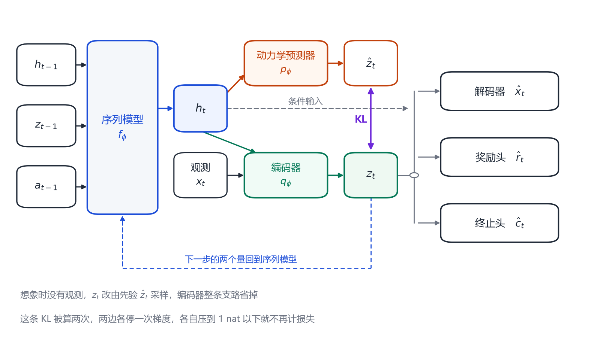
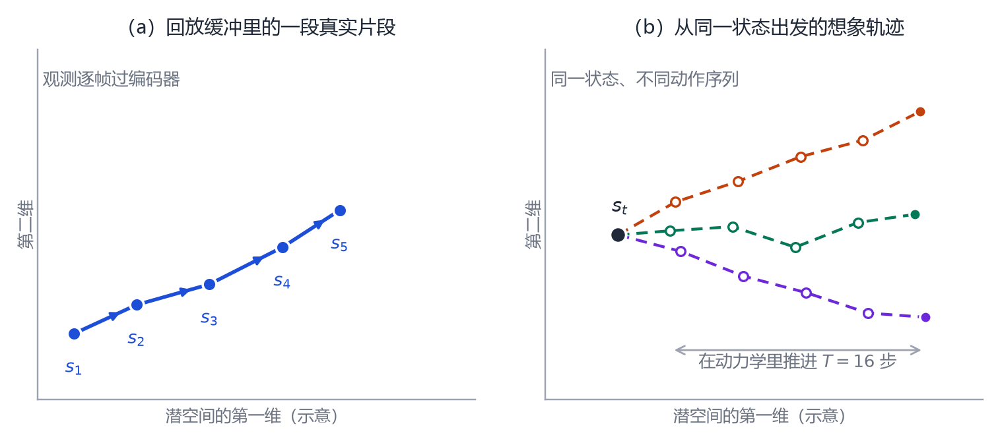
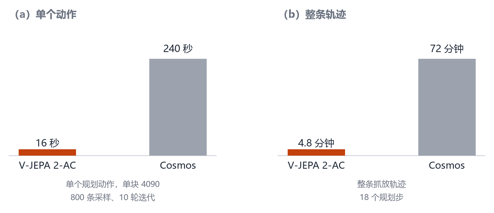
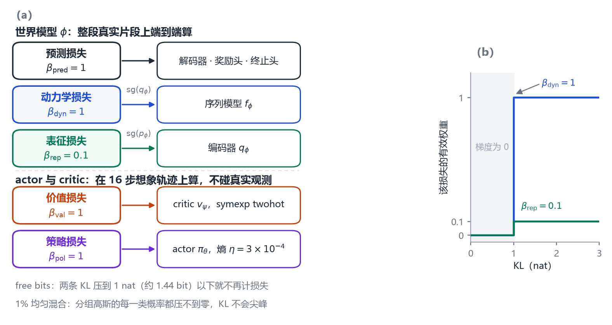
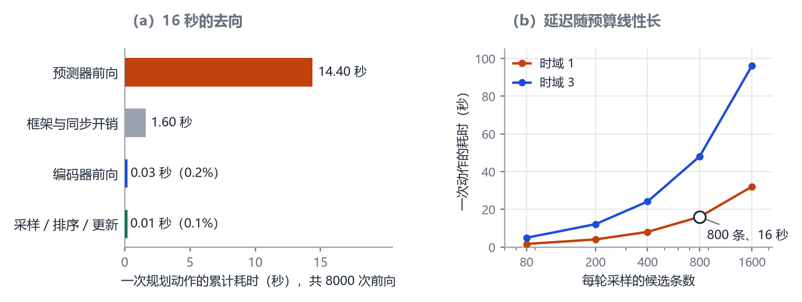

# 第 7 章　世界模型的工程

把一只杯子和一只盘子摆在桌上，让一个模型看一眼现在的画面，再回答一个问题：如果夹爪往前推两厘米，接下来会变成什么样。有两种回答方式，差别大得超出直觉，而这两种方式正好对应这一章要比较的两条路线。一种会给你画出下一帧，杯沿的反光、桌面上的影子、指头的位置都在里面，你可以直接用眼睛判断它说得像不像。另一种只回一个向量，上万个实数排在一起，没有一处能被人看懂，但把它和目标图片的向量相减，得到的距离可以直接交给优化器去压小。

第一种回答来自循环状态空间模型（Recurrent State Space Model，RSSM），也就是 Dreamer 系列一直用的那个世界模型。它内部挂着一台解码器，每一步都要把隐状态还原成画面，代价是参数和算力都压在重建上。第二种来自 V-JEPA 2-AC，它把预训练好的视频编码器整个冻住，只在特征空间里学一个带动作输入的预测器。两条路线都叫世界模型，承诺却完全不同，前者承诺能生成你会看到的一切，后者承诺只在决策用得上的地方准。

前面几章讲清楚了 JEPA 是什么，上一章讲 V-JEPA 2 怎么在一百万小时视频上预训练、又怎么接上动作，两条线索到这里才第一次正面相遇。这一章要把它们摆到同一张工作台上，一件一件比训练配方、超参、算力账单和两次测量。比完之后会发现，它们在纸面上差得很远，在工程上要操心的却是同一批事。隐状态里的信息够不够、想象多远还靠得住、预算花在训练还是花在规划、以及那笔延迟真实任务能不能接受，这四个问题两条路线都要回答，只是回答的方式不同。

先给一个结论，免得读到一半失去线索。要生成画面、要造合成数据、要让人一眼看出模型是不是理解了场景，就走重建那一条。要闭环控制、要在十几秒里决定下一步，就走潜空间那一条。中间没有更聪明的第三条路，只有把两条路的部件混着用，比如用重建模型造数据，再用潜空间模型在上面学策略。下面从状态表示讲起，因为后面所有分歧都是从这一个选择里长出来的。

## 7.1　两种状态表示

重建路线把状态拆成两个量，确定性的 $h_t$ 负责记历史，随机的 $z_t$ 负责补细节，再配一台解码器把两个量还原成画面。这么做等于给训练配了一个直接的判官，重建误差大就说明状态里丢掉了不该丢的东西，误差小就说明扣下来的信息足够画出原图。2018 年那篇 World Models 的参数账可以说明这种压力有多大，变分自编码器有 4348547 个参数，线性控制器只有 867 个，两者相差接近五千倍。绝大多数参数花在把 64×64 的赛车画面还原出来，而真正决定往哪打方向盘的，可能只是路沿的走向和一点模糊的速度感。

冻结路线的结构简单得多，编码器把每一帧压成特征图，预测器直接吃这些特征，损失函数里没有一个像素被重建。好处有三个，表示由预训练决定，不会因为后训练那点机器人数据被拉歪；回归的目标是固定的编码器输出，不会自己漂移；编码可以离线算好缓存起来，训练时不必重复做。代价也很清楚，编码器里没有的量补不回来。V-JEPA 2-AC 那篇论文把这一条写进了局限，说模型要从单目 RGB 里自己推断动作坐标轴，而机械臂底座常常不在画面里，这个推断就不成立。实践里的补法是人工试相机位置，论文自己也承认这一步没有自动化。

两种表示让“想象一步”的代价正好反过来。RSSM 一步想象是几个多层感知机的前向，输入当前状态和动作，输出下一个状态，算完就能接着推下一步。冻结特征那边，一步要过一个三亿参数的 Transformer，还得处理 16×16 个 patch 组成的序列。换成训练的视角，账又倒过来，RSSM 每个批次都要过解码器算重建、算两条 KL，冻结路线只算一个 L1 距离。所以一个把算力花在训练时，一个把算力花在规划时，谁的账单更贵取决于你打算推演多少次。

究竟选哪一种，在数据量上已经有一半答案。Minecraft 的一亿环境步足够从零训出一套带解码器的世界模型，因为环境本身能无限供给画面。Droid 里不到 62 小时的桌面视频不够训一个像样的视频解码器，但够训一个三亿参数的预测器。数据少的时候，借别人的表示几乎是唯一选择。数据多到能自己学表示时，信息守恒又变回优势，因为重建不允许状态悄悄丢掉解码器需要的细节。

## 7.2　RSSM 的五个式子

把一帧帧观测压成两个量，再把这两个量往前推，这套做法在 Dreamer 里被写成五个式子。前三个描述状态怎么变，后两个描述状态还能额外回答什么。写成公式是为了看清楚每个量受谁约束，训练时哪一路梯度流到哪个参数上。调试时这五个式子就是查错的顺序，先看重建与 KL 的曲线，再怀疑动力学本身。

$$
\begin{aligned}
&\text{序列模型} && h_t = f_\phi(h_{t-1}, z_{t-1}, a_{t-1}),\\
&\text{编码器} && z_t \sim q_\phi(z_t \mid h_t, x_t),\\
&\text{动力学预测器} && \hat z_t \sim p_\phi(\hat z_t \mid h_t),\\
&\text{奖励头} && \hat r_t \sim p_\phi(\hat r_t \mid h_t, z_t),\\
&\text{终止头} && \hat c_t \sim p_\phi(\hat c_t \mid h_t, z_t).
\end{aligned}
$$

式子里的 $x_t$ 是这一帧观测，$a_{t-1}$ 是上一步动作，$h_t$ 是由历史压出来的确定性隐状态，$z_t$ 是从一组离散分布里采样得到的随机隐变量。$f_\phi$、$q_\phi$、$p_\phi$ 是参数为 $\phi$ 的网络，三者的分工从各自的输入就能读出来。$h_t$ 负责记，它把动作和过去的随机量卷进一条循环链。$z_t$ 负责表示当下还说不准的部分，比如画面里那只正在下落的手。把两者拆开的好处要到想象时才显出来，真实训练时 $z_t$ 由编码器看着画面给出，想象时没有画面，换成先验 $\hat z_t$ 采样一个就行。编码器和解码器在这条路上可以整条省掉，结构如图 7-1。

<figure class="fig">

<figcaption><b>图 7-1</b>　RSSM 的五个部件与两条通路。橙色是只看隐状态的先验，绿色是看了画面的后验，紫色 KL 把两者拉在一起；右侧三个头分别给出重建、奖励与终止。</figcaption>
</figure>

图 7-1 里真正决定训练能不能收敛的是那条紫色的双向箭头。它对应两个损失，两个损失长得几乎一样，只在停梯度的位置上不同。动力学损失 $L_{\mathrm{dyn}}=\max\bigl(1,\ \mathrm{KL}\bigl(\mathrm{sg}(q_\phi) \,\|\, p_\phi\bigr)\bigr)$ 把后验当成靶子固定住，只训练序列模型去追它。表征损失 $L_{\mathrm{rep}}=\max\bigl(1,\ \mathrm{KL}\bigl(q_\phi \,\|\, \mathrm{sg}(p_\phi)\bigr)\bigr)$ 反过来把先验固定住，只训练后验变得更容易被预测。两者都要，因为只训动力学时后验会带着一堆不可预测的细节，先验永远追不上。只训表征时序列模型可以偷懒，把动力学学成常数也不会被罚。

两个损失外面的那个 $\max(1,\cdot)$ 就是 free bits，它的意思是 KL 一旦压到 1 nat 以下就不再产生梯度。1 nat 约等于 1.44 bit，含义是这一维已经只携带一比特多的信息，再压只会牺牲重建。这个设计解决一个很具体的两难。在 Dreamer 的第二代里，表征损失的系数要按视觉复杂度调，三维环境里细节对控制没用，需要强正则把状态压简单；静态背景的游戏里个别像素决定成败，需要弱正则保住细节。这两个要求没法用同一个系数满足，裁一刀之后，已经够小的 KL 自动退出，一套配方才有可能跨域。

还有一处改动看起来更小，作用却同样关键。编码器和动力学预测器输出的那组离散分布，被写成了九十九份网络输出掺一份均匀分布的混合，于是任何一类的概率都不可能被压到零。深度变分自编码器里常见的 KL 尖峰就是这么被压住的，分布一旦可以变成确定分布，KL 会在几步之内冲到很大的值，梯度跟着炸一次，之后的学习率实际上白走一段。掺进均匀分布之后，两组分布之间始终保留一条细小的重叠，KL 被夹在有限范围里，曲线才平滑得下来。代价是采样永远带一点随机性，想要完全复现某条轨迹时得把随机种子也一起固定。

## 7.3　在想象里训练

策略和价值函数不在真实环境里更新，而是在想象出来的状态序列上更新，这是 Dreamer 和普通强化学习最不一样的地方。流程从回放缓冲取一段真实片段开始，观测逐帧过编码器得到状态，这些状态在采集时就写进缓冲，省掉重复编码。从这里出发往前推 $T=16$ 步，每一步由 actor 采样动作，由先验给出下一个随机量，由奖励头给出 $\hat r_t$，由终止头给出 $\hat c_t$。整条链上没有一帧真实观测，也不经过解码器，所以一步的成本只有一次小前向。

$$\begin{aligned}
R_t^{\lambda} = r_t + \gamma c_t\bigl[(1-\lambda)v_t + \lambda R_{t+1}^{\lambda}\bigr],
\qquad \gamma = 0.997,\ \lambda = 0.95 .
\end{aligned}$$

这个式子是 $\lambda$-回报，$r_t$ 是模型给的奖励，$c_t$ 是终止标志，$v_t$ 是 critic 读出的价值期望，$\lambda$ 控制自举的比重。把 $\lambda$ 取 1 就退化成纯蒙特卡洛，16 步之外的回报完全不管。取 0 就退化成一步自举，模型预测的奖励几乎不起作用。0.95 落在中间，意思是前几步相信模型给的奖励，越往后越依赖 critic 的估值，因为越往后的状态越是模型编出来的。为什么非自举不可，算一下有效时域就明白了，$1/(1-\gamma)$ 约等于 333 步，而想象只推 16 步，剩下的 300 多步回报只能靠 critic 猜。

这里的 critic 学的不是一个数，而是回报的分布，网络在 symexp 上等距排列的分箱上输出 softmax，读出时取期望。actor 用 Reinforce 更新，目标里 $(R_t^{\lambda}-v_t)/\max(1,S)$ 那一项整体停梯度，只留 $\log \pi$ 这一项带梯度，再配一个熵正则。之所以不让梯度穿过动力学反传到动作，是因为中间隔着一串采样出来的离散码，直通估计在这么长的链上很不稳。Reinforce 的方差大，但至少不会把策略推到某一次采样噪声上。

采集与训练之间的比例是另一个必须手工定的量。论文用重放比来表达这件事，它的定义是每一步真实交互要训练多少个时间步，Minecraft 取 32，再除以一个批次里的时间步数和动作重复，才折算成梯度步与环境步之比。Atari 那边，动作重复 4、批形状 16×64，重放比 32 折下来是每 128 个环境步一次梯度更新，两亿步里一共 150 万次更新。这个数调大，同样的环境步数能换来更多更新，墙钟时间省下来，但缓冲里的片段会被反复咀嚼，世界模型开始记住那几段画面而不是学到规律；调小则相反，模型更新跟不上采集。没有通用的取值，只能按每一步交互的耗时和缓冲容量去试。

想象的可信度随步数下降，$T=16$ 是一个折中，它短到误差还没把状态推离数据分布，又长到能装下一次完整的动作效果。图 7-2 把这件事画成两半，左边是回放缓冲里已经发生的五个状态，右边是从同一个状态分叉出去的三条想象轨迹。真实世界只会给出其中一条，而模型一次就能给出三条，代价只是三次前向。这也解释了 RSSM 为什么非要把 $z_t$ 做成随机的，如果隐状态是确定性的，同一状态配同一动作只会得到同一条未来，采样就失去了意义。

<figure class="fig">

<figcaption><b>图 7-2</b>　真实片段与想象轨迹。左图五帧观测逐帧编码成状态，右图从同一状态出发，配三串不同动作在动力学里推进 16 步，走出三条可能的路。</figcaption>
</figure>

## 7.4　一套超参跨域

DreamerV3 提出的主张听起来不像研究，它把同一套超参数丢到 150 多个任务上，一个都不改。这些任务横跨 Atari 的 57 个游戏、18 个本体感知的连续控制任务、20 个纯图像输入的控制任务、23 个专门测试信用分配与奖励尺度的 BSuite 环境，还有 Minecraft。跨域真正的难点是尺度。Atari 的奖励是 0 到 1 之间的分数，机器人控制的奖励是负几百的力矩代价，Minecraft 的奖励稀疏到一整局只出现几次。同一个学习率、同一个熵系数在这些尺度上不可能同时合适，所以跨域先要做的不是换网络，而是拆尺度。

对付数值尺度用的是 symlog，$\operatorname{symlog}(x)=\operatorname{sign}(x)\ln(1+|x|)$，读出来时用反函数 symexp 解回去。取对数不行，因为目标可能是负数。用滑动统计量做标准化会引入非平稳，训练后期分布一直在动；换成绝对误差或 Huber 又常常停在同一水平上不动。奖励和回报走得更远一点，网络输出的是 $-20$ 到 $20$ 的等距网格经 symexp 变换得到的分箱上的 softmax，目标用 twohot 编码摊到相邻两个箱子上，损失是带软标签的交叉熵。这么做的结果是梯度只取决于分箱上的概率，与目标本身有多大脱钩，一个很大的回报和一个很小的回报给出的梯度是同一量级。

回报的归一化也有讲究，分母取这一批回报 5% 到 95% 分位的差，再用系数 0.99 的指数滑动平均抹平，并且设一个下限 $S=\max(1,\cdot)$。用标准差不行，稀疏奖励下标准差接近零，任何一点小波动都会被放大成一个大优势。用最大最小也不行，一个异常回合就能把分母撑得很大，其余回合全部被压平。分位数对多峰与离群值都不敏感，所以 150 个任务能共用它。这一层做完之后，回报大致落在 $[0,1]$ 附近，熵系数 $\eta=3\times 10^{-4}$ 才有资格固定下来。否则同一个系数在奖励尺度差三个数量级的任务上，要么把熵正则压得看不见，要么让它盖过回报。

论文在 14 个任务上做了消融，结论是所有稳健性技巧都有贡献。其中最强的一项是 KL 目标，也就是 free bits 与两条 KL 的平衡，排在它后面的是回报归一化和奖励与价值的 symexp twohot 回归。没有一个技巧是所有任务都需要的，每个技巧都只在一部分任务上起决定作用。这组结果最实用的地方是给出了排查顺序，配方在新环境上崩了，先看 KL 曲线，再看回报尺度，容量放到后面再怀疑。

## 7.5　规模与代价

默认模型是两亿参数，论文另外训了 12M 到 400M 共六档，学习率、批大小、损失系数一个都没改。曲线随规模单调变好，不只是分数更高，达到同样分数需要的环境交互也更少。这说明容量与样本效率在这套目标里可以互换，加算力能省数据。还有一条更实用的结论，在两个连续控制套件上，12M 的模型就能拿到 200M 的水平。想复现的人不必先有一张大卡。

尺寸之间不是各自独立的，全部从一个模型维度派生出来。多层感知机的隐藏单元数等于这个维度，循环单元数是它的八倍，卷积的通道数是它的十六分之一，每个隐变量取的码数也是十六分之一。层数与隐变量个数在六档之间保持不变，变的是宽度。两亿这一档的维度是 1024，于是循环单元 8192、基础卷积通道 64、每个隐变量 64 个码。按比例派生的好处是换尺寸只改一个数，坏处是最优配置被绑住，想单独加宽某一层就得自己重调。

Minecraft 这一场是验收。采到钻石要先砍树、做工作台、做木镐、下矿、找铁、做铁镐，一共 12 件物品全由稀疏奖励串起来，单局上限 36000 步约 30 分钟，熟练玩家大约 20 分钟能拿到。Dreamer 在一亿环境步之内让所有种子都采到了钻石，训练用一块 A100 跑了 8.9 天，靠 64 个环境实例并行采集数据。作为对照，VPT 用了 720 块 GPU 训 9 天，还需要人类玩家的键鼠示范。差别不在总卡时，在于前者把预算花在自己推演上，后者把预算花在模仿人上。不过这笔账要读准，8.9 天是墙钟时间，单卡串行意味着想再快只能换方案，而这个方案没给并行留位置。

## 7.6　冻结编码器与一个距离

V-JEPA 2-AC 的装配上一章讲过，这里只挑与工程判断有关的部分复述。编码器是预训练好的 ViT-g，每一帧独立编码成 16×16×1408 的特征图，整段后训练里它一直是冻结的。预测器约三亿参数，24 层、16 个头、隐藏维 1024，比编码器小得多。输入按 $(a_k, s_k, z_k)$ 交错排列，动作与末端状态各七维。注意力用块因果掩码，位置编码是三维旋转形式，前者保证看不到未来，后者保证换分辨率时位置不乱。

冻结编码器有三个理由，每一个都能在复现时省时间。数据太少，不到 62 小时的桌面视频如果拿去微调一个十亿级的编码器，几天之内就会过拟合到那几十个场景上。目标要稳，如果编码器和预测器一起训，回归的靶子每天都在动，预测器会一直追一个移动的目标。算力要省，编码可以离线算一次缓存，训练循环里只剩下预测器这一块。代价不会消失，编码器里没有的信息补不回来，动作坐标轴的推断要依赖相机看得见机械臂底座，落不到画面里的配置就得靠人工试位置。

损失有两项，一项是教师强制，用真实的下一帧特征当监督，逐帧算 L1，序列长度 16 帧所以算 15 步。另一项是 rollout 损失，把预测器的输出接回输入再推两步，只对第一步反传。用 L1 而不用平方误差，是因为特征维度很高，个别维度偶尔会冒出很大的偏差，平方会把它放大成主导项，把其余维度的学习压下去。rollout 损失只推两步，是成本与收益的折中。每多推一步就要多一次前向加反传，两步已经足够让预测器习惯自己那些不够准的输出。

规划时用的是一个距离，把目标图编码成 $z_g$，让预测器在动作序列条件下推到时域末端，两端的 L1 距离就是代价。交叉熵方法（Cross-Entropy Method，CEM）在这里的参数是：800 条采样、10 轮迭代、每轮取最好的 10 条更新分布、时域 1 步。采样出的动作被限制在半径 0.075 的 L1 球里，因为 Droid 里相邻帧的末端位移本来就小，放开只会浪费候选。时域取 1 意味着每次只优化一个动作，长程靠不断重规划拆开。抓放任务因此被拆成三段，先对着“已经抓住”的目标图优化 4 步，再对着“物体靠近落点”优化 10 步，对着“放好”优化 4 步。

## 7.7　两张账

第一张账是延迟。V-JEPA 2-AC 用 800 条采样、10 轮迭代，单个动作需要 16 秒。对照组 Cosmos 是一个潜扩散的视频生成模型，用 80 条采样、10 轮迭代，单个动作要 4 分钟，一条完整的抓放轨迹要跑一个多小时。把这两组数按 18 个规划步折算，差距是 4.8 分钟对 72 分钟，如图 7-3。差距来源不难找，扩散模型每采一个样本要迭代几十步去噪，再乘采样条数。预测器一次前向就给出全部 patch 的特征，800 条采样摊到一块 4090 上也只是几百次前向。

<figure class="fig">

<figcaption><b>图 7-3</b>　两种世界模型的规划耗时。左边是单个动作，右边是按 18 个规划步折算的整条抓放轨迹；样本条数不同，差距仍在十几到二十倍之间。</figcaption>
</figure>

第二张账是成功率。两个没参与训练的实验室各用一条 Franka 手臂，每个技能 10 次试验取平均。V-JEPA 2-AC 在到达目标上是 100%，抓杯子 65%、抓盒子 25%，抓着物体移动到目标位置 75% 和 75%，完整的抓放 80% 和 65%。同场的 Octo 是一个在整份 Droid 上做行为克隆的策略，对应成绩是 100%、15%、0%、15%、70%、15%、10%，除了到达与接近物体两项，其余都低得不能看。两个模型在“走过去”这件事上打平，差距全出现在需要精确接触的环节。

这条分界线值得再往里看一层。两个模型都能把夹爪送到物体跟前，却在合拢的那一瞬分开，说明差距不在视觉定位，而在动作的最后几毫米。论文给的解释是具体的，杯子要沿杯沿内侧下指再合拢，盒子要把两指张得足够宽，这两个要求都落在七维动作里最难精确的那两维上。800 条采样摊到七维之后，落到那一小块区域的候选本来就不多。Octo 在“抓着物体到达”上有 70%，在“抓住杯子”上只有 15%，同样指向一件事，把一个已经抓稳的物体搬到别处比抓住它容易得多。

这两组数字得一起读。到达任务满分说明距离在表征空间里是一块可以被压平的地形，优化器沿着它走不会掉沟里。抓盒子 25% 说明接触与夹爪开合要的是毫米级动作，采样密度在这里远远不够用。4 分钟一个动作的方案精度也不理想，它在四个物体交互任务里有三个是零，抓盒子也只有 20%。这说明慢不等于准，生成模型把算力花在了像素上，而不是花在任务需要的那几个维度上。16 秒一个动作同样不好用，一次抓放要等四五分钟，闭环里还留着大量可以省掉的重规划。

## 7.8　两种账不能互相抵消

把这套东西放回用途上看，两种世界模型的分工其实很清楚。要给人看、要造带动作标签的训练数据、要检查模型是不是真理解了场景，需要的是能出画面的生成模型，代价是慢，慢得没有商量余地。要让一个控制器在有限时间里决定下一步、要在几百条候选里挑出代价最低的那一条，需要的是潜空间里的预测器。它的代价是输出的东西没人能看懂，目标也只能是一张图。

两条路线的上限是同一个东西，模型在哪儿失真，规划就在哪儿失效。重建路线的失真表现为画面糊成一片，扩散模型在长 rollout 里会把细节抹掉。潜空间路线的失真表现为表征飘到编码器没产生过的地方，数值看着正常，语义上已经说不通。V-JEPA 2-AC 用 rollout 损失缓解后者，Dreamer 用 16 步的短时域和 1% 的均匀混合缓解前者。办法不同，面对的却是同一个敌人，自己预测出来的状态会慢慢滑出训练分布。

所以这一章比较下来的东西，说到底不是两个模型的优劣，而是两笔预算怎么分配。Dreamer 把预算压在训练时，换来的是想象一步的廉价。V-JEPA 2-AC 把预算压在预训练上，换来的是后训练只需要不到 62 小时的数据。两个选择都成立，前提都是模型在它被使用的那段时域里足够准。至于这段时域能有多长、准到什么程度，最终不由架构决定，而由喂进去的数据和构造出来的视图决定，这是下一章要算的账。

## 7.9　五条损失各管一段

7.1 到 7.8 把两条路线比完了，真正动手改代码时，最先卡住的地方还是损失函数。DreamerV3 把整套训练写成五条损失，每一条都带一个系数，系数列在论文附录的表格里，和一百五十多个任务共用同一套取值。五条分成两组，前三条在真实片段上端到端算，后两条在想象轨迹上算，两组之间只通过模型状态 $s_t=\{h_t,z_t\}$ 相接。世界模型这一侧的三条叫 $L_{\mathrm{pred}}$、$L_{\mathrm{dyn}}$、$L_{\mathrm{rep}}$，系数分别是 1、1 和 0.1：

$$
L(\phi)=\mathbb{E}_{q_\phi}\Big[\sum_{t=1}^{T}\big(\beta_{\mathrm{pred}}L_{\mathrm{pred}}+\beta_{\mathrm{dyn}}L_{\mathrm{dyn}}+\beta_{\mathrm{rep}}L_{\mathrm{rep}}\big)\Big].
$$

式子里的 $q_\phi$ 是编码器在给定观测后给出的后验，$T$ 是一条片段的长度。$\beta$ 是三条损失在总量里的权重，$\mathbb{E}$ 表示对后验采样取平均。$L_{\mathrm{pred}}$ 这一项里其实装了三个头，解码器的重建、奖励头的回归、终止头的二分类都算在里面，前两个走 symlog 平方误差，后一个走逻辑回归。所以“五条”是按损失的名字数的，不是按网络的个数数的，单独一条 $L_{\mathrm{pred}}$ 就同时喂着三个头。

$\beta_{\mathrm{rep}}$ 取 0.1 而其余取 1，理由不在单位而在方向。重建与可预测性对编码器提的要求正好相反，重建要 $z_t$ 保住解码器画得出画面的细节，可预测性要 $z_t$ 只留下先验猜得到的部分。KL 已经被 free bits 设了下限，1 nat 以下不再产生梯度，剩下的区间里再挂一个 0.1 的系数，等于把可预测性这股力压到重建的十分之一。KL 涨到 2 nat 时，动力学那一份贡献接近 1，表征那一份只有 0.1，如图 7-4(b)。

停梯度放在哪里，决定了每条损失训练谁。$L_{\mathrm{dyn}}$ 的梯度停在 $q_\phi$ 那一侧，更新的是序列模型；$L_{\mathrm{rep}}$ 的梯度停在 $p_\phi$ 那一侧，更新的是编码器与它输出的分布参数。$L_{\mathrm{pred}}$ 的梯度要穿过 $z_t$ 回到编码器，因为重建的误差必须归因到表征上，否则解码器再努力也补不回已经丢掉的信息。三条损失在同一个批次上同时算，靠 sg 运算符切开，互不拉扯，这也是 RSSM 一次前向就能同时更新五个部件的原因，如图 7-4(a)。

另一组两条管行为。价值损失 $L_{\mathrm{val}}$ 的系数是 1，形式是以 symexp 分箱为标签的交叉熵，critic 输出的是分布而不是标量，读出时取期望。这一条还挂着两个容易漏掉的部件，一个是系数 0.3 的回放辅助项，把同一条损失也算在缓冲里的真实轨迹上，另一个是慢 critic，用参数指数滑动平均（衰减 0.98）复制一份目标，再以系数 1 把主 critic 往它那边拉。策略损失 $L_{\mathrm{pol}}$ 的系数同样是 1，用 Reinforce，$(R_t^{\lambda}-v_t)/\max(1,S)$ 整体停梯度，只留 $\log\pi_\theta$ 带梯度，再加一个熵项，系数 $3\times10^{-4}$。

调参时这五条不能一起动。先看 KL 曲线，如果它长期贴着 1 nat，说明 free bits 在主导，此时改 $\beta_{\mathrm{rep}}$ 没有任何效果，要动的是编码器容量或者均匀混合的比例。KL 停在 2 nat 以上不下来，说明表征太复杂，把 $\beta_{\mathrm{rep}}$ 往上抬一档，再看重建掉了多少。两条行为损失留到回报归一化定住之后再调，否则尺度一变，前面调好的系数全部作废。

<figure class="fig">

<figcaption><b>图 7-4</b>　DreamerV3 的五条损失与 free bits 的开关作用。(a) 每条损失训练哪一部分，系数写在名字下面；(b) KL 压到 1 nat 以下时，两条 KL 损失的权重被截成零。</figcaption>
</figure>

## 7.10　十六秒花在哪里

7.7 报出的 16 秒是一个黑箱数字，复现时要能把它拆成乘法。交叉熵方法用 800 条候选、10 轮迭代、时域 1，一次规划动作要评估 $800\times10=8000$ 条候选。时域 1 意味着每条候选只需要一次前向，于是一共 8000 次前向。把 16 秒摊到这 8000 次上，每次 2 ms，这个数就是整条延迟的单价。

2 ms 合不合理，可以用浮点运算量估一遍。预测器约 3 亿参数，输入 256 个 patch 词元加动作与末端状态两个 token，一次前向大约 $2\times3\times10^{8}\times300\approx1.8\times10^{11}$ FLOPs。单块 4090 按 fp16 有效 90 TFLOP/s 算，这个量级需要 2 ms，与实测摊出来的数正好对上。估算下来，这 16 秒里没有被藏起来的开销，延迟几乎全被前向吃掉，如图 7-5(a)。

其余三块按同样口径分摊。编码器是十亿参数的 ViT-g，每个动作要编码当前帧与目标帧各一次，合计 0.03 秒。采样与排序便宜得出乎意料，800×10 次七维高斯采样、800 个标量的 L1 距离、一次排序、top-10 的均值方差更新，加在一起 0.01 秒。占第二位的是框架开销，8000 次小前向的启动、CPU 与 GPU 之间的同步、Python 循环本身，平均每次 0.2 ms，累计 1.6 秒。想把 16 秒改成 8 秒，优化排序毫无用处，只能减少前向次数或让每次前向更便宜。

减少前向次数有三个乘数可以动。候选条数从 800 降到 200，时间降到四分之一，代价是七维动作空间里的采样密度变稀，抓杯子这类要毫米级精度的技能会先掉下去。迭代轮数从 10 降到 4，时间降到四成，代价是第一轮那个粗略分布只被收窄四次，末端附近几个小位移可能还没被找到。时域从 1 提到 3，时间直接变成三倍，所以论文停在 1，理由 7.6 算过，长程靠重规划切成三段，如图 7-5(b)。

与 Cosmos 的对照把这件事说得更清楚。那个模型用 80 条候选，每条要跑几十步去噪，每步一次完整前向，800 次评估花了 4 分钟。比较规划成本时，参数量和采样条数都不是好指标，该问的是一条候选要过多少次网络，这个数在潜空间模型里是 1 或者 $T$，在扩散模型里是去噪步数乘 $T$。V-JEPA 2-AC 的候选数是对方的十倍，总时间只有十六分之一，差的就是这个数。

把这套账写成一行乘法，预算够不够就能提前算出来。延迟大致等于采样条数乘迭代轮数乘时域乘单次前向耗时，外加编码与框架开销。要在 1 秒内出一个动作，800 条、10 轮、时域 1 的配方下每次前向得压到 0.125 ms，比 2 ms 快十六倍，这不是换算子能做到的量级。可行的方向只有砍候选、砍轮数，或者把时域压到 1 并接受不断重规划。

<figure class="fig">

<figcaption><b>图 7-5</b>　一次规划动作的 16 秒花在哪里。(a) 8000 次前向占去近九成，采样与排序不到百分之一；(b) 延迟随候选条数与时域线性增长，圆点是实测的 16 秒，纵轴按一次前向 1.8 毫秒估算。</figcaption>
</figure>

## 7.11　模型第几步开始不准

训练和规划的账算完，还剩一个问题，模型在哪一步开始不可信，而这个数要量出来才能知道。量法有两种，教师强制与开环，区别只在第 $k$ 步的输入是真值还是模型自己上一步的输出。教师强制的误差反映拟合质量，开环的误差随步数增长，增长到多快才是决定可用时域的那个量。把开环误差写成随步数变化的曲线：

$$
\varepsilon_k=\frac{1}{|\Omega|}\sum_{p\in\Omega}\big\|\hat z_{t+k}^{(p)}-z_{t+k}^{(p)}\big\|_1 .
$$

$\Omega$ 是评估用的片段集合，$p$ 在片段与 patch 上取遍，$\hat z$ 是预测器给出的特征，$z$ 是编码器对真实帧给出的特征。两者维度相同，可以直接相减再取绝对值求和，$|\Omega|$ 用来摊成每样本的平均。曲线通常分三段，前几步的误差来自动作条件本身的模糊，中段近似线性增长。超过某个步数之后误差陡增，那说明状态已经滑出编码器见过的区域，预测器开始靠外推糊弄，陡增的位置就是可用时域的上界。

直接比 L1 有一个毛病，不同场景的运动幅度不同，画面越静止误差越小，跨任务没法比。把误差除以真实位移 $\|z_{t+k}-z_t\|_1$，得到的是预测位移差了多少这个相对量，与场景快慢无关。分母接近零时比值会炸，取 $\max(\cdot,\tau)$ 加一个下限，$\tau$ 取评估集上位移中位数的一个小比例即可。这个归一化还有一层好处，它把“预测得准但什么都没发生”和“预测得准且场景在动”分开，前者在控制里几乎没有价值。

两条曲线的用途不同，读数也不能混。教师强制误差回答的是给对了历史还能不能预测，主要反映动力学与动作条件的拟合；开环误差回答的是自己走会不会偏，把累积也算了进去。训练时两者都要有，V-JEPA 2-AC 用 15 步教师强制损失加 2 步 rollout 损失，后者只对第一步反传，Dreamer 的图里给 5 帧上下文、开环推 45 帧。rollout 这一项专门对准推理时的用法，代价是每多推一步就多一次前向加反传。

阈值怎么定，有一个能落地的做法。把 $\varepsilon_k$ 与单步误差 $\varepsilon_1$ 相比，取涨到两倍 $\varepsilon_1$ 的那一步作为可用时域的上界，再用闭环成功率验证它是不是过于乐观。评估必须在与训练不同的场景上做，同场景的片段会让曲线偏好看一大截。重建模型还要多一层小心，解码器会把开环误差在视觉上抹平，状态空间里已经偏了两成，解码出来的画面可能还看得出杯子的位置，用眼睛判断会得出错误的结论。

误读里最常见的有两种。只看平均不看分位数，个别维度的爆炸会被平均掉，特征维度上千时至少要报 95 分位。只看单步不看整条曲线，会以为模型很准，而实际能用的只有三步。可信时域一旦量出来，规划时域取多长、多久重规划一次、要不要做集成，就都有了依据。曲线为什么会在某一步陡起来，答案多半不在动力学结构，而在训练时见过的视图够不够杂，这是下一章要从头算的账。
