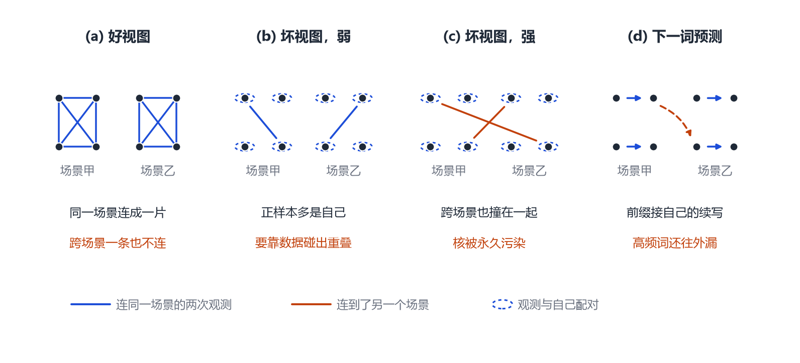
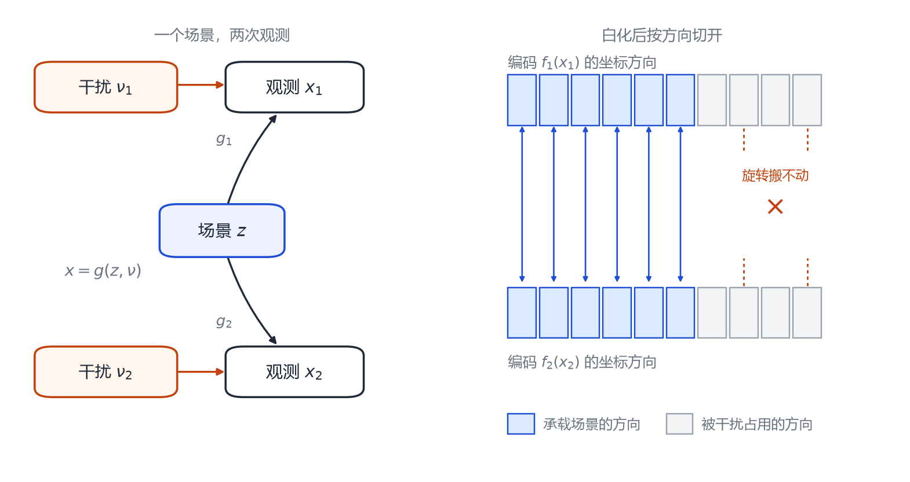
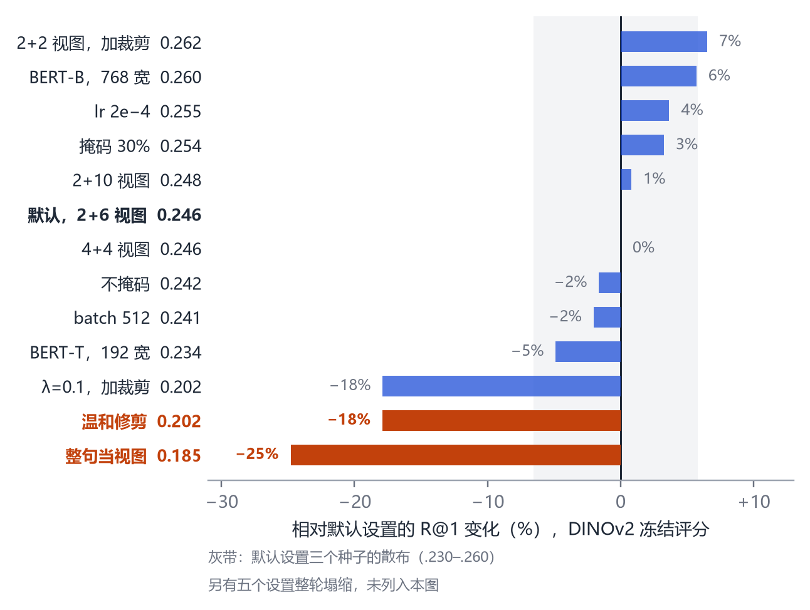

# 第 8 章　好视图与坏视图

一张 Flickr 照片底下挂着五句描述，“一只小狗在沙滩上跑”“海边有只狗在玩”“沙滩上奔跑的幼犬”，五个人的写法几乎不重样，说的却是同一件事。训练联合嵌入模型的时候，这五句话有两种用法，一种是把其中一句挖掉两个词做成两个残句，另一种是从五句里取两句，两种配对都能凑成正样本。直觉会偏向残句那一对，因为两个残句共享的词占了绝大多数，字面上几乎一样，实测的顺序却正好相反。差距的来源不在重叠多少，在于两次观测共享的是哪一部分。

上一章把世界模型的保真度算成规划能力的上限，那里的瓶颈落在模型容量和采样步数上，这一章往流水线的上游走一段，问的是正样本怎么造、数据集怎么筛。这个问题在任何自监督项目里都会最先遇到，也最容易被跳过，因为损失曲线看起来一切正常，下游指标却一直不动，人会先去调学习率和投影头。等把这两样都调遍再回头看数据，才发现目标函数一直被一个错误的核牵着走，而核由配对方式决定，改它往往不动一行模型代码。代价却比调参大得多。

回到那两种配对。残句共享的是那句话的写法，挖掉两个词之后剩下的十来个词、语序、标点全都在，两句不同的描述共享的是那张照片，写法可以完全不同，看到的东西却是同一批。写法是文字的私事，照片两个模态都看得见，机位、光照、被谁拍的这些量由图像本身确定下来，可没有任何一句话规定照片从哪个角度拍。于是第一种配对让文本编码器去对齐“怎么写”，第二种配对让它去对齐“看到了什么”，两种要求落在同一个 $k$ 维空间里，就是两种完全不同的排布。同一份数据、同一个损失，只换配对方式，结果的差别可以到一两倍。

下面给出三件可以直接用的东西。一条判据回答某种损坏会不会浪费维度，一个估计量把浪费的比例量出来，一张旋钮表说明在有限的算力里先动哪个参数。三样东西的结论都不太符合直觉，尤其是旋钮表那一条，把一个动作做对，比把很多动作微调更值钱。

## 8.1　四种配对

按哪些观测被连起来分类，正样本分成两族，细分下去是四种。好视图（good view）指同一个场景的两次观测，同一张照片配两句不同的描述、同一段视频的两帧都算，这个关系由世界给出，不依赖任何一次具体的观察。坏视图（bad view）指同一次观测的两次损坏，一张照片的两个随机裁剪、一句话的两次随机掩码，共同点是都从同一份材料出发。坏视图按力度再分一层，弱损坏只动一小块，挖掉一句里的两三个词，两个残句仍然高度相似；强损坏动一大半，把七成的词都挖掉，或者把照片裁到只剩一个角。第四种是下一词预测，正样本是一段文字的前缀和紧接其后的那个词，这种配对天然存在，任何一个位置都自带答案。

<figure class="fig">

<figcaption><b>图 8-1</b>　四种正样本各连了谁。两个场景各四个观测，蓝线连同一场景的两次观测，橙线连到另一个场景，虚线环是观测与自己配对。好视图在场景内连成一片，强损坏与下一词预测都往外连。</figcaption>
</figure>

图 8-1 把这四种摆在同一个画布上，每一格里是甲乙两个场景、每个场景四个观测，一条线表示这两个观测被当成了一对正样本。左起第一格是好视图，同一个场景的四个观测两两相连，一条线也不跨到另一格，这个核由“两张图拍的是不是同一个地方”决定，跟你抽到哪几句描述无关。第二格是弱损坏，绝大多数配对是一个观测和它自己，因为挖掉不同的词之后每个残句仍然只跟自己最像。两个不同观测被连上要等它们的残句碰巧重合，那要靠数据足够密。

第三格是强损坏，残句短到一定程度，跨场景的巧合就变成常态，剩下几个虚词的模式在沙滩上有、在停车场里也有，核于是在任何数据量下都把两个场景混在一起。第四格的连接很窄，前缀连着它自己的续写，这是一条短边，另外还有一类隐式正样本，两个前缀如果后面接同一个词，在最优解附近会互相靠近。一个词元跨不过一个场景，要连起同一场景的两句话需要很长的共享续写链，而高频续写会把不同场景连上，虚词、套话、文档风格都在做这件事。

四种配对可以统一看成对核的四种写法。给定一种正样本的分布，问一对正样本把场景 $z$ 的一个观测和另一个场景 $z'$ 的一个观测连起来的概率，这个概率称作诱导世界核（induced world kernel）。好视图诱导的核由设计决定，因为哪两次观测属于同一场景是数据集自带的标签，跟抽样无关；坏视图诱导的核要靠数据碰出来，两个残句碰巧重合，一条边才出现。这个区别是整章的骨架，后面几节的结论都是它的精确化。

## 8.2　干扰变量

要形式化“共享措辞”和“共享场景”的差别，得给观测加一个维度。设世界状态 $z$ 取自一个有限集合，一次观测不是 $z$ 的函数，它还带着一个只属于这次观测的变量 $\nu$，称作干扰变量（nuisance）。照片的 $\nu$ 是机位、光照、曝光时间、被谁拍的，一句描述的 $\nu$ 是用词、语序、句子长短、作者的口气。$\nu$ 与 $z$ 独立抽取，同一个场景拍两次得到两个不同的 $\nu$，渲染过程因此必须写成两个自变量。

$$
x = g(z, \nu)
$$

式子里 $x$ 是观测到的样本，$g$ 是这一次的渲染方式，给定 $(z,\nu)$ 就唯一确定 $x$。$g$ 仍然可以是单射，也就是说 $x$ 里没有丢掉关于 $(z,\nu)$ 的信息，但从 $x$ 恢复出来的是两个缠在一起的值，分不开哪部分是场景、哪部分是干扰。$\nu$ 的自由度也不必小，机位有三个，光照有一串参数，措辞的自由度更大，观测的多数信息其实花在 $\nu$ 上。这两个细节合起来解释了后面那些结论的语气，它们讲的不是信息不够，而是信息里分不出哪一块属于世界。

这里有一个容易滑过去的点，$\nu$ 不是噪声。噪声随机、无结构，平均掉就没了；$\nu$ 是结构化的，同一位作者写十句话句尾都带同一个语气词，同一台相机拍的十张照片白平衡都偏暖。模型学这套规律比学场景容易，因为它在数据里更一致，于是在嵌入空间里它占的方向往往比场景更显眼。可逆也帮不上忙，一个可逆的混合仍然是一个混合。

分不开为什么致命，因为跨模态的时候 $\nu$ 没有对应物。机位对视觉系统有用，可是没有一句话决定照片从哪个角度拍，任何旋转都不可能把机位方向和另一个模态的某个方向对上。于是问题变成一个预算问题，编码器输出的维度固定，白化之后总方差也固定，花在 $\nu$ 上的方向就是花在“另一个模态看不见的东西”上的方向。图 8-2 画了这个分解，左半边是一个场景配两个独立干扰、生出两个观测的生成过程，右半边是白化之后的十个坐标方向。

<figure class="fig">

<figcaption><b>图 8-2</b>　干扰占掉的方向。场景与各自的干扰共同生成观测，编码器白化后一部分方向承载场景、跨模态对得上，另一部分被干扰占满，任何旋转都搬不动。</figcaption>
</figure>

蓝格与灰格的比例不是设计出来的。目标函数里没有任何一项要求“多用蓝格”，它只要求正样本之间的预测误差小，如果正样本允许用干扰来降低这个误差，模型就会用，而且会优先用，因为干扰在数据里更一致。这一条解释了很多训练日志里的怪现象，损失降得很漂亮，换一批没见过的配对就散了。贴近它们的是措辞，不是内容，而措辞在跨模态的时候一分钱都不值。

## 8.3　花在干扰上的维度收不回来

把这句话变成一个下界，需要先把编码器标准化。设 $f$ 在观测上的输出已经中心化并白化，均值为零、协方差为单位阵 $I_k$，白化之后 $k$ 个方向上的总方差恰好是 $k$，多占一个方向就必然少占另一个。把 $f(x)$ 按“给定场景后还剩多少随机性”拆开，条件期望 $u(z)=\mathbb{E}[f(x)\mid z]$ 是其中能被场景解释的那部分，$f(x)-u(z)$ 是同一场景下仍在变的部分。前一部分的协方差记作 $C_f$，因为总协方差是 $I_k$ 而 $C_f$ 只是其中一块，它的特征值都落在 $[0,1]$ 里，第 $i$ 个特征值读成“场景在第 $i$ 个方向上解释了多少比例的方差”。

取这些特征值的平方根、求和、再除以 $k$，得到一个落在 0 到 1 之间的数 $\rho(f)=\operatorname{tr} C_f^{1/2}/k$，称作场景解释比例（scene-explained fraction）。$\rho=1$ 当且仅当 $C_f=I_k$，也就是给定 $z$ 之后 $f(x)$ 不再有任何变化，$f$ 成了 $z$ 的函数，$\rho$ 小则说明编码器把大量方向让给了干扰。这个数只依赖编码器和数据，不依赖你怎么对齐，所以在拟合任何映射之前就能估出来，是一个很好的体检指标。

定理 3 说这笔开销在任何对齐方式下都收不回来，这里的“任何”包括全部旋转与反射，也包括用数据拟合出来的那一个。这个下界只依赖两件事，编码器白化过、两个模态的干扰独立，对损失和训练方式一概不作假设。两个模态各有一个白化编码器，取同一场景的一对观测、各自的干扰独立，那么在所有正交变换里挑最好的那个，误差仍然满足

$$
\min_{Q\in O(k)} \mathbb{E}\big\lVert Q f_1(x_1) - f_2(x_2)\big\rVert^2 \;\ge\; 2k\Big(1 - \min_m \rho(f_m)\Big)
$$

$O(k)$ 是 $k$ 维空间里的旋转与反射，$\lVert\cdot\rVert$ 是欧氏长度，$m$ 遍历两个模态。右边的 $2k$ 是两个白化向量方向完全无关时的平方距离，所以整个下界读成“最坏情况乘上浪费的比例”，$\rho$ 每掉 0.1，$k=32$ 时下界就抬高 6.4。这个下界很保守，实测误差落在它的 1.2 到 2.7 倍之间，但只要两个编码器的质量差距足够大，排序就一致。它跟投影头、损失、温度都无关，所以两个模态怎么都对不齐的时候，该先去看各自的 $\rho$。

$\rho$ 怎么估，是这一节最实用的部分。Flickr30k 的 2,014 张验证与测试图各有五句描述，把每句都过一遍文本编码器，取嵌入的前 $k$ 个主方向并白化，再按图把五句的嵌入求平均。这个平均的协方差是场景部分加上干扰部分除以五，因为五句的干扰独立，平均之后干扰的方差只剩五分之一，所以估 $C_f$ 时要在“按图求得的均值协方差”里减掉“五分之一的组内协方差”。特征值再截到 $[0,1]$，因为白化之后总量是 $k$，超出这个范围的值只可能是估计误差。三个种子重复，取半极差，全部落在 .005 以内。

数字排得很整齐。$k=32$ 时好视图 JEPA 的 $\rho$ 是 .804±.003，坏视图是 .655±.005，下一词预测是 .608±.001，代进定理 3，三者的下界分别是 12.6、22.1、25.1。实测的最优旋转误差是 33.5、39.4、40.3，都高于下界，因为下界只保证“不能低于”。要紧的是顺序，$\rho$ 高的误差小，三条完全一致；完全无关的两组嵌入给 64，也就是 $2k$，三条都在这条线下面，说明学到的确实有东西。$k=128$ 时顺序不变，$\rho$ 降到 .654、.507、.440，下界 88.6、126.1、143.4，误差 157.0、171.5、176.6。

## 8.4　留下的是世界还是措辞

定理 3 说明干扰要花钱，命题 3 说明哪种损坏会花这笔钱。前一半讲好视图，把观测空间写成有限集合，场景与干扰各有分布，正样本由同一个场景配两个独立抽样的干扰生成，这样构造出来的核是张量积，特征值只有两族，一族是世界自己的核的 $\mu_1\ge\mu_2\ge\cdots$，另一族全是零。只要 $\mu_k$ 严格大于 $\max(\mu_{k+1},0)$，最优解就是世界谱嵌入乘一个旋转，式子里只有 $z$ 没有 $\nu$，$\rho=1$，一个方向都不浪费。这个结论与模态数量无关，与每个状态有多少观测也无关，正是那条“只差一个旋转”的结论在有多个观测时的样子。

后一半讲坏视图，结论就没这么好看了。假设一次损坏对状态和干扰的作用可分离，写成两个算子的张量积 $\Gamma = A\otimes B$，$A$ 作用在状态上，$B$ 作用在干扰上。两边的相关性保留度都是从 1 开始单调下降的一串数，记作 $1=\alpha_0\ge\alpha_1\ge\cdots$ 与 $1=\beta_0\ge\beta_1\ge\cdots$，整个核的特征值就是所有的 $\alpha_i\beta_j$。取前 $k$ 个特征值，如果其中有 $r$ 个的干扰指标 $j\ge 1$，最优解就有 $r$ 个方向落在干扰上，$\rho=1-r/k$，定理 3 给出的下界是 $2r$。

判断 $r$ 是否至少为一的条件很干净，看 $\beta_1$ 和 $\alpha_k$ 谁大。前者是损坏在干扰上保留的最大相关性，后者是它在世界第 $k$ 个方向上保留的，干扰留得比世界多，就必然有方向被浪费。两个裁剪保留了机位和光照，$\beta_1$ 接近 1，它们对场景的保留随 $k$ 增大而衰减，$k$ 取大一点就一定有 $\beta_1 \gt \alpha_k$，两次掩码保留的是措辞，同理。极端情形是 $B$ 为恒等算子、$\beta_j$ 全等于 1，那么只要干扰集合比 $k+1$ 大，分离条件就塌了，最优解整个落进干扰的特征子空间，$\rho=0$；反过来，把干扰重新随机采样一遍的损坏，一个方向都不浪费。

这条判据的好处是把“哪种损坏更坏”变成可以估的量，拿一批配对样本算两个相关系数就够，不用训练完再比下游指标。命题 3 的前提值得盯一下，它讲的是一个编码器、一个空间上的核，跨模态那句话是由此推出的解释，不是同一条定理的推论，真实数据上的排序只能算验证。可分离假设也是一个近似，真实的掩码会同时抹掉场景细节和作者口气，两者并不独立，好处是判据变成两个标量，坏处是两个量接近时它给不出方向。

## 8.5　视图与数据一起定核

好视图有一个很硬的性质，它诱导的核由设计决定，坏视图没有。定理 4 用两个量刻画正样本的好坏，第一个是 $\eta_m$，正样本在多大程度上保留了自己的干扰，形式上是把核算子压到纯干扰函数子空间之后的最大特征值；第二个是 $\varepsilon_m$，状态与干扰混合的程度，也就是算子把场景函数送到干扰函数、把干扰函数送到场景函数的那两块。好视图的两个量都是 0，于是回到只差一个旋转的情形，视图换了、模态加了、观测变多了，结论一个字都不用改。

在这两个量之上定理 4 要求一个间隙条件，第 $k$ 个核特征值不但要比下一个大，还要比干扰的保留度 $\eta_m$ 大。满足之后，每个谱解距离“它自己诱导的核的谱嵌入”不超过一个由间隙和 $\varepsilon_m$ 控制的小量，落进干扰的维度不超过这个小量的平方个。两个模态在配对观测上的对齐误差，与两个诱导核的谱嵌入之间的失配相差不超过各自小量之和。读法是这样的，一个谱解学到的永远是它自己那套正样本所诱导的核的谱嵌入，好视图的核就是世界自己的核，坏视图的核不是它选的，是数据替它选的。

这就把“坏视图为什么需要更多数据”讲清楚了。弱损坏下配对主要发生在观测自己身上，两个不同观测被连上只能靠残句重合，在以观测为节点、以“是否成为正样本”为边的图上，一个场景的观测本该连成一片，弱损坏只连出许多小碎片。样本越密碎片越容易碰出边，论文在一个合成世界上量了这个过程，五个类、每类六个状态，每个类占一段，类内每个状态占其中一小块，弱损坏用 $\exp(-d^2/2\Delta^2)$ 的权重把相距 $d$ 的两个样本连起来，$\Delta$ 是连接的到达半径。需要的半径随每个状态的样本数 $N$ 按 $\Delta \propto \log N/N$ 缩小。这个 $\log N$ 来自“最大空隙”的尺度，$N$ 个点撒在长度固定的区间上，最长的空档大致就是 $\log N/N$ 量级，半径要比它小才不至于跨到别的状态。

由此得到的结论很不讨好，样本翻倍带来的不是线性改善，而是被 $\log N$ 拖住的改善，想靠加数据把弱损坏救回来，代价是成倍涨的。合成实验里还有两条边界，到达半径大到能跨类，对齐就在任何样本量下被封顶，因为核被永久污染，这条上限与数据量无关；好视图每个状态一个样本就精确对齐，那条线在任何 $N$ 都是满的。同一件事在真实数据上有影子，好视图 JEPA 用比下一词预测少 42 倍的样本达到同样的对齐，这个数字下一章细说。

## 8.6　改一个旋钮

要把这套说法变成能照着配的清单，得看一次只改一个设置的实验。Flickr30k 的 Karpathy 划分有 29k 张训练图、每张五句，共 145k 条描述，文本侧是一个 384 宽、12 层、33M 参数的 BERT，从零训练，取 CLS 向量，最长 64 个词元。优化器 AdamW，学习率 $5\times10^{-4}$，十轮线性预热后余弦衰减，权重衰减 0.05，批大小 256，bf16，跑 200 轮，三个种子。默认视图是 2 个全局加 6 个局部片段，全局保留原句 50% 到 100% 的连续一段，局部 15% 到 50%，保留的词里再掩掉 15%。评分是对冻结的 DINOv2 ViT-B 算图文检索 R@1，旋转在验证对上拟合，报第 200 轮的数值，机会水平 .001。

<figure class="fig">

<figcaption><b>图 8-3</b>　改一个旋钮的相对影响。横轴是相对默认设置 .246 的变化，灰带是默认三个种子的散布，橙色的两行是修剪。修剪掉四分之一，其余设置都落在种子噪声之内。</figcaption>
</figure>

结果如图 8-3。默认设置的三个种子给出 .248、.260、.230，均值 .246，散布 .030；把视图换成整句描述、不做任何修剪，均值掉到 .185，相对掉 25%，放松修剪到 70%–100% 与 40%–80%，均值 .202，掉 18%。这两行是全表最低的，其余设置大多落在 .234 到 .262 之间，最大偏移 .016，唯一的例外是 $\lambda=0.1$ 加裁剪的 .202，它只有一个种子。默认自己的三个种子就跨了 .030，比那些差别都大。

没有一个设置真的变好，这是这张表最值得记住的一句。改宽度、改批大小、改掩码比例、改视图个数、改学习率，收益都不如把修剪做对，所以任何“视图越多越好”或“批越大越好”的结论都不能从这张表里读出来。宽度勉强算个例外，768 宽的 BERT-B 均值 .260，比默认高 .014，但它同时换了学习率和裁剪，不是单变量；192 宽的 BERT-T 掉到 .234，两个方向都在种子散布之内。

稳定性是另一本账。不加梯度裁剪时，默认 SIGReg 权重下的 36 次运行里有 3 次塌缩，而且塌得很突然，掩码 30% 的那个种子在第 49 轮还有 .243，到第 59 轮就掉到机会水平；2+2 视图的两个种子在第 19 到 39 轮之间塌，之前一直跟着种子 0 走。加上裁剪以后，2+2 视图三个种子都跑完，均值 .262，$\lambda=0.005$ 和 $\lambda=0.1$ 也都跑完，学习率提到 $10^{-3}$ 和 $\lambda=0.05$ 仍然塌。$\lambda=0.005$ 加裁剪虽然不塌，但部分退化，384 维的有效秩只有 33，分数还过得去（.238）。SIGReg 在实现里按嵌入个数缩放，改批大小和视图数会顺带改它的有效权重，批 512 时翻倍，2+2 视图减半，所以改视图数不是纯单变量。

## 8.7　复述是从哪儿来的

这里还有一个更靠前的问题没答，那些“同一场景的不同描述”是从哪儿来的。自然数据里最常见的是替代文本，网页图片旁边的说明，短、偏关键词、带品牌名，天生不是好视图。要凑够五句，一条路是人工写，成本高，另一条路是用一个看图的多模态模型生成，Recap-DataComp 就是这么做的，每张图三条文本里有两条由 LLaVA 写。于是正样本的构造和另一个模型的预训练绑在了一起。

看图模型写出来的描述里已经带着它自己在图文对上训练出来的对齐，把这些描述当正样本，文本编码器的高 $\rho$ 里有一部分是抄来的，不是自己从世界里看出来的。论文把这件事拆开量过，用同一个配方（BERT-S、学习率 $10^{-4}$、裁剪 1，20M 样本对应 2.24M 张图的文本，三个种子），在 WIT-1024 上对 DINOv2 ViT-B 打分。结果拿到三个数，.107 是同一批图片用 Recap 的三条文本，.080 是只用其中两条 LLaVA 复述得到的好视图，.060 是完全没有看图模型的一行，替代文本配一个只读文本的语言模型 Qwen2.5-7B-Instruct 写的复述。图片量加到 50M，.060 那一行升到 .096，三条 Recap 文本升到 .125，差距从八成收到三成，方向没有变，这部分提升仍然不是视图本身能解释的。

也不是全靠蒸馏。同一批替代文本上，用复述做的好视图仍然打赢替代文本自己的坏视图，.060 对 .055，换成 Flickr 检索口径是 .233 对 .180，种子之间不重叠。纯文本复述这条路走得通，只是很慢，它需要数据足够多才能把“同一场景的两种说法”凑齐。顺带还有一个反转，用三条 Recap 文本训出来的编码器在 Flickr 描述上检索最好，R@1 在 20M 与 40M 样本上分别是 .348 与 .386，因为 Flickr 的描述与 LLaVA 的写法都偏字面，而 WIT 的维基描述更像替代文本。

把这一章串起来。视图决定核，核决定上限，$\rho$ 把这个上限变成一个可以估的数，判据告诉你某种增强是不是在保留干扰，旋钮表告诉你先动哪个参数。这几条里最硬的是第一条，好视图不需要论证，它由数据集自带的分组给出，剩下的都是流水线问题。把它当成筛数据的标准，比当成调参的指引更有用。

第二硬的是修剪。整句当视图掉四分之一这件事，与其说是技巧，不如说是对“正样本该共享什么”的一次校准，整句里含着的句式、长度、作者习惯都是这次观测私有的东西，切一段就少一点。这条经验可以推广到别的模态，图像侧的两个裁剪之所以成为标准做法，理由与此完全一样。文本侧需要显式去做，因为句子没有图像那样的尺度与构图可以裁。

剩下的都是耐心的活。掩码比例、视图个数、批大小、宽度，这些参数在种子噪声里几乎看不出差别，为它们反复做实验的收益很低；真正需要反复做的是数据侧的工作，把同一场景的多次观测凑到一起，把替代文本换成字面描述，把复述的来源查清楚。下一章换一个角度，既然 $\rho$ 和对齐分数都带着评测集的偏好，那么对齐到底该怎么量，42 倍那个数字是怎么算出来的，值得单独一章说清。
