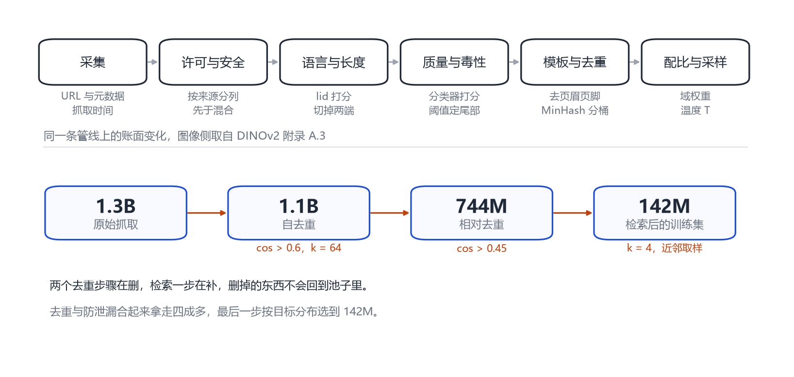
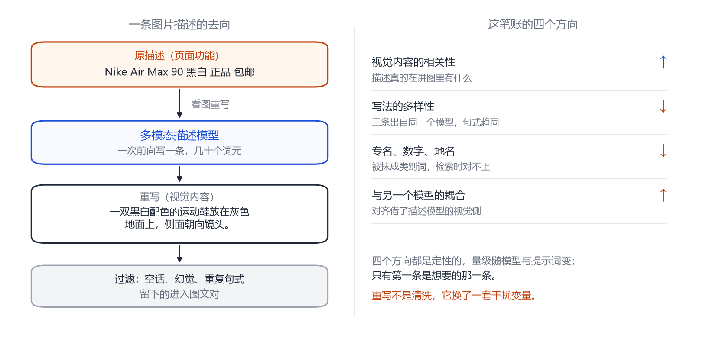
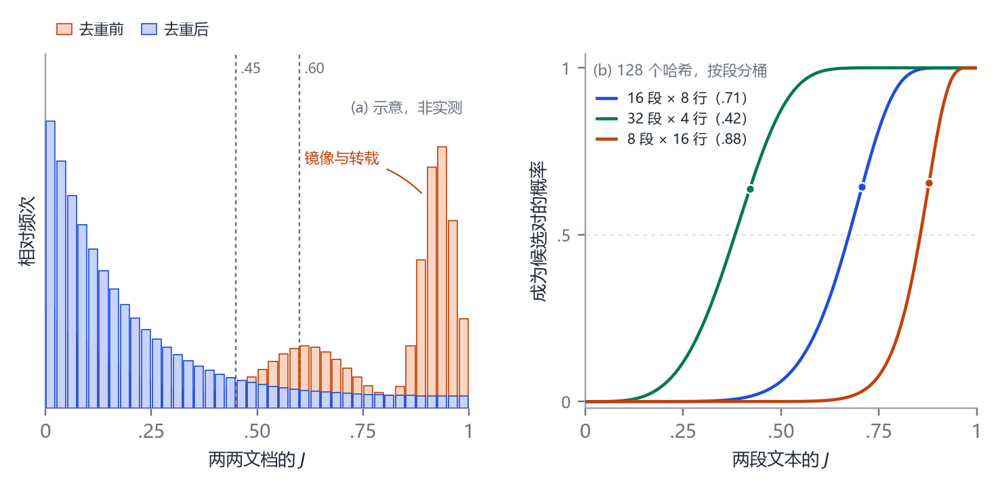
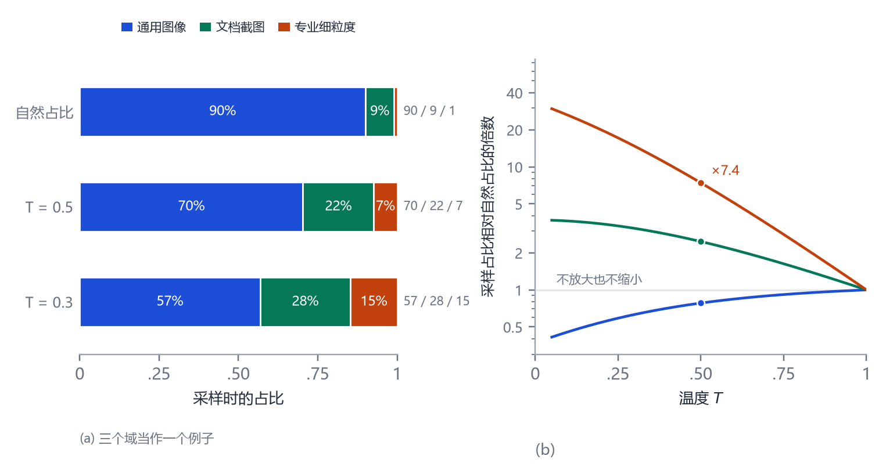

# 第 9 章　数据管线

一块硬盘装着一批网页文本，压缩状态下是四十五万亿字节，清洗完只剩五百七十吉字节，这是 GPT-3 论文附录里写下来的数字，2016 到 2019 年的四十一个 Common Crawl 分片，从 45TB 收到 570GB，折成约四千一百亿个词元。留下的体积不到原来的百分之二，这个比例是整本书里所有训练配方的起点。第一次看到它的人都会问同一句话，删掉的那百分之九十八到底是什么，凭什么把它删掉。这个问题没有标准答案，可是每一个答案都会在后面某一项指标上留下痕迹，读结果的人迟早要回头找它。

上一章把正样本拆成好视图与坏视图，结论是核由配对方式决定，配对由数据集给。那句话往下追一层就落到这里，因为"同一场景的两次观测"不是一句口号，它要求数据集里真的躺着第二次观测，而且两条记录得能被同一个编号绑在一起。数据管线要做的全部工作，是把这件偶然的事变成可重复的事，顺便把不能用的部分剔出去。这一步很少写进论文的方法章节，却常常决定最后能到哪。

这个过程有一个共同结构，它是单向的。过滤只会减少样本，不会增加，删掉一条记录之后，无论后来发现它多有用，都只能重新抓一遍、重新算一遍。把这条性质放在心上，顺序就跟着变了，先做便宜且可逆的判断，再做昂贵且不可逆的判断，先把元数据层面的规则用完，再动用模型。反过来做的项目，通常在第三个月开始后悔。

下面按数据流过来的顺序走一遍。采集与许可是入口，清洗决定留下什么，图文对那一节处理跨模态特有的噪声，去重是唯一会改变数据分布形状的操作，配比与采样决定每条留下的记录被看多少眼。每一节尽量给一个真实数字，并且交代那个数字是在什么条件下测出来的。读的时候不妨把每一步想成一个必须回答的问题，它删掉了谁、为什么是这一条、删错会怎样。多数管线事故都能追溯到某一步没有人回答过这三个问题。

## 9.1　采集与许可

采集听起来像把互联网搬回家，实际做的是从一批已经抓好的页面里抽出链接。DINOv2 从网页的 img 标签取 URL，丢掉被域名规则标记为不安全或受限的地址，再逐张下载、算哈希去重、跑 NSFW 分类、把可识别的人脸模糊掉，最终剩十三亿张进入后面的去重链条。DINOv3 换了一个来源，从 Instagram 的公开帖子取图，平台自己已经做过一轮内容审核，原始池子约一百七十亿张。两个数字差一个数量级，来源的性质也完全不同，一个是被动抓下来的网页，一个是带社交元数据的发布流。

采集阶段最容易被丢掉的不是图片，是元数据。每条记录至少要留住六列：URL、抓取时间、页面标题、替代文本、页面语言和许可标记，这几列在后面每一步都会被用到。想知道某一批图为什么突然变多，只有抓取时间能回答；想按站点做去重与配比，只有 URL 前缀能回答；想撤掉某个来源，只有许可标记能回答。这些信息在下载那一刻是免费的，丢了以后只能靠内容反推，而反推的准确率通常低到不能用于合规。

许可是三层叠在一起的，图片本身的授权、所在平台的条款、以及后来生成的描述文本所依据的模型条款。三层不一定同步，一张图可以允许研究使用而它的重写描述不允许商用，反过来也成立。工程上的做法是给每条记录两列，来源与许可，训练前按许可过滤，不要等出了问题再回头找。混进分片之后，一条记录属于哪个许可批次就再也分不出来，这是数据工程里少数几个真正不可逆的错误。

这条规则决定了许可过滤必须排在混合之前。省算力的诱惑很大，先把三个来源并成一个池子，统一去重、统一清洗，看起来只跑一遍推断，实际把来源信息煮成了一锅汤。等到某个来源的授权要撤回，能做的只有把整条管线从头跑一遍，而抓取、去重、描述重写加起来通常是几周的机器时间。把许可检查放在最前面，代价是几次廉价的表连接，收益是任何一次撤回都只需要删掉一个分片。

采集的第二个决定是广度与深度的比例。同一个站点抓十万页，重复率和模板率都会很高，页脚、导航、商品规格表在每一页都出现，去重和模板过滤都在替这个选择付账。偏向广度则有另一个代价，长尾站点质量参差，语言识别和毒性分类都要多花算力。DINOv2 在检索阶段给每个数据集设了一百万张的上限，为的是保持各部分在最终数据集里的平衡，同样的思路可以提前到采集阶段，给每个域名一个配额。

采集还有一个不写在论文里的约束，礼貌与压力。同一个域名并发太高会被封，被封之后丢的不只是当下的页面，还有这个站点后续的可达性，补抓的成本比按部就班抓高一个数量级。工程上给每个域名设并发上限与请求间隔，把它们写进抓取队列的配置，比事后补抓便宜得多。抓取时间也要记到秒级，因为同一批页面在不同时刻内容不同，事后核对两条记录是不是同一次快照，只能靠这个字段。

<figure class="fig">

<figcaption><b>图 9-1</b>　数据管线的六个阶段与一条真实链路上的账面变化。上半那排方框是判断点，下半是 DINOv2 从十三亿张图收到一亿四千二百万张的账面，最后一步靠检索补足，不再继续删。</figcaption>
</figure>

如图 9-1，六个阶段和一条真实链路摆在一起看。上半那排方框是判断点，下半那排数字是同一条判断在图像上留下的痕迹，从十三亿到十一亿是自去重，从十一亿到七亿四千四百万是相对去重，末尾补到一亿四千二百万是检索。这里有一个反直觉的地方，链条的最后一步在加数据，加的是从干净池子里挑出来、与目标分布接近的图。整条管线的目标从来不是"越干净越好"，而是"在需要的地方够干净"。

## 9.2　清洗

语言识别是第一个模型判断。fastText 那一类工具在文档级上准确率很高，因为一页文字有几千个字符，字符 n-gram 的分布足够稳定；到句子级就不行了，一句"今天天气不错"在十几种语言里都成立，模型给出的概率接近均匀。所以语言判定要排在长度过滤之后，先把短于几十个词元的记录切掉，再用文档级分数决定去留，边界上的样本抽两百条人工看一眼，比反复调阈值有用。这一步的判断成本很低，判错的代价却会顺着后面每一步放大。

误判的代价并不对称。把英语判成德语，删掉的是一批正常数据；把小语种判成相邻的大语种，删掉的是整个语种的供给，而这种缺失在下游指标上几乎看不出来，因为评测集本身也偏向大语种。多语种项目里更稳的做法是留一个中间带，概率在阈值以上的直接留，在另一个阈值以下的直接删，中间那一段按语种分层抽样，交给人判断。这件事花不了几天，省下的是一次全量重跑。

还有一种情况介于两者之间，一份文档里混着两种语言，产品说明书、双语合同、代码注释都属于这一类。文档级判定会给它一个主语言，另一部分内容就被当成噪声，或者整篇删掉。规模小的时候这不是问题，规模大了以后这类文档能占到几个百分点，处理办法是按段落判定、按段落保留，把一份文档拆成几段语言纯净的文本。代价是丢掉文档结构，收益是那几段内容不会白扔。

长度过滤要两头都切。太短的记录没有上下文，一句"阅读更多"或者一个商品编号，任何模型都学不到东西；太长的记录往往是拼接页，把一整年的博客归档、论坛楼层、目录页塞进一个文档，里面的段落彼此无关，注意力被均匀地摊开。下界按词元数定，上界按重复行比例定，后者比长度本身更能抓住拼接页，因为一份正常的长文档不会每隔三行重复一次页脚。长度阈值还要跟着语种调，黏着语的一个词元承载的信息比英语少，用同一把尺子会系统性削掉非英语数据。

质量过滤的经典做法是训一个分类器：正例用百科、书籍、经过编辑的语料，负例用原始网页，再拿分数决定保留。GPT-3 在这一步没有用硬阈值，而是用一条 Pareto 分布做随机保留，分数越高留下的概率越大，同时仍有少量低分文档被放进来。这个细节值得抄，硬阈值会把整个长尾一刀切掉，而长尾里恰好有大量罕见但真实的表达。随机保留还顺带保证了一件事，调整阈值不会让数据分布整体平移，只会让它稀疏一点。

毒性过滤用的是另一个分类器，输入是文本，输出是一个分数，阈值定在哪里是价值判断，不是技术参数。已知的偏差是这类分类器对少数族群的方言、对讨论歧视本身的文本误判率更高，硬删的结果是这些群体的语言整段消失，模型于是更不会处理它们，下一轮评测又把这个缺口记成"能力不足"。可行的缓解是把判定放在文档级，不要细到句子级，保留原始分数供复查，并且把阈值定在分布尾部，避开中位数。这些做法不能消除偏差，只能让它可审计。

模板去除是清洗里最不起眼、收益最直接的一步。BERT 在构造语料时对维基百科只取正文段落，明确忽略列表、表格和页眉，这个选择背后是一句常识，导航栏和参考文献列表不是语言。规模大了以后，模板句可以靠跨文档统计抓出来，一个句子在几百万份文档里一字不差地出现，它就不是内容，而是这个站点的一部分。实现上按段落做指纹，把出现频次超过阈值的段落整段删掉，比按句子删更安全，因为模板通常成块出现，句子级删除会在段落里留下断头断尾的半句。

这些步骤的先后会改变算力账单，也会轻微改变结果。去重放在分类之前，一个有一万份拷贝的簇只会被判定一次，删掉代表就是删掉整簇；反过来，先去毒性再去重，同一段文本要被分类一万次。模板去除最好排在语言识别之前，因为模板句往往是多语的，先删掉它们能让语言判定更准。整体原则是把规则类和元数据类的判断放在前面，把需要跑模型的部分放在后面，并且只对活下来的样本跑。

清洗的每一步都该有一个人工校准的样本。从被删掉的记录里分层抽五百条，从留下的里再抽五百条，逐条看判对没有，把误删率与漏放率记下来。这套抽检比调阈值重要，因为阈值只能优化代理指标，抽检能告诉你代理指标错在哪。最先暴露问题的总是被删的那一侧，模型把整类内容判错时，留下的样本看起来一切正常。

## 9.3　图文对

替代文本（alt-text）是网页作者为看不见图片的人写的一句话，它的功能是替代那张图，不是描述那张图。这个区别决定了它的统计性质。常见的三类写法是文件名、商品标题和页面功能，IMG_2043.jpg 属于第一类，Nike Air Max 90 黑白 正品 包邮 属于第二类，点击查看大图 属于第三类。三类文本都没有回答"图里有什么"，它们回答的是"这张图在这个页面上干什么"。一份几十亿对的图文数据集，绝大多数文本都属于这三种，剩下那部分才是真正在描述画面的句子。

把这句话翻译成上一章的语言，替代文本里的干扰变量 $\nu$ 是页面功能，它与图像内容几乎独立。同一个商品页的 alt 可以配一张特写、一张全家福或者一张模特图，三张图的场景完全不同，文本却一字不改。这样的一对样本共享的是页面角色，不是世界状态，用它训出来的核会把"商品"这个页面类别连成一片，把"这双鞋长什么样"留在外面。图文对的噪声因此不是随机噪声，它是有结构、可学习、并且与任务无关的那一类。

一个具体例子能说明后果。搜"黑白运动鞋"的人想要颜色与鞋型，替代文本里确实有这两个词；搜"Air Max 90"的人想要型号，重写描述里通常只剩"一双运动鞋"。前一种查询替代文本赢，后一种查询重写描述输。真实查询里品牌与型号占的比例不小，这也是为什么只保留重写文本的数据集在商品检索上会明显吃亏。

重写描述（recaption）走的是另一条路，拿一个多模态模型看图，让它用完整的句子写一遍。Recap-DataComp 的做法是每张图留三条文本，其中两条由 LLaVA 生成，一条保留原始替代文本，于是同一张图有了三次独立观测。生成之后还要过一道过滤，把"图中有一只狗"这种对任何图都成立的空话删掉，把与检测结果矛盾的句子删掉，把同一个模型反复使用的句式降权。这道过滤的质量，决定了重写带来的是信息还是噪声。

代价可以先算一笔账。假设要重写十亿张图，每条输出八十个词元，一个七十亿参数的多模态模型在 A100 上用 bf16 推理，每卡每秒大约能吐两千到四千个词元，取中间值三千，总开销是 $10^9\times80/3000$ 卡秒，约合三百一十卡天。六十四张卡跑五天，或者八张卡跑一个半月。这是量级估算，实际吞吐随批量、序列长度和视觉编码器的分辨率浮动两三倍，结论却稳定，重写一遍的成本和训一个小模型是同一量级。

花掉这些算力换来的是另一种文本，不是更好的文本。看图模型写描述时会丢掉专名、数字和地名，因为它的训练目标鼓励写"看起来对"的句子，写不出"精确"的句子；它也会把罕见物体归到最近的常见类别，一只柯基被写成小狗，一张电路板被写成电子设备。这些损失在自然图像上不明显，在专业领域里是致命的，医学影像、遥感、工业质检的图文对恰恰靠这些词区分。如图 9-2，这条链路和它的得失画在同一张图上。

<figure class="fig">

<figcaption><b>图 9-2</b>　一条替代文本被重写的过程与随之发生的交换。左栏是页面功能文本变成视觉描述再进入训练集的三步，右边四个箭头说明这笔交换里得与失各在哪一边，只有第一条是想要的那一条。</figcaption>
</figure>

还有一笔更隐蔽的代价，三条描述出自同一个模型，错误是相关的。上一章的下界要求两个模态的干扰独立，同一张图的两条重写描述共享同一个看图模型的偏见，独立性不成立，估出来的场景解释比例会偏高。数字上有对应，同样的配方在二百二十四万张图上，替代文本配纯文本改写的比例是 .654，两条看图模型重写是 .778，三条全用是 .793；图量加到五千万，纯文本改写那一项升到 .789，三条全用升到 .802，差距没有随数据消失。这部分提升是从描述模型的视觉编码器借来的，不是自己从图里看出来的。

所以重写不是清洗，它换了一套干扰变量。页面功能这个干扰被换掉了，换来的是描述模型的口味，文本变长了、变通顺了，也变得更同质、更容易被预测。工程上稳妥的做法是两列都留，原文本一列、重写一列，训练时按任务采样，检索类任务多用原文本，语义类任务多用重写。把原文本覆盖掉，等于把一个还能用的信号永久删掉，而这一列本来不花任何额外成本。

合成数据还有一层许可问题，它不跟图走。图片本身可能允许研究使用，生成描述的模型却可能禁止把输出用于训练另一个模型，两套条款各管一段，合起来才决定这份数据能不能用。一旦把重写文本混进主分片，这一列就再也分不出来源，条款变更时只能整批重做。所以重写文本要单独存一个命名空间，带上模型名与版本号，宁可多一次表连接，也不要多一次全量重跑。

## 9.4　去重

重复的代价有三份。模型会把重复样本记下来，测试集里的近重复会让分数虚高，账面数据量则给人一个错误的规模感。GPT-3 做完模糊去重之后，数据集平均缩小了百分之十，这个数字在网页文本上听起来不大，因为它的去重粒度是文档，同一篇文章的不同转载、同一份公告的多个镜像都只算一次。图像侧的重复率更高，DINOv2 从十三亿降到十一亿，每个重复连通分量只留一个代表。

去重的粒度也要选：文档级保留整篇，段落级会把同一篇文章的不同版本拆开，图像级要算嵌入。粒度越细，删得越准，算得越贵。网页文本通常做文档级，因为转载是整篇转载；图像通常做图像级，因为同一张图会以不同尺寸、不同水印、不同裁剪出现，字节级摘要抓不到这些变体。跨模态的重复更麻烦，同一张图配五句不同描述，去重时不能把五句当成五份独立数据，否则一张图会在训练集里出现五次。

精确去重最便宜，先做。把文档规范化，去掉多余空白、统一大小写、剥掉标点，再算一个哈希，哈希相同的只留一份；图片按字节算摘要，完全相同的文件直接合并。这一步能抓住三类重复：镜像站、同一份文档的多次上传、同一张图的字节级拷贝，成本接近排序，值得在管线最前面跑一遍。它抓不到改过一个字的转载，那部分要交给近重复。

近重复的做法是把文档切成片段再比较。取连续的五个词作为一个片段，一份文档的所有片段构成一个集合，两份文档的相似度用交并比衡量，记作 $J(A,B)=|A\cap B|/|A\cup B|$。这个量直观、可解释，值域在零到一之间，两份文档完全一样时等于一。直接算它需要把两个集合都展开，十亿份文档两两比较是不可能完成的，需要一种只比较指纹的办法。

MinHash 给每个集合算一个很短的指纹。取一个随机排列，把集合里的元素按这个排列排序，记下最小的那个元素，这个值就是一次 MinHash。两个集合的最小值相等的概率恰好等于它们的 $J$，因为两个集合合并之后的最小元素落在交集里的概率，就是交集占并集的比例。用 $k$ 个独立排列各算一次，统计相等的次数占总次数的比例，就得到 $J$ 的估计。$k=128$ 时，$J=0.5$ 附近的标准差约为 $\sqrt{0.25/128}=0.044$，够用来排序，不够用来做精确判定。有了这么多指纹，还要避免两两比较，做法是把它们切成段再分桶。$k$ 个哈希排成 $b$ 段、每段 $r$ 行，只要有一段完全相同，两份文档就成为候选对，候选概率是

$$
P_{\text{cand}}(J)=1-\left(1-J^{r}\right)^{b}
$$

当 $J$ 很小时 $J^r$ 接近零，概率接近零；当 $J$ 接近一时概率接近一，中间有一段陡坡，陡坡大致落在 $(1/b)^{1/r}$。把一百二十八个哈希切成十六段之后，要连续八个哈希全部相同才算命中，这个条件比单个哈希相同严格得多，陡坡之所以陡，原因就在这里。取 $b=16$、$r=8$，也就是一百二十八个哈希，阈值约 .71，$J=0.9$ 的候选率是 1.00，$J=0.5$ 只有 .06；取 $b=32$、$r=4$，阈值降到 .42，$J=0.5$ 的候选率已经到 .87，算力花在大量假候选上。如图 9-3 右图，这三条曲线画的就是候选概率，陡坡的位置和形状都由分段方式决定。

<figure class="fig">

<figcaption><b>图 9-3</b>　去重前后的相似度分布与分桶的命中曲线。左图橙色尖峰是镜像与转载，蓝色是去重后剩下的部分，为示意；右图三条曲线是不同分桶下成为候选对的概率，按公式算得，圆点标在阈值上。</figcaption>
</figure>

阈值定在哪里，是一个与上一章的说法直接冲突的决定。近重复的定义越宽，删掉的"重复"里就越可能包含同一场景的不同照片，而那些恰好是好视图的原料。同一座桥在早晨和傍晚各拍一张，两张图的 $J$ 可能到 .8，按 .6 的阈值只留一张，视图数量直接减半。所以去重阈值不能只看提纯效果，还要看它吃掉了多少可用的配对，这两件事在同一个参数上的方向相反。

DINOv2 用了两个不同的阈值，分工很清楚。自去重取 $k=64$ 近邻、余弦相似度大于 .6 的边，取连通分量，每个分量留一个代表；相对去重把阈值收紧到 .45，删掉的是与评测集的训练集太像的图，作用不是提纯而是防泄漏，这一步把数据从十一亿砍到七亿四千四百万。前一个数字决定冗余，后一个数字决定评测的可信度，混在一起谈就会得出"去重删了三成数据"这种没法解释的结论。两个阈值服务的目标不同，取哪一个要看你要的是提纯还是防泄漏，这件事在报告里必须写清。

连通分量这一步有个不显然的坑。边是按阈值画的，A 与 B 相似、B 与 C 相似，A 与 C 却可能只有 .3 的相似度，连通分量把三者并成一簇，只留一个代表，C 就跟着消失了。文档越长，这种链式合并越容易发生，因为长文档的片段集合大，两两之间总能找到一段重合。可控的做法是不做传递闭包，要求每个成员与代表点的相似度都过阈值，代价是多留几张代表图，收益是少删掉一批只是"沾边"的样本。

去重做完要验收，不能只看剩了多少条。抽一千对随机样本算一次 $J$ 分布，抽一千对被删掉的样本看它们是不是真重复，再抽一百对相似度落在阈值附近的边界样本，人工判一遍。三组数字合起来才知道阈值有没有定在正确的位置。只报"删掉了百分之几"的管线报告没有信息量，因为同样的比例可以由完全不同的阈值和完全不同的错误凑出来。

## 9.5　配比与采样

配比是整条管线里唯一一个不改变数据本身的旋钮。同一个池子，改权重就能改变模型看到的世界，删掉一条记录却再也拿不回来。也正因为如此，配比是唯一值得反复试的一步，试错的成本只是几次短训练，收益却会一直留到最终模型上。V-JEPA 2 把七个子集混成两千两百万个样本，每个子集的权重靠手工调；DINOv3 把数据分成三部分，其中一部分是 ImageNet-1k 这类公开数据集，训练时每十个批次里有一个整批来自这部分，其余批次从三部分里混采。

按自然频率采样是默认选项，也是最差的一个。互联网上通用内容占九成以上，专业内容不到百分之一，按原样采样，专业领域的梯度贡献可以忽略。可下游任务恰恰在专业领域上分高下，医学影像、遥感、文档理解都属于那不到百分之一。抬小众领域的权重不是偏爱，是把"每个领域被看多少眼"这件事从网页的统计规律里拿回来，交给自己决定。温度采样是这件事最常用的写法，把每个领域的自然占比记作 $p_i$，采样占比取

$$
q_i=\frac{p_i^{T}}{\sum_j p_j^{T}}
$$

指数 $T$ 等于一时原样不动，$T$ 趋近零时所有领域被拉平，中间的值控制拉平的力度。三个领域占比为九成、百分之九、百分之一时，取 $T=0.5$ 得到七成、两成二、百分之七，小众领域被放大七点四倍；取 $T=0.3$ 得到五成七、两成八、一成五，放大十四点七倍。用幂函数，不直接指定目标比例，好处是保序、连续、只有一个参数，改它不会破坏领域之间的相对关系。如图 9-4，三行占比和放大倍数画在一起。

<figure class="fig">

<figcaption><b>图 9-4</b>　三个领域的自然占比与两种温度下的采样占比，右边是放大倍数随温度的变化。温度越低小众领域被抬得越高，T 等于 0.5 时占百分之一的领域被放大七点四倍。</figcaption>
</figure>

抬权重是有代价的，代价记在有效轮数上。把一个小领域的采样占比从百分之一抬到百分之七，等于把它那批文件在同样的训练步数里多看七遍，而模型对同一批样本的收益随遍数递减。上一章那条对数线性曲线在样本被看了三十一遍之后开始低于预测，就是一个提醒，重复到一定次数，加数据不再等于加信息。定权重时要同时看两个数，采样占比与等效轮数，后者超过三到五就该考虑补新数据，而不是继续加权重。

权重落到实现上有三处容易漏。计数单位应该是词元或样本数，不是文件数，一万个短文本和一个长文档在文件数上一样，在计算上差两个数量级。采样器要按累积分布做全局洗牌，不在每个分片内部各自洗牌，否则一个批次可能整批来自同一个领域，批归一化和对比学习的负样本都会失真。混合后的实际占比要在线统计一次，按领域累计被采到的次数除以总次数，跟设定的目标比一遍，差得多了说明权重表或者分片有问题。

课程（curriculum）是配比的另一种用法，把权重从"按领域"换成"按训练阶段"。V-JEPA 2 在预热和恒定阶段用更短、分辨率更低的片段训练，到衰减阶段才升分辨率和片段长度，理由是早期算力该花在便宜的样本上，等表征大致成形，再把高分辨率的信息灌进去。这个做法省下的算力很实在，因为注意力开销随词元数平方增长，把高分辨率放在最后几百步，等于只在高分辨率上付一小段账。同一个思路在文本上是先短序列后长序列，在图像上是先低分辨率后高分辨率。

课程的风险在于它和学习率调度绑在一起。分辨率的切换点、片段长度的切换点、学习率开始衰减的点，三件事如果同时变，消融结果就说不清是哪一个起了作用。可控的做法是固定总样本数，不固定步数，让不同课程看到的数据量相同，再比较它们的终点。这个细节不写进论文的表格，但复现失败的项目里有相当一部分栽在这里，看到的现象是"照抄配方跑不出同样的曲线"，原因是曲线本身依赖阶段划分。

配比好不好，短期看不到，所以需要便宜的代理。做法是训三个小模型，每个跑几千步，用一组覆盖各领域的验证集打分，看哪一个的短板最少。代理任务的选择比代理模型的规模重要，验证集里必须包含真正在意的那几个领域，否则模型会诚实地优化一个没人关心的平均分。这类实验一次几小时，比在主模型上试错便宜两个数量级，代价是只能比较粗的差别。

## 9.6　收束

把这一章压成一句话，数据决定上限，模型只是逼近它。实用版本是三条判断。第一条，删除不可逆，所以顺序比技巧重要，先用元数据规则削掉大头，再用模型处理剩下的部分，先做许可再做混合。第二条，账面数据量不等于有效数据量，重复率、许可范围、语言分布、模板比例各自打一次折，一亿条记录最后能用的常常只剩一个零头。第三条，配比是唯一能低成本反复调的，因为它不动数据。

三条里最容易被低估的是顺序。一个项目在第四个月发现评测集泄漏，回头查记录，发现相对去重跑在检索之后，检索又把评测集附近的图拉了回来。这种错误不是能力问题，是流程问题，任何一个把清洗当成一步而不是一串有序步骤的管线都会犯。把每一步的输入输出写成表，标上它删掉了多少、为什么删，比任何一篇方法描述都更有用。

上限不好直接测，但可以估一个区间。把清洗后的数据按不同比例掺入已知的随机噪声，看指标随噪声比例怎么掉，再把掉到某个水平所需的噪声量换算成有效样本数。这一步的关键是把噪声当成标尺，不要当成又一批数据。这个换算不精确，却能给去重与配比一个共同的单位，删掉一条重复和补进一条新数据可以在同一张账上相减。

数据侧还有一件容易被忽略的事，管线是有版本的。采集的日期范围、过滤器的阈值、描述模型的版本、去重用的哈希数，任何一项变了，产出的数据集就是另一个数据集，用旧名字继续叫它会让所有对比失去意义。把配置连同数据一起存档，给每一版一个编号，是复现的前提，也是排查"上个月还好用、这个月掉点"的唯一线索。编号最好写进文件名和目录，不要只写在训练日志里，因为日志会丢，文件名不会。

数据准备好之后，下一个问题是怎么把它喂进去。一亿张图、几十万亿词元，显存装不下，单卡跑不完，梯度要在几百张卡之间同步，检查点要在半夜挂掉之后能续上。这些是第 10 章的内容，那里会看到批次的形状、一次同步的代价、一个检查点的大小，都会直接影响同一批数据能被看几遍。系统的效率决定了你能试多少次，而试多少次又决定了前面这些阈值与配比能不能被真正调对。
