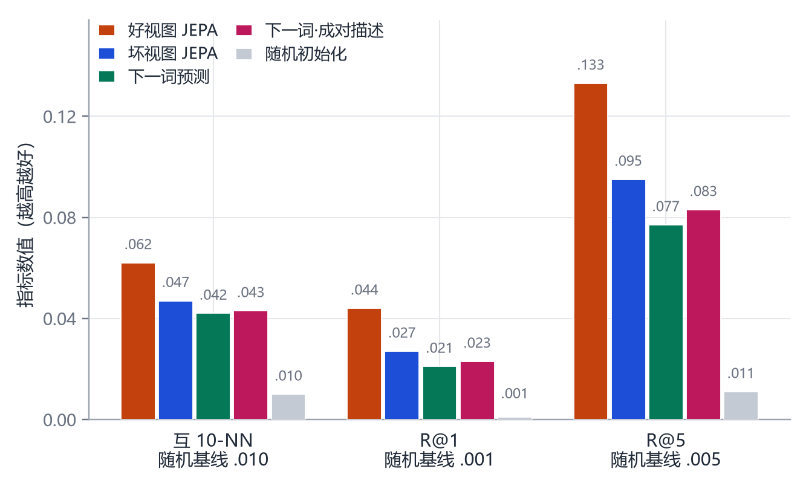
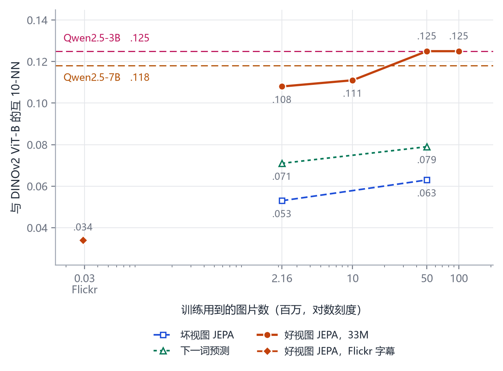
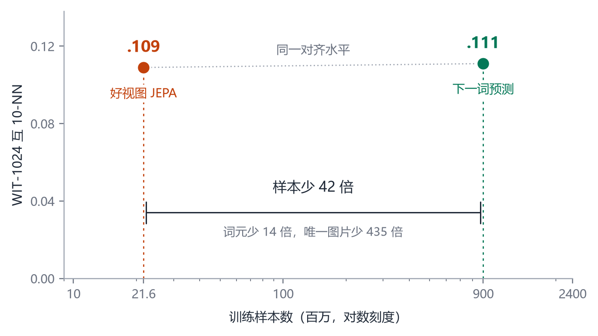

# 第 9 章　对齐的度量与规模

假设你手上有两个从头训起来的编码器，一个只读图片，一个只读文字，训练脚本里没有任何一行代码让它们交换信息，两边的参数从完全不同的数据上磨出来。训完之后你想知道它们是不是对同一个世界画了同一张地图，这时第一个冒出来的困难不是"像不像"这个说法太含糊，而是你必须找出一个数来代言这件事。这个数要能算，要能跟一条基线比，还要在别人换一套代码之后仍然说得通。三条缺一条，后面的结论就都变成了修辞。

上一章讲的是视图。好视图让两个观测共享同一个场景，坏视图只共享一段文字背后的作者口吻，修剪是把共享部分留下来的唯一手段，把整条描述直接当视图会掉两成半的对齐。那一章的结论是定性的，好视图能赢，赢得还不少。这一章要把"能赢"换成可以比较的数值，并且回答一个工程师更关心的问题，多一个数量级的数据能换来多少对齐，反过来，换一种正样本能省多少数据。

数字全部来自 Balestriero 与 LeCun 在 2026 年发表的那篇论文，它把 Huh 等人 2024 年提出的柏拉图式表征假设从一个观察推进成了一个定理，又用同一套代码在从十四万五千条字幕到九亿四千万张网页图背后的文本上把定理量了一遍。这一章不重复定理的证明，只用它的实验部分。对要动手的人来说，更有用的不是"为什么成立"，而是怎么量、量出来是多大、以及这套办法在哪里失灵，这三件事都比证明更容易复现，也更容易被误用。下面的表号沿用原文，可以回原论文核对。

全章的走法是这样。两个指标和它们的基线放在最前面，因为它们决定了后面每个数字能怎么读。实验设置单独占一节，因为读者照着复现时得知道哪些变量被按住了。接着是三张图对应的三段证据，从字幕到网页文本，从同规模对照到跨规模对照。末尾落到那条缩放定律上，包括它在什么地方给出的预测比实测更高，以及为什么那里会高。

## 9.1　两个指标和一条基线

第一个指标叫互相最近邻（mutual k-nearest neighbor，mNN），它问的是同一批样本在两个空间里是不是挨着同样的邻居。取一千对测试图文，在图像空间里给每张图找出十个最近的样本，在文本空间里给每段描述找出十个最近的样本，再逐个样本数两组编号重合了几个，在一千个样本上取平均。重合的意思是同一批编号同时在两个集合里出现，顺序不算数。写成公式是下面这个形式，式中的平均是对样本做的，不是对邻居做的。

$$
\mathrm{mNN}=\frac{1}{N}\sum_{i=1}^{N}\frac{1}{k}\left|S_{\phi}(\phi_i)\cap S_{\psi}(\psi_i)\right|
$$

其中 $\phi_i$ 是第 $i$ 张图在图像编码器里的向量，$\psi_i$ 是它那条描述在文本编码器里的向量，$S_\phi(\phi_i)$ 是图像空间里离 $\phi_i$ 最近的十个样本的编号集合，$S_\psi$ 是文本侧的对应集合，$|\cdot|$ 表示集合里元素的个数，$k=10$ 是邻居数，$N=1000$ 是参与比较的样本数。这个数最大是一，意思是两边的邻居完全一样。最小是零，意思是一个都不重合。它不含任何可训练参数，也没有一步拟合，两个空间各自建成，唯一被操作的对象是距离和编号。

这个数必须配一条基线，否则读不出高低。如果两侧的近邻是随便挑的，各取 $k$ 个，交集的期望是 $k^2/N$，除以 $k$ 就得到期望得分 $k/N$，取 $k=10$、$N=1000$ 时等于 0.01。基线之所以要紧，是因为 0.06 这样的数字单看很小，压在 0.01 之上就是六倍。而 0.01 本身不是零，任何一次测量都是在跟它比，不是跟零比。基线另一个作用是钉住"随机"这件事，让不同规模的实验可以互相参照。

第二个指标直接检验"只差一个旋转"这句话。在一千零一十四对验证数据上拟合一个正交映射，也就是一个 $384\times384$ 的矩阵，这里的 384 是两侧共用的嵌入宽度，然后拿它在测试集的一千条描述里做图到文的检索，报第一条命中的比例 R@1 和前五条里命中的比例 R@5，随机水平分别是千分之一和千分之五。选正交映射而不是随便一个线性层，是因为定理说的就是旋转，允许矩阵做别的动作，测的就不再是定理。这个矩阵是十五万个数字，两侧编码器各有三千三百万参数，用来搭桥的参数只占万分之五。

两个指标要一起报，理由在于它们各自会被什么污染。互相最近邻什么都不拟合，代价是它只看局部，全局的距离尺度可以完全不同；检索更强，可它自带自由度，矩阵越大越容易硬凑，上限还被旋转估计的精度卡住。说清这个数不是什么同样重要，它不是对齐百分比，0.232 不代表"对齐了百分之二十三点二"。绝对尺度取决于两侧编码器各自离理想表征有多远，同一个文本编码器对着 DINOv2 是 0.232，而那个从零训的图像 JEPA 对着 DINOv2 只有 0.101。原因不是文本侧更懂图，而是那个图像模型只见过两万九千张图，它自己就偏。

## 9.2　只改一个变量的实验

Flickr30k 用 Karpathy 划分，两万九千张训练图，每张五条人工描述，验证一千零一十四对，测试一千对，全部字幕加起来十四万五千条。这个数据集小得有点寒酸，好处是每张图有五条独立写成的描述，正好提供"同一个场景的五次观测"。五条描述在这里不是装饰，它是好视图的原料，没有第二、第三条独立描述，就没有"两次观测"可挑，后面所有对比都无从谈起。图像侧是 ViT-S/16，把图切成 16×16 的小块，每张图取两个 224×224 的全局视图和六个 96×96 的局部裁剪。文本侧是十二层、宽 384 的 BERT，三千三百万参数，为了看宽度的影响，同一套代码还训了 11M、109M、335M 三个版本。宽度这一维在这里留的是后手，等规模那一节要问"加参数到底有没有用"，手上得有四个宽度才答得了。

三个文本版本共用数据、目标函数、优化器和调度，只有"哪些文本算同一个东西的两次观测"这一条不同。掩码片段版把一条描述切成八段随机连续片段，每段遮掉 15% 的词元，八段互为正样本，它看到的是同一句话的八次损坏。描述版把八条互为正样本的文本都取自同一张图的不同描述，同样裁剪同样掩码，它看到的是同一个场景的八次独立描述。下一词版把 BERT 改成因果注意力，输出层与词嵌入绑定，每次只喂一条描述，第四组则是它的对照，每次喂同一张图的两条描述，让模型至少能看见这两句话说的是同一回事。

两侧用的都是 LeJEPA 目标，对两个全局视图的均值做不变性约束，再加一个各向同性高斯正则，$\lambda=0.02$。图像侧和文本侧从头到尾没有共享过一个批次，也没有对齐过一次损失，论文在这一段写得很直白，任何编码器都没有见过对方的模态。这句话值得多停一秒，因为它意味着后面每一个非零的对齐分数，都不是被对齐损失直接优化出来的。训练规模是两百个 epoch、批大小 256、AdamW、学习率 $5\times10^{-4}$、权重衰减 0.05，每个设置跑三个随机种子，报均值与半极差，半极差落在 0.001 到 0.008 之间，比组间差距小好几倍。

## 9.3　表 1 的三条指标给出同一个名次

图 9-1 把表 1 画成了柱状图，三组指标，四种文本编码器加一个随机初始化基线，取的都是两百轮训完的末轮检查点。每一组里几根柱子高度差得不算悬殊，顺序却完全一样。这件事本身就是结论的一半，因为三个指标量的是三件不同的事。读图时先看组内顺序，再看组间距离，顺序比距离可靠得多。

<figure class="fig">

<figcaption><b>图 9-1</b>　Flickr30k 上图像 JEPA 与四组文本编码器的对齐。三条指标上描述版都最高，掩码片段版次之，下一词版最低，随机初始化贴着基线。数据取自原论文表 1。</figcaption>
</figure>

描述版拿到 0.062 / 0.044 / 0.133，掩码片段版 0.047 / 0.027 / 0.095，下一词版 0.042 / 0.021 / 0.077。三条指标的排序完全一致，换成相对值，描述版比掩码版高 32%、63%、40%，比下一词版高 48%、110%、73%。一个数邻居，一个数第一名，一个数前五名，三个口径在同一批模型上给出同一个名次，这比任何单个数字都更能说明差距不是指标挑出来的。这个规模下所有数字都低，要紧的是排序稳。

图 9-1 里第四根柱子最值得看。研究者把下一词模型改成每次喂进同一张图的两条描述，结果互 10-NN 从 0.042 抬到 0.043，R@1 从 0.021 抬到 0.023，R@5 从 0.077 抬到 0.083，离描述版的 0.044 和 0.133 还差得远。这一行把两种解释分开了，差距不出在"有没有见过配对数据"上，因为这一行见的配对数据和描述版一样多。差距出在正样本的构造上，下一词模型的正样本是前缀和续写，两条描述即使并排放置，它学的也是"这句话后面接那句话"的概率，不是"这两句话指向同一张图"。

描述版的正样本直接就是同一个场景的两次观测，目标函数在拉近它们的时候没有别的信息可以依赖，只能去抓场景。这一点和上一章关于干扰变量的说法对得上，正样本里共享了什么，表征里就留下什么。随机初始化那一行是 0.010 / 0.001 / 0.011，和随机水平 0.010 / 0.001 / 0.005 几乎重合，说明指标没有给任何人送分。还有一处细节值得记，旋转之后图文嵌入在第一条主方向上的相关系数是 0.70，到第六十条掉到 0.1 附近，而初始化时处处接近零，对齐藏在前几个谱方向里。

## 9.4　把图像侧换成冻结的 DINOv2

Flickr 上的图像编码器是自己从零训的 ViT-S，只见过两万九千张图，它本身就是一个偏的参照物。换成冻结的 DINOv2 ViT-B/14，问题就变成了另一句话。文本侧能不能追上一个成熟得多的对手，这是这一节要回答的。换图像侧还有一个方法上的好处，图像侧从此不动，同一批文本编码器在它面前排队，比较的就不再是两套自训模型的巧合，而是一侧固定、另一侧可变的条件。

表 2 的三列分别是互 10-NN、用一千对拟合旋转得到的 R@1、用全部三万对训练加验证数据拟合旋转得到的 R@1。描述版是 0.232 / 0.246 / 0.346，掩码版 0.132 / 0.133 / 0.207，下一词版 0.122 / 0.118 / 0.213，零样本的 Qwen2.5-0.5B 是 0.098 / 0.135 / 0.240，预训练的 BERT-base 是 0.093 / 0.149 / 0.273。差距比 Flickr 那组大得多，原因主要在参照物变稳了。邻居结构这一列最干净，描述版 0.232 是 Qwen2.5-0.5B 的两倍多，是 BERT-base 的两倍半，而它只是一个三千三百万参数、只在字幕上训过两百轮的模型。

检索那两列要小心读。同一个编码器把旋转从一千对换成三万对，分数从 0.246 升到 0.346，Qwen 从 0.135 升到 0.240，BERT-base 从 0.149 升到 0.273，都涨，描述版仍然领先。涨的原因不难猜，一千对拟合不出一个十五万参数的矩阵，旋转估不准，检索就被它卡住，所以检索分数里混着估计误差，邻居结构里没有。同一个表里还有两组参照，用网页文本训出来的描述版读两万一千六百张到一亿张图背后的文本，互 10-NN 从 0.204 爬到 0.229；CLIP 的文本编码器和 all-mpnet-base-v2 分别在四亿图文对和十亿句对上训过，互 10-NN 只有 0.167 和 0.189，检索却是 0.489 和 0.481。

## 9.5　从字幕走到网页文本

字幕是稀缺资源，Flickr30k 的十四万五千条描述就是这个规模，再怎么训也就这么多。网页不一样，每张图有一条替代文本，Recap-DataComp 又用一个基于 LLaMA-3-8B 的图像描述模型看着图重写了两条，三条文本构成同一张图的三个视图，数量级直接换掉。这里有一个必须记住的间接性，没有见过像素的那个编码器读的是文本，而写这些文本的模型是见过像素的。这一层间接性消不掉，只能记住它在哪里。

评测集换成 WIT-1024，Huh 等人做柏拉图式表征假设时用的基准，取自维基百科的图文对，论文强调自己的模型没有在它上面训练过。图像侧仍然是冻结的 DINOv2 ViT-B，指标仍然是互 10-NN，这样跨节比较才有意义，因为 $k$、$N$ 和两侧编码器全换掉的话，数值就没法放在一起看。如图 9-2，只在 Flickr 字幕上训练时，这个编码器在 WIT 上只有 0.034；换成两百一十六万张图的文本升到 0.108，一千万张 0.111，五千万张 0.125，一亿张还是 0.125，种子之间最多差 0.009。曲线在五千万处拐平，不是数据没用了，而是这个宽度的模型把能装的装满了。

<figure class="fig">

<figcaption><b>图 9-2</b>　WIT-1024 上的互 10-NN 随训练图片数上升。描述版从 Flickr 字幕的 0.034 升到五千万张图的 0.125，与 Qwen2.5-3B 持平、高于 7B；两条坏视图曲线几乎平着走。数据取自原论文图 9。</figcaption>
</figure>

图上画了两条水平虚线，Qwen2.5-3B 的 0.125 和 Qwen2.5-7B 的 0.118。三千三百万参数、没做过下一词预测也没做过掩码词预测的编码器，在五千万和一亿张图的文本上追平了三亿参数的那一档，也超过了七十亿的那一档，参数差九十倍到两百倍。图上还有两条短线，是同一批数据、同一个编码器、只改正样本的对照组，两万一千六百张图时掩码版 0.053、下一词版 0.071，五千万张时 0.063 和 0.079。图片多二十三倍、步数只多不到一倍，两条坏视图的曲线只爬了 0.01 上下，差距反而拉大，这说明数据是乘数，视图是系数。

宽度在这条路上还没兑现。五千万张图时，宽三倍的 109M 模型在 WIT 上只有 0.116，不如 33M 的 0.125，两万一千六百张图时是 0.109 对 0.108，只是打平。检索分数倒是随宽度涨，Flickr 上 11M、33M、109M、335M 分别拿到 0.335、0.367、0.400、0.376，到 335M 回落。规模在这里没有表现出语言模型那种平滑的收益，加参数不是免费的，而在对齐这件事上，它暂时不是主要杠杆。这一点对做工程的人很要紧，因为它意味着预算应该先花在视图上，宽度的收益排在后面。

## 9.6　四十二倍的三种换算

到这一步，好视图和下一词之间的差别还混着参数、数据、训练步数。要把差别压成一个干净的数字，得把所有变量按住。研究者用同一个 109M 的 BERT-B，同一批 Recap-DataComp 文本，只改正样本，训了两个模型，描述版读到两千一百六十万个样本，在 WIT 上拿到 0.109；下一词版读到九亿个样本，拿到 0.111。如图 9-3，横轴是对数刻度的样本数，两个点几乎在同一水平线上，水平方向隔着一大段。

<figure class="fig">

<figcaption><b>图 9-3</b>　同一个 109M 编码器达到同一对齐水平所需的样本数。横轴对数刻度，纵轴是 WIT-1024 上的互 10-NN，两点取自原论文第 4.2 节，中间不插值。</figcaption>
</figure>

两千一百六十万乘以四十二，等于九亿零七百二十万，样本少四十二倍，这是第一个换算。一个好视图样本要读三条文本，所以词元数只少十四倍，这是第二个换算。九亿个样本对应九亿四千万张图背后的文本，两千一百六十万对应两百一十六万张图，唯一图片数少四百三十五倍，这是第三个。三个倍数说的是同一件事，词元那一条最保守，图片那一条最激进，引用时要说清用的是哪一个。

样本数打平时差距更大，同样是两千一百六十万个样本，三千三百万参数的编码器上，描述版 0.108，下一词版只有 0.071。这个比较有一个容易被忽略的前提，两侧的算力配置并不相同，描述版用批大小 256、学习率 $10^{-4}$，下一词版用批大小 2048、学习率 $2\times10^{-4}$，各自用适合自己规模的配方。也就是说，四十二倍不是把对手削弱之后得到的数字。结论还有一个弱点必须写明，下一词版没有更早的检查点可以评分，九亿那一端只有一个点，中间没有采样，论文自己也承认了这一点。要把"四十二倍"和"末轮差多少"分开，得在同一批中间检查点上重跑一遍。

## 9.7　一百零九百万对七百二十亿

把数据和模型一起放大，图景会变。同一个 109M 的 BERT-B，用九亿个样本，读的是九亿四千万张图的文本，训练用八块或十六块 GPU。同时用同一个编码器、同一批文本、同样多的样本各训一个下一词模型和一个坏视图模型，三个模型唯一的差别仍然是正样本。表 3 里，描述版在 WIT 上拿到 0.184，高于 Qwen2.5-72B 的 0.154、Llama-3-70B 的 0.151 和 CLIP 文本编码器的 0.124。换成线性 CKA，0.507 对 0.418；换成 CLIP ViT-H/14 做图像侧，0.230 对 0.210；换成五倍大的 COCO 测试集，0.161 对 0.108。四个口径上都是同一个方向，最刺眼的是参数那一栏，109M 对 72B，差六百六十倍。这一栏是它唯一吃亏的地方，结果仍然领先。词元的账也难看，它读了一千一百六十亿个文本词元，对手读了一万五千亿到一万八千亿，多出一百倍以上。

三个限定条件得摆出来。第四个种子把正则权重调成两倍之后只拿到 0.121，四个种子的平均是 0.168，仍然高于所有语言模型，但单个数字的稳定性没到可以忽略的程度。写这些文本的重写模型是通过 CLIP ViT-L/14 看图的，所以"没见像素"这句话要打一点折扣。WIT 的一千零二十四条描述里至少四十三条出现在 Recap-DataComp 的替代文本中，去掉它们之后，查过的九个文本模型变化都不超过 0.002。它测的是邻居结构的一致，不是知识量，109M 的模型不认识很多 Qwen2.5-72B 认识的东西，把它读成"小模型比大模型强"是误读。

站得住的读法是，对齐是表征几何的性质，而几何里由正样本决定的那一部分，比由参数决定的那一部分大得多。这个结论对一个要训模型的人有直接的操作含义。当你发现下游指标卡住时，先数一数正样本里有几次真正的独立观测，再考虑要不要加宽网络。加参数抬高训练与推理成本，改视图通常只动数据管线里的几十行代码，两种动作的代价差一个量级，收益的顺序却相反。

## 9.8　一条会在三点二亿处失效的曲线

几十个点连起来不是随机的，论文把它们写成了一条公式。设置是这样，同一个 BERT-S 读一千万张图的文本，每个训练条目以概率 $q$ 取好视图，也就是同一张图的两条文本，否则取坏视图，也就是一条文本的两份损坏；一共读 $M$ 个样本，这些文本来自 $N$ 张图。$q$ 这个量是整个公式的支点，它把"视图有多好"从一句描述变成了一个可以扫的参数。把 $q$ 从零扫到一不需要额外标注，坏视图切一条文本就有了。

$$
\mathrm{R@1}=a+d\log M+b\log\left(1+\frac{q^{\alpha}M^{\beta}N^{\gamma}}{c}\right)
$$

其中 $M$ 是训练看过的样本数，$N$ 是唯一图片数，$q$ 是训练条目里带好视图的比例，$a,d,b,c,\alpha,\beta,\gamma$ 都是拟合出来的常数。$a+d\log M$ 这一项是坏视图自己也能爬到的那条底，随样本数的对数线性上升。对数括号里那一项是好视图额外带来的部分，$q$ 越大、样本越多、图片越多它越大，但会饱和，饱和的位置由 $c$ 决定。常数多，是因为它要同时拟合底线的斜率和拐弯的位置。

用四十五个格子的结果拟合，均方根误差 0.007。然后拿它去预测八十五个没跑过的设置，$M$ 从三百万到一亿三千三百万，预测误差 0.0093，而同一个设置换一个种子重跑，差别是 0.0096。预测和重跑的误差一样大，这条曲线也就碰到了种子噪声的地板，再往下压没有意义。这比拟合优度更有说服力，剩下的误差不是模型没学到，而是数据本身在抖。

沿着等对齐线看，样本每多一倍能换掉的 $q$ 是次线性的，$q \propto M^{-0.30}$，数据翻倍换不回正样本比例减半，这条指数告诉你要靠数据去补视图，效率很低。换句话说，视图的质量无法用数量完全替代，只能一大部分一大半地补。唯一图片数的指数只有 $\gamma=0.19$，光堆图片、不改善视图作用很小。没有好视图时，图片从四十一万张堆到五千零九十万张，WIT 上一直卡在 0.054 到 0.057 之间，有好视图时同样一段区间是从 0.090 升到 0.115。

这条曲线在三点二亿样本处失效，而且只对好视图失效。三点二亿是拟合范围最长那条的四倍，相当于把一千万张图过了三十一遍。实测 R@1 是 0.418，公式在 $q=1$ 处预测 0.455；$q=0.1$ 时实测 0.348，预测 0.389；$q=0$ 那一组实测 0.338，预测 0.337，几乎不差。差距全部出现在有好视图的一侧，原因写在公式里，公式没有为"同一批数据被反复读"准备任何一项。论文对这条定律的评价很克制，指数识别得不好，它是一条配方的经验总结，不是定理的推论。这个态度值得学过来，因为缩放定律最容易被当成自然规律，而它实际上是在一个数据区间、一套配方、一个评测协议下拟合出来的插值表，越往外推越像外推。

这一章从头到尾在做一件事，把一个说法换成可以核对的操作。对齐说成"两个模型想到一块去了"没法验证，说成"互 10-NN 比基线高六倍，换一个指标名次不变"就可以验证。这等于把问题从"谁更接近真理"换成了"两个空间差多少"。代价是那个数只能在同一套 $k$、$N$ 和评测集下比较，度量是工具，工具的好坏取决于你知不知道自己站在哪个刻度上。

数字摆在这里的形状值得再看一眼。同样的编码器、同样的文本，换一种正样本，样本效率差四十二倍。参数大六百多倍的模型，在邻居结构上输给一个 109M 的文本编码器。正样本比例和数据量画在一张图上，可以画出一条误差和种子噪声相当的曲线。三条读数凑在一起，才构成一个可以照着做的配方，它们指向同一句话，正样本是这条路上最贵的资源，也是最省的那一个。

还有一层没有解决。这一册反复说好视图让两个 JEPA 对齐到只差一个旋转，定理给的是充分条件，条件里假设正样本真的对应同一个世界状态，假设干扰变量占的维度可以被压掉。这些假设在真实数据上成立多少、边界在哪里、什么时候定理会给出过于乐观的预测，是专业篇要处理的题目。地图画得准不准，取决于你相不相信那些条件。
