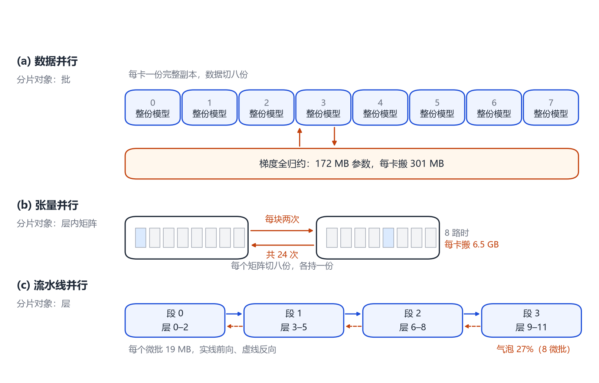
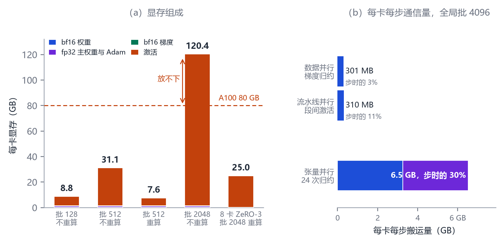
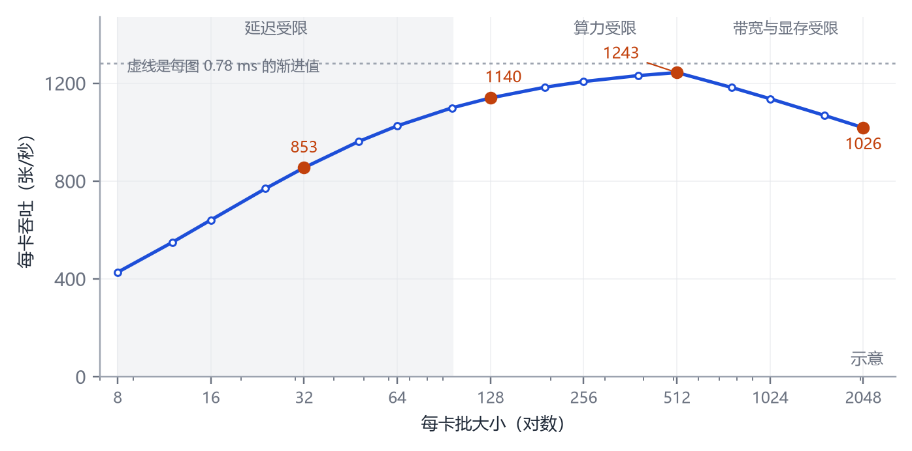
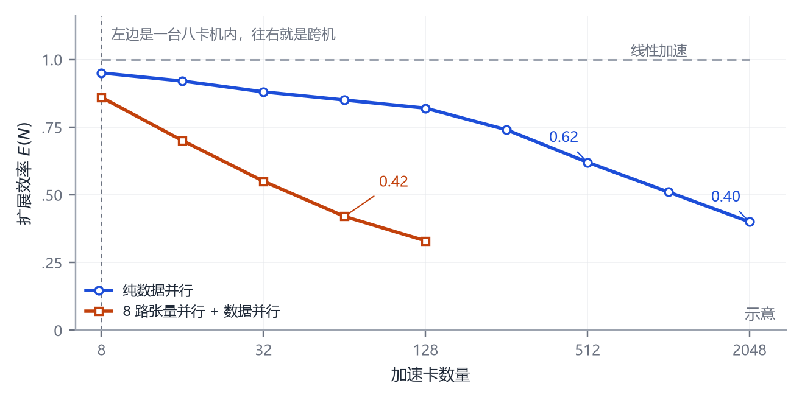

# 第 10 章　训练系统

同一份配方在八张卡和六十四张卡上不是同一件事。批大小、学习率、每一步的墙钟时间、损失曲线的形状都会变，改动最大的一处往往不在模型里，而在数据怎么切、梯度怎么换、状态怎么存。这一层东西平常被框架藏得很好，等它出问题，症状又都长在别处，跑得慢看起来像模型太大，掉精度看起来像学习率不对，只有把系统的账算清楚，才知道该动哪一个。

上一章把数据管线的每一道关过了一遍，从采集、清洗到配比，结论是数据决定上限。这一章接着往下游走，问的是那个上限要花多少机器、多少天才能摸到。同一批数据、同一个目标函数，系统选得对，一个实验四小时跑完；选得不对要四天，差别直接落在你能试多少次上。换句话说，系统是数据与指标之间那段最容易被忽略的路。

全章用一个算例贯穿。模型取 ViT-B/16，Dosovitskiy 等人在 2021 年的论文里给的规格是 8600 万参数、12 层、宽 768、12 个注意力头，patch 边长 16，224 见方的图切成 196 块加一个类别词元，序列长度 197。硬件取一块 A100 80GB，bf16 稠密算力按规格表是 312 TFLOP/s。所有显存与时间的数字都是量级估算，算式写在正文里，读者可以换成自己的模型重算一遍，方法比数本身有用。

几个问题排成一条线。显存决定单卡能放多大的批，并行决定放不下的批怎么切，吞吐决定每步多快，精度与检查点决定能不能稳着跑几天，账单决定你负担得起几次这样的训练。每一节都给一组可以直接抄下来的数，也给出这些数在什么条件下会失效，因为工程上真正贵的错误不是算错，而是在一个不适用的前提上照搬。

## 10.1　显存与并行

显存里同时住着四样东西。参数、优化器状态、梯度、激活值，前三样是参数量的常数倍，跟批大小无关，第四样随批大小线性涨，也随分辨率与序列长度一起涨。分清这两类很重要，因为绝大多数“显存不够”的抱怨来自第四样，而人的第一反应通常是去减参数量。这四样的比例决定了后面每一节的顺序，先看比例，再谈方案。

显存里最难估的一项是激活，因为只有它随批大小线性涨，而它又是唯一能靠减批立刻降下来的一项。它也可以写成一行，每一层都要为反向传播留下若干中间张量，每个词元每层留下约 $c$ 份宽度为 $d$ 的激活，$L$ 层、$T$ 个词元、批大小 $B$、每份 $b$ 字节，总量就是

$$
M_{\text{act}} \approx c \cdot L \cdot T \cdot d \cdot b \cdot B
$$

式中 $c$ 取 16，包含两处 LayerNorm 的输入、QKV 的输出、注意力的输出、MLP 的中间层与 GELU 的输出，注意力矩阵本身按分块计算的口径不落回显存，$b$ 在 bf16 下是 2。代入 ViT-B 的数字，$16 \times 12 \times 197 \times 768 \times 2$ 得到每张图 58 MB，批 128 时是 7.4 GB。这个式子的用处不是算准小数点后一位，而是回答两个问题，批翻倍时哪一项跟着翻倍，换分辨率时哪一项涨得最快。把 $c$ 从 16 换到 12 或 20，结论只动两成，而批从 128 换到 512 是四倍，两者的影响不在一个量级上，所以估到量级就对得起后面的判断。

参数那一侧小得出人意料。8600 万参数的 bf16 权重 172 MB，fp32 主权重 344 MB，Adam 的两个动量各 344 MB，bf16 梯度 172 MB，加在一起 1.38 GB。于是每卡批 128 时总占用 8.8 GB，激活占了八成四。这个比例在小模型上最极端，ViT-B 号称八十多兆参数，真正吃显存的是图像，参数量与占用在批稍微大一点之后就没什么关系了。把参数那一栏与激活那一栏并排看，才知道为什么减宽度省下的显存，远不如把批减一半来得快。

两条轴要分开看。参数量定的是常数项，批大小定的是斜率，把批从 128 抬到 512，总占用从 8.8 GB 涨到 31 GB，再抬到 2048 是 120 GB，直接越过 80 GB 的线。所以“这个模型放不下”这句话不完整，缺的是“在多大的批下放不下”，同一个 ViT-B 在批 128 上单卡就能跑，在批 2048 上八卡也放不下。这句话在评审里经常被说错，说的人往往只在大批上试过一次，没试过把批降到十分之一再跑。

分辨率是第二个乘数。224 换成 448，词元数从 197 涨到 785，激活跟着涨四倍，批 128 的 7.4 GB 变成 29 GB，一块 80 GB 的卡还剩一半余量但已经不敢再抬批。真正危险的是注意力矩阵那一项，如果实现没有按分块的方式算注意力，每个头都要把 785 乘 785 的分数矩阵写回显存，12 个头、2 字节、每图每层 14.8 MB，12 层是 177 MB，批 128 就是 22.7 GB，等于把预留给批的空间又吃掉一遍。换分辨率之前先确认注意力走的是分块核，这个顺序比调批大小重要，因为前者差的是几十 GB，后者差的是几 GB。

激活检查点（activation checkpointing）是第一个该动的旋钮。它不存每一层的全部中间量，只存每层的输入，反向传播到某一层时把这层的前向重算一遍。留下来的是 12 份宽度为 $2d$ 的层输入，加上一次重算的临时峰值，每张图约 12 MB，只有原来的五分之一。代价是多一次前向，总计算量从三份变成四份，慢三分之一。

批太大放不下时，梯度累积是最便宜的办法。每卡批 32、累积四步，等效批还是 128，而激活只按 32 算，1.9 GB，加参数侧的 1.38 GB 一共 3.3 GB，一块卡能同时开好几个作业。代价有三处，每步的固定开销不再被摊薄，吞吐掉一到两成；任何跨批的统计量按 32 算而不是 128，SIGReg 与 Barlow Twins 的协方差估计会明显更糙；动量按更新次数走，累积四步才更新一次，动量的有效时间尺度被拉长四倍。

数据并行分的是批。每张卡持有一份完整模型，各算各的那一份数据，一步结束时把梯度全归约一次，让所有卡上的参数保持相同。通信量按参数量算，环形归约时每张卡搬 $2(N-1)/N$ 倍的梯度总和，八卡时是 172 MB 的 1.75 倍，301 MB。A100 的节点间带宽 200 Gb/s 合 25 GB/s，这一步 12 ms，相对于每卡批 512 时 420 ms 的计算，占不到百分之三。这个比例是后面所有讨论的基准，凡是远高于它的通信方案都要问一句凭什么。

ZeRO 把“每卡一份”拆开。第一级分优化器状态，八卡时参数侧从 1.38 GB 降到 0.47 GB；第二级再分梯度；第三级连权重也分，每卡只剩 0.17 GB，需要的时候用一次 all-gather 把别人的参数临时拉回来。总量上通信量几乎没变，gather 加 reduce-scatter 与一次 all-reduce 相当，但它被拆成几十次小传输，对延迟敏感，批不够大的时候反而更慢。三级的顺序不能反，先分梯度再分状态，第一次更新就要把状态拼回来。

张量并行分的是层内的矩阵。注意力按头切，MLP 按中间维切，一个块里做完注意力要归约一次、做完 MLP 再归约一次。通信量按激活算而不是按参数算，每卡批 512、197 个词元、宽 768、bf16，一个张量 155 MB，12 层共 24 次归约，环形搬下来 6.5 GB，是数据并行的二十倍。走 NVLink 的 300 GB/s 要 22 ms，而每卡只承担八分之一的计算，52 ms，通信占到三成。

这就是张量并行只能待在机内的原因。跨机做八路张量并行，链路带宽掉一个数量级，22 ms 变成两百多毫秒，而计算被切得更碎，账立刻崩掉。机内的宽带链路是它的前提条件，不是优化项，判断一个集群适不适合大模型训练，先看同一台机器里卡与卡之间有没有全互联，再看跨机的带宽有没有到 200 Gb/s 这个量级。

流水线并行分的是层。12 层切成四段，每段三层，段与段之间只传边界上的激活，一个微批 64 张是 19 MB，前后向各一次，一步合计 310 MB。通信几乎不是问题，代价在气泡，前面的段填流水、后面的段排空，1F1B 调度下气泡比例是 $(P-1)/(m+P-1)$，$P$ 是段数、$m$ 是微批数，四段八微批时 27%，切到 32 个微批降到 9%。另一笔代价是显存不均衡，第一段要留住最多微批的激活，通常靠重算或把第一段做小来平衡。

四种方式不是四选一。一个六十四卡的作业常见写法是八路张量并行乘两路流水线乘四路数据并行，把 4096 的批切到每卡 64。选择的顺序有经验可循，先让单卡批落在吞吐曲线的拐点上，放不下就用数据并行加卡，卡多到通信开始咬人再上 ZeRO，模型大到单层都放不下才动张量并行与流水线。如图 10-1，三种分片动的对象完全不同，一边是批，一边是层内矩阵，一边是层，各自的通信量差着二十倍。

<figure class="fig">

<figcaption><b>图 10-1</b>　三种并行的数据流与通信量。数据并行只换梯度，流水线只传段边界的激活，张量并行在每一块里都要归约，通信量因此高出二十倍。</figcaption>
</figure>

如图 10-2(a)，五种配置摆在一起。批 2048 不重算是 120 GB，加上检查点降到 26 GB，同一块卡上从放不下变成放得下还有余量。最右那一栏是八卡 ZeRO-3 配批 2048 加检查点，参数侧被分掉以后只占 0.17 GB，总占用 25 GB，与单卡那一栏只差 1 GB。这条对比说明分片参数救不了激活，激活只能靠减批、重算或者切分来降。读这张图先看橙色那一段的高度，再看它的邻居。

<figure class="fig">

<figcaption><b>图 10-2</b>　显存与通信的分解，量级估算。左图五种配置的每卡占用，激活始终是最大一块，检查点能把批 2048 从越线拉回安全区；右图三种并行每步每卡的搬运量。</figcaption>
</figure>

## 10.2　混合精度与稳定性

混合精度的理由只有一个，速度。A100 的规格表上 fp32 是 19.5 TFLOP/s，tf32 是 156，bf16 与 fp16 都是 312，前后差 16 倍，显存占用同时减半。这两条加起来，没有人用 fp32 训大模型，问题只剩用哪一种半精度，以及在哪些地方不能省这点精度。半精度还顺带省带宽，同样 2 TB/s 的显存，bf16 每秒能搬两倍的元素数，那些访存为主的算子跟着快一倍，速度与显存两笔账一起收。

bf16 与 fp16 的差别全在指数位。fp16 用 5 位指数、10 位尾数，能表示的最大值 65504，最小正规数 $6.1\times10^{-5}$，梯度落在 $10^{-8}$ 这个量级就直接变成零。bf16 用 8 位指数、7 位尾数，指数宽度与 fp32 相同，范围从 $10^{-38}$ 到 $10^{38}$，代价是相对分辨率只有千分之四。一个能表示的动态范围窄，一个精度粗，两种毛病对应两种不同的处理方式，一个直接报错，一个安静地掉精度，后者更难查。

tf32 是第三种选择，容易被忘掉。它只改矩阵乘的输入，指数 8 位、尾数 10 位，A100 上 156 TFLOP/s，是 fp32 的八倍，精度损失比 bf16 小得多，适合那些一开 bf16 就掉点的老模型。要注意新版本框架里它的默认值是关的，脚本里写着 fp32 却以为自己在跑快路径，实际拿到的是 19.5 TFLOP/s 那一档。tf32 只省时间不省显存，显存紧的时候它帮不上忙。

fp16 需要损失缩放（loss scaling）来补指数位。做法是给损失乘一个常数 $S$，反向传出来的梯度一起被放大，更新前再除回去，典型取值 $2^{16}$ 等于 65536，能把 $10^{-8}$ 抬到 $6\times10^{-4}$，落进 fp16 的正常范围。动态版每若干步检查一次有没有 inf 或 nan，有就跳过这一步并把 $S$ 减半，连续几千步干净再把 $S$ 翻倍。被跳过的步数是白扔的算力，这也是 bf16 在 A100 之后成为默认的原因，省掉了一整套调度。

有一批运算必须留在 fp32。softmax 的分母、LayerNorm 的均值与方差、交叉熵里的 log-sum-exp、EMA 目标网络的权重、优化器的动量，这些地方都在做“很多个数相加再取平均”，半精度的尾数撑不住这个过程。197 个词元里如果某个值比最大值小一千倍，bf16 的 7 位尾数会把它的贡献整个抹掉，累加出来的分母就偏了。工程上的做法是这些归约用 fp32 累加，结果再转回 bf16。

EMA 是这一类里最容易被忽略的一项。$\tau=0.999$ 时每一步只吸收千分之一的更新，如果目标网络的权重存成 bf16，这个增量小于该量级上的分辨率千分之四，更新会被舍入掉，目标网络等于停住。症状很隐蔽，在线网络的损失照样在降，下游指标却卡住不动，看起来像塌缩又找不到塌缩的证据。JEPA 这一类方法的目标网络全靠 EMA 走，这一条必须写进检查清单。

数值问题的现场信号是梯度范数。损失变成 nan 之前几乎总会先出现几步的范数尖峰，所以日志里记更新前的全局梯度范数是划算的，它比损失早几十步报警。裁剪到 1.0 或 0.1 相当于给尖峰设了上限，代价是那一步的方向被压扁。另一处常见的是注意力掩码用负无穷，bf16 下两个负无穷相减得到 nan，改用一个足够大的有限负数，或者把被掩位置置零后重新归一化，都能绕开。

精度还会改变批大小的语义。fp16 的梯度下溢在批小的时候更常见，因为小批的梯度噪声大、量级更分散；bf16 没有下溢问题，但尾数短，梯度累积多步之后小的更新会被吞掉。两条合起来解释了为什么同一个配方换精度以后要重扫一遍学习率，而不是照抄。反过来，换精度以后损失曲线的抖动幅度也会变，抖动变大通常意味着有一处归约还在半精度上跑。

把这几条落成一份配置，nan 会少掉大半。前向与反向走 bf16 自动混合精度，主权重与优化器状态留 fp32，梯度归约用 fp32 或者带误差补偿的 bf16，损失函数内部全程 fp32，EMA 与检查点存 fp32。做完之后剩下的 nan 基本不再来自精度，而是来自数据，坏图、全黑帧、空文本、长度为零的样本，这些在 dataloader 里就该挡掉。等它们把某一步的梯度变成 inf 再去查是哪一张，代价是几个小时，而写一个过滤规则的代价是十分钟。

## 10.3　吞吐与利用率

吞吐的通用口径是模型浮点利用率（model FLOPs utilization, MFU）。它把一步里真正有用的浮点运算除以这一步的墙钟时间与硬件峰值，得到一个与模型大小、卡数、批大小都无关的比例，因此能横向比较，写成

$$
\mathrm{MFU} = \frac{6 N D B}{t_{\text{step}} \cdot P_{\text{peak}}}
$$

$N$ 是参数量，$D$ 是每个样本的词元数，$B$ 是这一步的全局批，$t_{\text{step}}$ 是墙钟秒数，$P_{\text{peak}}$ 是硬件峰值。系数 6 来自前向两次乘加、反向四次，一个参数一个词元算六次浮点运算，这是所有训练算力估算的共同起点。这三个量都能从日志里直接取到，算 MFU 不需要开 profiler，先算这个数再看别的，是排查吞吐问题的第一步。这个系数对带注意力的模型是一个近似，注意力那部分按 $T^2$ 单独算，$T$ 取 197 时只占千分之七，可以略去；词元数到一千以上就略不掉了，那时得把两项分别写出来。

分母的口径要统一，否则 MFU 之间没法比。厂商标的 312 TFLOP/s 是稠密 bf16、不含稀疏，若按 2:4 稀疏的 624 去算，同一段代码的 MFU 会被系统性低估一半。H100 上 fp8 的峰值又是 bf16 的两倍，用它做分母得到的数不能和 bf16 的放在一张表里。跨论文比较之前先问三件事，峰值是稠密还是稀疏、精度是什么、分母是单卡还是整机。三个答案不同，差出来的倍数比方法本身的差别还大。

代进算例。$6 \times 8.6\times10^{7} \times 197 \times 128$ 是 $1.3\times10^{13}$，每卡批 128 时一步 0.11 秒，除下来 $1.2\times10^{14}$，占 312 TFLOP/s 的 37%。四成上下的 MFU 在视觉自监督里算正常成绩，剩下六成不是浪费在算术上，而是花在 LayerNorm、softmax、GELU 这些访存为主的算子上，以及等通信、等数据、等一个没填满的矩阵乘。模型越小这个数越难做高，因为 $6ND$ 里的 $N$ 小，固定开销摊不开，同一个实现换成 ViT-L 就能升到四成五。

第一类瓶颈是数据加载。症状是 GPU 利用率周期性地掉到零，掉的位置与 epoch 边界对齐，或者 nvidia-smi 上出现整齐的锯齿。ViT 的一张图要解码 JPEG、做两次裁剪、归一化、转张量，CPU 上五到十毫秒，一个 worker 每秒只喂一百多张，八个 worker 勉强跟上每卡批 128 的节奏，再加卡就饿。第 6 章讲视频管线时 CPU 更吃紧，原因同一条，解码成本随分辨率与帧数一起涨。

数据侧的解法和模型侧完全不同，靠的是把活挪走。解码交给 GPU 上的解码器，裁剪、翻转、归一化写成 GPU 上的算子，样本预先打成大块的文件，让一次读盘喂很多个样本，预取队列开到能吃下两秒的批。做过这几步之后，每图的 CPU 成本能从十毫秒降到一毫秒以内，八个 worker 能喂的卡数从八张变成几十张。反过来，如果利用率曲线是平的而吞吐只有理论值的一半，问题就不在数据侧，别再加 worker 了。

第二类是通信。前面算过，八卡数据并行一步搬 301 MB，占步时的百分之三；八路张量并行搬 6.5 GB，占三成。判断依据不是带宽够不够，而是通信时间能不能与计算重叠。数据并行的全归约可以与反向传播的最后几层重叠，实测开销常低于算术值；张量并行的归约卡在每一个块的正中间，没法藏，只能靠更宽的链路。所以前者可以扩到几百卡，后者不行。

第三类是算子本身。批小的时候矩阵乘的行数少，张量核的分块填不满，一层 768 乘 768 的乘加在批 8 上只够跑几十微秒，启动开销与它同量级。这就是图 10-3 左侧那一段，吞吐随批大小近似线性上升，因为这段时间在等固定开销，不是在等算力。如图 10-3，批 32 时每卡 850 张每秒，批 128 时 1140，批 512 爬到 1240，再往上因为激活占满显存、L2 命中率下降，2048 时掉到 1030。

<figure class="fig">

<figcaption><b>图 10-3</b>　每卡吞吐随批大小的变化，示意。左侧受固定开销支配，中段进入算力受限的平台，尾段因显存与缓存压力回落，拐点在 96 到 160 之间。</figcaption>
</figure>

判断瓶颈不必一上来就开 profiler。先算一个数，每步的 $6NDB$ 除以实测步时得到实际算力，再除以峰值就是 MFU，这个数落在三成以下说明有东西在等，落在四成以上说明算术基本跑满了。要定位到具体算子才需要 profiler，看时间落在矩阵乘、逐元素还是显存拷贝上。经验上逐元素与归一化占到三成以上就是被访存卡住，这时候加卡没有用，该做的是算子融合、换更大的批，或者把增强搬到 GPU 上做。

拐点在 96 到 160 之间，工程上要找的是这个位置，而不是最大批。拐点之前加批几乎是白拿吞吐，之后加批要用学习率去换，而学习率能不能跟着抬取决于优化器的缩放规则，那是下一章的内容。另一个常被忽略的数是每图毫秒，批 512 时是 0.8 ms，它比吞吐更好算账，乘上样本数就是总卡时，除以卡数就是墙钟。

加卡不一定加速，这件事需要一个定义才谈得上。扩展效率取同样的每卡批，把单卡一步的时间除以 $N$ 卡时一步的时间，得到的是加卡以后还剩多少有效算力。没有这个定义，加卡没变快只是一句抱怨，写成

$$
E(N) = \frac{t_1}{N \cdot t_N}
$$

$E=1$ 是线性加速，八卡时每步正好快八倍。如图 10-4，纯数据并行的效率在 8 卡上是 0.95，128 卡 0.82，512 卡 0.62，2048 卡 0.40，下降的原因是梯度归约的通信量随卡数走而链路带宽不变，同时全局批变大以后每卡的局部批变小，算子效率跟着掉。0.62 这个数换成人话，512 张卡只顶得上 317 张卡的算力，剩下的 195 张在等。这条曲线是选拓扑的依据，比任何跑分都可靠。

张量并行的曲线更陡。机内八卡还能到 0.86，跨到 16 卡就掉到 0.70，再往上 32 卡 0.55、64 卡 0.42。两条曲线的斜率说明了一件事，小规模时机内张量并行划算，规模上去以后跨机的数据并行更划算，而真正的做法是两者叠加，把张量并行固定在八卡以内，用数据并行去扩。大规模训练的拓扑总是“节点内张量、节点间数据”，流水线插在中间补模型放不下的那部分，理由就在这两条斜率里。

<figure class="fig">

<figcaption><b>图 10-4</b>　扩展效率随卡数的变化，示意。数据并行在几百卡之内还能保住八成，八路张量并行出了机箱就掉到七成以下，两条斜率决定了拓扑该怎么叠。</figcaption>
</figure>

## 10.4　断点续训与可复现

一次 300 轮的预训练要跑几个钟头到几天，中途一定会断，抢占式实例更是平均几小时断一次。断点续训不是存一个模型那么简单，要存的是恢复训练所需的最小状态集，少一样，恢复出来的曲线就会与不中断的曲线分叉，而分叉点常常在几十步之后才显形，那时已经很难判断是恢复出错还是配方本来如此。

五样东西，参数、优化器状态、EMA 目标网络、数据加载器的位置、随机数状态。前三样是张量，后两样是几个计数器和生成器的状态。以 ViT-B 为例，参数 172 MB，fp32 主权重与两个动量 1.03 GB，梯度 172 MB，再加一份 EMA 的 172 MB，一次存 1.5 GB 上下；每半小时存一次，十二小时二十四次，三十几 GB，放在本地盘上不心疼，所以没必要为了省空间去存 bf16 的参数。后两样少存一个，恢复时不会报错，只会悄悄换一份数据顺序。

存的方式取决于并行度。纯数据并行下每张卡的权重相同，只让 rank 0 写就够了；ZeRO-3 下权重是分片的，每张卡写自己那一片，恢复时按当前卡数重新分。这两件事不能混，八卡存的检查点直接拿到十六卡上恢复会错位，权重张量对不上名字，或者更糟，对得上但内容错了一层。稳妥的做法是存成与并行度无关的格式，每层一个张量、文件名带层号，启动时按当前拓扑重新切分，代价是恢复前多一次组装。

存完要立刻验。写完读一遍、比一次校验和，比跑了两天以后发现文件截断便宜得多。长训练里还应该做一次冷启动演练，把整条恢复路径走通，包括数据位置、学习率调度、EMA 与优化器状态。这条演练最常见的收获是两个静默错误，数据位置没存、调度按轮记，两者都不报错，只在曲线里留一个看不出来的台阶，而那个台阶往往被当成恢复带来的波动糊过去。

数据顺序是最容易漏的一项。分布式采样器给每个 rank 分的是“每个 epoch 的一个子集”，恢复时要从这个子集断开的位置接着读，而不是从头。常见的 bug 是恢复后每个 rank 都从自己子集的第 0 个样本开始，于是同一批数据被重复消费一遍，梯度噪声的形状变了，损失会先掉一小截再回到原来的轨迹，看起来像是“恢复带来了提升”。

随机性来源要列全。权重初始化、dropout 或者掩码采样、裁剪的坐标与颜色抖动、worker 的 shuffle、cuDNN 选算法，每一项都会让两次运行分叉。要逐位复现，打开确定性开关，关掉 cuDNN 的自动调优，固定 cuBLAS 的工作区配置，把所有增强改成无状态，用种子与样本编号派生生成器，而不是共享一个全局随机流。这几项在框架里各有各的开关，指望一个环境变量全关掉不现实。

逐位复现的代价是吞吐。确定性算法禁用了一批非确定性的并行归约，实测掉一成到三成，长训练上这个折扣不小。工程上的折中是“对齐到分布”而不是“对齐到比特”，同配方换三个种子，曲线在百分之一以内重合，就说明配方是稳的；要求逐位相同只在排查数值 bug 的时候才需要，那时宁可慢。

复现可以分三级，代价差一个量级。比特级要求同一份代码、同一型号的硬件、同一套确定性算子，同一份输入跑两遍得到一样的结果，用来查 bug。分布级要求同配方换种子，指标落在同一个区间，用来判断配方稳不稳。结论级只要求“改动甲比改动乙好”这个排序在不同种子、不同数据切片下成立，用来写论文。三级里只有第三级是研究真正需要的，前两级是它的工具。

三个种子是可信重复的最小值。第 8 章那张旋钮表里，默认设置的三个种子在 R@1 上跨了 0.030，比表里多数改动的效应都大，单种子的实验读不出方向。日志里除了损失，至少要记全局步数、已消费样本数、学习率、梯度范数、每卡吞吐与显存峰值，这六项能覆盖九成的现场事故，剩下的那一成靠复现。

断点的间隔也要算。抢占式实例平均几小时断一次，间隔设成一小时，期望损失半小时的算力；设成十五分钟，期望损失只有七分钟，而写盘开销从每小时 1.5 GB 涨到 6 GB，相对于几百 GB 的中间文件可以忽略。这条换算是纯算术，开跑之前花两分钟就能定下来，比断两次之后凭感觉改成“每十分钟一存”要靠谱，也比盲目加密到每分钟一存省下大量无用的写盘。

还有一条与调度有关。学习率与 EMA 的衰减都应该按步记账而不是按轮，按轮记的调度在换批大小时会静默变形，比如批从 1024 换到 512，一轮的步数翻倍，余弦衰减实际走了一半就到底。恢复时读回步数，调度就能接上，读回轮数则会丢掉那半步，而丢掉的那半步恰好落在衰减最快的区间里。

## 10.5　一次预训练的账单

账单的第一行是卡时（GPU hours），不是钱。卡时等于步数乘每步秒数乘卡数再除以 3600。ViT-B 那个算例，ImageNet 的 128 万张图、批 1024、300 轮是 37.5 万步，八卡每步 0.12 秒，合 103 卡时。同样的活单卡做，300 万步乘 0.11 秒是 92 小时，四天不到，而八卡是半天多一点。卡时里没有单价，所以它是可以跨集群、跨云商比较的量，钱不是，同一份活在不同报价下的差额能到五倍。

大模型的账可以和论文对。DINOv2 的 ViT-g 在 A100-40GB 上跑了 62.5 万步，报的是 22,016 卡时；DINOv3 的 ViT-7B 在 H100-SXM5 上跑 100 万步，报的是 61,440 卡时。参数涨了 6.4 倍，卡时只涨 2.8 倍，因为 ViT-7B 的输入分辨率降到 256、每步词元数变少，而 H100 的单卡算力更高，两头抵掉了一部分。两行数放在一起还能读出一件事，卡时与参数量不是线性关系，中间隔着分辨率、词元数与硬件代际，所以“参数翻倍卡时就翻倍”这种说法在跨代比较里总是错的。

从卡时到电、再到碳，只有三项。$H$ 是卡时，$p$ 是单卡功率（单位千瓦），PUE 是数据中心的能耗比，三者乘起来再除以 1000 就是千瓦时，而这三项里只有卡时是变量，写成

$$
W = \frac{H \cdot p \cdot \mathrm{PUE}}{1000}
$$

DINOv3 那篇论文用的正是这三个数，61,440 卡时、H100 的热设计功耗 0.7 kW、PUE 1.1，算出来 47.3 兆瓦时，与表里的 47 对得上；再乘美国电网平均的 0.385 吨每兆瓦时，是 18.2 吨，表里写 18。DINOv2 那一行同样对得上，22,016 乘 0.4 乘 1.1 是 9.7 兆瓦时，3.7 吨。两行都对得上不是巧合，论文那张表就是按这条式子算的，自己复算一遍能确认口径没读错，分母里没有把 CPU 与网络的功耗偷偷算进去。

电价与租价的差别决定什么值得优化。47 兆瓦时按每度六毛算是 2.8 万元，61,440 卡时若按每小时 30 元的云价租是 184 万元，电费只占 1.5%。所以“省电”几乎不是省钱的抓手，“省卡时”才是，而卡时里最贵的部分不是算力，是空转，等数据、等通信、等一个没填满的矩阵乘。把 MFU 从 30% 提到 40%，账单直接打七五折。这笔账在自建集群上更明显，电价是固定支出，卡时才是能靠工程手段控制的那一项。

单价对结论的影响比想象中小。云价从每小时 30 元跌到 10 元，184 万的账单变 61 万，而这周能试几次一点没变，因为预算通常按卡时批，不按钱批。真正改变实验次数的是单次训练的卡时，把它从 103 压到 60，同样的预算下试错次数多七成，多出来的那部分恰好是消融最需要的东西。换句话说，谈判降的是发票，工程降的是次数。

真正的大头是试错。DINOv3 那篇论文在环境影响那一节给了两个数，单次预训练是 61,440 卡时，整个项目约 900 万卡时，相差 147 倍。这个比例就是配方研究的账单，一百多次等价的完整训练花在了找配方、试数据、做消融上，最终发表的那一次只占千分之七。论文没有解释这些卡时怎么分配，但量级本身已经说明问题，读到“训练了一个 7B 模型”时，该想到背后还有一百倍。

反过来算自己的预算很简单。手上有多少卡时，除以一次完整训练的卡时，再除以三，因为每个设置至少三个种子，得到的就是这周能问的问题数。八卡跑一周是 1344 卡时，ViT-B 一次预训练 103 卡时，除下来只够四个设置。想多问几个问题，要么把单次实验做小，在十分之一的数据上先筛，要么把系统调快，而前者几乎总是更划算，因为小规模上的排序通常能保住。

## 10.6　系统决定你能试几次

六节连起来是一条因果链。显存决定单卡能放多大的批，批落在吞吐曲线的哪个位置决定每步多快，并行的分片方式决定放不下的那部分怎么切、切完要多付多少通信，精度与检查点决定这条链能不能稳着跑几天，卡时乘上单价就是这一次训练的账单，账单除以预算就是你能试几次。链上任何一环算错，账面上的数字都会错一个量级，而不是错一成。

有一条顺序值得记住，单卡能跑通的东西先单卡跑通。在八张卡上排查一个数值 bug，成本是单卡的八倍，每次改动要重新起作业、等队列、翻八份日志，而九成的成因在单卡上就能复现，梯度下溢、EMA 卡住、掩码把整张图遮住，这些都不需要第二张卡。并行只该用来解决单卡解决不了的问题，也就是显存放不下和时间不够。反过来先上并行、再回头调通单卡，几乎总要在第八张卡上重来一遍。

另一条是把不确定性放对位置。种子、数据顺序、检查点、日志格式要尽量确定，它们是排查的地基；学习率、批大小、并行度可以放开试，它们本来就是配方的一部分。这条界线划清楚了，日志才有可比性，实验才能累积。反过来做的人不少，随机种子每次不同，并行度写死在脚本里，结果是配方动不了，系统也复现不了，两头都不占。

这四个数，每张图的显存、每步的秒数、MFU、一次训练的卡时，换一个模型就要重算，算式却不变，值得写成一页纸贴在项目里。写下来的另一个好处是换人接手时不用重新推一遍。ViT-L 的参数量是 ViT-B 的三倍多，激活是两倍多，同样的卡能放的批要减半；换成视频模型，词元数从 197 涨到 1568，激活直接涨八倍，不改并行方式根本跑不起来。

数字会变，先算哪一项、按什么顺序算，这两条不会变。系统做到位以后，剩下的问题就变成每次实验该改什么，塌缩怎么急救、学习率怎么随批缩放、消融怎么设计才读得出方向。四个数不清楚，后面所有关于配方的讨论都只能凭感觉，而凭感觉的实验做一百次也不会收敛到同一个答案。下一章就从一次塌缩的急救开始，把每次实验该问的问题排成一张表。
