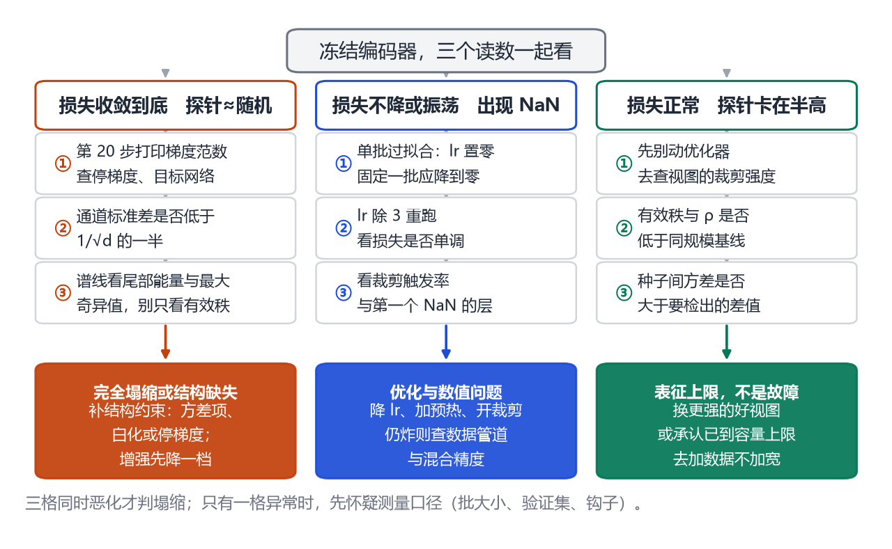
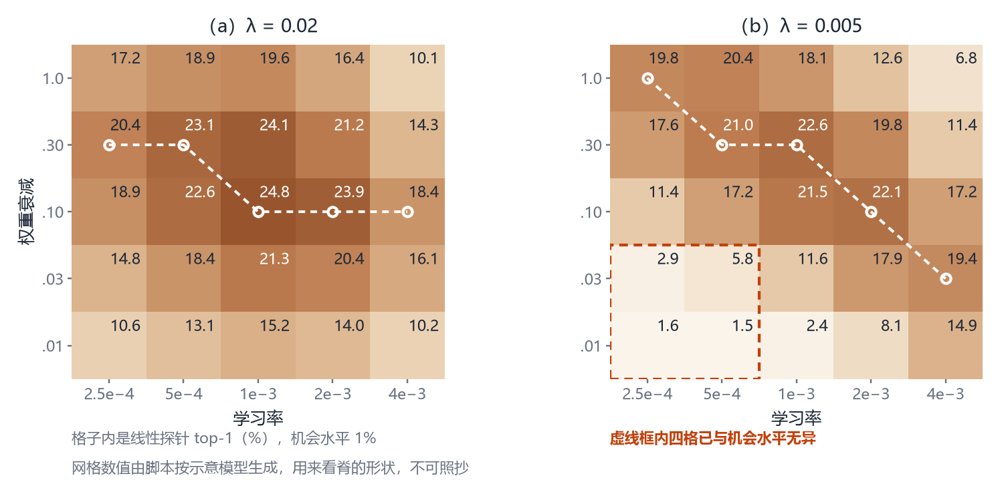
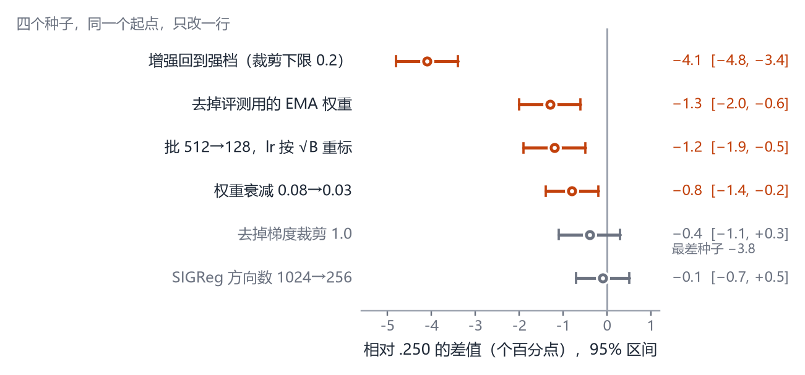
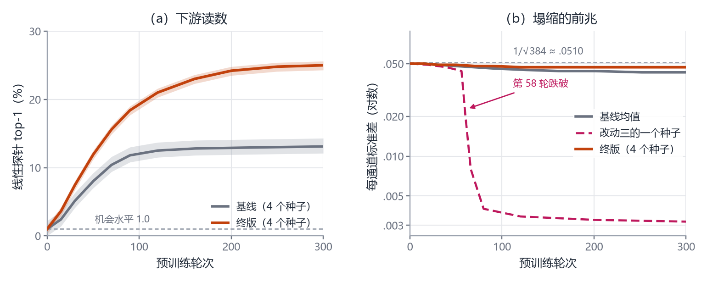

# 第 11 章　调参与失败诊断

一次预训练跑完，探针停在 .13，损失曲线从第 80 轮起贴着底部走平，日志里没有 NaN，没有重启，没有一条警告。把这次实验的配置摊开看，每一项都抄自某篇论文的默认值，每一项单独拿出来都说得通，合在一起就是一个只学到三成的东西。这种时候能做的事很少，换配方重跑一遍，或者调一个旋钮再跑一遍，或者承认不知道下一步动哪里。

上一章把一次预训练的账拆成了显存、吞吐和账单，算的是这套系统给得起多少次实验。这一章接着处理另一个问题，给定这些次数，先花在哪。同一个起点、同一批数据、同样的总算力，改动顺序不同，最后能到的分数可以差一倍，差别不在运气，在有没有按排除法的顺序走。预算固定的项目里，这个顺序问题比任何一个超参的具体取值都值钱，因为超参可以改，已经烧掉的实验不能退。

调参在这个语境里不是网格搜索。JEPA 的几个旋钮之间有乘性的耦合，学习率与权重衰减乘在一起才是衰减强度，正则权重随批大小与视图数漂移，目标网络的动量又与正则强度互相顶替，所以一个旋钮的最优值会随另一个漂走。网格搜索假定它们互不相干，于是把大部分预算花在注定无效的格子上，还会把种子噪声读成趋势。

这一章的数字分两类，一类能在论文里查到，会写清谁在哪一年测的、在什么数据上测的；另一类是按公式算出来的，给出算式和代入的数。末尾那个调参案例是从一份项目记录里整理的，数字保留三位小数，量级可信，个位不要照抄。整章的骨架可以画成一张诊断树，如图 11-1，三条入口对应三种症状，每条入口往下都是一组检查和一个处置。前半解释树上用到的旋钮，后半把树和消融方法讲清楚，再用一次真实的调参把两边接起来。

<figure class="fig">

<figcaption><b>图 11-1</b>　塌缩与停滞的三条入口。先按症状分叉，再按结构、统计量、增强、超参的顺序往下查，每一列的最后一步是处置。三格读数同时恶化才判塌缩。</figcaption>
</figure>

## 11.1　学习率与批大小

学习率与批大小之间的换算在文献里有两种写法，一种叫线性规则，$\eta=\eta_0 B/B_0$，批大小翻四倍，学习率也翻四倍；另一种叫平方根规则，$\eta=\eta_0\sqrt{B/B_0}$，同样翻四倍的批只把学习率抬一倍。两条规则都有人用，都能在某个区间里跑通，麻烦在于它们互相矛盾，而配方文档通常只写一条，不写它成立的范围。分不清用哪条的时候，最省事的判据是问这次训练受什么限制，受曲率限制用线性，受噪声限制用平方根。

线性规则的推导只用到一个假设，一步之内梯度几乎不变。批大小为 $B$ 时，一个轮次要走过 $D/B$ 步，$D$ 是训练集大小，每步沿负梯度走 $\eta$。把这条折线看成一条连续轨迹的解，轮次记作 $\tau$，就得到下面的式子。这个假设在批很大、学习率很小的时候近似成立，因为一步之内参数移动得少，梯度来不及变化，此时折线与轨迹贴得很近。

$$
\frac{d\theta}{d\tau}=-\frac{\eta D}{B}\nabla\mathcal{L}(\theta),
$$

右边那个系数衡量的是每一轮走多远，它由 $\eta/B$ 决定。两个批大小要走出同一条曲线，这个系数就得保持不变，于是 $\eta$ 与 $B$ 成正比。举个具体的数，批从 256 加到 1024，每轮步数除以四，学习率乘四，每轮的总位移不变，而每步的位移是原来的四倍。这条推导的代价就藏在四倍里，单步走得越远，二次项越不可忽略，梯度在一步之内没变这个假设也越勉强。

批一大，梯度估计的噪声就小，噪声小到一定程度之后，限制训练的东西从噪声换成了曲率。一批样本给出的梯度是真实梯度加一个零均值扰动，方差按 $1/B$ 缩小，一步位移里的噪声项因此是 $\eta\sigma/\sqrt{B}$。增大批只能把这一项按 $\sqrt{B}$ 压下去，不能按 $B$ 压，能用多大的步长这件事的刻度于是变成 $\sqrt{B}$。两条规则的交叉点叫临界批大小，小于它时线性可用，大于它时再加批只是把同样的路走得更细。

失效的地方比规则本身更值得记。换了优化器，Adam 一类的方法把梯度按二阶矩归一化，学习率与批大小的关系被这层吸收，线性规则要重新标定。换了损失尺度，正则权重、温度、视图个数都会改变梯度量级，跨配置比学习率之前要先对齐口径。预热按轮次写死时改批大小会顺带改掉预热的实际长度。数据管道跟不上时，名义批变大而有效批没变，规则的前提直接不成立。

真实配方里的数可以拿来对照。BYOL 的脚本写的是学习率等于 $0.2\times B/256$，线性规则，预热 10 个轮次，一共训 1000 轮；DINO 写的是 $0.0005\times B/256$，同样是线性，预热也是 10 轮。两家都把预热写成轮次，而轮次在换批大小之后对应的步数会变，所以照抄时要换算。V-JEPA 的做法相反，批 3072、学习率 $6.25\times10^{-4}$、预热 12000 步、总共 90000 步，预热带走的是 13% 的步数，比前两家大一个量级，因为大模型从随机初始化走到可用的那段路本身就更长。

批大小的收益有一条明显的拐点。LeJEPA 在 ImageNet-1k 上训 ViT、冻结主干做线性探测，批 128 得 72.20，256 得 74.15，512 得 74.72，1024 反而回落到 74.07，四个数来自同一份损失与同一组超参。从 128 到 512 每翻一倍换来一点九分和零点六分，到 1024 变成负的，说明这条曲线上 512 附近已经跨过了临界批大小，再往上加批买到的是更少的梯度噪声，付出的却是同样的算力。工程上的含义是批大小买到的是步数，不是质量，而步数可以用更长的训练换。

落到操作上，比较省事的流程是三步。第一步从配方里抄一个基准学习率，按 $\sqrt{B/B_0}$ 起手，因为平方根在两侧都不会错得太离谱。第二步跑两百步的短跑，看损失有没有在这两百步里稳定下降，短跑的代价约为一次完整实验的千分之一。第三步才决定要不要按线性放大，放大的同时把预热步数按同样的比例拉长。这个流程找不到最优点，它的作用是排除掉明显过大的值，而这一类值恰好是塌缩最常见的起因。

## 11.2　三个旋钮互相牵制

指数滑动平均、权重衰减、梯度裁剪在配置表里分属三栏，看上去各管一件事，实际上都在压同一个量，也就是参数每步实际移动多远、最后落在多大的范数上。三者之间的耦合是乘性的，动其中一个，另外两个的合适取值会跟着漂，所以按栏逐个调的顺序在这里不成立。这一节先把三项各自的机制说清楚，再把耦合摆出来。

指数滑动平均（exponential moving average，EMA）把一串参数压成一个慢变量，递推写成下面的式子。它在 JEPA 里几乎无处不在，目标网络的权重靠它维护，评测用的权重也靠它。同一个符号出现在两个位置上时含义完全不同，一个是让目标追得慢，一个是让读数抖得轻。

$$
\bar\theta_t=\lambda\bar\theta_{t-1}+(1-\lambda)\theta_t,
$$

$\theta_t$ 是第 $t$ 步的在线权重，$\bar\theta_t$ 是平均后的权重，$\lambda$ 是动量，越接近 1 平均得越慢。把递推展开可以看出，一层权重对过去各步的系数按 $(1-\lambda)\lambda^{k}$ 衰减，往回 $k$ 步之后剩下的比例约为 $\lambda^{k}$，令它等于 $e^{-1}$ 就得到有效窗口 $1/(1-\lambda)$。代进去 $0.996$ 是 250 步，$0.998$ 是 500 步，$0.999$ 是 1000 步，$0.9995$ 是 2000 步。这个数比 $\lambda$ 本身好记，因为窗口的长度直接决定平均掉的是多少步的抖动。

EMA 在 JEPA 里有两种用法，混起来谈就会把结论搞乱。第一种是当目标网络，BYOL 与 I-JEPA 都用它，目标一侧的权重由在线权重平均而来，梯度不回传，$\lambda$ 越大目标越稳。I-JEPA 取 $0.996$ 并线性爬到 1，V-JEPA 从 $0.998$ 爬到 1，DINO 也是 $0.996$ 到 1，三家都用爬升而不是常数，因为训练后期参数移动变慢，同样的 $\lambda$ 对应的窗口会显得太短。第二种是当评测权重，训练照常，只在打分时用平均后的权重，这一种不改模型，只改读数。

当目标网络用时，$\lambda$ 与塌缩之间有一条直接的通路。$\lambda$ 越接近 1，目标越接近不动，在线网络只要追上一个静止的目标就能把损失压到零，常数解于是更容易被找到。DINO 用中心化与锐化顶住这件事，中心化防止某一维独大，副作用是把表征推向均匀分布，锐化正好相反，两者配平才够用。I-JEPA 不靠这一对，它靠目标块由遮罩决定、预测器与目标编码器不对称，所以 $\lambda$ 爬到 1 也不出事。看清这一点，就能明白为什么"把 EMA 调到 0.999"在某些配方里是稳定器，在另一些配方里是塌缩的加速器。

权重衰减与学习率是一对乘积，这一条在 AdamW 里可以直接看出来，更新写成 $\theta\leftarrow\theta-\eta(\mathrm{wd}\cdot\theta+g)$，$g$ 是梯度，$\mathrm{wd}$ 是衰减系数，衰减项前面乘着 $\eta$，所以真正起作用的是 $\eta\cdot\mathrm{wd}$。DINO 把衰减从 0.04 余弦升到 0.4，同时学习率在余弦下降，两个因子一升一降，乘积大致持平；V-JEPA 用的是同一组数，0.04 到 0.4。这两份配方等于在说，衰减强度要跟着学习率走，改学习率不改衰减，等于顺手改了正则强度，而这个改动不会出现在任何一栏配置里。

梯度裁剪压的是另一头。全局范数裁剪把整步梯度按 $\|g\|\le c$ 缩放，只在超过阈值时生效，等效于把学习率临时乘上 $c/\|g\|$，也就是给步长加一个上限。BYOL 明确写了不用裁剪，连权重衰减都不用；DINO 与 V-JEPA 系列有这一项，Balestriero 与 LeCun 在 2026 年把配方系统量过的那篇论文里，裁剪阈值取 1.0，并写明更长的、更大的训练一律降学习率加裁剪。触发率是一个便宜好用的诊断量，健康训练里只有百分之几的步触发，长期两成以上在触发，说明学习率偏高或损失尺度不对。

三者叠在一起之后，调一个会推走另外两个。把裁剪调紧，有效学习率变小，收敛变慢，看上去像学习率太低；把衰减调大，有效学习率同样变小，还顺带压低了参数的范数，看上去像容量不够；把 EMA 动量调大，目标更稳但学得更慢，看上去像数据不够。这类"看上去像"是调参里最贵的部分，因为它们指向的错误方向往往是反的。

超参网格的形状能把这件事画出来。如图 11-2，横轴是学习率，纵轴是权重衰减，格子里是冻结主干的线性探测精度，两个面板只差正则权重，左图 $\lambda=0.02$，右图 $\lambda=0.005$。左图的好区域是一整片高原，最优格 24.8 出现在学习率 $10^{-3}$、衰减 0.10 的位置，同一列把衰减抬到 1.0 只剩 19.6，同一行把学习率抬到 $4\times10^{-3}$ 只剩 18.4。右图的高原收缩成一条斜脊，最优值沿对角线往左上移动，低衰减的左下角整片塌到机会水平，四个格子只剩 1.5 到 5.8。

<figure class="fig">

<figcaption><b>图 11-2</b>　学习率与权重衰减的二维网格，两个面板只差正则权重。左图好区域是一片高原，右图收缩成一条沿对角线走的脊，左下角塌到机会水平。网格为示意读数。</figcaption>
</figure>

两个面板放在一起，读法就出来了。好区域是一条脊而不是一个点，脊的方向是学习率与衰减反着走，也就是两者乘积近似不变，这正是上面那条乘积关系的图形版本。正则变弱时脊变窄，因为能替它顶住的只剩权重衰减这一项，于是同一个"最优点"在换了一批配置之后可能落在塌缩区的边上。抄一个最优点没有意义，能抄的是脊的方向，以及脊的宽度相对于种子噪声有多宽。

## 11.3　塌缩急救的顺序

诊断树的第一层按症状分叉，不按方法名分叉，理由在第二章已经说过，同一个症状能由好几种原因引起，按症状查反而快。图 11-1 的三条入口分别是损失收敛到底而探针贴在随机水平、损失不降或振荡、损失正常而探针卡在半高。三种症状对应的处置完全不同，第一种要补结构约束，第二种要修优化与数值，第三种根本不是故障。

判塌缩之前先定一条判据，否则"看起来塌了"会反复出现。那篇论文用的是末轮对齐分数低于 .05 这条线，机会水平是 .001，它把"低到接近随机"和"还剩一点结构"分在了两侧。判据一定要在开跑之前定，跑完之后再定等于给自己留改口的余地。

第一条入口的第一步永远相同，在第二十步前后打印每组参数的梯度范数，确认该为零的地方真的为零。停梯度写错位置、目标网络意外收到梯度、负样本掩码把自己也滤掉，这几种都属于代码里写了而没生效，读数和结构性缺失一模一样。第二章那组对照里，保留停梯度拿到 67.7% 的线性探测，去掉之后是 0.1%，两次的损失都收敛到同一个最低值。查这类问题不要看配置文件，要在反向传播之后看张量。

第二步看每通道标准差。取一个批次，先把嵌入做 $\ell_2$ 归一化，再逐通道算标准差，最后对所有通道取平均，这个数在正常训练时接近 $1/\sqrt{d}$。先归一化是为了把整体尺度这个自由度拿掉，否则一个把向量长度缩了一半的模型会让读数跟着减半，而形状其实没变。代入 2048 得 0.0221，代入 384 得 0.0510，推法是归一化之后各通道各向同性、每个通道分到 $1/d$ 的方差，所以它是可推的参照点而不是经验常数。报警线取它的一半，2048 维是 0.011，384 维是 0.026，跌破之后要连着看第三步，因为标准差掉下来只说明有方向在共享方差，不说明共享得有多严重。

第三步看谱线，而且要看两件事。前段的高度由最大奇异值给出，后段的水平由尾部能量占比给出，有效秩只说明形状、不说明高度，完全塌缩的表征反而会算出接近 $d$ 的有效秩。第二章那个演示里三条谱线算出的有效秩分别是 765.2、6.6 和 2048.0，最后一个正是全塌的那条。所以谱线要和标准差成对读，一个说形状、一个说尺度，只报一个数时读者分不清是形状坏而尺度正常，还是相反。

第四步做一次增强强度扫描，把裁剪比例与掩码比例各降一档，看谱线尾部的水平有没有抬起来。抬起来了就是增强过强，两段视图之间共享的信息本来就不够，编码器只能把剩下那点共性提出来。第五步查正则项的有效权重有没有漂。论文里 SIGReg 是按它看到的嵌入个数缩放的，批从 256 加到 512 权重翻倍，视图从 2+6 换成 2+2 减半，换成 2+10 变成一点五倍，于是"只改批大小"或"只改视图数"这两个动作从来不是单变量。

第二条入口要分开两件事，损失不降和损失振荡。损失不降时先做一个单批过拟合测试，把学习率置零，喂同一个批五百步，损失应该降到接近零，降不下去说明前向或损失接错了，跟学习率无关。损失振荡时把学习率除以三重跑，看曲线是否变单调；同时看裁剪触发率，长期两成以上在触发就说明步长本来就过大。出现 NaN 时不要从日志末尾往回找，要找到第一个变成 NaN 的层，那里通常是除零或 log 的输入先坏掉的地方。

第三条入口最容易误判，因为它看起来像训练失败，其实多半是上限。损失正常、谱线形状完整、标准差也在参照点附近，探针却一直卡在半高，这时该查视图而不是优化器。第八章那张旋钮表已经量过，除修剪之外的设置（宽度、批大小、掩码比例、视图个数、学习率）对均值的影响最多 .016，在默认配方三个种子的散布之内，而整句当视图会掉四分之一。处置就两条，换更强的好视图，或者承认到了容量上限去加数据，加宽是最贵而最没用的一条。

时间尺度决定了检查的密度。头两百步之内出现的塌缩几乎都是结构问题，因为结构错误从第一步就在起作用；上千步之后才出现的几乎都是超参问题，因为超参的影响要积累一段时间才显形。那篇论文记录得很细，掩码三成的那个种子第 49 轮还有 .243，第 59 轮就落到机会水平，两个 2+2 视图的种子在第 19 到 39 轮之间塌。按这个速度，检查应该按步数排，两三百步一次。

## 11.4　消融怎么设计

消融要回答的不是"哪个配置最好"，而是"这个改动值多少分，这个估值有多稳"。两个问题对应两个数，效应量和区间，缺一个就没法判断下一次该不该照着改。工程上最常见的失败不是算错效应量，而是拿一个点去比另一个点，然后把种子噪声读成机制。这类误判有一个共同的外观，两次运行的分数差了两三分，于是记录里多了一条"某设置更好"，而实际上那两三分的尺度只等于换一个随机种子的抖动。

单变量在纸面上容易，在代码里很难。第八章已经碰到过一次，换视图个数会顺带改 SIGReg 的有效权重，改批大小会顺带改学习率调度与归一化层的统计量，于是"只改一处"这句话在实现里根本落不下去。两种做法都可行，一种是把派生量显式固定，比如改批大小时把正则权重按嵌入个数反算回去；另一种是承认这是复合改动，在记录里写清它动了哪几行，读结论时把两种机制分开说。

种子数应该在开跑之前算，而不是跑完三个种子之后看情况补。补种子的做法有一个隐蔽的毛病，人会在看到结果之后决定补几个，看到两组差不多就补到三个，看到差距明显也停在三个，于是显著性水平被按结果悄悄调过。给定单次运行的标准差 $\sigma$ 和要检出的差值 $\delta$，两组比较所需的种子数是

$$
n=\frac{2\left(z_{1-\alpha/2}+z_{1-\beta}\right)^2\sigma^2}{\delta^2}\approx 15.7\left(\frac{\sigma}{\delta}\right)^2,
$$

$z$ 是标准正态的分位数，取 $\alpha=0.05$、检验功效 $0.8$ 时括号里是 $1.96+0.84$，平方再乘二得到 15.7。式子的意思是所需种子数与噪声方差成正比、与要检出的差值平方成反比，想分辨一半大的差别就要四倍的种子。$\sigma$ 可以从文献里借，那篇论文给出同一个配方换一个种子重跑的均方根差是 .0068，两个种子之间的差就是 $\sqrt{2}\times.0068=.0096$。代入 $\delta=.010$ 得到 7.3，向上取整是八个种子。反过来，只跑三个种子时能分辨的差值是 $.0068\times\sqrt{15.7/3}=.016$，正好等于那篇论文自己说的"其余旋钮最多动 .016"。

这个数解释了很多看起来矛盾的现象。同一张表里，批大小从 256 到 512 是 −.005，视图从 2+6 到 2+10 是 +.002，轮次从 200 到 100 是 +.001，三个数都在 ±.016 之内，三个种子根本分不出它们。而把修剪放松到 70%–100% 是 −.044，整句当视图是 −.061，两个都远在能分辨的范围之外。一张消融表里通常只有一两行是真的，把它们并列成排名会误导下一次投入。

区间的来源有三处，训练本身的随机性、测试集抽到了哪些样本、检查点怎么选，第三处不是噪声而是人的决定，影响比前两处大一个量级。做法上有一条硬规则，比较两个配方时要比差值的区间，而且要用配对的方式，同一批测试样本、同一个邻居数，两组各跑同样多的种子。配平之后测试集那部分误差大部分抵消，剩下的就是种子差。区间怎么估，第 12 章会单独讲，这一节只强调设计上的选择。

还有一类种子不能进均值，就是塌缩的那些。同一份表里，2+2 视图那一行三个种子塌了两个，均值只对没塌的那一个取，看上去还算体面，实际含义完全不同。正确做法是把塌缩率单独报出来，写成"三个种子里塌两个，剩下一个 .247"，让读者自己判断这个配方能不能用。这条规则比任何区间都重要，因为塌缩不是随机波动，它是配方在某些种子上走进了常数解，平均掉之后信息就没了。

比较多个配置时还要处理多重比较。六个配置两两跟基线比，每个都用 0.05 的显著性水平，至少有一个假阳性的概率是 $1-0.95^6=26.5\%$，四分之一还多。Bonferroni 把阈值降到 $.05/6=.0083$，代价是功效变低，需要的种子数跟着涨。更实用的做法是先定一个最小有意义差异，小于它的配置直接不测，把比较的次数压到三以内，这样既不用校正也不用增加预算。

预注册听起来是学术习惯，在工程里同样有用，因为它防的不是审稿人而是自己。写下来的内容不多，一句假设，一个主指标，种子数，停止条件，以及什么样的结果算失败。这些东西在开跑之前写进一个文件，跑完再打开对照，能挡掉两类事后解释，一类是换指标，三类指标里挑最好的那个等于把显著性水平乘三；另一类是换检查点，用测试集挑轮次等于把选择偏差直接写进分数。

如图 11-3，六行消融都相对同一个终版配方，横轴是差值，竖线是零。两行的区间跨过零，分别是去掉梯度裁剪和把方向数从 1024 减到 256，前者均值只掉 .004 但最差种子掉 .038，后者几乎不动。这两行是图里最有信息量的部分，它们说明森林图只画均值会漏掉一整类效应，也就是"均值不变而尾部变坏"，而这恰好是稳定性改动的典型形状。

<figure class="fig">

<figcaption><b>图 11-3</b>　六项消融相对终版配方的差值，横线是四个种子的 95% 区间。跨过零的两行在均值上都没有效果，其中去掉裁剪让最差种子掉了 .038。读数为示意。</figcaption>
</figure>

## 11.5　六次改动，从 .13 到 .25

案例的规模先交代清楚，因为它决定了后面每个数字的可信区间。数据是 ImageNet-100 的一个固定子集，训练 2.5 万张，验证 5000 张，每类 50 张；模型是 ViT-S/16，嵌入 384 维，预测器两层，8 个视图（2 个全局、6 个局部），掩码 15%，$\lambda=0.02$；评测是冻结编码器加线性探针，机会水平 1%。预算按量级估一遍，2.5 万张跑 200 轮是 500 万个样本，批 128 对应 3.9 万步，ViT-S 在四块 A100 上每步约 0.09 秒，合 59 分钟，加评测约一个半小时一次。

起点是 .130，四个种子落在 .121 到 .139 之间。这个数字的问题不在低，在形状，探针曲线在第 80 轮就平了，训练损失还在往下走，两条线从那时起分道。这个组合是第二章讲过的老毛病，目标函数被满足得越来越好，表征里能被线性读出的东西不再增加，也就是说训练没停，学到的东西已经不对了。

第一次改动动的是增强。裁剪的面积下限从 0.2 抬到 0.45，颜色抖动从 0.4 降到 0.2，去掉随机灰度，三个动作一起做，理由是它们都在削同一侧的信息，也就是让两个视图之间只剩下大类别的共性。分数从 .130 到 .158，中间读数跟着动了，谱线尾部的能量占比从 $1.2\times10^{-5}$ 抬到 $9.4\times10^{-4}$，有效秩从 118 到 246。尾部抬起来这件事比分数更有说服力，它说明被压掉的方向回来了一部分。

第二次改动是修一个 bug，不是调参。SIGReg 在实现里按它看到的嵌入个数缩放，而当时的代码按单卡批计算，四张卡并行时每个进程只看到四分之一，有效权重于是只有设定值的四分之一，$\lambda=0.02$ 实际在跑 0.005。改法是按全局嵌入数加总，一行代码。分数从 .158 到 .181，有效秩从 246 到 281，标准差从 .041 回到 .048。这一类改动在记录里要单独标出来，因为它不属于"哪个值更好"的问题，它属于"写错了"。

第三次改动是一次失败。批从 128 加到 512，学习率按平方根规则从 $5\times10^{-4}$ 抬到 $10^{-3}$，预热从 500 步拉到 1000 步。四个种子里两个在第 41 轮和第 58 轮塌了，剩下两个的末轮分数是 .170 和 .154，均值 .162，比不改还低。回头看在预料之中，那篇论文的表格里学习率 $10^{-3}$ 配裁剪一样全塌，平方根规则给的是一个上界而不是一个安全值。

第四次改动把学习率退到 $6.5\times10^{-4}$，同时把权重衰减从 0.05 提到 0.08。后一半是必要的，因为批大了四倍，每步的梯度更确定，同样的衰减系数相对变弱，乘积从 $2.5\times10^{-5}$ 抬到 $5.2\times10^{-5}$。分数从 .181 到 .204，四个种子全部跑完，最低的一个 .196。增益比前两次小，原因也在账上，批变大买到的是稳定性，不是上限。

第五次改动是一组两个动作，裁剪阈值取 1.0，评测改用动量 $0.9995$ 的平均权重。两个动作分开测会多花一天，而它们作用的量不同，一个压梯度尖峰、一个压评测抖动，不会互相抵消，所以合在一起跑。分数从 .204 到 .236，最差种子从 .196 抬到 .229，裁剪触发率在健康步上只有百分之三左右。这一组里真正值钱的是最差种子那一栏，均值只涨了 .032，而最差种子涨了 .033，说明这次改动没有制造新的尾部。

第六次改动回到数据。用感知哈希在 2.5 万张里找到 3.2% 的近重复，同一张图的轻微缩放、不同压缩质量、加了水印的版本，全部去掉，训练集剩 2.42 万。分数从 .236 到 .250，四个种子 .244 到 .255。数据少了 3.2% 而分数涨了，因为重复的那批图贡献的配对是"同一份材料的两次损坏"，按第八章的分法属于坏视图，它们在核里的作用是把同一张图自己的方向拉得更紧，占掉的正是本该留给场景的维度。

六次改动汇总在表 11-1，如图 11-4，起点和终点画在一起。左图是探针随轮次的变化，两条带子是四个种子的最小到最大，基线在第 80 轮之后就平了，终版爬到 300 轮还没平，这个配方还没跑够。右图是每通道标准差，终版四条都贴在 $.0510$ 下方一点，改动三里那个批 512、学习率 $10^{-3}$ 的种子在第 58 轮跌破，四个轮次之后落到 .003，探针同时回到机会水平。

**表 11-1**　六次改动的账，四个种子，半极差在 .004 到 .009 之间

| 次序 | 改动 | 从 | 到 | 差值 | 最差种子 |
|---|---|---|---|---|---|
| 0 | 基线（批 128，lr $5\times10^{-4}$） | — | .130 | — | .121 |
| 1 | 增强降档（裁剪 0.45，抖动 0.2） | .130 | .158 | +.028 | .149 |
| 2 | 修 SIGReg 的有效权重（按全局嵌入数） | .158 | .181 | +.023 | .174 |
| 3 | 批 512 加 lr $10^{-3}$，两个种子塌 | .181 | .162 | −.019 | .131 |
| 4 | lr 退到 $6.5\times10^{-4}$，wd 0.05→0.08 | .181 | .204 | +.023 | .196 |
| 5 | 裁剪 1.0 加评测 EMA $0.9995$ | .204 | .236 | +.032 | .229 |
| 6 | 去掉 3.2% 近重复图 | .236 | .250 | +.014 | .244 |

<figure class="fig">

<figcaption><b>图 11-4</b>　起点与终点的两次训练，四个种子的带子是取值范围。左图探针在第 80 轮之后分道，右图那条在 58 轮跌破的虚线是改动三里高学习率的一个种子。曲线按复盘记录重绘。</figcaption>
</figure>

## 11.6　复盘：哪几次真的动了手

六次改动里有五次进了账，+.028、+.023、+.023、+.032、+.014，加起来正好是 .120，第三次没进账。这个加法看起来干净，实际上高估了每一项的作用，因为其中三项动的是同一个量。增强降档、修复正则权重、去近重复，三件事都在提高"每个维度里有多少是被场景解释的"，放到第八章的语言里，它们在抬高 $\rho$，只是路径不同。分开记账会让人以为还有三份空间可以挖，合起来看才知道那三分是同一块地。

顺序依赖也要承认。六次改动是一次一步做的，每一次的增益都建立在前面几次之上，如果先改批大小再降增强，增益会在两项之间重新分配。这不是说记录没用，而是说它记录的是从某个起点出发的一条路径，不是一张全局的地形图。贪心调参找到的永远是一条路，要判断某个改动本身值多少，得在终版配方上把它单独拿掉再重跑。

第三次改动是这次复盘里最值钱的一次，因为它把"规则"和"安全值"分开了。平方根规则给出的是批变大四倍时学习率该抬多少，它没说抬到之后会不会太大，临界批大小也不告诉你绝对的安全边界在哪里。同理，第五次改动在账面上值 .032，可在终版配方上把裁剪单独拿掉只掉 .004，区间还跨着零，差额来自它在当时那个配方上挡住的一次塌缩。均值把一次事故摊成了三分，这是稳定性改动的共同形状，读的时候要回到最差种子那一栏。

有两次尝试没有写进表里，因为它们在噪声之内。把投影头从 384 加宽到 768，分数 .247，比终版低 .003；把 $\lambda$ 从 0.02 抬到 0.1，分数 .242，低 .008。后一个在预料之中，第四章扫过的 $\lambda$ 曲线是先升后降还有明显的峰值，八个视图时把权重推到 0.5 只剩 77.72，正则压过语义之后表征变成纯高斯而不再带信息。这两次失败也值得留档，它们把两个方向排除掉了，而排除一次的成本和确认一次一样。

还有一个更省钱的工具没用到，就是用训练损失本身做模型选择。LeJEPA 那篇论文量过这件事，训练损失与下游线性探测精度之间的 Spearman 相关约为 85%，把损失按 $\lambda^{\alpha}$ 归一之后，$\alpha\approx0.4$ 时相关接近 99%，横跨不同的数据集与架构都成立。没有标签的领域因此也能用训练损失做交叉验证，不必为了选一个检查点去标一批数据。前提是损失口径一致，换批大小、换视图数、改正则权重都会改口径，所以只在同一套配方内部比。

落到规则上，这次复盘留下三条。每条改动开跑之前写下它预期改变的中间读数，跑完先看那个读数有没有动，动了再看分数，没动就当没发生。同一个方向连做三次都没有超过两倍种子标准差，就停手去查数据和视图。任何一次改动如果让最差种子变差，即使均值变好也要单独记一笔，因为最差种子是下次塌缩的候选。

把这一章压成一句话，调参是排除法，不是碰运气，也不是搜索。每一次改动都在排除一个假设，学习率太大、正则被稀释、视图带的信息不够、数据里有重复、某一步的梯度炸了，假设被排除之后剩下的可能性变少，而不是某个点变得更优。这个说法有一个直接后果，失败实验和成功实验一样值钱，只要它排除了一个本来还在候选里的原因。

顺序比力度重要。视图和数据排在最前，因为改它们只动数据管线里的几十行代码，收益却常常是两三分。稳定性排在中间，因为它的收益主要体现在最差种子，均值上常常看不出来。优化器的细节排在后面，在一个结构正确的配方上，学习率与批大小只在很窄的范围里才有可分辨的差别。容量排在末位，加宽加深的代价最高，而在对齐这件事上它暂时不是主要杠杆。

所以一张诊断表的价值不在于它列了多少招，而在于它规定了先看什么。上一章把系统给得起多少次实验算清楚了，这一章把每次实验该问什么算清楚了，两件事合起来才构成一个能自我纠错的循环。再往前一步会遇到另一个问题，这一章所有读数都带着评测集的偏好，换一个邻居数、换一种池化、换一批测试样本，同一个模型可以多两分也可以少两分。这个偏好怎么量、跨论文的数字怎么比，是下一章的事。
