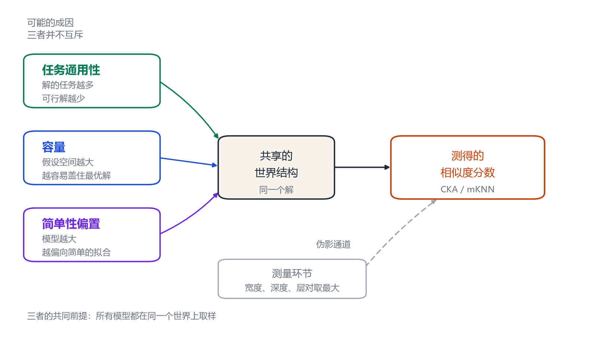
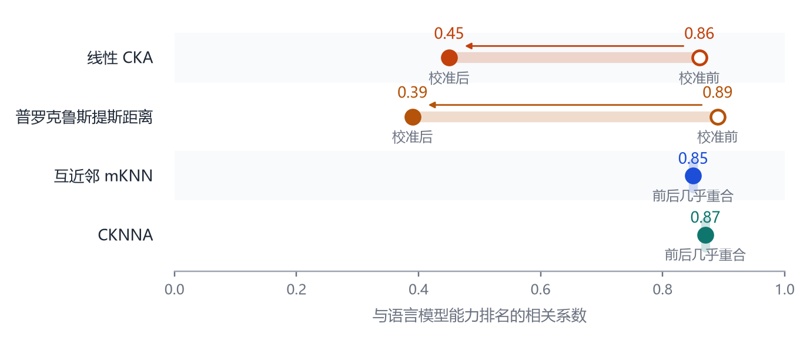
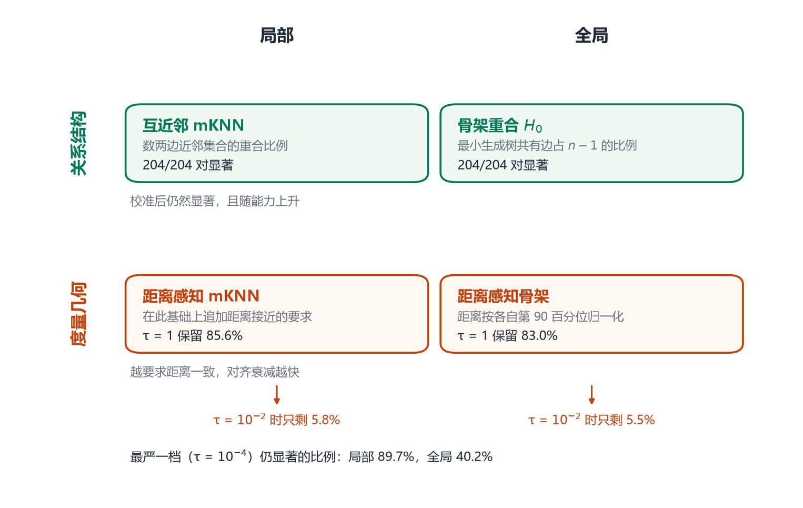

# 第 1 章　从观察到一个命题

在词向量还是主流的年代，做机器翻译的人注意到一件事。两种语言各自在自己的语料上训练出来的词向量，只要给出一小批译词，就能学出一个线性映射，把一边的向量搬到另一边，搬过去之后近邻关系大体还对得上。两个语料库不相交，两个词表不相交，训练过程互不知情，可它们对"哪些词在讲同一类事情"的判断是相通的。这件事后来被处理成一项工程技巧，很少再有人追问它意味着什么，因为它发生在同一种模态内部，语言与语言之间的差别还不够刺眼。

2024 年，Huh、Cheung、Wang 和 Isola 把这个观察推到一个更强的形式上，提出柏拉图表征假设（Platonic Representation Hypothesis，PRH）。原话是，在不同数据、不同目标、不同模态上训练的神经网络，其表征空间正在收敛到一个关于现实的共同统计模型。名字借自柏拉图的洞穴，投在墙上的影子是观测，洞外的实物是生成这些观测的世界，模型从影子里反推的东西正往洞外靠。这个比喻只能当修辞读，论文自己也这么定位，它把可以检验的陈述说得体面了些，真正被检验的是分数与模型规模的联合走势，不是洞外有没有东西。

通常的讲法回答这些东西是什么、怎么把它们训起来，落点都在做法上；这一册要问的是另一类问题，收敛为什么可能成立，在什么条件下成立，条件不成立时剩下的东西长什么样。两类问题的答案形式不同，做法可以用配方和指标描述，成立与否只能写成命题。命题这种写法有固定的骨架，前面列条件，后面给结论，中间还要夹一段说明哪一步用了哪一条。

要为后面七章铺路，这一章得先把命题写清楚，再把它头顶那把尺子检查一遍。要交代的有四件，原始表述说了什么，三条选择性压力各自怎么起作用，相似度指标为什么会随模型变大而虚高。第四件是校准之后到底还剩什么，它决定了这一册后面八章怎么措辞，也决定了每一处结论允许说到多重。凡是说两个模型对齐，都得先讲清对齐的是关系还是距离，否则两句相反的话可以同时成立。

## 1.1　三件不该相通的事

78 个视觉模型的来源很杂。其中 17 个是视觉 Transformer，从 tiny 到 giant 都有，训练目标覆盖 ImageNet-21k 分类、掩码自编码、DINO 与 CLIP，有一部分还在 ImageNet-12k 上做过微调；另有一个随机初始化的 ResNet-50 当对照；11 个是对比学习训练的 ResNet-50，数据分别是 ImageNet-1k、Places-365 和若干合成图像集；剩下 49 个是 ResNet-18，用对齐性与均匀性损失训练。能力用 19 个视觉任务适配基准（Visual Task Adaptation Benchmark，VTAB）的分类任务来量，做法是冻住主干只训线性分类头，某任务准确率达到 78 个模型里最好成绩的八成，就算它解决了这个任务。对齐度在 Places-365 的验证集上算，取 1000 张图、近邻数 $k=10$，用的是互近邻。

结果是一条单调的趋势，解决的 VTAB 任务越多，模型彼此之间的互近邻得分越高。把模型按能力分箱，最强的一箱内部贴得很紧，最弱的一箱里各走各的路，换成二维嵌入看更直观，能力强的挤成一小团，能力弱的散在四周。Huh 等人在这里引了托尔斯泰的句子，说强的模型都是相似的，弱的模型各有各的弱法。Bansal 等人在 2021 年给这种可能性起过一个名字，叫安娜·卡列尼娜情形，指的是所有表现好的网络可能用同一种方式表征世界。

跨模态那一侧的设置是 12 个语言模型与 17 个视觉模型两两配对，一共 204 对。取 1024 对图文样本，把同一批样本在两边编码器里的向量都取出来算互近邻，再把分数按语言模型的能力排开，曲线往上走，最高的一条爬到 0.16 就停住了。这个数要配着基线读，$k=10$、$N=1000$ 时随机的期望得分约为 $k/N=0.01$，0.16 是它的十六倍。十六倍说明近邻重合不是偶然，可从 0.16 到完全一致还隔着很长的距离，把它说成"已经基本对齐"同样是夸大。

按直觉，这几组模型不该有共同语言。视觉模型的输入是像素，语言模型的输入是词元，损失一个算在遮住的图块上、一个算在下一个词的概率上，中间没有任何东西告诉它们第 768 维该对应第 4096 维的哪一维。视觉模型之间更没有配对样本，它们各自训练，唯一的联系是看过同一批图片。在这样的前提下还能读到 0.16，说明"哪些样本算一类"这件事上有共识，而共识从哪来，正是三条选择性压力要回答的问题。

## 1.2　原始表述与三条压力

PRH 的原始表述只有一句话，训练数据、训练目标、模态都不相同的神经网络，其表征空间正在收敛到一个关于现实的共同统计模型。这句话里最容易被跳过的是"现实的统计模型"，它把收敛的目标从"某个最优网络"换成了"生成数据的那个过程的分布"，收敛于是不再指参数相似，而指对世界的描述在变准。论文把它写成假设而非结论，并在正文里给了一个数学草稿，世界是 $T$ 个离散事件组成的序列，每个事件经若干个双射的观测函数投影到像素、声音、质量这些测量空间。草稿随即带出一条限制，论证只在观测是双射时严格成立，也就是每个投影都携带世界的全部信息。

第一条压力是任务通用性。每个训练数据点、每个目标函数都给表征加一条约束，模型要解的约束越多，同时满足全部约束的表征就越少，可行解的集合就越窄。论文把这条路写成多任务缩放假设，并把它与 Cao 和 Yamins 在 2024 年提出的逆变原理并列，后者说的是容易的目标解集大、难的目标解集小。下一词预测看起来是单一任务，其实不是，要接上"他把杯子推到桌沿，杯子会"，模型得知道物体会掉，要接上"她把冰块放进温水，冰块会"，得知道热传导。

第二条是容量。假设存在一个对所有标准目标都最优的表征，函数类越大，越有可能把这个最优解包进去；小模型的假设空间覆盖不到它，只能停在离初始化最近的局部解上，于是彼此不像，大模型覆盖到了，就都落到同一个点上。像几个人在同一片山里找最低处，地图小的只能在自家山谷里转，地图大的才能走到同一个盆地。这条解释还有一个方向相反的改写，说容量有限装不下场景的全部细节，只能保留对预测最有用的那一部分，瓶颈一样，留下的东西也就一样。一个说空间够大所以装得下同一个解，一个说空间不够大所以只装得下同一批东西，落点相同。

第三条是简单性偏置。在训练数据上得到同一个映射，并不妨碍模型内部发展出彼此不同的表征，十亿参数的模型完全可以学出一套又复杂又独特的内部语言。拦住它的是深网天然的奥卡姆倾向，越大的模型越偏向简单的拟合，权重衰减、丢弃与训练动力学本身都往这个方向推，于是大模型不是找到了更多种解法，而是在更多种解法里挑了同一种。三条压力并不互斥，论文自己的说法是它们可能同时起作用，真正的问题不是挑一条，而是判断那条上升的曲线里有多少来自它们、有多少来自别的地方。

论文列出的保留后来都被实验追上了，值得摆开。观测有损或随机，论证就不成立；机器人领域还没有像图像和文本那样标准化的世界状态表示，硬件贵、数据少，那里的收敛远没有那么明显。研究者的集体偏好与硬件的适配性也在塑造模型的方向，这类因素会让趋同看起来比实际更强；专用智能可能根本不收敛，一个只预测蛋白质结构的系统与一个只在高速公路上跟车的系统之间，未必有多少共享。还有一条最要紧，度量的选择本身有争议，互近邻只是众多指标之一，0.16 算强算弱，作者留成了开放问题。

如图 1-1，三条压力被画成三条实线，它们各自经过"共享的世界结构"这个中间环节，再落到被测出来的分数上。下面那条虚线绕开了中间环节，从测量环节直接通到分数，宽度、深度与层对取最大都挂在这一侧。实线那一路是研究者希望看到的故事，虚线那一路是方法学要排除的干扰。这张图里没有任何数据，它只是把本章要拆的两件事并排放好。

<figure class="fig">

<figcaption><b>图 1-1</b>　三条选择性压力与一次测量。上面三条实线经过共享的世界结构再落到分数，下面的虚线从测量环节直接抬高分数，两者叠加才得到图上看到的读数。</figcaption>
</figure>

## 1.3　尺子自己会变松

那条曲线的纵轴是相似度分数，分数由指标算出来，而指标是一个统计量，它有自己的零分布。最常用的是中心核对齐（Centered Kernel Alignment，CKA）。给定同一批 $n$ 个样本在两组表征下的矩阵 $X\in\mathbb{R}^{n\times d_x}$ 与 $Y\in\mathbb{R}^{n\times d_y}$，先算出样本之间的相似度矩阵 $XX^\top$ 与 $YY^\top$，各自减去行列均值做中心化得到 $\tilde X$ 与 $\tilde Y$，再把两个矩阵拉直算余弦：

$$
\operatorname{CKA}(X,Y)=\frac{\lVert \tilde Y^\top \tilde X\rVert_F^2}{\lVert \tilde X^\top \tilde X\rVert_F\,\lVert \tilde Y^\top \tilde Y\rVert_F},
$$

其中 $\lVert\cdot\rVert_F$ 是把所有元素平方求和再开方，$d_x$ 与 $d_y$ 是两边的宽度。读法是，两个相似度矩阵在互相投影之后还剩多少共同方向，取值落在 0 到 1 之间，1 表示两张矩阵成比例。

问题出在分母上。Gröger 等人的命题 4.1 说，若两边的行独立同分布、均值为零、协方差都是单位阵，且 $x_i$ 与 $y_i$ 相互独立，那么中心化后的互协方差 $\tilde C=\tilde Y^\top\tilde X$ 满足 $\mathbb{E}_{H_0}\lVert\tilde C\rVert_F^2=d_xd_y/(n-1)$。这个量不为零，而 CKA 的分子正是它，分母的两项各自按 $O(\sqrt d)$ 增长，两下一除，指标在零假设下的基线就是 $O(d/n)$ 量级。含义很具体，样本数固定时把模型加宽一倍，两个毫无关系的表征之间的 CKA 期望就会翻倍，看上去像是越宽越对齐。这是有限样本下高维协方差估计的噪声，不是实现错误，随机矩阵理论里管它叫噪声体，上边缘由 $d/n$ 决定，不会塌到零。

互近邻走的是另一条路。同一篇论文的命题 4.2 说，若两边的行独立、两两距离几乎必然互不相同，那么对任何 $k\lt n$ 都有 $\mathbb{E}_{H_0}[\mathrm{mKNN}(X,Y)]=k/(n-1)$，基线里没有 $d$，只有 $k$ 与 $n$，量级是 $O(k/n)$。这个差别在比较研究里很实用，$k$ 由研究者自己定，可以跨实验固定，$d$ 由架构决定，根本没法控制，而典型设置下 $k$ 远小于 $d$。普罗克鲁斯提斯距离（Procrustes distance）这类几何指标跟着谱指标走，它们同样是全对距离的函数，继承的是 $O(d/n)$ 的基线，不是 $O(k/n)$。

第二个污染来自深度。逐层比较时没有人知道该拿哪一层对哪一层，通行做法是把所有层对算一遍再报最大值，$T_{\max}=\max_{\ell,\ell'}S_{\ell,\ell'}$，搜索的层对数是 $M=L_AL_B$。即使两边毫无关系，取最大也会把报告分数抬高，这叫 look-elsewhere 效应；论文给了一个只依赖右尾的界，若零假设下的波动满足次高斯尾，则 $\mathbb{E}_{H_0}[T_{\max}]\le\mu+C\sigma\sqrt{\log M}$，$C$ 是常数，$\mu$ 与 $\sigma$ 是共同的均值与尺度，比较次数越多，期望最大值越高。两个污染不是并列的而是分层的，宽度让每个层对都有正的机会相似，深度提供更大的池子去挑这些机会，报告的分数跟着一起漂高，128 层对 2 层即使毫无共享信号也占便宜。

## 1.4　把零假设摆上桌

要把两条通路分开，得先有一个参照点。论文的办法是置换检验，保持 $X$ 的行不动，把 $Y$ 的行随机打乱，样本之间的对应关系被破坏，两组表征变成相互独立，重复 $K$ 次就得到相似度的一个零分布。取右尾临界值 $\tau_\alpha$ 为合并样本 $\{s_{\mathrm{obs}},s^{(1)},\dots,s^{(K)}\}$ 的第 $\lceil(1-\alpha)(K+1)\rceil$ 个次序统计量，$\lceil\cdot\rceil$ 表示向上取整，校准分数定义为

$$
s_{\mathrm{cal}}=\max\left(\frac{s_{\mathrm{obs}}-\tau_\alpha}{s_{\max}-\tau_\alpha},\,0\right),
$$

其中 $s_{\mathrm{obs}}$ 是观测分数，$s_{\max}$ 是该指标的理论上界，CKA 与互近邻都取 1，$\alpha$ 是显著性水平。观测值落在 $\tau_\alpha$ 以下记 0，等于上界时仍记 1，中间按超过零假设的部分等比例缩放。

深度那个污染要用另一种校准，不是把每个层对分别校准再取最大，而是对最终报告的那个统计量本身做零分布。同一次置换要施加到第二个模型的所有层上，逐层算出 $S^{(k)}$ 再取 $T^{(k)}=T(S^{(k)})$，这样得到的零分布对应整条分析管线，包括取最大这一步。逐项校准之后再取最大值，膨胀依然存在，因为最大值总是挑到噪声里最高的那一个。这个区分看似琐碎，实际是校准能否成立的关键，论文把它写成聚合感知的零校准，取最大时它回到 Westfall 与 Young 在 1993 年给出的 maxT 程序。

实验用的是 204 对视觉语言模型，三个语言家族（BLOOM、OpenLLaMA、LLaMA）对五个视觉家族（ImageNet-21K、MAE、DINOv2、CLIP、CLIP 微调版），$d/n$ 从 0.19 到 8，$n=1024$，$k=10$，$\alpha=0.05$，置换 $K=200$ 次，多重比较用 Benjamini 与 Hochberg 校正。结果是，未校准的 CKA 随模型能力稳定上升，校准之后这条趋势消失，SVCCA、RV 系数与普罗克鲁斯提斯距离也一样。最能说明问题的是分数与能力排名的相关系数，线性 CKA 从 0.86 掉到 0.45，普罗克鲁斯提斯距离从 0.89 掉到 0.39。而局部指标几乎不动，互近邻保持在 0.85 附近，CKNNA 在 0.87 附近，如图 1-2。

<figure class="fig">

<figcaption><b>图 1-2</b>　校准前后的相关系数。横轴是分数与语言模型能力排名的相关系数，空心点是校准前，实心点是校准后，全局指标掉了一半，局部指标前后几乎重合。</figcaption>
</figure>

校准本身也有代价和边界。校准分数通过 $\tau_\alpha$ 依赖 $\alpha$，换一个显著性水平读数会变，所以论文同时报置换 $p$ 值与零分布分位数，让不依赖 $\alpha$ 的摘要也在场。效应量与 $p$ 值不能互相替代，前者说超过机会多少，后者说有多少证据反对零假设，204 对模型在互近邻上全部显著，但显著不等于大。还有一点，校准不是把分数变准，而是把"什么关系都没有时该有多高"估出来，校正的是参照点而不是测量误差。

## 1.5　亚里士多德的名字

校准之后剩下的东西有个清楚的名字。全局谱指标塌到零基线附近，局部近邻基本保留，于是论文提出亚里士多德表征假设（Aristotelian Representation Hypothesis，ARH），在不同目标、不同数据、不同模态上训练的网络，收敛到共享的局部邻域关系。这个说法比原来的弱，因为全局收敛蕴含局部收敛，整个几何对上之后近邻自然对上，反过来不成立。还有一条更细的结果把"局部"再切一刀，把小带宽的径向基核 CKA 校准之后，对齐也消失了，也就是说两个模型都认为样本 $A$ 与 $B$ 是邻居，却并不认为它们一样近。

共享的是邻接关系，不是距离，这句话值得先记下。一对点挨不挨着，是一个二值判断，对单调变形不敏感；它们相距多远，是一个带尺度的量，换个坐标系、换个温度、换一层归一化就会变。前者在跨模态比较里活得下来，后者活不下来，这个不对称不是实验误差，而是两种信息在训练目标里的地位不同。任何只把正样本拉近、只把二阶矩压成单位阵的目标，都没有对距离数值下过约束。

名字取自亚里士多德《范畴篇》里的关系范畴。他把"相对者"单列为一类，比如"两倍"与"一半"，这类东西的存在依赖于另一个东西的存在，而"白"这样的性质不依赖。局部邻域关系正是这个意义上的相对者，它不告诉你每个点在哪，只告诉你谁与谁相对。论文说这是对原假设的收窄而不是推翻，理由也直接，原来的证据有一大半被归因于 $d/n$ 与层对取最大，剩下的撑不起"全局一致"这种强度。

## 1.6　结构对几何

You、Jang、Mo 与 Jung 在 2026 年指出，"局部"这个词承担了它承担不起的东西。此前的局部与全局对比同时改了两件事，一件是结构尺度，另一件是比较的内容。互近邻是局部的、关系的，CKA 是全局的、度量的，两个变量一起动，结论就分不清是哪一个造成。他们搭了一个 $2\times 2$ 的框架，把尺度与内容拆开，关系的两侧是局部的互近邻与全局的骨架重合，度量的两侧则在保持关系不变的前提下追加距离一致性要求，严格程度由容忍度 $\tau$ 控制，$\tau$ 越小要求越严。

全局那一格要新造一个指标。他们把点云按距离阈值逐渐连边，$H_0$ 记录连通分量的个数，每一条让两个分量合并的边叫死亡边，这些边恰好构成最小生成树，也就是用 $n-1$ 条边把 $n$ 个点连成一棵不断开的树、总长度最小的那棵。骨架重合定义为两棵树共有的边占 $n-1$ 的比例，

$$
S_{H_0}(X,Y)=\frac{|T_X\cap T_Y|}{n-1},
$$

$T_X$ 与 $T_Y$ 是两组表征上的最小生成树边集。这个量只问哪两个点被连起来，不问边长，因此是纯粹的关系量；最小生成树本身对边长不敏感，同一条边在两边连的始终是同一对样本，关系与度量就这样被拆成两步。

结果是，204 对模型的互近邻与骨架重合在校准后全部显著，两个指标在模型对层面高度一致，Spearman 相关系数 0.968，全局关系同样随能力上升。度量那一侧的变化陡得多，$\tau=1$ 时局部与全局分别保留关系基线的 85.6% 与 83.0%，$\tau=10^{-2}$ 时降到 5.8% 与 5.5%，两个尺度衰减得几乎平行。真正分出高下的是最严的一档，$\tau=10^{-4}$ 时局部还有 89.7% 的模型对显著，全局只剩 40.2%。视频与文本的对照复现了同样的形状，143 对全部显著，$\tau=10^{-4}$ 时局部 86.0%、全局 46.9%。

四格与数字的关系如图 1-3。读法因此要改一次，收敛的是关系结构，不收敛的是度量几何，尺度只在最严格的要求下才显出差别。所谓"亚里士多德"里的"局部"其实说窄了，局部只是关系的一种取法，全局的骨架也是关系。这对后面的写法有直接影响，凡是要说两个模型对齐，都得先交代它对齐的是关系还是距离，否则同一句话在两个格子里会得到相反的结论。

<figure class="fig">

<figcaption><b>图 1-3</b>　结构对几何的 2×2 框架。横向分局部与全局，纵向分关系与度量，上面一格校准后仍然显著，下面一格随距离要求收紧而迅速衰减，最严一档的差距写在最下面。</figcaption>
</figure>

## 1.7　换个训练目标再验一次

前两篇都在图文对上做，而图文对有一个天然的疑问。图像与文本都由人产生，都在描述同样的东西，相似可能来自数据共享，未必来自世界本身。世界模型提供了一个更干净的场景，它的训练目标是预测下一个状态，不是描述。DINO 世界模型（DINO-WM）的结构不复杂，一个冻结的视觉编码器把每帧变成一组图块特征，一个 6 层的 Transformer 预测器读历史特征与动作，一次输出下一帧的全部图块特征，编码器可以整块换掉。

Li、Ma、Xiong、Chen 与 Zhang 换了四种编码器，DINOv2 的四个尺寸、SigLIP、MAE，再加一个 ResNet18，前三个都是视觉 Transformer，ResNet18 是卷积网络。五个环境是 PointMaze、PushT、Wall、Rope、Granular，分别盖住导航、有接触的推物、避障，以及绳子与颗粒这类可变形物体；这几类动力学对表征的要求不一样，收敛只在某一个环境里出现就不算证据。相似度用逐层计算再平均的互近邻。参照点选 DINOv2-S 的第 10 轮检查点，理由是它在五个环境里的零样本规划成功率最稳，这是按性能挑出来的操作参照，论文明确不把它当成真理念。

结果分三档。DINO 家族起点就高，与参照同源，之后缓慢上升；SigLIP 与 MAE 起点低，上升最明显；ResNet 一直在低位，整个训练窗口里没明显靠近，这与卷积拓扑不兼容有关。有一个平凡解释需要先排掉，如果预测器只是把编码器的几何原样传下去，那么预测器空间的相似度应该约等于编码器空间的相似度。实际不是这样，从编码器到第 1 轮的预测器，跨模型相似度通常明显下降，从第 1 轮到第 10 轮又回升，编码器带来的几何先被改写，再被训练塑造成一个更共享的结构。

功能检验用拼接，把两个预测器各切一半，$A$ 的前 $k$ 层接 $B$ 的后 $6-k$ 层，中间插一个轻量多层感知机做适配，其余参数全部冻结，再用交叉熵方法规划器在想象里滚 5 步，测规划成功率。PointMaze 上 DINOv2 接 SigLIP 切在 3 层时成功率 0.90，切在 1 层时 0.86；Wall 更能区分，同样的两对模型，3 层是 0.62，1 层只有 0.30，2 层 0.38。不对称的地方同样有信息，MAE 当前端、DINOv2 当后端时，PointMaze 上还有 0.74，Wall 上掉到 0.02，MAE 接 SigLIP 在 Wall 上是 0.00。适配器能把特征空间对上，却补不出缺失的规划要素，这一点在困难环境里格外明显，多步自回归又把误差一层层放大。

## 1.8　命题需要前件

讲到这里，有一件事必须说清楚，否则下一章会被误读。上面所有结论的形式都是程度。在距离要求最严的一档，204 对里仍有 89.7% 的局部对齐显著，互近邻与能力的相关系数保持在 0.85，而局部一侧的保留比例从 85.6% 掉到 5.8%。这些数字依赖样本量、指标选择、模型池的构成与显著性水平，换一批模型数字会变，换一个指标措辞要改，它们说的是在这些条件下的收敛程度。

定理的形式完全不同。第 3 章要给的命题是这样的，设 $M\ge 2$ 个模态共享同一个正样本分布 $\pi$，且目标函数的最小值点唯一到一个旋转，那么存在一个世界嵌入 $h^\star$，使每个模态的总体最优编码器都满足 $f_m^\star\circ g_m=Q_mh^\star$，$Q_m$ 是 $k$ 阶正交矩阵，任意两个模态之间只差一个旋转 $Q_mQ_{m'}^\top$。条件写在前面，结论跟在后面，条件不成立结论不成立，条件成立结论没有例外。配套的命题 1 说明这个唯一性从哪来，平方损失加白化之后，最小值恰好是图的前 $k$ 个特征向量给出的谱嵌入，代价是 $2\sum_{i=1}^{k}(1-\mu_i)$，$\mu_i$ 是图核从大到小排的第 $i$ 个特征值，只要 $\mu_k\gt\mu_{k+1}$，最小值点就是 $Q\Phi_\pi$。

两者的关系不是"实验发现、定理证明"。定理不证明 204 对模型显著，实验也不检验定理的前提，因为真实数据有损、样本有限、训练到不了最优。定理回答的是如果一切理想，为什么必然收敛、收敛到什么；实验回答的是在现实的模型池里，收敛发生在哪一层结构上。前者是关于极限的陈述，后者是关于现状的陈述，互不替代，也不该拿一个去否定另一个。

下一章要把世界写成有限状态集合，把模态写成渲染函数，把正样本写成状态对上的对称分布。这三步做完，"同一个世界"就不再是比喻，而是一个有限集合加一个概率分布。"看见"也不再是动词，而是一族单射，每个模态一族。接着要证明的事情很具体，这个分布矩阵的归一化邻接矩阵的特征向量，正好就是让白化 JEPA 取到最小值的坐标。
