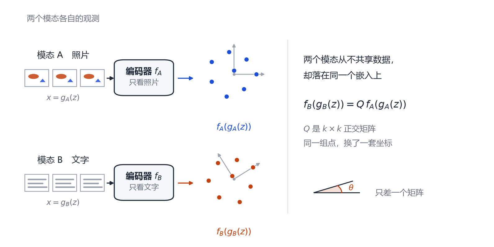
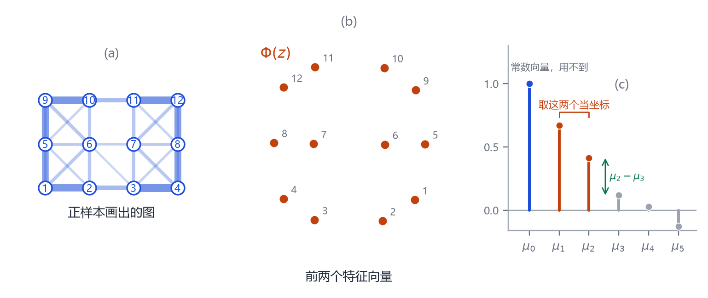
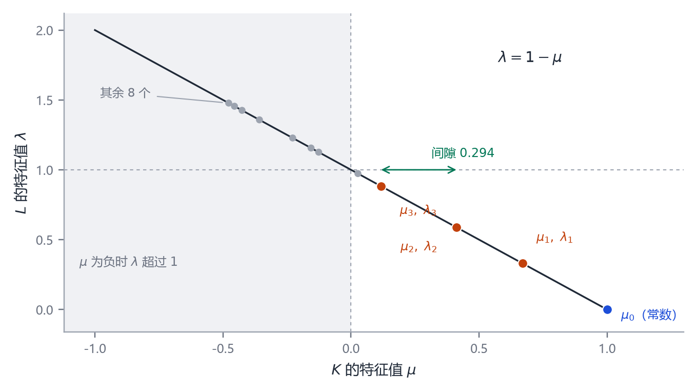
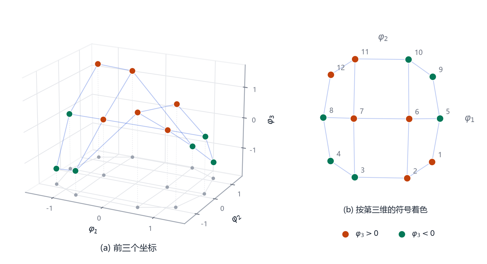

# 第 2 章　图核与谱嵌入

上一章把柏拉图表征假设从一句经验判断收窄成一个有前件的命题：换架构、换目标函数、换模态，只要模型足够大、数据足够多，学到的表征在近邻意义上会重合，而校准掉度量自身的零基线之后，全局意义上的"完全一致"并不成立。这个结论留下的问题很具体，重合到什么程度算重合，两个模型之间剩下的那点差别有没有形状，能不能用一个量把它写下来。

回答这类问题不能靠更精细的相似度指标，得先把被比较的对象写清楚。"同一个世界"是什么，"一个模型看见世界的方式"是什么，"两次观测被当作同一件事"又是什么，这三件事在没有符号的时候只能靠比喻，一旦写成集合、概率和映射，问题就变成一道可以算的题。这一章铺的是这套符号的地基，顺手把一半的答案算出来。

具体路线是四步。先把世界写成有限状态集与概率，把模态写成从状态到观测的单射，把正样本写成状态对上的对称分布；再把这张分布矩阵看成一张带权图，用它的归一化邻接矩阵把"谁常见"这个干扰除掉；然后从归一化邻接矩阵的特征向量读出每个状态的坐标，并说明这组坐标自动带白化；最终把白化 JEPA 的目标函数平方展开，证明它的总体最优解就是这组坐标，代价恰好是 $2\sum_{i=1}^{k}(1-\mu_i)$。

有一条线索贯穿全章，值得先摆出来。目标函数只由成对嵌入之间的距离构成，反塌缩项又只要求嵌入的二阶矩是单位阵，两件事合起来把"往哪个方向摆"的自由度全部交出去，剩下的自由度只有"保留哪几个方向"。用图的眼光看，这个问题就是取前 $k$ 个特征向量，所以谱分解不是外挂上去的分析工具，而是目标函数自己挑中的答案。

## 2.1　世界、模态与正样本

世界写成 $Z$，一个有限集合，元素叫状态，每个状态带一个严格为正的概率 $p(z)$。有限是定理的前提而不是行文上的省事，后面的每一个求和都写在这 $|Z|$ 个状态上，谱分解也才是一个 $|Z|\times|Z|$ 矩阵的特征问题；换成连续世界要把求和换成积分，结论的形状不变，测度上的细节要多出好几页，几个前提也都得重新写一遍。

模态编号 $m=1,\dots,M$，且 $M\ge 2$。模态 $m$ 通过一个渲染函数 $g_m$ 把状态变成观测，$x=g_m(z)$，一张照片、一句描述、一段录音都是这样来的。要求 $g_m$ 是单射，意思是不存在两个不同状态渲染出同一个观测，这条要求很硬，真实相机做不到，两个不同场景完全可能拍出同一张模糊照片；它的作用是保证观测里没有丢信息，让"从观测反推状态"这一步在原理上可行，第 5 章会专门处理它不成立的情形。

训练数据不是单个观测，而是一对对的观测 $(g_m(z),g_m(z'))$，每一对都被声明为同一个场景的两次观察。这些观测背后的状态对服从一个分布 $\pi_m$，它有两条性质，写下来很短：对称，$\pi_m(z,z')=\pi_m(z',z)$；两个边缘都等于 $p$，$\sum_{z'}\pi_m(z,z')=p(z)$。

对称这一条说的是配对没有方向，$z$ 与 $z'$ 被当成一对和 $z'$ 与 $z$ 被当成一对是同一件事，所以 $\Pi$ 一定是对称矩阵。边缘这一条更关键，它说的是从一对正样本里挑一个看，看到的状态服从 $p$，换挑另一个也服从 $p$，于是所有平均都在同一个分布上做；改变正样本只改变哪些状态被配在一起，不改变哪些状态常见。后面每一次把期望写成 $\mathbb{E}_p$ 都靠这一条，它把 $\pi$ 与 $p$ 的关系锁死，也让"两个模态看的是同一批状态"这句话变成了一个可以检验的等式。

目标函数有两个部件，一个管预测，一个管反塌缩。模态 $m$ 的编码器 $f:X_m\to\mathbb{R}^k$ 把观测映到 $k$ 维嵌入。训练要让它最小化的量写在下面，两个部件都在其中。

$$
L_m(f)=\mathbb{E}_{(z,z')\sim\pi_m}\,\ell\big(f(g_m(z)),\,f(g_m(z'))\big)+\Omega(f),
$$

其中 $\ell$ 是预测项，取平方距离 $\ell(a,b)=\lVert a-b\rVert^2$，作用是把一对正样本的嵌入拉近；$\Omega$ 是反塌缩项，只通过嵌入的分布起作用，可以是一条罚项，也可以是硬约束。论文里的实验把预测器取成恒等映射，所以 $\ell$ 直接比较两个嵌入，而当作世界模型用的 JEPA 会让一个学出来的预测器从一个嵌入推出另一个，有时还以动作为条件，那种情形不在这套分析覆盖的范围之内。

两个项都对旋转不变，这一点后面要用两次。设 $Q$ 是 $k$ 阶正交矩阵，它保持长度和夹角，几何上是一个旋转，也可以带一次镜面反射；于是 $\ell(Qa,Qb)=\lVert Q(a-b)\rVert^2=\lVert a-b\rVert^2$，而把每个嵌入都乘上 $Q$，二阶矩从 $I_k$ 变成 $QI_kQ^\top=I_k$，白化约束也不变。渲染是单射还带来一个便宜，$f$ 与 $f\circ g_m$ 一一对应，目标可以整体搬到状态上写成 $L_\pi$，这一步在论文里是引理 1，第 3 章会正式用到，本章先用它的结论。整章的关系如图 2-1。

<figure class="fig">

<figcaption><b>图 2-1</b>　两个模态各自的观测与编码。左边两行是同一批场景的照片和描述，中间两个编码器互不相见，右边两组点是同一组点，只差坐标系的转角 $\theta$。</figcaption>
</figure>

图 2-1 左边是同一个世界在两个模态里的样子，照片一行是像素，文字一行是句子，中间两个编码器各自训练，数据里没有一对配好的跨模态样本；右边两团点画的是结论，红点是蓝点转过 $\theta$ 之后的样子，坐标轴跟着一起转，所以在各自的坐标系里两组点的位置完全一样。这张图里没有任何计算，它只是把"差一个旋转"这句话画成了可以看的东西，而本章剩下的部分要给这句话补上条件。

## 2.2　正样本画出的图

把 $\pi$ 写成一个矩阵 $\Pi$，$\Pi_{zz'}=\pi(z,z')$，再把概率排成对角矩阵 $D=\operatorname{diag}(p)$，边缘条件就是一句话，$\Pi\mathbf{1}=p$，或者说 $\Pi$ 的行和等于 $D$ 的对角线。这个等式看着平淡，它却是后面所有推导的发动机，归一化邻接矩阵的最大特征向量之所以正好是 $\sqrt{p}$，靠的就是它。

把 $\Pi$ 当邻接矩阵读，节点是状态，边权是两个状态被配成一对的概率。对角元是两次观察落在同一个状态上的概率，非对角元是两个不同状态被当成一对的概率，全部元素加起来正好是 $1$，所以对角的那部分质量是从非对角那里挪过来的。一张只有对角的 $\Pi$ 意味着正样本永远是同一个状态的两次复制，这时 $\Pi=D$，图里没有任何边，所有状态彼此孤立。

孤立图上什么也读不出来。把 $\Pi=D$ 代进归一化邻接矩阵，$K=D^{-1/2}DD^{-1/2}=I$，全部特征值等于 $1$，谱间隙为零，取前 $k$ 个特征向量得到的是坐标轴本身，每个状态拿到一个只有一位为 $1$ 的向量，这个向量与状态之间的关系毫无关联。真实的正样本总有非对角质量，两次拍摄之间杯子挪了一点，两句话的措辞换了一种，这些"差不多但不是同一个"的状态对被连起来，图才有形状。

衡量形状的量是比值而不是质量。同一个 $\pi(z,z')$ 可以因为两个状态都常见而很大，也可以因为配对偏好而很大，只有后者与图的结构有关。把 $\pi(z,z')$ 除以 $p(z)p(z')$，得到的是"这两个状态一起出现的频率比它们各自独立出现时高多少倍"，常见与否被除掉，剩下全是配对偏好。这个比值就是本章标题里的图核（graph kernel），归一化邻接矩阵正是它在 $D^{-1/2}$ 共轭下的矩阵形式。

12 个状态的小世界可以把这件事算出来。状态排成 3 行 4 列的格子，正样本偏好相邻位置，隔一格的两次拍摄肉眼分不出差别所以也算一对，隔两格的基本不配。用这个世界的 $\pi$ 算出来的 $K$ 有一组具体特征值，最大的是 $1$，往下依次是 $0.669$、$0.411$、$0.118$，谱的形状一眼可见。这几个数字后面还要用，图 2-2 会把它们画出来，第四节拿去算坐标，第七节拿去量间隙。

## 2.3　归一化邻接与常数特征向量

最直接的想法是对 $\Pi$ 做特征分解，这条路立刻撞上一个麻烦。一个方阵乘上向量一般会把方向扭歪，特征向量是那类方向不变、只被拉长或缩短的向量，对着一张图做特征分解等于找出"哪些方向是这张图自己的方向"；可是出现得越频繁的状态在矩阵里那一行越大，第一特征向量差不多就是"哪里常见"，一条走廊里最常被拍到的转角会把所有坐标拉向自己，几何结构被频率盖住。

拿掉频率影响的办法是给每一行每一列各除一个 $\sqrt{p}$。指数取一半有讲究，它让矩阵在缩放之后仍然对称。把这件事写成公式，就得到

$$
K=D^{-1/2}\,\Pi\,D^{-1/2},\qquad K_{zz'}=\frac{\pi(z,z')}{\sqrt{p(z)\,p(z')}},
$$

$K$ 叫归一化邻接矩阵。它对称，因为两边除的都是对角矩阵，这一条让它的特征值全是实数、特征向量可以取成彼此正交。而且可以直接验算 $K\sqrt{p}=D^{-1/2}\Pi D^{-1/2}D^{1/2}\mathbf{1}=D^{-1/2}\Pi\mathbf{1}=D^{-1/2}p=\sqrt{p}$。也就是说 $\sqrt{p}$ 是 $K$ 的特征向量，特征值恰好是 $1$，这是整张谱里最大的那个。

这个结果不是巧合，它解释了归一化为什么只能用 $D^{-1/2}$。要让"常数函数"成为特征向量，就得让 $\Pi\mathbf{1}=p$ 这件事正好被吸收掉，而边缘条件给的正是这个等式；顺着要求解下去，左乘 $D^{-1/2}$ 把行和变成 $\sqrt{p}$，再右乘一个 $D^{-1/2}$ 让矩阵保持对称，形式就定了。换成 $D^{-1}$ 会得到不对称的矩阵，换成别的幂次则要么破坏对称，要么让 $\sqrt{p}$ 不再是特征向量。

另一个方向也值得走一遍。$D^{-1}\Pi$ 是把每行除以行和得到的矩阵，作用在函数上是 $(T_\pi h)(z)=\mathbb{E}_\pi[h(z')\mid z]$，读作从 $z$ 出发、在正样本那一头取平均，这是马尔可夫算子。它不对称，但在以 $p$ 为权的内积 $\langle a,b\rangle_p=\mathbb{E}_p[ab]$ 下自伴，因为 $\pi$ 对称；把函数乘上 $D^{1/2}$ 之后这个内积变成普通欧氏内积，$T_\pi$ 变成 $K$。所以对称化只是一次等距换坐标，特征值一个也没变。

这个算子还能读成一次随机游走。从 $z$ 出发，按 $\pi(z,z')/p(z)$ 的概率跳到下一个状态，跳一步之后的期望就是 $T_\pi$ 作用在函数上的结果，而 $p$ 是这个游走的平稳分布，因为 $\sum_z p(z)\,\pi(z,z')/p(z)=\sum_z\pi(z,z')=p(z')$，两边都对得上。常被访问的状态在平稳分布里权重大，这正是直接对 $\Pi$ 做特征分解会先抓到"哪里常见"的原因，把 $p$ 除掉之后剩下的才是游走的结构。

排好序的特征值是 $1=\mu_0\ge\mu_1\ge\cdots\ge\mu_{|Z|-1}$，对应的正交归一特征向量记 $v_0,v_1,\dots$，其中 $v_0=\sqrt{p}=D^{1/2}\mathbf{1}$。这个向量什么也没说，它只是把每个状态的概率重排了一遍，任何两个状态在这一维上的大小关系都由概率决定而与连接方式无关，所以取坐标时要从 $v_1$ 开始，把 $v_0$ 扔掉。

## 2.4　谱嵌入与白化成单位阵

坐标要从特征向量里读出来。谱嵌入（spectral embedding）把每个状态变成一个 $k$ 维向量，每一维对应一个特征向量。定义写成

$$
\Phi(z)=\frac{1}{\sqrt{p(z)}}\big(v_1(z),\,\dots,\,v_k(z)\big)\in\mathbb{R}^k,
$$

第 $j$ 个坐标是第 $j$ 个特征向量在 $z$ 这一项上的值，整体再除以 $\sqrt{p(z)}$。取的是 $K$ 最大的 $k$ 个非平凡特征向量，也就是图上变化最慢的几个波形；$k$ 由使用者定，条件 $1\le k\lt|Z|$ 留给后面去说。

除以 $\sqrt{p}$ 那一步值得单独算一遍。记 $\phi_i=v_i/\sqrt{p}$，则 $\Phi=(\phi_1,\dots,\phi_k)$，二阶矩的第 $(i,j)$ 项可以一路写到加权内积上，

$$
\mathbb{E}_p\big[\Phi(z)\Phi(z)^\top\big]_{ij}=\sum_z p(z)\,\phi_i(z)\phi_j(z)=\langle\phi_i,\phi_j\rangle_p .
$$

特征向量在普通欧氏内积下正交归一，即 $\sum_z v_i(z)v_j(z)=\delta_{ij}$，把 $v_i=\sqrt{p}\,\phi_i$ 代进去，$p$ 被约掉，剩下 $\langle\phi_i,\phi_j\rangle_p=\delta_{ij}$。于是二阶矩正好是单位阵 $I_k$，$k$ 个坐标两两不相关，方差都是 $1$，这才是白化这个词的准确含义。

这就是白化（whitening）。它不是事后补上的一道罚项，而是归一化与正交归一性合起来自动掉出来的结果，只要坐标来自 $K$ 的特征向量，除以 $\sqrt{p}$ 之后二阶矩必然是单位阵。这一点在工程上很值钱，VICReg 罚方差与协方差、Barlow Twins 让两路特征的相关矩阵靠近单位阵，都是把白化当成要额外优化的目标，而在这条路上它是解的副产品。

程序上只有几行。$K$ 用一次外积就除干净，$\Phi$ 取第二列之后的 $k$ 列，其余都是库函数。下面这段代码可以照抄，输入只有一个 $\Pi$。

```python
import numpy as np
p = Pi.sum(1)                       # 行和就是 p，边缘条件 Π1 = p
K = Pi / np.sqrt(np.outer(p, p))    # 归一化邻接 D^{-1/2} Π D^{-1/2}
w, V = np.linalg.eigh(K)            # 对称矩阵，特征值都是实数
w, V = w[::-1], V[:, ::-1]          # 从大到小排
Phi = V[:, 1:k + 1] / np.sqrt(p)[:, None]   # 扔掉 v0，除以 sqrt(p)
```

把这个流程用在那个 12 状态的小世界上，结果如图 2-2。整个世界只有 12 个状态，$\Pi$ 是 $12\times12$ 的矩阵，一次特征分解就够。图里三格对应本章要讲的三件事，图本身、读出的坐标、以及支撑这两个坐标的谱。

<figure class="fig">

<figcaption><b>图 2-2</b>　12 状态的合成世界上算出的谱嵌入。(a) 正样本画出的图，线宽是配对概率；(b) 前两个特征向量给出的坐标，把状态摆回一张格子；(c) 特征值，$\mu_2$ 与 $\mu_3$ 之间空出 $0.294$。</figcaption>
</figure>

图 2-2(a) 是 $\Pi$ 画出来的图，12 个状态按编号排在 3 行 4 列的格子上，线宽是配对概率，最粗的线连的是上下左右相邻的位置，斜线是隔一格的配对，越远越淡。(b) 是 $\Phi$ 的前两个坐标，12 个点自己又排回一张格子，只是整张纸被转了、翻了，还沿一个方向拉长了一点。(c) 是特征值，蓝色的 $\mu_0=1$ 用不到，红色的 $\mu_1=0.669$ 与 $\mu_2=0.411$ 就是 (b) 的两个坐标方向。

点能排回格子，原因不神秘。特征向量是图上的低频波形，相邻状态连线密的方向上波形变化平缓，取最低频的两个波形，正好够把一个二维格子摊开；这也预告了它什么时候失效，如果格子退化成一条几乎等间距的长链，最低频的两个波形会挤在一起，间隙变小，(b) 里的点就开始晃，坐标轴的方向随之失去意义。

## 2.5　拉普拉斯视角与旋转不变

谱嵌入还可以换一套说法，用拉普拉斯矩阵讲。记 $L=I-K$，它是归一化拉普拉斯，$K$ 的大特征值对应 $L$ 的小特征值，取 $K$ 前 $k$ 个非平凡特征向量等于取 $L$ 最小的 $k$ 个。这个形式在图上有一个熟悉的含义，二次型 $\langle h,Lh\rangle_p=\tfrac12\mathbb{E}_\pi\lVert h(z)-h(z')\rVert^2$ 度量 $h$ 沿边变化得多快，$L$ 的零空间是常数函数，特征值小意味着这个方向上的函数在图上几乎不变。

这条路线 2003 年由 Belkin 和 Niyogi 走过，叫拉普拉斯特征映射（Laplacian eigenmaps），当时用来降维，先把数据点连成一张图，再取特征向量当坐标。这里的差别在于来路，那边是先有图、再挑一个降维目标，这边是先有一个 JEPA 的目标函数，图与坐标都是它自己长出来的；于是"取几个特征向量"从一个手调的超参变成了一句有条件的结论，条件就是下一节的谱间隙。

现在把目标函数的两项与旋转的关系说清楚，这一节后面全靠它。$\ell$ 是平方距离，任何正交矩阵都不改变它；$\Omega$ 只通过嵌入的分布起作用，白化约束写成 $\mathbb{E}_ph=0$ 与 $\mathbb{E}_phh^\top=I_k$，把每个嵌入换成 $Qh$ 之后一阶矩变成 $Q\cdot 0=0$，二阶矩变成 $QI_kQ^\top=I_k$，约束照样成立，取值也不变。两条合起来，$h$ 是最优解则 $Qh$ 也是，解不是一个点而是一条轨道。

轨道这件事是整章结论的模具。目标函数如果偏爱某个方向，比如某一维的方差被罚得比别的维重，最优解就会被那个方向钉住，两个模态之间的差别也不再是一个旋转，而是一个更宽的变换类。正因为它对方向完全无所谓，最终剩下的差别才只能是一个旋转；第 3 章定理里那个 $Q_m$ 就是从这个性质里长出来的，第 7 章会看到一个反例，那里的目标只确定到可逆线性变换。

## 2.6　平方展开与马尔可夫算子

渲染是单射，$f\mapsto f\circ g_m$ 是编码器与函数 $h:Z\to\mathbb{R}^k$ 之间的双射，目标函数搬到状态上一字不改，$L_m(f)=L_\pi(f\circ g_m)$。模态在式子里消失了，换一个模态只是换一套输入坐标，要优化的东西没变；这一步就是引理 1 的内容，正式陈述与一行证明放在第 3 章，这里只需要它把 $f$ 换成 $h$。

设 $h=(h_1,\dots,h_k)$，白化给 $\langle h_i,h_j\rangle_p=\delta_{ij}$ 与 $\langle h_i,\mathbf{1}\rangle_p=0$。把平方展开，$\lVert h(z)-h(z')\rVert^2=\sum_j\big(h_j(z)^2-2h_j(z)h_j(z')+h_j(z')^2\big)$，首项与末项在 $\pi$ 下的期望都等于 $\mathbb{E}_ph_j^2$，因为 $\pi$ 的两个边缘都是 $p$，而交叉项留下一个 $\mathbb{E}_\pi h_j(z)h_j(z')$。两边一合，加上 $\sum_j\mathbb{E}_ph_j^2=k$，

$$
\mathbb{E}_\pi\lVert h(z)-h(z')\rVert^2=2k-2\sum_{j=1}^{k}\langle h_j,\,T_\pi h_j\rangle_p .
$$

$T_\pi$ 是 $\pi$ 决定的马尔可夫算子，$(T_\pi h)(z)=\mathbb{E}_\pi[h(z')\mid z]$，读作从 $z$ 出发、在正样本那一头取平均。它在 $L^2(p)$ 上自伴，并把 $1^{\perp}$ 映到自身，在 $1^{\perp}$ 上的特征对是 $(\mu_i,\phi_i)_{i\ge 1}$，特征值与 $K$ 的那串相同，特征函数是 $\phi_i=v_i/\sqrt{p}$。下一步要用到的正是这两条，自伴让 $\langle h_j,T_\pi h_j\rangle_p$ 可以按特征值展开，$1^\perp$ 让常数方向被排除在白化已经排掉的那一维之外。

于是最小化损失等价于最大化 $\sum_j\langle h_j,T_\pi h_j\rangle_p$，约束是这 $k$ 个函数在 $L^2(p)$ 里正交归一且都与常数正交。Ky Fan 的最大原理说，在这样的 $k$ 元正交族上，这个和不超过 $T_\pi$ 前 $k$ 个特征值之和 $\sum_{i=1}^{k}\mu_i$，取等当且仅当这 $k$ 个函数张成的子空间就是前 $k$ 个特征函数张成的子空间。把结论写全，就是论文里的命题 1。

命题 1（白化 JEPA 只确定到旋转）　取 $\ell(a,b)=\lVert a-b\rVert^2$，$\Omega$ 把嵌入白化成 $\mathbb{E}_ph=0$、$\mathbb{E}_phh^\top=I_k$，并设 $1\le k\lt|Z|$。则 $\min L_\pi=2\sum_{i=1}^{k}(1-\mu_i)$；若 $\mu_k\gt\mu_{k+1}$（约定 $\mu_{|Z|}=-\infty$），最小值点恰好是 $Q\Phi_\pi$，$Q$ 跑遍 $k$ 阶正交群 $O(k)$。

证明的骨架可以拆成四步，每一步的代价都写在条件里。边缘相等让平方展开里的两个一次项合成 $2k$，这是第一个数；$\pi$ 对称让 $T_\pi$ 自伴，Ky Fan 的原理才有立场说话；$h\mapsto D^{1/2}h$ 是等距变换，把 $T_\pi$ 变成 $K$ 而特征值不变，$\mu_i$ 于是可以从矩阵上直接读；谱间隙 $\mu_k\gt\mu_{k+1}$ 让前 $k$ 维特征子空间唯一，剩下的事只是同一个子空间的两组正交基差一个正交矩阵，于是 $h=Q\Phi_\pi$。反向也成立，每个 $Q\Phi_\pi$ 都可行，都取到 $2\sum_{i\le k}(1-\mu_i)$。

边界要写明。命题 1 管的是二阶矩这一种反塌缩，LeJEPA 的 SIGReg 把嵌入推向各向同性高斯，它在投影方向的期望上旋转不变，二阶矩也相同，但全分布约束下的唯一性论文没有证，留成了假设。VICReg 与 Barlow Twins 只在白化硬约束的极限下落到同一个目标上，两者还对平移不变，要先中心化才能对上。绕开这些细节的说法是，命题 1 说的是"平方距离加二阶矩"这一族，别的族要单独看，而定理一并不依赖具体是哪一族。

## 2.7　谱间隙与唯一性

命题 1 的条件里，$\mu_k\gt\mu_{k+1}$ 最容易被跳过，却也是唯一决定"唯一"的条件。它要求第 $k$ 个特征值与第 $k+1$ 个之间留出空档，空档存在时前 $k$ 个特征函数张成的子空间与其余部分被谱隔开，子空间本身是唯一的，正交基才只在子空间内部旋转；空档不存在时这个子空间可以连续滑动，连"差一个旋转"这句话都说不出口。

两种情形可以对照着看。那个 12 状态的世界里，$\mu_2=0.4114$ 与 $\mu_3=0.1176$ 之间空出 $0.2938$，取 $k=2$ 时子空间被这个空档钉住，图 2-2(b) 里的坐标只差一个旋转。把同样的 12 个状态改成两簇，簇内连得密、簇间连得稀，谱就会在 $k$ 附近挤成一片，同一个 $k$ 取出来的坐标会随微小扰动整体转动，坐标轴的意义随之丢掉。

那三个数字是本书复现的，脚本在 books/code/theory/ch02/figures.py，$\mu_1=0.6694$、$\mu_2=0.4114$、$\mu_3=0.1176$，间隙 $0.2938$。它们没有任何普适意义，只说明一件事，一个结构清楚的小世界上间隙可以是正的而且不算小，取前两个特征向量得到的坐标能还原出格子的形状，而这正是命题 1 承诺的东西。

间隙的大小由正样本决定，这是本章最有用的工程结论。正样本让同一个场景的两次观察更集中，图的边就更密更一致，谱的前几项与后面拉得更开；正样本里混进大量跨场景的配对，图被连成一团，谱就挤平，可用的方向变少。第 5 章与第 6 章会把这个量写成两个参数，那里量的是坏视图把多少质量花在干扰上，而这里量的是同一件事在谱上的读数。

间隙也是定理一的接口。定理一的前提之一是 $L_\pi$ 的最小值点唯一到旋转，命题 1 给的是这个前提成立的一个充分条件。第 3 章会看到，定理一只需要"唯一到旋转"这句抽象的话，至于这句话由什么保证，它并不关心；也正因为它不关心，命题 1 的边界才不会被误读成定理的边界，换成 SIGReg 时定理仍然成立，只是"唯一"要靠另一条论证。

## 2.8　马尔可夫算子的谱性质

2.6 节把"$T_\pi$ 在 $L^2(p)$ 上自伴、并把常数方向单独拎出来"当作两条现成的事实用了一次，这一节把它们补上，再看谱落在什么区间。算子这样定义，

$$
(T_\pi h)(z)=\frac{1}{p(z)}\sum_{z'}\pi(z,z')\,h(z')=\mathbb{E}_\pi\big[h(z')\,\big|\,z\big],
$$

它作用于状态上的函数而不直接动状态，把 $h:Z\to\mathbb{R}$ 映成另一个函数，矩阵形式是 $D^{-1}\Pi$，第 $z$ 行第 $z'$ 列的元素是 $\pi(z,z')/p(z)$，读作从 $z$ 出发、按正样本落到 $z'$ 的概率。这个矩阵一般不对称，因为同一条边两个方向的分母分别是 $p(z)$ 与 $p(z')$，正样本对称并不等于这两个数相等。

内积取带权的 $\langle h,g\rangle_p=\sum_z p(z)h(z)g(z)$，把定义代进去，$p(z)$ 与分母约掉，

$$
\langle T_\pi h,g\rangle_p=\sum_{z,z'}\pi(z,z')\,g(z)h(z'),
$$

右端对 $g$ 与 $h$ 完全对称，交换两者结果不变，所以 $\langle T_\pi h,g\rangle_p=\langle h,T_\pi g\rangle_p$，自伴成立。这一行只用了 $\pi$ 对称，没有用到边缘条件，也不需要 $p$ 是平稳分布。自伴有三个直接后果：特征值全为实数，不同特征值对应的特征函数在 $\langle\cdot,\cdot\rangle_p$ 下正交，全体特征函数可以取成一组正交归一的基，于是 2.6 节里"按特征值展开 $\langle h_j,T_\pi h_j\rangle_p$"这一步才有依据。

$T_\pi$ 与 $K$ 只差一次相似变换。把 $D^{1/2}$ 从左边乘进去、$D^{-1/2}$ 从右边乘出来，$D^{1/2}T_\pi D^{-1/2}=D^{1/2}D^{-1}\Pi D^{-1/2}=K$，所以两者的特征值一模一样，特征函数差一个权重，$\phi_i=D^{-1/2}v_i$。常数函数在这一侧就是特征函数，$T_\pi\mathbf{1}=\mathbf{1}$，因为每一行都除掉了自己的行和，行和变成 1；$K$ 那一侧的对应物是 $\sqrt{p}$，两者是同一个函数在两套坐标下的样子。命题 1 里那串 $1=\mu_0\ge\mu_1\ge\cdots$ 因此从哪一侧读都行，读法不同，数字相同。

谱不会跑出 $[-1,1]$，理由是一次条件期望不会放大长度。对任意 $z$，条件期望的平方不超过平方的条件期望，$(T_\pi h)(z)^2\le\mathbb{E}_\pi[h(z')^2\mid z]$，两边乘 $p(z)$ 对 $z$ 求和，右端正好是 $\sum_{z'}p(z')h(z')^2$，于是 $\lVert T_\pi h\rVert_p\le\lVert h\rVert_p$，算子范数不超过 1，全部特征值落在 $[-1,1]$。上端由常数函数占住，$\mu_0=1$。这里要小心，$T_\pi$ 的元素全非负，谱却有负的一半，元素非负只保证谱半径本身是正的那个特征值，管不住其余特征值的符号。

两个端点各对应一种图结构。$\mu_1=1$ 要求特征值 1 的特征空间不止一维，等价于图不连通，每个连通块分到一个常数函数；图连通时 $\mu_1\lt1$，间隙为正靠的就是这一条。$\mu=-1$ 要求 $h(z')=-h(z)$ 在每条正概率的边上同时成立，也就是存在一个只取 $\pm1$ 的函数，把每条边的两端染成相反的颜色，这只有二分图才做得到。4 行 3 列的格子只把上下左右配成正样本时正好二分，算出的最小特征值是 $-1.0000$，整串谱关于 0 对称，$0.8428$、$0.6778$、$0.5062$、$0.3201$、$0.0374$、$-0.0374,\dots,-1.0000$。把斜对角的对也加进去，斜边两端同色，二分性被破坏，最小值升到 $-0.6786$；2.2 节那个高斯核把更远的对也带进来，最低停在 $-0.4776$。

间隙的作用可以写成一条不等式。把 $h$ 减去它在 $p$ 下的均值，剩下的部分落在 $1^{\perp}$ 里，反复作用 $n$ 次之后 $\lVert T_\pi^n h-\mathbb{E}_ph\rVert_p\le\mu_1^n\lVert h-\mathbb{E}_ph\rVert_p$，$\mu_1$ 越接近 1，衰减越慢，游走忘掉初始位置费的时间越长。这个世界的 $\mu_1=0.6694$，十步之后剩 $0.0181$，二十步之后剩 $0.0003$，局部结构在几步之内就被抹平，远处的影响传得很慢，前几个特征函数只由近邻决定，这也解释了它们在两张只有远边不同的图上几乎不变。命题 1 的代价 $2\sum_{i\le k}(1-\mu_i)$ 量的就是这件事，$\mu_i$ 离 1 越近，这个方向越便宜，越值得拿来当坐标。

## 2.9　归一化邻接与拉普拉斯

拉普拉斯矩阵在这条路上有三个版本，彼此只差一次坐标变换。记 $L=I-K$，它是归一化拉普拉斯（normalized Laplacian）的对称形式；$I-T_\pi$ 是同一个算子在 $L^2(p)$ 里的样子，一般不对称，对应随机游走拉普拉斯；$D-\Pi$ 是组合拉普拉斯，没有归一化。三者的关系可以一次写完，

$$
L=I-D^{-1/2}\Pi D^{-1/2}=D^{-1/2}(D-\Pi)D^{-1/2},\qquad I-T_\pi=D^{-1/2}L\,D^{1/2}.
$$

中间的等号把 $D$ 拆成 $D^{1/2}D^{1/2}$ 再左右各分一个，最右边那个相似变换说明 $L$ 与 $I-T_\pi$ 的特征值相同、特征向量差一个 $D^{1/2}$。三个版本里只有组合拉普拉斯是直接照图写的，另外两个都要先知道 $p$。

$L$ 的二次型是图上相邻状态的差能量。对向量值函数 $h:Z\to\mathbb{R}^k$，

$$
\tfrac12\,\mathbb{E}_\pi\lVert h(z)-h(z')\rVert^2=\sum_z p(z)\lVert h(z)\rVert^2-\sum_{z,z'}\pi(z,z')\langle h(z),h(z')\rangle ,
$$

右边第一项来自把平方展开后的两个一次项，各自对 $\pi$ 的一个边缘求和，都等于 $\mathbb{E}_p\lVert h(z)\rVert^2$，第二项是交叉项。再令 $u=D^{1/2}h$，则 $\lVert u\rVert^2=\mathbb{E}_p\lVert h(z)\rVert^2$，而 $\langle u,Ku\rangle=\sum_{z,z'}\pi(z,z')\langle h(z),h(z')\rangle$，右端正好是 $\langle u,Lu\rangle$。这条等式把矩阵代数和图上的直观接起来，边上的差越大二次型越大，差全为零时取到 0，$Lu=0$ 当且仅当 $h$ 在每条边两端相等，也就是在每个连通块上是常数。$K\sqrt{p}=\sqrt{p}$ 与这句话是同一件事的两面，因为 $L\sqrt{p}=0$。

性质跟着二次型走。$L$ 对称半正定，特征值 $\lambda_i=1-\mu_i$ 落在 $[0,2]$，$\lambda_0=0$ 对应常数方向，上界 2 来自 $\mu\ge-1$。迹给出一个可以拿来自查的恒等式，$\operatorname{tr}K=\sum_z\pi(z,z)/p(z)$ 是对角元之和，小世界里正样本从不取同一个状态，对角元全是 0，于是 $\operatorname{tr}K=0$、$\sum_i\mu_i=0$、$\sum_i\lambda_i=12$。脚本里这两条都验过，特征值求和的绝对值在 $10^{-15}$ 量级，换成 $L$ 的谱，偏差同样在这个量级。数值上 $\lambda_0$ 不会正好是 0，这个世界的头一个特征值是 $4.4\times10^{-16}$，是浮点舍入留下的余量，取坐标时丢掉它，理由不是它小，而是它对应的就是常数方向。

未归一化的版本差在一个尺度上。同一个 12 状态世界，$D-\Pi$ 的谱从 0 排到 $0.1233$，$L$ 的谱从 0 排到 $1.4776$，前者把十一个非零特征值全挤在 0.12 以内，任何一个数都被总质量牵着走，换一个状态更多、配对更密的世界，整条谱会跟着平移，图与图之间没法比。归一化把总质量除掉，$\mu$ 只与形状有关，这是 $D^{-1/2}$ 除了消掉频率之外的第二个用处，也解释了为什么本章所有的界都以 $\mu$ 的形式出现。

Rayleigh 商把两条路线合成一句。$\lambda(u)=\langle u,Lu\rangle/\langle u,u\rangle$，取最小的 $k$ 个特征向量就是让 $\sum_j\langle u_j,Lu_j\rangle$ 最小，约束是这 $k$ 个向量正交归一且都与 $\sqrt{p}$ 正交；换回 $h$，这个和就是 $\tfrac12\mathbb{E}_\pi\lVert h(z)-h(z')\rVert^2$，也就是命题 1 目标函数里唯一随 $h$ 变的部分。于是 $\min L_\pi=2\sum_{i\le k}(1-\mu_i)$ 读作"$k$ 个最小特征值之和"，两条路给出同一组坐标，只是一个从最大特征值往下数，一个从零往上数。

如图 2-3，把 12 个 $\mu_i$ 与对应的 $\lambda_i$ 画在同一张图上，所有点落在直线 $\lambda=1-\mu$ 上，$k=2$ 时的间隙 $0.2938$ 在横轴与纵轴上宽度相同，只是被翻到了 $[0,2]$ 的另一段。$\mu$ 为负的七个特征值在 $L$ 上超过 1，最远的一个到 $1.4776$，离上界 2 还有 $0.5224$，这个距离与二分性被破坏的程度是同一件事。图里只标了前四个，灰色八点挤在直线靠近上端的一段，那里 $\mu$ 从 $0.0270$ 一路排到 $-0.4776$。

<figure class="fig">

<figcaption><b>图 2-3</b>　$K$ 与 $L$ 的特征值一一对应。所有点落在 $\lambda=1-\mu$ 上，蓝点是常数方向，绿色箭头是 $k=2$ 时的间隙，灰点是被省掉的八个。</figcaption>
</figure>

## 2.10　小世界的矩阵、特征值与坐标

这个世界的参数只有几个，写全了便于复算。12 个状态放在 $4\times3$ 的格点上，坐标取 $(i,j)$，$i=0,1,2,3$，$j=0,1,2$，编号按行优先，$(0,0)$ 是 1 号，$(3,0)$ 是 4 号，$(0,2)$ 是 9 号，$(3,2)$ 是 12 号。未归一化的核取高斯型 $M_{zz'}=\exp\big(-d^2(z,z')/(2\cdot0.9^2)\big)$，$d^2$ 是格点上的平方距离，指数里的系数是 $\kappa=1/(2\cdot0.81)=0.6173$。代入四档距离，$d^2=1$ 给 $0.5394$，$d^2=2$ 给 $0.2910$，$d^2=4$ 给 $0.0847$，$d^2=5$ 给 $0.0457$，再远的四档是 $0.0072$、$0.0039$、$0.0021$、$0.0003$，对角线置零，因为一对正样本是两次不同的拍摄。核取高斯型没有别的道理，只为让远近之间平滑过渡，邻接关系不至于在一格之内突然断掉。

把 $M$ 除以它自己的总和得到 $\tilde M$，行和并不等于目标边缘，Sinkhorn 迭代用一个正向量 $a$ 反复做 $\tilde M\mapsto\operatorname{diag}(a)\tilde M\operatorname{diag}(a)$，每轮把 $a$ 乘上 $\sqrt{p/\text{行和}}$，直到行和等于 $p$。这一步也会把对角线上的零保留下来，正缩放不改变哪些元素是零。$p$ 取 $1/12$ 附近加一点扰动再归一，范围是 $0.0818$ 到 $0.0854$，均值 $0.0833$，并不完全均匀，这样边缘条件的约束才是实的。迭代收敛后行和与 $p$ 的最大偏差是 $5.8\times10^{-14}$，对称性偏差 $3.5\times10^{-18}$，可以当精确值用。

$\Pi$ 的第 1 行是 1 号状态与其余 11 个配对的概率，四个非零项是到 2 号的 $0.0280$、到 5 号的 $0.0251$、到 6 号的 $0.0111$、到 9 号的 $0.0081$，其余都在 $10^{-3}$ 以下，行和 $0.0818$ 就是 $p_1$。归一化之后 $K$ 的第 1 行是 $0.3401$、$0.3071$、$0.1347$、$0.0973$，四个数之间的比例没动，整体被放大了十二倍上下，因为这一行的分母 $\sqrt{p_1p_{z'}}$ 都在 $0.083$ 附近。这一步也说明了归一化到底改了什么，它不改配对偏好，只把每个状态的习惯频率折算进去。

对 $K$ 做一次对称特征分解，十二个特征值从大到小是

$$
1.0000,\ 0.6694,\ 0.4114,\ 0.1176,\ 0.0270,\ -0.1262,\ -0.1560,\ -0.2277,\ -0.3575,\ -0.4254,\ -0.4550,\ -0.4776 .
$$

前四个是正的且互相拉开，第五个掉到 $0.0270$，往后全是负的，一路缓降到 $-0.4776$。把它们加起来是 $-6.7\times10^{-16}$，与迹为零对得上；换成 $L$ 的谱就是逐个减 1 再取负，和是 12。谱的形状在这里说得很清楚，一条从 1 掉到 0 的快坡，加上一条从 0 缓降到 $-0.48$ 的长尾，取坐标只用得到快坡上的头几个。

取 $k=3$，$\Phi$ 的三列各有各的形状。第一列主要沿 $i$ 变化，底行四个值是 $1.202$、$0.612$、$-0.629$、$-1.198$，换到第二层是 $1.387$、$0.656$、$-0.651$、$-1.371$，同一列位置上的差不到 $0.19$。第二列主要沿 $j$ 分层，$j=0$ 的四个值在 $-1.03$ 到 $-1.41$ 之间，$j=1$ 全在 $\pm0.03$ 以内，$j=2$ 落在 $0.99$ 到 $1.41$ 之间。第三列是两者的乘积，$(0,0)$ 处 $1.370$，$(3,0)$ 处 $-1.336$，到 $j=2$ 符号整体翻过来，$(0,2)$ 是 $-1.313$，$(3,2)$ 是 $1.323$。以 $\Phi$ 为坐标，二阶矩在数值上就是单位阵，非对角元都在 $10^{-16}$ 以下，白化是算出来的而不是调出来的。

命题 1 的代价在这三个点上是 $2\big[(1-0.6694)+(1-0.4114)\big]=1.8384$，取到第三个方向是 $2\times1.8016=3.6033$，其中 $1.8016$ 正是 $\tfrac12\mathbb{E}_\pi\lVert\Phi(z)-\Phi(z')\rVert^2$，三个坐标在正样本对上的平均差能量。如图 2-4，把三个坐标画进三维空间，12 个点不铺满一块体积，而是搭成一张弯起来的薄片，底下灰点是前两维的投影，第三列的高度在四个角上正负相间。原因在第三列的形状，它与 $\varphi_1\varphi_2$ 的相关系数是 $-0.998$，四个角上的比值分别是 $-1.111$、$-1.110$、$-1.090$、$-1.068$，符号永远相反，所以第三维没带来新的自由度，只把平面弯了一下；换成只看前两维并按符号着色，格子被染成棋盘。

<figure class="fig">

<figcaption><b>图 2-4</b>　12 状态小世界的前三个谱坐标。(a) 三维里是一张弯片，底部灰点是前两维的投影；(b) 只看前两维，颜色是第三维的符号，格子成了棋盘。</figcaption>
</figure>

特征向量的正负号是约定，不是结论。同一组特征值下 $v_i$ 与 $-v_i$ 都合格，脚本取的是库函数给的那一组，换成相反的一组，图 2-4 里的点整张翻过来，两两之间的距离、二阶矩、代价一个不变。坐标轴的意义只能读到"差一个旋转"这一层，再细的朝向由数值库的约定决定，这一点在 2.4 节已经埋下，那里说的是整组坐标可以乘任意 $Q$，这里说的是单个特征向量的正负号连 $Q$ 都不用，翻一下就换了一套。

这一章从头到尾只做了一件事，把一个 JEPA 的目标函数翻译成一张图的特征问题。世界是节点，正样本是边，归一化把频率的影响除掉，特征向量给出坐标，白化从归一化里掉出来，代价是 $2\sum_{i\le k}(1-\mu_i)$，唯一性靠谱间隙。整条链上没有一步用到"表征趋同"这个词，它是算出来的结果，不是一个被假设的性质。

值得强调的是这个结果的形状。它没有说两个模态会重合，它说的是一个模态的最优解长什么样，以及这个解在什么条件下只确定到一个旋转。前半句是纯优化问题，后半句是纯线性代数，两者之间没有用任何关于"世界有多复杂"的假设，因为复杂性全部被 $Z$、$p$、$\pi$ 三个对象吸收了，换一个世界只是换一组特征值。

剩下的缺口很清楚。这里只处理了一个模态，正样本是给定的，最优点指总体最优。第 3 章把多个模态接上来，正样本共享时每个模态的最优解都落在同一个旋转轨道上，定理一就是这句话的正式版本；第 4 章处理正样本不共享的情形，用两个核的距离与谱间隙给出错位的上界，那里的主角仍然是这一章推出来的 $K$ 与 $\Phi$。
