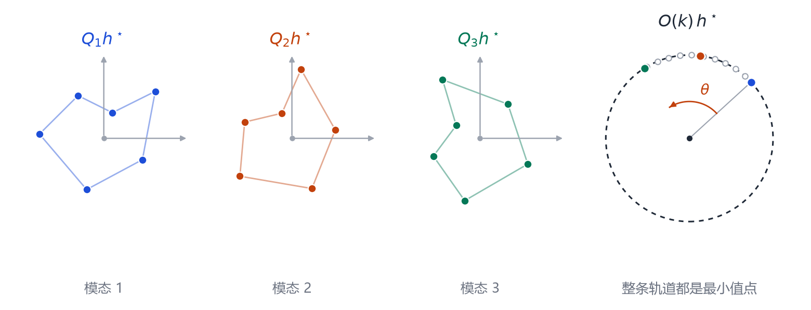
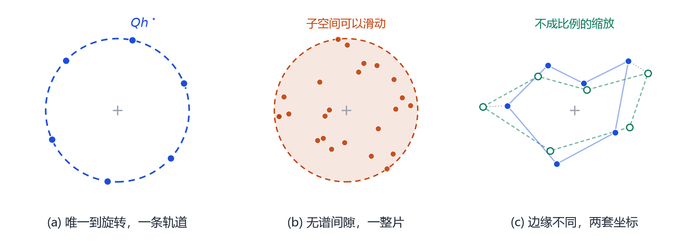

# 第 3 章　定理一

三个人各自测绘同一片城区，一个人把北画在纸的上方，一个人把自家门前那条街画在纸的上方，第三个人甚至把纸横过来用。三张图交上来，街道走向互不相同，同一个路口在三张纸上的位置也差得很远。可是把其中任意一张绕纸面旋转一个角度，路口就逐个对上，连拐角的形状都吻合。这件事之所以可能，与三个人是否商量过无关，与他们测的是不是同一片城区有关。第 2 章把这件事的代数部分做完了，把一个白化 JEPA 的目标函数化归成一张图上的谱问题，并在谱有间隙时说明最小值点唯一到旋转。

这一章把那个代数结论拼成一个关于模态的命题，也就是定理一。拼的过程只用到两样东西，一是渲染只换坐标这条引理，二是上一章那个唯一性结论，剩下的是把两者接起来。接好之后得到的句子很短，短到容易被当成同义反复；可它的四条前件每一条都对应一个会失效的物理情形，失效之后结论的形状也跟着变，这是本章后半部分的全部内容。读这一章的方式应当是把定理当成一张清单，逐项检查它在理想条件下为什么成立，再看现实里哪一项先垮。

先说一句关于分量的话。定理一本身几乎是引理的直接推论，数学重量压在命题一里，也就是“白化加上谱间隙之后最小值点恰好是一条旋转轨道”这一条。定理一做的事情是把这条几何事实翻译成模态之间的语言，翻译之后得到的句子可以被实验者读懂，也可以被反驳。承认这一点不会削弱它，反而让它的边界变得清楚，因为凡是命题一不管的地方，定理一也不管。

还有一件容易被跳过的事，共享正样本到底共享了什么。两个模态不共享观测，图像编码器看不到句子，文本编码器看不到像素；它们也不共享配对样本，没有人给出这张照片对应这句话这样的标注。它们共享的只有一件事，哪些状态对被算作一对正样本，用第 2 章的话说，两个模态的正样本分布 $\pi_m$ 是同一个 $\pi$。整章要证明的对齐全部由这一条撑起来，一旦两个 $\pi$ 不同，证明的第一步就断了。

## 3.1　渲染只换坐标

记号在第 2 章已经立好，这里只复述到够用的程度。世界是有限状态集 $Z$，每个状态 $z$ 带一个正概率 $p(z)$，模态 $m$ 通过渲染函数 $g_m$ 把状态变成观测 $x = g_m(z)$，正样本分布 $\pi_m$ 对称，两个边缘都等于 $p$。模态 $m$ 的 JEPA 最小化 $L_m(f)=\mathbb{E}_{(z,z')\sim\pi_m}\ell\big(f(g_m(z)),f(g_m(z'))\big)+\Omega(f)$，其中 $\ell$ 是预测项，取平方距离 $\lVert a-b\rVert^2$，$\Omega$ 是反塌缩项，$f$ 是编码器。按论文的设定，预测器取恒等，$\ell$ 直接比较两个嵌入，$\ell$ 与 $\Omega$ 都对旋转不变。

引理 1（渲染只换坐标）　若 $g_m$ 是单射，则 $f\mapsto f\circ g_m$ 是模态 $m$ 的编码器与函数 $Z\to\mathbb{R}^k$ 之间的一一对应，且 $L_m(f)=L_\pi(f\circ g_m)$。证明只有一行，把期望里的 $x=g_m(z)$ 与 $x'=g_m(z')$ 换回状态，单射保证换元既不重复也不遗漏，于是求和跑遍的还是同一批状态对，$\ell$ 与 $\Omega$ 的形式一点没动。这条等式把两个空间上的优化问题接在一起，观测空间从此只通过 $g_m$ 出现，而在损失取值里它连出现都没有。换句话说，模态这个身份在损失里被彻底消掉了，留下的只是坐标的名字。

引理的全部内容就是这一次换元，可它换掉的东西不少。换元之后，目标函数里再也找不到 $g_m$，也找不到观测空间 $X_m$，剩下的是一道只关于 $Z$ 与 $\pi$ 的题；模态之间的差别被压缩进一个技术条件（单射），而这个条件不进入损失的任何一个数值。第 2 章那套谱分解之所以能用来谈模态，靠的就是这一步。反过来看，凡是不满足单射的模态，它的目标函数就没法这样落回世界上，后面所有关于 $h^\star$ 的话也只能有条件地说。

单射这个条件值得单独看一眼，它是引理里唯一涉及几何的假设。它要求的不是 $g_m$ 的像填满观测空间，像可以很稀疏，一张低维流形就够用；它要求的是不同的状态不许撞到同一个观测上，也就是渲染不许把世界的两个点在观测层面粘起来。现实里最容易违反这条的不是噪声，而是分辨率与视角，一张远距离拍下的照片会把一条街上的几十个位置压成同样的几个像素，这些位置在观测层面确实不可区分。把这类情形排除在定理之外不是回避，而是为了让“观测只是坐标”这句话成立，有损的情形留到 3.4 单独处理。

这里有一个容易漏掉的技术点，$\Omega$ 必须只通过 $f$ 的嵌入分布起作用。若 $\Omega$ 里出现对输入坐标的显式依赖，比如给某一维单独加惩罚，换元之后它就不再是同一个泛函，引理不成立。论文把这一点写进设定，$\Omega\in\{0,\infty\}$ 的硬约束是最干净的情形。白化硬约束满足要求，VICReg 与 Barlow Twins 只在白化的极限下落到同一个形式上，SIGReg 的约束更强，它在全分布意义下是否给出唯一性，论文留成了假设。

## 3.2　四个前提与定理的陈述

定理 1（柏拉图表征定理）　设 $M\ge 2$ 个模态共享同一个正样本分布，$\pi_1=\cdots=\pi_M=\pi$，且 $L_\pi$ 的最小值点唯一到旋转。则存在一个世界嵌入 $h^\star:Z\to\mathbb{R}^k$，使每个模态 $m$ 的每个最小值点 $f_m^\star$ 都满足

$$
f_m^\star\circ g_m = Q_m h^\star,\qquad Q_m\in O(k),
$$

于是任意两个模态之间只差一个旋转 $Q_mQ_{m'}^\top$。把这段话拆开读，前半句说的是存在一个 $h^\star$，它只依赖世界与正样本，不依赖模态；后半句说的是每个模态自己的最优解都是这个 $h^\star$ 被某个正交矩阵转过的样子。两个模态比较时 $h^\star$ 被约掉，剩下的 $Q_mQ_{m'}^\top$ 仍然是正交矩阵，这就是“只差一个旋转”的确切含义。定理的全部结论由这两半组成，前半是存在性，后半是唯一到旋转，两条缺一条都读不出对齐。

第一个前提是世界有限，并且每个渲染都是单射。有限把期望变成求和，把谱分解变成有限矩阵的特征分解，技术上省掉测度论那一层；单射则保证观测不丢状态，使引理里的换元成为一一对应。第二个前提是共享正样本，$M$ 个模态的 $\pi_m$ 是同一个 $\pi$，换句话说它们对“哪些状态算相似”给出了完全一致的答案。这两条合起来，把 $M$ 个彼此看不见对方数据的问题，变成一个同题多解的问题。

第三个前提是最小值点指总体最优，也就是 $p$ 与 $\pi$ 精确已知、约束精确成立时目标函数的全局最小值点。它排除的是“训练停在哪里”这个问题，与优化算法无关，也与训练了多久无关，换句话说，它问的不是优化器的行为，而是目标函数本身的性质。第四个前提是唯一到旋转，解集不是一堆互不相干的点，而是一条轨道。这一条不是定理自带的，要由命题一供给，靠的是谱间隙。

命题 1（谱 JEPA 唯一到旋转）　取 $\ell(a,b)=\lVert a-b\rVert^2$，$\Omega$ 为白化硬约束 $\mathbb{E}_ph=0$、$\mathbb{E}_phh^\top=I_k$，且 $1\le k\lt|Z|$。则 $\min L_\pi=2\sum_{i=1}^{k}(1-\mu_i)$；若 $\mu_k\gt\mu_{k+1}$（约定 $\mu_{|Z|}=-\infty$），最小值点恰为 $Q\Phi_\pi$，$Q\in O(k)$，其中 $\Phi_\pi(z)=(v_1(z),\dots,v_k(z))/\sqrt{p(z)}$。

谱间隙是这条命题唯一的门槛。$\mu_k$ 与 $\mu_{k+1}$ 之间留出空隙，前 $k$ 维特征子空间才唯一，围绕它的一切才不随扰动滑动。间隙由正样本画出的图决定，不由编码器的宽度或训练步数决定，这一点在第 2 章那个 12 个状态的小世界上已经见过，格子状的世界间隙宽，两簇之间联系稀疏的世界间隙窄。定理一继承了这个门槛，并且把它原封不动地放在自己的前件里。

## 3.3　一行证明

证明由引理 1 直接给出。设 $f_m^\star$ 是 $L_m$ 的最小值点，因为 $f\mapsto f\circ g_m$ 是一一对应，它对应的 $h=f_m^\star\circ g_m$ 就是 $L_\pi$ 的最小值点，这一步用的是单射。由前提四，$L_\pi$ 的最小值点全体恰是 $\{Qh^\star: Q\in O(k)\}$，于是 $f_m^\star\circ g_m=Q_mh^\star$ 对某个 $Q_m$ 成立。整个证明没有用到 $M$ 的具体值，也没有用到 $g_m$ 的解析形式，只用到它是单射这一件事。几步连起来就是定理一的全部内容，中间没有任何估计或近似，也没有任何需要额外假设的地方。

证明之所以只有一行，是因为定理一没有断言任何关于 $k$、$|Z|$、$M$ 或图的连通性的新事实。它不断言 $h^\star$ 就是谱嵌入（那是命题一说的），不断言间隙有多大，也不断言 $Q_m$ 唯一。它只做一件事，把“$L_\pi$ 的解集是一条轨道”翻译成“每个模态的解都落在同一条轨道上”。从这个角度看，定理更像一个接口，命题一在接口的一侧，实验语言在另一侧，定理负责说明两侧说的是同一件事。

用具体的例子读一遍会更清楚。图像的编码器只看像素，文本的编码器只看词串，两边的训练数据里没有一对配好的样本，训练过程里也没有任何一步让它们互相对照。若两者的正样本都指向同一批状态对，也就是同一场景的两次拍摄、同一场景的两句描述都被当成相似，定理说它们各自的最优解是同一个 $h^\star$ 的两套写法。这句话的力量全在“没有对照”四个字上，模型之间的对齐不是被教出来的，而是被同一个目标函数逼出来的。

轨道上取哪个点当 $h^\star$ 是任意的，如图 3-1 所示，左边三格是同一族点在三套坐标下的位置，右边一格是其中那个点在三套坐标下的位置连成的圆。若把 $h^\star$ 换成 $Rh^\star$，$R\in O(k)$，那么 $Q_m$ 相应换成 $Q_mR^\top$，等式仍然成立，而两个模态之间的相对旋转 $Q_mQ_{m'}^\top$ 一点没变。也就是说定理给出的是 $M$ 个模态在 $O(k)$ 里的相对位置，绝对位置没有意义，把某个模态的坐标系定为标准只是人为选了一个代表元。后面所有关于对齐的说法都只用到相对量。

<figure class="fig">

<figcaption><b>图 3-1</b>　旋转轨道。左边三格是同一族点在三套坐标下的位置，形状相同、朝向不同；右格画出一个点在旋转下的轨迹，虚线圆上的每一点都对应一个最小值点，$\theta$ 是两套坐标之间的转角。</figcaption>
</figure>

## 3.4　三条前提各自被去掉之后

四条前件在现实里都很难完全满足，所以更值得问的是哪一条先垮，垮了之后结论变成什么形状。图 3-2 把三种情形并排放了一次，画的是最小值集合而不是目标函数，因为定理说的正是这个集合的形状。左边一格是前提都成立的情形，解集是一条轨道；中间与右边两格分别对应去掉唯一性与去掉边缘匹配，形状都变了，变的方式并不相同。三格画在一起是为了说明一件简单的事，定理的结论不是一句修辞，而是关于一个集合形状的陈述，集合一变形，句子就跟着失效。

去掉单射，第一个受伤的是引理。$g_m$ 不再一一对应，$f\mapsto f\circ g_m$ 就不再是双射，只有一个方向成立，给了 $f$ 一定能得到 $f\circ g_m$，反过来不行。这意味着 $h$ 不能定义在 $Z$ 上，只能定义在商空间 $Z/\!\sim_m$ 上，其中 $z\sim_mz'$ 表示两个状态在模态 $m$ 里渲染成同一个观测。结论可以留在商空间里，代价是两个状态只要在一个模态里长得一样，它们的嵌入就被强行压成同一个点，这与它们在世界里是否相同无关。

现实中的渲染都是有损的，模糊的照片、被遮挡的物体、分辨率不够的传感器，都会把不同的状态映到相近甚至相同的观测上。这时候真正要问的不是单射是否成立，而是两个模态的等价关系是否一致。若两个模态把不同的状态对合并，它们各自的商空间不同，连一个公共的 $h^\star$ 都不存在，谈旋转也就无从谈起；若两者合并得差不多，结论会以近似的形式回来，误差由等价类的粗细决定。这条退化在实验里比谱间隙更常见，因为照片与句子丢掉的从来不是同一批信息。

去掉唯一到旋转，结论崩得最彻底。若 $\mu_k=\mu_{k+1}$，第 $k$ 个方向与第 $k+1$ 个方向在目标函数眼里一样好，把其中一个换成另一个，损失不变，于是最小值点不止一条轨道，而是前 $k+1$ 维特征子空间里所有 $k$ 维子空间各自成一条轨道。两个模态可以各自挑一个子空间，各自都是最优，彼此之间却差着一个不属于 $O(k)$ 的线性变换。定理一在这种情形下说不出话，因为“只差一个旋转”这句话本身预设了解集比一条轨道大不了多少。

边缘匹配这一条比前两条更基础，它管的不是解的唯一性，而是两个模态是否在看同一个世界。$\pi_1$ 与 $\pi_2$ 的边缘都等于 $p$，这条要求说的是两个模态眼里各个状态出现的频率相同；若文本里谈的全是厨房、图片里全是街道，两个边缘对不上，白化的基准就不同，两个嵌入甚至不在同一个内积空间里比较。定理一把这一条藏在“共享 $\pi$”里，看起来只说了正样本相同，实际上它同时规定了共同的加权分布，也就是共同的度量。这一点在定理二里被提到明面上，那里直接把“两个核共享边缘 $p$”写成前提，因为它一旦不成立，误差的表达式连写都写不出来。

三条前提的分量并不相同，值得排一次序。单射失效的后果最局部，它只把结论从 $Z$ 上挪到商空间上，两个模态只要商得一样，对齐仍然成立，损失的是分辨率而不是几何。唯一性失效的后果最重，解集从一条轨道扩成一族，两个模态各自的最优解之间连一个线性变换都不一定找得到，定理的结论直接落空。边缘失效的后果最基础，它让两个嵌入不在同一个内积空间里，连比较都无从谈起。工程上真正先垮的往往不是单射，因为照片与句子的有损程度远小于它们覆盖的状态范围之差。

<figure class="fig">

<figcaption><b>图 3-2</b>　最小值集合的三种形状。(a) 四条前提都成立时是一条轨道；(b) 谱间隙消失时解集扩成一族，散点只是示意，真实的集合是同一个特征子空间里所有 $k$ 维子空间；(c) 边缘不同时两套坐标不成比例，旋转对不上。</figcaption>
</figure>

## 3.5　模态数不进入定理

定理里 $M$ 只出现在 $M\ge2$ 这个条件中，此外没有任何位置用到它的大小。五个、十个、二十个模态各自在自己那堆数据上训练，只要共享同一个 $\pi$，就都落在同一条轨道上，两两之间各差一个旋转 $Q_mQ_{m'}^\top$。这一点在代数上是自动的，因为 $O(k)$ 对乘法封闭，两个正交矩阵的乘积以及它们的转置仍然是正交矩阵，相对旋转永远落在同一个群里。定理的这条性质常被读成“模态越多越一致”，其实它说的是“多一个模态不多一条轨道”。

这条无关性有它的代价。$M$ 变大不会让对齐变好，它只是增加落在同一轨道上的实例数目；真正决定对齐质量的是 $\pi$ 的形状，也就是正样本把哪些状态连起来、连得多紧。若 $\pi$ 让谱没有间隙，再多的模态也只是各自挑自己的子空间；若 $\pi$ 好，两个模态就够了，第三个第四个只是重复确认。经验研究里那种“模型越多越像”的印象与这条无关性并不冲突，但也不能由它推出来。

把这条无关性展开也是一件有意思的事。三个模态给出三对相对旋转，$Q_1Q_2^\top$、$Q_2Q_3^\top$、$Q_1Q_3^\top$，它们之间不是相互独立的，前两个相乘就得到第三个，因为 $Q_1Q_2^\top Q_2Q_3^\top=Q_1Q_3^\top$。这意味着一批模态之间的一致性存在循环约束，量两个相对旋转就决定了第三个，不需要再去测一遍。若在实验里发现三个模态两两对齐良好，而它们的复合与第三个对不上，那不是定理出了问题，而是有一对估计错了，这是检验配准结果的一个便宜办法。

## 3.6　定理与实验各自的对象

第 1 章讲过的那个实验，把 12 个语言模型与 17 个视觉模型两两配对，得到 204 对，用 1024 对图文样本算相似度。结果是校准之后全局指标的上升趋势消失，线性 CKA 与能力排名的相关系数从 0.86 掉到 0.45，普罗克鲁斯提斯距离从 0.89 掉到 0.39，而局部近邻指标几乎不动，mKNN 保持在 0.85 附近。这些数字说明的是收敛发生在哪一层结构上，它们与定理一印在同一页纸上，却不是同一件事。把两边的措辞并排看，实验说的是相关性与比例，定理说的是等式与存在量词，两种句子不能互相替代。

定理一不证明那 204 对模型显著，这句话要按字面理解。定理的前件在实验里一条都不精确成立，渲染有损，正样本不是同一个 $\pi$，训练停在局部解，白化在批量上只是近似。反过来，实验也不检验定理的前提，因为实验测的是有限模型池上的相似度分数，而定理谈的是总体最优解之间的距离。两者的对象不同，一个是条件命题，一个是给定条件下的测量。

要把两者接起来，需要额外加两条假设，而不是从定理直接推出实验。第一条假设是经验核接近总体核，数据足够多、正样本足够代表世界，于是 $\hat\pi$ 可以当 $\pi$ 用；第二条假设是优化落点接近最小值点，训练足够久、白化足够准。这两条都可以被检验，检验的方式是看结论是否随样本量、批大小、步数稳定下来，稳定的范围就是定理能借用的范围。定理一本身对它们不表态，它只保证前提成立时结论必然成立。

前提二在实验里到底怎么近似，值得写清楚。图像一侧的正样本是同一场景的两次拍摄，两次拍摄之间时间差很小，相机位置变了，物体没变；文本一侧的正样本是同一场景的两句描述，说法不同，场景相同。两种正样本都是“同一状态附近的两个观测”，这股直觉与定理要求的“同一个 $\pi$”并不一样，因为定理要求两边连接的完全是同一批状态对。把前提二当成一条可以被数据反驳的假设，才能看出实验真正测的是什么，它测的是两个 $\hat\pi$ 有多接近，以及谱在这两个核上的形状。

## 3.7　三条常见误读

第一种误读把最小值点当成梯度下降的落点。定理说的是目标函数的全局最小值点集合，而训练是在一个非凸的、带随机梯度的过程中进行的，白化约束在每个批量上只是近似成立，编码器的参数化还带来额外的对称性。从“最优解在一条轨道上”推不出“训练会落到那条轨道上”，中间隔着一整片优化地形。经验上这件事往往成立，但那是另一条命题，需要别的工具来证。

第二种误读把旋转当成坐标对齐。定理里的 $Q_m$ 不是事后配准算法算出来的矩阵，而是一个自由度，两个编码器学到的几何本身相同，差别只在于用哪套基去写它。这个区别有实际后果，若两个模态的几何本身就不同，比如正样本不一样，或者一边在干扰上花掉了维度，再精巧的普罗克鲁斯提斯对齐也只能给出一个平均意义上的近似，不会让它们真正重合。把定理读成“配一下就能对上”，会让人误以为对齐是一件只依赖算法的事。

第三种误读把总体最优当成有限样本结论。有限样本下 $\pi$ 只能估，谱也只能估，特征向量对扰动敏感，谱间隙小的时候尤其如此，$k$ 的取法、批大小、样本量都会改变估出来的嵌入。定理给的是理想化的极限，把它当成“我的模型一定对齐”的保证，会在间隙窄的世界里立刻碰壁。第 4 章的定理二处理的正是这个落差，它把核失配与谱间隙写成一个上界，说明有限偏差能被什么量界定。

三种误读有一个共同来源，把条件命题当成了无条件断言。定理的形式是“若四条前提成立，则存在 $h^\star$ 与 $Q_m$”，它没有说前提在现实里成立，也没有说结论在没有前提时仍然成立。读到这类命题时最安全的习惯是先把它写成一行前件与后件的清单，再问每一项在手里这份数据上能打多少折。愿意做这一步的人，得到的不是一句口号，而是一组可以测量的量：谱间隙、核失配、等价类的粗细、样本量。

回到开头那三张地图。定理一说的话其实很朴素，只要三个人测的是同一片城区，各自画出的图在忽略纸的摆法之后必然相同，而纸的摆法就是一个正交矩阵。它没有说三个人会画出同样精细的图，也没有说那个转角能被轻易找到，这两件事分别属于分辨率与配准，是另外的问题。区分这三件事有一个好处，读者不会因为转角难找就怀疑地图是同一张，也不会因为地图相同就以为配准是免费的。

这个界定的用处在于，它把“为什么会对齐”归因到一个可以改的量上。谱间隙由正样本决定，正样本让同一场景的两次观察更集中，图的低频结构更清楚，间隙就更大；间隙越大，轨道越稳，越不容易被子空间滑动打散。于是对齐从一件玄学的事，变成一件关于数据构造的事，正样本怎么采、采多密、覆盖多宽，直接决定定理的前提能不能站住。换句话说，定理把“要不要对齐”这个问题，换成了“正样本做得好不好”这个问题，后者是可以动手的。

定理一还有一个前件没有被动过，正样本相同。现实中两个模态的正样本不一样，图像的正样本是同一场景的两次拍摄，文本的是同一场景的两句描述，哪一种配对更常见，两边各有各的答案。两个 $\pi$ 只要不同，证明的第一步就接不上，剩下的不是一句“差一个旋转”，而是一个需要被界定的差距。这个差距由两个核差多少、谱间隙有多窄共同决定，是下一章要写的东西。
