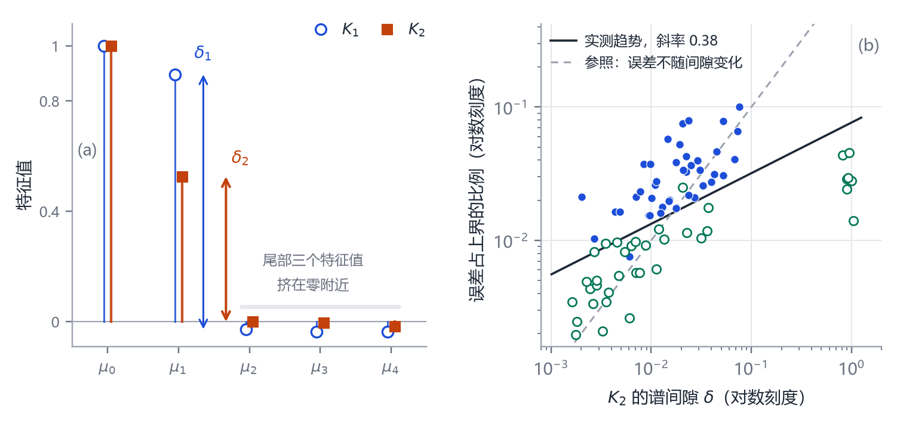
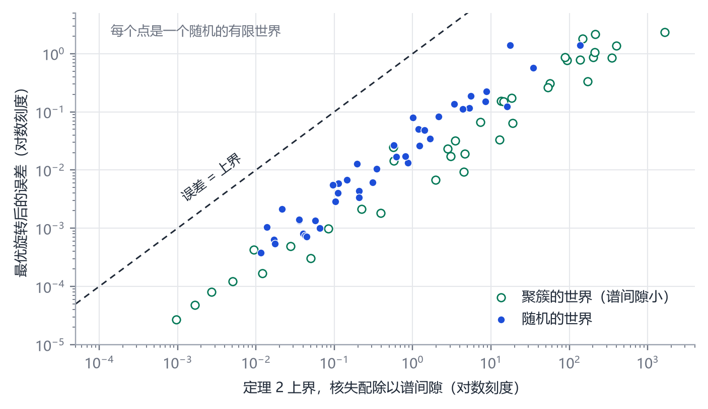

# 第 4 章　定理二

上一章把共享正样本写成了一个条件命题。只要若干模态的正样本分布是同一个 $\pi$，它们的最小值点就都落在同一个旋转轨道上，任意两个模态之间只差一个正交矩阵。这个结论很干净，代价是把最不可信的那条前提放在了正中间，也就是正样本相同这件事本身。定理一的证明只有一行，全部重量都压在“两个模态认同一批状态对”这句话上，而这句话在工程里几乎没有被直接验证过。

图像的正样本是同一个场景的两次拍摄，文本的正样本是同一个场景的两句话，哪一种配对更常见，两个模态各有各的答案。照片那一侧习惯把相邻两个机位拍到的画面算作一对，文字那一侧习惯把“台面上有一只杯子”和“桌上放着一只杯子”算作一对，前者连起来的是视角上的邻居，后者连起来的是措辞上的同义。两组连接覆盖的状态对不同，画出来的图就不同，核也不同。定理一里那个等号在这里断掉，剩下的问题不再是“是否只差一个旋转”，而是“差多少、由什么决定”。

定理二补的正是断掉之后的那一段。它给出一个不等式，左边是配对比较之后仍然存在的错位，右边是两个量之比，分子是两个核差多少，分母是两个模态的谱分离得多开。这个形状值得先记住，因为它把“对齐得好不好”这件只能靠实验回答的事，换成了两个可以分别估计的量的比值。分子小、分母大，界就小，对齐就有保证；分子大或者分母小，界被推到很远，定理什么也没有承诺。

这一章的路线是先把两个量说清楚，再给陈述与证明骨架，然后用本书复现的数值实验说明这个界有多松，并回到配对数据的作用上。有两处需要提前提醒，以免读到一半产生误解。定理里的间隙只在其中一个核上量，这个不对称不是笔误，后面会交代它的来由。界在间隙很小的时候会松到没有实用价值，读它的时候要分清保证与估计是两件事。

## 4.1　两个核的差

把两个模态各自的核写出来，记作 $K_{\pi_1}$ 与 $K_{\pi_2}$，它们同阶、对称、最大特征值都等于 1，因为两个分布共享边缘 $p$。谱嵌入记作 $\Phi_1$ 与 $\Phi_2$，都是从状态集到 $\mathbb{R}^k$ 的映射，取值由各自核的头部特征向量除以 $\sqrt{p}$ 得到。定理一说的是两个核相等时两个嵌入只差一个旋转，现在等号换成一个差，问题随之变成这个差能有多大。$p$ 在这里的用处是给每个状态一个权重，所有平均都按它来做，换了权重，嵌入和误差的含义都会跟着变，这也是为什么定理要把共享边缘写成一条独立的前提。

度量两个矩阵的差有现成的工具，用得最多的是两种范数。谱范数 $\|E\|_2$ 取 $E$ 的最大奇异值，几何上是这个矩阵在某个方向上最多能把单位向量拉长多少倍，它只关心最坏的那一个方向。Frobenius 范数 $\|E\|_F$ 把所有元素的平方加起来再开方，等于把所有奇异值的平方加起来开方，关心的是总能量。两种范数都会在定理里出现，说明作者不打算在两种失配形态之间选边，而是让结论自己挑一个更紧的。

取小的那个的道理，可以看两种极端。如果失配集中在少数几个状态对上，$E$ 几乎是秩一的，$\|E\|_F$ 与 $\|E\|_2$ 差不多大，而定理里那一支要乘上 $\sqrt{k}$，乘完反而比 Frobenius 大，这时紧的是 Frobenius。如果失配摊在几乎所有对上，$\|E\|_F$ 可以大到 $\sqrt{|Z|}$ 倍谱范数，谱范数乘 $\sqrt{k}$ 就小得多，这时紧的是另一支。两个不等式都成立，编进同一个 $\min$ 里，等于说哪一支更贴近这个世界的失配形态就用哪一支，这也是定理在数值上不至于离谱的原因之一。

回到照片与文字的例子，两个核的差多半是集中的。绝大多数状态对上，两侧都认为这两个状态算一对，分歧集中在少数几处，比如照片把隔着半米的两张图算作一对，文字不认。这种形态落在 Frobenius 那一支上，也是后面数值实验里最常出现的形态。反过来，如果两个模态对“什么算同一个场景”的理解整体偏移，比如一个按物体取正样本、一个按整个场景取，失配就会摊开，谱范数那一支才起作用，两种形态对应两种完全不同的失配来源。

## 4.2　定理二的陈述

陈述之前要把三个记号交代完。共享边缘 $p$ 指的是从一对正样本里随便取一头，取到的状态服从同一个 $p$，这条比两个核接近更基础，它管的是两个模态在不在看同一个世界。$\Phi_1$ 与 $\Phi_2$ 是各自的谱嵌入，定理允许 $K_{\pi_1}$ 在 $k$ 处有重特征值，那时头部特征向量任取一组正交基即可，这个宽容是有用的，它让条件只落在第二个核上。$\delta$ 是 $K_{\pi_2}$ 的谱间隙，定义为 $\mu_k-\mu_{k+1}$，也就是第 $k$ 个与第 $k+1$ 个特征值之间空出来的那一段距离。

**定理 2（核失配界定错位）**　设 $\pi_1,\pi_2$ 共享边缘 $p$，$\Phi_1,\Phi_2$ 是它们的谱嵌入（$K_{\pi_1}$ 在 $k$ 处有重特征值时取任意一组正交归一的头部特征向量），$\delta=\mu_k-\mu_{k+1}\gt 0$ 是 $K_{\pi_2}$ 的谱间隙，则

$$
\min_{Q\in O(k)}\Big(\mathbb{E}_p\big\|\Phi_1(z)-Q\Phi_2(z)\big\|^2\Big)^{1/2}
\le \frac{2\sqrt{2}}{\delta}\min\Big(\sqrt{k}\,\|K_{\pi_1}-K_{\pi_2}\|_2,\ \|K_{\pi_1}-K_{\pi_2}\|_F\Big) .
$$

左端是一个配对比较的量，读法要一句一句拆。固定一个状态 $z$，取它在两个模态里的坐标 $\Phi_1(z)$ 与 $\Phi_2(z)$，先把后者整体转一个 $Q$，再量两点之间的距离，对所有状态按 $p$ 加权平均，开方得到均方根距离。$Q$ 在 $O(k)$ 上取遍所有旋转与反射，取最小的那一个，意思是不追究纸怎么摆，只追究摆好之后还差多少。白化之后每个坐标的方差都是 1，所以这个距离落在 0.1 量级上已经算相当接近，1 以上说明两个嵌入基本没对上。

$\delta$ 只在 $K_{\pi_2}$ 上量，这一点需要强调，因为它是定理里唯一一处不对称。把不等式两端看作两个模态，分母只属于第二个模态，角色对调，分母就换成另一个核的间隙，界的大小随之改变。写成单侧不是记账习惯，理由在陈述里那句“$K_{\pi_1}$ 有重特征值时任取一组”。既然允许第一个核在 $k$ 处重合，它的间隙可以是零，$1/\delta$ 就无从谈起，能当标尺的只剩第二个核。这个细节在引用时最容易丢，丢了之后界看起来会比实际更紧，读者会误以为定理比实际更强。

形式上的不对称不等于实质上的偏袒。两个核都没有重特征值时，把未受扰动与受扰动的位置对调，同一段 Davis–Kahan 论证照样成立，得到的界只是分母换了，于是严格说这一条可以取两侧里较大的那个间隙。论文把哪一侧当参考固定下来，证明里就不必把两种情况分开写。读的人不必把一个选择当成额外条件，也不该因此以为第二个模态在定理里更重要，两个模态在不等式里的地位差别只体现在这一个分母上。

## 4.3　证明骨架与常数

证明的第一步是把函数上的谱换成矩阵上的谱，两件事本来就是同一件。映射 $h\mapsto D^{1/2}h$ 把 $L^2(p)$ 等距地送到 $\mathbb{R}^{|Z|}$，在这个坐标下马尔可夫算子 $T_\pi$ 变成归一化邻接矩阵 $K_\pi$，特征值与特征向量一一对应。$D$ 是以 $p$ 为对角线的对角阵，$|Z|$ 是状态数。这个等距关系意味着后面所有的范数计算都可以在有限维里做，不必回到函数空间去处理测度问题，证明的难度因此降了一个档次。

第二步只用共享边缘这一条，它管的是两个核在哪个子空间里活动。因为边缘相同，两个矩阵都把 $D^{1/2}\mathbf{1}$ 当最大特征向量，特征值都是 1，$\mathbf{1}$ 是全一向量。这个公共方向之外的部分记作 $H$，两个矩阵都把 $H$ 送到 $H$ 里面，谁也不会把分量漏到公共方向上，于是可以只在 $H$ 上比较两者的头部特征子空间。$(K_{\pi_1}-K_{\pi_2})D^{1/2}\mathbf{1}=0$ 说的也是同一件事，差矩阵在公共那一列上是零，后面把范数限制到 $H$ 上不改变任何数值，靠的就是这一行。

第三步把左端写成一个矩阵的 Frobenius 范数。取 $V_m$ 的列是 $K_{\pi_m}$ 头部 $k$ 个特征值对应的正交归一特征向量，那么 $V_m$ 在状态 $z$ 那一行正好是 $\sqrt{p(z)}\,\Phi_m(z)^\top$。按 $p$ 加权的均方距离于是等于 $\|V_1-V_2Q^\top\|_F^2$，一行一行加起来就是这个范数，权重已经被 $\sqrt{p}$ 吸收进去。这一步把“对状态加权平均”换成了“对矩阵取范数”，后面的工具才有地方用。

第四步是整段证明的实质，用 Davis–Kahan 型的扰动界。在 $H$ 上把 $K_{\pi_2}$ 当未受扰动的矩阵，把 $K_{\pi_1}$ 当扰动后的矩阵，取 Yu、Wang 与 Samworth 给出的变体，参数 $r=1$、$s=k$。这个变体要的间隙恰好是未受扰动那个矩阵第 $k$ 与第 $k+1$ 个特征值之差，也就是定理里的 $\delta$，结论是存在一个正交矩阵 $\hat O$ 使 $\|V_1\hat O-V_2\|_F$ 不超过 $2^{3/2}$ 乘上那个 $\min$ 再除以 $\delta$。按第三步的等式换回左端就是定理，中间没有别的技巧。

常数 $2\sqrt2$ 可以拆成两个因子，一个紧一个不紧。$\sqrt2$ 来自把子空间夹角换成基底距离这一步，两个 $k$ 维子空间的主夹角记作 $\theta_i$，最优对齐之后的平方距离是 $2\sum_i(1-\cos\theta_i)$，它不超过 $2\sum_i\sin^2\theta_i$，开方就多出 $\sqrt2$。后一个因子在数值上几乎是精确的，下一节的实验会把这一点量出来。另一个因子 2 是变体自带的余量，它照顾扰动把两侧谱都推动的可能，实际误差用不到这么多，所以这个界从一开始就至少松了一倍。

## 4.4　两层读法

定理的第一层读法很直接，核越接近、间隙越大，右端越小，两个嵌入就越对齐。这一层几乎是同义反复，但它把好视图三个字翻译成了一个可算的量，后面两章都要用这个翻译。反过来说，如果同一个场景的两次观察被连得很紧、不同场景之间几乎不连，核的结构就很清楚，间隙也大，这时即使两个模态的配对习惯略有出入，对齐仍然稳。这句话是定理二全部工程意义的来源，它说明选正样本这件事比事后对齐重要得多。

第二层读法更细，也更接近训练里的经验，就是谱的两端稳定性不同。把同一段论证用在特征向量块上、块的左右两侧都留出间隙，得到的是分块版本，被大间隙与其余谱隔开的方向受保护，挤在谱尾、左右都没有空档的方向可以完全不齐。Davis–Kahan 的原始结论说的也是这件事，特征子空间对扰动的敏感度与间隙成反比，间隙是保护，不是装饰。这条读法解释了一个常见现象，两个编码器整体相似度不低，可某几个具体属性就是读不出来，那几个属性落在谱尾。

如图 4-1 左边所示，一个 24 个状态的世界里，两组谱摆在一起看，$K_{\pi_1}$ 由两簇状态构成，簇内连得紧、簇间连得稀，在 $k=1$ 处留出 0.92 的空档。把同一个核与一个同边缘的无关核按四成掺入得到 $K_{\pi_2}$，空档掉到 0.53，同一个世界两个间隙差了近一倍，定理取的是右边那一个，这也是上一节说的不对称在图上最直白的样子。尾部三个特征值挤在零附近，那些方向在定理里根本没有被保护，任何一点扰动都能把它们推开。

<figure class="fig">

<figcaption><b>图 4-1</b>　两个核的谱与间隙。(a) 聚簇核在 $k=1$ 处留出 0.92 的空档，混进四成无关核之后只剩 0.53，定理取后者；(b) 80 个世界上误差占上界的比例随间隙变小而升高，斜率 0.38。</figcaption>
</figure>

图 4-1 右边换了一个看法，横轴是 $\delta$，纵轴是误差占上界的比例，每个点是后面那批随机世界里的一个。用一条斜率为 1 的线做参照，它对应的假设是误差与间隙无关，此时比例应当随间隙线性上升。实测拟合的斜率只有 0.38，相关系数 0.63。间隙变小时误差自己确实在变大，但长得比 $1/\delta$ 慢得多，界被推远的速度快过真实误差增长的速度，这是下一节要量的东西。

## 4.5　八十个世界

数值验证的脚本与本章的插图放在同一个文件里，世界是随机生成的有限状态集。状态数在 8 到 39 之间取，嵌入维度 $k$ 在 1 到 5 之间取，边缘 $p$ 从 $[0.3,1]$ 上的均匀分布抽出来再归一化，一半的世界是聚簇的、一半是随机的。每个世界配一对核，第二个核由第一个与一个同边缘的无关核按权重混合，权重在 $10^{-4}$ 到 1 之间按对数均匀取。混合之后的矩阵要用 Sinkhorn 迭代缩回声行和等于 $p$，否则共享边缘这条前提就不成立，右端也就无从算起。

每组核算出两个谱嵌入，用正交 Procrustes 对齐，取对齐之后的均方根误差作为左端的值，再按定理右端算出一个数。整个过程没有训练也没有梯度，纯粹是特征分解加一次奇异值分解，所以这组数字检验的是定理的算术，不是定理在训练里的表现。这一点在引用时必须说清楚，否则容易被读成定理在真实训练中被验证了。两个模态在实验里被替换成两个核，是为了把正样本不同这件事从工程噪声里剥出来单独看。

结果如图 4-2，80 个点全部落在对角虚线的下方。误差最大只有上界的 0.0999，中位数 0.0188，误差本身从 $2.7\times10^{-5}$ 跨到 2.3，上界从 $9.6\times10^{-4}$ 跨到 1657，两个量的分布都很宽。绿色空心圈是聚簇的世界，谱间隙小，上界被 $1/\delta$ 推到右边，点整体贴在这条带的右下沿。蓝点是随机世界，间隙大，上界普遍小，点靠左，两群的形态在这一张图上分得很清楚。

<figure class="fig">

<figcaption><b>图 4-2</b>　定理二的数值验证（本书复现）。每个点是一个随机有限世界，横轴是定理右端，纵轴是最优旋转后的误差，80 个世界全部落在对角线下方。</figcaption>
</figure>

论文用同样的构造跑了 300 个世界，其中一半是聚簇的，报告的最坏情况是误差占上界的 18%。本书这 80 个世界的最坏值是 10%，中位数 1.9%，量级与论文一致，但这不算对论文的复现校验，两次抽样的世界不同、混合权重的分布也不同。它能说明的只是这个界在一批独立的随机世界上同样站得住，以及它在什么形态下会松。想把它当成复现，得用同一套种子与同一个生成规则重跑那 300 个世界。

## 4.6　上界为什么松

界为什么松，可以先把它拆开看是哪一段松。本书这 80 个世界里，把误差与两个投影算子之差的 Frobenius 范数比一下，后者就是两个子空间的距离，中位数是 0.707，正好是 $1/\sqrt2$。常数里那个 $\sqrt2$ 不但不多余，在这些世界上几乎是精确的，子空间定下来之后两组基之间还能差的就只有这个因子。松的地方因此不在常数，而在用范数代替夹角这一步，那一步把扰动的所有可能方向都算了进去。

松的幅度可以从两个角度看。把子空间距离与 $\min(\sqrt{k}\|E\|_2,\|E\|_F)/\delta$ 比，中位数是 0.075，实际距离只有这个量的十三分之一。Davis–Kahan 要照顾所有范数相同的扰动，而实验里的扰动是从一个核往另一个核连续混合出来的，方向由结构决定，不是最坏的那一种。在范数相同的一类扰动里，真正落到这组特征向量上的那一份往往小得多，这不是定理的疏漏，是它的设计目标与估计误差不同。

$1/\delta$ 的位置决定了界的另一处松。本书把 80 个世界按间隙三分，间隙最小的三分之一，误差只占上界的 0.0054，约一百八十五分之一，间隙最大的三分之一，比例是 0.0306，约三十三分之一。绝对误差也一样，小间隙组的中位数是 0.174，大间隙组是 0.0067，差了二十几倍。间隙确实在伤害对齐，但伤害的幅度远小于 $1/\delta$ 所预示的，界把最坏情况放大了，也把典型情况一起放大了。

这个界的用法因此要分清楚，它保证最坏情况不会更糟，不能用来估计这一次对齐得有多好。想拿它做工程预算，得在同类数据上重新标定一个常数，把右端乘上零点零几才接近实测。想知道两个具体编码器差多少，直接做一次 Procrustes 比任何上界都准。定理的价值在于它指出了哪两个量在起作用，而不在于它给出的数字能当预报值。

## 4.7　命题二与那个旋转

定理一与定理二说的都是差一个旋转，左端那个 $Q$ 是在 $O(k)$ 上取下确界得到的，定理没有说取到的是哪一个矩阵。这个问题看起来琐碎，实际上是配对数据唯一能起作用的地方，也是把两个独立训练的编码器接起来时必须回答的问题。命题二把它分成两条来答，一条说前两阶矩不够，一条说多少对就够。两条合起来的结论有点反直觉，配对信息的全部用处只是一个 $k\times k$ 的矩阵。

第一条是坏消息，几乎不用证明，白化嵌入的任意旋转仍然白化。$\mathbb{E}_p\Phi=0$ 与 $\mathbb{E}_p\Phi\Phi^\top=I_k$ 这两条在任何正交矩阵 $R$ 下都成立，因为 $R\,I_kR^\top=I_k$，一阶矩也照样是零。于是两个模态的无配对样本，无论在各自那一侧算多少统计量，只要只看前两阶矩，得到的结论都是可以差任意一个旋转，一个比特的信息也拿不到。这条结论对很多零样本对齐的做法是一个警告，凡是只用均值和协方差的办法，都绕不开这个旋转自由。

**命题 2**　在定理一的设定下，(i) 白化嵌入的任意旋转仍然白化，因此两个模态的无配对样本中，任何只依赖前两阶矩的统计量都无法确定它们之间的旋转；(ii) 若 $n\ge k$ 个世界状态的嵌入在 $\mathbb{R}^k$ 中张满整个空间，则满足 $f^\star_1\circ g_1=Qf^\star_2\circ g_2$ 的旋转 $Q$，是 $\sum_{i\le n}\|f^\star_1(g_1(z_i))-Rf^\star_2(g_2(z_i))\|^2$ 在 $R\in O(k)$ 上的唯一最小值点。

第二条的证明只有三行。把两组坐标按行排成矩阵 $X$ 与 $QX$，正交 Procrustes 目标 $\|QX-RX\|_F^2$ 在 $R=Q$ 处取到零，而它非负，零就是最小值。若另一个 $R$ 也取到零，则 $(R-Q)X=0$，$X$ 满秩迫使 $R=Q$，唯一性就出来了。闭式解是一次奇异值分解，算 $A^\top B=U\Sigma V^\top$，最优旋转是 $UV^\top$，$A$ 与 $B$ 是两组点按行排成的矩阵。自由度上也能看出为什么 $k$ 对就够，$k$ 阶正交矩阵有 $k(k-1)/2$ 个自由参数，一个配对给 $k$ 个方程，$k$ 对就给 $k^2$ 个。

两种失效都很干净。$n\lt k$ 时方程不够，整片子流形上都能取到最小值，任何能把这 $n$ 个点对上的旋转都算解，剩下的自由度没有任何东西去约束。$n\ge k$ 但取样退化时又是另一种情形，两点重合、三点共线之类让矩阵秩亏，方程数够了却解不出唯一的 $R$。工程上这两种情况都会碰到，配对数据往往既不多也不处在一般位置，所以配对之后还需要一道精修。

还有一处定理没有覆盖，而工程上经常碰到，就是两个模态的嵌入维度不同。论文里 DINOv2 是 768 维，文本 JEPA 是 384 维，这时拟合的是一个行正交的线性映射，参数是 $d_ad_b-d_b(d_b+1)/2$，ViT-B 这一档约 0.22M，全部在配对上拟合。这个情形既不是旋转也不是白化之后的等距，命题二的两条都不直接适用。把它当成旋转来读，只在维度相同时成立，维度不同时它是把一个空间压进另一个空间的低维子空间。

## 4.8　无配对为什么可能

命题二的第一条只说了前两阶矩不够，没有说无配对一定不行，这两句话之间隔着很大的空间。有限世界与连续分布在这里分道扬镳。嵌入分布如果真在旋转下不变，任何统计量都定不出 $Q$；可一个有限世界的嵌入分布不可能在旋转下不变，它的支撑是有限个点，非平凡旋转会把支撑挪到别处。挪开之后的形状与原来不同，形状上的差别就是可以用来定方向的指纹。

连续极限下不变是可能的。SIGReg 的目标分布 $\mathcal{N}(0,I_k)$ 就是旋转不变的，世界状态无穷多的极限里，两个模态的嵌入分布可以都变成这个高斯，谁也指不出对方转了哪个角度。这也解释了为什么定理只覆盖二阶反塌缩，约束越接近全分布匹配，越接近一个旋转不变的目标，无配对对齐能借力的高阶结构就越少。换成一句工程上的话，反塌缩项写得越强，配对数据的用处越小，无配对几何的用处越大。

有限世界的高阶结构带着指纹，这件事已经被做成了方法。Schnaus 等人在 2026 年提出只靠共享几何对齐两个编码器，做法是匹配两团点的聚类结构，再用最优传输精修一个正交映射，在 COCO 上用不相交的一半图像与一半文本拟合，报告的 FOSCTTM 是 0.018。论文里还有一个更直观的旁证，只有 30 对、远少于 768 维时拟合出来的旋转是欠定的，用无配对的图像与文本精修之后，描述器的 CIDEr 从 .169 追平了用 1,014 对拟合的检索基线 .158。这正好是配对只定一个矩阵、剩下的靠几何这句话的实验版本。

定理二的条件一共四条，读它的时候要一条条对。世界有限，观测由单射渲染给出，两个分布的边缘相同，结论只针对二阶反塌缩下的总体最优解，而且是谱解而不是训练停下来的那个网络。真实训练一条都不完全满足，渲染有损，样本有限，反塌缩项多半不是白化硬约束。LeJEPA 的全分布约束更强，论文自己也没有证它在有限世界上的唯一性，只把它留成假设。

它的用处不在于把实验现象证明掉，而在于指出了决定对齐的两个量，并且这两个量都能在训练之前估出来。核失配可以量，把一个模态的正样本定义写下来，就能算出它的核与另一个模态差多少。谱间隙也可以量，一次特征分解就够。两个量一个在分子一个在分母，都能通过改正样本来动，这是定理二留给工程的第一件东西。

定理二还留着一个没有动过的自由度，它默认正样本是给定的，只在两个核差多少上做文章。可如果正样本本身选得不好，失配再小也没用，因为花在干扰上的那些维度不对齐，任何旋转都救不回来。这个情形要单独处理，它不属于核失配，也不属于谱间隙太小，而是正样本把不该连的状态连了起来。下一章把它写成一个可估的量，并说明坏视图浪费的维度为什么永远收不回来。
