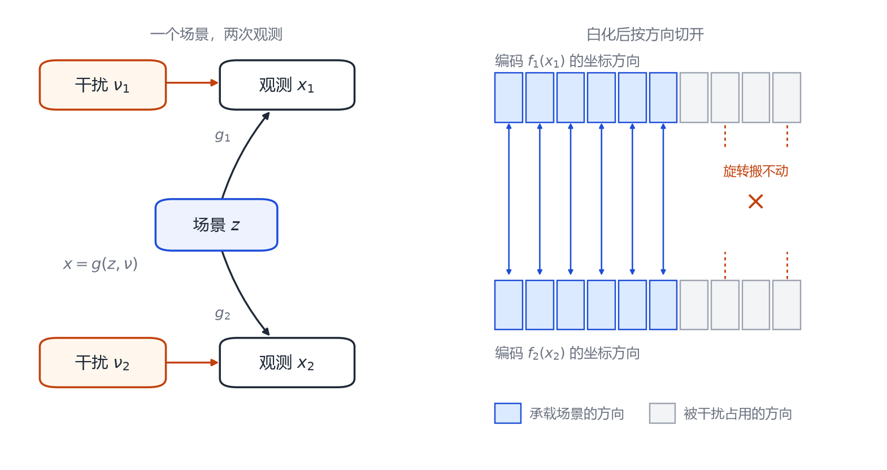
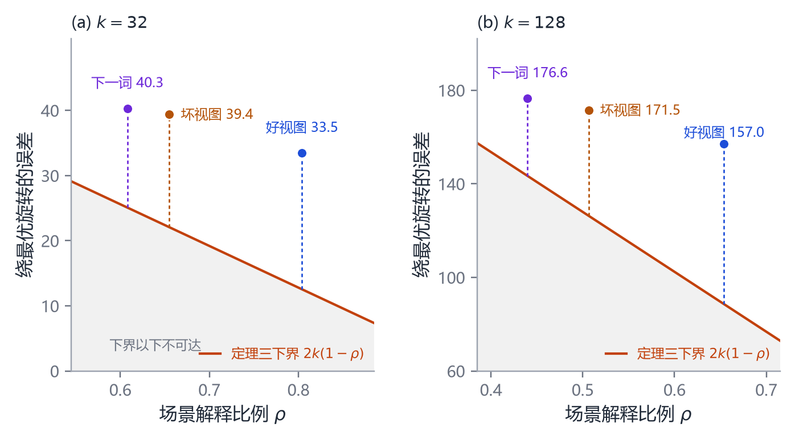
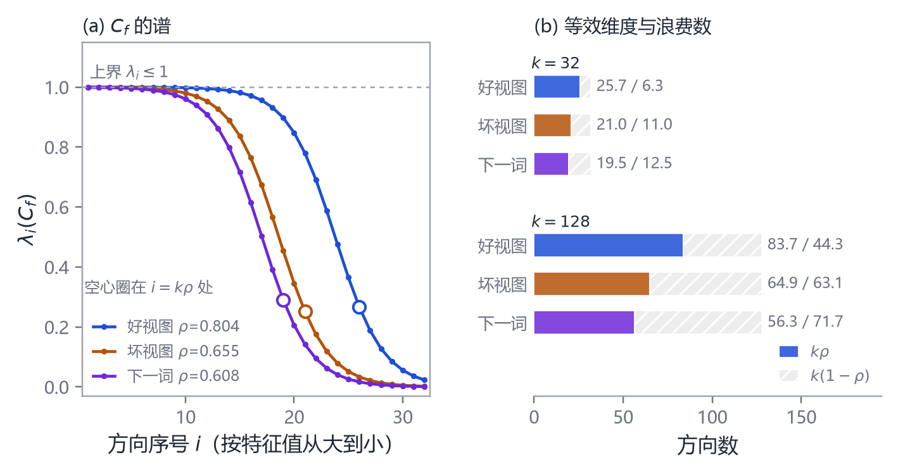
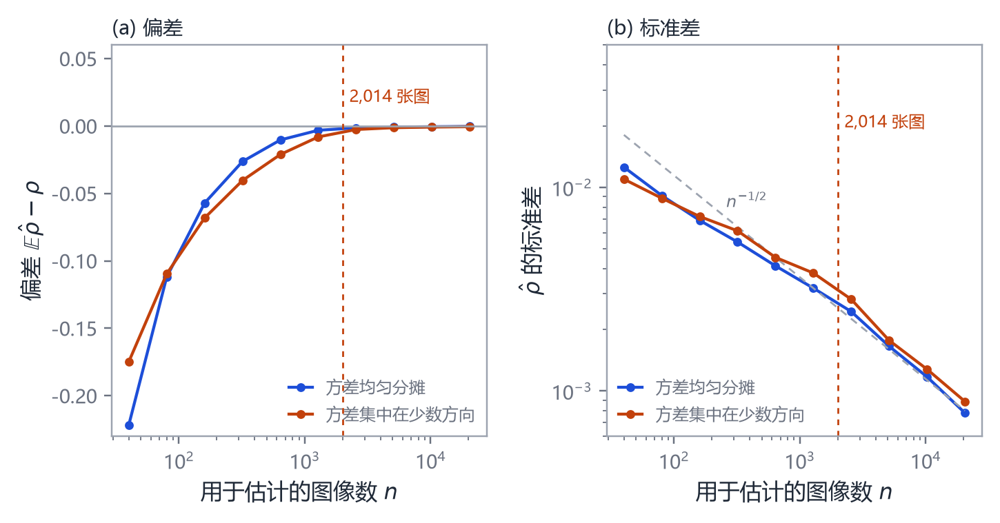

# 第 5 章　干扰变量的代价

Flickr 的一张照片下面通常挂着五句描述，五个人各自写了一句话，说的是同一件事，用词几乎不重样。把其中任意两句取出来配成一对正样本，这一对共享的只有那张照片，其余部分都是写法的差异。换一种构造，取其中一句随机挖掉两个词，做两次得到两个残句，再把这两个残句配成一对，这一对共享的是那句话的写法，从语序到保留下来的每一个实词都几乎一致。两种配对都叫"正样本"，在图上的形状却很不一样，前者跨过两份材料连到同一个场景，后者始终在材料内部打转。

这两种配对交给同一个图文对齐目标，哪一种更有利。直觉落在残句上，因为字形重叠密集，重叠本身就是信号，看起来比"两句毫不相干的描述"强得多。实验给出的顺序正好相反，差距也不止几个百分点，残句这一侧始终排在后面。上一章把对齐的失败归到正样本的核上，用两个核之间的距离界定两个模态的错位，那个结论把正样本当成已经给定的东西，始终没有回答"两种正样本差在哪里"，也没有说清差别会以什么形式变成误差。

要写出下界，先得让"一次观测"这个概念变宽。上一章的渲染 $g_m$ 只吃世界状态，一个状态因此只有一张照片、一句话，正样本只能是两个不同状态的观测。现在给每一份观测配一个只属于它自己的变量，观测由状态和这个变量共同决定，同一个状态于是有了很多观测。有了这一层，才能问一个干净的问题，编码器输出的那些维度里，有多少在描述世界，有多少在描述这些私有的变量。

答案由三个对象组成。条件均值 $u(z)$ 是嵌入里能被状态解释的部分，它的协方差 $C_f$ 是这部分占的份额，取平方根、求迹、除以维度得到一个数 $\rho$，读作场景解释比例。定理 3 说，$\rho$ 低的那一侧，无论另一个模态学成什么样、无论怎么旋转，平方误差都下不去，而这个下界只依赖两个数。命题 3 接着回答哪种正样本会让 $\rho$ 变低，答案是损坏把干扰保留下来的比世界第 $k$ 个方向更多的时候，而判据只用到两条保留度序列里各自的一个数。

## 5.1　观测携带自己的干扰

设世界是有限状态集 $\mathcal{Z}$，状态按 $p(z)\gt 0$ 抽取，模态 $m$ 的观测由 $x=g_m(z,\nu)$ 生成。这里 $\nu$ 取自模态 $m$ 的有限干扰集 $\mathcal{N}_m$，分布记作 $q_m$，而且与 $z$ 独立抽取。$\nu$ 是这份观测私有的东西，照片的 $\nu$ 是机位、光照、曝光时间，一句话的 $\nu$ 是用词、语序、句子长短、作者的口气，一段音频的 $\nu$ 是录音设备与房间。同一个场景拍两次得到两个不同的 $\nu$，同一个场景写五句得到五个不同的 $\nu$，这就是"一个状态有很多观测"的确切含义，也是上一章的单观测模型装不下的东西。

单射的意思在这里变了一次。$g_m$ 仍然可以单射，但单射的对象是数对 $(z,\nu)$，不是 $z$，也就是说给定状态和干扰能唯一确定观测，反过来从观测里能恢复出这一对，却分不开哪一部分属于状态、哪一部分属于干扰。上一章没有 $\nu$ 的位置，因为那里一个状态只有一个观测，单射直接保证观测与状态一一对应，恢复出观测就等于恢复出状态。承认一个状态有很多观测，代价就是把这种可分性的丧失一并接下来，从此"从 $x$ 反推 $z$"变成一个欠定问题。

$\nu$ 不是噪声，这一点容易滑过去。噪声无结构、零均值，多做几次平均就压下去了；$\nu$ 是结构化的，同一位作者写十句话句尾都带同一个语气词，同一台相机拍的十张照片白平衡都偏暖，同一批数据里干扰的规律比场景的规律更一致。对一个只最小化预测误差的目标来说，更好学的规律会先被学走，而干扰恰好更好学，因为它在一个模态内部反复出现、几乎不需要跨样本比较。模型学干扰并且用干扰降低损失，这不是模型的缺陷，是这个目标在这批数据上找到的最省力的走法。

分不开为什么致命，要看跨模态这一步。机位对视觉系统有用，可是没有一句话决定照片从哪个角度拍，于是机位方向在文本侧根本不存在对应物，任何旋转都不可能把它对到某个文本方向上。编码器白化之后，$k$ 个坐标方向上的总方差恰好是 $k$，多占一个方向就必然少占另一个，于是问题变成一个预算问题。花在 $\nu$ 上的方向，就是花在另一个模态看不见的东西上的方向，这个分解如图 5-1 所示。

<figure class="fig">

<figcaption><b>图 5-1</b>　干扰变量的分解。左图是生成过程，一个场景配两个独立干扰生出两个观测；右图是白化后的十个坐标方向，蓝色承载场景、跨模态能对上，灰色被干扰占满，旋转搬不动。</figcaption>
</figure>

图 5-1 右边那排灰格不是设计出来的。目标函数里没有任何一项要求"多用蓝格"，它只要求正样本之间的预测误差小，凡是能用干扰把这个误差压低的地方，优化就会用，因为干扰在两个模态之间没有约束、可以自由地容纳残差。蓝格与灰格的比例因此是数据与正样本共同决定的产物，不是一个事后可以补上的配置，也不是换一个更深的网络就能自动改善的比例。这个比例没有解析表达式，只有估计值。

## 5.2　场景解释比例

设 $f$ 是模态 $m$ 的编码器，在观测上已经中心化并白化，也就是 $\mathbb{E}[f(x)]=0$、$\mathrm{Cov}(f(x))=I_k$。把 $f(x)$ 按"给定状态之后还剩多少随机性"拆成两块，条件均值 $u(z)=\mathbb{E}[f(x)\mid z]$ 是可以由状态解释的那一块，残差 $f(x)-u(z)$ 是同一状态下仍在变的那一块，也就是干扰。前一块的协方差记作 $C_f=\mathrm{Cov}(u(z))$，它描述的是嵌入里随世界走的那部分在各个方向上有多少幅度，而对角线之外的项说明这些幅度在方向上是否整齐。两块之间没有交叉项，因为条件残差的期望在给定状态下恒为零。

因为总协方差是 $I_k$，而 $C_f$ 只是其中的一个成分，所以 $0\preceq C_f\preceq I_k$，它的特征值 $\lambda_1\ge\cdots\ge\lambda_k$ 全都落在 $[0,1]$。第 $i$ 个特征值可以直读成一个比例，等于 1 表示这个方向上嵌入的变动完全由状态引起，等于 0 表示这个方向与状态毫无关系、整条幅度都归干扰。全协方差分解 $I_k=C_f+\mathbb{E}[\mathrm{Cov}(f(x)\mid z)]$ 把这件事写得更清楚，右边第二项就是干扰在总方差里占的份额，两项相加恰好是白化给出的总量。这个分解只用到了条件期望的基本性质，对编码器本身没有任何额外要求。

把特征值取平方根、求和、再除以维度，就得到这一章反复用的那个数，论文称之为场景解释比例（scene-explained fraction）。它的取值落在零与一之间，两个端点各有确切含义，一表示嵌入已经完全由状态决定，零表示嵌入里没有一丝与世界有关的部分。这个数是本章的主角，后面的下界、判据与两个极端都要用同一个符号来表述。它只依赖单个编码器在白化之后的谱，因此估算时不需要另一个模态在场。

$$
\rho(f)=\frac{\operatorname{tr}C_f^{1/2}}{k}\in[0,1]
$$

这里用平方根而不是特征值本身，是因为 $\operatorname{tr}C_f^{1/2}$ 是 $C_f^{1/2}$ 的核范数，也就是各个方向上"解释幅度"的和，它和后面证明里出现的迹范数估计是同一个量。$\rho=1$ 当且仅当 $C_f=I_k$，当且仅当 $\mathbb{E}[\mathrm{Cov}(f(x)\mid z)]=0$，也就是给定状态后嵌入不再有任何波动、$f(x)$ 是 $z$ 的函数。$\rho$ 小则说明编码器把大量幅度让给了干扰，它的有效维度里真正描述世界的部分很少。这个"少"是连续的量，不是全有或全无。

这个量有一个值得记住的读法，它衡量的是等效维度的占比，不是误差。一个编码器把 32 个方向全部用在世界上，$\rho=1$；把其中 12 个方向让给干扰，剩下的方向仍然完美地描述世界，$\rho$ 大约等于 $20/32$。这个读法只在 $C_f$ 的特征值两极化时严格成立，一般情况下 $\rho$ 介于两者之间，但"占了多少维度"这个直觉在各个情形下都够用。它也提醒读者，$\rho$ 是编码器的性质，不涉及另一个模态，因此可以在单模态内部估出来。

## 5.3　定理 3

定理 3 把 $\rho$ 与跨模态误差连起来，陈述里只出现两个编码器、一对观测和一个正交群。设两个编码器都中心化白化，配对的两份观测来自同一个世界状态，各自的干扰独立，那么在所有正交变换里取最好的那个，平方误差仍然有下界。下界的形状很简单，最坏情况减去被世界解释的那一部分，等号只在一个条件下出现，那就是嵌入里已经没有干扰。这条定理的证明只有几步，但它把"多学一点干扰"与"多付一点误差"之间的汇率定死了。

定理 3（干扰的代价）　设 $f_1,f_2$ 是同一世界两个模态的中心化白化编码器，取值都在 $\mathbb{R}^k$ 里；取一个世界状态的一对观测 $(x_1,x_2)$，两者的干扰独立。记 $m$ 遍历两个模态，$\rho(f_m)$ 是各自的场景解释比例。那么在所有正交变换里取最小的平方误差也下不去，下界只由两个 $\rho$ 决定。定理同时给出等号条件，$\rho(f)=1$ 当且仅当 $f(x)$ 只是世界状态的函数，写成式子就是

$$
\min_{Q\in O(k)}\ \mathbb{E}\big\lVert Qf_1(x_1)-f_2(x_2)\big\rVert^2\ \ge\ 2k\Big(1-\min_m \rho(f_m)\Big).
$$

符号逐个交代。$O(k)$ 是 $k$ 维空间里的正交群，包含旋转与反射，也就是所有保长度、保夹角的线性变换，误差取遍它求最小值，等于问"最好的对齐能做到多好"。$\lVert\cdot\rVert$ 是欧氏长度，平方之后对观测求期望，期望同时跨状态与两份干扰。$m$ 遍历两个模态，取两者 $\rho$ 的较小值，因此哪一侧浪费得多就由哪一侧定界，另一个模态再干净也救不回来。右边的 $2k$ 是两个白化向量之间可能的最大平方距离，方向完全无关时正好取到这个值。

于是 $2k(1-\rho)$ 可以读成"最坏情况乘上浪费的比例"。$\rho=1$ 时下界是零，定理允许完美对齐；$\rho=0.5$ 时下界是 $k$，等于说一半预算白花了；$\rho=0$ 时下界顶到 $2k$，与两个编码器毫无关系的极端情形一样糟。这个读法把下界变成一个可以事先算的数，只要知道编码器的 $\rho$，就知道跨模态误差的地板在哪里，而不必真的去训练一个对齐映射。地板的位置与另一个模态的选择无关，这是它最有用的地方。

证明的关键只有一步，但这一步要拆成几层才看得清。对任意正交 $Q$，白化给出 $\mathbb{E}\lVert Qf_1(x_1)-f_2(x_2)\rVert^2=2k-2\operatorname{tr}(Q\Sigma)$，其中 $\Sigma=\mathbb{E}[f_1(x_1)f_2(x_2)^\top]$ 是跨模态的互协方差，它衡量两个嵌入在各方向上同向变化的程度。$\operatorname{tr}(Q\Sigma)$ 的最大值由 von Neumann 迹不等式给出，等于 $\Sigma$ 的核范数 $\lVert\Sigma\rVert_*$，取到它的 $Q$ 就是正交 Procrustes 的解。于是最小误差恰好写成 $2k-2\lVert\Sigma\rVert_*$，剩下的工作全部落在估计互协方差的核范数上。这个写法还顺带说明，最好的那个 $Q$ 一定存在，因为正交群是紧的，最小点取得到。

接下来要把 $\lVert\Sigma\rVert_*$ 压到 $k\rho$ 以下。给定状态后两次观测条件独立，所以 $\Sigma=\mathbb{E}[u(z)w(z)^\top]$，只由两个条件均值决定，干扰的私有部分不进入互协方差。设 $C_1,C_2$ 分别是 $u,w$ 的协方差，由全协方差公式 $C_2=I_k-\mathbb{E}[\mathrm{Cov}(f_2(x_2)\mid z)]\preceq I_k$，同理 $C_1\preceq I_k$。把 $u,w$ 用 $C_1^{1/2},C_2^{1/2}$ 的伪逆标准化之后，$\Sigma$ 分解成 $C_1^{1/2}RC_2^{1/2}$，其中 $R$ 的算子范数不超过 1，这一条来自 Cauchy–Schwarz 不等式。用伪逆而不是逆，是为了容纳 $C_1$ 或 $C_2$ 秩亏的情形，此时 $u$ 几乎必然落在 $C_1$ 的值域里，标准化仍然合法。

有了分解，Schatten 范数的 Hölder 不等式给出 $\lVert\Sigma\rVert_*\le\lVert C_1^{1/2}\rVert_*\lVert R\rVert_{\mathrm{op}}\lVert C_2^{1/2}\rVert_{\mathrm{op}}\le\operatorname{tr}C_1^{1/2}=k\rho(f_1)$，因为 $C_2^{1/2}$ 的最大特征值不超过 1。误差因此不小于 $2k(1-\rho(f_1))$，把两个模态的角色对调还得到同一式子里的 $\rho(f_2)$，取下界更低的那一侧就是定理陈述里的形式。整条链上用到的条件只有三个，中心化白化给出 $2k$ 这个常数，干扰独立让互协方差里只剩条件均值，$C\preceq I_k$ 让算子范数那一项不超过 1。三步都是等式或不等式，没有任何一步依赖渐近近似。

条件的边界值得说明。若两个模态的干扰彼此相关，$\Sigma$ 里会多出一块只由干扰贡献的项，那一块可以很接近 $I_k$，下界就不再成立，这也是定理陈述里"独立"两个字不能省的原因。若编码器没有白化，$2k$ 要换成两个模态迹协方差之和，结论的形状不变而常数随尺度漂移。至于单射，定理 3 一次也没用上，它只用到了"给定状态后两次观测条件独立"，这也是这条定理能被搬到图文以外的成对数据上去的原因。

## 5.4　在真实编码器上量 ρ

$\rho$ 可以估，因为它只需要"同一状态的多个观测"，而这正是图文数据天然提供的东西。Flickr30k 的 2,014 张验证与测试图每张有五句描述，五句就是五份干扰。同一张图的五句之间的差异给出了组内方差的直接估计，不需要任何标注，也不需要跨模态配对。论文用这批描述量了三个文本编码器，一个用整句描述作视图、一个用掩码片段作视图、一个是下一词预测，三者在同一条流水线与同一批文本上训练，只有正样本不同，因此 $\rho$ 的差别只能归到正样本上。

估计的步骤有四步，每一步都对应着理论里的一个符号。先取编码器嵌入的前 $k$ 个主方向并白化，把维度压到与理论一致，也让总协方差恰好是 $I_k$。再对每张图把五句嵌入求平均，得到 $u(z)$ 的一个样本，五句的平均正是条件均值在有限样本下的替代。然后把 $C_f$ 估成"每图均值的协方差减去五分之一倍组内协方差均值"，减这一项是因为五句的平均只保留了五分之一的组内方差，不扣掉就会把干扰算进场景。末了把特征值裁到 $[0,1]$，因为有限样本的估计可能越界，裁这一步不影响排序，只是让 $\rho$ 落在它该在的区间里。

结果见论文表 6 与图 5-2。$k=32$ 时好视图的 $\rho$ 是 .804，坏视图是 .655，下一词预测是 .608，三个种子上的半幅都不超过 .005；代进定理 3 得到下界 12.6、22.1、25.1，而实测的最优旋转误差是 33.5、39.4、40.3。三个误差都在各自的下界之上，这是定理要求的；三者的顺序与 $\rho$ 的顺序完全一致，这是定理没有要求而数据给出的。$k=128$ 时 $\rho$ 降到 .654、.507、.440，下界升到 88.6、126.1、143.4，实测误差 157.0、171.5、176.6，顺序依旧，只是三个数之间的距离被拉开了一些。

<figure class="fig">

<figcaption><b>图 5-2</b>　场景解释比例与误差的对应。(a)(b) 分别是 $k=32$ 与 $k=128$ 的论文表 6 数据，橙线是定理 3 的下界，灰区不可达，三个点都落在界上方，$\rho$ 大的点误差小。</figcaption>
</figure>

图 5-2 里灰区是定理 3 排除掉的部分。三点离橙线的垂直距离是那个下界没有算进去的损失。这段余量有具体来源，有限样本的估计误差、白化之后的残余相关、编码器非线性带来的偏差都在里面，定理只保证误差不低于下界，不负责说明下界有多紧。纵轴的单位是平方距离，方向完全无关时取 $2k$，也就是 $k=32$ 时的 64 与 $k=128$ 时的 256，六个实测误差都落在它的五成到七成之间，说明对齐这件事在绝对尺度上仍然很难，$k$ 加倍并没有让相对情形好转。

$\rho$ 的用处不只是一个诊断数字。论文在九个编码器上比较 $\rho$ 的排序与它们在 WIT 数据上的对齐排序，两者只差一对相邻互换，秩相关 .98。一个只用组内方差就能算出来的量，能预测另一个数据集上的跨模态对齐名次，这件事比单个数字更有说服力。它说明 $\rho$ 抓到的不是某一批数据的偶然，而是编码器与它自己的干扰之间的固定关系。

## 5.5　好视图不花这笔钱

定理 3 说浪费要付代价，命题 3 说哪种正样本会浪费。命题 3 的前一半讲好视图，它把每个模态的观测空间取成有限集，状态与两次干扰三者互相独立，渲染仍然单射，好视图的正样本是 $(g_m(z,\nu),g_m(z',\nu'))$，其中 $(z,z')\sim\pi$、$\nu,\nu'$ 独立取自 $q_m$。这样构造出来的核是张量积 $\pi\otimes q_mq_m^\top$，$\pi$ 是世界自己的正样本核，$q_mq_m^\top$ 是干扰的秩一核。张量积把"状态这一侧由世界决定、干扰这一侧各自独立"这句话写成了矩阵形式。

张量积的好处是谱可以算出来。这个核在 $L^2(p\otimes q_m)$ 上的 Markov 算子是 $T_\pi\otimes J_m$，$J_m$ 是投影到 $q_m$ 上常数函数的算子，它的特征对只有两族，一族是 $(\mu_i,\phi_i\otimes 1)$，另一族全是零、落在 $L^2(p)\otimes 1^\perp$ 上。也就是说，沿着干扰方向没有任何非零的特征值，干扰在谱里完全不占位置，无论干扰集有多大、$q_m$ 有多不均匀。这一族零特征值的重数是干扰集的规模减一，与世界的规模无关，因此好视图的谱完全由 $\pi$ 决定。

于是分离条件退化成世界自己的条件。只要 $\mu_k\gt\max(\mu_{k+1},0)$，前 $k$ 个特征值就恰好是 $\mu_1,\dots,\mu_k$，与其余部分分开，命题 1 的 Ky Fan 论证给出最优解 $Q\Phi_\pi\otimes 1$，写成观测上的形式是 $f^\star_m(g_m(z,\nu))=Q_m\Phi_\pi(z)$。这个式子里只有 $z$，没有 $\nu$，因此 $\rho=1$、一个方向都不浪费。这个结论与模态数无关，与每个状态有几个观测也无关，任意多个模态只要共享同一个 $\pi$，两两之间就差一个旋转，这就是定理 1 在"一个状态很多观测"情形下的样子。

这里有一个容易被读漏的地方。好视图之所以干净，不是因为它的正样本信息多，而是因为它的正样本在两个模态之间共享的恰好是状态。同一张照片的两句描述共享照片，也共享一部分措辞的统计，但措辞是各自私有的，两份干扰独立抽取，张量积把这份私有性完整地写进了谱里。反过来说，若数据让两句不相关的描述因为共享品牌名而被配上，共享的那部分就不再是状态，张量积的前提也就不再成立。

## 5.6　坏视图把维度花在哪个方向

命题 3 的后一半讲坏视图，前提比前一半多一条。设一次损坏把状态与干扰分开作用，写成两个算子的张量积 $\Gamma_m=A\otimes B_m$，$A$ 作用在状态上、$B_m$ 作用在干扰上，两者都是行随机矩阵且分别以 $p$ 与 $q_m$ 为平稳分布。平稳分布这一条保证损坏之后的观测与干净观测同分布，编码器仍可以在干净观测上中心化白化，定理 3 才用得上。损坏后的联合分布是 $(A^\top D_pA)\otimes(B_m^\top D_{q_m}B_m)$，张量积结构让谱再一次可以算。

两边的相关性保留度各是一串从 1 开始单调下降的数，$1=\alpha_0\ge\alpha_1\ge\cdots$ 是 $A^*A$ 在 $L^2(p)$ 上的特征值，$1=\beta_0\ge\beta_1\ge\cdots$ 是 $B_m^*B_m$ 在 $L^2(q_m)$ 上的特征值，对应的特征函数记作 $\psi_i$ 与 $\chi_j$。整个核的特征值是所有的 $\alpha_i\beta_j$，特征函数是 $\psi_i(z)\chi_j(\nu)$。于是每个特征值都能读出它属于哪个方向，$j=0$ 的那些只依赖状态，$j\ge1$ 的那些带着干扰。$\alpha_1$ 与 $\beta_1$ 分别是损坏在世界与干扰上保留得最好的那个方向的相关性，两个数各自不超过 1。

把除 $(0,0)$ 之外的特征值从大到小排成 $\xi_1\ge\xi_2\ge\cdots$。若 $\xi_k\gt\xi_{k+1}$，前 $k$ 个特征值里恰有 $r$ 个满足 $j\ge1$，命题 1 给出最优解是这 $k$ 个特征函数的正交组合，而条件均值把 $j\ge1$ 的那些打成零，因为 $\mathbb{E}[\chi_j(\nu)]=0$。于是 $C_f$ 有 $r$ 个零特征值，$\rho(f)=1-r/k$，定理 3 给出的下界是 $2r$。这个数字可以直读成"每一个被干扰占掉的方向值两个单位的平方误差"，$r$ 就是这一个编码器在跨模态对齐上白扔的方向数。

$r$ 是否至少为 1，有一个很干净的判据。所有 $j\ge1$ 的特征值都不超过 $\beta_1$，而 $j=0$ 中超过 $\beta_1$ 的只能是 $\alpha_1,\alpha_2,\dots$ 里大于 $\beta_1$ 的那几个指标。若 $\beta_1\gt\alpha_k$，这样的指标最多只有 $k-1$ 个，$\beta_1$ 必然挤进前 $k$ 个，于是 $r\ge1$；反之若 $\beta_1\le\alpha_k$，前 $k$ 个就是 $\alpha_1,\dots,\alpha_k$，分离条件把 $r$ 逼成零。判据说的是同一件事的两种说法，损坏在干扰上保留的最大相关性，超过了它在世界第 $k$ 个方向上保留的相关性。

这个判据把"哪种损坏更坏"变成了一个可以估的量，估法只需两组相关性序列。同一张照片的两个裁剪保留机位与光照，$\beta_1$ 接近 1，而它们对场景第 $k$ 个方向的保留 $\alpha_k$ 随 $k$ 增大而衰减，$k$ 取大一点必然有 $\beta_1\gt\alpha_k$，所以图像编码器按这一定义都是坏视图，DINOv2 也不例外。一句话的两次掩码保留措辞，同理，掩掉一半的词仍然保留作者的选择，而句子所指的那件事在第 $k$ 个方向上已经模糊。这也解释了为什么加大维度不能救坏视图，$k$ 越大 $\alpha_k$ 越小，判据越容易满足，被占掉的方向越多。

## 5.7　两个极端

第一个极端是损坏完全不动干扰，$B_m=I$、$\beta_j$ 全等于 1。这时所有带 $j\ge1$ 的特征值都等于 $\alpha_i$，分离条件在干扰集比 $k+1$ 大的时候直接塌掉，最优解整个落进纯干扰的特征子空间，那里的特征值是 1。若 $\alpha_1\lt1$，$C_f$ 就是零矩阵，$\rho=0$，下界 $2k$ 顶到最坏情形，等于说这种编码器在跨模态对齐上一无所有。两个裁剪落在同一视角上、两次掩码落在同一批词上，都是这个极限的近似，区别只在于有多接近。

另一个极端是损坏把干扰重新独立抽样。这时 $B_m^*B_m$ 在常数之外的特征值全为零，$\beta_j=0$ 对每个 $j\ge1$ 成立，带干扰指标的特征值 $\alpha_i\beta_j$ 一律是零，前 $k$ 个里不可能有 $j\ge1$ 的项，于是 $r=0$、$\rho=1$、下界为零。这类损坏看起来在"加噪"，实际上把私有变量洗掉了，效果与好视图一致，把这一条代入命题 3 就能直接得到，不需要额外假设。它和第一个极端之间的差别只有一处，就是这个算子在干扰那侧有没有保留相关性。

两个极端之间是一条连续的带，判据 $\beta_1\gt\alpha_k$ 就是带上的分界。它给出的实际建议不是"用更强的损坏"，而是"看损坏保留了什么"，一个只改动词时态、不改句子所指的变换比一个裁掉半个画面的变换更接近好视图，因为前者动的是措辞这一侧，后者动的是机位与光照这一侧。工程上能做的，是让变换尽量落在世界的等价类里，而不是落在干扰上。这句话听起来像常识，但它现在有了一个可以量的形式。

## 5.8　两处不等式的展开

5.3 节把证明压成了五行，其中两处各用一句话带过，一处说迹的最大值等于核范数，一处说标准化之后的算子范数不超过一。这两句话各是一条有名字的结论，各有自己的等号条件，摊开才能看清定理的边界落在哪里。摊开之后会发现，前一步只用白化给出的两个二阶矩，后一步只用干扰独立与协方差被 $I_k$ 压住这两件事。两步之间没有共用假设，任何一条松动都会独立地把结论打掉。

第一处是 von Neumann 迹不等式。设 $A,B$ 是 $k\times k$ 实矩阵，奇异值降序记作 $\sigma_1\ge\cdots\ge\sigma_k$，它说的是 $\lvert\operatorname{tr}(A^\top B)\rvert\le\sum_i\sigma_i(A)\sigma_i(B)$，也就是内积不超过两组奇异值逐项相乘之和。把两个矩阵写成 $A=U_1\operatorname{diag}(a)V_1^\top$ 与 $B=U_2\operatorname{diag}(b)V_2^\top$，内积变成 $\sum_{ij}a_ib_j\,(U_1^\top U_2)_{ij}(V_2^\top V_1)_{ji}$，括号里两个都是正交矩阵的元素。对每个固定行用一次 Cauchy–Schwarz，这族系数的行和与列和都不超过一，加权和的最大值在 $a,b$ 按同样次序配对时取到。

等号条件正好是 Procrustes 的形状。取 $A=\Sigma^\top$、$B=Q$，正交矩阵的奇异值全是 1，右端退化成核范数，等号在 $Q$ 把 $\Sigma$ 的左奇异向量映到右奇异向量时成立，也就是 $Q=VU^\top$。$\Sigma$ 有零奇异值时这个解不唯一，零奇异值的方向上随便转都不改变迹，最优集的维数等于零奇异值的重数。二维时取 $\Sigma=\operatorname{diag}(s_1,s_2)$、$Q$ 为转角 $\theta$ 的旋转，有 $\operatorname{tr}(Q\Sigma)=(s_1+s_2)\cos\theta$，转到直角就把信息全扔了，误差从 $2k-2(s_1+s_2)$ 抬到 $2k$。

第二处是 Cauchy–Schwarz，用它之前要先把条件均值标准化，记 $\tilde u=(C_1^{1/2})^{+}u$。$u$ 几乎必然落在 $C_1$ 的值域里，因为落在核里的方向 $a$ 满足 $\mathbb{E}(a^\top u)^2=a^\top C_1a=0$，所以 $u=C_1^{1/2}\tilde u$ 是恒等式而不是近似。于是 $\mathbb{E}[\tilde u\tilde u^\top]=P_1$ 是到值域上的正交投影，伪逆只是把值域上的向量拉回坐标。一组描述如果只在少数方向上变化，$C_1$ 的最小特征值就会贴着零，用伪逆就是给那种情形准备的。

把互协方差写成 $\Sigma=C_1^{1/2}RC_2^{1/2}$，其中 $R=\mathbb{E}[\tilde u\tilde w^\top]$ 是标准化之后的互协方差，$\tilde w$ 用与 $\tilde u$ 同样的办法从 $w$ 造出来。对任意两个向量 $a,b$ 有 $|a^\top Rb|\le\sqrt{a^\top P_1a}\sqrt{b^\top P_2b}\le\lVert a\rVert\lVert b\rVert$，中间那步就是 Cauchy–Schwarz，两步合起来给出算子范数不超过一。这一步全是逐对的估计，不要求高斯，也不要求分布有界，只要求二阶矩存在。它同时是最紧的一步，等号要求 $\tilde w$ 是 $\tilde u$ 的线性像，两个模态的条件均值完全对齐时才会出现。放松它只能靠更强的结构假设，比如允许两个模态差一个仿射映射。

用 Hölder 把三层范数接起来，$\lVert XY\rVert_*\le\lVert X\rVert_*\lVert Y\rVert_{\mathrm{op}}$ 用两次得到 $\lVert C_1^{1/2}RC_2^{1/2}\rVert_*\le\lVert C_1^{1/2}\rVert_*\lVert R\rVert_{\mathrm{op}}\lVert C_2^{1/2}\rVert_{\mathrm{op}}$。第一项是 $\operatorname{tr}C_1^{1/2}=k\rho(f_1)$，第三项是 $C_2$ 最大特征值的平方根。$C_2\preceq I_k$ 让它不超过一，而这条半序来自白化，因为 $I_k=C_2+\mathbb{E}[\operatorname{Cov}(f_2\mid z)]$ 且第二项半正定。核范数于是不超过 $k\rho(f_1)$，误差不小于 $2k(1-\rho(f_1))$，交换两个模态再取更松的一侧就是定理。

把数代进去能看出这条链有多紧。$k=32$、$\rho=.804$ 时 $k\rho=25.7$，$2k-2k\rho=64-51.5=12.5$，论文写 12.6 是因为代的是未四舍五入的 $\rho$，$.655$ 与 $.608$ 分别给出 22.1 与 25.1。三个编码器的谱形与等效维度如图 5-3，左图三条曲线按表 6 的 $\rho$ 拟合，形状只是示意，右图的 $k\rho$ 与 $k(1-\rho)$ 完全由 $\rho$ 算出。手算的口诀是每浪费 $1/k$ 的份额下界涨两个单位，因为 $2k$ 乘以 $1/k$ 正好是二。

<figure class="fig">

<figcaption><b>图 5-3</b>　场景解释比例在谱上的位置。左图三条特征值序列按表 6 的 $\rho$ 拟合，形状只作示意，塌下去的那一段就是被干扰占掉的方向；右图的等效维度与浪费数由 $\rho$ 直接算出。</figcaption>
</figure>

这条链上有三处要盯住。白化失效时 $2k$ 要换成两个迹协方差之和，下界的形状还在但不再能直接比较。干扰相关时 $\Sigma$ 里多出一块只由两份干扰贡献的项，那一块可以接近 $I_k$，核范数的上界立刻失效。还有一处常被写错，把 $\rho$ 换成 $1-\operatorname{tr}C_f/k$ 看上去更直观，可 $\operatorname{tr}C_f\ge k\rho^2$，换掉之后得到的是更小的数，那条式子不再是下界。

## 5.9　估计量的偏差与方差

$\rho$ 是总体量，手上只有样本，5.4 节写的估法用四个步骤把样本变成 $\hat\rho$，这里补它作为统计量的性质。记每个状态的观测数为 $n_0$，Flickr 上 $n_0=5$，状态 $z$ 的组内均值记作 $m_z$。它满足 $\mathbb{E}[m_z]=u(z)$ 与 $\operatorname{Cov}(m_z)=C_f+W/n_0$，其中 $W=\mathbb{E}[\operatorname{Cov}(f(x)\mid z)]$ 是组内方差的平均。白化给出 $I_k=C_f+W$，所以 $W$ 不必另估，把估出的协方差减去 $\hat W/n_0$ 就把组内均值只保留 $1/n_0$ 的那部分补回来。

偏差有三个来源，量级不同。二次型扰动展开给出 $\mathbb{E}\sqrt{\hat\lambda_i}\approx\sqrt{\lambda_i}-\sigma_i^2/(8\lambda_i^{3/2})$，这里 $\sigma_i^2$ 是 $\hat\lambda_i$ 的方差，这一项为负，量级 $O(1/n)$，在 $\lambda_i$ 小时被 $\lambda_i^{-3/2}$ 放大。裁零把负的那一半改成零，添进一个正的、$O(\sigma_i)$ 的项，方向与前者相反。小样本上真正占主导的是第三种，$n$ 与 $k$ 同量级时样本谱被展宽，凹函数把展宽压成整体偏低，量级 $O(k/n)$，所以偏差在小样本上是负的，随 $n$ 增大先快后慢地缩到零。

方差有一个闭合形式。一阶展开是 $\hat\rho\approx\rho+\frac{1}{2k}\operatorname{tr}\big(C_f^{-1/2}(\hat C-C_f)\big)$，代入样本协方差的协方差再取迹，得到 $\operatorname{Var}\hat\rho\approx\frac{1}{2nk^2}\sum_i\frac{(\lambda_i+w_i/n_0)^2}{\lambda_i}$，其中 $w_i$ 是组内方差在第 $i$ 个方向上的份额。读法有三条，衰减是 $n^{-1/2}$，与状态数的开方成反比；小特征值的方向贡献最大，因为分母上就是那个 $\lambda_i$；$n_0$ 增大把 $w_i/n_0$ 压小，方差随之下降。

模拟能让这三个量对上，取值只是示意，不是论文的编码器。取 $k=32$、$n_0=5$，一组谱把方差均匀分摊在 32 个方向上，另一组把大部分方差放在 24 个方向上，$n$ 从 40 增到 20,480。偏差都是负的，第一组从 $-.222$ 收到 $-.0003$，第二组从 $-.175$ 收到 $-.0005$，$n=2{,}014$ 附近只剩 $-.002$，与论文三个种子之间 $\pm.003$ 的半幅同量级。标准差在同一批设置上从 $.013$ 降到 $.0008$，斜率贴着 $-1/2$，$n=2{,}014$ 处是 $.0028$，把上面那条式子代进一组平均在 $.7$ 附近、最小不低于 $.1$ 的谱得到 $.0026$，两者之差来自谱形。如图 5-4，左图是偏差，右图是标准差与 $n^{-1/2}$ 的参考线。

由此可以下一个判断，.804 与 .655 之间差 $.149$，按 $.003$ 的标准差算是五十倍，不是抽样噪声。论文只报三个种子的半幅而不报置信区间，是因为种子之间的差异把估计误差与训练随机性叠在了一起，再细分也分不开。要让两个编码器的差别有意义，差距至少要在 $.01$ 以上，门槛大约是三个标准差。这个门槛不高，所以表 6 里 .149 与 .147 的差距都站得住，而 .507 与 .440 之间只差 $.067$，按同样的尺度算是二十倍上下。

<figure class="fig">

<figcaption><b>图 5-4</b>　$\hat\rho$ 的偏差与标准差，模拟示意，不是论文测量。左图纵轴是估计值减真值，图像数增大时两组谱都向零收敛；右图标准差贴着 $n^{-1/2}$ 的参考线，竖线是 Flickr 的 2,014 张图。</figcaption>
</figure>

## 5.10　张量积那一步的细节

命题 3 的两半都架在张量积上，核写成张量积之后谱才能逐项算出来。好视图的核是 $\Pi\otimes q_mq_m^\top$，它的边缘用一行求和就能验，$\sum_{z',\nu'}\pi(z,z')q_m(\nu)q_m(\nu')=p(z)q_m(\nu)$，用到了 $\pi$ 的边缘为 $p$ 与 $q_m$ 的和为一。编码器在白化与求期望时面对的是乘积分布 $p\otimes q_m$，状态与干扰在这个分布下独立，这就是"干扰私有"这句话的全部数学内容。

Markov 算子在可分函数上的作用一行可以算完。取 $h(z,\nu)=\phi(z)\psi(\nu)$，则 $(Th)(z,\nu)=(T_\pi\phi)(z)\cdot\langle\psi\rangle_{q_m}$，干扰那一侧只剩下 $\psi$ 在 $q_m$ 下的均值。取 $\psi=1$ 得到特征对 $(\mu_i,\phi_i\otimes1)$，取 $\psi$ 与常数正交得到零，零特征值的重数是干扰集规模减一。分离条件写成 $\mu_k\gt\max(\mu_{k+1},0)$ 而不写成 $\mu_k\gt\mu_{k+1}$，是因为 $\pi$ 诱导的图可以是二部图，$\mu_{k+1}$ 允许取负值，负得再深也不占前 $k$ 个位置。

坏视图那一半多一层算子。损坏写成 $\Gamma_m=A\otimes B_m$，两次损坏的联合分布是 $(A^\top D_pA)\otimes(B_m^\top D_{q_m}B_m)$，对应的 Markov 算子是 $A^*A\otimes B_m^*B_m$，特征值因此是 $\alpha_i\beta_j$，特征函数是 $\psi_i\otimes\chi_j$。$A^*A$ 的特征值落在 $[0,1]$ 要两步，行随机与平稳性合起来给出 $\lVert Ah\rVert_p^2\le\sum_{z'}p(z')h(z')^2$，这是 Jensen 加一次换序的结果。$\alpha_0=1$ 落在常数上则要用一次等号，$\langle A^*A\mathbf 1,\mathbf 1\rangle_p=\lVert A\mathbf 1\rVert_p^2$ 已经取到上界，Cauchy–Schwarz 只能取等，所以 $A^*A\mathbf 1=\mathbf 1$。这一步不需要细致平衡，行随机加上平稳就够。

$C_f$ 在这个解上是投影，$\rho$ 因此取离散值。条件均值把 $j\ge1$ 的分量打成零，留下的是 $j=0$ 的那些，白化让每个留下的分量方差恰好为一，于是 $C_f=Q\operatorname{diag}(c)Q^\top$ 而 $c$ 只取 0 与 1。投影的平方根是它自己，$\operatorname{tr}C_f^{1/2}=k-r$，$\rho=1-r/k$ 是一个分数，与真实编码器上连续变化的 $.804$ 不是一类东西。判据的计数在 5.6 节已经走过，这里只补一句边界，$\beta_1=\alpha_k$ 时两者可能并列，命题 3 写的是"大于"而不是"不小于"。

这一章把坏视图的代价压缩成一个数，而这个数可以用数据估出来。只要每个状态有几个观测，组内方差就在手里，不需要任何跨模态的配对。定理 3 给的是下界，命题 3 给的是判据，两者合起来足以解释为什么同一批描述下好视图与坏视图的 $\rho$ 差了 .15、下界差了将近一倍，也足以解释为什么加大 $k$ 会让坏视图更糟。这个数还不是全部代价，它只算了维度被占用的那部分。

不过这里还有一层没有处理。命题 3 讲的是一个模态、一个白化编码器、一个由损坏诱导的核，跨模态那句话是从定理 3 借来的解释，不是同一条定理的推论，真实数据上的排序是验证不是证明。更要紧的是，坏视图除了浪费维度，还改变了核本身，它把哪些状态连起来取决于数据里恰好重合了什么，这个后果不能靠加宽嵌入补上，只能靠样本量去撞。下一章把这件事写成定理 4，并且给出"多要多少数据"的具体数字。

