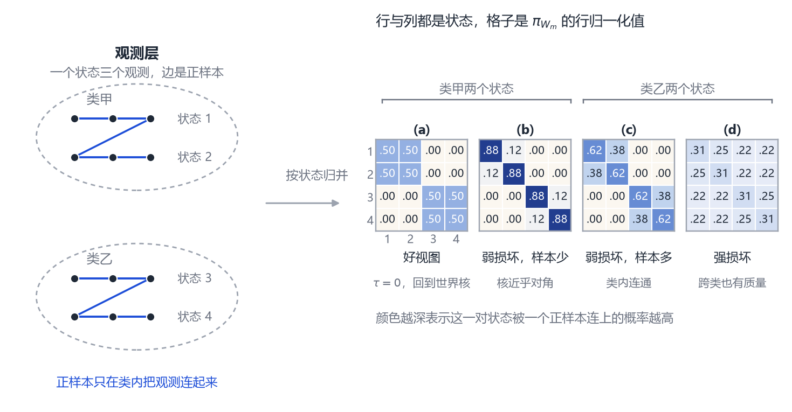
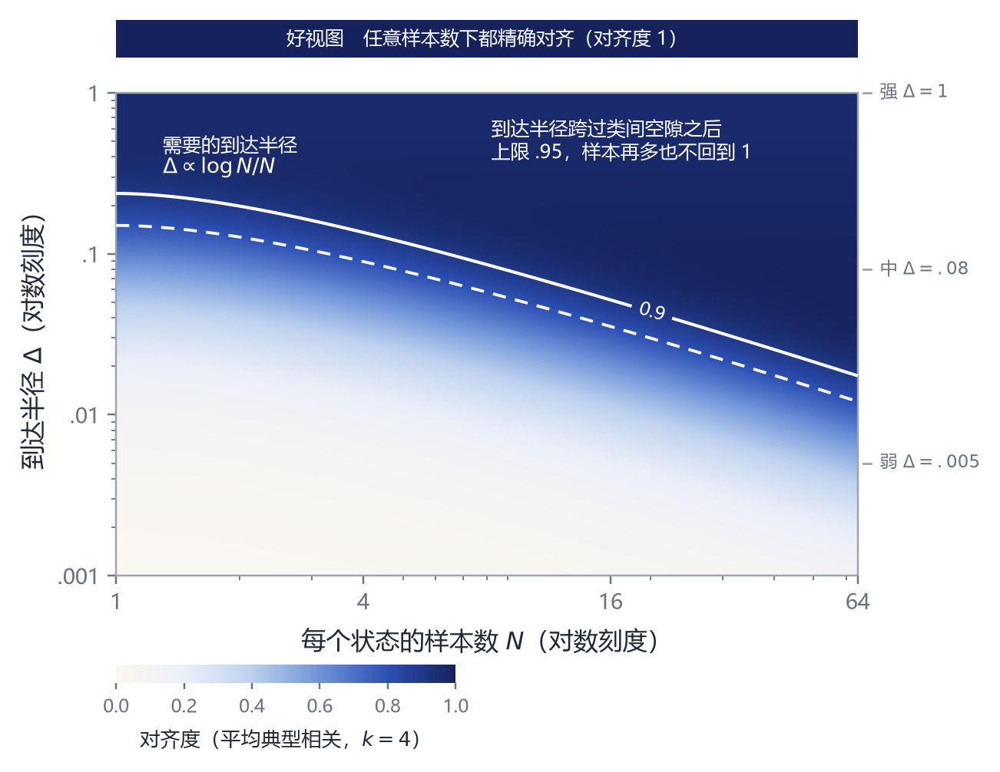

# 第 6 章　视图与数据

第 5 章把坏视图的代价算成了一张账单，干扰占掉的方向任何旋转都搬不回来，定理 3 给出的下界是 $2k(1-\rho)$，实测的场景解释比例 .804 与 .608 之间那段差距就是这笔账。算这笔账时有一个前提始终没有动，就是正样本的分布被当作给定的，跟着核也被当作给定的。这一章把这个前提拆开，问的是另一种问题，一种正样本的分布究竟把哪些世界状态连在了一起，以及这件事能不能写成一个可以估的量。换一个提法，答案的形状也跟着变，从编码器差多远变成核差多远。

一个婚礼现场被二十个人各拍一张，写成二十条描述。若正样本取“同一场婚礼的两条描述”，这二十条描述彼此相连，连的是同一件事；若正样本取“同一条描述挖掉两个词之后得到的两个残句”，相连的是同一条描述的两次损坏，二十条描述仍是二十座孤岛。两种正样本给出的连线完全不同，学出来的几何也就不同，而这一层差别在定理 1 的表述里看不见，因为定理 1 只说正样本共享即可对齐，没有说共享的是哪一部分。换个说法，定理 1 假定连线已经画好了，剩下的只是让两个模态各自照着画一遍。

判断哪一种连线更好，需要一把可以落地的尺子。第 3 章的尺子是唯一性，核有谱间隙时谱解唯一到旋转；第 5 章的尺子是干净程度，干扰越多能对上的方向越少。两把尺子量的其实是同一个对象，就是那张“谁和谁相连”的图，这一章把它放到正中央，先给它一个名字，再回到真实语料看它值多少样本。

## 6.1　观测上的正样本与状态上的核

设定先把记号摆好。模态 $m$ 有有限多个观测 $x$，每个观测落在唯一的世界状态 $s_m(x)$ 上，这正是第 2 章的渲染映射反过来读的样子。观测的边缘分布记作 $\omega_m$，它由数据给出，把一个状态的所有观测加起来就得到状态的边缘分布 $p$；正样本的分布 $W_m$ 是观测对上对称的概率，边缘同样是 $\omega_m$，也就是说它把哪些观测算作一对，与观测本身出现的频率一致。这与第 2 章把 $\pi$ 当作状态对上的对称律是同一个格式，只是这里多垫了一层观测。

$W_m$ 有三种来源，正好对应第 5 章的分法。好视图取 $W_m(x,x')=\pi\big(s_m(x),s_m(x')\big)\,\omega_m(x\mid s_m(x))\,\omega_m(x'\mid s_m(x'))$，先抽一个状态对，再各自独立抽一个观测，$\pi$ 是世界自己的核。损坏是一族保持观测边缘不变的扰动 $\Gamma_m$，它把一条描述换成同一条描述的另一次损坏，条件 $\omega_m\Gamma_m=\omega_m$ 保证白化与评测用的还是同一个分布。第三种是两者的混合，一批数据里既有同一场景的两条描述，也有同一条描述的两份损坏，真实语料几乎总是这一种。好视图给的是上界，损坏给的是最常被误当成好视图的那一种，区别全在 $W_m$ 里，不在目标函数里。

定义只有一行，叫做诱导世界核（induced world kernel）。$\pi_{W_m}(z,z')$ 是一对正样本把一个 $z$ 的观测和一个 $z'$ 的观测连起来的概率，写成 $\pi_{W_m}(z,z')=\sum_{x\in z}\sum_{x'\in z'}W_m(x,x')$，其中记号 $x\in z$ 指 $s_m(x)=z$。这个求和把观测层的一张图压成状态层的一张图，行和等于 $p(z)$，因为 $W_m$ 的边缘是 $\omega_m$，把固定 $x$ 的那一行加起来得到的正是 $\omega_m(x)$。于是 $\pi_{W_m}$ 与第 2 章的 $\pi$ 属于同一类对象，都是以 $p$ 为平稳分布的对称律，区别只在来源。这一步压缩如图 6-2，左边是观测层，一个类里两个状态各三个观测，蓝线是正样本。

<figure class="fig">

<figcaption><b>图 6-2</b>　从观测上的正样本到状态之间的诱导核。左边是观测层，右边四张矩阵是归并之后的行归一化核，弱损坏在样本少时近乎对角，样本多时才在类内连通。按论文定义绘制的示意。</figcaption>
</figure>

图 6-2 右边四张矩阵就是压缩之后的状态层，行与列都是状态，格子里的数是一行的归一化值。(a) 是好视图，块内均匀、块外干净；(b) 与 (c) 是同一个弱损坏在两个样本量下的样子，差别全在非对角；(d) 是强损坏，块外也有了可观的数。看的时候只需要盯两件事，非对角的质量落在哪个块里，块与块之间有没有质量。前者的块内说明连的是同一类的状态，后者的块外说明跨了类，而跨类正是 $\pi_{W_m}$ 与 $\pi$ 分岔的地方。

对角项 $\pi_{W_m}(z,z)$ 是“同一个状态的两个观测被连起来”的概率，它在 $1^\perp$ 上不起作用，真正决定谱形状的是非对角质量。第 2 章已经讲过这一层，在坏视图这里要再强调一次，因为弱损坏会把几乎全部质量压在对角线上，非对角只剩下数据密度碰出来的零星几条边。谱解看不到对角上的那些数有多重，它只看到非对角够不够撑起一个连通的结构。这也解释了为什么同样的损坏在小数据上退化得那么快，退化不是噪声造成的，而是非对角质量本来就不够。

有一个操作性的事实值得单独说。把同一状态的全部观测合并成一个节点，$W_m$ 在合并图上诱导的核正好是 $\pi_{W_m}$，所以“数边再归并”就是估计诱导核的全部内容。这句话把抽象的核变成了能数出来的东西，也解释了数据覆盖为什么会改变它，某个状态只有一个观测时，它与其他状态之间的边只能靠这个观测与别人的损坏重叠，重叠不上就是零。由此得到本章要反复用的一句判断，好视图的核由设计固定，坏视图的核由数据给出。定理 4 做的就是把这个判断写成一个带条件的不等式。

## 6.2　干扰保留度与混合程度

要写出不等式，得先把观测空间上的函数分成两块。设 $P$ 是到状态函数的条件期望，$Ph(x)$ 只依赖 $s_m(x)$，$\mathcal H_S$ 是 $P$ 的像，$\mathcal H_N$ 是 $I-P$ 的像，也就是给定状态之后条件期望为零的那些函数，直白地说就是干扰。$1^\perp=\mathcal H_S\oplus\mathcal H_N$ 是正交直和，因为干扰函数在状态上取条件平均恰好归零，这一条在后面把扰动拆成四块时要用到。正样本的作用则写成一个算子，$T_{W_m}h(x)=\sum_{x'}W_m(x,x')h(x')$ 是观测图上的一步随机游走，也就是第 2 章的 Markov 算子在有了观测之后的样子。它在 $\mathcal H_S$ 上的压缩与状态侧的 $T_{\pi_{W_m}}$ 酉等价，因为 $W_m$ 的状态边缘正好是 $p$。

这一步酉等价是整条证明的支点，它说明只考虑状态函数时，观测上的谱与状态上的谱是同一个谱。剩下的三块给出定理 4 的三个量。斜着压到干扰上的 $(I-P)T_{W_m}(I-P)$ 的最大特征值记作 $\eta_m$，度量一对正样本在多大程度上保留了自己那份干扰，值接近 1 表示正样本几乎完全由措辞、机位、作者口气决定。两个交叉块 $(I-P)T_{W_m}P$ 与 $PT_{W_m}(I-P)$ 互为伴随，它们的算子范数记 $\varepsilon_m$，Hilbert–Schmidt 范数记 $\varepsilon_m^{\mathrm{HS}}$，度量状态与干扰混在一起的程度。算子范数盯的是最坏的那个方向，Hilbert–Schmidt 范数看的是整体能量，扰动分散时后者更紧，所以定理 4 的界对两者取小。

好视图的两个量都归零。同一个场景的两次观测，干扰独立抽取，给定状态之后两次观测之间没有剩余相关，交叉块为零，$\varepsilon_m=0$；同一个状态内部的正样本只由状态决定，$\eta_m=0$。若一个状态只有一个观测，$\mathcal H_N$ 里没有非零函数，$\eta_m$ 约定为 $-\infty$，后面的间隙条件于是自动满足。好视图的定义到这里有了定量版本，不是语义上更好，而是这两个量恰好都是零，这正是“设计固定核”的全部内容。命题 3 的情形可以对照着看，损坏对状态与干扰可分离时写成 $\Gamma_m=A\otimes B$，于是 $\varepsilon_m=0$、$\eta_m=\beta_1$、$\pi_{W_m}=A^\top D_pA$，其中 $\beta_1$ 是损坏在干扰上保留的最大相关性，$D_p$ 是状态边缘构成的对角阵，三个量一起退化成第 5 章那张表里的东西。

这两个量之所以够用，是因为状态函数与干扰函数正交，一个核算子在这两块上的作用只有四种组合。两种在块内，状态到状态、干扰到干扰，它们决定谱落在哪里；两种是交叉，它们决定特征函数被污染多少。定理 4 的界正好按这两个来源分开，$\eta_m$ 管前者，$\varepsilon_m$ 管后者。这也是为什么条件里出现的是 $\max(\mu_{k+1},\eta_m)$ 而不是 $\mu_{k+1}$ 单独一项，干扰与下一个世界方向在这个式子里平级。

## 6.3　间隙条件与两个结论

定理 4 的前提可以写成一行。设 $\mu_1\ge\mu_2\ge\cdots$ 是 $T_{\pi_{W_m}}$ 在 $1^\perp$ 上的特征值，取 $1\le k\le|\mathcal Z|-1$。第 $|\mathcal Z|$ 个特征值约定为 $-\infty$，只是为了 $k$ 取到上界时条件仍有意义，要求

$$
\delta_m=\mu_k-\max\big(\mu_{k+1},\eta_m\big)\gt 0 .
$$

两条要求叠在一个式子里，读的时候要分开看。$\mu_k\gt\mu_{k+1}$ 是第 2 章的谱间隙，保证前 $k$ 个特征函数定得住。$\mu_k\gt\eta_m$ 是新的，保证第 $k$ 个状态方向比任何被保留下来的干扰都更显著。缺了后一条，前 $k$ 个特征函数里就可能混进一个干扰方向，而那个方向在对面模态里根本没有对应物。

结论 (i) 说的是谱解落在哪个轨道上。$W_m$ 在 $1^\perp$ 上任意一组正交归一的前 $k$ 个特征函数记作 $f_m$，$f_m$ 就是第 2 章定义的那个谱解，只是变量从编码器换成了观测上的函数。$f_m$ 是数据驱动的对象，$\Phi^{(m)}\circ s_m$ 是核驱动的对象，定理说的是这两者只差一个旋转和一项 $\tau_m$。

$$
\min_{O\in O(k)}\big\|f_m-O\,\Phi^{(m)}\!\circ s_m\big\|_{\mathrm L^2(\omega_m)}\le\tau_m,
\qquad
\tau_m=\frac{2\sqrt 2}{\delta_m}\min\big(\sqrt k\,\varepsilon_m,\ \sqrt 2\,\varepsilon_m^{\mathrm{HS}}\big).
$$

符号逐个交代。$\Phi^{(m)}$ 是诱导核 $\pi_{W_m}$ 的谱嵌入，$O(k)$ 是 $k$ 维的旋转与反射，$\circ s_m$ 表示把状态上的函数拉回观测上，范数取观测分布 $\omega_m$ 下的 $\mathrm L^2$ 范数。整句的意思是，一个谱解落在自己核的谱嵌入的某个旋转附近，偏离由 $\tau_m$ 控制，而 $\tau_m$ 是混合程度除以间隙。间隙越小或者混合越重，$\tau_m$ 越大，谱解离自己的核越远。

(i) 还带一条关于维度的推论。因为 $f_m$ 已经中心化并白化，$\operatorname{tr}C_{f_m}=\|Pf_m\|^2=k-\|(I-P)f_m\|^2$，配合上一条界就得到 $\operatorname{tr}C_{f_m}\ge k-\tau_m^2$。这里 $C_{f_m}=\operatorname{Cov}\big(\mathbb E[f_m(x)\mid s_m(x)]\big)$ 是编码里能被状态解释的那部分的协方差，白化之后它的迹就是落在状态上的维度数，所以这条不等式说的是落进干扰的方向不超过 $\tau_m^2$ 个。第 5 章那句“花在干扰上的维度收不回来”在这里有了归因，浪费多少由 $\eta_m$ 与 $\varepsilon_m$ 决定，而且浪费有一个上限。

结论 (ii) 走完跨模态这一步。取同一个状态的配对观测 $(x_1,x_2)$，耦合可以任意，只要状态的边缘是 $p$、给定状态后各自的观测服从 $\omega_m$。$f_1$ 与 $f_2$ 是两个模态各自的谱解，$Q$ 遍历所有旋转。$d$ 是两个诱导核谱嵌入之间的失配，下面这条不等式说它和对齐误差只差一项。

$$
\Big|\min_{Q\in O(k)}\big(\mathbb E\|f_1(x_1)-Qf_2(x_2)\|^2\big)^{1/2}-d\Big|\le\tau_1+\tau_2,
$$

读法是两个模态的对齐误差不会离“两个核本身有多像”太远，多出来的部分恰好是两个模态各自的 $\tau$ 之和，一边的核歪了，另一边再好也补不回来。$d$ 不用另外估计，定理 2 已经给过，$d\le\frac{2\sqrt 2}{\delta}\min\big(\sqrt k\,\|K_{\pi_{W_1}}-K_{\pi_{W_2}}\|_2,\ \|K_{\pi_{W_1}}-K_{\pi_{W_2}}\|_{\mathrm F}\big)$，$\delta$ 取第二个核的谱间隙 $\mu_k-\mu_{k+1}$。定理 4 要求 $\delta_2\gt0$，所以这个 $\delta$ 一定为正，链条于是闭合，两个归一化邻接矩阵之间的距离控制谱嵌入的距离，谱嵌入的距离加上两个 $\tau$ 控制编码器之间的距离。

证明骨架分三段。第一段在 $1^\perp$ 上把 $T_{W_m}$ 写成 $T_0+F$，$T_0$ 保留两个对角块，$F$ 是交叉块，于是 $\|F\|_{\mathrm{op}}=\varepsilon_m$、$\|F\|_{\mathrm{HS}}=\sqrt 2\,\varepsilon_m^{\mathrm{HS}}$，那个 $\sqrt 2$ 来自两个互为伴随的块各贡献一份。第二段注意 $T_0$ 的前 $k$ 个特征函数正是 $\Phi^{(m)}\circ s_m$，其后的特征值不超过 $\max(\mu_{k+1},\eta_m)$，间隙是 $\delta_m$，套用 Davis–Kahan 型扰动界就得到 $\tau_m$，两种范数给出两条界因而取小。第三段用 Ky Fan 最大原理说明谱解就是目标函数的最小值点，再用 $I-P$ 是压缩映射把特征函数的误差转成迹的下界。

论文随代码发布的检验在随机世界上跑过这两条界。状态数随机，每个状态一到四个观测，正样本混合好视图、观测与自身的配对以及完全随机的配对，这样造出来的 $W_m$ 既有 $\eta_m$ 也有 $\varepsilon_m$。两条界在全部样本上成立；在界有信息量、也就是低于平凡上界 $\sqrt{2k}$ 的那些例子里，(i) 的 2848 例误差最多为界的 32%、中位 11%，(ii) 的 307 例最多 10%、中位 0.8%。这组数字说明界不空，也偏保守。

## 6.4　读法

定理 4 最要紧的一句可以直接说出来，一个谱解学到的，是它自己那套正样本所诱导的核的谱嵌入，误差 $\tau_m$。这句话把表征学的是什么从数据搬到了核上，编码器不可能学到超出它的核的东西，核里没有的状态区别，谱解里也不会有。它同时解释了为什么两个架构不同、数据不同的模型可以对齐到只差一个旋转，因为它们的正样本诱导出了同一个核，而这件事与架构无关。好视图是这句话的特例，也是最干净的特例，$\varepsilon_m=0$、$\eta_m=0$、$\pi_{W_m}=\pi$，于是 $\tau_m=0$。

定理 4 因此在好视图上还原成定理 1 的一个版本，条件退化成 $\mu_k\gt\max(\mu_{k+1},0)$，正是第 2 章的谱间隙，只是现在允许每个状态有多个观测，每个观测带自己的干扰。第 5 章说好视图一个方向都不浪费，那不是巧合，是 $\tau=0$ 的直接后果。坏视图没有这个特权，它的核不是它选的，$\pi_{W_m}$ 记录的是哪些状态被它的正样本连起来，而这件事取决于数据怎么覆盖每个状态和它的邻居。同一个弱损坏，样本稀时每个状态内部的观测连不成片，$\pi_{W_m}$ 接近对角阵，谱解看到的是碎片，样本密的时候碎片接起来，$\pi_{W_m}$ 才慢慢长成 $\pi$ 的形状。

这条读法解释了一个常见的困惑。同样用对比目标，图文对有时能对上有时对不上，差别往往不在目标函数，而在两边数据各自连出了什么。两个模态的坏视图 JEPA 只有在它们的数据让正样本连起同一批状态时才对齐，一边的核碎了，另一边再好也没用。定理 4 与命题 3 也在这里接上了，乘积损坏下 $\delta_m\gt0$ 等价于 $\alpha_k\gt\max(\alpha_{k+1},\beta_1)$，正是命题 3 的分离条件再加 $r=0$，也就是说没有方向被浪费与 $\tau_m$ 有限是同一件事的两种说法。

前提的边界要留住。编码器类只通过 $\tau_m$ 进入定理，如果把编码器限制在同一状态的观测上取常值，等于先把观测合并，$\pi_{W_m}$ 一个元素都不变，而 $\eta_m$ 与 $\varepsilon_m$ 只会下降，界因此更好。反过来，把不同状态的观测合并的归纳偏置，或者作用很软的平滑，都在这套模型之外，定理不覆盖它们，不能拿它替这类设计辩护。还有一层方法论上的分别，定理 4 没有说坏视图学不到东西，它说的是坏视图学到的东西由数据决定，因此在数据不变的前提下无法靠改目标来改善。这个区分把目标不对与数据不对拆开了。

## 6.5　合成世界里的到达半径

这套读法可以用一个合成世界量出来。世界有五个类，每类六个状态，一共三十个状态；图像侧是一个好视图 JEPA，它的世界核把一个类里六个状态连起来，类与类之间一条边也没有。文本侧把每个状态的观测摆在一条直线上，一个类占一个块，块与块之间留出空隙，这叫字面数据；把空隙去掉、让类贴着类，叫混合数据。一个状态占的区间宽度是 $1/6$。

文本侧的坏视图按距离造，两个样本以 $e^{-d^2/(2\Delta^2)}$ 的权连起来，$d$ 是它们在直线上的距离，$\Delta$ 叫到达半径（reach），弱的取 $.005$，中的取 $.08$，强的取 $1$。样本少、半径小的时候，一个样本最像它自己，正样本几乎都是观测与自身的配对；半径大到跨过块间空隙，正样本就把两个类连在一起，核在任何样本量下都被污染。这个过程如图 6-1，横轴是每个状态的样本数 $N$，纵轴是到达半径 $\Delta$，两个轴都取对数刻度，刻度与论文同一张图一致。每个格子是对三次采样的平均，色阶就是两个谱解在配对观测上的平均典型相关，$k=4$，1 表示只差一个旋转。

<figure class="fig">

<figcaption><b>图 6-1</b>　合成世界上对齐度随样本数与到达半径的变化。两个轴都是对数刻度，白线为 0.9 等值线，虚线为 $\Delta\propto\log N/N$，顶条是好视图。按论文结论重绘的示意图，不是原始数据。</figcaption>
</figure>

图 6-1 上有几处值得看。左下大片浅色说明样本少的时候小半径根本连不成片，一个状态被切成许多只连自己的小块。白色的 0.9 等值线随样本数增加向左下退，说明弱视图要靠更多样本换同样的对齐；顶条是好视图，任意 $N$ 都精确对齐，与下面的梯子不在一个数量级。同一张图上还有一个上限，半径大到跨过类间空隙之后，对齐度停在 .95 附近，样本再加也不回到 1。

等值线为什么长成 $\log N/N$ 的形状，可以用顺序统计量讲清楚。$N$ 个样本落在宽 $1/6$ 的区间里，把区间切成 $N+1$ 段，最长那段的期望量级是 $\frac{1}{6}\frac{\log N}{N}$，要把一个状态内部连成一片，半径必须跨过这段最长的空档，否则状态先碎成几片，谱解看到的是碎片而不是状态。这条推理解释了论文为什么只拟合一个常数，形式由极值统计给出，剩下的是一个倍数。合成世界也把定理 4 的两个来源分得很开，碎片小对应 $\pi_{W_m}$ 接近对角、$\eta_m$ 偏高，跨类则对应 $\mu_k$ 与 $\mu_{k+1}$ 之间的间隙被填平、$\delta_m$ 变小。两条路径一个动分子一个动分母，最终都落到同一个量上。

混合数据那一半把上限压得更低。类贴着类的时候，任何坏视图的上限都掉到 .89 附近，样本再多也补不回来，因为核里两个类已经分不开。好视图那一侧则是精确的，每个状态一个样本就够，因为它的核由设计固定，不需要靠重叠把碎片接起来。两个极端摆在一起，这一节的问题就清楚了，坏视图靠样本密度换半径，而这条交换只在一个上限之下有效。

## 6.6　数据种类决定核

同样的样本量、同样的损坏、同样的编码器，换一批文本，核就换一个。在 5000 万张图的网页文本上，两次掩码的坏视图配 LLaVA 重写的描述，在 WIT-1024 上到 .092；换成同一批图的替代文本，只有 .056。两个数相差近六成，而除了文本本身，其余条件一个没动。替代文本是网页上为了让图片被搜到、被读屏软件读出来而写的短句，同一家店的十张图会共享品牌名，同一个模板会重复同一串词，这些重复把不同场景连了起来。重写描述只写画面里看得见的东西，链子留在场景内部，于是替代文本让 $\pi_{W_m}$ 在类外多出质量，$\delta_m$ 被压低，而字面描述让链子在场景内部走完。

把变量反过来，同一批文本只换视图，差距同样稳定。两条重写描述上，好视图 .096、坏视图 .092，差得不多，因为重写描述本身已经很接近字面；完全没有图像描述模型参与的那一组在 224 万张图上，替代文本加纯文本模型写出的同义句，好视图 .060、坏视图 .055，检索分数 .233 对 .180，差距在检索上更明显。这里有一个不能省的限定，换数据同时改变了 $\eta_m$、$\varepsilon_m$ 和核本身，所以这组对照分不开三项各占多少。定理 4 说清了三项各自的作用，却没有给出只改核的实验设计，真实语料上做不到这件事，论文自己写了这一句，专业篇更要留住它。

数据种类还有另一面，是评测集本身的风格。论文解释了为什么重写描述在 Flickr 上检索最好，Flickr 的人工描述是字面的，像重写的文本，而 WIT 的维基描述更像替代文本。对齐度这个数字里于是混着训练文本与评测文本的风格距离。好视图从哪来这个问题也在这里露头，Flickr 的多条人工描述是标注给的配对，网页上的替代文本加两条重写描述是网页结构给的配对，重写那一步又借了一个看过图的模型，三种来源的配对信息量与携带的干扰都不同。

## 6.7　真实语料上的四十二倍

把镜头拉回真实语料，这套读法变成一组倍数。用同一个 109M 参数的文本编码器、同一批 Recap-DataComp 文本，只改正样本的构造，好视图读到 2160 万个样本时在 WIT-1024 上到 .109，下一词预测读到 9 亿个样本才到 .111，相差 42 倍。三个倍数说的是同一件事的三个刻度，样本少 42 倍，词元少 14 倍，因为一个好视图样本要读三条文本，唯一图片少 435 倍，216 万张对 9.4 亿张。词元那一条最保守，因为算力大致跟着词元走，而 42 倍这个数字容易被一条样本读三条文本稀释掉。

同样本量下的差距更大。同样是 2160 万个样本，3300 万参数的编码器上，好视图 .108，下一词只有 .071，差了一半还多。这条对照排除了样本数打平之后差距就消失的解释，说明好视图的每条样本都在提供别的信息。两侧的算力配置不同，好视图用批大小 256、学习率 $10^{-4}$，下一词用批大小 2048、学习率 $2\times10^{-4}$，各自用适合自己规模的配方，42 倍不是把对手削弱之后得到的。

把这些点连起来，论文拟合了一条缩放律。$M$ 是训练样本数，$N$ 是图片数，$q$ 是训练条目里带好视图的比例。三者与对齐度的关系写成

$$
\mathrm{R@1}=a+d\log M+b\log\Big(1+\frac{q^{\alpha}M^{\beta}N^{\gamma}}{c}\Big),
$$

$a,d,b,c$ 与三个指数都是拟合出来的常数，第一项加第二项是坏视图自己也能爬到的那条底，对数项是好视图额外带来的那部分。用 45 个格子的结果拟合，均方根误差 .007；拿它预测 85 个没跑过的设置，误差 .0093，而同一个设置换个种子重跑的差别是 .0096。预测和重跑一样准，这条曲线也就碰到了种子噪声的地板。

两个指数的读法比数值本身更重要。沿等对齐线看，样本每翻倍能换掉的 $q$ 是次线性的，$q\propto M^{-0.30}$，样本翻十倍才能把好视图的比例降一半左右。唯一图片数的指数只有 $\gamma=.19$，说明光堆图片、不改善视图几乎没有用，$q=0$ 时 WIT 上的分数从 41 万张图到 5090 万张图都停在 .054 到 .057 之间。这与 6.5 节的读法完全一致，核不由数据量决定，数据量只决定能不能靠重叠把碎片接起来。

这条律在最远处失效，而失效的方式本身很说明问题，到 3.2 亿个样本，四倍于最长的拟合运行，图片已经被读了 31 遍，$q=1$ 处实测 .418、律预测 .455，$q=.1$ 处 .348 对 .389，$q=0$ 处 .338 对 .337。只有好视图被高估，坏视图几乎命中，论文自己的解释是律里没有重复数据这一项。从核的角度也能这样读，重复读同一批图片不会让 $\pi_{W_m}$ 变宽，只会让同一个核估得更准，准到一定程度之后增益就停了。

把这一章的三层叠起来看，结论是一条从定义到数字的链。第一层是定义，$\pi_{W_m}$ 把一种正样本的分布压成状态之间的一张图，好视图由设计固定它，坏视图由数据给出它。第二层是定理，$\tau_m$ 把离自己核有多远写成 $\eta_m$、$\varepsilon_m$ 与 $\delta_m$ 的函数。第三层是数字，42 倍、$q\propto M^{-0.30}$、$\gamma=.19$ 与 3.2 亿样本处的失效，都是这条链的投影，也都是可以复核的数字。

还差一块。这一章把下一词预测放在坏视图里一起说，只说它的核靠共享措辞相连，没有解释它为什么比坏视图更难处理。原因在第 5 章已经露过头，它的解只确定到可逆线性变换，白化前提在它身上不成立，所以定理 4 的 $\tau_m$ 不能直接搬过去。下一章先把下一词预测完整地写成 JEPA 的形式，再回来问这套语言在它身上能说到哪一步。
