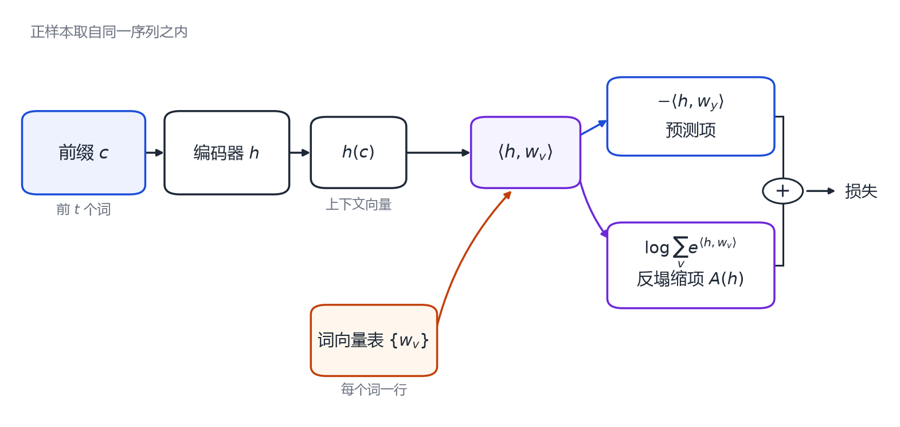
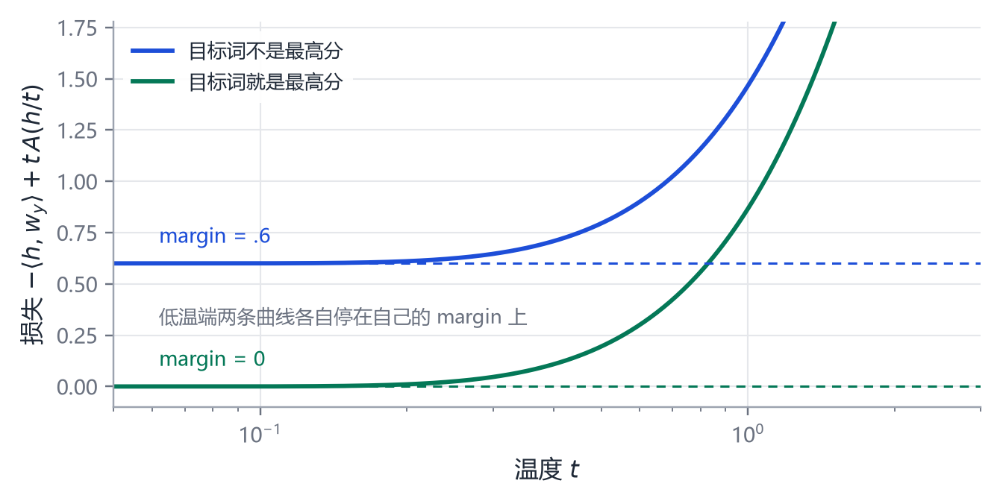
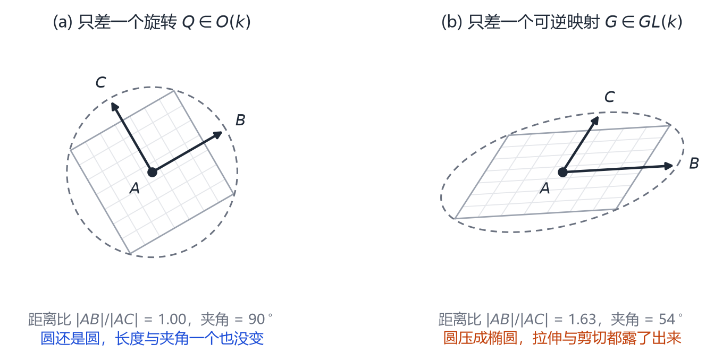
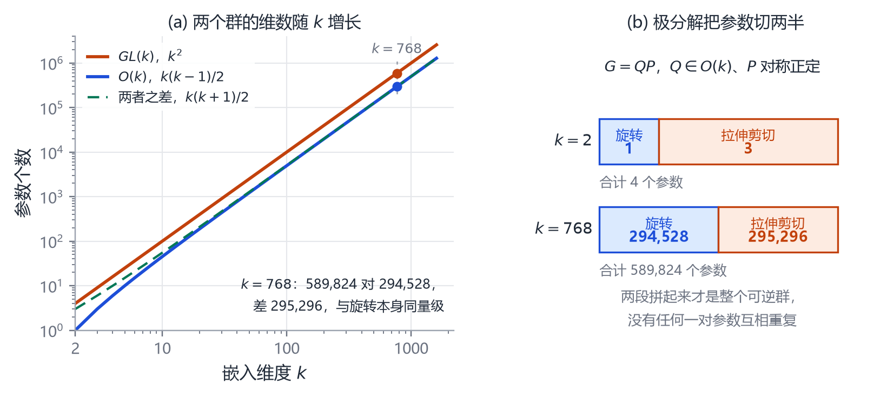

# 第 7 章　下一词预测的 JEPA 形式

把一个训练好的语言模型的最后一层向量取出来当句子嵌入，再拿去做图文检索，结果往往不如一个专门训练、参数少得多的双塔模型。工程上对这个现象的解释通常停在"它不是为检索训练的"，这句话正确，却没有回答更基本的问题，也就是它到底在学什么，以及它学的那个东西为什么不能直接拿来比较两张图。语言模型的训练目标本身是一个自监督目标，它把一段文字与紧接其后的那个词配成正样本，把这两样东西往一起拉，从形式上看，它与 JEPA 的距离比一般人以为的近得多。论文把这层关系写成一条命题，命题的内容可以拆成三句话，而这三句话各自的分量差别很大。

上一章用诱导世界核把"正样本连了谁"写成了一个核算子，定理 4 说明一个谱解学到的是它自己那套正样本诱导的核的谱嵌入，好视图的核就是世界自己的核，坏视图的核由数据决定，需要靠密度去把碎片连起来。那一章留下了一个没有回答的问题，就是语言模型的正样本属于哪一类，它既不是同一个场景的两次观测，也不是同一次观测的两次损坏。这一章把这个空缺填上，办法是把下一词损失拆开，看拆出来的两项各自落在 JEPA 的哪个位置上。拆完之后会发现，能对上的部件一个不缺，只有一处对不上，而那一处恰好是最要紧的地方。

命题 4 的第一条说这个损失在结构上就是一个 JEPA，上下文编码器、目标编码器、预测方式、正样本四样东西都能一一指出，这一条把"是不是"回答完了。第二条说配分项不看目标词，温度趋零时整个损失收敛到一个 margin，这一条把反塌缩怎么工作回答完了。第三条说最优解只确定到一个可逆线性变换，而不是一个旋转，这一条把"能不能当世界模型用"回答完了。三条里面第三条最重，因为它不是一个负面评价，而是一个精确的代数事实。

按这三条走，顺序不能反。先把损失拆成两项并交代每个符号的含义，再把拆出来的四个部件与式（1）里的 JEPA 逐条对上，然后单看配分项的两副面孔，一副是它作为均匀性项的作用，另一副是它在零温极限下的样子。接着算一笔关于群的账，说明可逆线性变换比旋转多出多少自由度，以及这个差为什么让距离与夹角同时失去意义。收尾回到正样本与实验数字，说明命题 3 在这里只能启发式地使用。

## 7.1　把交叉熵拆成两项

设前缀 $c$ 是前面 $t-1$ 个词组成的序列，编码器把它映成一个向量 $h(c)\in\mathbb{R}^k$，$k$ 是嵌入维度。词表 $V$ 里的每个词 $v$ 有一行向量 $w_v\in\mathbb{R}^k$，所有行叠起来就是一张 $|V|\times k$ 的矩阵，也就是模型输出层的权重。真实的下一个词记作 $y$，它一定在 $V$ 里。带线性 softmax 头的模型给这个词的条件概率是 $p(y\mid c)=e^{\langle h(c),w_y\rangle}/\sum_{v\in V}e^{\langle h(c),w_v\rangle}$，其中 $\langle\cdot,\cdot\rangle$ 是内积。线性头是一个真条件，logits 直接就是内积，中间没有别的非线性，也没有除加性偏置之外的东西。对这个式子的左边取负对数，就得到下一词预测的损失，而它一步就能拆成两项，拆法是恒等变形，不是近似。

$$
-\log\frac{e^{\langle h(c),w_y\rangle}}{\sum_{v\in V}e^{\langle h(c),w_v\rangle}}
= -\langle h(c),w_y\rangle + \log\sum_{v\in V}e^{\langle h(c),w_v\rangle}.
$$

这个拆分不是近似，也不是重写，它就是 softmax 定义的一次代数整理，论文的证明里只用了一行。右边第一项只跟目标词那一行有关，它做的事情是把 $h(c)$ 往 $w_y$ 的方向拉。右边第二项记作 $A(h)=\log\sum_{v\in V}e^{\langle h(c),w_v\rangle}$，它跟 $y$ 无关，却要对整张词表求和，做的事情正好相反，是把 $h(c)$ 从所有词向量的附近推开。两项的分工在后面每一节都会再出现一次，只是换着名字出现。

图 7-1 把这两条路画在同一张图上，左边是前缀经编码器得到向量，中间是与词向量表做内积，右边分成两项再相加。两条路共用同一个 $h(c)$，所以它们在同一组数上争夺，第一项要 $h(c)$ 与 $w_y$ 的内积大，第二项要 $h(c)$ 与任何一个 $w_v$ 的内积都别太大。损失的最小值点就是这场争夺的平衡点，而平衡点的位置取决于词表有多大、词向量排成什么形状。如果词表只剩一行，两项会精确抵消，所以这个平衡点只在词表足够大、词向量彼此分开时才有内容。

<figure class="fig">

<figcaption><b>图 7-1</b>　下一词预测的 JEPA 形式。前缀经编码器得到上下文向量，与词向量表逐行做内积，一项只在目标词上取值，一项对全表求对数配分，两项相加即损失。</figcaption>
</figure>

把概率目标改写成这样两项，代价是丢掉一部分直觉。原来的交叉熵读起来是"给正确答案分配的概率太低"，改写成两项之后，读起来变成"目标词的分数不够高"与"某个词的分数太高"，两者都是分数，不是概率。这个视角的转换后面还要用到，因为在温度趋零的极限下，剩下的只有分数之差，而分数之差有一个与概率无关的名字。代价不大，因为后面要做的事只有两件，求极值和比大小，两件在分数上做都比在概率上做方便。

## 7.2　三个部件一一对上

命题 4 的第一条把这个损失读成一个 JEPA，读法是逐件指认。上下文编码器 $h$ 就是 JEPA 里的 $f$，它把观测映成 $k$ 维向量，这里的观测是前缀。目标编码器是"词到向量"的查表，把目标词 $y$ 映成 $w_y$。预测不是欧氏距离而是内积，两个编码器的输出直接相乘。正样本是同一段序列里的 $(c,y)$ 对，$y$ 紧接在 $c$ 之后。四件东西都在，所以这个损失在结构上确实是一个 JEPA，而不只是"某种自监督目标"。标准 JEPA 的一般写法是

$$
L_m(f)=\mathbb{E}_{(z,z')\sim\pi_m}\,\ell\big(f(g_m(z)),\,f(g_m(z'))\big)+\Omega(f),
$$

其中 $\ell$ 是预测项，$\Omega$ 是反塌缩项，而 $\Omega$ 只通过 $f$ 的嵌入分布依赖 $f$，不依赖别的参数。对照之下，命题 4 说这里的 $\ell$ 换成 $-\langle h(c),w_y\rangle$，正样本分布换成序列内部的分布，$\Omega$ 换成 $A(h)$。这个对照有三处不完全贴合，而这三处恰好说明了它与标准 JEPA 的差别在哪里。差别只在这三处，其余部分原样保留。

第一处是目标编码器的身份。标准 JEPA 里两个模态各有一个编码器，各自看一种观测，彼此不知道对方存在。这里第二个编码器是一张查表，它的参数就是要学的词向量本身，而它的输入 $y$ 是序列里的一个符号，与 $c$ 属于同一种观测。第二处是反塌缩项的依赖关系。式（1）里 $\Omega$ 只看 $f$ 的嵌入分布，这里 $A$ 除了看 $h$ 还要看整张词表 $\{w_v\}$，也就是说它依赖目标编码器的参数。命题 4 的措辞是"结构上是 JEPA"，这个让步语气对应的正是这两处。

第三处是预测项的形式，它是内积而不是平方距离。两者并不是没有关系，因为 $\lVert h-w_y\rVert^2=\lVert h\rVert^2+\lVert w_y\rVert^2-2\langle h,w_y\rangle$，一旦两个向量的范数都被固定，最小化内积与最小化平方距离就是同一件事。差别只在范数不被固定的时候出现，而正是这一点差别把解的不变群从 $O(k)$ 扩大到 $GL(k)$，这件事留到 7.5 节。所以在范数被约束的场合，把这套损失读成 JEPA 的平方误差形式并不算错，只是会看漏一个自由度。

## 7.3　配分项不看目标词

$A(h)=\log\sum_{v\in V}e^{\langle h,w_v\rangle}$ 是一个 log-sum-exp，它对 $h$ 与整张词表的相容度做了一个光滑的最大值。它的性质有两面。作为函数，它总是不小于 $\max_v\langle h,w_v\rangle$，最大分数与其余分数的差距越大，它越贴近这个最大值。作为损失的一部分，它完全不看 $y$，所以它给出的梯度只跟"当前 $h$ 最像哪些词"有关，跟正确答案是哪个词无关。通常的反塌缩项也是不看标签的，这一点在这里被完整保留下来。

把 $A$ 对 $h$ 求梯度，得到 $\nabla_h A=\sum_{v\in V}\mathrm{softmax}_v(\langle h,w_v\rangle)\,w_v$，也就是当前预测分布下所有词向量的加权平均。这个方向有两层意思。它指向模型此刻最倾向的那些词的平均位置，所以 $A$ 把 $h$ 往这个平均的反方向推；权重是 softmax 概率，所以模型越确信某个词，那一行被推得越狠。极端情形下，如果 $h$ 与某个 $w_v$ 的内积远大于其他词，梯度几乎就是 $w_v$ 本身，$A$ 于是在这个方向上给出最强的排斥。

这与对比学习里的均匀性项是同一个角色。Wang 和 Isola 在 2020 年把对比损失拆成对齐与均匀两部分，均匀那一部分要求嵌入在球面上铺开，防止"把所有输入映到同一点"这条捷径，$A$ 做的是同一件事，只是分母从负样本池换成了整张词表。差别在于推开对象的来源，对比学习的负样本从数据分布里采，$A$ 推开的词向量是被学习的参数，所以它做的不是"推开数据里已有的东西"，而是"推开模型自己正在长出来的东西"。这个差别有一个直接后果，被推开的对象不能事先设计，词向量怎么排布是这场拉锯的结果。所以"配分项把嵌入均匀铺开"这个说法只在很粗的层面成立，准确的说法是它把 $h$ 从词向量当前的构型上推开，而构型本身在变。

## 7.4　温度趋于零时的 margin

把 logits 除以温度 $t$，配分项变成 $\log\sum_v e^{\langle h,w_v\rangle/t}$，整个损失相应变成 $-\langle h,w_y\rangle+t\log\sum_v e^{\langle h,w_v\rangle/t}$。这是 log-sum-exp 的标准用法，除以 $t$ 相当于把分数拉开，$t$ 越小拉得越开。令 $t\to 0$，$tA(h/t)$ 收敛到 $\max_v\langle h,w_v\rangle$，于是整个损失收敛到 $\max_v\langle h,w_v\rangle-\langle h,w_y\rangle$。这个量不小于零，因为它是一个最大值减去其中一项，等号只在目标词自己取到最大值时成立。注意 $t$ 在这个式子里只作为分母出现，它不改变比较的对象，只改变比较的锋利程度。

这个极限有一个干净的名字，叫 margin，意思是目标词的分数离最高分还差多少。它为零当且仅当目标词就是分数最高的那个，此时配分项不再惩罚任何东西，损失也降到零。图 7-2 把两条曲线画在一起，上面那条对应目标词不是最高分的情形，常温下损失离 margin 还有一段距离，温度降低时它单调地滑向那条水平虚线。下面那条对应目标词就是最高分的情形，它从上方滑向零，滑到底部就是完美预测。

<figure class="fig">

<figcaption><b>图 7-2</b>　温度与 margin。横轴是温度 $t$（对数刻度），纵轴是缩放后的损失，$t$ 变小时两条曲线分别落到各自的水线上，曲线由本书按一组固定 logits 算出。</figcaption>
</figure>

温度的两端都认识。$t=1$ 时它是原来的 softmax 交叉熵，配分项把力气摊给整张词表；$t\to 0$ 时它变成一个 max-margin 损失，配分项只跟最强的那一个竞争者打交道。中间的变化不是形状上的渐变，而是被罚对象的收缩，低温下梯度几乎全落在少数几个大 logit 上，其余词拿到的排斥力可以忽略。所以"交叉熵在做均匀性"这个说法是有条件的，它只描述常温附近的平均行为。

这解释了一件在实践里被反复观察到的事。温度降低会让模型更快地抓住最可能的答案，也会让嵌入的分布从铺开转向分成几簇，因为均匀性被换成了 margin，而 margin 只关心第一名。语言模型用的温度通常接近 1，所以它同时具备两种性质的一部分，既有均匀的排斥，又有对最强竞争者的额外压制。配分项的这一面解释完之后，剩下的问题是解的形状，而那要看群。

## 7.5　只能确定到一个可逆线性变换

命题 4 的第三条讲的是解的识别性，也就是这个损失的最优解能被确定到什么程度。条件有两个，一是条件分布处处非零，也就是每个前缀后面接每个词的概率都严格大于零，二是嵌入维度 $k$ 足够大，大到容得下整张词表留下的秩。在这两个条件之下，损失的最小值点满足下面这个等式，也就是说内积把条件概率的对数复现了出来，此外没有别的东西被约束，剩下的那个自由度在下一段交代。处处非零这个条件也不只是技术性假设，因为若某个词在某个前缀之后永不出现，对应的那一行内积就不受任何约束，识别性无从谈起。

$$
\langle h(c),w_v\rangle=\log p(v\mid c)+b(c),
$$

其中 $b(c)$ 是一个只跟前缀有关、与 $v$ 无关的常数，它的来源是 softmax 的平移不变性，给某个前缀的所有 logits 同时加一个常数，条件分布一个数都不变。既然这个常数对每个前缀各有一份，它就不构成对 $h$ 的任何约束，剩下的自由度全部来自别处。把 $b$ 移走之后，等式的左边仍然是一个 $k$ 维内积，右边是一张固定的数表，问题于是变成如何用两个 $k$ 维向量把这整张表分解开。分解在这里没有唯一答案，因为两个向量可以同时换成 $Gh$ 与 $G^{-\top}w_v$ 而内积不变。

真正有意思的是下一层，也就是当 $h$ 与 $w_v$ 同时变换时会发生什么。把 $h$ 换成 $Gh$，把每个 $w_v$ 换成 $G^{-\top}w_v$，$G$ 是任意可逆矩阵，内积一个都不变，因为 $\langle Gh,G^{-\top}w_v\rangle=\langle h,w_v\rangle$。所有 logit 不变，条件概率不变，损失不变，所以解集在这类变换下整体不动。这个可逆矩阵的集合记作 $GL(k)$，于是 $h$ 最好只能确定到一个可逆线性变换。命题 4 的用词很克制，它说的是"at best up to an invertible linear map"，意思是即使在最有利的条件下也只能到这个程度。

自由度的账可以算得很清楚。$GL(k)$ 有 $k^2$ 个参数，$O(k)$ 有 $k(k-1)/2$ 个，差是 $k(k+1)/2$，正好是 $k$ 阶对称正定矩阵的维数。这个数字不是巧合，因为任何可逆矩阵都能唯一地写成一个旋转乘一个对称正定矩阵，$G=QP$，这叫极分解。多出来的那些自由度全部落在 $P$ 上，而 $P$ 就是拉伸与剪切，它作用在 $h$ 自己这一侧的几何上，不构成两侧之间的相对量。

回到 7.2 节留下的那个问题，答案在预测项的形式里。不变群由 $\ell$ 的等距群决定，如果 $\ell$ 是平方距离，只有正交变换能让它逐点不变，群是 $O(k)$；如果 $\ell$ 是内积 $-\langle a,b\rangle$，那么任何一对互逆的线性变换都让它不变，群是 $GL(k)$。平方距离会把拉伸惩罚掉，因为拉伸改变长度；内积不会，因为内积是 $h$ 与 $w$ 两套向量共同定义的，一边拉长、一边压短，乘积不动。所以"下一词预测只差一个旋转"这个说法是错的，它差的是一个可逆线性变换。

## 7.6　距离为什么失去意义

旋转之下有很多东西不变，长度、夹角、两点之间的距离、距离之间的比值、最近邻关系、Gram 矩阵，以及由 Gram 矩阵决定的谱分解。所以当两个嵌入只差一个旋转时，"这两个向量有多远""这两个方向夹角多大"在两边的答案完全一致，跨模态的比较只要先把这个旋转找出来就行。正交 Procrustes 能把它定死，$k$ 对处于一般位置的配对点足够，解由一次奇异值分解给出。这条结论就是命题 2，也是整个 PRH 里最干净的一段。

换成可逆线性变换，这个清单一项都不剩。沿某个方向把 $h$ 拉长三倍，同时把对应的 $w_v$ 压缩三倍，所有 logit 一个都不变，模型的输出一个字符都不变，可是 $h$ 那一侧任意两点之间的距离变了，距离之间的比值变了，夹角也变了。图 7-3 用二维把这件事画出来，左边是旋转，右边是拉伸加剪切，同样的两条边在右图里距离比从 1.00 变成 1.63，夹角从 90 度变成 54 度。变化发生在 $h$ 侧的几何上，不在两侧的关系上。

<figure class="fig">

<figcaption><b>图 7-3</b>　两组变换的自由度差别。左图是旋转，网格只转角度，单位圆仍是圆，距离比与夹角都不变；右图是拉伸加剪切，单位圆压成椭圆，同样的两条边，距离比与夹角都改了。</figcaption>
</figure>

后果是任何依赖距离或夹角的操作在这个空间里都没有唯一答案。最近邻检索读的是距离，谱分解读的是内积结构，CKA 读的是 Gram 矩阵，这三样在一般线性变换下都会变，所以"把模型的嵌入取出来算相似度"这件事，如果没有额外约束，得到的数只能相对于某个坐标约定才有意义。图文对齐之所以必须显式拟合一个映射，而不能指望两边各自取出的坐标恰好对上，原因就在这里。这也解释了为什么这类对齐结果对预处理与维度选择那么敏感。

有配对的时候，能定到的是一个线性映射，而且这个映射不可解释。原因是 $G$ 的自由度正好可以吸收两侧的差，任何一组配对都能被某个线性映射拟合得很好，拟合出来的映射依赖你选了哪一组配对、哪个坐标系，它没有"哪个方向更重要"的含义。要得到旋转，必须额外加约束，比如要求白化、要求两侧等维、要求映射正交，而这三条在真实模型里通常一条都不成立。论文自己也标出了这个边界。

实验里图像侧是 DINOv2，768 维，文本侧是自训练的小模型，384 维，两侧维度不等，拟合的是行正交的线性映射，论文明确说理论没有覆盖这一情形，理论覆盖的是等维、白化、只差旋转。这种映射的自由参数是 $d_ad_b-d_b(d_b+1)/2$，在 DINOv2 ViT-B 上是 0.22M，在最好的 captioner 的 5,120 维特征上是 1.9M，全部由配对拟合。这些参数是可数的，但拟合出来的东西是一个投影，不是一个"应该"的旋转。换句话说，理论能保证的那一步在这里只能靠工程手段补上，而工程手段没有保证。

## 7.7　隐式正样本与神经坍缩

命题 4 的第三条还有一个推论，它比前半句更容易被忽略。既然 $\langle h(c),w_v\rangle=\log p(v\mid c)+b(c)$，那么要让某个词的条件概率高，就必须让 $h(c)$ 与 $w_v$ 的内积大，于是所有以同一个词结尾的前缀都会被推向同一个 $w_v$ 附近。这就是语言模型里被反复观察到的神经坍缩，Papyan 等人在 2020 年系统地描述过这个现象，论文指出语言模型随规模增大会逼近它。坍缩在这里不是缺陷，它是这个目标的最优解形状。

于是下一词预测有了第二类正样本，而且是隐式的。两个前缀如果后面接同一个词，它们都聚在 $w_v$ 附近，彼此就靠近了，虽然没有一条损失项直接把这两个前缀配成一对。命题 4 的显式正样本只有一类，就是前缀与它紧接的续写，隐式的这一类是被最优解的形状顺便造出来的。这相当于正样本的核多了一圈连接，只是这圈连接的强度由词频与条件概率决定，不由数据里"哪些句子描述同一个场景"决定。

这类连接很弱，弱在两个方向。往内看，一个词元跨不过一个场景，要连起同一场景的两句话需要很长的共享续写链，链上每一环都要靠数据碰出来，所以它需要极密的数据。往外看，高频续写会把不同场景连上，虚词、标点习惯、文档风格、套话这些东西在任何场景里都出现，它们造成的连接一律外溢。第 6 章给弱损坏的诊断是连接窄、靠密度补、跨场景漏，这里的情形是同型的。这里的读法是启发式的，不是推论，因为下一词预测不是谱 JEPA，它没有白化约束，也不在单一空间上定义核，所以定理 4 与命题 3 的那些量都不能直接搬到它身上。

## 7.8　实验能看到的与看不到的

论文用一组对照来检验这个预测。同一批图像编码器不动，只换文本侧，文本侧分别是好视图 JEPA、坏视图 JEPA（以掩码跨度为正样本）、下一词预测，以及一个特别的第四种，把同一张图的两句描述拼成一段再喂给下一词预测。对照的设计要点是数据不变、编码器不变，只有正样本的定义变。四者在同一份数据上训练同样的轮数，然后在 1,000 对 Flickr 测试对上量三个指标，互 10-NN、R@1、R@5，每个数字给三个种子的半极差。

结果排在一张表里。好视图的三个数是 .062、.044、.133，坏视图是 .047、.027、.095，下一词预测是 .042、.021、.077，把成对描述拼起来再喂给下一词预测的那一列是 .043、.023、.083。随机初始化是 .010、.001、.011，机会水平是 .010、.001、.005，也就是说随机初始化时互 10-NN 与 R@1 恰好落在机会水平上，三个指标都只在训练之后才有区分度。这条观察本身就说明这组指标的分辨力有限，后面几处差别都落在小数点后第三位上。

这组数字里最要紧的是最后两列的距离。给下一词预测喂同一张图的两句描述，等于把"这两句说的是同一件事"这条信息放进了它的上下文，比只喂单句强得多，可它的互 10-NN 只从 .042 挪到 .043，R@1 从 .021 到 .023，R@5 从 .077 到 .083。相对提升是有一点，R@1 上大约一成，绝对量却可以忽略；同一批数据交给好视图 JEPA，R@1 是 .044，是它的两倍。这三个数字放在一起，说明数据侧的配对信息确实进来了一部分，只是被目标函数压住了。

提升小的原因，命题 4 的第一条已经说了。拼起来的两句在序列上前后相邻，但模型看到的正样本仍然是"前缀到下一个词"，没有任何一项损失告诉它"这两句描述的是同一张图"。它唯一能利用的通道是跨句位置上共享的措辞与共享的续写，而这条通道很窄，正是 7.7 节说的那圈连接。把配对信息从数据侧搬进来，如果没有改变正样本的定义，它就进不了目标函数。

这也是为什么命题 3 在这里只能启发式地应用。命题 3 的前提是一个编码器、一个空间上的核、白化后的嵌入，结论是坏视图会把维度花在干扰上，而下一词预测有两个编码器，核定义在序列内部，嵌入没有白化，解只定到 $GL(k)$。论文的措辞是这是一个待检验的预测，不是推论，随后才给出上面那组对照。第 5 章量到的 $\rho$ 排序与这个预测同向，好视图 .804、坏视图 .655、下一词 .608，但同向不等于证明。

把三条串起来看，可以给下一词预测一个不夸张的评价。它在结构上确实是一个 JEPA，配分项确实在起反塌缩的作用，零温极限下它确实退化成 max-margin，这三点都是命题，条件写清楚了，结论也站得住。它缺的是另外两样东西，一样是识别性，解只定到可逆线性变换，距离与夹角都不再有意义；另一样是正样本，前缀与续写共享的是一段文档的措辞，不是一次世界状态的观测。两样东西合起来，就解释了它在跨模态比较里为什么总是排在最后。

所以语言模型的效率问题不是能力问题，而是目标问题。它学到的东西是措辞与共现，这两样在文本内部极其有用，语言模型的全部能力都建立在这上面，只是它不是世界状态。在需要"同一个场景的两次观测靠在一起"的场合，它必须靠多得多的数据去把这条连接碰出来，好视图 JEPA 用少 42 倍的样本就达到了同样的对齐。这个数字的来历，以及它周围的证据链与三条硬限制，第 11 章会完整交代。

## 7.9　词向量是一次隐式矩阵分解

在把证据交给下一章之前，7.5 节的那条等式值得再读一遍。把 $k$ 维内积看成一次矩阵乘法，把词当作行、把观察到的前缀当作列，$M_{vc}=\log p(v\mid c)$ 是一张行数等于词表大小、列数等于前缀数的宽表，等式 $WH=M+\mathbf{1}b^\top$ 说这张宽表被两个窄矩阵复现，$W$ 有 $k$ 列、$H$ 有 $k$ 行，余量只有每个前缀分到的那个常数。Levy 和 Goldberg 在 2014 年对 skip-gram 负采样（skip-gram with negative sampling，SGNS）做过同型的事，他们证明那个目标的最优解等价于把一张平移过的点互信息矩阵分解开。这条结果常被读成"词向量的线性结构有了解释"，它真正的分量在于指出了被分解的究竟是哪张表。

SGNS 的目标很朴素，它把每一对共现 $(w,c)$ 的分数 $s_{wc}=\langle u_w,v_c\rangle$ 往上推，同时把从噪声分布里抽出来的负样本往下压。写成式子是 $\sum_{w,c}n_{wc}\log\sigma(s_{wc})+m\sum_{w,c}n_wp_n(c)\log\sigma(-s_{wc})$，其中 $n_{wc}$ 是共现次数、$n_w$ 是词 $w$ 的出现次数、$p_n$ 是噪声分布、$m$ 是每个正样本配的负样本个数、$\sigma$ 是 logistic 函数。这个目标对每个分数是解耦的，单独把某一个 $s_{wc}$ 的导数置零就得到 $\sigma(s_{wc})=\frac{n_{wc}}{n_{wc}+m\,n_wp_n(c)}$，再用 $\log\frac{\sigma}{1-\sigma}=s$ 翻回分数，有 $s_{wc}=\log\frac{n_{wc}}{m\,n_wp_n(c)}$。把次数换成概率（$n_{wc}=Np(w,c)$、$n_w=Np(w)$）后 $N$ 消掉，剩下 $s_{wc}=\log\frac{p(w,c)}{p(w)p_n(c)}-\log m$，前一项是以 $p_n$ 为上下文边缘的点互信息（pointwise mutual information，PMI）。

同一套账可以原样搬到下一词预测，只是被分解的表换了一张。用点互信息的定义把条件概率展开，$\log p(v\mid c)=\log\frac{p(c,v)}{p(c)p(v)}+\log p(v)=\mathrm{PMI}(c,v)+\log p(v)$，代回 7.5 节的等式就有 $\langle h(c),w_v\rangle=\mathrm{PMI}(c,v)+\log p(v)+b(c)$。三项的地位并不相同，$b(c)$ 给每个前缀一个常数，softmax 的平移不变性让它彻底自由，写多少都不影响任何概率。$\log p(v)$ 给每个词一个常数，它对所有前缀一视同仁地抬高这个词的 logit，效果正是"这个词不管上下文都更容易出现"，只有剩下的 PMI 同时依赖两边，是真正被内积拟合的那部分。

秩的账跟着这个偏移走。$\log p(v)$ 那一项是矩阵里的一个秩一加项，每行取一个常数、所有列相同，所以论文附录的条件写成 $k$ 至少等于 $[\log p(v\mid c)]$ 模掉常数之后的秩，而这张表与 PMI 矩阵只差一个秩一项，需要的维度最多差一。频率因此留在几何里，高频词的 logit 被整体抬高，它在任何前缀附近都占着一块地方，与 7.3 节说的排斥力叠在一起。边界的另一头是支撑，真实语料里绝大多数 $(c,v)$ 组合一次都没出现，右端是负无穷，等式只能在实际观察到的格子上近似成立，所以它只对已观测格子有内容。

## 7.10　GL(k) 不变性怎么验证

命题 4 的第三条可以分四步验证，四步问的不是同一件事。第一步是代数恒等，把 $h$ 换成 $Gh$、把每个 $w_v$ 换成 $G^{-\top}w_v$，逐个 logit 算一遍，$\langle Gh,G^{-\top}w_v\rangle=h^\top G^\top G^{-\top}w_v=h^\top w_v$，中间那步只用了 $(G^{-\top})^\top=G^{-1}$。所以它对任何可逆的 $G$ 都成立，既不要求正交也不要求对称，条件宽松到只剩下"可逆"这一条。损失是这些 logit 的函数，logit 一个不变，条件概率、配分项、margin 就全都不变，这是解集整体不动的完整理由，不是一次近似。

第二步要数清楚这个不动性留下多少自由度，这取决于群作用在解集上是否自由。假设某个 $G$ 让整组解原地不动，那么 $G^{-\top}w_v=w_v$ 对每个词都成立，把 $k$ 个线性无关的 $w_v$ 并成矩阵就有 $G^{-\top}=I$，也就是 $G=I$。稳定子因此是平凡的，轨道维数正好等于群的维数 $k^2$。这一步用上了 7.5 节的条件，词向量必须张满整个 $k$ 维空间，否则稳定子会变大，未定度相应变小，识别性反倒好一些。

第三步是数值检查，它要回答的不是能不能看出差别，而是最多能看出多少。在双精度下取一个随机的可逆矩阵（随机正交阵右乘一个单位矩阵加小扰动的对称正定阵），改写前后的 logits 最大绝对差应当落在 $10^{-15}$ 的量级。残差的唯一来源是 $G$ 的条件数对浮点运算的放大，条件数到 $10^6$ 时残差被抬到 $10^{-9}$ 附近，仍然比任何训练噪声小几个数量级。这个量级说明看不出差别不是精度不够，而是真的没有差别，论文附录记录的自检里命题 4 的分解与 $GL(k)$ 不变性正是被单独列出的检查项。

第四步问的是能不能用约束把群收小，答案是能，而且收得很干净。若额外要求上下文嵌入白化（协方差 $\Sigma_h=I$）并且词向量表的 Gram 矩阵固定（$W^\top W=I_k$，在词表不小于 $k$ 时可行），那么保解的 $G$ 必须同时满足 $G\Sigma_hG^\top=\Sigma_h$ 与 $G^{-\top}\Sigma_WG^{-1}=\Sigma_W$。两条各自化归 $GG^\top=I$，于是 $G$ 只能是正交阵，多出来的 $k(k+1)/2$ 个方向被精确吃掉。这就是白化在自监督方法里反复出现的代数理由，它把一个 $k^2$ 维的不变群换成一个 $k(k-1)/2$ 维的不变群。

如图 7-4，这笔账分左右两半画。左半张把三条曲线放在一起，$GL(k)$ 的维数是 $k^2$，$O(k)$ 的维数是 $k(k-1)/2$，两者之差 $k(k+1)/2$ 正好是对称正定矩阵的维数，$k=768$ 时前两个数是 589,824 与 294,528，差 295,296，也就是可逆变换的自由度里有一半是旋转。右半张用极分解 $G=QP$ 把这个加法画成两段，$k=2$ 时是 1 加 3，$k=768$ 时是 294,528 加 295,296。任何可逆矩阵都能唯一地写成一个旋转乘一个对称正定矩阵，所以"只差一个旋转"丢掉的是整整一半自由度，不是一处小修正。

<figure class="fig">

<figcaption><b>图 7-4</b>　两个群的自由度。左图三条曲线几乎平行，最远两条的间距就是多出来的部分；右图按极分解把参数切成两段，维度 2 与 768 各占一行，颜色分界处就是旋转与拉伸的交界。</figcaption>
</figure>

## 7.11　神经坍缩的构型与隐式连接

7.7 节说共享续写会把前缀拉近，这句话可以写成一条不等式。把上下文向量与词向量都归一化，记 $\hat h=h/\lVert h\rVert$、$\hat w_v=w_v/\lVert w_v\rVert$，若两个前缀与同一个词向量的夹角都不超过 $\epsilon$，则 $\lVert\hat h(c)-\hat h(c')\rVert\le\lVert\hat h(c)-\hat w_y\rVert+\lVert\hat w_y-\hat h(c')\rVert\le2\epsilon$，两者彼此的夹角不超过 $2\epsilon$。这条界把隐式正样本的强度交给了一个量，就是共享的那个续写有多确定，而确定程度由 $\log p(y\mid c)+b(c)$ 与 $\lVert h(c)\rVert\lVert w_y\rVert$ 的比值给出。共享的续写越确定，$\epsilon$ 越小，两个前缀贴得越紧。

两个方向的弱点由同一条界解释。共享续写是虚词、标点、文档风格这类高频项时，几乎每个前缀都以很大概率接它，$\epsilon$ 对所有人都小，所有前缀于是彼此都近，连接密到没有区分力。共享续写是低频的具体名词时，$\epsilon$ 只有少数前缀能压得足够小，连接才带上信息，可这样的前缀本身稀少，要靠语料去碰。两端都不合用，中间那段既要有足够样本把低频续写碰出来，又要续写足够具体才不跨场景，窗口宽度由语料决定。

坍缩的目标形状由 Papyan、Han 与 Donoho 在 2020 年描述的三条现象给出，其中第三条说类均值在训练末段收敛到单纯形等角紧框架，任意两类的余弦是 $-1/(C-1)$，这是中心化之后还能做到的最大等角。把 $C$ 换成词表大小，这个数变成 $-1/(|V|-1)$，词表以万计时它离零只有万分之几，词向量因此接近两两正交。这里还有一条硬限制，$k$ 维空间里的等角紧框架最多放 $k+1$ 个向量，而词表远大于 $k+1$，语言模型不可能真的收敛到单纯形等角框架，只能收敛到它的近似。正交带来的便宜很直接，一个前缀往 $w_y$ 靠不会挤掉别的词的位置，代价则是维度预算被词表吃掉一块，留给世界方向的只剩残差。

把这些接回命题 4，三条各自有了一根更硬的支柱。等式那一条是矩阵分解，被分解的表与 PMI 只差一个秩一项，这回答了词向量为什么有线性结构；群那一条的自由度可以被白化与 Gram 约束精确收成一半，这回答了它什么条件下退化回旋转；正样本那一条的强度由条件概率决定，这回答了它为什么需要极密的数据。这些都只是把 7.8 节的结论往下讲一层，识别性停在可逆线性变换上这句话本身还留着一个问题，就是它能被推到多紧、可逆群与正交群之间那条界线能不能写成谱条件。把这条线拉直，是下一章接着要做的事。
